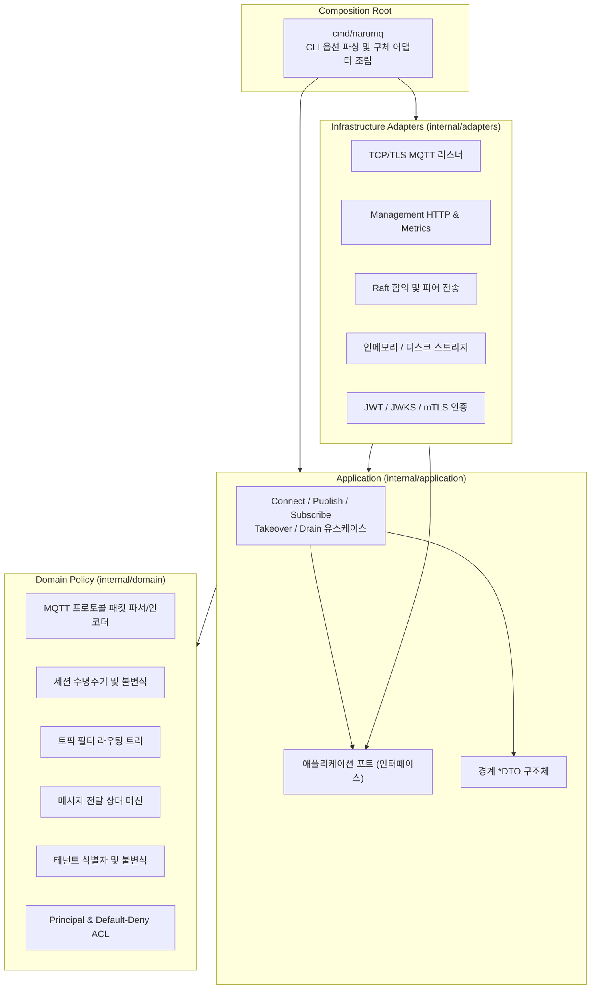

# NaruMQ

> **연결은 이동해도, 메시지는 남는다.**

NaruMQ는 Kubernetes 및 클라우드 환경에 최적화된 분산 MQTT 브로커 클러스터 프로젝트입니다.

---

## 1. 프로젝트 비전과 목표 (Target Goals)

장기 연결(Long-lived connection) 기반인 MQTT 프로토콜은 컨테이너 기반 클라우드 환경에서 Pod 재시작, 노드 교체, 롤링 업데이트 시 연결이 단절되거나 세션 및 메시지가 유실되기 쉽습니다. NaruMQ는 제품 요구사항 정의서([PRD](docs/requirements/PRD.md))를 바탕으로 다음 목표를 달성하고자 설계되었습니다.

- **고가용성 분산 합의:** Raft 합의 알고리즘을 기반으로 3개 가용 영역(AZ)에 노드를 분산 배치하여 1개 노드 장애 시에도 RPO 0(데이터 유실 없음)을 달성하는 것을 목표로 합니다.
- **단일 세션 소유권과 펜싱:** 분산 환경에서도 각 클라이언트 세션에 고유 에포크(Epoch)와 펜싱 토큰을 부여해 다중 쓰기 충돌을 방지합니다.
- **안전한 롤링 배포 (Graceful Drain):** Pod 교체 전 클라이언트 연결을 점진적으로 안전하게 이전하고 세션을 인계한 후 `SAFE_TO_STOP` 배리어를 통과하는 무중단 롤링 업데이트를 목표합니다.
- **강력한 격리와 보안:** 테넌트(Tenant)별 네임스페이스 격리, 클라이언트 식별자 독립성, 엄격한 Default-Deny ACL, TLS 1.2+ 및 JWT/mTLS 인증을 제공합니다.
- **클린 아키텍처와 결정적 검증:** 포트와 어댑터(Ports and Adapters) 패턴을 통해 비즈니스 정책을 외부 의존성과 철저히 격리하며, 90% 이상의 엄격한 테스트 커버리지, 퍼즈 테스트 및 뮤테이션 테스트를 거칩니다.

---

## 2. 현재 구현 상태 및 검증 경계 (Current Status & Boundaries)

NaruMQ는 현재 단계별 로드맵에 따라 개발이 진행 중인 오픈소스 프로젝트입니다. 현재 저장소의 구현 및 검증 범위는 다음과 같습니다.

| 영역 | 현재 구현 상태 | 검증 및 제공 경계 |
| --- | --- | --- |
| **개발 단계** | Phase 1 완료 / Phase 2 진행 중 | **Phase 1 단일 노드 보안 및 테넌트 격리** 슬라이스가 구현·검증되었으며, 분산 합의 및 복제 상태 머신은 **Phase 2 진행 중** 상태입니다. |
| **독립 실행 (Standalone CLI)** | 소스 빌드 실행 지원 | 루프백 개발 익명 모드 또는 TLS + strict 보안 설정(`-security-config`)으로 기동합니다. **주의:** 현재 standalone 리스너(`cmd/narumq/main.go`)는 인메모리 세션·큐·retained 저장소를 사용하며 기동 로그에 `"qos0_only": true`를 남깁니다. 영속적 세션 복구나 분산 QoS 1/2 내구성(Durable ACK)은 standalone 프로세스의 제공 범위가 아닙니다. |
| **클러스터 런타임** | 스파이크 및 시험 모드 | [클러스터 아키텍처](docs/architectures/cluster-architecture.md)는 현재 **Target / Draft** 상태입니다. 고정 voter Raft 피어 전송/리더 선출(`-raft-peer-config`), 동적 클러스터 런타임(`-cluster-config`), 오프라인 v3 백업 복원(`-cluster-restore`)이 개발용 절차로 제공됩니다. **주의:** 분산 세션 소유권 복제, 프로덕션 스토리지 내구성(EBS/WAL fsync, power-loss), 분산 QoS 1/2 durable ACK는 [잔여 과제(`docs/tasks.md`)](docs/tasks.md)로 열려 있는 미구현 과제입니다. Phase 2 진행 상태가 이러한 광범위한 고가용성 운영 기능의 완성을 뜻하지 않습니다. |
| **관리 API 및 관측성** | Phase 1 Read-only Query | `/api/v1/cluster`, `/api/v1/nodes`, `/api/v1/clients` 등 읽기 전용 쿼리 프로필, K8s 프로브(`/health/live`, `/health/ready`), Prometheus `/metrics` 엔드포인트를 제공합니다. |
| **배포 및 패키징** | 소스 빌드 기반 지원 | 공식 배포 패키지(rpm/deb/helm 등)나 프로덕션 HA 인스톨러는 제공하지 않습니다. 무중단 롤링 업데이트 스펙([Drain과 rolling update 스펙](docs/specs/drain-and-rolling-update.md))은 현재 **Draft** 상태입니다. |

---

## 3. 시작하기 (Quick Start)

상세한 빌드, 설정 및 검증 절차는 별도의 [How-to 가이드](#4-가이드-및-매뉴얼-how-to-guides)에서 관리하며, 여기서는 소스 빌드와 로컬 개발 실행의 기본 흐름만 요약합니다.

### 시스템 요구사항
- **Go 툴체인:** Go 1.26.5 이상 (`go version`으로 확인)
- **Git**

### 기본 실행 순서
1. **바이너리 빌드:**
   ```sh
   go build -o bin/narumq ./cmd/narumq
   ```
2. **로컬 개발 모드 실행 (루프백 익명 평문 MQTT):**
   CLI는 보안-기본 정책상 MQTT 리스너에 `-security-config` 또는 루프백 전용 개발 익명 플래그를 요구합니다.
   ```sh
   ./bin/narumq -tcp-listen 127.0.0.1:1883 -http-listen 127.0.0.1:8080 -allow-insecure-anonymous-mqtt
   ```
   *(기대 로그: `MQTT TCP listener started (development_only: true, qos0_only: true)`, `management HTTP listener started`)*
3. **헬스체크 확인:**
   ```sh
   curl -s http://127.0.0.1:8080/health/ready
   ```

> 💡 **안내:** 보안 모드(TLS 및 JWT/mTLS 설정 적용)나 클러스터 시험 실행 방법은 아래 [설치 및 실행 가이드](docs/how-to/installation-guide.md)를 참조하세요.

---

## 4. 가이드 및 매뉴얼 (How-to Guides)

작업별 상세 실행 절차, 전제 조건, 검증 기준 및 롤백 방법은 아래 가이드에서 다룹니다.

- 📖 **[NaruMQ 소스 빌드 및 실행 가이드](docs/how-to/installation-guide.md)**
  소스 컴파일, 로컬 개발 모드 기동, TLS 및 JWT/mTLS 보안 설정 기동, 헬스 프로브와 메트릭 확인 절차를 안내합니다.
- 💻 **[로컬 개발 환경 구성 및 검증 가이드](docs/how-to/development-guide.md)**
  개발 환경 준비, 클린 아키텍처 계층 규칙, 코딩 컨벤션, 단위/퍼즈 테스트 실행 및 종합 검증 도구(`tools/verify`) 사용법을 안내합니다.
- ⚙️ **[고정 voter Raft peer-only 프로세스 실행](docs/how-to/fixed-voter-raft-peer-only.md)**
  MQTT 리스너 없이 3개의 고정 voter Raft 피어 프로세스를 로컬에서 띄워 피어 전송과 리더 선출을 검증하는 개발용 절차입니다.
- 🔄 **[동적 클러스터 멤버십 변경](docs/how-to/dynamic-cluster-membership.md)**
  3노드 클러스터에 새 노드를 Learner로 투입, 동기화 후 Voter로 승격하거나 안전하게 제거하는 운영 절차입니다.
- 💾 **[Cluster backup 복원](docs/how-to/cluster-backup-restore.md)**
  온라인 상태에서 v3 백업 아카이브를 추출하고 오프라인 노드에 시딩하여 복원하는 재해 복구 절차입니다.

---

## 5. 개발 및 검증 도구 (Verification Suite)

NaruMQ는 높은 안정성을 요구하는 분산 인프라이므로 엄격한 테스트 기준을 코드로 강제합니다.

```sh
# 전체 단위 테스트 실행
go test ./... -count=1

# 데이터 레이스(Race Detector) 검사
go test -race ./... -count=1

# CI와 동일한 13단계 로컬 종합 검증 (포맷, vet, 테스트, 퍼즈, 추적성, 아키텍처, 커버리지 90%, 뮤테이션 80%)
go run ./tools/verify local
```

상세한 검증 파이프라인 구조와 빈발 오류 해결 방법은 [개발 가이드](docs/how-to/development-guide.md)를 참조하세요.

---

## 6. 아키텍처 및 계층 원칙

NaruMQ의 소스 코드는 **클린 아키텍처(Clean Architecture / Ports and Adapters)**를 따르며, 의존성은 항상 바깥쪽에서 안쪽(도메인 정책)으로만 향합니다.



- `internal/domain`: 순수 비즈니스 로직. 네트워크, 파일시스템, 외부 프레임워크를 import하지 않습니다.
- `internal/application`: 유스케이스 조율. 인터페이스(포트)를 직접 소유하며, 구체 어댑터를 import하지 않습니다.
- `internal/adapters`: 외부 인프라 I/O를 수행하며 애플리케이션 포트를 구현합니다.
- `cmd/narumq`: 유일한 구체 구현체 조립 및 의존성 주입 공간입니다.

---

## 7. 문서 체계

저장소의 모든 설계 및 규범 문서는 `docs/` 디렉터리 아래에서 **SSOT(Single Source of Truth, 단일 진실 공급원)** 원칙에 따라 관리됩니다.

- [문서 전체 인덱스](docs/README.md)
- [저장소 작업 지침](AGENTS.md)
- [문서 작성 규칙](docs/AGENTS.md)

### 디렉터리 구성

| 디렉터리 | 역할 및 답하는 질문 | 시작 문서 |
| --- | --- | --- |
| `docs/requirements/` | 무엇이 필요하며 왜 필요한가? | [PRD](docs/requirements/PRD.md) |
| `docs/specs/` | 시스템 밖에서 관찰할 수 있는 동작은 무엇인가? | [시스템 스펙](docs/specs/README.md) |
| `docs/contracts/` | 경계에서 무엇을 어떤 형식으로 주고받는가? | [Management API v1](docs/contracts/management-api-v1.md) |
| `docs/architectures/` | 코드는 어디에 있고 구성요소·모듈은 어떻게 연결되는가? | [Project structure](docs/architectures/project-structure.md), [Broker core](docs/architectures/broker-core.md) |
| `docs/decisions/` | 왜 이 기술·구조를 선택했는가? (ADR) | [ADR 카탈로그](docs/decisions/README.md) |
| `docs/explainers/` | 핵심 기술과 원리는 어떻게 작동하는가? | [기술 해설 모음](docs/explainers/README.md) |
| `docs/conventions/` | 소스와 저장소 산출물을 어떤 규칙으로 작성하는가? | [Go 코딩 컨벤션](docs/conventions/go-coding-conventions.md) |
| `docs/how-to/` | 특정 작업을 안전하게 어떻게 수행하는가? | [How-to 가이드 모음](docs/how-to/README.md) |

### 처음 읽는 순서

1. [PRD](docs/requirements/PRD.md)에서 NaruMQ가 해결하는 문제와 핵심 가치를 파악합니다.
2. [Project structure의 코드 지도](docs/architectures/project-structure.md)에서 패키지 위치와 실행 진입점을 확인합니다.
3. [시스템 스펙](docs/specs/README.md)에서 프로토콜, 세션, 클러스터, 보안의 관찰 가능한 동작 기준을 확인합니다.
4. [설치 가이드](docs/how-to/installation-guide.md)와 [개발 가이드](docs/how-to/development-guide.md)를 따라 로컬 환경을 세팅하고 코드를 실행해 봅니다.
5. 설계 배경과 심층 기술이 궁금하다면 [기술 결정 기록(ADR)](docs/decisions/README.md) 및 [기술 해설](docs/explainers/README.md)을 읽습니다.
