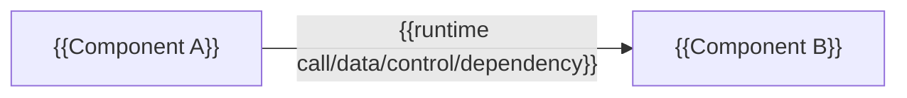

# {{Architecture view 이름}}

{{이 view가 답하는 구조 질문과 핵심 결론을 한 문단으로 쓴다.}}

| 항목 | 값 |
| --- | --- |
| 관점 상태 | Target |
| 문서 상태 | Draft |
| 구현 증거 | 없음 |
| 범위 | {{System/Component/Deployment/Security 등}} |
| 관련 요구사항 | {{ID와 링크}} |
| 관련 스펙·Contract | {{링크}} |
| 관련 ADR | {{링크}} |
| 최종 확인일 | YYYY-MM-DD |

## 1. View와 범위

{{포함하는 구조, 생략한 세부와 diagram 화살표의 의미를 쓴다.}}

## 2. Component와 책임

| Component | 주된 책임 | 소유하지 않는 책임 | 의존 대상 |
| --- | --- | --- | --- |
| {{이름}} | {{책임}} | {{비책임}} | {{대상}} |

## 3. 핵심 흐름

1. {{입력과 시작점}}
2. {{경계를 지나는 흐름}}
3. {{상태와 결과}}

## 4. 경계와 제약

- Trust boundary: {{identity와 enforcement point}}
- Dependency rule: {{허용 방향}}
- Physical mapping: {{논리 component와 배포 자원 대응}}

## 5. Current와의 차이 또는 전환 조건

{{Target/Transitional view일 때 차이, migration과 제거 조건을 쓴다.}}

## 6. 미결정 사항과 위험

| 항목 | 영향 | 확정 근거·후속 ADR |
| --- | --- | --- |
| {{항목}} | {{영향}} | {{링크}} |

