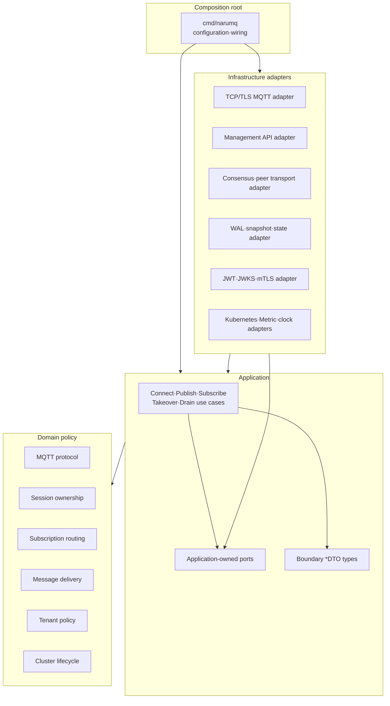

# Broker core architecture

Broker core는 MQTT, session, routing, delivery, tenancy와 cluster lifecycle 정책을 중심에 둔다. Application use case가 필요한 port를 소유하고 infrastructure adapter가 이를 구현한다. Source dependency는 바깥쪽 adapter에서 안쪽 policy로만 향한다.

| 항목 | 값 |
| --- | --- |
| 관점 상태 | Current Phase 0 slice / Target |
| 문서 상태 | Draft |
| 구현 증거 | `domain/mqtt`, `domain/routing`, `application/subscribe`, `application/publish`, `adapters/memory/deliveryqueue`의 unit test와 package import graph |
| 범위 | 단일 broker process의 component와 source dependency |
| 관련 요구사항 | [PRD](../requirements/PRD.md) NFR-11~NFR-15, TEST-01~TEST-16 |
| 관련 결정 | [ADR-0001](../decisions/ADR-0001-core-implementation-language.md) Accepted |
| 관련 Architecture | [Project structure](project-structure.md) |
| 관련 Convention | [Go coding conventions](../conventions/go-coding-conventions.md) |
| 관련 해설 | [Broker core의 계층 경계](../explainers/broker-core-boundaries.md), [Go 동시성과 backpressure](../explainers/go-concurrency-and-backpressure.md) |
| 최종 확인일 | 2026-09-19 |

## Source dependency view

아래 화살표는 runtime call이 아니라 허용된 source dependency 방향이다.



Domain component 사이의 세부 dependency는 구현 단계의 package graph와 architecture test에서 확정한다. 이 view는 순환 dependency를 허용한다는 뜻이 아니다.

## Component 책임

| Component | 소유하는 정책 | 의존해서는 안 되는 대상 |
| --- | --- | --- |
| MQTT protocol | Packet validation, QoS handshake와 protocol reason | Socket, TLS library, HTTP, storage 자료형 |
| Session ownership | Session key, owner epoch와 fencing invariant | Pod/IP, wall clock lease만으로 만든 권한 |
| Subscription routing | Canonical topic/filter, wildcard match와 route selection 정책 | 외부 tenant prefix encoding, network client |
| Message delivery | Inflight, offline delivery, expiry와 ACK 이후 상태 | 특정 WAL·database API |
| Tenant policy | Tenant namespace, quota와 ACL 입력 의미 | JWKS response, certificate library object |
| Cluster lifecycle | Member state, readiness와 drain barrier의 domain rule | Kubernetes Pod API |
| Application use case | Domain policy orchestration와 transaction·commit 경계 | Concrete adapter와 framework object |
| Adapter | Wire, storage, platform 자료형 변환과 I/O | 새로운 domain rule 결정 |
| Composition root | Concrete implementation 선택과 lifecycle wiring | Business invariant 구현 |

## Current Phase 0 gate 3 slice

현재 source는 다음 inward dependency를 실제로 검증한다.

```text
application/subscribe ───────┐
application/publish ─────────┼──> domain/routing ──> domain/mqtt
                             │
adapters/memory/deliveryqueue ─┘
        └──> application/publish (DeliveryQueue port)
```

- `domain/mqtt`: subscription packet의 wire 구조, fixed flag, property-free profile,
  option·reason allowlist와 입력 ownership을 결정한다.
- `domain/routing`: non-shared `+`·`#` matching, `$` topic boundary, session별
  overlap collapse와 effective QoS를 결정한다. TCP, queue, tenant 구현을 모른다.
- `application/subscribe`: ordered ACK reason과 routing mutation을 조정한다.
  shared subscription과 MQTT 5 subscription option runtime은 이 slice에서 deferred다.
- `application/publish`: routing 결과를 `DeliveryDTO`로 변환하고 queue의 full·unavailable
  결과를 session별로 보고한다. concrete adapter를 import하지 않는다.
- `adapters/memory/deliveryqueue`: application port의 fixed per-session item capacity,
  FIFO와 payload ownership을 구현한다. backpressure의 최종 disconnect 정책은 소유하지 않는다.

이 slice는 TCP/TLS, retained storage, ACL·tenant, persistence, replication과
connection lifecycle을 구현했다는 뜻이 아니다.

이번 gate 3의 publish·subscribe·wildcard routing·backpressure 검증은
[ADR-0001 §7 검증 게이트](../decisions/ADR-0001-core-implementation-language.md#7-검증-게이트)의
3번 항목에 해당한다. Durable cluster와 rolling drain을 이미 구현했다는 의미는 아니다.

## Application-owned port

Port는 구현 adapter 옆이 아니라 이를 사용하는 application 쪽이 소유한다.

| Port 범주 | Application이 요구하는 능력 | Adapter 후보 |
| --- | --- | --- |
| Session·state store | Epoch 조건부 read·write, snapshot과 recovery | Durable state adapter |
| Replication | Command proposal, commit receipt와 membership 관찰 | `etcd/raft` adapter 후보 |
| Peer transport | 인증된 node message 송수신과 backpressure | Cluster RPC adapter |
| Authentication | Credential을 논리 principal과 tenant binding으로 검증 | JWT/JWKS, mTLS, password adapter |
| Metric·audit | Cardinality가 제한된 관측값과 비밀 없는 event 기록 | OpenMetrics·audit adapter |
| Node discovery·platform | Member 후보와 workload lifecycle 관찰 | Kubernetes adapter |
| Clock·random | Expiry와 jitter를 결정적으로 제공 | Runtime·test adapter |

Capability별 port package, concrete adapter와 내부 client의 목표 대응은 [주요 port capability와 adapter map](project-structure.md#주요-port-capability와-adapter-map)을 따른다.

Port signature와 정확한 자료형은 source 및 machine-readable contract가 생긴 뒤 검증한다. 이 문서는 interface code를 미리 확정하지 않는다.

## 경계를 넘는 값

- MQTT adapter는 byte buffer를 검증된 packet value로 변환한다.
- Authentication adapter는 provider 응답을 `tenantId`, `subject`, `roles` 같은 논리 principal로 변환한다.
- Storage adapter는 engine record를 domain entity로 직접 노출하지 않는다.
- Management API adapter는 HTTP object를 application command·query DTO로 변환한다.
- Kubernetes adapter는 Pod·Endpoint object를 cluster `nodeId`나 session owner로 그대로 사용하지 않는다.

직접 작성한 application 경계 자료형은 [Go coding conventions](../conventions/go-coding-conventions.md#34-dto-이름)에 따라 `DTO` Postfix를 사용한다. Domain entity와 generated wire type은 이 이름 규칙의 대상이 아니다.

성능 때문에 zero-copy가 필요해도 buffer 수명과 소유권을 port contract에 명시해야 한다. Framework object를 안쪽으로 전달하는 방식으로 최적화하지 않는다.

## 목표 package 구조

Directory와 package의 기준 tree는 [Project structure](project-structure.md)에서 관리한다. 이 문서는 component 책임과 source dependency만 기준으로 삼는다. Framework 이름이 최상위 제품 구조를 결정하지 않게 한다.

## Architecture verification

- Domain이 application, adapter와 외부 framework package를 import하면 실패한다.
- Application이 concrete adapter를 import하면 실패한다.
- Port가 adapter package에 선언되면 실패한다.
- Component dependency graph에 cycle이 생기면 실패한다.
- Boundary DTO에 HTTP, Kubernetes, Raft 또는 storage engine type이 포함되면 실패한다.
- Domain unit test가 실제 network, storage, clock 또는 random에 의존하면 실패한다.

정확한 CI 도구와 package allowlist는 source tree가 생긴 뒤 정한다. 검증 원칙은 [Performance와 verification 스펙](../specs/performance-and-verification.md)의 architecture verification을 따른다.

## 미결정 사항

- Domain component 사이의 최종 package dependency graph
- Storage engine과 persisted record encoding
- Cluster RPC transport와 framing
- Route index partition·replication 방식
- Management API와 Dashboard framework

이 선택은 architecture view가 아니라 후속 ADR의 대상이다.
