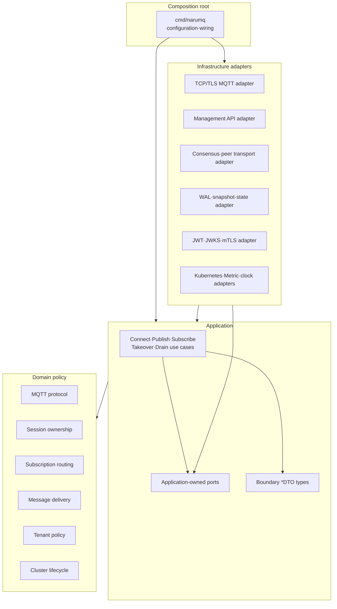

# Broker core architecture

Broker core는 MQTT, session, routing, delivery, tenancy와 cluster lifecycle 정책을 중심에 둔다. Application use case가 필요한 port를 소유하고 infrastructure adapter가 이를 구현한다. Source dependency는 바깥쪽 adapter에서 안쪽 policy로만 향한다.

| 항목 | 값 |
| --- | --- |
| 관점 상태 | Current Phase 0 gate 3 / single-node ingress vertical slice |
| 문서 상태 | Draft |
| 구현 증거 | `cmd/narumq`, `internal/domain/mqtt`, `internal/domain/routing`, `internal/domain/session`, `internal/application/connect`, `internal/application/publish`, `internal/application/subscribe`, `internal/application/ports/deliveryqueue`, `internal/adapters/tcp`, `internal/adapters/memory/deliveryqueue`, `internal/adapters/memory/sessionstore`, `internal/adapters/clock`와 각 package/integration test |
| 범위 | 단일 broker process의 component, loopback TCP runtime과 source dependency |
| 관련 요구사항 | [PRD](../requirements/PRD.md) NFR-11~NFR-15, TEST-01~TEST-16 |
| 관련 결정 | [ADR-0001](../decisions/ADR-0001-core-implementation-language.md) Accepted |
| 관련 Architecture | [Project structure](project-structure.md) |
| 관련 Convention | [Go coding conventions](../conventions/go-coding-conventions.md) |
| 관련 해설 | [Broker core의 계층 경계](../explainers/broker-core-boundaries.md), [Go 동시성과 backpressure](../explainers/go-concurrency-and-backpressure.md) |
| 최종 확인일 | 2026-09-19 |

## Source dependency view

아래 화살표는 runtime call이 아니라 허용된 source dependency 방향이다.



Domain component 사이의 세부 dependency는 구현 단계의 package graph와 architecture test에서 확정한다. 이 view는 순환 dependency를 허용한다는 뜻이 아니다.

## Component 책임

| Component | 소유하는 정책 | 의존해서는 안 되는 대상 |
| --- | --- | --- |
| MQTT protocol | Packet validation, QoS handshake와 protocol reason | Socket, TLS library, HTTP, storage 자료형 |
| Session ownership | Session key, owner epoch와 fencing invariant | Pod/IP, wall clock lease만으로 만든 권한 |
| Subscription routing | Canonical topic/filter, wildcard match와 route selection 정책 | 외부 tenant prefix encoding, network client |
| Message delivery | Inflight, offline delivery, expiry와 ACK 이후 상태 | 특정 WAL·database API |
| Tenant policy | Tenant namespace, quota와 ACL 입력 의미 | JWKS response, certificate library object |
| Cluster lifecycle | Member state, readiness와 drain barrier의 domain rule | Kubernetes Pod API |
| Application use case | Domain policy orchestration와 transaction·commit 경계 | Concrete adapter와 framework object |
| Adapter | Wire, storage, platform 자료형 변환과 I/O | 새로운 domain rule 결정 |
| Composition root | Concrete implementation 선택과 lifecycle wiring | Business invariant 구현 |

## Current Phase 0 gate 3 + single-node ingress slice

현재 source는 다음 inward dependency와 실제 loopback runtime을 검증한다.

```text
cmd/narumq
    └── adapters/tcp ──> application/connect
                              ├──> domain/session
                              ├──> ports/deliveryqueue <── adapters/memory/deliveryqueue
                              ├──> ports/retained <────── adapters/memory/retained
                              └──> domain/routing <── application/subscribe/publish
                                      └──> domain/mqtt
```

- `domain/mqtt`: CONNECT/CONNACK, QoS 0·1·2 PUBLISH, acknowledgement,
  SUBSCRIBE 계열, PINGREQ/PINGRESP/DISCONNECT의 wire 구조와 ownership을 결정한다.
- `domain/session`: Clean Start, Session Expiry, connected duplicate와 disconnect
  retention invariant를 value lifecycle로 결정한다.
- `domain/routing`: non-shared `+`·`#` matching, `$` topic boundary, overlap collapse,
  No Local·Retain As Published와 `RemoveSession` stale-subscription cleanup을 결정한다.
  TCP와 queue·retained storage를 모른다.
- `application/connect`: lifecycle repository, shared delivery queue, routing cleanup과
  CONNACK/negative rejection을 직렬화한다.
- `application/subscribe`와 `application/publish`: ordered ACK, retained replay의
  queue-before-route commit, retained replace/delete, Message Expiry deadline 계산과
  QoS 0·1·2 route delivery를 조정한다. `ports/deliveryqueue`, `ports/retained`와
  `ports/clock`은 여러 use case가 공유하는 capability다.
- `adapters/tcp`: bounded input buffer, CONNECT timeout, negotiated-version dispatch,
  single writer, SUBACK-before-replay ordering, control queue/delivery wake,
  keepalive와 connection cleanup을 소유한다.
- `adapters/memory/deliveryqueue`, `adapters/memory/retained`,
  `adapters/memory/sessionstore`, `adapters/clock`은 각각 bounded queue와
  retained state의 lazy expiry purge, lifecycle map과 wall-clock 구현이다.

ingress 성공 경계는 QoS 0·1·2 PUBLISH handshake이며 `Retain=true`도 exact-topic
replace/delete와 established subscriber live delivery를 지원한다. Message Expiry는
ingress 수신 시각에서 absolute deadline을 만들고, queue·retained replay·outbound
serialization 전체에서 `now >= deadline`을 적용한다. MQTT 5 outbound에는 올림한
남은 초를 쓰고 MQTT 3.1.1에는 property를 생략한다. TLS/auth, tenant/ACL, takeover,
durable offline queue와 replication은 지원하지 않는다.

## Application-owned port

Port는 구현 adapter 옆이 아니라 이를 사용하는 application 쪽이 소유한다.

| Port 범주 | Application이 요구하는 능력 | Adapter 후보 |
| --- | --- | --- |
| Session·state store | Epoch 조건부 read·write, snapshot과 recovery | Durable state adapter |
| Session lifecycle | client ID별 lifecycle load/save/delete와 expiry 복구 | `application/connect.SessionRepository` ← `adapters/memory/sessionstore.MemorySessionRepository` |
| Delivery queue | session 등록·제거, bounded enqueue, FIFO drain와 atomic batch enqueue, expiry purge | `application/ports/deliveryqueue.Queue` ← `adapters/memory/deliveryqueue.Queue` |
| Retained message | exact-topic replace/delete, deterministic expiry-aware list와 count·byte bounded ownership | `application/ports/retained.Repository` ← `adapters/memory/retained.Repository` |
| Clock | deterministic expiry 입력 | `application/ports/clock.Clock` ← `adapters/clock.SystemClock` |
| Replication | Command proposal, commit receipt와 membership 관찰 | `etcd/raft` adapter 후보 |
| Peer transport | 인증된 node message 송수신과 backpressure | Cluster RPC adapter |
| Authentication | Credential을 논리 principal과 tenant binding으로 검증 | JWT/JWKS, mTLS, password adapter |
| Metric·audit | Cardinality가 제한된 관측값과 비밀 없는 event 기록 | OpenMetrics·audit adapter |
| Node discovery·platform | Member 후보와 workload lifecycle 관찰 | Kubernetes adapter |
| Clock·random | Expiry와 jitter를 결정적으로 제공 | Runtime·test adapter |

Capability별 port package, concrete adapter와 내부 client의 목표 대응은 [주요 port capability와 adapter map](project-structure.md#주요-port-capability와-adapter-map)을 따른다.

현재 source에 구현된 `connect.SessionRepository`, `ports/clock.Clock`,
`ports/deliveryqueue.Queue`와 `ports/retained.Repository`의 method signature는 해당
package가 소유한다. Queue와 retained port는 time-sensitive operation에 `now`를
받고 DTO는 absolute `ExpiresAt`을 운반한다. durable state·replication·authentication
같은 미구현 capability는 target interface로만 기록한다.

## 경계를 넘는 값

- MQTT adapter는 byte buffer를 검증된 packet value로 변환한다.
- Authentication adapter는 provider 응답을 `tenantId`, `subject`, `roles` 같은 논리 principal로 변환한다.
- Storage adapter는 engine record를 domain entity로 직접 노출하지 않는다.
- Management API adapter는 HTTP object를 application command·query DTO로 변환한다.
- Kubernetes adapter는 Pod·Endpoint object를 cluster `nodeId`나 session owner로 그대로 사용하지 않는다.

직접 작성한 application 경계 자료형은 [Go coding conventions](../conventions/go-coding-conventions.md#34-dto-이름)에 따라 `DTO` Postfix를 사용한다. Domain entity와 generated wire type은 이 이름 규칙의 대상이 아니다.

성능 때문에 zero-copy가 필요해도 buffer 수명과 소유권을 port contract에 명시해야 한다. Framework object를 안쪽으로 전달하는 방식으로 최적화하지 않는다.

## 목표 package 구조

Directory와 package의 기준 tree는 [Project structure](project-structure.md)에서 관리한다. 이 문서는 component 책임과 source dependency만 기준으로 삼는다. Framework 이름이 최상위 제품 구조를 결정하지 않게 한다.

## Architecture verification

- Domain이 application, adapter와 외부 framework package를 import하면 실패한다.
- Application이 concrete adapter를 import하면 실패한다.
- Port가 adapter package에 선언되면 실패한다.
- Component dependency graph에 cycle이 생기면 실패한다.
- Boundary DTO에 HTTP, Kubernetes, Raft 또는 storage engine type이 포함되면 실패한다.
- Domain unit test가 실제 network, storage, clock 또는 random에 의존하면 실패한다.

정확한 CI 도구와 package allowlist는 source tree가 생긴 뒤 정한다. 검증 원칙은 [Performance와 verification 스펙](../specs/performance-and-verification.md)의 architecture verification을 따른다.

## 미결정 사항

- Domain component 사이의 최종 package dependency graph
- Storage engine과 persisted record encoding
- Cluster RPC transport와 framing
- Route index partition·replication 방식
- Management API와 Dashboard framework

이 선택은 architecture view가 아니라 후속 ADR의 대상이다.
