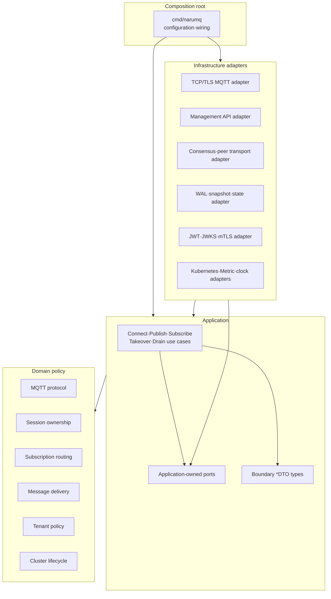

# Broker core architecture

Broker core는 MQTT, session, routing, delivery, tenancy와 cluster lifecycle 정책을 중심에 둔다. Application use case가 필요한 port를 소유하고 infrastructure adapter가 이를 구현한다. Source dependency는 바깥쪽 adapter에서 안쪽 policy로만 향한다.

| 항목 | 값 |
| --- | --- |
| 관점 상태 | Active Phase 1 security and tenant isolation architecture |
| 문서 상태 | Active |
| 구현 증거 | Phase 0 단일 노드 ingress, TLS/mTLS transport와 합의 스파이크 증거가 기존 패키지에 보존되어 있다. Phase 1 tenancy·security·authentication 패키지와 JWT/mTLS 데이터 플레인 인증·인가 파이프라인은 unit/integration test, 실제 TLS socket test와 command composition test를 통해 현재 source 증거가 확보되었다. |
| 범위 | 단일 broker process의 component, loopback TCP runtime과 source dependency |
| 관련 요구사항 | [PRD](../requirements/PRD.md) NFR-11~NFR-15, TEST-01~TEST-16 |
| 관련 결정 | [ADR-0001](../decisions/ADR-0001-core-implementation-language.md) Accepted |
| 관련 Architecture | [Project structure](project-structure.md) |
| 관련 Convention | [Go coding conventions](../conventions/go-coding-conventions.md) |
| 관련 해설 | [Broker core의 계층 경계](../explainers/broker-core-boundaries.md), [Go 동시성과 backpressure](../explainers/go-concurrency-and-backpressure.md) |
| 최종 확인일 | 2026-10-05 |

## Source dependency view

아래 화살표는 runtime call이 아니라 허용된 source dependency 방향이다.



Domain component 사이의 세부 dependency는 구현 단계의 package graph와 architecture test에서 확정한다. 이 view는 순환 dependency를 허용한다는 뜻이 아니다.

## Component 책임

| Component | 소유하는 정책 | 의존해서는 안 되는 대상 |
| --- | --- | --- |
| MQTT protocol | Packet validation, QoS handshake와 protocol reason | Socket, TLS library, HTTP, storage 자료형 |
| Session ownership | `tenancy.SessionKey`, owner epoch와 fencing invariant | Pod/IP, wall clock lease만으로 만든 권한 |
| Subscription routing | tenant-aware `Topic`/`TopicFilter`, wildcard match와 route selection 정책 | 외부 tenant prefix encoding, network client |
| Message delivery | queued·in-flight process-local state, expiry와 ACK 이후 상태 | 특정 WAL·database API |
| Tenant policy | typed namespace value와 MQTT filter relation | JWKS response, certificate library object |
| Security policy | immutable `Principal`, role/action ACL과 default-deny precedence | HTTP, JWT/JWKS, configuration parser |
| Cluster lifecycle | Member state, readiness와 drain barrier의 domain rule | Kubernetes Pod API |
| Application use case | authentication→binding→authorization→mutation 순서와 transaction 경계 | Concrete adapter와 framework object |
| Adapter | Wire, storage, authentication과 platform 자료형 변환·I/O | 새로운 business invariant 결정 |
| Composition root | Strict configuration, concrete implementation 선택과 lifecycle wiring. MQTT listener 보안 mode를 socket 생성 전에 결정하고 secure mode의 authentication/policy를 반드시 조립한다. | MQTT business invariant 구현 |

`cmd/narumq`는 MQTT listener를 열기 전에 하나의 보안 mode만 선택한다. Secure mode는
`-security-config`를 strict decode하고 configured JWT/JWKS provider와 선택적인 mTLS
certificate provider를 생성한다. 두 provider와 ACL `Policy`는 application `connect`
use case에 주입되고, TCP adapter에는 verified certificate를
`ClientCertificateDTO`로 변환하는 extractor만 주입된다. Insecure mode는
`-allow-insecure-anonymous-mqtt`와 literal loopback `-tcp-listen`의 명시적
development·benchmark 예외에서만 선택하며, 이때 provider와 policy wiring을 생략한다.
이 flag나 allow-all `Policy`를 domain/application 계약으로 전파하지 않는다.

## Implemented Phase 1 security·tenant-aware single-node ingress slice

typed tenant namespace, JWT/JWKS 또는 verified client certificate mTLS authentication,
default-deny ACL과 loopback MQTT runtime이 현재 source와 test에 연결되어 있다.
TLS adapter는 trust anchor와 client certificate validity/EKU를 TLS handshake에서
검증한 뒤 application authentication port가 소비하는 certificate DTO만 전달한다.

```text
cmd/narumq
    ├── adapters/authentication ──> application/ports/authentication
    ├── adapters/tls ─────────────> application/ports/authentication
    └── adapters/tcp ─────────────> application/connect
                              ├──> application/ports/authentication
                              ├──> domain/security
                              ├──> domain/session
                              ├──> domain/tenancy
                              ├──> ports/deliveryqueue <── adapters/memory/deliveryqueue
                              ├──> ports/retained <────── adapters/memory/retained
                              └──> domain/routing <── application/subscribe/publish
                                      └──> domain/mqtt
```
- `domain/tenancy`: private comparable `TenantID`, `SessionKey`, `Topic`, `TopicFilter`와
  기존 MQTT wildcard/$ matcher, filter containment/intersection을 소유한다.
- `domain/security`: verified binding을 담은 immutable `Principal`과 role별
  deny > allow > default-deny ACL policy를 소유한다. JWT/JWKS, certificate library
  object나 configuration을 모른다.
- `domain/session`: SessionKey와 principal snapshot을 lifecycle과 Will snapshot에 함께
  저장하고 Claim/Expire 결과로 전달한다.
- `application/connect`: certificate 또는 Username·Password authentication, exact
  Client ID binding, Will ACL을 session ownership보다 먼저 평가한다. mTLS credential과
  MQTT credential을 함께 제출하면 거절하며, 인증·binding·Will 검증 전에는 timer·
  repository·route·queue를 변경하지 않는다.
- `adapters/authentication`: allowlisted JWT algorithm, required `kid`, verified JWKS,
  claim validation과 static identity binding, 그리고 exact certificate selector
  `(commonName|dnsSan|emailSan)` mapping을 application Result로 변환한다. Certificate
  `NotAfter` 경계와 unmapped/ambiguous selector를 fail-closed로 처리한다.
  JWT cache refresh는 coalesced이고 TTL 이후 fetch 실패에 fail-closed한다.
- `adapters/tls`: TLS 1.2+ listener와 trust anchor를 구성하고 verified chain의 leaf에서
  `ClientCertificateDTO`를 만들어 application boundary로 전달한다. Raw certificate는
  TCP/application/domain 경계로 넘기지 않는다.
- `adapters/tcp`: accepted SessionKey와 principal snapshot을 connection에 보관하고 모든
  data-plane dispatch에 함께 전달한다. Dynamic cluster는 CONNECT를 raw MQTT Client ID로
  추적하고 tenant별 committed owner/epoch fence를 기록한다. bind 시 반환 ownership이 fence와
  다르면 거절하며, takeover apply는 이미 bind된 이전 연결을 닫는다. Cleanup은
  `DisconnectIfOwnershipEpoch`에서 연결이 획득한 epoch와 local map을 비교해 다르면 local
  lifecycle·timer·delivery·Will 변경을 건너뛴다. 원격 takeover apply는 이전 node의 local map을
  바꾸지 않으므로 takeover cleanup은 `DisconnectTakeover`로 local lifecycle을 정리하고 Will을
  억제하며 집계하지 않는다. 후계의 표준 판단은 [ADR-0028](../decisions/ADR-0028-planned-handoff-will-and-reason-metric.md)을 따른다. 이전 epoch의 DETACH·DISCARD 등 replicated session mutation은 committed
  owner/epoch 검증에서 거절된다. Username은 identity로 사용하지 않으며 log에 남기지 않는다.
- `adapters/memory/deliveryqueue`, `adapters/memory/retained`, `adapters/memory/sessionstore`는
  각각 SessionKey, `(tenant, topic)`, SessionKey를 key로 사용한다.

성공 경계는 JWT 또는 mTLS로 인증된 CONNECT 뒤 QoS 0·1·2 PUBLISH handshake,
ordered SUBACK/UNSUBACK와 Will 등록·지연 publication이다. ACL 거절은 mutation 전에
반환하며 MQTT 5 PUBLISH는 QoS에 따라 DISCONNECT/PUBACK/PUBREC `0x87`,
MQTT 3.1.1은 연결 종료를 사용한다. Tenant 연결·session·subscription·traffic 한도와
거절 metric은 아래 내부 설계에 따라 지원한다. Blocklist, audit sink과 기존 연결
token reauthentication은 이 slice에서 지원하지 않는다. 관리 API의 범위는 별도 스펙을 따른다.

## Tenant 연결·traffic 한도 내부 설계

`cmd/narumq/security_config.go`는 생략과 명시한 0을 구분해 tenant override를 해석한다.
`tenant_limits.go`의 `newTenantLimitService`가 `clock.SystemClock`, profile과 reporter를
조립한다. `main.go`와 `cluster_runtime.go`는 같은 service를 CONNECT, SUBSCRIBE와
TCP `Config.TenantLimits`에 주입한다. 외부 동작과 집계 범위는
[Tenant §5.2](../specs/tenancy-and-security.md#52-연결-상태와-traffic-한도),
선택 근거는 [ADR-0034](../decisions/ADR-0034-node-local-tenant-connection-and-traffic-limits.md)를 따른다.

| 파일·심볼 | 소유하는 상태와 처리 |
| --- | --- |
| `internal/application/tenantlimit/tenantlimit.go` `Service` | 변경되지 않는 resolved profile과 tenant별 traffic bucket을 소유한다. Bucket의 message·byte token과 마지막 보충 시각은 mutex로 보호한다. Payload 제한을 먼저 검사하고 rate 대기 시간 또는 거절 차원을 반환한다. Reporter는 mutex를 푼 뒤 호출한다. |
| `internal/adapters/memory/sessionstore/store.go` `TenantSessionCounts` | `sessionsKey` 변경과 같은 mutex 안에서 session·connected count를 갱신한다. Detached lifecycle도 session 수에 포함한다. 마지막 lifecycle 삭제 때 tenant count entry를 지운다. |
| `internal/domain/routing/routing.go` `TenantSubscriptionCount` | Read lock 안에서 tenant에 bind된 shared·non-shared subscription을 센다. 별도 index는 두지 않는다. Cluster는 현재 committed projection을 읽는다. |
| `internal/application/connect/connect.go` `ConnectContext` | Use case mutex 안에서 `session.Open` 성공 뒤 count를 검사한다. 거절하면 ownership·repository·route·queue·timer를 바꾸지 않는다. 허용한 뒤 기존 standalone timer를 취소한다. |
| `internal/application/subscribe/subscribe.go` `SubscribeCommitted` / `UnsubscribeCommitted` / `subscribeOne` | `tenantSubscriptionMu`는 subscription 한도가 설정된 인증 요청의 판정·commit·retained replay·route 변경을 직렬화한다. Replace와 remove도 같은 mutex를 사용하므로 freed slot이 오래된 replacement에 다시 점유되지 않는다. Filter별 ACL 뒤 새 filter만 한도를 검사하고, 거절한 filter는 commit·replay하지 않는다. 한도가 없으면 이 mutex를 사용하지 않는다. Remote projection apply는 이 mutex 밖에서 진행하므로 다른 node의 경쟁은 근사다. |
| `internal/adapters/tcp/server.go` `readLoop` / `server_tenant_limits.go` `admitTenantPublish` | Receive Maximum의 새 Packet ID 예약 여부로 과금을 결정한다. Inline dispatch와 cluster phase lane에 넘기기 전에 payload·rate를 검사한다. 대기는 timer가 수행하며 connection의 `stop`이 대기를 끝낸다. 다음 packet은 대기 뒤 읽는다. |
| `cmd/narumq/tenant_limits.go` `tenantLimitRejectionReporter` / `internal/adapters/metrics/registry.go` | Application의 `Reporter` port를 구현한다. 저장 quota와 tenant label 집합을 공유해 counter를 기록하고 tenant·dimension별 Warn을 제한한다. |

예를 들어 `maxPayloadBytes=16`인 인증된 tenant가 17-byte QoS 1 PUBLISH를 보내면
TCP reader가 dispatch 전에 이를 거절한다. Payload는 route나 저장 상태에 들어가지 않는다.
Writer가 PUBACK `0x97`을 쓴 뒤 기존 `releaseInboundQuota`가 Receive Maximum 예약을 해제한다.
Service는 프로세스 수명 동안 bucket을 보관하며, 종료 시 별도 goroutine을 정리할 필요가 없다.

## MQTT listener admission 내부 설계

`cmd/narumq/mqtt_listener.go`의 `openMQTTListener`가 listener 조립을 소유한다.
Standalone은 `main.go`, cluster는 `cluster_runtime.go`의 `clusterMQTTListeners`에서
이 helper를 호출한다. 입력은 주소, TLS config, 두 한도와
`ports/metrics.ListenerAdmissionRecorder`다. 기본값과 외부 동작은
[MQTT §7.1](../specs/mqtt-protocol-and-session.md#71-현재-상한과-기본값),
JSON 형식은 [cluster config 계약](../contracts/raft-membership-v2.md#14-combined-cluster-configuration)을 따른다.

Helper는 raw TCP listener를 연다. 두 한도 중 하나라도 켜져 있으면
`internal/adapters/tcp/listener_admission.go`의 `NewAdmissionListener`로 감싼다.
TLS가 켜져 있으면 마지막에 `internal/adapters/tls/listener.go`의 `NewListener`로
감싼다. 중간 생성이 실패하면 이미 연 listener를 닫는다. 두 한도가 모두 0이면
admission wrapper를 만들지 않는다.

`admissionListener`는 mutex로 `active`, `tokens`, `refilled`를 보호한다.
`Accept`는 raw socket을 받은 뒤 `admit`를 호출한다. 거절이면 socket을 닫고
선택적으로 Metric을 기록한 뒤 다음 socket을 기다린다. Inner `Accept` 오류는
그대로 반환한다. 허용이면 `admittedConn`을 반환한다. 이 wrapper의 `Close`는
inner socket을 닫고 `sync.Once`로 연결 수를 한 번 줄인다.

예를 들어 최대 연결 수가 1이면 첫 socket은 CONNECT를 보내기 전에도 slot을
사용한다. 두 번째 socket은 Server의 `startListener`에 도달하지 않고 닫힌다.
첫 연결이 종료되면 `server.go`의 `requestClose`가 socket의 `Close`를 호출한다.
TLS도 raw socket의 `Close`까지 전달하므로 같은 slot 반환을 따른다.

TLS를 바깥에서 감싸면 Server의 입력은 계속 `*tls.Conn`이다. 따라서 기존
transport 판별과 verified client certificate 추출을 바꾸지 않는다. Clock은
composition root에서 `clock.SystemClock`으로 제공한다. Metric port의 구현은
`internal/adapters/metrics/registry.go`의 `Registry`다. 이 두 의존성은 adapter에서
application-owned port를 향하며 domain에는 socket이나 limiter 의존성을 추가하지 않는다.

## Application-owned port

Port는 구현 adapter 옆이 아니라 이를 사용하는 application 쪽이 소유한다.

| Port 범주 | Application이 요구하는 능력 | Adapter 후보 |
| --- | --- | --- |
| Session·state store | Epoch 조건부 read·write, snapshot과 recovery | Durable state adapter |
| Session lifecycle | tenant-aware `SessionKey`별 lifecycle load/save/delete와 expiry 복구 | `application/connect.SessionRepository` ← `adapters/memory/sessionstore.MemorySessionRepository` |
| Delivery queue | SessionKey 등록·제거, bounded FIFO enqueue, queued·in-flight recovery, expiry purge | `application/ports/deliveryqueue.Queue` ← `adapters/memory/deliveryqueue.Queue` |
| Retained message | tenant-aware exact-topic replace/delete, deterministic expiry-aware list와 count·byte bounded ownership | `application/ports/retained.Repository` ← `adapters/memory/retained.Repository` |
| Authentication | Credential 또는 verified client certificate를 binding Result로 변환하는 application port | `application/ports/authentication.AuthenticationProvider` 및 `ClientCertificateAuthenticationProvider` ← `adapters/authentication.JWKSAuthenticationProvider`, `MTLSAuthenticationProvider` |
| Clock | deterministic expiry 입력 | `application/ports/clock.Clock` ← `adapters/clock.SystemClock` |
| Replication | Command proposal, commit receipt와 membership 관찰 | 고정 voter peer-only 경로: `internal/adapters/raft` + `internal/adapters/tcp.TCPPeerTransport`; full application port는 후속 |
| Live QoS 0 forwarding | Connected remote-owned delivery를 owner node로 bounded at-most-once 전달 | `application/publish.RemoteForwarder` ← `cmd/narumq.clusterRuntime` → `internal/adapters/tcp.DynamicTCPPeerTransport` |
| Metric·audit | Cardinality가 제한된 관측값과 비밀 없는 event 기록 | 후속 observability adapter |
| Node discovery·platform | Member 후보와 workload lifecycle 관찰 | Kubernetes adapter |
| Clock·random | Expiry와 jitter를 결정적으로 제공 | Runtime·test adapter |
현재 source에 구현된 `connect.SessionRepository`, `ports/authentication.AuthenticationProvider`,
`ports/authentication.ClientCertificateAuthenticationProvider`, `ports/clock.Clock`,
`ports/deliveryqueue.Queue`와 `ports/retained.Repository`의 method signature는 해당
package가 소유한다. Domain과 application boundary는 raw client/topic/filter key와
raw certificate를 저장하지 않고 typed value, certificate DTO와 principal snapshot을
운반한다. delivery queue의 queued·in-flight state는 persistent session이 살아 있는 동안
process-local boundary가 소유하며, process restart·durable storage·replication·metrics·audit는
후속 capability 범위로 유지한다.

## Delivery state boundary

`application/ports/deliveryqueue.Queue`는 delivery를 만드는 publish·subscribe use case와
전송을 수행하는 TCP adapter 사이의 복구 경계다. Queue adapter는 session별 FIFO queued
entry와 Packet Identifier별 outbound QoS state를 함께 보관한다. Standalone persistent
disconnect는 이 두 collection을 삭제하지 않는다. Clean reset 또는 Session Expiry는
`Remove`로 전체 session state를 삭제한다. TCP connection은 active cache일 뿐이므로 reconnect 시
queue boundary에서 outbound state를 다시 읽고, `CONNACK` 뒤에 복구 packet을 전송한다.
Dynamic cluster의 connected remote-owned QoS 0 delivery는 `publish.RemoteForwarder` port를 통해 `clusterRuntime`으로 전달된다. Runtime은 local committed ownership을 읽고 별도 `NMQFWRD2` lane으로 owner node에 보낸다. Receiver는 ownership과 local queue 등록을 다시 확인한 뒤 `AcceptForwarded`로 enqueue한다. 이 volatile at-most-once 경로는 delivery queue의 node-local ownership이나 durable delivery guarantee를 바꾸지 않는다. Detached persistent session은 별도 offline commit 경로를 먼저 사용한다.
Dynamic cluster persistent disconnect는 `BeginDetach`로 local enqueue를 차단하고 QoS 0 FIFO를 캡처한다. `DetachSession` 성공 뒤 `FinishDetach(true)`로 local queue를 제거한다. 실패는 `FinishDetach(false)`로 기존 queue를 재개한다. 같은 node의 publish는 queue lock 밖에서 한 번 기다린 뒤 offline·remote·local 순서로 다시 판정한다. Forward delivery는 기다리지 않는다. 세부 상태와 호출 순서는 [Cluster architecture의 detach 전환 절](cluster-architecture.md#detach-전환-local-publish-보호)을 따른다.

### MQTT 연결별 resource limit

외부 동작과 기본값은 [MQTT §7.1](../specs/mqtt-protocol-and-session.md#71-현재-상한과-기본값)이 기준이다. Domain codec은 CONNECT·CONNACK의 두 한도 property를 검증한다. `PacketSize`·`PublishPacketSize`는 전송할 크기를 할당 없이 계산한다. Socket과 deadline은 TCP adapter만 소유한다.

`server.go`의 `readLoop`는 `frame_reader.go`의 `frameReader`로 byte를 모은다. 연결을 만들 때 작은 buffer를 할당한다. 받은 byte가 buffer를 채운 뒤에만 늘린다. 완성 packet을 소비해 남은 byte가 없으면 초기 크기로 반환한다. CONNECT 절대 deadline은 유지한다. CONNECT 뒤에는 KeepAlive deadline과 미완성 packet의 첫 수신 시각을 별도로 보관하고, 둘 가운데 이른 deadline을 socket에 설정한다. 추가 byte만 받았을 때 packet 완성 deadline을 연장하지 않는다.

Reader는 QoS 1/2 PUBLISH를 dispatch하기 전에 `receiving` map에 Packet Identifier를 예약한다. `receiveMu`가 reader와 writer의 접근을 보호한다. 최종 ACK(PUBACK·PUBCOMP·실패 PUBREC)는 `writePacket`에서 같은 mutex를 잡은 채 socket에 쓰고 quota를 반환한다. 이 경계는 ACK를 읽은 client가 즉시 다음 PUBLISH를 보낼 때 이전 quota를 보는 경합을 막는다. Write가 실패하면 quota를 반환하지 않는다. 기존 write timeout이 대기를 제한한다. Cleanup은 map을 비운다. 미완료 QoS 2의 정상 PUBREC과 같은 ID의 DUP는 quota를 반환하거나 추가하지 않는다.

`activate`는 client 한도를 CONNACK 전에 connection에 보관한다. Writer는 QoS 1/2 promotion 전에 남은 client quota를 계산한다. ACK 완료의 기존 delivery wake가 보류한 전송을 다시 시작한다. 복구 항목은 `outbound`와 `recovered`에 함께 남으며 새 delivery보다 먼저 처리한다. 복구 PUBREL은 PUBLISH quota가 없어도 보낸다.

Client packet 한도를 넘는 QoS 0은 queue head에서 완료한다. QoS 1/2는 기존 `PromoteBatch` 뒤 `CompleteOutbound`로 완료하고 Packet Identifier를 반환한다. Cluster도 기존 SEND·COMPLETE commit 경계를 사용한다. 복구 PUBLISH도 같은 크기 판정으로 완료한다. 다른 packet의 초과는 `writePacket`에서 전송 전에 거절한다. Reader 오류의 MQTT 5 DISCONNECT reason은 `disconnectReasonFor`가 고른다. Durable phase lane에서 뒤늦게 발견한 오류의 기존 종료 경로는 바꾸지 않는다.


## 경계를 넘는 값

- MQTT adapter는 byte buffer를 검증된 packet value로 변환한다.
- Authentication adapter는 provider 응답을 `tenantId`, `subject`, `roles` 같은 논리 principal로 변환한다.
- Storage adapter는 engine record를 domain entity로 직접 노출하지 않는다.
- Management API adapter는 HTTP object를 application command·query DTO로 변환한다.
- Kubernetes adapter는 Pod·Endpoint object를 cluster `nodeId`나 session owner로 그대로 사용하지 않는다.

직접 작성한 application 경계 자료형은 [Go coding conventions](../conventions/go-coding-conventions.md#34-dto-이름)에 따라 `DTO` Postfix를 사용한다. Domain entity와 generated wire type은 이 이름 규칙의 대상이 아니다.

성능 때문에 zero-copy가 필요해도 buffer 수명과 소유권을 port contract에 명시해야 한다. Framework object를 안쪽으로 전달하는 방식으로 최적화하지 않는다.

## Raft 영속성 경계

저장 scheduling은 [ADR-0020](../decisions/ADR-0020-asynchronous-raft-wal-group-commit.md)을 따른다. `node.go`의 `Open`은 공식 `AsyncStorageWrites=true` RawNode와 단일 `wal_worker.go`의 `WALAppendWorker`를 구성한다. `node_ready.go`의 `processReadyLocked`는 `MsgStorageAppend`를 bounded FIFO로 넘기고, worker 완료 뒤 `stable_store.go`의 `applyRecord`로 memory index를 갱신한다. Worker는 disk만 소유하며 RawNode와 application을 호출하지 않는다. `ProcessReady`는 fsync를 기다리지 않고 새 Ready와 완료를 처리한다. `StorageReady`는 합쳐진 알림이다. Local storage thread ID·메시지는 peer 경계를 통과하지 않는다.

WAL worker는 이미 대기 중인 요청의 기존 CRC frame을 순서대로 기록한 뒤 한 번 sync한다(group commit: 여러 요청이 같은 sync 완료를 기다리는 방식). Count·byte와 snapshot barrier는 ADR-0020의 계약을 따른다. Persistent state가 없는 요청은 앞선 작업 뒤 완료하지만 새 frame·sync는 만들지 않는다. Commit-only HardState도 sync하며, 해당 저장 요청에 첨부된 정확한 Responses는 성공 완료 뒤에만 전달한다. `runClusterMode`가 연결한 `StorageActivityObserver`는 실제 worker I/O를 storage health monitor에 알린다. Ready 처리 시간은 이제 fsync 시간을 포함하지 않으므로 두 histogram 비율의 감소를 성능 개선으로 해석하지 않는다.

Entry-bearing `MsgApp`도 local append 완료까지 같은 bounded 요청에서 보류한다. 공식 async의 leader 복제·저장 병행보다 엄격한 기존 crash-point 계약을 유지하기 위한 경계이며, heartbeat·tick을 함께 보류하지 않는다. Fresh-read readiness는 driver가 게시한 application 완료 상태를 검사한다. Read 결과는 해당 상태 게시 뒤 반환하므로 다음 Ready의 in-flight adapter index를 완료된 projection으로 오해하지 않는다.

Apply 요청은 발행 시점의 append sequence까지 영속화된 뒤 반환한다. Runtime의 `applyBatch`가 typed application과 route projection을 갱신한 뒤 `CompleteApply(batch.ApplySequence)`로 library apply 완료를 확인한다. `Advance`와 8ms timed driver 수집은 제거한다. `stageQueuedDriverWork`는 공용 64개 예산 안에서 지금 대기 중인 inbound를 먼저 처리하며 새로운 도착을 기다리지 않는다. 이미 fresh proof를 완료한 FIFO command의 64개·64 KiB proposal batch는 유지한다. 적용·projection·outbound가 끝난 proposal은 이후 unrelated 저장 완료까지 기다리지 않고 반환한다.

Incoming snapshot은 WAL worker의 단독 barrier 작업이다. Local typed snapshot은 pending WAL·apply가 없는 경계까지 `snapshotPending`으로 보존한다. Backup request도 driver 소유 목록에서 cancel·failure 또는 저장·apply가 끝날 때까지 기다리며 inbound FIFO를 막지 않는다. Drain의 fresh proof와 durable applied/projection index는 유지한다. `Close`는 신규 node 작업을 막고 worker를 join한 뒤 WAL을 닫는다. WAL open의 file·parent directory sync와 snapshot의 temp write·file sync·rename·directory sync는 그대로다.

Close의 마지막 저장은 queue 밖에 보관된 append도 포함한다. Worker는 queued 작업 뒤 이를 기록하되 shutdown 완료를 새 응답으로 발행하지 않아 완료 channel 상한을 지킨다. 선행 terminal 오류로 미처리 작업이 남거나 마지막 sync가 실패하면 저장 실패를 Close에서 반환한다. 반복 Close는 이미 닫힌 파일을 다시 sync하지 않는다. 보류 entry-bearing peer 메시지는 한 번 marshal한 소유 bytes로 보관해 이후 Ready의 protobuf 수명에 의존하지 않는다.

새 local ReadIndex는 `cluster_read_admission.go`가 peer별 전송 여유와 같은 Ready 앞의 발행량을 대조해 제어한다. Follower는 leader 방향의 공간을, leader는 quorum을 구성할 voter의 공간을 기준으로 삼는다. Heartbeat와 proof response의 두 frame 비용 및 두 control frame 여유를 유지하며, 여러 node가 leader queue를 함께 쓰는 비용은 현재 voter·learner 수로 나눈 발행 예산에 반영한다. 분모를 1–15로 제한하여 최소 한 요청은 발행할 수 있게 한다. 빈 3-voter cluster의 local proof 한도는 node별 5개다. 공간이 없으면 driver가 단일 FIFO request를 인수한 상태로 보관하고 request channel의 추가 인수를 멈춘다. `DynamicTCPPeerTransport.OutboundReady`의 write 완료 알림 또는 원래 context 취소에서 다시 판정하며 inbound와 tick은 계속 처리한다. `Node.Step`의 `StepResultDTO`는 decoded message가 ReadIndex request인지 알려 주므로 fan-out 앞에서 inbound 수집을 멈추되 replication response는 같은 staging 예산에서 모을 수 있다. 전송 뒤에는 `runtime.Gosched`로 transport writer에 실행 기회를 준다. Transport 용량은 예약이 아닌 snapshot이고 incoming remote 요청의 발생량까지 보장하지 않는다.

PUBLISH의 local projection admission은 `clusterProjectionReady`가 소유한다. Ready drain 중인 요청은 `clusterDriverProjection`으로 driver queue에 들어가며, `handleDriverRequest`는 driver 소유 목록에 넣는다. 현재 commit index까지 apply/projection이 완료된 경계에서 `resolveProjectionRequests`가 health와 applied index를 검사해 응답한다. 이미 안정된 상태에서는 atomic snapshot으로 즉시 판정한다. 이 checkpoint는 quorum proof를 캐시하거나 새 ReadIndex를 추가하지 않는다. Storage health만 10ms마다 재확인하므로, ingress가 그 주기로 Ready의 짧은 종료 구간을 찾아야 하는 기아(처리 기회를 계속 놓치는 현상)를 피한다.

Snapshot restore 또는 local member profile 적용은 `cluster_release_profile.go`의 release-profile gate를 즉시 무효화한다. 같은 이벤트가 controller를 깨워 두 fresh read barrier의 재확인을 시작하므로, 불필요한 500ms 주기 대기를 줄인다. 알림은 최대 한 개로 합치고 이전 revision의 결과는 gate를 열지 못한다. 재확인 전 fail-closed admission, quorum proof, WAL·ACK 경계는 그대로다.

Durable TCP의 `server_phases.go`는 연결당 bounded FIFO lane 두 개로 RECEIVE/ADVANCE와 RELEASE/COMPLETE를 겹쳐 처리한다. 첫 lane의 PUBLISH는 `server_submission.go`에서 준비하고 application `BeginPublish`/`BeginReceiveQoS2`의 pending 값을 얻는다. `deliverystate.Committer.BeginDelivery`는 application 소유 port이며, Composition Root의 `clusterRuntime.beginCommit`이 준비된 변경을 driver에 대기시킨다. Driver는 변경마다 고유 ReadIndex proof를 확인하고 그 index까지 local projection을 적용한 뒤 입력 순서대로 proposal을 제출한다. TCP 완료 worker만 pending 값을 기다려 ACK를 만든다. WAL worker의 비동기 실행은 이 ACK 경계를 앞당기지 않는다. 같은 방향·PacketID의 입력 순서는 별도로 지키고 control packet은 앞선 lane 작업과 pending 완료를 모두 기다린다. `server.go`의 `deliveryMu`는 상태와 PacketID 예약만 보호하며 durable I/O 중에는 풀어 다른 교환이 진행할 수 있게 한다. Wire write는 기존 writer 하나가 계속 소유한다. 입력 제한, 재사용·종료 순서와 ACK 경계는 [MQTT spec §3.1](../specs/mqtt-protocol-and-session.md#31-수신-qos-상태)에 정의한다.

Target 없는 QoS 1 client PUBLISH와 QoS 1/2 Will은 application port `deliverystate.PublishCommitter.BeginQuorumBarrier`를 통해 같은 cluster driver의 ReadIndex를 기다리며 Raft proposal을 만들지 않는다.

송신 ACK의 ADVANCE·COMPLETE는 `deliveryqueue.Queue.BeginReplaceOutbound`·`BeginCompleteOutbound`로 준비한다. Cluster adapter는 proof·commit 뒤에만 local outbound state를 변경하고, TCP 완료 worker가 그 뒤 PUBREL 전송 또는 PacketID 해제를 허용한다. 송신 writer는 고정 크기 8개 배열로 FIFO batch를 준비한다. `PromoteBatch`는 모든 pending 결과를 회수하고 성공한 연속 prefix만 local queue에서 옮기며, 일부 성공 뒤의 오류도 호출자에게 전달한다. 뒤의 SEND가 먼저 commit된 경우를 위해 writer는 실패한 항목부터 모든 suffix PacketID를 재시도 또는 연결 정리까지 보존한다. Durable sequence가 없는 local 항목도 예약을 중복 사용하지 않는다. 상세 동작과 회귀 시험은 [MQTT §3](../specs/mqtt-protocol-and-session.md#3-publish와-내구성-ack)에 연결한다.

`stable_store_fault_injection_test.go`는 신규 WAL 생성, 재-open, directory sync 실패 뒤 같은 directory 재시도 경계를 검증한다. 별도의 black-box harness인 `tests/chaos/cluster-storage-v1`은 sync 오류를 주입하고 제어된 전원 차단 뒤 sync되지 않은 FUSE 상태를 되돌린다. 이 로컬 시험은 선택한 영속화 순서를 검증하지만 production Linux filesystem, EBS 또는 실제 전원 손실의 내구성을 입증하지 않는다. 이는 ADR-0009의 미완료 gate다.

## 목표 package 구조

Directory와 package의 기준 tree는 [Project structure](project-structure.md)에서 관리한다. 이 문서는 component 책임과 source dependency만 기준으로 삼는다. Framework 이름이 최상위 제품 구조를 결정하지 않게 한다.

## Architecture verification

- Domain이 application, adapter와 외부 framework package를 import하면 실패한다.
- Application이 concrete adapter를 import하면 실패한다.
- Port가 adapter package에 선언되면 실패한다.
- Component dependency graph에 cycle이 생기면 실패한다.
- Boundary DTO에 HTTP, Kubernetes, Raft 또는 storage engine type이 포함되면 실패한다.
- Domain unit test가 실제 network, storage, clock 또는 random에 의존하면 실패한다.

정확한 CI 도구와 package allowlist는 source tree가 생긴 뒤 정한다. 검증 원칙은 [Performance와 verification 스펙](../specs/performance-and-verification.md)의 architecture verification을 따른다.

## 미결정 사항

- Domain component 사이의 최종 package dependency graph
- Storage engine과 persisted record encoding
- Cluster RPC transport와 framing
- Route index partition·replication 방식
- Management API와 Dashboard framework

이 선택은 architecture view가 아니라 후속 ADR의 대상이다.
