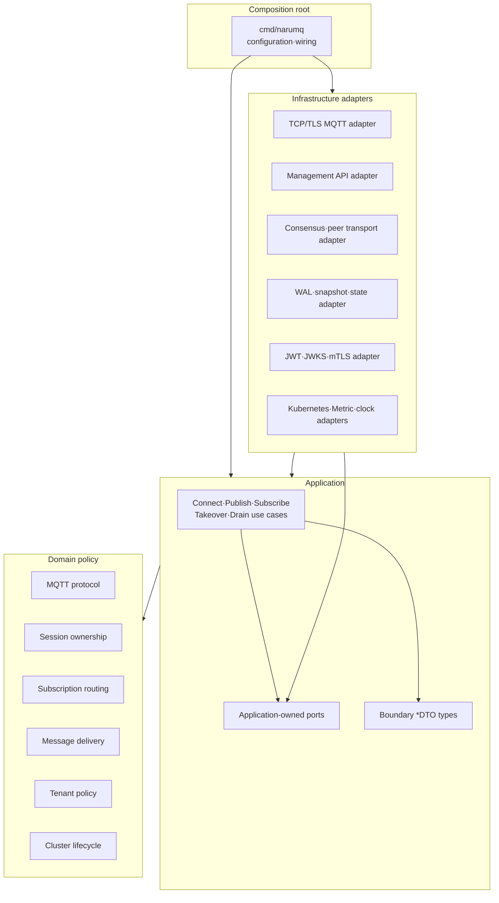

# Broker core architecture

Broker core는 MQTT, session, routing, delivery, tenancy와 cluster lifecycle 정책을 중심에 둔다. Application use case가 필요한 port를 소유하고 infrastructure adapter가 이를 구현한다. Source dependency는 바깥쪽 adapter에서 안쪽 policy로만 향한다.

| 항목 | 값 |
| --- | --- |
| 관점 상태 | Active Phase 1 security and tenant isolation architecture |
| 문서 상태 | Active |
| 구현 증거 | Phase 0 단일 노드 ingress, TLS/mTLS transport와 합의 스파이크 증거가 기존 패키지에 보존되어 있다. Phase 1 tenancy·security·authentication 패키지와 JWT/mTLS 데이터 플레인 인증·인가 파이프라인은 unit/integration test, 실제 TLS socket test와 command composition test를 통해 현재 source 증거가 확보되었다. |
| 범위 | 단일 broker process의 component, loopback TCP runtime과 source dependency |
| 관련 요구사항 | [PRD](../requirements/PRD.md) NFR-11~NFR-15, TEST-01~TEST-16 |
| 관련 결정 | [ADR-0001](../decisions/ADR-0001-core-implementation-language.md) Accepted |
| 관련 Architecture | [Project structure](project-structure.md) |
| 관련 Convention | [Go coding conventions](../conventions/go-coding-conventions.md) |
| 관련 해설 | [Broker core의 계층 경계](../explainers/broker-core-boundaries.md), [Go 동시성과 backpressure](../explainers/go-concurrency-and-backpressure.md) |
| 최종 확인일 | 2026-09-20 |

## Source dependency view

아래 화살표는 runtime call이 아니라 허용된 source dependency 방향이다.



Domain component 사이의 세부 dependency는 구현 단계의 package graph와 architecture test에서 확정한다. 이 view는 순환 dependency를 허용한다는 뜻이 아니다.

## Component 책임

| Component | 소유하는 정책 | 의존해서는 안 되는 대상 |
| --- | --- | --- |
| MQTT protocol | Packet validation, QoS handshake와 protocol reason | Socket, TLS library, HTTP, storage 자료형 |
| Session ownership | `tenancy.SessionKey`, owner epoch와 fencing invariant | Pod/IP, wall clock lease만으로 만든 권한 |
| Subscription routing | tenant-aware `Topic`/`TopicFilter`, wildcard match와 route selection 정책 | 외부 tenant prefix encoding, network client |
| Message delivery | queued·in-flight process-local state, expiry와 ACK 이후 상태 | 특정 WAL·database API |
| Tenant policy | typed namespace value와 MQTT filter relation | JWKS response, certificate library object |
| Security policy | immutable `Principal`, role/action ACL과 default-deny precedence | HTTP, JWT/JWKS, configuration parser |
| Cluster lifecycle | Member state, readiness와 drain barrier의 domain rule | Kubernetes Pod API |
| Application use case | authentication→binding→authorization→mutation 순서와 transaction 경계 | Concrete adapter와 framework object |
| Adapter | Wire, storage, authentication과 platform 자료형 변환·I/O | 새로운 business invariant 결정 |
| Composition root | Strict configuration, concrete implementation 선택과 lifecycle wiring. MQTT listener 보안 mode를 socket 생성 전에 결정하고 secure mode의 authentication/policy를 반드시 조립한다. | MQTT business invariant 구현 |

`cmd/narumq`는 MQTT listener를 열기 전에 하나의 보안 mode만 선택한다. Secure mode는
`-security-config`를 strict decode하고 configured JWT/JWKS provider와 선택적인 mTLS
certificate provider를 생성한다. 두 provider와 ACL `Policy`는 application `connect`
use case에 주입되고, TCP adapter에는 verified certificate를
`ClientCertificateDTO`로 변환하는 extractor만 주입된다. Insecure mode는
`-allow-insecure-anonymous-mqtt`와 literal loopback `-tcp-listen`의 명시적
development·benchmark 예외에서만 선택하며, 이때 provider와 policy wiring을 생략한다.
이 flag나 allow-all `Policy`를 domain/application 계약으로 전파하지 않는다.

## Implemented Phase 1 security·tenant-aware single-node ingress slice

typed tenant namespace, JWT/JWKS 또는 verified client certificate mTLS authentication,
default-deny ACL과 loopback MQTT runtime이 현재 source와 test에 연결되어 있다.
TLS adapter는 trust anchor와 client certificate validity/EKU를 TLS handshake에서
검증한 뒤 application authentication port가 소비하는 certificate DTO만 전달한다.

```text
cmd/narumq
    ├── adapters/authentication ──> application/ports/authentication
    ├── adapters/tls ─────────────> application/ports/authentication
    └── adapters/tcp ─────────────> application/connect
                              ├──> application/ports/authentication
                              ├──> domain/security
                              ├──> domain/session
                              ├──> domain/tenancy
                              ├──> ports/deliveryqueue <── adapters/memory/deliveryqueue
                              ├──> ports/retained <────── adapters/memory/retained
                              └──> domain/routing <── application/subscribe/publish
                                      └──> domain/mqtt
```
- `domain/tenancy`: private comparable `TenantID`, `SessionKey`, `Topic`, `TopicFilter`와
  기존 MQTT wildcard/$ matcher, filter containment/intersection을 소유한다.
- `domain/security`: verified binding을 담은 immutable `Principal`과 role별
  deny > allow > default-deny ACL policy를 소유한다. JWT/JWKS, certificate library
  object나 configuration을 모른다.
- `domain/session`: SessionKey와 principal snapshot을 lifecycle과 Will snapshot에 함께
  저장하고 Claim/Expire 결과로 전달한다.
- `application/connect`: certificate 또는 Username·Password authentication, exact
  Client ID binding, Will ACL을 session ownership보다 먼저 평가한다. mTLS credential과
  MQTT credential을 함께 제출하면 거절하며, 인증·binding·Will 검증 전에는 timer·
  repository·route·queue를 변경하지 않는다.
- `adapters/authentication`: allowlisted JWT algorithm, required `kid`, verified JWKS,
  claim validation과 static identity binding, 그리고 exact certificate selector
  `(commonName|dnsSan|emailSan)` mapping을 application Result로 변환한다. Certificate
  `NotAfter` 경계와 unmapped/ambiguous selector를 fail-closed로 처리한다.
  JWT cache refresh는 coalesced이고 TTL 이후 fetch 실패에 fail-closed한다.
- `adapters/tls`: TLS 1.2+ listener와 trust anchor를 구성하고 verified chain의 leaf에서
  `ClientCertificateDTO`를 만들어 application boundary로 전달한다. Raw certificate는
  TCP/application/domain 경계로 넘기지 않는다.
- `adapters/tcp`: accepted SessionKey와 principal snapshot을 connection에 보관하고 모든
  data-plane dispatch에 함께 전달한다. Username은 identity로 사용하지 않으며 log에 남기지 않는다.
- `adapters/memory/deliveryqueue`, `adapters/memory/retained`, `adapters/memory/sessionstore`는
  각각 SessionKey, `(tenant, topic)`, SessionKey를 key로 사용한다.

성공 경계는 JWT 또는 mTLS로 인증된 CONNECT 뒤 QoS 0·1·2 PUBLISH handshake,
ordered SUBACK/UNSUBACK와 Will 등록·지연 publication이다. ACL 거절은 mutation 전에
반환하며 MQTT 5 PUBLISH는 QoS에 따라 DISCONNECT/PUBACK/PUBREC `0x87`,
MQTT 3.1.1은 연결 종료를 사용한다. Metrics, quota/blocklist, management API,
audit sink과 기존 연결 token reauthentication은 이 slice에서 지원하지 않는다.

## Application-owned port

Port는 구현 adapter 옆이 아니라 이를 사용하는 application 쪽이 소유한다.

| Port 범주 | Application이 요구하는 능력 | Adapter 후보 |
| --- | --- | --- |
| Session·state store | Epoch 조건부 read·write, snapshot과 recovery | Durable state adapter |
| Session lifecycle | tenant-aware `SessionKey`별 lifecycle load/save/delete와 expiry 복구 | `application/connect.SessionRepository` ← `adapters/memory/sessionstore.MemorySessionRepository` |
| Delivery queue | SessionKey 등록·제거, bounded FIFO enqueue, queued·in-flight recovery, expiry purge | `application/ports/deliveryqueue.Queue` ← `adapters/memory/deliveryqueue.Queue` |
| Retained message | tenant-aware exact-topic replace/delete, deterministic expiry-aware list와 count·byte bounded ownership | `application/ports/retained.Repository` ← `adapters/memory/retained.Repository` |
| Authentication | Credential 또는 verified client certificate를 binding Result로 변환하는 application port | `application/ports/authentication.AuthenticationProvider` 및 `ClientCertificateAuthenticationProvider` ← `adapters/authentication.JWKSAuthenticationProvider`, `MTLSAuthenticationProvider` |
| Clock | deterministic expiry 입력 | `application/ports/clock.Clock` ← `adapters/clock.SystemClock` |
| Replication | Command proposal, commit receipt와 membership 관찰 | 고정 voter peer-only 경로: `internal/adapters/raft` + `internal/adapters/tcp.TCPPeerTransport`; full application port는 후속 |
| Live QoS 0 forwarding | Connected remote-owned delivery를 owner node로 bounded at-most-once 전달 | `application/publish.RemoteForwarder` ← `cmd/narumq.clusterRuntime` → `internal/adapters/tcp.DynamicTCPPeerTransport` |
| Metric·audit | Cardinality가 제한된 관측값과 비밀 없는 event 기록 | 후속 observability adapter |
| Node discovery·platform | Member 후보와 workload lifecycle 관찰 | Kubernetes adapter |
| Clock·random | Expiry와 jitter를 결정적으로 제공 | Runtime·test adapter |
현재 source에 구현된 `connect.SessionRepository`, `ports/authentication.AuthenticationProvider`,
`ports/authentication.ClientCertificateAuthenticationProvider`, `ports/clock.Clock`,
`ports/deliveryqueue.Queue`와 `ports/retained.Repository`의 method signature는 해당
package가 소유한다. Domain과 application boundary는 raw client/topic/filter key와
raw certificate를 저장하지 않고 typed value, certificate DTO와 principal snapshot을
운반한다. delivery queue의 queued·in-flight state는 persistent session이 살아 있는 동안
process-local boundary가 소유하며, process restart·durable storage·replication·metrics·audit는
후속 capability 범위로 유지한다.

## Delivery state boundary

`application/ports/deliveryqueue.Queue`는 delivery를 만드는 publish·subscribe use case와
전송을 수행하는 TCP adapter 사이의 복구 경계다. Queue adapter는 session별 FIFO queued
entry와 Packet Identifier별 outbound QoS state를 함께 보관한다. Persistent disconnect는
이 두 collection을 삭제하지 않으며, clean reset 또는 Session Expiry만 `Remove`를 통해
전체 session state를 삭제한다. TCP connection은 active cache일 뿐이므로 reconnect 시
queue boundary에서 outbound state를 다시 읽고, `CONNACK` 뒤에 복구 packet을 전송한다.
Dynamic cluster의 connected remote-owned QoS 0 delivery는 `publish.RemoteForwarder` port를 통해 `clusterRuntime`으로 전달된다. Runtime은 local committed ownership을 읽고 별도 `NMQFWRD2` lane으로 owner node에 보낸다. Receiver는 ownership과 local queue 등록을 다시 확인한 뒤 `AcceptForwarded`로 enqueue한다. 이 volatile at-most-once 경로는 delivery queue의 node-local ownership이나 durable delivery guarantee를 바꾸지 않는다. Detached persistent session은 별도 offline commit 경로를 먼저 사용한다.

## 경계를 넘는 값

- MQTT adapter는 byte buffer를 검증된 packet value로 변환한다.
- Authentication adapter는 provider 응답을 `tenantId`, `subject`, `roles` 같은 논리 principal로 변환한다.
- Storage adapter는 engine record를 domain entity로 직접 노출하지 않는다.
- Management API adapter는 HTTP object를 application command·query DTO로 변환한다.
- Kubernetes adapter는 Pod·Endpoint object를 cluster `nodeId`나 session owner로 그대로 사용하지 않는다.

직접 작성한 application 경계 자료형은 [Go coding conventions](../conventions/go-coding-conventions.md#34-dto-이름)에 따라 `DTO` Postfix를 사용한다. Domain entity와 generated wire type은 이 이름 규칙의 대상이 아니다.

성능 때문에 zero-copy가 필요해도 buffer 수명과 소유권을 port contract에 명시해야 한다. Framework object를 안쪽으로 전달하는 방식으로 최적화하지 않는다.

## 목표 package 구조

Directory와 package의 기준 tree는 [Project structure](project-structure.md)에서 관리한다. 이 문서는 component 책임과 source dependency만 기준으로 삼는다. Framework 이름이 최상위 제품 구조를 결정하지 않게 한다.

## Architecture verification

- Domain이 application, adapter와 외부 framework package를 import하면 실패한다.
- Application이 concrete adapter를 import하면 실패한다.
- Port가 adapter package에 선언되면 실패한다.
- Component dependency graph에 cycle이 생기면 실패한다.
- Boundary DTO에 HTTP, Kubernetes, Raft 또는 storage engine type이 포함되면 실패한다.
- Domain unit test가 실제 network, storage, clock 또는 random에 의존하면 실패한다.

정확한 CI 도구와 package allowlist는 source tree가 생긴 뒤 정한다. 검증 원칙은 [Performance와 verification 스펙](../specs/performance-and-verification.md)의 architecture verification을 따른다.

## 미결정 사항

- Domain component 사이의 최종 package dependency graph
- Storage engine과 persisted record encoding
- Cluster RPC transport와 framing
- Route index partition·replication 방식
- Management API와 Dashboard framework

이 선택은 architecture view가 아니라 후속 ADR의 대상이다.
