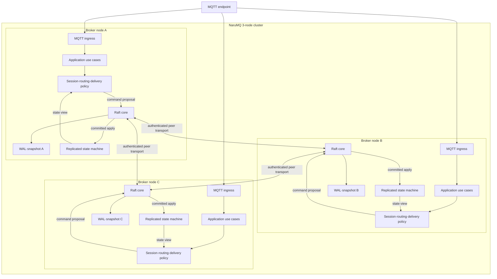
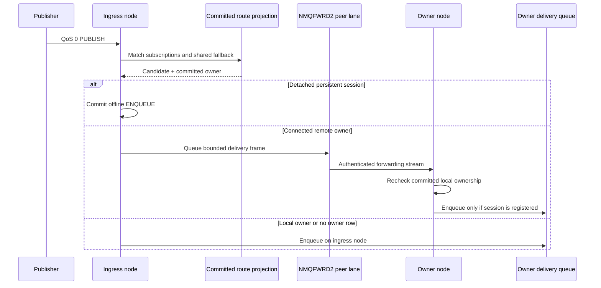
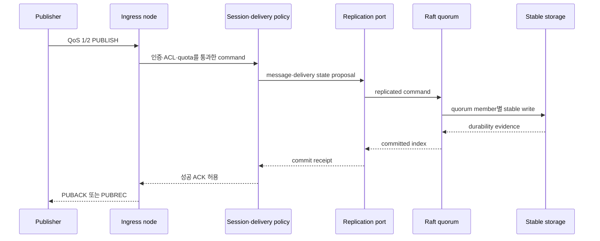

# Cluster architecture

NaruMQ cluster는 세 broker node가 같은 replicated state machine에 참여하는 목표 구조다. 각 node는 MQTT connection을 직접 수용한다. Session ownership과 durable write는 quorum commit을 거쳐 단일 owner와 복구 가능한 상태를 유지한다.

| 항목 | 값 |
| --- | --- |
| 관점 상태 | Target |
| 문서 상태 | Draft |
| 구현 증거 | 제한된 구현 증거: `internal/adapters/raft`, dynamic peer transport, `cmd/narumq -cluster-config`, QoS 0 `NMQFWRD2` forwarding과 cluster QoS 1/2 durable delivery가 있다. Broker-side `NodeDrain`/`SAFE_TO_STOP`은 `TestDynamicClusterNodeDrainProcessAcceptance`와 `TestDynamicClusterNodeDrainCancelTimeoutAndResumeProcessAcceptance`에서 PASS (combined 25.916s; [Drain spec §10])다. Session metadata owner-crash recovery process acceptance `TestDynamicClusterSessionMetadataProcessAcceptance`도 3-node PASS (29.40s; [Cluster spec §11.24](../specs/cluster-session-and-delivery.md#1124-session-metadata-복제와-owner-손실-복구-수용-매핑))다. 이 결과는 local process acceptance 범위이며 supported SDK 전체 redirect/Will 호환성, external rollout, production storage/EBS, BP-03과 N/N-1 gate를 통과했다는 뜻은 아니다. |
| 범위 | Broker cluster의 runtime component와 상태 소유권 |
| 관련 요구사항 | [PRD](../requirements/PRD.md) CLU-01~CLU-14, MQTT-02~05, NFR-07~NFR-10 |
| 관련 스펙 | [Cluster session과 durable delivery](../specs/cluster-session-and-delivery.md), [Drain과 rolling update](../specs/drain-and-rolling-update.md), [MQTT protocol과 session](../specs/mqtt-protocol-and-session.md) |
| 관련 결정 | [ADR-0002](../decisions/ADR-0002-cluster-consensus-library.md), [ADR-0003](../decisions/ADR-0003-durable-ack-barrier.md), [ADR-0004](../decisions/ADR-0004-session-ownership-and-fencing.md), [ADR-0008](../decisions/ADR-0008-raft-peer-transport.md), [ADR-0009](../decisions/ADR-0009-raft-production-state-profile.md) (Accepted, design target only), [ADR-0011](../decisions/ADR-0011-cluster-backup-restore-v1.md) (historical v1), [ADR-0012](../decisions/ADR-0012-retained-replication-and-cluster-backup-v2.md), [ADR-0013](../decisions/ADR-0013-offline-queue-replication-and-cluster-backup-v3.md), [ADR-0014](../decisions/ADR-0014-cross-node-live-qos0-forwarding.md) (live QoS 0 only), [ADR-0015](../decisions/ADR-0015-cluster-durable-qos-delivery.md) (limited QoS 1/2 durable delivery), [ADR-0016](../decisions/ADR-0016-node-drain-and-safe-to-stop.md) (broker drain scope only). ADR-0002~0004는 Proposed |
| Tenant storage quota decision | [ADR-0017](../decisions/ADR-0017-tenant-storage-quota.md) (TEN-08 scope; production and mixed-version gates remain open) |
| 관련 Contract | [Cluster release compatibility v1](../contracts/cluster-release-compatibility-v1.md), Active [Raft peer transport v1](../contracts/raft-peer-transport-v1.md), Draft [Raft membership v2](../contracts/raft-membership-v2.md), Draft [Replicated state v1](../contracts/replicated-state-v1.proto), Draft [Cluster backup v3](../contracts/cluster-backup-v3.md), Superseded [Cluster backup v2](../contracts/cluster-backup-v2.md), Superseded [Cluster backup v1](../contracts/cluster-backup-v1.md) |
| 최종 확인일 | 2026-10-03 |

## Runtime component view

아래 화살표는 runtime data·control flow다. 세 node는 같은 component 구조를 갖는다. Delivery의 client 송신 경로와 read-only query는 복잡도를 줄이기 위해 생략했다.



Consensus module pin, file-backed WAL/snapshot과 sync target, application-state encoding family, 단일-group partition profile은 Accepted [ADR-0009](../decisions/ADR-0009-raft-production-state-profile.md)의 scoped design target이다. 이는 현재 구현의 production readiness, crash durability, durable ACK 또는 release 호환성을 승인하지 않는다. 고정 voter `{1,2,3}`의 transport v1은 Accepted [ADR-0008](../decisions/ADR-0008-raft-peer-transport.md)과 Active [contract](../contracts/raft-peer-transport-v1.md)에서 정한다.

## Raft core, cluster runtime과 제한된 acceptance evidence

`internal/adapters/raft`는 `go.etcd.io/raft/v3 v3.7.0`의 `RawNode`, stable WAL/snapshot persistence, committed command/configuration boundary와 typed application snapshot을 제공한다. `internal/adapters/raft/records`는 replicated-state protobuf와 cluster backup archive framing/checksum을 소유한다. NMQSTATE1 opaque command replay와 `internal/application/takeover`는 이전 deterministic ownership spike의 경계이며 production cluster backup format이 아니다.

Local snapshot 저장 공간 회수는 `stable_store.go` `createSnapshotPayload`에서 snapshot을 확정한 뒤 `wal_compaction.go` `compactWAL`·`pruneSnapshotFiles`로 이어진다. `Node.Snapshot`·`SnapshotWithApplicationData`·fixed bootstrap은 node mutex와 기존 append worker idle 조건을 유지하므로 WAL handle 교체와 새 append가 경쟁하지 않는다. 재시작 때 `openStableStoreMode`가 stale WAL temp를 제거하고 `readWALMode`가 finalized snapshot 이후 tail을 복구한다. 수신 snapshot의 worker 저장 경로는 바꾸지 않는다. 결정과 local 수용 범위는 [ADR-0023](../decisions/ADR-0023-raft-wal-compaction-and-snapshot-retention.md)·[Cluster §11.22](../specs/cluster-session-and-delivery.md#1122-wal-compactionsnapshot-retentiontorn-tail-수용-매핑)를 따른다.

`cmd/narumq -raft-peer-config`는 고정 `{1,2,3}` voter의 peer-only Raft와 mTLS TCP transport다. 이 mode는 MQTT listener, application proposal API 또는 cluster readiness를 제공하지 않는다. Dynamic cluster의 composition root는 별도 `cmd/narumq -cluster-config`다. 이 mode는 Raft, authenticated peer transport, membership state machine, Management API, route projection 및 fresh quorum을 요구하는 MQTT admission을 process 안에서 조립한다.

빈 bootstrap directory의 시작 경계는 `cmd/narumq/cluster_runtime.go`의 `runClusterMode`가 소유한다. `cluster_bootstrap_probe.go`가 directory와 configured peer set을 검사하고, `internal/adapters/tcp/peer_bootstrap_probe.go`의 임시 probe server와 client로 모든 peer의 진행 응답을 모은 뒤에만 `raftadapter.Open`으로 넘어간다. Probe server 종료는 진행 중 연결 종료·handler join·listener deadline 초기화를 포함하며 listener 자체는 닫지 않는다. 같은 raw listener를 `NewDynamicTCPPeerTransport`가 TLS listener로 감싸 재사용한다.

함께 시작한 peer ID의 허용 map은 `DynamicTCPPeerTransport`가 별도 mutex와 process memory에만 소유한다. Running probe handler는 `clusterRuntime.bootstrapProgress`에서 읽은 `Node.Status()`의 term·commit index와 이 허용 map으로 응답한다. `peer_transport_flow.go`의 `receiveRaftFrame`은 전체 payload 수신 직후 해당 ID를 map에서 지운다. Forwarding lane은 이 map을 변경하지 않는다. 정확한 응답·거절 규칙은 [membership v2 §1.5](../contracts/raft-membership-v2.md#empty-directory-bootstrap-probe), 안전 근거는 [ADR-0022](../decisions/ADR-0022-bootstrap-volume-loss-guard.md), 실행 증거는 [Cluster §11.20](../specs/cluster-session-and-delivery.md#1120-voter-volume-손실-보호와-재시드-수용-매핑)를 따른다.

승격된 joiner voter의 같은-volume 재시작은 local snapshot/WAL에서 committed identity를 복구한 뒤 `runSeedAdmission`이 seed 요청 없이 재개한다. 기록을 잃어 local phase가 `STAGED`이면 seed runtime의 `admitPeer`가 committed `VOTER` 후보를 거절한다. TCP client의 `RequestSeedAdmission`도 fresh `STAGED→VOTER` 응답을 identity·peer registry 설치 전에 거절하므로 이전 binary seed의 승인에 의존하지 않는다. Membership 정책은 composition runtime이, wire 수신과 transport identity 설치 경계는 TCP adapter가 소유하며 안쪽 application/domain에 I/O 의존성을 추가하지 않는다. [ADR-0024](../decisions/ADR-0024-joiner-voter-volume-loss-admission.md)·[§11.20](../specs/cluster-session-and-delivery.md#1120-voter-volume-손실-보호와-재시드-수용-매핑)의 local 3-voter·4-voter 수용 범위와 production 제외를 따른다.

고정 voter peer-only mode의 제한된 개발 실행 절차는 [peer-only 실행 안내](../how-to/fixed-voter-raft-peer-only.md)를 참조한다.

`POST /api/v1/cluster/backups`는 ClusterAdmin 전용으로 fresh quorum barrier 뒤 typed snapshot과 committed tail을 담은 archive v3(`NMQBKUP3`)를 반환한다. `-cluster-restore`는 그 archive를 오프라인에서 검사·seed하고 종료한다. Current restore는 같은 cluster ID와 정확한 3 bootstrap voter identity를 요구하며 archive에 learner가 있으면 거절한다. Archive v1과 v2는 읽지 않고 거절한다. 구현 위치는 [`cluster_backup.go`](../../cmd/narumq/cluster_backup.go), [`cluster_backup_restore.go`](../../cmd/narumq/cluster_backup_restore.go), [backup archive codec](../../internal/adapters/raft/records/backup.go), [Cluster backup v3 contract](../contracts/cluster-backup-v3.md)이고 process acceptance는 [Cluster §11.7](../specs/cluster-session-and-delivery.md#117-cluster-backuprestore와-snapshot-finalize-수용-매핑), [§11.8](../specs/cluster-session-and-delivery.md#118-retained-replication과-backup-v2-수용-매핑) 및 [§11.9](../specs/cluster-session-and-delivery.md#119-offline-queue-replication과-backup-v3-수용-매핑)에 있다.

Dynamic cluster mode는 tenant-scoped retained value와 detached persistent session의 QoS 0 offline queue를 Raft에 commit한다. ADR-0015는 QoS 1/2 durable target queue와 publisher QoS 2 inbound state를 session별 replicated state로 추가하며, §11.11 process acceptance는 detached QoS 1/2 전달, owner takeover, backup v3 restore, ACK 뒤 publisher-node process kill 및 quorum loss 중 성공 ACK 부재를 확인했다. Connected QoS 0 delivery는 authenticated `NMQFWRD2` lane으로 committed owner에게 전달하며 Raft state에 쓰지 않는다. QoS 0 offline/retained, live forwarding, durable QoS 1/2 및 broker-side drain/`SAFE_TO_STOP` evidence는 각각 §11.8–§11.11과 [Drain spec §10](../specs/drain-and-rolling-update.md#10-broker-drain-수용-시험-매핑)을 참조한다. Production EBS power-loss, WAL/fsync crash gate, BP-03, N/N-1, TEN-08, supported SDK redirect/Will compatibility와 external rollout은 검증되지 않았다. ADR-0002·0003·0004가 Proposed인 동안 전체 view도 production 또는 Verified 상태가 아니다.

## 상태 소유권

| 상태 | 권위 있는 위치 | Local copy의 역할 |
| --- | --- | --- |
| Membership과 configuration | Quorum-committed cluster state | Discovery·health cache |
| Session lifecycle metadata | Quorum-committed `SessionMetadataState` plus owner/epoch; snapshot and whole-state digest | Per-owner local lifecycle projection and deadline timers, rebuildable from committed metadata; timers are disposable and do not establish lifecycle state |
| Persistent subscription | Replicated state | Node-local route projection 구성 |
| QoS 1·2 inflight와 handshake | Replicated state | Packet 송수신 진행 |
| Durable offline message | Replicated log·store | Owner의 delivery queue |
| Connected live QoS 0 | Owner node의 process-local delivery queue | Ingress가 owner로 forwarding하며, replicated durable state가 아니다 |
| Retained message | Replicated state | Topic lookup cache |
| Tenant storage quota profile | Quorum-committed profile; usage derived from committed retained, offline and QoS 1/2 records | Rebuilt locally from the same state and snapshot; the committed profile alone governs admission |
| Route metadata | Committed persistent-subscription state | Rebuildable node-local route projection |
| Active TCP connection과 socket buffer | Connection을 수용한 node | 복제하지 않는다. Reconnect로 교체한다. |
| Metric·log buffer | Node local, 외부 observability로 export | System of record가 아니다. |

Route metadata는 committed persistent subscription에서 계산하는 node-local disposable projection이다. Node는 routing readiness를 광고하기 전에 이를 rebuild해야 하며, projection은 ownership 또는 durable delivery progress의 권위가 아니고 drain barrier를 대신하지 않는다. Physical rebuild mechanics와 route-index partition placement는 미결정이다.
Session lifecycle metadata는 별도의 authority가 아니라 membership replicated state machine의 `SessionMetadataState`다. `internal/application/membership/session_metadata.go`가 CONNECT metadata와 DETACH/CLAIM_WILL/DISCARD transition의 validation·apply, snapshot용 정렬 deep copy를 소유한다. 이 state는 ownership row의 `(tenant, client)` key에 연결되고, metadata epoch는 committed ownership epoch보다 클 수 없다. `internal/application/connect/session_metadata.go`는 복구 record를 domain lifecycle로 변환하고, local `session.Lifecycle`·principal·routes·delivery registration을 재구성한다. Local Will/expiry timers는 committed absolute due/expiry time에서 다시 계산되는 disposable scheduling state일 뿐 권위 있는 lifecycle이나 만료 근거가 아니다.

`cmd/narumq/cluster_session_metadata.go`는 runtime composition boundary다. CONNECT acquire 전에 ownership read barrier를 거치고, feature `session-metadata`가 committed active일 때만 session DTO를 ownership command에 실어 ownership과 CONNECTED metadata를 한 apply로 설치한다. Metadata change commit은 inactive 상태도 replicated apply gate에 맡겨 판정하며, ownership owner/epoch fencing과 quorum commit 뒤 반환된 Will만 publish caller에 전달한다. `ClusterSessions`는 활성화 뒤 local committed metadata와 committed ownership/delivery rows에서 management DTO를 만든다. `management.Service`는 이 view를 사용해 어느 node에서도 동일한 committed session 목록을 조회하고, feature 비활성일 때는 local session store로 되돌아간다.

`cmd/narumq/cluster_session_recovery.go`는 lifecycle controller다. Runtime은 이를 `serve`에서 시작하고 종료 때 join하며 snapshot restore 뒤 full scan을 요청한다. Apply loop는 metadata가 없는 ownership result만 비동기 queue에 넣는다. Controller는 readiness가 된 뒤 full scan과 변경 key를 처리하고, queue overflow는 다음 full scan으로 보완한다. Driver apply goroutine에서 connect use case를 직접 호출하지 않아 CONNECT의 commit 대기와 use-case mutex가 서로 막히지 않는다. 복구 대상은 feature active, committed metadata와 ownership이 모두 존재하고 local node가 현재 owner인 session뿐이다. 이전 epoch의 CONNECTED metadata는 정상 handoff로 처리해 Will을 억제하고, 현재 epoch의 CONNECTED metadata는 owner 재시작으로 보고 비정상 disconnect 규칙을 적용한다. DETACHED record는 저장된 절대 Will/expiry deadline을 재예약한다. DETACH·CLAIM_WILL·DISCARD 모두 owner/epoch가 fenced이며 Will은 claim/discard transition이 quorum commit된 결과만 발행되어 at-most-once가 된다. 상세 결정·외부 동작과 수용 시험은 [ADR-0025](../decisions/ADR-0025-replicated-session-metadata-and-owner-loss-recovery.md) 및 [Cluster spec §4.3·§11.24](../specs/cluster-session-and-delivery.md#1124-session-metadata-복제와-owner-손실-복구-수용-매핑)를 따른다.
Committed profile은 `internal/application/membership/machine.go`에서 적용한다. `tenant_quota.go`가 version validation과 usage projection을 소유하고 retained/offline/delivery mutation이 기존 global capacity 다음에 positive delta를 검사한다. `snapshot.go`는 profile을 저장하고 restore 때 tenant usage를 다시 계산한다. `cmd/narumq/cluster_records.go`는 application DTO와 typed protobuf 사이를 변환하며 `internal/adapters/raft/records/codec.go`가 profile을 포함한 deterministic encoding, validation, snapshot digest와 object count를 소유한다. `cmd/narumq/cluster_config.go`는 `tenantQuotas`를 엄격히 읽고 `cluster_tenant_quota.go` controller는 committed version보다 높은 local profile을 quorum에 제안한다. Readiness는 quota profile의 quorum commit을 요구하며 local config 일치 여부로 admission을 막지 않는다. Admission은 committed profile을 따른다. Mismatch log와 gauge는 committed version이 local보다 높거나 같은 version의 내용이 다를 때만 설정한다. 상세 process 흐름과 수용 증거는 [Cluster spec §11.16](../specs/cluster-session-and-delivery.md#1116-tenant-storage-quota-수용-매핑)에 연결한다.

## Live QoS 0 delivery path

이 경로는 연결된 subscriber session만 다룬다. 각 candidate의 순서는 detached-session offline `ENQUEUE`, remote owner forwarding, local queue enqueue다. Ingress node는 현재 committed state machine에서 ownership을 직접 읽으므로 message마다 Raft read barrier를 추가하지 않는다.



Ingress가 frame을 forwarding queue에 넣으면 전달 시도는 성공으로 처리하지만, receiver 확인 응답이나 재시도는 없다. 전달은 at-most-once(최대 한 번)이며 owner와 session이 일치하지 않거나 session이 등록되지 않으면 조용히 버린다. Owner queue가 가득 차면 subscriber connection을 닫는다. 이 경로는 QoS 1/2 forwarding이나 durable acknowledgement를 제공하지 않는다.

### Detach 전환 local publish 보호

Persistent subscriber의 disconnect 중 같은 node에서 publish한 message가 queue capture와 제거 사이에서 사라지지 않도록 전환 표시를 둔다. 예를 들어 local queue에 `race/1`이 있고 DETACH 중 `race/2`를 publish하면, 성공한 DETACH는 `race/1`을 가져가고 이후 offline ENQUEUE는 `race/2`를 기록한다. 동작과 대기 상한의 기준은 [Cluster §4.1·§11.25](../specs/cluster-session-and-delivery.md#1125-detach-전환-local-qos-0-보존-수용-매핑)와 [ADR-0026](../decisions/ADR-0026-detach-transition-local-qos0-gate.md)이다.

[ADR-0027](../decisions/ADR-0027-detach-forward-and-owner-crash-qos0-boundary.md)의 forward 유실·비대기는 `cmd/narumq/cluster_offline_detach_race_test.go`의 package 시험에서 확인하며, owner crash 경계는 `tests/integration/cluster_detach_owner_crash_process_test.go`가 `cmd/narumq/cluster_offline.go` `DetachSession`의 proposal 직전 `offline-detach-before-commit`과 `Applied` 확인 직후 `offline-detach-after-commit` failpoint로 확인한다([Cluster §11.26](../specs/cluster-session-and-delivery.md#1126-detach-전환-forward연결-중-owner-crash-유실-경계-수용-매핑)).

| 파일·심볼 | 현재 역할 |
| --- | --- |
| `internal/application/ports/deliveryqueue/queue.go` `Queue` | `BeginDetach`, `FinishDetach`, `AwaitDetach`와 `ErrDetaching` 경계를 소유한다. 기존 `ListQueued` 읽기 API는 유지한다. |
| `internal/adapters/memory/deliveryqueue/queue.go` `sessionState.detaching` | Nil이면 정상 상태다. Channel이 있으면 전환 중이다. Queue mutex 아래 capture와 표시를 함께 수행한다. Process-local batch는 purge 전에 거절하고 durable item은 기존 경로로 받는다. |
| `internal/application/connect/connect.go` `disconnectLocked` | BeginDetach 복사본에서 local QoS 0만 추린다. DETACH 호출 뒤 FinishDetach를 실행한다. 성공은 queue 제거, 실패는 기존 queue 재개다. |
| `internal/application/publish/publish.go` `deliverQoS0Candidate` | 각 판정에서 clock의 현재 시각으로 absolute expiry를 확인한다. 만료되지 않은 후보만 offline commit → remote forwarding → local enqueue 순서로 판정하고, 같은 시각을 proposal·enqueue에 전달한다. 전환 오류는 한 번 기다리고 제거 오류는 한 번 재판정한다. `AcceptForwarded`는 기다리지 않고 전환 오류를 Unavailable로 바꾼다. |

`AwaitDetach`는 queue mutex 밖에서 channel 또는 context 종료를 기다린다. `FinishDetach`와 `Remove`는 lock 안에서 channel의 소유권을 가져오고 lock 밖에서 닫는다. 따라서 enqueue와 capture는 서로 엇갈리지 않으며, 기다리는 동안 다른 queue 작업은 mutex를 사용할 수 있다. Runtime의 `resolveAppliedProposals`는 local apply가 완료된 제안에만 결과를 전달하므로, 성공한 DETACH 뒤의 publish는 반영된 offline state를 다시 판정한다. 기존 runtime·durable queue 조립은 바꾸지 않는다.

실제 memory queue 동시 시험은 `cmd/narumq/cluster_offline_detach_race_test.go`에 있다. Forward lane과 연결 중 owner crash의 queue 손실은 보호하지 않는다. Process 회귀와 local gate 결과는 §11.25에 기록한다.


## Durable publish 경로

아래 흐름은 구조적 경로다. 성공 ACK의 정확한 조건은 cluster spec과 ADR-0003을 기준으로 한다.



Publisher ingress node와 consensus leader는 같지 않을 수 있다. Runtime은 Raft peer transport를 통해 proposal을 leader로 전달하고 commit 결과를 ingress에 돌려준다. MQTT policy는 Raft·transport 자료형에 종속되면 안 된다.

## Session ownership 경로

1. Connection을 수용한 node가 인증된 `(tenantId, clientId)`를 만든다.
2. Application이 현재 ownership record와 expected epoch를 확인한다.
3. Candidate owner가 새 epoch command를 replication port에 제안한다.
4. Quorum commit receipt를 받은 node만 session을 복구하고 traffic을 처리한다.
5. 현재 owner와 exact owner/epoch가 일치하는 모든 persistent subscription mutation과 inbound/outbound QoS inflight mutation만 authoritative session aggregate에 적용한다. 불일치 mutation은 최종 저장 경계에서 거절하며, route projection은 committed persistent subscription 결과에서만 파생한다.

동시 CONNECT, reconnect, drain과 rebalance는 같은 ownership primitive를 공유한다. 상태 전이와 오류 결과는 [Cluster session과 durable delivery 스펙](../specs/cluster-session-and-delivery.md)을 따른다.

Durable delivery는 session 전체를 교체하는 final checkpoint 대신 SEND·ADVANCE·COMPLETE 등 각 QoS 전이를 먼저 commit한다. `-cluster-config`의 broker-side planned drain은 `NodeDrain` operation을 quorum에 저장하고 `cmd/narumq/cluster_drain.go`가 admission 차단, LB propagation delay, rate 제한 ownership transfer와 barrier를 조정한다. `internal/domain/nodedrain`은 phase와 blocker 규칙을 소유한다. `SAFE_TO_STOP` 뒤에도 process 종료나 Pod 삭제는 자동 승인되지 않는다. External rollout controller, Kubernetes lifecycle, BP-07과 N-1↔N은 별도 scope다. 정확한 operation contract와 수용 증거는 [Drain spec](../specs/drain-and-rolling-update.md) §10을 따른다.

## Session metadata 복구 경로

이 흐름은 replicated session lifecycle을 CONNECT ownership과 함께 기록하고, owner가 다시 READY가 된 뒤 local runtime projection과 timer를 재구성한다. 화살표는 호출·자료 전달 순서다.

```mermaid
sequenceDiagram
    participant C as MQTT CONNECT
    participant U as connect.UseCase
    participant R as clusterRuntime
    participant M as membership StateMachine
    participant Q as Raft quorum
    participant X as sessionRecovery controller
    participant L as local lifecycle and timers
    participant W as Will publisher

    C->>U: authenticated session + protocol/Will/expiry
    U->>R: AcquireSessionOwnership
    R->>R: ownership read barrier; test active feature
    R->>Q: ownership acquire/transfer + SessionConnect
    Q->>M: commit and apply atomically
    M-->>U: owner epoch
    Note over M: SessionMetadataState is authoritative
    X->>M: after READY, scan committed metadata/ownership
    M-->>X: records owned by this node
    X->>L: RecoverOwnedSession (outside Raft apply goroutine)
    L->>R: DETACH / CLAIM_WILL / DISCARD
    R->>Q: owner + epoch-fenced metadata command
    Q->>M: commit transition
    M-->>L: committed Will result or no Will
    L->>W: publish only committed claimed Will
    L->>L: rebuild local deadline timers from absolute deadlines
```

`UseCase.ConnectContext` asks for `AcquireSessionOwnership`; after a fresh ownership read, `clusterRuntime.AcquireSessionOwnership` includes CONNECT metadata only when `session-metadata` is active. The membership apply installs the new ownership epoch and CONNECTED metadata in the same command. Thus no committed state exposes new ownership with the previous pending Will. Before activation, this metadata payload is absent and the legacy ownership behavior remains.

At startup the recovery controller waits for readiness, then scans committed session keys; later ownership apply notifications and snapshot-restore scans feed the same pending-work loop. A bounded notification queue is only a prompt: overflow requests a full scan. The controller verifies that the feature is active and the local node is the current owner before calling `RecoverOwnedSession`. It does not call the use case from the Raft apply goroutine, because CONNECT may hold the use-case mutex while waiting for commit.

The membership record, keyed by tenant and client, is authoritative for lifecycle connection status, owner epoch, Will and absolute Will/session-expiry deadlines. The local domain lifecycle, routes, delivery registration and timers are rebuilt projections. A local timer firing alone cannot claim a Will or erase replicated state: its command must pass owner/epoch fencing and commit. A committed Will claim removes the pending Will before publish; a failed claim does not publish. A CONNECTED record at the same ownership epoch as the recovering owner follows abnormal-disconnect behavior. If metadata epoch is older than current ownership, recovery treats it as planned handoff, suppressing the Will. DETACHED metadata re-arms timers against its stored absolute deadlines, so restart does not restart the expiry or Will delay. Expiry metadata discard is committed before durable discard; stale ownership removes only the obsolete local projection without publishing a Will.

After activation, `clusterRuntime.ClusterSessions` builds the Management API view from the node's committed session metadata and ownership/delivery state. The management service uses that cluster view for list and exact-client lookup regardless of ingress node. Before activation, or when the feature is inactive, it uses the existing local session store; sessions created before activation are not retroactively represented until reconnect. This path is distinct from storage-production durability: process acceptance does not establish production EBS/WAL guarantees.

## Control path

| Control path | 구조적 역할 | 권위 경계 |
| --- | --- | --- |
| Join·leave | Member 후보를 검증하고 cluster membership을 변경 | Quorum commit |
| Readiness | Local sync, quorum, committed persistent-subscription에서 rebuild한 route projection과 replica 준비 상태를 집계 | Spec의 probe 조건 |
| Drain | Connection admission을 닫고 ownership을 이전 | `SAFE_TO_STOP` barrier |
| Snapshot·restore | Committed index 기준으로 state를 압축·복구 | Checksum과 schema compatibility |
| Mixed-version rollout | N-1↔N wire·state 호환성을 유지 | Release compatibility contract |

## Failure boundary

- 단일 process·Pod·host 손실은 남은 두 member의 quorum으로 복구하는 목표다.
- Minority partition은 새 ownership과 durable ACK를 만들지 않는다.
- Stable write quorum이 없으면 성공 PUBACK/PUBREC을 반환하지 않는다.
- TCP connection은 복제하지 않는다. Client reconnect와 session takeover로 복구한다.
- 단일 Region 전체 손실은 이 cluster view의 가용성 범위 밖이다.

Physical failure domain은 [EKS on EC2 deployment architecture](eks-ec2-deployment.md), fencing 원리는 [세션 소유권과 fencing](../explainers/session-ownership-and-fencing.md)에서 설명한다.

## 미결정 사항

아래 범위는 runtime 구현 또는 acceptance가 없거나 v1 backup profile의 제한을 넘어선다.

- Production WAL/snapshot lifecycle·retention, 지원 filesystem/volume의 power-loss 및 volume-loss guarantee
- Replicated-state schema의 migration·release compatibility vectors와 Active peer transport 밖 RPC encoding
- Route-index의 물리적 배치와 rebuild mechanics
- Full CLU-14: `offline`/`retained` state, archive retention, disaster-recovery RPO/RTO, cross-cluster migration 및 3-voter 제한 밖 restore
- Release N/N-1 compatibility matrix와 양방향 검증
