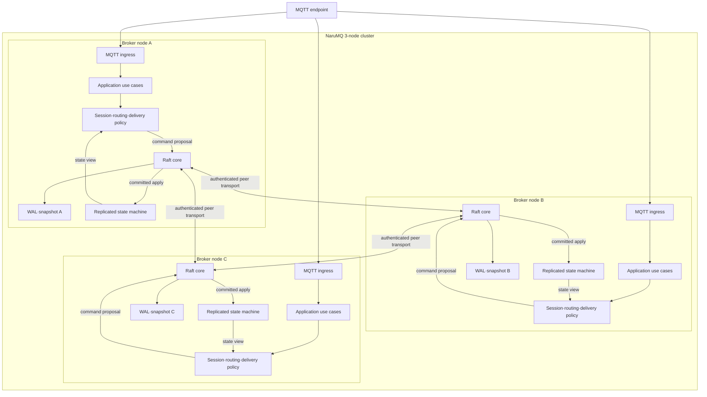
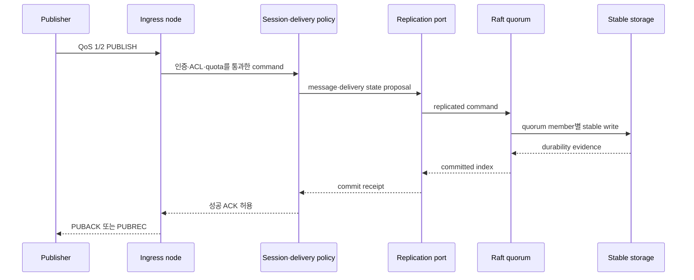

# Cluster architecture

NaruMQ cluster는 세 broker node가 같은 replicated state machine에 참여하는 목표 구조다. 각 node는 MQTT connection을 직접 수용한다. Session ownership과 durable write는 quorum commit을 거쳐 단일 owner와 복구 가능한 상태를 유지한다.

| 항목 | 값 |
| --- | --- |
| 관점 상태 | Target |
| 문서 상태 | Draft |
| 구현 증거 | 제한된 Phase 0/2 evidence: `internal/adapters/raft`, `internal/adapters/tcp`, `cmd/narumq -raft-peer-config`, `internal/application/takeover`, `tests/integration/raft_peer_transport_test.go`, `tests/integration/raft_consensus_test.go` |
| 범위 | Broker cluster의 runtime component와 상태 소유권 |
| 관련 요구사항 | [PRD](../requirements/PRD.md) CLU-01~CLU-14, MQTT-02~05, NFR-07~NFR-10 |
| 관련 스펙 | [Cluster session과 durable delivery](../specs/cluster-session-and-delivery.md), [MQTT protocol과 session](../specs/mqtt-protocol-and-session.md) |
| 관련 결정 | [ADR-0002](../decisions/ADR-0002-cluster-consensus-library.md), [ADR-0003](../decisions/ADR-0003-durable-ack-barrier.md), [ADR-0004](../decisions/ADR-0004-session-ownership-and-fencing.md), [ADR-0008](../decisions/ADR-0008-raft-peer-transport.md), [ADR-0009](../decisions/ADR-0009-raft-production-state-profile.md) (Accepted, design target only). ADR-0002~0004는 Proposed |
| 관련 Contract | [Cluster release compatibility v1](../contracts/cluster-release-compatibility-v1.md), Active [Raft peer transport v1](../contracts/raft-peer-transport-v1.md); replicated-state contract는 ADR-0009가 encoding family만 정했으며 exact schema는 미작성 |
| 최종 확인일 | 2026-09-24 |

## Runtime component view

아래 화살표는 runtime data·control flow다. 세 node는 같은 component 구조를 갖는다. Delivery의 client 송신 경로와 read-only query는 복잡도를 줄이기 위해 생략했다.

Consensus module pin, file-backed WAL/snapshot과 sync target, application-state encoding family, 단일-group partition profile은 Accepted [ADR-0009](../decisions/ADR-0009-raft-production-state-profile.md)의 scoped design target이다. 이는 현재 구현의 production readiness, crash durability, durable ACK 또는 release 호환성을 승인하지 않는다. 고정 voter `{1,2,3}`의 transport v1은 Accepted [ADR-0008](../decisions/ADR-0008-raft-peer-transport.md)과 Active [contract](../contracts/raft-peer-transport-v1.md)에서 정한다.

## Phase 0/2 제한된 구현 증거

현재 repository는 `internal/adapters/raft`에서 `go.etcd.io/raft/v3 v3.7.0`의 `RawNode`와 deterministic logical-tick harness, opaque application command boundary(`BatchDTO.Commands`, `AppliedCommands`)와 NMQSTATE1 opaque command snapshot/WAL recovery를 검증한다. `internal/application/takeover`는 이 command bytes를 해석하고 application committed-command sequence position을 부여해 세션 소유권 상태 전이(single owner 선출, majority takeover, stale epoch 거절, restart 복구)를 검증한다.

`cmd/narumq -raft-peer-config`는 고정 `{1,2,3}` voter의 production `RawNode`, mTLS TCP transport, bounded per-peer queues와 retry를 composition root에서 연결한다. 인증된 TLS loopback 3-node election/replication/catch-up 및 peer-only 실행 증거는 [transport integration tests](../../tests/integration/raft_peer_transport_test.go)와 [peer-only CLI tests](../../cmd/narumq/raft_peer_config_test.go)에 있다. 이 executable path는 MQTT listener, proposal API, replicated MQTT message/route state, durable ACK barrier, readiness 또는 membership workflow와 연결되지 않는다.

따라서 위 runtime view의 전체 cluster는 여전히 Target 구조다. 현재 구현된 실제 경로는 [adapter source](../../internal/adapters/raft/node.go), [stable store](../../internal/adapters/raft/stable_store.go), [TCP peer transport](../../internal/adapters/tcp/peer_transport.go), [peer-only composition](../../cmd/narumq/raft_peer_config.go), [takeover state machine and codec](../../internal/application/takeover), [transport integration evidence](../../tests/integration/raft_peer_transport_test.go), [consensus integration evidence](../../tests/integration/raft_consensus_test.go)의 제한된 core다. ADR-0002와 ADR-0004가 Proposed인 동안 이 view를 production cluster 또는 Verified 상태로 승격하지 않는다.
## 상태 소유권

| 상태 | 권위 있는 위치 | Local copy의 역할 |
| --- | --- | --- |
| Membership과 configuration | Quorum-committed cluster state | Discovery·health cache |
| Session owner와 epoch | Replicated state machine | 현재 connection의 빠른 판정 |
| Persistent subscription | Replicated state | Node-local route projection 구성 |
| QoS 1·2 inflight와 handshake | Replicated state | Packet 송수신 진행 |
| Durable offline message | Replicated log·store | Owner의 delivery queue |
| Retained message | Replicated state | Topic lookup cache |
| Route metadata | Committed persistent-subscription state | Rebuildable node-local route projection |
| Active TCP connection과 socket buffer | Connection을 수용한 node | 복제하지 않는다. Reconnect로 교체한다. |
| Metric·log buffer | Node local, 외부 observability로 export | System of record가 아니다. |

Route metadata는 committed persistent subscription에서 계산하는 node-local disposable projection이다. Node는 routing readiness를 광고하기 전에 이를 rebuild해야 하며, projection은 ownership·checkpoint·drain barrier의 근거가 아니다. Physical rebuild mechanics와 route-index partition placement는 미결정이다.

## Durable publish 경로

아래 흐름은 구조적 경로다. 성공 ACK의 정확한 조건은 cluster spec과 ADR-0003을 기준으로 한다.

Publisher ingress node와 consensus leader는 같지 않을 수 있다. Runtime forwarding은 허용하지만 MQTT policy가 Raft·transport 자료형에 종속되면 안 된다.

## Session ownership 경로

1. Connection을 수용한 node가 인증된 `(tenantId, clientId)`를 만든다.
2. Application이 현재 ownership record와 expected epoch를 확인한다.
3. Candidate owner가 새 epoch command를 replication port에 제안한다.
4. Quorum commit receipt를 받은 node만 session을 복구하고 traffic을 처리한다.
5. 현재 owner와 exact owner/epoch가 일치하는 모든 persistent subscription mutation과 inbound/outbound QoS inflight mutation만 authoritative session aggregate에 적용한다. 불일치 mutation은 최종 저장 경계에서 거절하며, route projection은 committed persistent subscription 결과에서만 파생한다.

동시 CONNECT, reconnect, drain과 rebalance는 같은 ownership primitive를 공유한다. 상태 전이와 오류 결과는 [Cluster session과 durable delivery 스펙](../specs/cluster-session-and-delivery.md)을 따른다.

Drain에서는 draining owner가 현재 epoch의 최종 subscription·inflight checkpoint를 commit한 뒤에만 successor의 더 큰 epoch ownership acquire를 commit한다. Acquire 이후 old owner의 route-affecting persistent subscription 또는 inbound/outbound QoS inflight mutation은 exact owner/epoch check에서 stale로 거절되고 authoritative aggregate를 바꾸지 않는다. Route projection은 committed persistent subscription 결과에서만 파생되며, 이를 rebuild한 뒤에만 readiness를 광고한다.

## Control path

| Control path | 구조적 역할 | 권위 경계 |
| --- | --- | --- |
| Join·leave | Member 후보를 검증하고 cluster membership을 변경 | Quorum commit |
| Readiness | Local sync, quorum, committed persistent-subscription에서 rebuild한 route projection과 replica 준비 상태를 집계 | Spec의 probe 조건 |
| Drain | Connection admission을 닫고 ownership을 이전 | `SAFE_TO_STOP` barrier |
| Snapshot·restore | Committed index 기준으로 state를 압축·복구 | Checksum과 schema compatibility |
| Mixed-version rollout | N-1↔N wire·state 호환성을 유지 | Release compatibility contract |

## Failure boundary

- 단일 process·Pod·host 손실은 남은 두 member의 quorum으로 복구하는 목표다.
- Minority partition은 새 ownership과 durable ACK를 만들지 않는다.
- Stable write quorum이 없으면 성공 PUBACK/PUBREC을 반환하지 않는다.
- TCP connection은 복제하지 않는다. Client reconnect와 session takeover로 복구한다.
- 단일 Region 전체 손실은 이 cluster view의 가용성 범위 밖이다.

Physical failure domain은 [EKS on EC2 deployment architecture](eks-ec2-deployment.md), fencing 원리는 [세션 소유권과 fencing](../explainers/session-ownership-and-fencing.md)에서 설명한다.

## 미결정 사항

아래 네 가지 design target은 [ADR-0009](../decisions/ADR-0009-raft-production-state-profile.md)에 scoped 범위로 기록했으며 runtime 승인이나 production acceptance를 뜻하지 않는다. 다음 구현·계약은 여전히 미결정 또는 미검증이다.

- Exact WAL·snapshot on-disk schema와 lifecycle, crash recovery·retention 구현
- Replicated-state protobuf의 exact messages·field numbers·limits·migration vectors 및 Active peer transport 범위 밖 RPC encoding
- Route-index의 물리적 배치와 rebuild mechanics
- Backup·DR, dynamic membership과 join·leave workflow
- Release N/N-1 compatibility matrix와 양방향 검증
