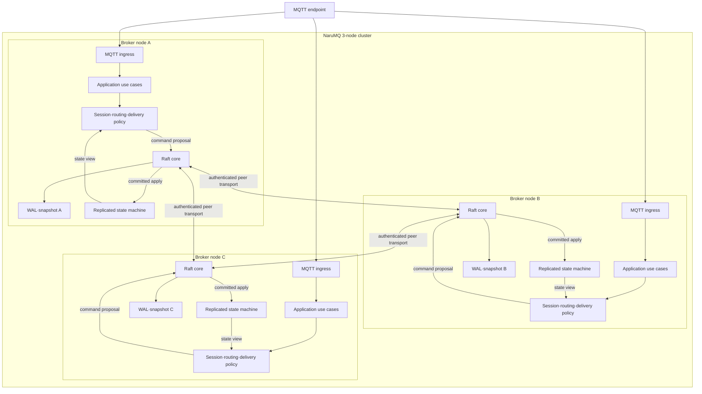
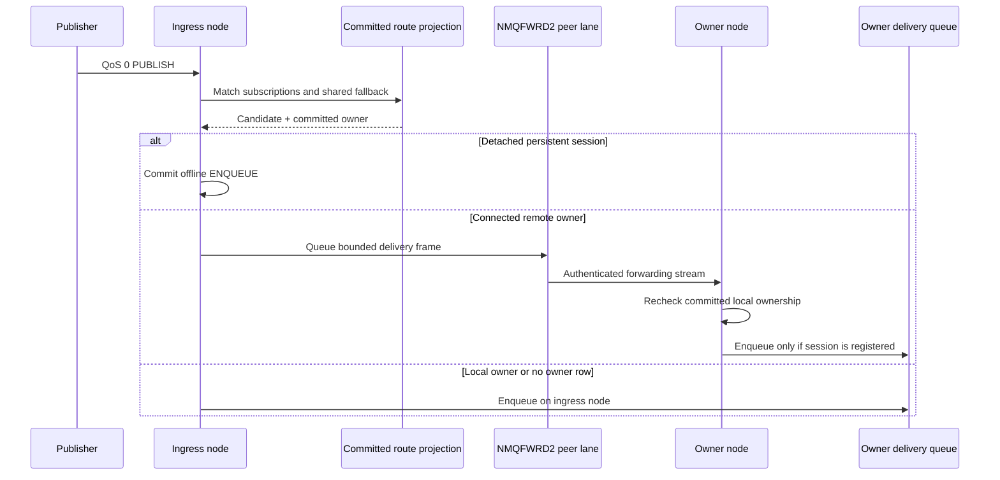
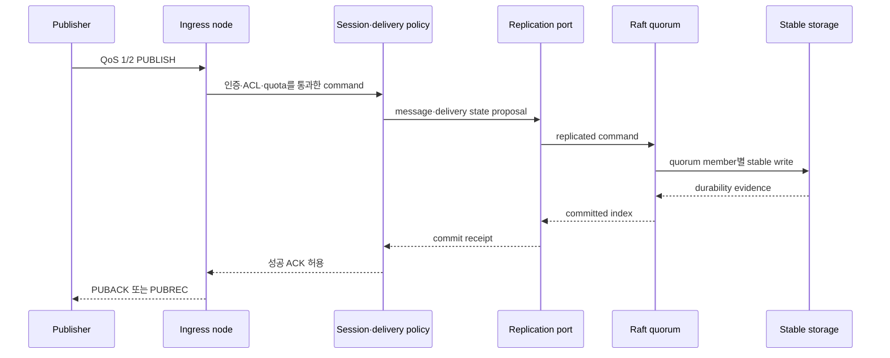

# Cluster architecture

NaruMQ cluster는 세 broker node가 같은 replicated state machine에 참여하는 목표 구조다. 각 node는 MQTT connection을 직접 수용한다. Session ownership과 durable write는 quorum commit을 거쳐 단일 owner와 복구 가능한 상태를 유지한다.

| 항목 | 값 |
| --- | --- |
| 관점 상태 | Target |
| 문서 상태 | Draft |
| 구현 증거 | 제한된 구현 증거: `internal/adapters/raft`, dynamic peer transport, `cmd/narumq -cluster-config`, QoS 0 `NMQFWRD2` forwarding과 cluster QoS 1/2 durable delivery가 있다. Broker-side `NodeDrain`/`SAFE_TO_STOP`은 `TestDynamicClusterNodeDrainProcessAcceptance`와 `TestDynamicClusterNodeDrainCancelTimeoutAndResumeProcessAcceptance`에서 PASS (combined 25.916s; [Drain spec §10])다. Session metadata owner-crash recovery process acceptance `TestDynamicClusterSessionMetadataProcessAcceptance`도 3-node PASS (29.40s; [Cluster spec §11.24](../specs/cluster-session-and-delivery.md#1124-session-metadata-복제와-owner-손실-복구-수용-매핑))다. 이 결과는 local process acceptance 범위이며 supported SDK 전체 redirect/Will 호환성, external rollout, production storage/EBS, BP-03과 N/N-1 gate를 통과했다는 뜻은 아니다. |
| 범위 | Broker cluster의 runtime component와 상태 소유권 |
| 관련 요구사항 | [PRD](../requirements/PRD.md) API-09, CLU-01~CLU-14, MQTT-02~05, NFR-07~NFR-10 |
| 관련 스펙 | [Cluster session과 durable delivery](../specs/cluster-session-and-delivery.md), [Drain과 rolling update](../specs/drain-and-rolling-update.md), [MQTT protocol과 session](../specs/mqtt-protocol-and-session.md) |
| 관련 결정 | [ADR-0002](../decisions/ADR-0002-cluster-consensus-library.md), [ADR-0003](../decisions/ADR-0003-durable-ack-barrier.md), [ADR-0004](../decisions/ADR-0004-session-ownership-and-fencing.md), [ADR-0008](../decisions/ADR-0008-raft-peer-transport.md), [ADR-0009](../decisions/ADR-0009-raft-production-state-profile.md) (Accepted, design target only), [ADR-0011](../decisions/ADR-0011-cluster-backup-restore-v1.md) (historical v1), [ADR-0012](../decisions/ADR-0012-retained-replication-and-cluster-backup-v2.md), [ADR-0013](../decisions/ADR-0013-offline-queue-replication-and-cluster-backup-v3.md), [ADR-0014](../decisions/ADR-0014-cross-node-live-qos0-forwarding.md) (live QoS 0 only), [ADR-0015](../decisions/ADR-0015-cluster-durable-qos-delivery.md) (limited QoS 1/2 durable delivery), [ADR-0016](../decisions/ADR-0016-node-drain-and-safe-to-stop.md) (broker drain scope only). ADR-0002~0004는 Proposed |
| Tenant storage quota decision | [ADR-0017](../decisions/ADR-0017-tenant-storage-quota.md) (TEN-08 scope; production and mixed-version gates remain open) |
| Cluster MQTT policy decision | [ADR-0052](../decisions/ADR-0052-configuration-tiers-and-cluster-policy.md) overall status Proposed; G1 `mqttLimits`, G7 applied configuration view and `ClusterPolicy.tenantQuotas` are adopted |
| 관련 Contract | [Cluster release compatibility v1](../contracts/cluster-release-compatibility-v1.md), Active [Raft peer transport v1](../contracts/raft-peer-transport-v1.md), Draft [Raft membership v2](../contracts/raft-membership-v2.md), Active [Replicated-state v1](../contracts/replicated-state-v1.md), Draft [Cluster backup v3](../contracts/cluster-backup-v3.md), Superseded [Cluster backup v2](../contracts/cluster-backup-v2.md), Superseded [Cluster backup v1](../contracts/cluster-backup-v1.md) |
| API-09·TEN-08 구현 증거 | `clusterPolicy.mqttLimits`, `ClusterPolicy.tenantQuotas`, 적용 설정 조회와 snapshot/backup v3 계약을 구현한다. 3-node acceptance는 [CFG-SCN-28, CFG-SCN-31, CFG-SCN-35~38](../specs/configuration-and-runtime-options.md#6-수용-시험)에 연결한다. 이는 production storage/EBS 또는 전체 release gate를 검증하지 않는다. |
| 최종 확인일 | 2026-10-11 |

## Runtime component view

아래 화살표는 runtime data·control flow다. 세 node는 같은 component 구조를 갖는다. Delivery의 client 송신 경로와 read-only query는 복잡도를 줄이기 위해 생략했다.



Consensus module pin, file-backed WAL/snapshot과 sync target, application-state encoding family, 단일-group partition profile은 Accepted [ADR-0009](../decisions/ADR-0009-raft-production-state-profile.md)의 scoped design target이다. 이는 현재 구현의 production readiness, crash durability, durable ACK 또는 release 호환성을 승인하지 않는다. 고정 voter `{1,2,3}`의 transport v1은 Accepted [ADR-0008](../decisions/ADR-0008-raft-peer-transport.md)과 Active [contract](../contracts/raft-peer-transport-v1.md)에서 정한다.

## Raft core, cluster runtime과 제한된 acceptance evidence

`internal/adapters/raft`는 `go.etcd.io/raft/v3 v3.7.0`의 `RawNode`, stable WAL/snapshot persistence, committed command/configuration boundary와 typed application snapshot을 제공한다. `internal/adapters/raft/records`는 replicated-state protobuf와 cluster backup archive framing/checksum을 소유한다. NMQSTATE1 opaque command replay와 `internal/application/takeover`는 이전 deterministic ownership spike의 경계이며 production cluster backup format이 아니다.

Local snapshot 저장 공간 회수는 `stable_store.go` `createSnapshotPayload`에서 snapshot을 확정한 뒤 `wal_compaction.go` `compactWAL`·`pruneSnapshotFiles`로 이어진다. `Node.Snapshot`·`SnapshotWithApplicationData`·fixed bootstrap은 node mutex와 기존 append worker idle 조건을 유지하므로 WAL handle 교체와 새 append가 경쟁하지 않는다. 재시작 때 `openStableStoreMode`가 stale WAL temp를 제거하고 `readWALMode`가 finalized snapshot 이후 tail을 복구한다. 수신 snapshot의 worker 저장 경로는 바꾸지 않는다. 결정과 local 수용 범위는 [ADR-0023](../decisions/ADR-0023-raft-wal-compaction-and-snapshot-retention.md)·[Cluster §11.22](../specs/cluster-session-and-delivery.md#1122-wal-compactionsnapshot-retentiontorn-tail-수용-매핑)를 따른다.

`cmd/narumq -raft-peer-config`는 고정 `{1,2,3}` voter의 peer-only Raft와 mTLS TCP transport다. 이 mode는 MQTT listener, application proposal API 또는 cluster readiness를 제공하지 않는다. Dynamic cluster의 composition root는 별도 `cmd/narumq -cluster-config`다. 이 mode는 Raft, authenticated peer transport, membership state machine, Management API, route projection 및 fresh quorum을 요구하는 MQTT admission을 process 안에서 조립한다.

빈 bootstrap directory의 시작 경계는 `cmd/narumq/cluster_runtime.go`의 `runClusterMode`가 소유한다. `cluster_bootstrap_probe.go`가 directory와 configured peer set을 검사하고, `internal/adapters/tcp/peer_bootstrap_probe.go`의 임시 probe server와 client로 모든 peer의 진행 응답을 모은 뒤에만 `raftadapter.Open`으로 넘어간다. Probe server 종료는 진행 중 연결 종료·handler join·listener deadline 초기화를 포함하며 listener 자체는 닫지 않는다. 같은 raw listener를 `NewDynamicTCPPeerTransport`가 TLS listener로 감싸 재사용한다.

함께 시작한 peer ID의 허용 map은 `DynamicTCPPeerTransport`가 별도 mutex와 process memory에만 소유한다. Running probe handler는 `clusterRuntime.bootstrapProgress`에서 읽은 `Node.Status()`의 term·commit index와 이 허용 map으로 응답한다. `peer_transport_flow.go`의 `receiveRaftFrame`은 전체 payload 수신 직후 해당 ID를 map에서 지운다. Forwarding lane은 이 map을 변경하지 않는다. 정확한 응답·거절 규칙은 [membership v2 §1.5](../contracts/raft-membership-v2.md#empty-directory-bootstrap-probe), 안전 근거는 [ADR-0022](../decisions/ADR-0022-bootstrap-volume-loss-guard.md), 실행 증거는 [Cluster §11.20](../specs/cluster-session-and-delivery.md#1120-voter-volume-손실-보호와-재시드-수용-매핑)를 따른다.

`ProbeBootstrapPeer`와 `RequestSeedAdmission`은 한 번의 peer 교환을 수행한다. 두 client는 응답 frame을 받은 뒤 peer가 TLS 연결을 닫을 때까지 기다린다. `DynamicTCPPeerTransport.acceptLoop`는 inbound slot을 반환한 뒤 연결을 닫아 다음 요청이 직전 연결의 slot 반환과 경합하지 않게 한다.

승격된 joiner voter의 같은-volume 재시작은 local snapshot/WAL에서 committed identity를 복구한 뒤 `runSeedAdmission`이 seed 요청 없이 재개한다. 기록을 잃어 local phase가 `STAGED`이면 seed runtime의 `admitPeer`가 committed `VOTER` 후보를 거절한다. TCP client의 `RequestSeedAdmission`도 fresh `STAGED→VOTER` 응답을 identity·peer registry 설치 전에 거절하므로 이전 binary seed의 승인에 의존하지 않는다. Membership 정책은 composition runtime이, wire 수신과 transport identity 설치 경계는 TCP adapter가 소유하며 안쪽 application/domain에 I/O 의존성을 추가하지 않는다. [ADR-0024](../decisions/ADR-0024-joiner-voter-volume-loss-admission.md)·[§11.20](../specs/cluster-session-and-delivery.md#1120-voter-volume-손실-보호와-재시드-수용-매핑)의 local 3-voter·4-voter 수용 범위와 production 제외를 따른다.

고정 voter peer-only mode의 제한된 개발 실행 절차는 [peer-only 실행 안내](../how-to/fixed-voter-raft-peer-only.md)를 참조한다.

`POST /api/v1/cluster/backups`는 ClusterAdmin 전용으로 fresh quorum barrier 뒤 typed snapshot과 committed tail을 담은 archive v3(`NMQBKUP3`)를 반환한다. `-cluster-restore`는 그 archive를 오프라인에서 검사·seed하고 종료한다. Current restore는 같은 cluster ID와 정확한 3 bootstrap voter identity를 요구하며 archive에 learner가 있으면 거절한다. Archive v1과 v2는 읽지 않고 거절한다. 구현 위치는 [`cluster_backup.go`](../../cmd/narumq/cluster_backup.go), [`cluster_backup_restore.go`](../../cmd/narumq/cluster_backup_restore.go), [backup archive codec](../../internal/adapters/raft/records/backup.go), [Cluster backup v3 contract](../contracts/cluster-backup-v3.md)이고 process acceptance는 [Cluster §11.7](../specs/cluster-session-and-delivery.md#117-cluster-backuprestore와-snapshot-finalize-수용-매핑), [§11.8](../specs/cluster-session-and-delivery.md#118-retained-replication과-backup-v2-수용-매핑) 및 [§11.9](../specs/cluster-session-and-delivery.md#119-offline-queue-replication과-backup-v3-수용-매핑)에 있다.

### Dynamic cluster MQTT policy

Dynamic cluster의 선택 `clusterPolicy` config는 `mqttLimits`와 선택 `tenantQuotas`를 포함한다. `cmd/narumq/cluster_config.go`가 strict JSON, version, MQTT limits와 tenant quota 범위를 검사한다. `cluster_policy.go` controller는 `cluster-policy` feature가 활성화된 뒤 local policy version을 제안한다. `cluster-policy-tenant-quotas`가 비활성이면 quota field가 포함된 policy를 제안하지 않는다. Lower local version은 committed version을 덮지 않는다. Same version의 내용이 다르면 committed values가 적용되고 mismatch가 기록된다. `applyBatch`는 committed MQTT limits와 quota profile을 runtime admission에 적용한다. MQTT limits는 새 connection부터 적용하고 기존 connection은 유지한다.

ClusterAdmin은 `PUT /api/v1/cluster/policy`에서 `If-Match`와 `Idempotency-Key`로 MQTT limits와 선택 quota를 조건부 변경한다. `GET /api/v1/cluster/policy`는 committed policy와 ETag를 반환한다. `GET /api/v1/nodes/{nodeId}/config`는 해당 node의 설정과 effective policy source·version을 읽기 전용으로 반환한다. Config와 audit query는 path ID가 serving node와 다른 경우 `409 node_not_local`을 반환하고 remote proxy를 하지 않는다. Policy state와 quota는 typed snapshot과 backup v3에 포함된다. Parser, reconciliation, snapshot·backup, API와 3-node restart·drift acceptance는 [Configuration §6](../specs/configuration-and-runtime-options.md#6-수용-시험) 및 G7 실행 기록에 연결한다. Process acceptance는 production storage/EBS 또는 전체 release gate를 검증하지 않는다.


Dynamic cluster mode는 tenant-scoped retained value와 detached persistent session의 QoS 0 offline queue를 Raft에 commit한다. ADR-0015는 QoS 1/2 durable target queue와 publisher QoS 2 inbound state를 session별 replicated state로 추가하며, §11.11 process acceptance는 detached QoS 1/2 전달, owner takeover, backup v3 restore, ACK 뒤 publisher-node process kill 및 quorum loss 중 성공 ACK 부재를 확인했다. Connected QoS 0 delivery는 authenticated `NMQFWRD2` lane으로 committed owner에게 전달하며 Raft state에 쓰지 않는다. QoS 0 offline/retained, live forwarding, durable QoS 1/2 및 broker-side drain/`SAFE_TO_STOP` evidence는 각각 §11.8–§11.11과 [Drain spec §10](../specs/drain-and-rolling-update.md#10-broker-drain-수용-시험-매핑)을 참조한다. Production EBS power-loss, WAL/fsync crash gate, BP-03, N/N-1, TEN-08, supported SDK redirect/Will compatibility와 external rollout은 검증되지 않았다. ADR-0002·0003·0004가 Proposed인 동안 전체 view도 production 또는 Verified 상태가 아니다.

### Replication profile과 planned removal 보호

`cmd/narumq/cluster_config.go`는 선택 객체 `replication`을 엄격하게 읽는다. `replicationProfile`은 생략값을 3/2로 변환한다. `internal/application/membership/replication_profile.go`는 지원 profile 검증과 대상 외의 voter 수 판정을 소유한다. `runClusterMode`가 이 값을 `membership.NewService`에 주입하므로 application은 config JSON이나 Raft adapter에 의존하지 않는다.

Removal 요청은 HTTP `membership_handlers.go`에서 `Service.StartPlannedRemoval`로 들어간다. Service는 기존 idempotency replay·member 존재·phase 판정 뒤 committed `VOTER` ID를 검사한다. `LEAVING`은 세지 않는다. 남은 voter가 부족하면 command를 만들기 전에 거절한다. HTTP adapter는 이 application 오류를 non-retryable 409로 변환한다.

Leader driver의 `clusterRuntime.advanceMembership`은 `OperationPhaseRemoving`에서 현재 `node.Status().VoterIDs`로 다시 검사한다. 부족하면 기존 `removalBlockLogged` 중복 억제와 `reason=replication_factor_unsatisfied` 경고를 사용하고 transfer·ConfChange를 제안하지 않는다. 대상이 이미 voter 집합에서 빠졌으면 전체 voter 수로 판정한다. Local leader가 제거 대상일 때의 leadership transfer는 기존 순서를 유지한다. Drain이 공유하는 `PlanRemovalHandoff`와 committed apply 규칙은 바꾸지 않는다.

Management query는 `clusterStateProvider.GetClusterSummary`에서 같은 config profile을 읽는다. Standalone `management.Service.GetClusterSummary`는 1/1을 만든다. Profile은 process config 값이며 replicated state에 새로 저장하지 않는다. 지원값이 하나라 node별 값이 다를 수 없으며, 다른 profile과 mixed-release 한계는 [ADR-0029](../decisions/ADR-0029-replication-factor-write-quorum-profile.md)를 따른다. 동작·실행 증거는 [Cluster §4.4·§11.27](../specs/cluster-session-and-delivery.md#1127-replication-factorwrite-quorum-profile-수용-매핑)이 기준이다.

## 상태 소유권

| 상태 | 권위 있는 위치 | Local copy의 역할 |
| --- | --- | --- |
| Membership과 configuration | Quorum-committed cluster state | Discovery·health cache |
| Session lifecycle metadata | Quorum-committed `SessionMetadataState` plus owner/epoch; snapshot and whole-state digest | Per-owner local lifecycle projection and deadline timers, rebuildable from committed metadata; timers are disposable and do not establish lifecycle state |
| Persistent subscription | Replicated state | Node-local route projection 구성 |
| QoS 1·2 inflight와 handshake | Replicated state | Packet 송수신 진행 |
| Durable offline message | Replicated log·store | Owner의 delivery queue |
| Connected live QoS 0 | Owner node의 process-local delivery queue | Ingress가 owner로 forwarding하며, replicated durable state가 아니다 |
| Retained message | Replicated state | Topic lookup cache |
| Tenant storage quota profile | Quorum-committed profile; usage derived from committed retained, offline and QoS 1/2 records | Rebuilt locally from the same state and snapshot; the committed profile alone governs admission |
| Route metadata | Committed persistent-subscription state | Rebuildable node-local route projection |
| Active TCP connection과 socket buffer | Connection을 수용한 node | 복제하지 않는다. Reconnect로 교체한다. |
| Metric·log | Node-local metric registry, log stream, optional runtime metrics JSONL file | Neither is replicated nor a system of record. |

Route metadata는 committed persistent subscription에서 계산하는 node-local disposable projection이다. Node는 routing readiness를 광고하기 전에 이를 rebuild해야 하며, projection은 ownership 또는 durable delivery progress의 권위가 아니고 drain barrier를 대신하지 않는다. Physical rebuild mechanics와 route-index partition placement는 미결정이다.
Session lifecycle metadata는 별도의 authority가 아니라 membership replicated state machine의 `SessionMetadataState`다. `internal/application/membership/session_metadata.go`가 CONNECT metadata와 DETACH/CLAIM_WILL/DISCARD transition의 validation·apply, snapshot용 정렬 deep copy를 소유한다. 이 state는 ownership row의 `(tenant, client)` key에 연결되고, metadata epoch는 committed ownership epoch보다 클 수 없다. `internal/application/connect/session_metadata.go`는 복구 record를 domain lifecycle로 변환하고, local `session.Lifecycle`·principal·routes·delivery registration을 재구성한다. Local Will/expiry timers는 committed absolute due/expiry time에서 다시 계산되는 disposable scheduling state일 뿐 권위 있는 lifecycle이나 만료 근거가 아니다.

`cmd/narumq/cluster_session_metadata.go`는 runtime composition boundary다. CONNECT acquire 전에 ownership read barrier를 거치고, feature `session-metadata`가 committed active일 때만 session DTO를 ownership command에 실어 ownership과 CONNECTED metadata를 한 apply로 설치한다. Metadata change commit은 inactive 상태도 replicated apply gate에 맡겨 판정하며, ownership owner/epoch fencing과 quorum commit 뒤 반환된 Will만 publish caller에 전달한다. `ClusterSessions`는 활성화 뒤 local committed metadata와 committed ownership/delivery rows에서 management DTO를 만든다. `management.Service`는 이 view를 사용해 어느 node에서도 동일한 committed session 목록을 조회하고, feature 비활성일 때는 local session store로 되돌아간다.

`cmd/narumq/cluster_session_recovery.go`는 lifecycle controller다. Runtime은 `serve`에서 controller를 시작하고 종료 때 join한다. Snapshot restore 뒤에는 full scan을 요청한다. Apply loop는 metadata 없는 ownership result를 비동기 queue에 넣는다. Controller는 readiness 뒤 full scan과 변경 key를 처리하며 overflow 때 full scan을 요청한다. Driver apply goroutine에서 connect를 직접 호출하지 않으므로 commit 대기와 mutex가 서로 막히지 않는다. Feature active, metadata·ownership 존재, local current owner인 session만 복구한다. 이전 epoch CONNECTED에는 표준 계획 인계 Will 규칙을, 현재 epoch CONNECTED에는 owner 재시작의 비계획 규칙을 적용한다. DETACHED는 절대 Will/expiry 시각으로 예약한다. DETACH·CLAIM_WILL·DISCARD는 owner/epoch 검사를 거친다. Will은 committed claim·대체 결과로만 발행한다. 기준은 [ADR-0025](../decisions/ADR-0025-replicated-session-metadata-and-owner-loss-recovery.md), [ADR-0028](../decisions/ADR-0028-planned-handoff-will-and-reason-metric.md), [Cluster §4.3·§11.24](../specs/cluster-session-and-delivery.md#1124-session-metadata-복제와-owner-손실-복구-수용-매핑)을 따른다.
Committed quota profile은 `internal/application/membership/machine.go`에서 적용한다. `tenant_quota.go`가 legacy profile version validation과 usage projection을 소유하고 retained/offline/delivery mutation이 기존 global capacity 다음에 positive delta를 검사한다. `StateMachine.EffectiveTenantQuotaProfile()`은 active `cluster-policy-tenant-quotas`와 committed policy quota가 있으면 이를 우선하고, 없으면 legacy committed profile을 사용한다. Policy field를 제거하면 legacy profile로 돌아간다. `snapshot.go`는 두 profile을 저장하고 restore 때 usage를 다시 계산한다. `cmd/narumq/cluster_records.go`는 application DTO와 typed protobuf 사이를 변환하며 `internal/adapters/raft/records/codec.go`가 feature gate, deterministic encoding, validation, snapshot digest와 object count를 소유한다. `cluster_tenant_quota.go` controller는 policy를 설정하지 않은 경우에만 legacy profile을 제안한다. Readiness는 quota profile commit을 요구하며 local config 불일치만으로 admission을 막지 않는다. Admission은 effective committed profile을 따른다.

## Live QoS 0 delivery path

이 경로는 연결된 subscriber session만 다룬다. 각 candidate의 순서는 detached-session offline `ENQUEUE`, remote owner forwarding, local queue enqueue다. Ingress node는 현재 committed state machine에서 ownership을 직접 읽으므로 message마다 Raft read barrier를 추가하지 않는다.



Ingress가 frame을 forwarding queue에 넣으면 전달 시도는 성공으로 처리하지만, receiver 확인 응답이나 재시도는 없다. 전달은 at-most-once(최대 한 번)이며 owner와 session이 일치하지 않거나 session이 등록되지 않으면 조용히 버린다. Owner queue가 가득 차면 subscriber connection을 닫는다. 이 경로는 QoS 1/2 forwarding이나 durable acknowledgement를 제공하지 않는다.

### Detach 전환 local publish 보호

Persistent subscriber의 disconnect 중 같은 node에서 publish한 message가 queue capture와 제거 사이에서 사라지지 않도록 전환 표시를 둔다. 예를 들어 local queue에 `race/1`이 있고 DETACH 중 `race/2`를 publish하면, 성공한 DETACH는 `race/1`을 가져가고 이후 offline ENQUEUE는 `race/2`를 기록한다. 동작과 대기 상한의 기준은 [Cluster §4.1·§11.25](../specs/cluster-session-and-delivery.md#1125-detach-전환-local-qos-0-보존-수용-매핑)와 [ADR-0026](../decisions/ADR-0026-detach-transition-local-qos0-gate.md)이다.

[ADR-0027](../decisions/ADR-0027-detach-forward-and-owner-crash-qos0-boundary.md)의 forward 유실·비대기는 `cmd/narumq/cluster_offline_detach_race_test.go`의 package 시험에서 확인하며, owner crash 경계는 `tests/integration/cluster_detach_owner_crash_process_test.go`가 `cmd/narumq/cluster_offline.go` `DetachSession`의 proposal 직전 `offline-detach-before-commit`과 `Applied` 확인 직후 `offline-detach-after-commit` failpoint로 확인한다([Cluster §11.26](../specs/cluster-session-and-delivery.md#1126-detach-전환-forward연결-중-owner-crash-유실-경계-수용-매핑)).

| 파일·심볼 | 현재 역할 |
| --- | --- |
| `internal/application/ports/deliveryqueue/queue.go` `Queue` | `BeginDetach`, `FinishDetach`, `AwaitDetach`와 `ErrDetaching` 경계를 소유한다. 기존 `ListQueued` 읽기 API는 유지한다. |
| `internal/adapters/memory/deliveryqueue/queue.go` `sessionState.detaching` | Nil이면 정상 상태다. Channel이 있으면 전환 중이다. Queue mutex 아래 capture와 표시를 함께 수행한다. Process-local batch는 purge 전에 거절하고 durable item은 기존 경로로 받는다. |
| `internal/application/connect/connect.go` `disconnectLocked` | BeginDetach 복사본에서 local QoS 0만 추린다. DETACH 호출 뒤 FinishDetach를 실행한다. 성공은 queue 제거, 실패는 기존 queue 재개다. |
| `internal/application/publish/publish.go` `deliverQoS0Candidate` | 각 판정에서 clock의 현재 시각으로 absolute expiry를 확인한다. 만료되지 않은 후보만 offline commit → remote forwarding → local enqueue 순서로 판정하고, 같은 시각을 proposal·enqueue에 전달한다. 전환 오류는 한 번 기다리고 제거 오류는 한 번 재판정한다. `AcceptForwarded`는 기다리지 않고 전환 오류를 Unavailable로 바꾼다. |

`AwaitDetach`는 queue mutex 밖에서 channel 또는 context 종료를 기다린다. `FinishDetach`와 `Remove`는 lock 안에서 channel의 소유권을 가져오고 lock 밖에서 닫는다. 따라서 enqueue와 capture는 서로 엇갈리지 않으며, 기다리는 동안 다른 queue 작업은 mutex를 사용할 수 있다. Runtime의 `resolveAppliedProposals`는 local apply가 완료된 제안에만 결과를 전달하므로, 성공한 DETACH 뒤의 publish는 반영된 offline state를 다시 판정한다. 기존 runtime·durable queue 조립은 바꾸지 않는다.

실제 memory queue 동시 시험은 `cmd/narumq/cluster_offline_detach_race_test.go`에 있다. Forward lane과 연결 중 owner crash의 queue 손실은 보호하지 않는다. Process 회귀와 local gate 결과는 §11.25에 기록한다.


## Durable publish 경로

아래 흐름은 구조적 경로다. 성공 ACK의 정확한 조건은 cluster spec과 ADR-0003을 기준으로 한다.



Publisher ingress node와 consensus leader는 같지 않을 수 있다. Runtime은 Raft peer transport를 통해 proposal을 leader로 전달하고 commit 결과를 ingress에 돌려준다. MQTT policy는 Raft·transport 자료형에 종속되면 안 된다.

### Publish backpressure의 책임과 lifecycle

새 저장을 받을 여유가 없으면 publish ingress에서 실패를 반환한다. 예를 들어 local data directory 여유 공간이 기준보다 작을 때 QoS 1 client PUBLISH는 PUBACK `0x97`을 받는다. Readiness와 이미 승인한 QoS 진행은 유지한다. 동작 기준과 한계는 [ADR-0030](../decisions/ADR-0030-publish-backpressure-admission.md)·[Cluster §4.5](../specs/cluster-session-and-delivery.md#45-publish-backpressure-admission)에 있다.

| 파일·심볼 | 역할 |
| --- | --- |
| `internal/application/publish/admission.go` `Admission` | Application이 pressure·delivery capacity 조회 port와 sentinel을 소유한다. Raft와 filesystem 타입을 알지 않는다. |
| `publish.go` `publish`·`BeginReceiveQoS2`, `submission.go` `beginPublish` | 새 client 저장에서 pressure를 먼저 검사한다. Route match 뒤 delivery 후보를 capacity 검사에 넘긴다. RELEASE와 trusted Will은 이 검사를 건너뛴다. |
| `internal/application/membership/delivery_capacity.go` `DeliveryPublishCapacity` | Read lock 아래 전역·tenant 사용량과 target 합계를 검사한다. Fast path가 부족할 때만 committed ownership·subscription과 session 포화를 확인한다. `delivery.go`의 apply와 eligibility helper를 공유한다. |
| `cmd/narumq/cluster_publish_pressure.go` `clusterPublishPressureController` | Disk 측정·hysteresis·backlog 나이와 admission 결과를 소유한다. 거절 counter, rate-limited log, sampled gauge와 leader의 peer lag를 기록한다. `observeCommitLeadership`가 local 또는 connected leader의 도달 가능성과 leadership generation을 기록하고 `markCommitProposed`가 제출 generation을 고정한다. |
| `internal/adapters/diskspace` `FreeBytes` | Windows·Unix filesystem API에서 일반 사용자에게 남은 byte 수를 반환한다. `cmd/narumq`가 third-party API를 직접 import하지 않는다. |
| `cluster_durable.go` `BeginDelivery`, `cluster_runtime.go` `beginCommit`·`resolveAppliedProposals`·`clusterPendingCommit.Wait` | Driver에 전달하기 전에 backlog entry를 pending commit에 넣고 proposal waiter로 넘긴다. Driver가 apply와 projection을 완료하거나 오류 결과를 확정하면 entry를 제거한다. Begin 오류로 전달하지 못한 entry만 caller가 제거한다. Wait의 timeout·취소는 수락된 proposal의 entry를 제거하지 않는다. 다른 Commit은 추적하지 않는다. |
| `cluster_proposals.go` → TCP transport → Raft adapter | `reclaimUnsentProposals` → `ReclaimUnsent` → `DeferForwardedProposal`로 연결 없는 peer의 write 전 `MsgProp`만 기존 FIFO로 옮긴다. `outCurrent`는 유지하며 disconnected leader의 flush credit은 0이다. |
| `internal/adapters/metrics/registry_backpressure.go`, TCP `server.go`·`server_submission.go` | Metrics는 고정 reason과 peer별 관측값을 출력한다. TCP는 두 admission 오류를 기존 capacity 실패 응답으로 바꾼다. |

`runClusterMode`는 config 기본값을 해석하고 controller를 만든다. `publish.WithAdmission`으로 use case에 주입한다. `serve`는 MQTT listener 시작 전에 동기 측정을 한 번 실행하고 1초 ticker를 시작한다. Context 종료 뒤 `stopAndWait`가 ticker goroutine을 join한다. `diskPressure`, `lagActive`, `sampleErr`는 node-local 관측 상태이며 복제하지 않는다. Backlog list와 거절 log 시각 map은 각각 mutex로 보호한다.

Driver는 Ready 처리 전에 leadership을 관찰한다. Proposal batch 제출 성공 직후에도 같은 상태를 관찰하고 각 entry에 현재 generation을 기록한다. Backlog mutex는 list, 제출 상태와 leadership 상태를 함께 보호한다. 이전 generation의 제출 entry는 나이에서 제외하며 미제출 entry는 현재 leader의 도달 시작 시각을 기준으로 계산한다. Admission과 metric은 같은 `oldest` 계산을 사용한다. [ADR-0035](../decisions/ADR-0035-failover-aware-commit-lag-and-unsent-proposal-reclaim.md)를 따른다.

Backlog의 수명은 결과를 읽는 caller가 아니라 commit 완료 경계에 맞춘다. `submitCommitBatch`는 entry 참조를 proposal waiter에 넘긴다. `resolveAppliedProposals`는 projection 완료 뒤 entry를 제거하고 결과를 buffered channel에 전달한다. TCP phase worker나 SEND batch가 앞선 요청을 기다리더라도 이미 완료된 요청은 새 PUBLISH를 거절하지 않는다. Caller의 timeout과 늦은 결과 보관은 기존 경계를 유지한다.

Driver에 전달한 entry의 완료는 driver가 소유한다. Caller가 먼저 timeout으로 끝나도 수락된 proposal은 뒤늦게 apply될 수 있다. `proposal-recovery` 비활성 경로는 entry를 늦은 projection 완료까지 유지한다. 활성 경로는 driver가 만료된 waiter를 오류로 확정하고 entry를 제거한다. 이 요청은 이후 재제안하지 않는다. 늦은 original frame은 복제 receipt와 fence로 판정하며 원래 caller에게 성공 ACK를 보내지 않는다. 이전 generation의 entry는 ADR-0035의 나이 계산에서 제외한다. Test-only held command도 제출 때 같은 entry를 waiter로 전달한다.

Capacity 검사는 저장을 예약하지 않는다. 따라서 동시에 수용한 command가 apply 때 경합할 수 있다. 기존 apply는 session 포화와 RELEASE 시점 포화를 `Saturated`로 처리하며 runtime이 그 수를 집계한다. Local management summary는 기존 storage pressure에 disk admission 상태를 OR로 더한다. 다른 node의 disk 압력은 이 값에 포함하지 않는다. 실행 증거는 [Cluster §11.28](../specs/cluster-session-and-delivery.md#1128-publish-backpressure-수용-매핑)에서 확인한다.

### 안전한 proposal 복구의 현재 구현

이 경로는 [ADR-0036](../decisions/ADR-0036-replicated-proposal-receipts-and-safe-reproposal.md)·[ADR-0037](../decisions/ADR-0037-proposal-request-identity.md)·[ADR-0038](../decisions/ADR-0038-proposal-receipt-capacity-fences.md)을 구현한다. 예를 들어 QoS 1 PUBLISH를 이전 leader가 받은 뒤 손실되어도, 살아 있는 ingress는 원래 5초 deadline 안에서 같은 요청을 새 leader에 다시 제안할 수 있다. 같은 요청이 두 번 commit되면 두 번째 적용은 처음 결과만 반환한다.

| 파일·심볼 | 현재 책임 |
| --- | --- |
| `cluster_runtime.go` `resolveCommitReads` | 최초 fresh proof를 보관한다. Receipt 한도 전에 FIFO head를 기다리며 원래 deadline을 유지한다. 오래된 proof는 새 nonce로 갱신한다. 한 driver turn에서 이미 staging한 command도 retirement floor 계산에 포함한다. |
| `cluster_proposal_recovery.go` `prepareProposal` | 이미 소유한 canonical bytes에서 payload를 복원한다. 새 RequestID, origin NodeID, 최초 proof와 SHA-256을 붙인다. Caller가 이후 slice를 바꿔도 재제안 bytes는 바뀌지 않는다. |
| 같은 파일의 `recoverProposals` | Leader·term·role generation이 바뀌면 별도의 새 ReadIndex를 요청한다. Local apply와 projection 뒤 아직 살아 있는 요청을 FIFO로 제출한다. 이미 수락한 bytes를 같은 generation에서 반복하지 않는다. Backpressure로 수락하지 못한 batch만 같은 proof 아래 계속 기다린다. 복원된 receipt로 완료된 요청과 만료된 caller도 driver가 정리한다. |
| `internal/application/membership/proposal_receipts.go` | Origin과 RequestID별 최초 결과를 보관한다. 같은 digest는 state mutation 없이 처음 결과를 반환한다. 다른 digest, retired proof와 capacity fence는 conflict다. 가변 길이 결과를 mutation 전에 예약하며 bounded count·byte 예산을 지킨다. |
| `internal/adapters/raft/records/proposal_codec.go`, `cluster_records_proposal.go` | Adapter는 canonical command digest와 wire 제약을 검사한다. Composition root는 protobuf와 application DTO를 변환한다. Application은 protobuf·SHA-256 구현을 import하지 않는다. |
| `cluster_runtime.go` `applyBatch`·`resolveAppliedProposals` | `Replayed` 결과의 ownership close·Will·notification을 반복하지 않는다. Projection 완료 뒤 원래 buffered result channel에 결과를 보낸다. 만료된 caller의 ACK는 허용하지 않는다. |

Receipt와 두 fence는 application state다. Snapshot, Raft replay와 backup restore가 보존한다. ReadIndex nonce, 재제안 generation과 waiter는 driver-local 값이다. 재시작한 node는 이전 process의 caller를 되살리지 않는다. ConfChangeV2는 이 application 재제안 경로에 넣지 않는다. 새 형식과 한도의 기준은 [Replicated-state contract](../contracts/replicated-state-v1.md#proposal-recovery-형식)이며 실행 증거는 [Cluster §11.33](../specs/cluster-session-and-delivery.md#1133-안전한-proposal-복구-수용-매핑)에 연결한다.

## Session ownership 경로

1. Connection을 수용한 node가 인증된 `(tenantId, clientId)`를 만든다.
2. Application이 현재 ownership record와 expected epoch를 확인한다.
3. Candidate owner가 새 epoch command를 replication port에 제안한다.
4. Quorum commit receipt를 받은 node만 session을 복구하고 traffic을 처리한다.
5. 현재 owner와 exact owner/epoch가 일치하는 모든 persistent subscription mutation과 inbound/outbound QoS inflight mutation만 authoritative session aggregate에 적용한다. 불일치 mutation은 최종 저장 경계에서 거절하며, route projection은 committed persistent subscription 결과에서만 파생한다.

동시 CONNECT, reconnect, drain과 rebalance는 같은 ownership primitive를 공유한다. 상태 전이와 오류 결과는 [Cluster session과 durable delivery 스펙](../specs/cluster-session-and-delivery.md)을 따른다.

Durable delivery는 session 전체를 교체하는 final checkpoint 대신 SEND·ADVANCE·COMPLETE 등 각 QoS 전이를 먼저 commit한다. `-cluster-config`의 broker-side planned drain은 `NodeDrain` operation을 quorum에 저장하고 `cmd/narumq/cluster_drain.go`가 admission 차단, LB propagation delay, rate 제한 ownership transfer와 barrier를 조정한다. `internal/domain/nodedrain`은 phase와 blocker 규칙을 소유한다. `SAFE_TO_STOP` 뒤에도 process 종료나 Pod 삭제는 자동 승인되지 않는다. External rollout controller, Kubernetes lifecycle, BP-07과 N-1↔N은 별도 scope다. 정확한 operation contract와 수용 증거는 [Drain spec](../specs/drain-and-rolling-update.md) §10을 따른다.

## 연결 rebalance 실행 경로

이 절은 [ADR-0033](../decisions/ADR-0033-connection-rebalance-operation.md)을 구현한 현재 모듈을 설명한다. 전체 문서의 Draft 상태와 별개로 이 경로는 실제 구현에 연결되어 있다. 동작 기준과 실행 증거는 [Cluster §9·§11.31](../specs/cluster-session-and-delivery.md#1131-연결-rebalance-수용-매핑)을 따른다.

| 파일·심볼 | 책임 |
| --- | --- |
| HTTP `rebalance_handlers.go` → `membership.RebalanceService` | 엄격한 JSON·권한 검사를 거친 START·조회·CANCEL 요청을 application port에 전달한다. 같은 key의 같은 parameter는 phase와 무관하게 replay한다. |
| Membership `rebalance.go`·`rebalance_validation.go` | 복제된 operation과 participant 보고를 소유한다. START 때 VOTER를 고정하고 REPORT apply에서 수렴을 판정한다. Drain과 rebalance 시작을 서로 배제한다. |
| `domain/connrebalance/rebalance.go` | 값만 받아 수렴식과 local Idle → WaitingForLB → Transferring → Settling 전이를 계산한다. I/O를 하지 않는다. |
| `cmd/narumq/cluster_rebalance.go` `sync`·`run` | Local 연결 수를 보고하고 admission·LB 대기·rate 제한 TRANSFER를 실행한다. 현재 operation ID로 worker의 admission 변경과 종료 정리를 보호한다. |
| `tcp.Server.ConnectedSessionIDs` | CONNECT로 묶인 session ID의 정렬된 복사본을 반환한다. 아직 CONNECT하지 않은 socket은 제외한다. |
| Membership `rebalance_handoff.go` | 연결된 다른 participant 중 최저 연결 수 node를 고르고 local owner의 epoch+1 TRANSFER를 만든다. |
| Runtime `applyBatch`·`clusterAdmissionOpen`·`CheckReadiness` | Drain과 rebalance admission의 AND, remote owner 변경 뒤 redirect, shedding readiness를 연결한다. |
| `cluster_records.go`·records codec·membership snapshot | DTO를 wire로 바꾸고 feature·count·strict decode를 검사한다. Operation과 보고는 복구 가능한 snapshot에 저장한다. |

예를 들어 12/7/0 연결에서 편차 1을 쓰면 fairShare는 7, ceiling은 8이다. Node 1 controller는 admission을 닫고 목표 7을 유지한다. 첫 TRANSFER 전에 fresh read barrier와 local projection 준비를 확인한다. `PlanRebalanceTransfer`의 command가 commit되면 `applyBatch`가 MQTT 5 `CloseSessionForDrain`을 호출한다. Client가 새 node에 재접속하면 기존 ownership·ATTACH 경로로 delivery state를 재개한다. 실제 process 시험에서는 연결 5개가 node 3으로 재접속해 7/7/5가 됐다.

`runClusterMode`가 controller를 조립한다. `serve`가 driver와 함께 시작하고 context 종료 뒤 `stopAndWait`로 join한다. Committed apply와 snapshot 복구 뒤 `sync`가 Running participant의 worker를 시작한다. Local `shed`, 다음 이전 시각과 시도한 session 집합은 worker memory에만 있다. 재시작하면 이를 다시 계산하며 보고된 `SessionsTransferred`는 복구한다. `mu`는 operation ID와 reference를 보호하고 atomic bool은 admission을 제공한다. Terminal 상태나 비참여 node의 admission은 열린다.

수렴의 권위는 replicated REPORT apply다. Local shedding 상태는 실행 제어값이며 완료의 별도 권위가 아니다. Participant 변경과 client의 LB 배치는 controller가 소유하지 않는다. 이 한계 때문에 node 손실·잘못된 재접속 배치는 timeout으로 끝날 수 있다.

## Session metadata 복구 경로

이 흐름은 replicated session lifecycle을 CONNECT ownership과 함께 기록하고, owner가 다시 READY가 된 뒤 local runtime projection과 timer를 재구성한다. 화살표는 호출·자료 전달 순서다.

```mermaid
sequenceDiagram
    participant C as MQTT CONNECT
    participant U as connect.UseCase
    participant R as clusterRuntime
    participant M as membership StateMachine
    participant Q as Raft quorum
    participant X as sessionRecovery controller
    participant L as local lifecycle and timers
    participant W as Will publisher

    C->>U: authenticated session + protocol/Will/expiry
    U->>R: AcquireSessionOwnership
    R->>R: ownership read barrier; test active feature
    R->>Q: ownership acquire/transfer + SessionConnect
    Q->>M: commit and apply atomically
    M-->>U: owner epoch + SupersededWill
    Note over M: SessionMetadataState is authoritative
    X->>M: after READY, scan committed metadata/ownership
    M-->>X: records owned by this node
    X->>L: RecoverOwnedSession (outside Raft apply goroutine)
    L->>R: DETACH / CLAIM_WILL / DISCARD
    R->>Q: owner + epoch-fenced metadata command
    Q->>M: commit transition
    M-->>L: committed Will result or no Will
    L->>W: publish only committed claimed Will
    L->>L: rebuild local deadline timers from absolute deadlines
```

`UseCase.ConnectContext`는 `AcquireSessionOwnership`을 호출한다. Runtime은 fresh ownership read 뒤 `session-metadata` 활성 여부를 확인한다. 활성 상태에서 membership apply는 새 epoch와 CONNECTED metadata를 같은 command로 설치한다. 대체된 예약 Will 또는 recovery 전 계획 인계 Will은 `SupersededWillDTO`로 반환한다. `connect/will_outcome.go`의 `resolveSupersededWillLocked`가 발행·억제를 결정하며 발행은 mutex를 푼 뒤 진행한다. Ownership 대체는 이미 commit됐으므로 이후 local activation rollback과 관계없이 처리한다. 비활성 상태에서는 metadata payload 없이 기존 ownership 동작을 유지한다.

At startup the recovery controller waits for readiness, then scans committed session keys; later ownership apply notifications and snapshot-restore scans feed the same pending-work loop. A bounded notification queue is only a prompt: overflow requests a full scan. The controller verifies that the feature is active and the local node is the current owner before calling `RecoverOwnedSession`. It does not call the use case from the Raft apply goroutine, because CONNECT may hold the use-case mutex while waiting for commit.

Membership record는 lifecycle 연결 상태, epoch, Will과 절대 Will·expiry 시각의 기준이다. Local lifecycle·route·delivery 등록·timer는 이 값을 복원한 상태다. Timer만으로 Will을 claim하거나 복제 상태를 지울 수 없다. Owner/epoch 검사와 commit을 통과해야 한다. Claim은 발행 전에 pending Will을 제거하며 commit 실패 시 발행하지 않는다. 같은 epoch의 CONNECTED recovery는 비계획 종료다. 이전 epoch의 CONNECTED recovery는 `DisconnectPlannedHandoff`로 표준 즉시 발행·지연 규칙을 적용한다. DETACHED recovery는 저장된 절대 시각을 사용한다. Expiry metadata discard는 durable discard보다 먼저 commit한다. Stale owner는 이전 local 상태만 제거한다.

이전 owner의 TCP cleanup은 `DisconnectTakeover`로 local Will을 폐기하며 집계하지 않는다. `clientTimers.willOrigin`은 예약 출처를 memory에만 둔다. 복원한 timer는 zero 값인 비계획 출처를 사용한다. `WithWillOutcomeRecorder`는 별도 port를 주입하며 auth/session metrics를 켜지 않는다. Registry는 고정 배열의 6개 counter를 render한다. 처리 규칙과 복제하지 않는 출처의 한계는 [ADR-0028](../decisions/ADR-0028-planned-handoff-will-and-reason-metric.md)을 따른다.

After activation, `clusterRuntime.ClusterSessions` builds the Management API view from the node's committed session metadata and ownership/delivery state. The management service uses that cluster view for list and exact-client lookup regardless of ingress node. Before activation, or when the feature is inactive, it uses the existing local session store; sessions created before activation are not retroactively represented until reconnect. This path is distinct from storage-production durability: process acceptance does not establish production EBS/WAL guarantees.

## Control path

| Control path | 구조적 역할 | 권위 경계 |
| --- | --- | --- |
| Join·leave | Member 후보를 검증하고 cluster membership을 변경 | Quorum commit |
| Readiness | Local sync, quorum, committed persistent-subscription에서 rebuild한 route projection과 replica 준비 상태를 집계 | Spec의 probe 조건 |
| Drain | Connection admission을 닫고 ownership을 이전 | `SAFE_TO_STOP` barrier |
| Connection rebalance | 연결 수를 보고하고 과부하 node의 admission·rate 제한 ownership 이전을 조정 | Replicated participant REPORT의 수렴 판정 |
| Snapshot·restore | Committed index 기준으로 state를 압축·복구 | Checksum과 schema compatibility |
| Mixed-version rollout | N-1↔N wire·state 호환성을 유지 | Release compatibility contract |

## Failure boundary

- 단일 process·Pod·host 손실은 남은 두 member의 quorum으로 복구하는 목표다.
- Minority partition은 새 ownership과 durable ACK를 만들지 않는다.
- Stable write quorum이 없으면 성공 PUBACK/PUBREC을 반환하지 않는다.
- TCP connection은 복제하지 않는다. Client reconnect와 session takeover로 복구한다.
- 단일 Region 전체 손실은 이 cluster view의 가용성 범위 밖이다.

Physical failure domain은 [EKS on EC2 deployment architecture](eks-ec2-deployment.md), fencing 원리는 [세션 소유권과 fencing](../explainers/session-ownership-and-fencing.md)에서 설명한다.

## 미결정 사항

아래 범위는 runtime 구현 또는 acceptance가 없거나 v1 backup profile의 제한을 넘어선다.

- Production WAL/snapshot lifecycle·retention, 지원 filesystem/volume의 power-loss 및 volume-loss guarantee
- Replicated-state schema의 migration·release compatibility vectors와 Active peer transport 밖 RPC encoding
- Route-index의 물리적 배치와 rebuild mechanics
- Full CLU-14: `offline`/`retained` state, archive retention, disaster-recovery RPO/RTO, cross-cluster migration 및 3-voter 제한 밖 restore
- Release N/N-1 compatibility matrix와 양방향 검증
