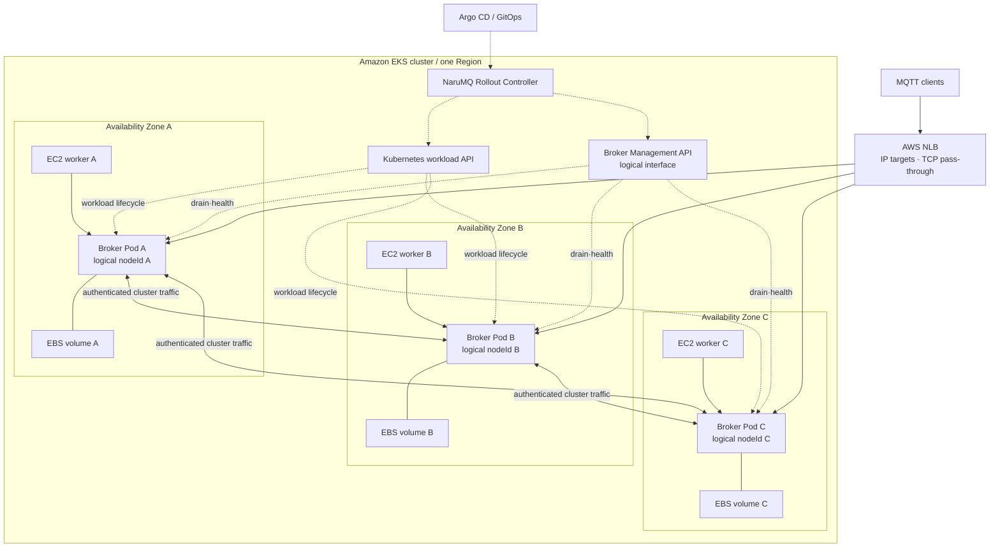

# EKS on EC2 deployment architecture

`EKS_EC2_HA`의 목표 배치는 세 broker Pod를 서로 다른 EC2 instance와 가용 영역에 하나씩 놓고 각 Pod에 독립 EBS volume을 연결한다. NLB는 MQTT endpoint를 제공한다. Rollout controller는 broker의 `SAFE_TO_STOP`을 확인한 뒤에만 workload 교체를 승인한다.

| 항목 | 값 |
| --- | --- |
| 관점 상태 | Target |
| 문서 상태 | Draft |
| 구현 증거 | 배포 산출물은 `deploy/kubernetes/eks-ec2-ha/`에 있다. 격리 EKS의 검증 범위와 실패는 [Drain 검증 기록](../verification/drain-and-rolling-update.md), [Cluster 검증 기록](../verification/cluster-session-and-delivery.md), [용량 검증 기록](../verification/performance-and-verification.md)에 둔다. 시험 환경은 폐기했으며 현재 실행 중인 배포를 뜻하지 않는다. |
| 범위 | `EKS_EC2_HA` logical-to-physical deployment mapping |
| 관련 요구사항 | [PRD](../requirements/PRD.md) DEP-01~DEP-23, CLU-01~CLU-14 |
| 관련 스펙 | [Drain과 rolling update](../specs/drain-and-rolling-update.md), [Cluster session과 durable delivery](../specs/cluster-session-and-delivery.md), [Performance와 verification](../specs/performance-and-verification.md) |
| 관련 결정 | [ADR-0006](../decisions/ADR-0006-external-rollout-controller.md), [ADR-0007](../decisions/ADR-0007-aws-production-deployment-platform.md). 모두 Accepted |
| 관련 해설 | [EKS 고가용성과 장애 도메인](../explainers/eks-ha-failure-domains.md), [AWS NLB와 MQTT 연결 lifecycle](../explainers/aws-nlb-mqtt-connection-lifecycle.md) |
| 최종 확인일 | 2026-10-16 |

## Production qualification profile selected

아래 값은 EKS qualification과 BP-02 비교에 사용할 profile이다. 실제 배포나 production 지원을 증명하지 않는다.

| 항목 | 선택 값 | 남은 검증 |
| --- | --- | --- |
| EKS | Kubernetes 1.37 | EKS platform version과 시험 증거 |
| Worker와 AMI | `m7g.large` 3대, AZ마다 1대; 인스턴스당 2 vCPU·8 GiB; EKS-optimized Amazon Linux 2023 ARM64 | Region별 AMI ID와 node group 설정 |
| Broker storage | broker별 20 GiB `gp3`, 기본 3,000 IOPS·125 MiB/s | 독립·암호화·AZ binding, 합성 복원·같은 EBS 재연결·disk pressure는 제한된 격리 시험으로 확인했다. Production 부하·반복 실행·정확한 RTO는 별도 수용 대상이다. [Drain 검증 기록](../verification/drain-and-rolling-update.md#5-eks-장애-matrix-실행-기록-2026-10-16)과 [Cluster CLU-14 기록](../verification/cluster-session-and-delivery.md#2026-10-16-clu-14-완결-matrix-실행-결과)을 따른다. |
| NLB | 내부 `IP` target, TCP 1883; Management 8080은 내부 ClusterIP Service | Readiness·deregistration 전파는 제한된 관찰만 있다. 정상 인증 traffic routing·기존 연결 drain·TLS endpoint·idle timeout·client IP의 전체 수용이 남았다. |
| Broker resources | Pod마다 requests=limits `1 CPU`·`4 GiB` | 측정한 production workload의 N-1 capacity |
| Comparator | EMQX Enterprise 6.3.1, ARM64 | 측정 workload를 허용하는 license; [PRD §18 질문 15](../requirements/PRD.md#18-미결정-사항) 참고 |

`IP` target은 Amazon VPC CNI를 사용한다. AWS Load Balancer Controller는 2.7.2 이상으로 하고 실제 버전과 image digest를 run artifact에 고정한다. NaruMQ와 EMQX에는 같은 node와 broker resource limit을 적용한다.

용량 측정에는 시험 전용 overlay `deploy/kubernetes/eks-ec2-ha-capacity/`를 쓴다. 이 overlay는 기본 `eks-ec2-ha`에 MQTT TLS listener 8883, NLB TCP 8883, broker Pod마다 loopback JWKS sidecar와 `security.json`을 만드는 init container를 더한다. 시험 전용 `broker-process.sh`는 broker를 자식 process로 실행한다. Controller는 이를 멈춘 뒤 Pod를 삭제해 정상 drain과 비정상 장애를 구분한다. 작은 실행 identity 파일은 64 KiB memory emptyDir에 둔다. Wrapper 자원도 broker container의 한도에 포함된다. Generator는 Terraform 변수 `capacity_generator_enabled`(기본 `false`)로 만드는 전용 node group(`c7g.xlarge` 1대, taint `narumq.io/generator=true:NoSchedule`)에서 Job으로 실행한다. 기본 manifest와 기본 Terraform 계획은 바뀌지 않는다. 측정 계약은 [성능 §3.9](../specs/performance-and-verification.md#39-bp-02-eks-용량-측정-계약)다.

용량은 아직 채택하지 않았다. Pod 장애 복구 단계는 보완했지만 quota 거절 분류와 production 부하 측정이 남았다. 정상 drain·worker 전원 손실·Pod 삭제는 서로 다른 장애 모델이다. 기준과 증거는 [성능 검증 기록](../verification/performance-and-verification.md#pod-장애-주입-보완의-eks-재실행-2026-10-16)을 따른다.

Peer TLS 인증서와 관리·MQTT 인증 정보는 Git에 넣지 않고 EKS Secret `narumq-cluster-secrets`로 주입한다. Image digest는 실행마다 artifact에 고정한다. 폐기된 fixture의 image·주소·volume ID를 새 배포의 입력으로 재사용하지 않는다.

### 검증 범위와 남은 제약

실측값·재시험 과정은 다음 검증 기록에서만 관리한다. 제한된 수용은 production 전체 승인이나 연속 가용성의 증거가 아니다.

| 범위 | 기록과 남은 제약 |
| --- | --- |
| 계획된 같은 AZ worker 이동 | [Drain 기록](../verification/drain-and-rolling-update.md#계획된-cross-worker-ebs-복구-수용-2026-10-15). 같은 PVC·PV·EBS와 MQTT 상태 복구를 확인한 계획된 이동이며 장애 복구와 구분한다. |
| 비정상 worker 종료와 peer 재연결 | [Cluster 기록](../verification/cluster-session-and-delivery.md#eks-무응답-종료-재측정-2026-10-16). ADR-0059의 TCP 생존 확인·기존 Pod 해제는 제한된 EKS 실행으로 확인했다. 다른 장애 유형·정확한 RTO는 별도다. |
| Leader·AZ 전원 중단·disk pressure | [Drain 장애 matrix](../verification/drain-and-rolling-update.md#5-eks-장애-matrix-실행-기록-2026-10-16). Worker 정지 모델과 표본 관찰이며 AZ network·EBS 서비스·control plane 장애, 반복 실행을 보장하지 않는다. |
| CoreDNS와 healthy node 관측 | [Drain 기록](../verification/drain-and-rolling-update.md#coredns-배치와-healthy-node-unknown의-eks-재현-2026-10-16). 아래 배치 전제로 timeout 구간을 줄이지만 없애지는 못한다. |

기존 EKS와 합성 fixture는 폐기했다. 보호 snapshot·공유 ECR image는 보존한다. 자원 정리 증거는 [TODO의 실행 환경](../TODO.md#실행-환경과-우선순위)에 연결한다. 폐기 기록을 장애 복구나 전체 AWS 비용 0의 증거로 사용하지 않는다.

## Physical deployment view

실선은 MQTT·cluster runtime traffic이다. 점선은 Kubernetes/AWS control flow다. AWS managed control plane과 세부 subnet·security group은 생략했다.

Management API는 내부 `narumq-management` ClusterIP Service의 8080/TCP로 접근한다. MQTT NLB도 `internal`이며 현재 1883/TCP만 노출한다. Dedicated rollout controller는 아직 배포하지 않았다. Diagram의 rollout 경로는 target design이며 live cluster에서 drain gate 시험을 거치지 않았다.

## Logical-to-physical mapping

| Logical identity·state | Physical resource | 수명과 제약 |
| --- | --- | --- |
| NaruMQ `nodeId` | Broker membership record와 assigned stable state | Pod 이름·IP·EC2 ID와 다르며 cluster lifetime 동안 재사용하지 않는다. |
| StatefulSet slot | Pod 이름·peer DNS·PVC·peer 인증서 `node-<ordinal>`·ConfigMap `slot-<ordinal>` | Slot은 ordinal로 정해지는 broker 자리다. `slot-<ordinal>` 값이 그 자리에서 실행할 `nodeId`를 정하고, Pod는 `node-<nodeId>.json`으로 시작한다. 초기 값은 `slot-0=1`, `slot-1=2`, `slot-2=3`이다. Volume을 잃은 slot은 새 `nodeId`로 채운다. |
| Broker process | Container in Pod | 재시작 시 TCP connection과 memory를 잃는다. |
| Broker runtime endpoint | Pod IP (`IP` target) | NLB가 Pod IP로 직접 전달하며 NodePort를 거치지 않는다. |
| Stable WAL·snapshot | Broker별 EBS persistent volume | 같은 가용 영역의 replacement EC2에 재연결한다. |
| Failure domain | EC2 instance와 가용 영역 | Quorum Pod를 서로 다르게 배치한다. |
| Session owner | Quorum-committed `(nodeId, epoch)` | Kubernetes scheduling state로 판정하지 않는다. |

PersistentVolume, Pod와 logical `nodeId`는 [ADR-0061](../decisions/ADR-0061-eks-ordinal-member-slot.md)의 slot으로 결합한다. Main container와 preStop drain은 같은 `slot-<ordinal>` 파일에서 `nodeId`를 읽는다. 파일이 없거나 값이 양의 10진수가 아니면 broker를 시작하지 않고 preStop도 drain을 요청하지 않는다. 잘못된 volume이 연결되거나 identity를 확인할 수 없으면 Pod를 READY로 만들지 않는다. 교체 절차는 [동적 멤버십 절차](../how-to/dynamic-cluster-membership.md#eks-slot의-volume-손실-교체)를 따르며 아직 Draft다.

## Traffic path

1. Client가 공통 NLB endpoint에 TCP/TLS connection을 만든다.
2. NLB가 release profile의 target type과 health state에 따라 broker target을 고른다.
3. Broker listener가 MQTT protocol과 client authentication을 처리한다.
4. 선택한 broker가 필요하면 cluster peer와 통신해 ownership·durable commit을 완료한다.
5. Client connection은 선택한 broker에 남는다. NLB는 established connection을 다른 Pod로 옮기지 않는다.

NLB는 `IP` targets와 TCP listeners를 사용한다. TLS를 NLB에서 종료하지 않고 broker listener에서 종료한다. 이 경로는 mTLS client certificate identity를 broker 인증 경계까지 보존한다. Health check, deregistration, client IP와 idle timeout 정책은 시험 profile에 고정해야 한다.

## Planned rollout control path

1. GitOps가 목표 release를 rollout resource에 반영한다.
2. Rollout controller가 대상 broker의 drain API를 호출한다.
3. Broker readiness와 NLB target lifecycle이 새 connection을 제외한다.
4. Broker가 connection·session·replication barrier를 완료한다.
5. Controller가 `SAFE_TO_STOP`을 확인한 뒤 Kubernetes에 Pod 교체를 요청한다.
6. Replacement Pod가 volume·identity·cluster sync를 검증하고 READY가 된다.
7. Controller가 다음 broker로 이동한다.

이는 구조적 제어 경로다. 상태, timeout과 실패 동작의 규범적 기준은 [Drain과 rolling update 스펙](../specs/drain-and-rolling-update.md)이다.

### Termination grace admission

`deploy/kubernetes/eks-ec2-ha-admission`은 [Drain §7](../specs/drain-and-rolling-update.md#7-external-rollout-gate와-kuberneteseks)의 짧은 grace 거절을 구현하는 별도 package다. 기본 namespaced 배포에 cluster-scoped 정책을 섞지 않으려고 분리했다. Kubernetes 1.30 이상의 `ValidatingAdmissionPolicy`와 binding을 명시적으로 설치한다. Binding은 `narumq` namespace만, policy는 Pod template의 `app=narumq`인 StatefulSet만 대상으로 삼는다.

현재 preStop의 600,000ms 대기에 따라 최소 grace는 660초다. 선택 annotation `narumq.io/drain-timeout-millis`는 admission에 더 긴 예산을 요구할 때만 쓴다. Broker timeout을 설정하는 field가 아니며 600,000ms 미만은 거절한다. 따라서 annotation으로 실제 hook보다 짧은 grace를 허용할 수 없다. Hook 대기를 늘리는 변경은 이 정책의 하한도 함께 갱신해야 한다.

Release profile의 지원 상태는 `deploy/release/deployment-profiles-v1.json`에 둔다. `tools/release-profile validate`는 이 descriptor와 현재 EKS manifest를 대조한다. `filter`는 다른 profile의 시험을 `EKS_EC2_HA`의 HA·RPO·rolling 근거에서 제외한다. Descriptor의 `Supported`는 대상 profile 분류다. 미실행 production 수용을 통과로 바꾸는 표시는 아니다.

## Placement와 availability constraint

- Required anti-affinity로 broker Pod 둘이 같은 EC2 worker에 배치되지 않게 한다.
- Topology spread와 `DoNotSchedule` 수준 제약으로 세 가용 영역에 하나씩 배치한다.
- Broker별 EBS volume을 공유하지 않는다.
- PodDisruptionBudget과 rollout 동시성은 계획 중단을 한 번에 한 broker로 제한한다.
- Replacement는 log·snapshot·route sync와 quorum 확인 전 NLB target에 포함되지 않는다.
- N-1 상태에서 production traffic과 재동기화를 함께 감당할 capacity를 확보한다.
- CoreDNS replica 두 개는 서로 다른 worker와 AZ에 둔다. `deploy/terraform/eks.tf`의 `aws_eks_addon.coredns`가 required hostname anti-affinity와 zone topology spread(`DoNotSchedule`)를 설정한다. Worker 하나를 잃어도 cluster DNS endpoint가 모두 사라지지 않는다.

PDB는 host·AZ loss를 막지 않으며 NLB deregistration은 application drain을 증명하지 않는다. 각각 placement evidence와 `SAFE_TO_STOP` evidence가 필요하다.

CoreDNS 배치 전제는 healthy node가 `unknown`으로 보이는 구간을 줄일 뿐 없애지 않는다. 관측 RPC는 query마다 peer DNS 이름을 새로 조회한다. 죽은 worker의 CoreDNS endpoint가 not ready가 될 때까지 일부 DNS 조회가 timeout된다. 그동안 healthy node가 `UNREACHABLE/node_query_timeout`으로 보일 수 있다. 2026-10-16 EKS 전제 실행에서 DNS timeout은 fault 뒤 5.39~27.89초에 나왔다. 사용자는 이 동작을 계약 동작으로 수용했다([Drain §10 CoreDNS 재현](../verification/drain-and-rolling-update.md#coredns-배치와-healthy-node-unknown의-eks-재현-2026-10-16)).

## Observability mapping

Release evidence는 다음 계층을 같은 run ID로 연결한다.

- Logical `nodeId`, owner epoch와 broker release
- Pod UID·IP와 Kubernetes node
- EC2 instance ID와 가용 영역
- PersistentVolume·EBS volume ID와 storage 설정
- NLB target ID·state와 target group 속성
- Drain operation ID와 `SAFE_TO_STOP` evidence

Dashboard label로 모든 cloud ID를 항상 노출할 필요는 없다. 그러나 failure test artifact에서는 logical failure와 physical resource를 역추적할 수 있어야 한다.

## 지원 범위와 미결정 사항

`EKS_EC2_HA`만 초기 production 지원 목표다. `ECS_EC2`는 Experimental 후보이며 `EKS_FARGATE`와 `COMPOSE_LOCAL`은 production HA 증거로 사용하지 않는다.

다음 값은 release profile과 후속 ADR에서 확정해야 한다.

- EKS platform version, region-specific AMI ID, node group과 capacity policy
- AWS Load Balancer Controller와 EKS add-on의 exact version·image digest
- EBS encryption·snapshot 정책과 실제 production I/O 적합성
- NLB health check, deregistration, client IP와 idle timeout 속성
- Management API ingress와 network policy
- Rollout controller replica, leader election과 failure recovery
- `terminationGracePeriodSeconds`, drain deadline과 전파 대기 값
