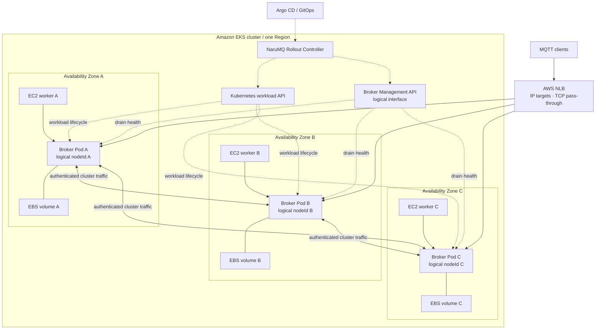

# EKS on EC2 deployment architecture

`EKS_EC2_HA`의 목표 배치는 세 broker Pod를 서로 다른 EC2 instance와 가용 영역에 하나씩 놓고 각 Pod에 독립 EBS volume을 연결한다. NLB는 MQTT endpoint를 제공한다. Rollout controller는 broker의 `SAFE_TO_STOP`을 확인한 뒤에만 workload 교체를 승인한다.

| 항목 | 값 |
| --- | --- |
| 관점 상태 | Target |
| 문서 상태 | Draft |
| 구현 증거 | `deploy/kubernetes/eks-ec2-ha/`의 초기 3-node 배포와 2026-10-15 삭제 전 3-AZ·Ready 관찰은 과거 실행 증거다. 비용 정리 승인에 따라 `narumq-eks`와 전용 인프라를 폐기했으며 현재 실행 중인 배포가 아니다. |
| 범위 | `EKS_EC2_HA` logical-to-physical deployment mapping |
| 관련 요구사항 | [PRD](../requirements/PRD.md) DEP-01~DEP-23, CLU-01~CLU-14 |
| 관련 스펙 | [Drain과 rolling update](../specs/drain-and-rolling-update.md), [Cluster session과 durable delivery](../specs/cluster-session-and-delivery.md), [Performance와 verification](../specs/performance-and-verification.md) |
| 관련 결정 | [ADR-0006](../decisions/ADR-0006-external-rollout-controller.md), [ADR-0007](../decisions/ADR-0007-aws-production-deployment-platform.md). 모두 Accepted |
| 관련 해설 | [EKS 고가용성과 장애 도메인](../explainers/eks-ha-failure-domains.md), [AWS NLB와 MQTT 연결 lifecycle](../explainers/aws-nlb-mqtt-connection-lifecycle.md) |
| 최종 확인일 | 2026-10-15 |

## Production qualification profile selected

아래 값은 EKS qualification과 BP-02 비교에 사용할 profile이다. 실제 배포나 production 지원을 증명하지 않는다.

| 항목 | 선택 값 | 남은 검증 |
| --- | --- | --- |
| EKS | Kubernetes 1.37 | EKS platform version과 시험 증거 |
| Worker와 AMI | `m7g.large` 3대, AZ마다 1대; 인스턴스당 2 vCPU·8 GiB; EKS-optimized Amazon Linux 2023 ARM64 | Region별 AMI ID와 node group 설정 |
| Broker storage | broker별 20 GiB `gp3`, 기본 3,000 IOPS·125 MiB/s | 암호화·AZ binding·같은 PVC/EBS remount와 계획된 same-AZ cross-worker 재연결은 제한 범위에서 확인했다([수용 기록](../specs/drain-and-rolling-update.md#계획된-cross-worker-ebs-복구-수용-2026-10-15)). 단일 EC2 비정상 종료 후 재연결은 [실패한 초기 observer와 후속 복구 관찰](../specs/drain-and-rolling-update.md#비정상-단일-ec2-worker-복구-관찰-2026-10-15)로 구분한다. 전체 장애 matrix·자동 관찰 완료·정확한 RTO·snapshot/restore·disk pressure·production I/O·durability는 미검증이다. |
| NLB | 내부 `IP` target, TCP 1883; Management 8080은 내부 ClusterIP Service | T0→EndpointSlice unready 11.520641s, T0→target `draining` 12.647725s 관찰(보고된 30s 예산 이내); 성공 인증 traffic routing, existing connection drain, TLS endpoint, idle timeout·client IP 미검증 |
| Broker resources | Pod마다 requests=limits `1 CPU`·`4 GiB` | 측정한 production workload의 N-1 capacity |
| Comparator | EMQX Enterprise 6.3.1, ARM64 | 측정 workload를 허용하는 license; [PRD §18 질문 15](../requirements/PRD.md#18-미결정-사항) 참고 |

`IP` target은 Amazon VPC CNI를 사용한다. AWS Load Balancer Controller는 2.7.2 이상으로 하고 실제 버전과 image digest를 run artifact에 고정한다. NaruMQ와 EMQX에는 같은 node와 broker resource limit을 적용한다.

ARM64 broker image는 `809446814769.dkr.ecr.ap-northeast-2.amazonaws.com/narumq@sha256:09f77ae1e4d2277fb96192abaafbf3e2d1717683746ff8e6acc17efc9ccfa916`으로 고정한다. 2026-10-14 작업 트리의 node 관측 API를 포함한 image이며 배포·검증 결과는 [EKS 재배포 실행 기록](../how-to/operations-dashboard.md#eks-재배포-실행-기록-2026-10-14)에 둔다. Peer TLS 인증서와 관리·MQTT 인증 정보는 Git에 넣지 않고 EKS Secret `narumq-cluster-secrets`에 저장한다. 이 image의 초기 cluster·Dashboard 검증은 production workload, TLS client endpoint 또는 장애 주입의 증거가 아니다.

### 라이브 EKS에서 관찰한 제한된 동작 (2026-10-14)

AWS EKS live cluster(`narumq-eks`, ap-northeast-2)의 배치·단일 drain·Pod 재생성·preStop 성공 관찰이다. 아래 결과는 각 acceptance의 일부 evidence이며 DEP-13~23 전체 또는 EKS production qualification 완료를 뜻하지 않는다.

1. **3-AZ 배치 관찰 (DEP-15·DEP-20 일부)**:
   - 3개 worker node(`ap-northeast-2a`, `ap-northeast-2b`, `ap-northeast-2c`)에 broker Pod(`narumq-0`, `narumq-1`, `narumq-2`)가 하나씩 배치된 것을 확인했다.
   - `podAntiAffinity`(`requiredDuringSchedulingIgnoredDuringExecution` on `kubernetes.io/hostname`) 및 `topologySpreadConstraints`(`maxSkew: 1`, `topologyKey: topology.kubernetes.io/zone`, `DoNotSchedule`) 설정을 확인했다. EC2/AZ failure injection, 단일 AZ 장애 데이터 플레인 복구, PDB 및 rollout 동시성 acceptance는 이 결과로 검증되지 않는다.
2. **EBS 볼륨 독립성 및 KMS 암호화 (DEP-21)**:
   - 3개 PV(`pvc-c5fb94f3-...`, `pvc-ee6982d0-...`, `pvc-4432f554-...`)에 바인딩된 Amazon EBS 볼륨(`vol-008e786a085cefaf1`, `vol-09c3a0e11277903d9`, `vol-0b7a87e6bafd97a79`)이 모두 `gp3`, 20 GiB, AWS KMS 고객 관리 키 암호화(`Encrypted: true`), 각 AZ별 `in-use` 상태임을 AWS EC2 API로 확인했다.
3. **Pod 재생성 뒤 동일 EBS 재연결 관찰 (DEP-21 일부)**:
   - `narumq-1` Pod 삭제 시 나머지 두 노드로 quorum(`quorumAvailable=true`)이 유지됐다.
   - 재생성 Pod가 같은 PVC(`data-narumq-1`)와 EBS volume(`vol-09c3a0e11277903d9`)을 재사용해 65.1초 만에 `Ready`가 됐다. 이는 같은 volume remount 관찰이지 다른 worker에 대한 EBS 재연결 acceptance는 아니다.
   - Applied index는 93에서 100으로 전진했다. 이 관찰만으로 WAL/snapshot 무손실 복구, durable ACK/data 보존을 입증하지 않는다.
4. **단일 drain에서의 상태·전파 관찰 (DEP-22 일부)**:
   - Drain 시작 뒤 `/health/ready`가 0.079s 내 503, EndpointSlice `ready:false`는 T0+11.520641s, AWS NLB target `draining`은 T0+12.647725s에 관찰됐다. 두 전파 시간은 기록 timestamp에서 계산한 값으로 30초 예산 이내다.
   - NLB를 통한 20개 MQTT connect probe는 모두 unauthenticated였고 성공적으로 수락된 연결은 없었다. Report의 `nlbRoutingIsolated=false`; 이 결과는 정상 인증 traffic이 healthy target에만 routing됨을 증명하지 않는다. 별도의 direct probe는 drain 중 broker가 `CONNACK 0x03`을 반환한 것을 확인했다.
5. **preStop 성공 경로 관찰 (DEP-13·DEP-14 일부)**:
   - 최초 실행(GET 404) 뒤 POST하고 `COMPLETED/SAFE_TO_STOP`까지 기다린 실행(36.5s, exit 0), 재실행 시 완료 작업 재사용(1.5s, exit 0)을 확인했다.
   - Hook/drain failure, timeout, grace expiry 및 삭제 admission 차단은 이 성공 경로로 검증되지 않는다. 기존 연결 drain/termination, NLB idle timeout/client IP, EBS snapshot/restore와 disk pressure도 미검증이다.
6. **Evidence**:
   - `.artifacts/verification/nlb-lifecycle-verification-report.json`, `.artifacts/verification/prestop-hook-verification-report.json`, `.artifacts/verification/ebs-storage-az-recovery-report.json`.

### 기존 시험 환경 최종 폐기 (2026-10-15)

사용자가 비용 정리를 위해 기존 `narumq-eks`와 전용 인프라의 삭제를 승인했다. 삭제 전에는 읽기 전용 점검만 수행했다. Broker 3개가 서로 다른 AZ·worker에서 Ready였고, health probe 9개와 NLB healthy target 3개를 확인했다. 독립된 20 GiB 암호화 gp3 volume과 660초 종료 유예 설정도 확인했다. Rollout controller는 설치돼 있지 않았다. 이 구성 관찰은 장애·timeout·복원 수용 시험을 대신하지 않는다.

최종 online backup(commit index 100)의 body/trailer checksum과 전체 파일 hash를 검증했다. Archive, voter 설정·인증 자료, node-local 감사 기록과 Terraform state를 Windows DPAPI `CurrentUser`로 암호화해 보존한 뒤 전용 namespace와 Terraform 관리 자원 41개를 삭제했다. 직접 AWS 조회에서 EKS·VPC·NLB·target group·전용 security group·ENI·EBS 7개·EIP·IAM 역할/정책/OIDC provider가 없고, NAT는 `deleted` 상태이며 Terraform state는 resource 0개였다. 전용 CloudWatch log group도 삭제했다. 사용자가 전체 로그 보존의 필요성을 질문한 뒤 불필요한 전체 내보내기를 중단했고 부분 수집 파일도 제거했다. 필요한 시험 증거와 node-local 감사 기록은 별도로 보존했다. 보호 snapshot 세 개와 공유 ECR image는 유지했다. 최종 상태는 `.artifacts/verification/eks-final-20261014T221024Z/final-decommission-summary.json`에 기록했다.

증거는 `.artifacts/verification/eks-final-20261014T221024Z/eks-readonly-qualification.json`, `preservation.json`, `terraform-final-apply-result.json`, `post-terraform-direct-verification.json`에 있다. 기존 `CLU-14 FAILED/UNRESOLVED`와 전체 EKS acceptance 미완료 상태는 유지한다. 최종 폐기를 장애·롤아웃 시험 결과로 사용하지 않는다.

### 격리 시험 재개 (2026-10-15)

사용자 재개 지시에 따라 `deploy/terraform-acceptance`의 별도 local state로 `narumq-ha-acceptance-20261015`를 만들었다. `m7g.large` worker 세 개를 서로 다른 AZ에 배치했고 새 VPC의 peering/TGW 경로 부재를 확인했다. 원본 `narumq-eks`는 재생성하지 않았다. 전용 S3·IRSA는 별도 `deploy/terraform-acceptance-s3` state로 관리했다. Base 배포의 공유 image pin을 시험 image로 덮어쓰지 않고, 검증한 전용 ARM64 platform digest를 fixture 입력으로만 사용했다.

실제 rollout·active-drain controller 재시작·API 실패 차단·target Lease 독점과 감사 PVC 검증은 [Drain §10](../specs/drain-and-rolling-update.md#10-broker-drain-수용-시험-매핑)에 있다. 새 PVC 세 개의 S3 복원·전체 RTO는 [Cluster §11.9](../specs/cluster-session-and-delivery.md#119-offline-queue-replication과-backup-v3-수용-매핑), 같은 EC2/EBS 비정상 재시작에서 찾은 취소 상태 결함과 수정 후 검증은 [§11.20](../specs/cluster-session-and-delivery.md#1120-voter-volume-손실-보호와-재시드-수용-매핑)에 둔다. 이 제한된 실행을 전체 DEP·CLU-14 또는 production 성능 수용으로 사용하지 않는다.

시험 후 새 EKS·S3 전용 관리 자원 54개를 삭제했다. 직접 AWS 조회에서 전용 VPC·NLB·EBS 11개·ENI·security group·ASG·IAM·OIDC·S3 bucket·log group 부재와 NAT `deleted`를 확인했다. 두 state의 resource는 0개다. 작업 image 태그·digest 5개를 제거하고 기존 공유 image와 보호 snapshot 세 개는 유지했다. 필요한 archive·설정·감사·state/plan 기록은 DPAPI `CurrentUser`로 암호화했다. 상세는 `.artifacts/verification/eks-resume-20261015T000337Z-21df3b/final-summary.json`, `direct-cleanup-verification.json`, `iam-nat-cleanup-verification.json`을 따른다. 전체 CloudWatch 로그는 수집하지 않았다.

### 계획된 다른 worker의 EBS 복구 (2026-10-15)

별도 state·새 VPC의 합성 fixture에서 기존 3-AZ broker 배치를 사용했다. 이동 대상 volume과 같은 AZ에 임시 worker 하나를 추가했다. 기존 worker의 신규 scheduling을 막은 뒤 broker의 `SAFE_TO_STOP`을 확인하고 해당 Pod UID를 삭제했다. 새 worker가 같은 PVC·PV·EBS를 연결했으며 broker와 MQTT 상태가 복구됐다. 이는 계획된 이동 경로이며 EC2·AZ·volume 장애 경로는 아니다. 실행 파일·결과와 자원 정리는 [Drain §10의 수용 기록](../specs/drain-and-rolling-update.md#계획된-cross-worker-ebs-복구-수용-2026-10-15)을 따른다. 제품 코드와 배포 template은 바꾸지 않았다.

### 단일 EC2 비정상 종료 후 복구 관찰 (2026-10-15)

새 격리 fixture에서 follower EC2를 OS shutdown 없이 종료했다. 종료 확인 뒤 시도한 operator의 out-of-service Node patch는 CAS 검사에서 거절됐다. AWS cloud controller가 기존 Node를 제거했고, 다른 EC2에서 같은 EBS를 연결한 broker와 기존 MQTT 상태가 복구됐다. 이 관찰은 제품 코드·배포 template을 바꾸지 않았다. 초기 observer 실패와 관찰 공백이 있으므로 자동 복구 수용·정확한 RTO·연속 가용성을 완료로 표시하지 않는다. 실행과 정리의 기준 기록은 [Drain §10](../specs/drain-and-rolling-update.md#비정상-단일-ec2-worker-복구-관찰-2026-10-15)을 따른다.

## Physical deployment view

실선은 MQTT·cluster runtime traffic이다. 점선은 Kubernetes/AWS control flow다. AWS managed control plane과 세부 subnet·security group은 생략했다.

Management API는 내부 `narumq-management` ClusterIP Service의 8080/TCP로 접근한다. MQTT NLB도 `internal`이며 현재 1883/TCP만 노출한다. Dedicated rollout controller는 아직 배포하지 않았다. Diagram의 rollout 경로는 target design이며 live cluster에서 drain gate 시험을 거치지 않았다.

## Logical-to-physical mapping

| Logical identity·state | Physical resource | 수명과 제약 |
| --- | --- | --- |
| NaruMQ `nodeId` | Broker membership record와 assigned stable state | Pod 이름·IP·EC2 ID와 다르며 cluster lifetime 동안 재사용하지 않는다. |
| Broker process | Container in Pod | 재시작 시 TCP connection과 memory를 잃는다. |
| Broker runtime endpoint | Pod IP (`IP` target) | NLB가 Pod IP로 직접 전달하며 NodePort를 거치지 않는다. |
| Stable WAL·snapshot | Broker별 EBS persistent volume | 같은 가용 영역의 replacement EC2에 재연결한다. |
| Failure domain | EC2 instance와 가용 영역 | Quorum Pod를 서로 다르게 배치한다. |
| Session owner | Quorum-committed `(nodeId, epoch)` | Kubernetes scheduling state로 판정하지 않는다. |

PersistentVolume, Pod와 logical `nodeId`의 결합 방식은 storage·membership ADR에서 확정해야 한다. 잘못된 volume이 연결되거나 identity를 확인할 수 없으면 Pod를 READY로 만들지 않는다.

## Traffic path

1. Client가 공통 NLB endpoint에 TCP/TLS connection을 만든다.
2. NLB가 release profile의 target type과 health state에 따라 broker target을 고른다.
3. Broker listener가 MQTT protocol과 client authentication을 처리한다.
4. 선택한 broker가 필요하면 cluster peer와 통신해 ownership·durable commit을 완료한다.
5. Client connection은 선택한 broker에 남는다. NLB는 established connection을 다른 Pod로 옮기지 않는다.

NLB는 `IP` targets와 TCP listeners를 사용한다. TLS를 NLB에서 종료하지 않고 broker listener에서 종료한다. 이 경로는 mTLS client certificate identity를 broker 인증 경계까지 보존한다. Health check, deregistration, client IP와 idle timeout 정책은 시험 profile에 고정해야 한다.

## Planned rollout control path

1. GitOps가 목표 release를 rollout resource에 반영한다.
2. Rollout controller가 대상 broker의 drain API를 호출한다.
3. Broker readiness와 NLB target lifecycle이 새 connection을 제외한다.
4. Broker가 connection·session·replication barrier를 완료한다.
5. Controller가 `SAFE_TO_STOP`을 확인한 뒤 Kubernetes에 Pod 교체를 요청한다.
6. Replacement Pod가 volume·identity·cluster sync를 검증하고 READY가 된다.
7. Controller가 다음 broker로 이동한다.

이는 구조적 제어 경로다. 상태, timeout과 실패 동작의 규범적 기준은 [Drain과 rolling update 스펙](../specs/drain-and-rolling-update.md)이다.

## Placement와 availability constraint

- Required anti-affinity로 broker Pod 둘이 같은 EC2 worker에 배치되지 않게 한다.
- Topology spread와 `DoNotSchedule` 수준 제약으로 세 가용 영역에 하나씩 배치한다.
- Broker별 EBS volume을 공유하지 않는다.
- PodDisruptionBudget과 rollout 동시성은 계획 중단을 한 번에 한 broker로 제한한다.
- Replacement는 log·snapshot·route sync와 quorum 확인 전 NLB target에 포함되지 않는다.
- N-1 상태에서 production traffic과 재동기화를 함께 감당할 capacity를 확보한다.

PDB는 host·AZ loss를 막지 않으며 NLB deregistration은 application drain을 증명하지 않는다. 각각 placement evidence와 `SAFE_TO_STOP` evidence가 필요하다.

## Observability mapping

Release evidence는 다음 계층을 같은 run ID로 연결한다.

- Logical `nodeId`, owner epoch와 broker release
- Pod UID·IP와 Kubernetes node
- EC2 instance ID와 가용 영역
- PersistentVolume·EBS volume ID와 storage 설정
- NLB target ID·state와 target group 속성
- Drain operation ID와 `SAFE_TO_STOP` evidence

Dashboard label로 모든 cloud ID를 항상 노출할 필요는 없다. 그러나 failure test artifact에서는 logical failure와 physical resource를 역추적할 수 있어야 한다.

## 지원 범위와 미결정 사항

`EKS_EC2_HA`만 초기 production 지원 목표다. `ECS_EC2`는 Experimental 후보이며 `EKS_FARGATE`와 `COMPOSE_LOCAL`은 production HA 증거로 사용하지 않는다.

다음 값은 release profile과 후속 ADR에서 확정해야 한다.

- EKS platform version, region-specific AMI ID, node group과 capacity policy
- AWS Load Balancer Controller와 EKS add-on의 exact version·image digest
- EBS encryption·snapshot 정책과 실제 production I/O 적합성
- NLB health check, deregistration, client IP와 idle timeout 속성
- Management API ingress와 network policy
- Rollout controller replica, leader election과 failure recovery
- `terminationGracePeriodSeconds`, drain deadline과 전파 대기 값
