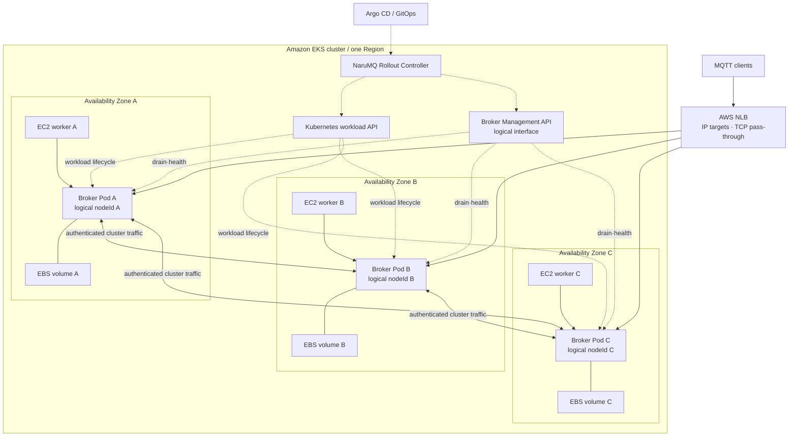

# EKS on EC2 deployment architecture

`EKS_EC2_HA`의 목표 배치는 세 broker Pod를 서로 다른 EC2 instance와 가용 영역에 하나씩 놓고 각 Pod에 독립 EBS volume을 연결한다. NLB는 MQTT endpoint를 제공한다. Rollout controller는 broker의 `SAFE_TO_STOP`을 확인한 뒤에만 workload 교체를 승인한다.

| 항목 | 값 |
| --- | --- |
| 관점 상태 | Target |
| 문서 상태 | Draft |
| 구현 증거 | `deploy/kubernetes/eks-ec2-ha/`가 `narumq-eks`에서 초기 3-node cluster를 시작했다. 세 Pod가 서로 다른 AZ에서 Ready다. |
| 범위 | `EKS_EC2_HA` logical-to-physical deployment mapping |
| 관련 요구사항 | [PRD](../requirements/PRD.md) DEP-01~DEP-23, CLU-01~CLU-14 |
| 관련 스펙 | [Drain과 rolling update](../specs/drain-and-rolling-update.md), [Cluster session과 durable delivery](../specs/cluster-session-and-delivery.md), [Performance와 verification](../specs/performance-and-verification.md) |
| 관련 결정 | [ADR-0006](../decisions/ADR-0006-external-rollout-controller.md), [ADR-0007](../decisions/ADR-0007-aws-production-deployment-platform.md). 모두 Accepted |
| 관련 해설 | [EKS 고가용성과 장애 도메인](../explainers/eks-ha-failure-domains.md), [AWS NLB와 MQTT 연결 lifecycle](../explainers/aws-nlb-mqtt-connection-lifecycle.md) |
| 최종 확인일 | 2026-10-13 |

## Production qualification profile selected

아래 값은 EKS qualification과 BP-02 비교에 사용할 profile이다. 실제 배포나 production 지원을 증명하지 않는다.

| 항목 | 선택 값 | 남은 검증 |
| --- | --- | --- |
| EKS | Kubernetes 1.37 | EKS platform version과 시험 증거 |
| Worker와 AMI | `m7g.large` 3대, AZ마다 1대; 인스턴스당 2 vCPU·8 GiB; EKS-optimized Amazon Linux 2023 ARM64 | Region별 AMI ID와 node group 설정 |
| Broker storage | broker별 20 GiB `gp3`, 기본 3,000 IOPS·125 MiB/s | 암호화·snapshot 정책과 production I/O 적합성 |
| NLB | 내부 `IP` target, TCP 1883; Management 8080은 내부 ClusterIP Service | Broker TLS endpoint, health check, deregistration, idle timeout |
| Broker resources | Pod마다 requests=limits `1 CPU`·`4 GiB` | 측정한 production workload의 N-1 capacity |
| Comparator | EMQX Enterprise 6.3.1, ARM64 | 측정 workload를 허용하는 license; [PRD §18 질문 15](../requirements/PRD.md#18-미결정-사항) 참고 |

`IP` target은 Amazon VPC CNI를 사용한다. AWS Load Balancer Controller는 2.7.2 이상으로 하고 실제 버전과 image digest를 run artifact에 고정한다. NaruMQ와 EMQX에는 같은 node와 broker resource limit을 적용한다.

ARM64 broker image는 `809446814769.dkr.ecr.ap-northeast-2.amazonaws.com/narumq@sha256:09f77ae1e4d2277fb96192abaafbf3e2d1717683746ff8e6acc17efc9ccfa916`으로 고정한다. 2026-10-14 작업 트리의 node 관측 API를 포함한 image이며 배포·검증 결과는 [EKS 재배포 실행 기록](../how-to/operations-dashboard.md#eks-재배포-실행-기록-2026-10-14)에 둔다. Peer TLS 인증서와 관리·MQTT 인증 정보는 Git에 넣지 않고 EKS Secret `narumq-cluster-secrets`에 저장한다. 이 image의 초기 cluster·Dashboard 검증은 production workload, TLS client endpoint 또는 장애 주입의 증거가 아니다.

## Physical deployment view

실선은 MQTT·cluster runtime traffic이다. 점선은 Kubernetes/AWS control flow다. AWS managed control plane과 세부 subnet·security group은 생략했다.

Management API는 내부 `narumq-management` ClusterIP Service의 8080/TCP로 접근한다. MQTT NLB도 `internal`이며 현재 1883/TCP만 노출한다. Dedicated rollout controller는 아직 배포하지 않았다. Diagram의 rollout 경로는 target design이며 live cluster에서 drain gate 시험을 거치지 않았다.

## Logical-to-physical mapping

| Logical identity·state | Physical resource | 수명과 제약 |
| --- | --- | --- |
| NaruMQ `nodeId` | Broker membership record와 assigned stable state | Pod 이름·IP·EC2 ID와 다르며 cluster lifetime 동안 재사용하지 않는다. |
| Broker process | Container in Pod | 재시작 시 TCP connection과 memory를 잃는다. |
| Broker runtime endpoint | Pod IP (`IP` target) | NLB가 Pod IP로 직접 전달하며 NodePort를 거치지 않는다. |
| Stable WAL·snapshot | Broker별 EBS persistent volume | 같은 가용 영역의 replacement EC2에 재연결한다. |
| Failure domain | EC2 instance와 가용 영역 | Quorum Pod를 서로 다르게 배치한다. |
| Session owner | Quorum-committed `(nodeId, epoch)` | Kubernetes scheduling state로 판정하지 않는다. |

PersistentVolume, Pod와 logical `nodeId`의 결합 방식은 storage·membership ADR에서 확정해야 한다. 잘못된 volume이 연결되거나 identity를 확인할 수 없으면 Pod를 READY로 만들지 않는다.

## Traffic path

1. Client가 공통 NLB endpoint에 TCP/TLS connection을 만든다.
2. NLB가 release profile의 target type과 health state에 따라 broker target을 고른다.
3. Broker listener가 MQTT protocol과 client authentication을 처리한다.
4. 선택한 broker가 필요하면 cluster peer와 통신해 ownership·durable commit을 완료한다.
5. Client connection은 선택한 broker에 남는다. NLB는 established connection을 다른 Pod로 옮기지 않는다.

NLB는 `IP` targets와 TCP listeners를 사용한다. TLS를 NLB에서 종료하지 않고 broker listener에서 종료한다. 이 경로는 mTLS client certificate identity를 broker 인증 경계까지 보존한다. Health check, deregistration, client IP와 idle timeout 정책은 시험 profile에 고정해야 한다.

## Planned rollout control path

1. GitOps가 목표 release를 rollout resource에 반영한다.
2. Rollout controller가 대상 broker의 drain API를 호출한다.
3. Broker readiness와 NLB target lifecycle이 새 connection을 제외한다.
4. Broker가 connection·session·replication barrier를 완료한다.
5. Controller가 `SAFE_TO_STOP`을 확인한 뒤 Kubernetes에 Pod 교체를 요청한다.
6. Replacement Pod가 volume·identity·cluster sync를 검증하고 READY가 된다.
7. Controller가 다음 broker로 이동한다.

이는 구조적 제어 경로다. 상태, timeout과 실패 동작의 규범적 기준은 [Drain과 rolling update 스펙](../specs/drain-and-rolling-update.md)이다.

## Placement와 availability constraint

- Required anti-affinity로 broker Pod 둘이 같은 EC2 worker에 배치되지 않게 한다.
- Topology spread와 `DoNotSchedule` 수준 제약으로 세 가용 영역에 하나씩 배치한다.
- Broker별 EBS volume을 공유하지 않는다.
- PodDisruptionBudget과 rollout 동시성은 계획 중단을 한 번에 한 broker로 제한한다.
- Replacement는 log·snapshot·route sync와 quorum 확인 전 NLB target에 포함되지 않는다.
- N-1 상태에서 production traffic과 재동기화를 함께 감당할 capacity를 확보한다.

PDB는 host·AZ loss를 막지 않으며 NLB deregistration은 application drain을 증명하지 않는다. 각각 placement evidence와 `SAFE_TO_STOP` evidence가 필요하다.

## Observability mapping

Release evidence는 다음 계층을 같은 run ID로 연결한다.

- Logical `nodeId`, owner epoch와 broker release
- Pod UID·IP와 Kubernetes node
- EC2 instance ID와 가용 영역
- PersistentVolume·EBS volume ID와 storage 설정
- NLB target ID·state와 target group 속성
- Drain operation ID와 `SAFE_TO_STOP` evidence

Dashboard label로 모든 cloud ID를 항상 노출할 필요는 없다. 그러나 failure test artifact에서는 logical failure와 physical resource를 역추적할 수 있어야 한다.

## 지원 범위와 미결정 사항

`EKS_EC2_HA`만 초기 production 지원 목표다. `ECS_EC2`는 Experimental 후보이며 `EKS_FARGATE`와 `COMPOSE_LOCAL`은 production HA 증거로 사용하지 않는다.

다음 값은 release profile과 후속 ADR에서 확정해야 한다.

- EKS platform version, region-specific AMI ID, node group과 capacity policy
- AWS Load Balancer Controller와 EKS add-on의 exact version·image digest
- EBS encryption·snapshot 정책과 실제 production I/O 적합성
- NLB health check, deregistration, client IP와 idle timeout 속성
- Management API ingress와 network policy
- Rollout controller replica, leader election과 failure recovery
- `terminationGracePeriodSeconds`, drain deadline과 전파 대기 값
