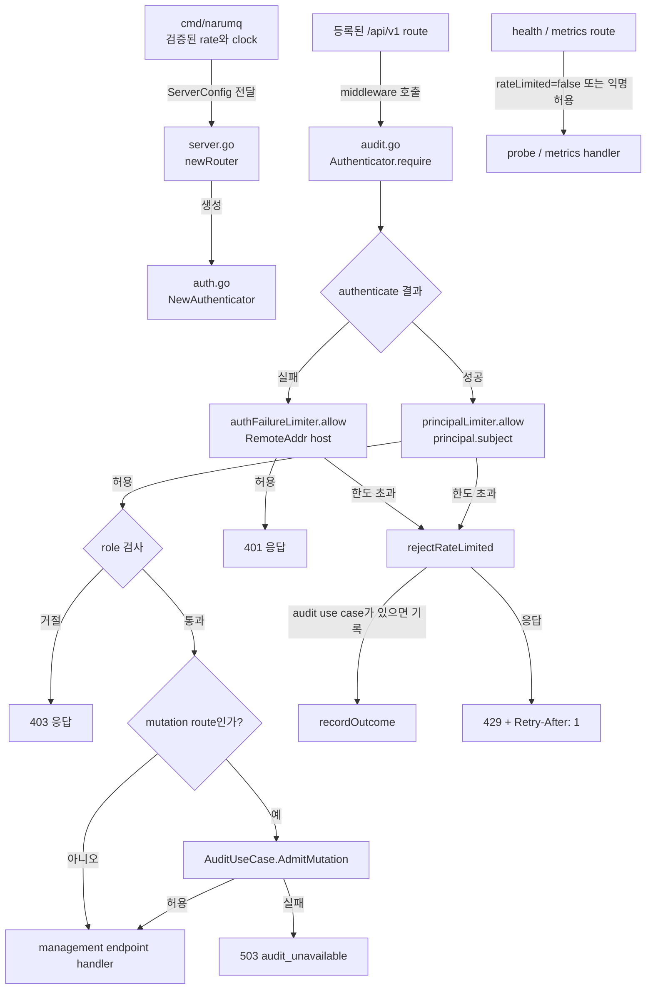

# Management HTTP adapter 모듈 설계

이 모듈은 management HTTP route, 인증·role 검사, node-local rate limit과 응답 생성을 담당한다. Rate limiter는 process memory를 사용하며, application 계층에는 rate-limit 정책이나 limiter 상태를 노출하지 않는다.

| 항목 | 값 |
| --- | --- |
| 구조 시점 | Current |
| 문서 상태 | Verified |
| 구현 대조 | 2026-10-09 source, adapter·contract·process 시험과 local gate |
| 코드 위치 | `internal/adapters/http/management` |
| 코드 지도 | [Project structure](project-structure.md) |
| 관련 스펙 | [Management API와 observability §1.5](../specs/management-api-and-observability.md#15-rate-limit), [§8·§9](../specs/management-api-and-observability.md#8-dashboard-계약) |
| 관련 요구사항 | [PRD](../requirements/PRD.md) API-05, SEC-11, UI-01~UI-05·UI-10 |
| 관련 계약 | [Management API v1](../contracts/management-api-v1.md), [Audit event v1](../contracts/audit-event-v1.md) |
| 관련 ADR | [ADR-0043](../decisions/ADR-0043-management-api-rate-limit.md), [ADR-0045](../decisions/ADR-0045-operations-dashboard-grafana.md) |

## 1. 책임과 경계

- 맡는 책임: HTTP route를 application management port에 연결하고, 주입된 credential의 인증·role 검사·rate limit·공통 오류 응답을 적용한다.
- 맡는 책임: rate limit을 적용한 요청의 거절 결과를 주입된 `AuditUseCase`에 전달한다.
- 맡지 않는 책임: flag와 cluster JSON 검증, credential file I/O, cluster 전체 rate 합산, audit 파일 저장과 회전이다. 설정·key file 검증은 `cmd/narumq`가, audit 저장은 `internal/adapters/auditlog`가 담당한다.
- 다른 모듈에 공개하는 기능: `NewServer`, `NewServerWithMembership`, `NewRouter`, `NewRouterWithMembership`와 `ServerConfig`다.

`NewServer`는 audit use case를 전달하지 않는다. `NewServerWithMembership`는 cluster 구성에서 audit use case를 받는다. [Audit event v1 contract §5](../contracts/audit-event-v1.md)에 따라 standalone mode는 audit producer 범위가 아니다.

## 2. 내부 구조

아래 화살표는 runtime 호출 또는 설정 전달을 뜻한다.

| 요소 | 역할 | 만들어지는 시점과 소유자 | 의존 대상 |
| --- | --- | --- | --- |
| `server.go` `newRouter` | route를 등록하고 `Authenticator`를 route middleware에 연결한다. | Router를 만들 때 생성하며 HTTP server가 소유한다. | Management ports, metrics port, `AuthConfig` |
| `auth.go` `NewAuthenticator` | credential 검증, `subject`·role 생성, 두 limiter 초기화와 기본값 적용을 한다. | Router 초기화 때 생성되며 해당 router가 소유한다. | `ports/clock.Clock`, `requestRateLimiter` |
| `audit.go` `Authenticator.require` | 인증 실패 IP limit, 인증 성공 principal limit, role 검사와 mutation admission 순서를 실행한다. | 요청마다 middleware가 호출한다. | `Authenticator`, optional `AuditUseCase` |
| `audit.go` `rejectRateLimited` | denial audit 결과를 전달하고 `429` 응답과 `Retry-After`를 만든다. | 한도를 넘긴 요청마다 호출한다. | `recordOutcome`, `WriteError` |
| `rate_limit.go` `requestRateLimiter` | key별 token bucket을 잠금으로 보호하고 refill·eviction을 수행한다. | `NewAuthenticator`마다 principal/IP limiter 하나씩 생성한다. | `ports/clock.Clock` |
| `server.go` health·metrics route | probe와 scrape handler를 등록하고 rate limit에서 제외한다. | Router 초기화 때 등록한다. | `health.go`, `metrics.go` |

## 3. 데이터 모델

| 이름 | 형태 | 저장 위치 | 제약과 항상 지켜야 할 조건 |
| --- | --- | --- | --- |
| `ServerConfig.RequestRate` | 정수, 초당 rate와 burst | process 설정 | 기본 50이며 `cmd/narumq`가 1~1,000,000 범위를 검증한다. |
| `ServerConfig.AuthFailureRate` | 정수, 초당 rate와 burst | process 설정 | 기본 5이며 `cmd/narumq`가 1~1,000,000 범위를 검증한다. |
| `ServerConfig.APIKey`, `APIKeyRole` | key 문자열과 역할 | process 설정 | Cluster mode에서 `cmd/narumq/cluster_config.go` `loadClusterManagementCredentials`가 `management.readOnlyApiKeyFile`을 읽고 양끝 공백을 제거한다. 빈 key와 ClusterAdmin token과 같은 key를 거절한 뒤 `RoleReadOnly`로 주입한다. HTTP adapter는 파일을 직접 읽지 않는다. |
| principal key | `managementPrincipal.subject` 문자열 | principal limiter map | Bearer, API key, local anonymous subject를 구분한다. `X-Forwarded-For`를 사용하지 않는다. |
| 인증 실패 key | `RemoteAddr`에서 분리한 host | auth-failure limiter map | host-port parsing 실패 시 원문을 쓰고 빈 주소는 `unknown`으로 바꾼다. |
| `rateBucket` | `tokens float64`, `refilled time.Time` | limiter map | token은 rate를 넘지 않는다. 새 bucket은 가득 찬 상태로 시작한다. |
| `requestRateLimiter.buckets` | key와 bucket의 map | process memory | limiter마다 최대 4096개다. Cluster node 사이에 공유하지 않는다. |

## 4. 처리 순서

| 순서 | 코드 위치 | 조건·계산 | 바뀌는 상태 | 결과 |
| --- | --- | --- | --- | --- |
| 1 | `cmd/narumq/main.go`, `cluster_config.go`, `cluster_runtime.go` | standalone flag 또는 optional cluster field를 검증하고 `ServerConfig`로 전달한다. | 없음 | Router 생성에 필요한 rate와 clock이 정해진다. |
| 2 | `server.go` `newRouter`; `auth.go` `NewAuthenticator` | 0 이하 rate는 기본값으로, nil clock은 `systemClock`으로 바꾼다. | principal·IP limiter 두 개가 만들어진다. | 등록 route가 middleware를 공유한다. |
| 3 | `server.go` registered `/api/v1` handler; `audit.go` `require` | credential을 확인한다. 실패면 IP bucket, 성공이면 principal bucket을 role 검사 전에 사용한다. | 통과한 요청은 bucket token 하나를 소비한다. | 한도 초과는 handler보다 먼저 거절한다. |
| 4 | `audit.go` `rejectRateLimited` | 인증 성공 bucket 또는 실패 IP bucket이 token을 주지 않으면 호출한다. | AuditUseCase가 있으면 `management.request` denial 결과를 전달한다. | HTTP `429`, `rate_limited`, `Retry-After: 1`을 반환한다. |
| 5 | `audit.go` `require` | token을 받은 뒤 role을 검사한다. Mutation이면 `AdmitMutation`을 호출한다. | `403` 요청도 token을 이미 소비했다. | role 부족은 `403`; audit admission 실패는 `503`; 통과하면 handler를 실행한다. |
| 6 | `server.go` health·metrics route 또는 `/` fallback | probe와 scrape는 `rateLimited=false`로 실행한다. 등록되지 않은 path는 fallback handler를 사용한다. | API bucket은 바뀌지 않는다. | probe·metrics는 rate limit에서 제외되고 unknown path는 `404`다. |

Rate-limit event는 audit use case가 주입된 cluster 경로에서 기존 node별 denial 상한을 공유한다. 상한을 넘긴 audit event는 audit service가 억제할 수 있지만 HTTP `429` 응답은 유지된다. [Audit event v1 contract §5](../contracts/audit-event-v1.md)에 따라 standalone mode는 producer 범위에 포함되지 않는다.

## 5. 상태와 초기화

- 초기화 시점: `newRouter`가 `NewAuthenticator`를 호출할 때 두 limiter를 만든다. Production composition root는 `Clock`을 전달하고, 직접 만든 authenticator에서 clock을 생략하면 `systemClock`을 쓴다.
- 상태 소유자: 각 limiter의 map과 mutex는 해당 `Authenticator`가 소유한다. Process restart 때 bucket 상태가 초기화된다.
- 동시 실행과 순서: `allow`는 limiter별 mutex를 잡은 상태에서 시각 읽기, bucket refill, eviction과 token 소비를 수행한다. principal limiter와 IP limiter는 별도 map과 mutex를 쓴다.
- 시간 처리: 시간이 앞으로 갈 때만 token을 보충한다. clock이 뒤로 가면 bucket 상태를 보충하거나 `refilled` 시각을 바꾸지 않는다.
- 용량 관리: 새 key로 map이 가득 차면 모든 bucket을 refill하고 가득 찬 bucket만 제거한다. 여전히 가득 차 있으면 새 key를 fail-closed로 거절한다. 기존 key는 계속 조회한다.

## 6. 오류 처리

| 실패 지점 | 처리 방법 | 남는 상태 | 확인 시험 |
| --- | --- | --- | --- |
| `authenticate` 뒤 실패 IP bucket 소진 | 기존 `401` 대신 `429 rate_limited`를 반환한다. | IP bucket은 소진 상태다. | `TestRateLimitSeparatesPrincipalsAndAuthFailures` |
| 인증 성공 principal bucket 소진 | role 검사와 handler 전에 `429 rate_limited`를 반환한다. | principal bucket은 소진 상태다. | `TestRateLimitPrincipalBucketRejectsThenRefills` |
| bucket map이 가득 차고 가득 찬 bucket이 없음 | 새 key를 거절하고 기존 key는 처리한다. | map은 4096개를 유지한다. | `TestRateLimiterBoundsKeysAndEvictsFullBuckets` |
| 시간 역행 | refill하지 않는다. | 기존 `refilled` 시각을 유지한다. | `TestRateLimitPrincipalBucketRejectsThenRefills` |
| Mutation audit admission 실패 | handler를 실행하지 않고 retryable `503 audit_unavailable`을 반환한다. | rate token은 이미 소비됐다. | `internal/adapters/http/management/audit_test.go` |
| Denial event가 audit 초당 상한 초과 | audit service가 event를 억제하고 metric을 증가시킨다. | HTTP 응답은 원래 `429`다. | Audit event v1 §5와 application audit 시험 |

## 7. 설계 선택

| 선택 | 이유 | 검토한 다른 방법 | 근거 |
| --- | --- | --- | --- |
| 인증 성공과 실패에 별도 limiter를 둔다. | 잘못된 credential 폭주가 정상 인증 주체의 한도를 소비하지 않는다. | 하나의 IP bucket으로 모든 요청을 제한한다. | [ADR-0043](../decisions/ADR-0043-management-api-rate-limit.md) |
| Bucket을 node-local process memory에 둔다. | Management listener 보호에 peer RPC나 replicated state가 필요하지 않다. | Cluster-wide 합산 limiter를 둔다. | [ADR-0043](../decisions/ADR-0043-management-api-rate-limit.md) |
| Clock을 port로 주입하고 map을 mutex로 보호한다. | fake clock으로 시간 경계를 결정적으로 시험하고 동시 map 접근을 직렬화한다. | 실제 시각에 의존하거나 limiter 간 lock을 공유한다. | `rate_limit_test.go`, `requestRateLimiter.allow` |
| 가득 찬 bucket만 eviction하고 공간이 없으면 거절한다. | eviction 때문에 사용자가 새 burst를 얻지 않고 key 수를 제한한다. | 임의 bucket을 제거하거나 map을 확장한다. | [Management API 스펙 §1.5](../specs/management-api-and-observability.md#15-rate-limit) |
