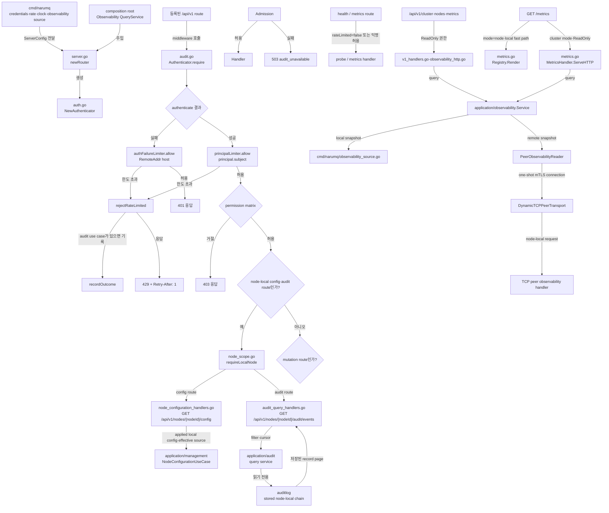

# Management HTTP adapter 모듈 설계

이 모듈은 management HTTP route, named credential 인증, 명시적 permission matrix, node-local rate limit, node·cluster 관측 query와 응답 생성을 담당한다. Rate limiter는 process memory를 사용하며, application 계층에는 rate-limit 정책이나 limiter 상태를 노출하지 않는다.

| 항목 | 값 |
| --- | --- |
| 구조 시점 | Current |
| 문서 상태 | Verified |
| 구현 대조 | 2026-10-14 source, API-09 `mqttLimits` 3-node acceptance, observability handler·contract·process acceptance, Grafana process·visual acceptance와 constrained `go run ./tools/verify local` PASS |
| 코드 위치 | `internal/adapters/http/management` |
| 코드 지도 | [Project structure](project-structure.md) |
| 관련 스펙 | [Management API](../specs/management-api-and-observability.md), [Tenant와 security](../specs/tenancy-and-security.md) §6·§7 |
| 관련 요구사항 | [PRD](../requirements/PRD.md) API-05, API-09, SEC-07, SEC-10~SEC-12, UI-01~UI-05·UI-10 |
| 관련 계약 | [Management API v1](../contracts/management-api-v1.md), [Audit event v1](../contracts/audit-event-v1.md) |
| 관련 ADR | [ADR-0043](../decisions/ADR-0043-management-api-rate-limit.md), [ADR-0045](../decisions/ADR-0045-operations-dashboard-grafana.md), [ADR-0048](../decisions/ADR-0048-management-api-oidc-api-key-rbac.md), [ADR-0049](../decisions/ADR-0049-mqtt-credential-revocation.md), [ADR-0050](../decisions/ADR-0050-mqtt-client-blocklist.md), [ADR-0052](../decisions/ADR-0052-configuration-tiers-and-cluster-policy.md) §1.1.1 |

## 1. 책임과 경계

- 맡는 책임: HTTP route를 application port에 연결하고, named API key·OIDC JWT·break-glass bearer의 인증, permission matrix, rate limit과 공통 오류 응답을 적용한다.
- 맡는 책임: rate limit을 적용한 요청의 거절 결과를 주입된 `AuditUseCase`에 전달한다.
- 맡지 않는 책임: flag와 cluster JSON 검증, credential file I/O, cluster 전체 rate 합산, audit 파일 저장과 회전이다. 설정·key file 검증은 `cmd/narumq`가, audit 저장은 `internal/adapters/auditlog`가 담당한다.
- 다른 모듈에 공개하는 기능: `NewServer`, `NewServerWithMembership`, `NewRouter`, `NewRouterWithMembership`, `NodeConfigurationUseCase`, `ClusterPolicyUseCase`, `ServerConfig`와 `ServerConfig.Observability`다.

`NewServer`는 standalone mode의 audit service를 연결하지 않는다. Dynamic cluster composition은 audit service/query, `NodeConfigurationUseCase`, credential revocation·blocklist application service와 `ClusterPolicyUseCase`를 management server에 주입한다. `/api/v1/security/credential-revocations`의 GET·POST·DELETE와 `/api/v1/security/blocklist`의 GET, blocklist entry의 POST·DELETE는 `PermissionCredentialAdmin`으로 보호한다. Mutation은 해당 `security.credential.*` 또는 `security.blocklist.*` event를 admission한 뒤 service에 전달한다. `GET /api/v1/cluster/policy`는 ReadOnly, policy PUT과 `GET /api/v1/nodes/{nodeId}/config`는 ClusterAdmin 권한을 요구한다. 성공한 policy update는 `cluster.policy.update` event에 이전·새 version을 기록한다. `config`와 `/api/v1/nodes/{nodeId}/audit/events`는 인증·권한 검사 뒤 `requireLocalNode`를 적용한다. Node ID가 다르면 원격 proxy 없이 `409 node_not_local`을 반환한다. Standalone router에는 cluster-only service가 없으므로 해당 route를 등록하지 않는다. Audit 조회 결과를 다시 감사 기록하지 않는다.

`ServerConfig.Observability`는 `observationports.QueryService`에 연결하며 구현체는 `internal/application/observability.Service`다. `/api/v1/cluster`, `/api/v1/nodes`, `/api/v1/nodes/{nodeId}`와 metrics JSON route는 ReadOnly 권한을 적용한다. `/metrics?mode=node`는 local Registry 경로를 사용한다. Cluster text mode는 ReadOnly 권한을 적용하고 모든 대상 query가 완료된 경우에만 출력한다. Dynamic cluster peer query는 TCP adapter가 mTLS 연결로 전달한다. Standalone source는 local node 하나를 대상으로 한다.

## 2. 내부 구조

아래 화살표는 runtime 호출 또는 설정 전달을 뜻한다.

| 요소 | 역할 | 만들어지는 시점과 소유자 | 의존 대상 |
| --- | --- | --- | --- |
| `server.go` `newRouter` | route를 등록하고 `Authenticator`를 route middleware에 연결한다. | Router를 만들 때 생성하며 HTTP server가 소유한다. | Management ports, `NodeConfigurationUseCase`, metrics renderer, `observationports.QueryService`, `ClusterPolicyUseCase`, `AuthConfig`, local node ID |
| `v1_handlers.go`와 `observability_http.go` | `/api/v1/cluster`, `/nodes`, `/nodes/{nodeId}`와 JSON metrics route를 `QueryService`에 연결하고 query 오류를 HTTP 오류로 바꾼다. | Router 초기화 때 생성된다. | `ServerConfig.Observability`, ReadOnly permission |
| `metrics.go` `MetricsHandler` | `mode=node`는 local Registry를 직접 렌더한다. Cluster text mode는 `QueryService`를 호출하고 `complete=false`면 응답을 렌더하지 않는다. | Router 초기화 때 생성된다. | Metrics renderer, `QueryService`, ReadOnly permission |
| `ServerConfig.Observability` | `observationports.QueryService` | HTTP server 설정 | JSON·cluster text handler가 같은 query service를 사용한다. Standalone·dynamic source 선택은 composition root가 담당한다. |
| `auth.go` `NewAuthenticator` | credential 검증, `subject`·role 생성, 두 limiter 초기화와 기본값 적용을 한다. | Router 초기화 때 생성되며 해당 router가 소유한다. | `TokenVerifier`, `ports/clock.Clock`, `requestRateLimiter` |
| `audit.go` `Authenticator.require` | 인증 실패 IP limit, 인증 성공 principal limit, permission 검사와 mutation admission 순서를 실행한다. | 요청마다 middleware가 호출한다. | `Authenticator`, optional `AuditUseCase` |
| `audit.go` `rejectRateLimited` | denial audit 결과를 전달하고 `429` 응답과 `Retry-After`를 만든다. | 한도를 넘긴 요청마다 호출한다. | `recordOutcome`, `WriteError` |
| `rate_limit.go` `requestRateLimiter` | key별 token bucket을 잠금으로 보호하고 refill·eviction을 수행한다. | `NewAuthenticator`마다 principal/IP limiter 하나씩 생성한다. | `ports/clock.Clock` |
| `server.go` health·metrics route | probe와 scrape handler를 등록하고 rate limit에서 제외한다. | Router 초기화 때 등록한다. | `health.go`, `metrics.go` |
| `node_scope.go` `requireLocalNode` | canonical decimal node ID를 확인하고 요청 대상과 serving node가 다르면 409를 반환한다. Remote proxy는 하지 않는다. | Node-local config·audit handler가 permission 검사 뒤 호출한다. | `ServerConfig.LocalNodeID`, `parseCanonicalMemberID`, `WriteError` |
| `node_configuration_handlers.go` `GET /api/v1/nodes/{nodeId}/config` | local runtime configuration and effective policy sources를 `NodeConfigurationUseCase`에서 읽어 data envelope로 반환한다. Security section은 identity 수와 non-secret ACL 규칙을 포함하고, credential identity list와 secret values/paths는 제외한다. | Dynamic cluster route에서만 사용한다. | ClusterAdmin permission, local node scope, `NodeConfigurationUseCase` |
| `audit_query_handlers.go` `GET /api/v1/nodes/{nodeId}/audit/events` | query service에서 이 node의 저장된 hash-chain record를 읽어 공통 list envelope로 반환한다. 조회는 새 audit event를 만들지 않는다. | 요청마다 실행한다. | local node scope, `application/audit` query service |
| `credential_revocation_handlers.go` `GET`·`POST`·`DELETE` | Committed revocation list, revoke와 restore를 application service에 전달한다. | Dynamic cluster server route에서만 사용한다. | `PermissionCredentialAdmin`, mutation audit admission, `CredentialRevocationUseCase` |
| `blocklist_handlers.go` `GET`·`POST`·`DELETE` | Committed blocklist와 block/unblock을 application service에 전달한다. | Dynamic cluster server route에서만 사용한다. | `PermissionCredentialAdmin`, mutation audit admission, `BlocklistUseCase` |
| `cluster_policy_handlers.go` `GET`·`PUT /api/v1/cluster/policy` | Committed policy·ETag를 조회한다. PUT은 strict JSON body와 optional `tenantQuotas`를 검증해 conditional update와 idempotency replay를 application service에 전달한다. Quota payload는 512 KiB 이하이고 `cluster-policy-tenant-quotas` feature가 필요하다. | Dynamic cluster server route에서만 사용한다. | ReadOnly/ClusterAdmin permission, mutation audit admission, `ClusterPolicyUseCase` |

## 3. 데이터 모델

| 이름 | 형태 | 저장 위치 | 제약과 항상 지켜야 할 조건 |
| --- | --- | --- | --- |
| `ServerConfig.RequestRate` | 정수, 초당 rate와 burst | process 설정 | 기본 50이며 `cmd/narumq`가 1~1,000,000 범위를 검증한다. |
| `ServerConfig.AuthFailureRate` | 정수, 초당 rate와 burst | process 설정 | 기본 5이며 `cmd/narumq`가 1~1,000,000 범위를 검증한다. |
| Cluster management credentials | `management.apiKeys`의 `{id, keyFile, roles}`, 선택적 OIDC verifier와 정적 `identities` | 검증된 cluster 설정과 process memory | `cmd/narumq`가 key file을 읽는다. API key는 constant-time 비교로 모두 확인하고 OIDC role은 설정된 subject binding에서만 부여한다. Adapter는 file I/O를 하지 않는다. |
| principal key | `managementPrincipal.subject` 문자열 | principal limiter map | `apikey:<id>`, `oidc:`, `management-bearer-token`, standalone local anonymous를 구분한다. `X-Forwarded-For`를 사용하지 않는다. |
| 인증 실패 key | `RemoteAddr`에서 분리한 host | auth-failure limiter map | host-port parsing 실패 시 원문을 쓰고 빈 주소는 `unknown`으로 바꾼다. |
| `rateBucket` | `tokens float64`, `refilled time.Time` | limiter map | token은 rate를 넘지 않는다. 새 bucket은 가득 찬 상태로 시작한다. |
| `requestRateLimiter.buckets` | key와 bucket의 map | process memory | limiter마다 최대 4096개다. Cluster node 사이에 공유하지 않는다. |
| `ServerConfig.LocalNodeID` | serving node의 canonical decimal member ID | composition root가 cluster router에 전달 | Node-local config·audit route에서 path ID와 비교한다. Standalone router에는 0을 전달해 route를 등록하지 않는다. |
| `ServerConfig.Observability` | `observationports.QueryService` | HTTP server 설정 | `/api/v1` JSON handler와 cluster text handler가 같은 query service를 사용한다. Standalone·dynamic source 선택은 composition root가 담당한다. |

## 4. 처리 순서

| 순서 | 코드 위치 | 조건·계산 | 바뀌는 상태 | 결과 |
| --- | --- | --- | --- | --- |
| 1 | `cmd/narumq/main.go`, `cluster_config.go`, `cluster_runtime.go` | Standalone flag 또는 cluster management 설정을 검증한다. Cluster mode는 named API key와 선택적 OIDC verifier·subject-role binding을 적재하고 admin bearer를 break-glass로 유지한다. | 없음 | 검증된 credential과 rate 설정을 Router에 전달한다. |
| 2 | `server.go` `newRouter`; `auth.go` `NewAuthenticator` | 0 이하 rate는 기본값으로, nil clock은 `systemClock`으로 바꾼다. | principal·IP limiter 두 개가 만들어진다. | 등록 route가 middleware를 공유한다. |
| 3 | `server.go` registered `/api/v1` handler; `audit.go` `require` | API key는 설정 목록과 constant-time 비교한다. OIDC JWT는 verifier로 확인하고 roles는 static subject binding에서만 가져온다. | 인증된 principal의 subject와 roles가 정해진다. | 실패는 IP bucket, 성공은 principal bucket을 role 검사 전에 사용한다. |
| 4 | `audit.go` `rejectRateLimited` | 인증 성공 bucket 또는 실패 IP bucket이 token을 주지 않으면 호출한다. | AuditUseCase가 있으면 `management.request` denial 결과를 전달한다. | HTTP `429`, `rate_limited`, `Retry-After: 1`을 반환한다. |
| 5 | `audit.go` `require` | token을 받은 뒤 명시적 permission matrix를 검사한다. Mutation이면 `AdmitMutation`을 호출한다. | `403` 요청도 token을 이미 소비했다. | role 부족은 `403`; audit admission 실패는 `503`; 통과하면 handler를 실행한다. |
| 6 | `server.go` health·metrics route 또는 `/` fallback | probe와 scrape는 `rateLimited=false`로 실행한다. 등록되지 않은 path는 fallback handler를 사용한다. | API bucket은 바뀌지 않는다. | probe·metrics는 rate limit에서 제외되고 unknown path는 `404`다. |
| 7 | `v1_handlers.go`, `metrics.go`, `application/observability.Service` | JSON route는 ReadOnly query를 실행한다. Text mode `node`는 Registry를 직접 읽고 cluster mode는 service를 호출한다. | Snapshot은 요청 중에 수집하며 cache를 저장하지 않는다. | Node API는 원격 상태를 직접 읽고, metrics JSON은 partial status를 반환할 수 있다. |
| 8 | `metrics.go`, `observability_http.go` | Cluster text 또는 aggregated collection에서 대상 query가 실패한다. | 부분 Prometheus body를 만들지 않는다. | Retryable `503 metrics_collection_incomplete`를 반환한다. |

Rate-limit event는 audit use case가 주입된 cluster 경로에서 기존 node별 denial 상한을 공유한다. 상한을 넘긴 audit event는 audit service가 억제할 수 있지만 HTTP `429` 응답은 유지된다. [Audit event v1 contract §5](../contracts/audit-event-v1.md)에 따라 standalone mode는 producer 범위에 포함되지 않는다.

## 5. 상태와 초기화

- 초기화 시점: `newRouter`가 `NewAuthenticator`를 호출할 때 두 limiter를 만든다. Production composition root는 `Clock`을 전달하고, 직접 만든 authenticator에서 clock을 생략하면 `systemClock`을 쓴다.
- 상태 소유자: 각 limiter의 map과 mutex는 해당 `Authenticator`가 소유한다. Process restart 때 bucket 상태가 초기화된다.
- 동시 실행과 순서: `allow`는 limiter별 mutex를 잡은 상태에서 시각 읽기, bucket refill, eviction과 token 소비를 수행한다. principal limiter와 IP limiter는 별도 map과 mutex를 쓴다.
- 시간 처리: 시간이 앞으로 갈 때만 token을 보충한다. clock이 뒤로 가면 bucket 상태를 보충하거나 `refilled` 시각을 바꾸지 않는다.
- 용량 관리: 새 key로 map이 가득 차면 모든 bucket을 refill하고 가득 찬 bucket만 제거한다. 여전히 가득 차 있으면 새 key를 fail-closed로 거절한다. 기존 key는 계속 조회한다.

## 6. 오류 처리

| 실패 지점 | 처리 방법 | 남는 상태 | 확인 시험 |
| --- | --- | --- | --- |
| `authenticate` 뒤 실패 IP bucket 소진 | 기존 `401` 대신 `429 rate_limited`를 반환한다. | IP bucket은 소진 상태다. | `TestRateLimitSeparatesPrincipalsAndAuthFailures` |
| 인증 성공 principal bucket 소진 | role 검사와 handler 전에 `429 rate_limited`를 반환한다. | principal bucket은 소진 상태다. | `TestRateLimitPrincipalBucketRejectsThenRefills` |
| bucket map이 가득 차고 가득 찬 bucket이 없음 | 새 key를 거절하고 기존 key는 처리한다. | map은 4096개를 유지한다. | `TestRateLimiterBoundsKeysAndEvictsFullBuckets` |
| 시간 역행 | refill하지 않는다. | 기존 `refilled` 시각을 유지한다. | `TestRateLimitPrincipalBucketRejectsThenRefills` |
| Mutation audit admission 실패 | handler를 실행하지 않고 retryable `503 audit_unavailable`을 반환한다. | rate token은 이미 소비됐다. | `internal/adapters/http/management/audit_test.go` |
| Denial event가 audit 초당 상한 초과 | audit service가 event를 억제하고 metric을 증가시킨다. | HTTP 응답은 원래 `429`다. | Audit event v1 §5와 application audit 시험 |
| Cluster node query 실패 | `queryStatus`와 nullable measurement를 반환한다. | Membership row는 유지되고 측정값은 미확인으로 남는다. | `TestNodeListPreservesUnknownAndRetiredStates`, `TestDynamicClusterObservabilityProcessAcceptance` |
| Cluster text metrics 조회 중 대상 실패 | 부분 metric text를 렌더하지 않고 retryable `503 metrics_collection_incomplete`를 반환한다. | 응답 body에 부분 scrape가 없다. | `TestPrometheusMetricsModesAndAuthorization`, `TestDynamicClusterObservabilityProcessAcceptance` |

## 7. 설계 선택

| 선택 | 이유 | 검토한 다른 방법 | 근거 |
| --- | --- | --- | --- |
| 인증 성공과 실패에 별도 limiter를 둔다. | 잘못된 credential 폭주가 정상 인증 주체의 한도를 소비하지 않는다. | 하나의 IP bucket으로 모든 요청을 제한한다. | [ADR-0043](../decisions/ADR-0043-management-api-rate-limit.md) |
| Bucket을 node-local process memory에 둔다. | Management listener 보호에 peer RPC나 replicated state가 필요하지 않다. | Cluster-wide 합산 limiter를 둔다. | [ADR-0043](../decisions/ADR-0043-management-api-rate-limit.md) |
| Clock을 port로 주입하고 map을 mutex로 보호한다. | fake clock으로 시간 경계를 결정적으로 시험하고 동시 map 접근을 직렬화한다. | 실제 시각에 의존하거나 limiter 간 lock을 공유한다. | `rate_limit_test.go`, `requestRateLimiter.allow` |
| 가득 찬 bucket만 eviction하고 공간이 없으면 거절한다. | eviction 때문에 사용자가 새 burst를 얻지 않고 key 수를 제한한다. | 임의 bucket을 제거하거나 map을 확장한다. | [Management API 스펙 §1.5](../specs/management-api-and-observability.md#15-rate-limit) |
