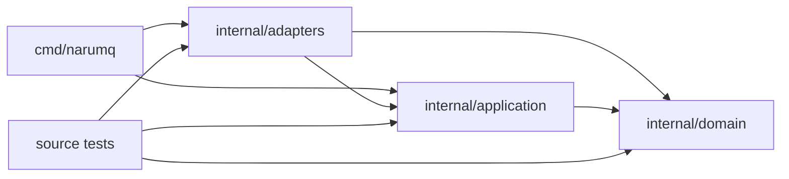

# Project structure

이 문서는 현재 코드의 진입점과 책임을 찾는 지도다. 계층 책임은 [Broker core architecture](broker-core.md), cluster 내부 흐름은 [Cluster architecture](cluster-architecture.md)를 따른다. 동작과 수용 기준은 관련 스펙·계약에서 관리한다. Benchmark 기준과 실행 증거는 [Performance와 verification](../specs/performance-and-verification.md)에 있다. 아래 `Target repository tree`는 목표 구조이며 구현 완료를 뜻하지 않는다.

| 항목 | 값 |
| --- | --- |
| 관점 상태 | Current implementation overview |
| 문서 상태 | Active |
| 범위 | 현재 repository의 코드 진입점, 모듈 책임, source dependency |
| 관련 요구사항 | [PRD](../requirements/PRD.md) MQTT-10, API-09, NFR-11~NFR-15, TEST-01~TEST-17, DEP-19~DEP-23 |
| 관련 결정 | [ADR-0001](../decisions/ADR-0001-core-implementation-language.md), [ADR-0052](../decisions/ADR-0052-configuration-tiers-and-cluster-policy.md) (Proposed overall; G1·API-09 `mqttLimits`, G2·G10 TLS, G3 cluster 평문 TCP, G4·G9 parser·secret-file 범위, G8 standalone 고정 식별자 규칙 채택), [ADR-0057](../decisions/ADR-0057-mqtt-websocket-listener.md), [ADR-0058](../decisions/ADR-0058-cluster-backup-s3-retention-and-restore.md) (user-delegated S3 design; acceptance open) |
| 관련 architecture | [Broker core](broker-core.md), [Cluster](cluster-architecture.md), [EKS on EC2 deployment](eks-ec2-deployment.md) |
| 관련 convention | [Go coding conventions](../conventions/go-coding-conventions.md) |

## 코드 지도: 실행 모드와 MQTT CONNECT 대표 흐름

먼저 `cmd/narumq`가 설정을 읽고 실행 모드를 고른다. MQTT 연결의 대표 경로는 listener에서 CONNECT를 읽고, application use case가 인증·session 상태를 판정한 뒤 성공 CONNACK을 쓰는 흐름이다.

| 관심사 | 시작점과 주요 위치 | 책임·경계 |
| --- | --- | --- |
| 프로세스 시작 | `cmd/narumq/main.go`: `main` → `run` → `runWithContext` | `-cluster-config`, `-cluster-restore`, `-raft-peer-config`, `-audit-verify`와 standalone 설정을 구분한다. `-audit-verify`는 저장 로그를 읽기 전용으로 검사한다. |
| 설정 적재 | `cmd/narumq/cluster_config.go` `loadClusterConfigFile` → `parseClusterConfig`·`checkClusterJSON`; `security_config.go` `loadSecurityConfigFile` → `parseSecurityConfig`; `raft_peer_config.go` `loadRaftPeerConfigFile` → `parseRaftPeerConfig`; `build_identity.go` `resolveBuildIdentity` | 모드별 loader와 parser가 설정을 읽고 정적 검증한다. 세 parser는 중복 JSON key를 거절한다. Security·peer-only parser는 `config_json.go`의 `rejectDuplicateJSONKeys`를 쓴다. Standalone은 MQTT listener 전에 security를 읽고, `-http-auth-token-file`은 listener를 열기 전에 읽는다. Dynamic cluster는 peer listener나 Raft 복구를 먼저 시작할 수 있지만 MQTT·management listener 전에 security를 읽는다. 입력 형식은 [Process configuration v1](../contracts/process-configuration-v1.md), 적용 흐름은 [configuration spec](../specs/configuration-and-runtime-options.md), 목표 계층은 [ADR-0052](../decisions/ADR-0052-configuration-tiers-and-cluster-policy.md) (Proposed)가 기준이다. |
| Standalone ingress | `runWithContext` → `serveServices`; `cmd/narumq/mqtt_listener.go`; `internal/adapters/tcp/server.go` | `mqtt_listener.go`가 TCP/TLS와 WS/WSS listener를 구성한다. MQTT listener는 같은 `tcp.Server`에 등록하고 management HTTP와 함께 종료한다. HTTP API 형식은 [management API contract](../contracts/management-api-v1.md)에 둔다. |
| MQTT CONNECT | `tcp.Server.Serve` → `readLoop`/`activate` → `internal/application/connect/connect.go` `UseCase.ConnectContext` | Dynamic cluster는 인증 전에 source IP·verified certificate fingerprint·CONNECT User Name, 인증 뒤 tenant-scoped Client ID의 committed blocklist를 검사한다. CONNECT use case의 사전 검사는 authenticator와 ownership 부작용을 줄인다. `connection.activate`는 ownership commit 뒤 bind와 CONNACK 전에 TCP 색인을 다시 검사해 apply 경쟁을 닫는다. 이 경로는 CONNECT별 read barrier를 추가하지 않는다. |
| MQTT packet과 한도 | `internal/adapters/tcp/{frame_reader,server_phases,server_submission}.go`; `internal/application/{publish,subscribe}` | TCP 경계는 frame·packet을 검증하고 해당 use case로 전달한다. Receive Maximum, Maximum Packet Size, listener·tenant 한도와 오류 경계는 [MQTT protocol spec](../specs/mqtt-protocol-and-session.md)을 따른다. |
| Dynamic cluster 시작 | `runWithContext` → `cmd/narumq/cluster_config.go` → `cluster_runtime.go` `runClusterMode` → `clusterRuntime.serve` | Peer transport, Raft, application projection, runtime controller, node-local audit publisher와 data-plane denial recorder를 조립한다. `clusterPolicyController`는 active `cluster-policy` feature 아래 local `clusterPolicy`를 commit·reconcile하며 committed state를 TCP server의 신규 connection limits에 적용한다. MQTT TCP/TLS와 WS/WSS listener는 node 정적 `mqtt` 설정에서 구성하며, TLS listener는 `mqtt.tls`를 사용하고 Raft peer TLS와 인증서·client-auth를 분리한다. 선택 `runtimeMetrics`는 `runtimemetrics.New`로 만들며 `clusterRuntime.serve`가 다른 service와 함께 실행하고 종료까지 기다린다. |
| Backup restore / peer-only | `cluster_backup_restore.go` `restoreClusterBackup`; `raft_peer_config.go` `runRaftPeerOnly` | 각각 archive restore와 MQTT listener가 없는 fixed-voter peer 경로를 시작한다. |
| S3 backup and offline restore deployment | `deploy/kubernetes/eks-ec2-ha/{kustomization.yaml,cronjob-backup.yaml,backup.sh}` (default local-only scheduled archive); `deploy/kubernetes/eks-ec2-ha-s3/{kustomization.yaml,cronjob-backup-s3-patch.yaml,s3_uploader.py,restore-from-s3.py,restore-from-s3-list-job.yaml,restore-from-s3-seed-jobs.yaml}` (explicit S3 opt-in); `deploy/kubernetes/eks-ec2-ha-restore-targets/{kustomization.yaml,restore-target-pvcs.yaml}` (shared empty recovery claims); `deploy/kubernetes/eks-ec2-ha-restore-mode` (local recovery overlay); `deploy/kubernetes/eks-ec2-ha-s3-restore-mode` (S3 recovery overlay); `deploy/terraform/modules/cluster-backup-s3` | The default overlay stores integrity-checked archives locally with `mtime +30` cleanup and references neither the S3 service account nor the Terraform-only settings ConfigMap. The shared production root controls module creation with `backup_s3_enabled` (default `false`). The separate `deploy/terraform-acceptance-s3` root has no such variable and directly invokes the module; it creates fixture resources only when an operator explicitly applies that root. Apply the S3 overlay only after the selected root has installed its resources. On-demand restore Jobs remain operator-created and are not rendered by the overlay's apply package. Both recovery overlays reuse the shared clean-PVC base. Existing backup API/archive code stays authoritative; live S3, elapsed retention, sustained RPO and full RTO acceptance remain open. See [Cluster backup §10](../specs/cluster-session-and-delivery.md#10-snapshot-backup과-restore) and [ADR-0058](../decisions/ADR-0058-cluster-backup-s3-retention-and-restore.md). |
| Management API | Standalone: `cmd/narumq/main.go` `NewServer`; cluster: `cmd/narumq/cluster_runtime.go` `NewServerWithMembership` → `internal/adapters/http/management/server.go` | HTTP 요청을 application port로 전달한다. Composition root는 membership·policy·security·audit service와 `ServerConfig.Observability` query service를 주입한다. `cmd/narumq/observability_source.go`가 standalone과 dynamic cluster의 local snapshot source를 구성한다. |
| Node·cluster query | `/api/v1/cluster`, `/api/v1/nodes`, `/api/v1/nodes/{nodeId}`, `/api/v1/nodes/{nodeId}/metrics`, `/api/v1/metrics` → `v1_handlers.go`·`observability_http.go` → `internal/application/observability.Service` | Dynamic cluster는 committed membership의 각 node에 직접 query한다. `PeerObservabilityReader`가 응답을 application DTO로 바꾸고 `DynamicTCPPeerTransport.QueryObservability`가 mTLS one-shot connection을 연다. 실패한 대상은 query status와 null measurement로 반환한다. |
| Metric scrape | `GET /metrics` 기본 `mode=node` → `MetricsHandler.ServeHTTP` → `Registry.Render`; cluster text mode → `QueryService.CollectMetrics` → `renderMetricFamilies` | Node mode는 RPC와 readiness 검사 없이 local Registry를 렌더한다. Cluster text mode는 전체 query가 완료됐을 때만 렌더하며 누락된 node가 있으면 retryable `503`을 반환한다. Typed capture는 `Registry.CaptureMetrics`와 `VisitMetrics`를 사용한다. |
| Metric instrumentation | `internal/adapters/tcp/server.go`; `internal/application/{connect,publish}`; `internal/adapters/metrics/{registry.go,registry_snapshot.go}`; `internal/application/ports/metrics/{metrics.go,snapshot.go,catalog.go}` | TCP adapter와 use case는 application port로 metric을 기록한다. Registry는 typed label key를 쓰고 static catalog에서 metric type, scope, aggregation, label metadata를 읽는다. `Render`와 typed capture는 `VisitMetrics`를 공유한다. |
| Observability | `internal/application/observability`; `internal/application/ports/observability`; `internal/adapters/tcp/{peer_observability_adapter.go,peer_observability_transport.go}`; `cmd/narumq/observability_source.go` | Application service는 bounded node snapshot 조회, cluster summary와 metric 집계를 맡는다. Command composition은 local source와 peer reader를 연결한다. Standalone은 고정 local member를 사용한다. |
| Management audit | `http/management/audit.go`, `audit_query_handlers.go` → `internal/application/audit` → `internal/application/ports/audit` → `internal/adapters/auditlog` | Dynamic cluster mutation은 기록 가능할 때만 실행한다. Audit events와 node configuration은 serving node-local read다. Config response는 적용 설정, effective policy source·version·value와 `security.identityCounts`, 설정 순서의 `security.acl`을 반환한다. Config·audit route는 다른 node ID에 `409 node_not_local`을 반환하며 remote proxy를 하지 않는다. |
| Rollout controller | `cmd/narumq-rollout-controller/main.go`; `internal/application/rollout`; `internal/adapters/rollout/{manager.go,kubernetes_types.go}` | The command opens the reused durable `auditlog.FileAuditPublisher` and supplies it to the Kubernetes adapter runtime; the adapter package owns CRD runtime objects, manager/leader election, Kubernetes CAS/UID+RV mutations, Management API, OCI manifest/config verification and workload reconciliation. The application owns status/audit/runtime ports and serial drain policy; the I/O-free domain owns release compatibility. A finalizer is written before side effects and retains deleting CRs until abort/replacement is resolved. |
| MQTT denial audit | `connect.UseCase`, subscribe result와 `tcp.Server` → `internal/application/audit.DataPlaneRecorder` → node-local publisher | `dataplane.go`가 bounded queue에서 MQTT denial을 기록한다. `limiter.go`가 초당 한도를 공유하고, `cluster_runtime.go`가 recorder lifecycle을 관리한다. |
| Credential revocation과 expiry | `internal/application/membership/credential_revocation_service.go`; `cmd/narumq/cluster_runtime.go`; `internal/adapters/tcp/server.go`; `internal/application/connect/connect.go` | `CredentialRevocationService`가 `CredentialRevocationChangeDTO`를 `clusterRuntime.Commit`에 보낸다. `applyBatch`가 `StateMachine.Apply` 뒤 `tcp.Server.ApplyCredentialRevocation`을 호출한다. Dynamic `ConnectContext`는 auth 후, Client ID·ownership 변경 전에 check한다. `connection.activate`는 ownership commit 뒤 다시 check한다. Apply는 matching session을 닫고 Will을 억제한다. |
| Client blocklist | `internal/domain/security/blocklist.go`; `internal/application/membership/blocklist_service.go`; `cmd/narumq/cluster_runtime.go`; `internal/adapters/tcp/server.go`; `internal/application/connect/connect.go`; `internal/adapters/http/management/blocklist_handlers.go` | `BlocklistService`가 typed entry를 Raft에 commit하고 runtime은 `StateMachine.Apply` 결과를 TCP 색인에 반영한다. CONNECT는 인증 전에 source IP, verified certificate fingerprint, username을 확인한다. 인증 뒤에는 tenant-scoped Client ID를 확인한다. Apply는 일치하는 session을 닫고 Will을 억제한다. Management GET은 fresh Raft read barrier 뒤 `policyVersion`과 entry를 반환한다. |
| 공유 구독 durable 전달과 owner 손실 | `internal/domain/routing/routing.go` `matchLocked`; `cmd/narumq/cluster_owner_reachability.go` → `routing.Table.SetOwnerReachability`; `internal/application/publish/publish.go`; `internal/application/membership/delivery_shared.go`; `cmd/narumq/cluster_runtime.go` `applyBatch` | Ingress node는 peer transport `Status().Connected`로 도달할 수 없는 owner의 member를 shared 후보에서 뺀다. 모두 도달할 수 없으면 기존 순서를 쓴다. `shared-subscription-reroute` 활성화 뒤 durable 대상은 shared filter를 기록하고, member record의 reset·폐기·release·만료 apply가 남은 QUEUED·QoS 1 inflight message를 같은 group의 다른 member로 옮긴다. 기준은 [ADR-0060](../decisions/ADR-0060-shared-subscription-durable-owner-loss-reroute.md)이다. |
| Storage fault evidence | `tests/chaos/cluster-storage-v1/main.go` `runCLI` → `runner.go` `Run` | FUSE fault simulation 및 별도 local ext4 profile을 실행한다. 이는 production EBS 또는 물리 전원 손실의 증거가 아니다. |
| EKS worker 복구 관찰 도구 | `tests/chaos/eks-worker-recovery/main.py` `main` → `SurvivorTunnel`·`Fixture`·`MQTTProbe`·`observe_fault`; `observer.py` `IndependentMonitor`·`fence_node`·`release_fenced_pod`; `payload_oracle.py` `Oracle.prepare`·`verify`; `tests/test_eks_worker_recovery.py` | 관리 API와 합성 MQTT의 표본을 독립 기록한다. Fault mode는 생존 Pod identity를 확인하고 두 port의 kubectl tunnel을 직접 소유·종료한다. Pre-fault drain 기록도 이 tunnel로 조회한다. `fault --execute --plan`만 준비된 전용 follower EC2를 종료한다. Node 변경은 종료 확인·UID/RV 조건 뒤 한 번만 시도하며 실패 후 새 상태를 관찰한다. Taint가 확인되면 `release_fenced_pod`가 기존 대상 Pod를 Pod UID 조건·grace 0으로 한 번만 삭제한다. 복구 표본에는 VolumeAttachment와 EBS attachment 상태를 함께 남긴다. `payload_oracle.py`는 별도 명령으로 persistent session·오프라인 QoS 1·retained hash를 장애 전후에 확인한다. Product runtime은 이 도구를 import하지 않는다. 동작·실제 EKS 결과·미완료 범위는 [Drain spec §10](../specs/drain-and-rolling-update.md#eks-worker-observer-보완-기준)을 따른다. |
| 미게시 S3 backup 복구·정리 | `deploy/kubernetes/eks-ec2-ha-s3/s3_uploader.py` `main(arguments)` → `maintain_stage` → `read_request`; `tests/test_backup_s3.py`; `tests/test_backup_publication.py` | 예약·수동 producer와 uploader를 모두 중지한 maintenance 상태에서 정확한 `.staging-XXXXXXXX` 하나만 처리한다. 완성된 archive/request는 전체 SHA 검증 후 게시하고 불완전 잔여는 명시적 요청으로만 삭제한다. 자동 업로드 loop·broker/API/archive 형식은 바꾸지 않는다. [Cluster §10·§11.9](../specs/cluster-session-and-delivery.md#10-snapshot-backup과-restore)를 따른다. |

### Cluster write와 복구의 코드 방향

Runtime driver는 Raft 처리와 application state 적용 시점을 조정한다. Durable write는 요청마다 새 ReadIndex proof로 quorum을 확인한 뒤 FIFO 순서로 제출한다. Proposal batch의 수집 예산은 최대 64개·64 KiB다.

Transport에서 write를 시작하지 않은 proposal만 회수해 FIFO에 돌려놓는다. 안전한 재제안은 해당 feature가 활성화된 요청에만 적용한다. RequestID·최초 proof·digest와 원래 payload를 보존하고, 복제 receipt로 중복 상태 변경과 외부 효과를 막는다.

Disk 전용 writer가 여러 WAL frame을 한 sync로 기록한다. Runtime은 적용·projection 완료 뒤 waiter를 끝낸다. 상세한 처리·실패 경계는 [Cluster architecture](cluster-architecture.md), [Raft peer transport contract](../contracts/raft-peer-transport-v1.md), [Cluster 스펙](../specs/cluster-session-and-delivery.md)을 따른다.

| 관심사 | 주요 코드 위치 | 역할 |
| --- | --- | --- |
| Fresh proof·proposal | `cmd/narumq/cluster_read_admission.go`, `cluster_proposals.go` | Fresh read admission과 bounded proposal batch |
| 재제안·receipt | `cmd/narumq/cluster_proposal_recovery.go`, `internal/application/membership/proposal_receipts.go` | 안전한 재제안과 복제 request receipt |
| WAL 영속화 | `internal/adapters/raft/node_ready.go`, `wal_worker.go`, `stable_store.go` | Raft Ready 처리, WAL group commit, snapshot·WAL 저장 |
| Drain·rebalance | `cmd/narumq/cluster_drain.go`, `cluster_rebalance.go` | 복제 상태를 사용하는 node drain·connection rebalance controller |
| Cluster health | `cmd/narumq/cluster_runtime.go` `clusterHealthChecker.CheckStartup`·`CheckReadiness` | Typed recovery 전 startup을 차단한다. `JOINING` startup은 readiness 조건을 직접 평가하므로 Kubernetes readiness probe가 시작하기를 기다리지 않는다. 이미 시작한 drain 상태는 이 경로에서 해제하지 않는다. |
| Drain cancellation replay | `internal/application/membership/drain.go` `StateMachine.applyNodeDrain` | `FAILED→CANCELLED`에서 failure code와 blocking reason을 함께 지운다. WAL 재생도 같은 전이를 적용하므로 재시작의 typed snapshot 검증과 일치한다. |
| Cluster bootstrap / admission | `cmd/narumq/cluster_bootstrap_probe.go`; `cluster_runtime.go` `runClusterMode`; `internal/adapters/tcp/peer_bootstrap_probe.go`, `peer_transport.go` `RequestSeedAdmission` | Empty-directory bootstrap probe와 seed admission을 연결한다. 두 client는 응답 뒤 peer가 TLS 연결을 닫을 때까지 기다리고, dynamic transport는 inbound slot을 반환한 뒤 연결을 닫는다. |
| Tenant quota / release profile | `cmd/narumq/cluster_tenant_quota.go`, `cluster_release_profile.go`; `internal/application/membership/tenant_quota.go`, `cluster_policy.go`, `snapshot.go` | Legacy quota profile을 commit한다. `StateMachine.EffectiveTenantQuotaProfile`은 active `cluster-policy-tenant-quotas` policy 값을 우선하고 policy field가 없으면 legacy profile로 돌아간다. Snapshot restore는 두 값을 복구한다. |
| Cluster MQTT policy | `cmd/narumq/cluster_policy.go`, `cluster_config.go`, `cluster_runtime.go`; `internal/application/membership/cluster_policy.go`, `cluster_policy_service.go`; `internal/adapters/tcp/server.go` | Local versioned `mqttLimits`와 선택 quota를 feature activation 뒤 제안하고 committed policy를 적용한다. `SetConnectionLimits`는 신규 connection에 적용하며 기존 connection의 limits는 유지한다. Management HTTP wire format은 `cluster_policy_handlers.go`가 맡는다. |
| Peer capacity / proposal reclaim | `cmd/narumq/cluster_read_admission.go`, `cluster_proposals.go`; `internal/adapters/tcp/peer_transport.go`, `peer_transport_flow.go` | Outbound capacity에 맞춰 read/proposal을 발행하고 아직 write하지 않은 proposal만 회수한다. |
| Dynamic peer TCP 생존 확인 | `internal/adapters/tcp/peer_liveness.go` `newPeerNetDialer`·`applyPeerLiveness`; `peer_liveness_linux.go` `setPeerUserTimeout`; `peer_transport.go` `DynamicTCPPeerTransport.handleInbound`·`dialPeer`; `tests/chaos/peer-blackhole-reconnect/run.py` | [ADR-0059](../decisions/ADR-0059-dynamic-peer-tcp-liveness.md)에 따라 Raft·forwarding stream socket에 keepalive와 Linux `TCP_USER_TIMEOUT`을 설정한다. `dialPeer`는 연결 전에, `handleInbound`는 stream magic을 읽은 뒤 설정한다. 응답 없는 상대의 연결이 끊기면 기존 `dialPeer` loop가 같은 DNS 이름으로 재연결한다. Chaos 시나리오는 leader가 node 2인 cluster에서 이전 IP를 버린 뒤 새 IP의 대체 node가 준비되는 시간을 잰다. |
| Snapshot / WAL reclaim | `internal/adapters/raft/wal_compaction.go`, `stable_store.go`, `node_ready.go` | Snapshot 뒤 WAL compact와 snapshot retention을 관리한다. |
| Session recovery | `cmd/narumq/cluster_session_metadata.go`, `cluster_session_recovery.go`; `internal/application/membership/session_metadata.go` | Owner/epoch로 session metadata를 fence하고 READY 뒤 recovery 후보를 전달한다. |
| MQTT listener / tenant limit | `cmd/narumq/mqtt_listener.go`, `security_config.go`; `internal/adapters/tcp/listener_admission.go`, `server_tenant_limits.go`; `internal/application/tenantlimit` | Listener admission과 node-local tenant connection/traffic policy를 연결한다. |

### Session과 QoS 상태 소유권

MQTT session은 tenant와 Client ID로 식별한다. `internal/application/takeover`는 ownership·persistent subscriptions·inbound/outbound QoS inflight aggregate를 소유하고, `internal/application/membership`은 committed lifecycle metadata와 session ownership 전이를 적용한다. Runtime recovery controller는 READY 뒤 복구 후보를 use case에 전달한다. Will·expiry metadata는 owner와 epoch로 fence되며, committed claim/discard 결과만 발행 결정을 내린다. QoS 2 Packet ID별 handshake 상태와 재연결 처리는 session/application 경로가 관리한다. 세부 상태 전이와 복구 한계는 [MQTT protocol and session spec](../specs/mqtt-protocol-and-session.md)과 [Cluster architecture](cluster-architecture.md)를 따른다.

## Target repository tree

아래는 목표 배치를 요약한 tree다. `Target` 전용 항목은 실제 구현으로 간주하지 않는다.

```text
.
├── .github/workflows/         # repository automation
├── cmd/narumq/                 # composition root
├── cmd/narumq-rollout-controller/ # rollout-controller composition root
├── internal/
│   ├── domain/                 # protocol·session·routing·tenant·cluster invariant
│   ├── application/            # use cases와 application-owned ports
│   └── adapters/               # network·storage·consensus·platform I/O
├── deploy/profiles/            # deployment inputs
├── tests/
│   ├── integration/ conformance/ compatibility/ e2e/ chaos/ benchmark/
│   └── verification/
├── tools/verify/
└── docs/
```

## Directory naming

- Go package directory는 소문자 한 단어로 짓고, package path에 underscore나 mixed caps를 쓰지 않는다.
- `cmd/narumq`는 실행 파일 이름을 따른다. Deployment profile은 kebab-case를 쓴다.
- Test directory는 `integration`, `conformance`, `compatibility`, `e2e`, `chaos`, `benchmark`처럼 검증 목적을 나타낸다.
- Team 이름이나 일시적인 issue 번호를 directory 이름에 넣지 않는다.
- 안정된 외부 Go API와 compatibility 정책이 승인되기 전에는 `pkg/`를 만들지 않는다. Dependency 공급 정책 결정 전에는 `vendor/`를 만들지 않는다.

## Root directory 책임

| Directory | 현재 책임 |
| --- | --- |
| `cmd/narumq` | 설정 해석, concrete adapter 조립, runtime lifecycle |
| `internal/domain` | MQTT·session·routing·delivery·tenancy·security·cluster invariant |
| `internal/application` | Use case 조정, commit 경계, port와 application DTO |
| `internal/adapters` | TCP/TLS, HTTP, authentication, memory, Raft/storage, metrics 등 외부 I/O |
| `deploy/profiles` | 배포 profile과 resolved configuration 입력 |
| `tests` | package·process·실제 dependency를 사용하는 검증. Production runtime이 import하지 않는다. |
| `tools` | Repository 검증·생성 도구 |
| `docs` | 요구사항, architecture, spec, contract, decision과 guide |

## Source dependency

화살표는 허용된 source import 방향이며 runtime 호출 순서를 나타내지 않는다.



- Domain은 외부 library/framework과 I/O package를 import하지 않는다.
- Application은 domain과 application-owned port에만 의존한다.
- Adapter는 application port와 필요한 domain value에 의존하며 external type을 안쪽 경계로 전달하지 않는다.
- Concrete adapter는 composition root가 조립한다.
- `tests`는 source test에서 production package를 사용할 수 있지만 process integration, benchmark, compatibility harness는 binary나 container를 실행한다. Production runtime은 `tests`를 import하지 않는다.

## 현재 모듈 지도

아래 표는 현재 구현된 대표 package만 요약한다. Port와 DTO의 전체 경계는 [Broker core architecture](broker-core.md)를 기준으로 한다.

| 그룹 | Package | 현재 책임 |
| --- | --- | --- |
| Domain | `internal/domain/mqtt`, `session`, `tenancy`, `security`, `routing`, `delivery` | MQTT wire 의미, session invariant, tenant namespace·ACL, route matching과 delivery 상태 |
| Domain lifecycle | `internal/domain/release`, `nodedrain`, `connrebalance` | Release feature profile, drain/rebalance 전이·barrier 정책 |
| Application ingress | `internal/application/connect`, `publish`, `subscribe` | CONNECT 인증·binding, PUBLISH/Will, SUBSCRIBE/UNSUBSCRIBE 조정과 commit 경계 |
| Application state | `internal/application/takeover`, `membership`, `tenantlimit` | Session takeover/QoS state, replicated membership·metadata·receipt 적용, tenant admission policy |
| Application audit | `internal/application/audit`, `internal/application/ports/audit` | Management event admission과 bounded MQTT data-plane denial recording을 기존 publisher port로 전달 |
| Application ports | `internal/application/ports/{authentication,metrics,observability,audit}` 및 use-case-owned ports | Application이 요구하는 외부 capability 경계 |
| Network/security adapters | `internal/adapters/tcp`, `tls`, `websocket`, `authentication`, `http/management` | MQTT TCP/TLS·WS/WSS ingress, TLS/mTLS, JWT/JWKS, 고정 profile Argon2id username/password 인증, management HTTP, credential revocation/expiry와 client blocklist 연결 lifecycle, Management audit fail-closed와 MQTT denial audit fail-open 처리 |
| 보안 설정·password hash CLI | `cmd/narumq/security_config.go`, `main.go`, `cluster_runtime.go`, `password_hash.go` | JWT/password/mTLS binding을 strict decoder로 검증하고 standalone·cluster runtime에 provider를 조립한다. `-hash-password`는 stdin에서 password를 읽어 hash를 stdout에 쓴다. |
| State adapters | `internal/adapters/memory/{deliveryqueue,retained,sessionstore}`, `internal/adapters/raft` | Process-local queue·retained·session store 및 Raft/WAL/snapshot persistence |
| Audit adapter | `internal/adapters/auditlog` | Node-local JSONL append, fsync, rotation, recovery와 hash-chain verification |
| Raft records | `internal/adapters/raft/records` | Versioned replicated-state/backup protobuf binding, deterministic encoding과 validation |
| Observability | `internal/adapters/clock`, `metrics`, `runtimemetrics`; `internal/application/observability`; `internal/application/ports/{metrics,observability}` | Clock과 process/runtime metric을 제공한다. MQTT packet·connection·CONNECT 거절·publish·audit·listener metric도 이 영역이 기록한다. Typed metric catalog는 family metadata를 정의한다. Application observability service는 node·cluster snapshot을 조정한다. TCP peer adapter는 직접 관측 RPC를 운반한다. Subscription gauge는 scrape할 때 route projection에서 읽는다. |
Application port는 사용하는 application package가 소유한다. 외부 library와 wire type은 adapter에서 domain value나 application DTO로 바꾼다. Domain과 application은 외부 I/O, framework와 provider SDK에 의존하지 않는다. `internal/adapters/raft`의 transport/persistence 책임과 replicated record 의미는 분리되어 있다. 세부 계층 책임은 [Broker core architecture](broker-core.md)를 따른다.

## 주요 port capability와 adapter map

Port는 capability를 요구하는 application package가 소유한다. Composition root가 concrete adapter를 만들고 주입한다. 현재 연결된 주요 경계는 다음과 같다.

| Capability | Application port | 현재 구현 |
| --- | --- | --- |
| Authentication | `internal/application/ports/authentication` (`Credential`, `AuthenticationProvider`, `ClientCertificateDTO`) | JWT·Argon2id password·certificate binding은 `internal/adapters/authentication`; TLS 검증과 certificate DTO 생성은 `internal/adapters/tls` |
| Credential revocation | `internal/application/connect.CredentialRevocationChecker` | `cmd/narumq.clusterRuntime`의 committed-state read barrier와 TCP apply propagation |
| Client blocklist | `internal/application/connect.BlocklistMatcher` | `cmd/narumq.clusterRuntime`의 node-local committed-state matcher와 TCP apply propagation. CONNECT마다 barrier를 추가하지 않는다. |
| Clock | `internal/application/ports/clock` | `internal/adapters/clock` |
| Delivery queue / retained | `internal/application/ports/{deliveryqueue,retained}` | `internal/adapters/memory/{deliveryqueue,retained}` |
| Metrics | `internal/application/ports/metrics` | `internal/adapters/metrics` |
| Node·cluster observability | `internal/application/ports/observability.QueryService`와 snapshot source | `internal/application/observability.Service`; `cmd/narumq/observability_source.go`; `internal/adapters/tcp.PeerObservabilityReader`·`DynamicTCPPeerTransport` |
| Session lifecycle | `internal/application/connect`의 repository boundary | `internal/adapters/memory/sessionstore` |
| Audit publisher | `internal/application/ports/audit.AuditPublisher` | `internal/adapters/auditlog.FileAuditPublisher` |
| MQTT denial recorder | `internal/application/ports/audit.DataPlaneDenialRecorder` | `internal/application/audit.DataPlaneRecorder` |

`internal/adapters/raft`와 `internal/adapters/tcp`의 Raft runtime·peer transport는 composition root가 직접 조립한다. Cluster replication application port나 `internal/adapters/storage` WAL session repository는 이 표에서 현재 구현으로 간주하지 않는다.

## Model과 경계 자료형 배치

| 자료형 | 위치 규칙 |
| --- | --- |
| Domain value와 invariant | `internal/domain/<capability>`에 둔다. Storage tag·wire encoding을 넣지 않는다. |
| Use case DTO | 사용하는 `internal/application/<usecase>`에 둔다. Shared DTO package는 실제 안정된 경계가 생길 때만 만든다. |
| Management HTTP wire type | `internal/adapters/http/management`에 둔다. Domain/application으로 HTTP type을 전달하지 않는다. |
| Replicated record | `internal/adapters/raft/records`가 versioned encoding·validation을 소유한다. Domain은 record schema를 import하지 않는다. |
| External API type | 해당 provider adapter 안에서 변환한다. External library type은 application/domain 경계를 넘지 않는다. |

Port와 DTO는 책임별로 배치한다. 포괄 `models`, `types`, `interfaces`, `common`, `utils` package를 만들지 않는다. Adapter 내부 mapper가 persistence/wire data와 domain/application value를 변환한다.

### File and test placement

- Package-local unit/fuzz test는 대상 package의 `*_test.go`에 둔다.
- 여러 package나 실제 process가 필요한 test는 `tests/integration` 등 검증 목적에 맞는 suite에 둔다.
- 한 package에서만 쓰는 fixture는 package의 `testdata/`에 둔다. Suite 간 공유 fixture는 소비하는 suite 아래에 둔다.
- Generated source는 사용하는 adapter의 `generated/` 아래에 격리하고 생성 원본과 command를 함께 관리한다.

## Benchmark harness map

Benchmark는 `tests/benchmark`에 격리되어 product runtime이 import하지 않는다. 각 BP package는 profile, workload, 비교 설정과 metric 선택을 소유한다. 공통 package는 Docker/MQTT 실행 경계와 artifact mechanics만 공유한다.

| 역할 | 위치 | 책임 |
| --- | --- | --- |
| Host controller | 각 BP의 `compare.go` 및 BP-06/07의 `failure.go`·`rolling.go` | Broker·runner container를 구성하고 필요한 경우 장애·rolling action을 주입한다. |
| Runner | 각 BP의 `runner.go` | Phase 순서, client lifecycle, workload schedule과 final validity를 관리한다. |
| MQTT client | `tests/benchmark/internal/mqttclient`; BP별 `client.go`·`session.go` | CONNECT/frame I/O 및 BP별 packet/QoS 흐름을 처리한다. QoS 2 pending/completed Packet ID 상태는 client/session 경계에 있다. |
| Collector | BP별 `collector.go`, `aggregate.go`, `metrics.go` | Expected delivery, missing/duplicate/error와 latency를 집계한다. |
| Resource | BP별 `resource.go`; `internal/environment` | Docker stats window와 workload/resource 요약을 연결한다. |
| Suite | BP별 `suite.go`; `internal/suiteartifact`, `runtimeartifact` | 반복 순서, target validity 및 metric 중앙값·MAD artifact를 만든다. |
| Shared host/runtime | `tests/benchmark/internal/{environment,jsonl,runtimeartifact,suiteartifact}` | Container·readiness·resource·JSONL 및 공통 artifact 처리 |
| EKS 용량 측정(BP-02 확대) | `tests/benchmark/capacity/main.go` 하위 명령 `run`·`local`·`fixture`·`security-config`·`serve-jwks`; `run.go` → `ladder.go` 단계 탐색 → `step.go` 단계 phase → `client.go`·`collector.go` 판정 자료 → `verdict.go` `computeVerdict`; `control.go` marker 교환; `local.go` Docker controller; `tests/benchmark/capacity/eks/controller.py` `prepare`·`deploy`·`run`·`cleanup`; `deploy/kubernetes/eks-ec2-ha-capacity/` overlay | Runner는 target과 무관하며 MQTT·management endpoint와 profile만 받는다. 장애 주입과 복구는 control marker로 외부 controller가 맡는다. Local controller는 Docker container를 `SIGKILL`하고 EKS controller는 `kubectl`로 Pod를 강제 삭제하고 worker를 cordon한다. Overlay는 TLS 8883, loopback JWKS sidecar, Pod 안에서 만드는 `security.json`과 시작하지 않는 Job template을 더한다. 계약은 [성능 §3.9](../specs/performance-and-verification.md#39-bp-02-eks-용량-측정-계약)다. |
| EKS fixture·marker 경계 | `tests/benchmark/capacity/eks/controller.py` `apply_generated`·`kill_marker` → `tests/benchmark/capacity/control.go` `killPhase.poll`; `tests/benchmark/capacity/eks_control_test.go` `TestEKSKillMarkersDecodeInRunner` | 준비한 Secret은 server-side apply로 저장해 큰 credential 본문을 annotation에 복제하지 않는다. Controller는 내부 숫자 node ID를 marker의 JSON 문자열로 바꾼다. 회귀 시험은 실제 Python producer가 만든 5개 상태 marker를 Go runner로 읽어 형식 불일치를 잡는다. |
| 용량 시험 전용 Pod 장애 주입 | `deploy/kubernetes/eks-ec2-ha-capacity/broker-process.sh` `run`·`identity`·`freeze`·`resume`; `statefulset-capacity-patch.yaml`; `tests/benchmark/capacity/eks/controller.py` `handle_request_kill` → `handle_kill`·`handle_restore`·`resume_target`; `target_matches_pod`; `tests/test_eks_capacity_controller.py` `FaultIdentityTests` | Wrapper가 broker를 신호를 보낼 수 있는 자식 process로 실행한다. ACK 뒤 원래 UID·container·실행 UUID를 대조하고 broker의 모든 thread를 멈춘 뒤 Pod를 삭제한다. 이때 정상 preStop은 drain을 시작하지 못한다. 삭제 요청 수락만으로 대상 추적을 끝내지 않고 다른 UID인 Ready Pod를 확인해야 끝낸다. 예외·Ctrl+C·timeout의 `finally`에서는 같은 process만 재개한다. 강제 종료·workstation 장애의 자동 재개는 지원하지 않는다. 기본 배포와 broker binary는 바꾸지 않는다. 계약과 실제 process 검증은 [성능 §3.9](../specs/performance-and-verification.md#39-bp-02-eks-용량-측정-계약)를 따른다. |
| EKS 용량 시험의 CPU·재시작 관측 | `tests/benchmark/capacity/eks/controller.py` `RunController.run`·`handle_request_kill`·`loop` → `ResourceSampler.request` → `RuntimeDiagnostics.sample`; `parse_cpu_stat`·`pod_runtime_summary`; `tests/test_eks_capacity_controller.py` `RuntimeDiagnosticsTests` | 별도 수집 스레드가 주기·단계 경계 요청을 처리한다. `kubectl exec`로 broker의 cgroup CPU 누계를 읽고, Pod 조회로 UID·container ID·OOM 종료 상태·재시작 횟수를 얻는다. 교체를 가로지른 표본은 버리고, 같은 container의 증가량만 계산해 `controller/runtime-health.jsonl`에 남긴다. 장애 주입 경로는 관측 완료를 기다리지 않는다. 계약과 실행 증거는 [성능 §3.9](../specs/performance-and-verification.md#39-bp-02-eks-용량-측정-계약)를 따른다. |

BP-01~BP-07의 phase, metric, timeout/error 경계와 실행 증거는 [Performance and verification spec](../specs/performance-and-verification.md)에만 둔다.

## Verification and integration test entrypoints

| 목적 | 위치·진입점 | 소유 범위 |
| --- | --- | --- |
| Package unit/fuzz | 대상 package의 `*_test.go` | Package-local invariant와 경계 |
| Process integration | `tests/integration/*_process_test.go` | 실제 broker process, socket, cluster 상태·복구 흐름 |
| Historical-binary compatibility | `tests/integration/cluster_membership_process_test.go::clusterProcessConfigForBinary`, `clusterLegacyDurationKeys`, `clusterLegacySecurityConfig`; `tests/integration/cluster_drain_process_test.go::clusterDrainProcessStartOn` | 이전 source에서 빌드한 binary에는 해당 설정 key와 drain 요청 형식으로 변환해 보낸다. 현재 binary에는 현재 형식을 보낸다. |
| Tenant isolation penetration | `tests/integration/cluster_tenant_isolation_pentest_process_test.go::TestDynamicClusterTenantIsolationPenetrationProcessAcceptance` | 실제 3-node에서 tenant 격리·management 인증 공격. 위협 대응은 [Threat model](threat-model.md), 실행 증거는 [Tenant와 security §9.3](../specs/tenancy-and-security.md#93-nfr-19-자동-penetration-test-실행-증거)에 둔다. |
| MQTT denial audit acceptance | `tests/integration/cluster_audit_process_test.go::TestDynamicClusterMQTTDenialAuditProcessAcceptance` | 실제 3-node cluster에서 denial event, schema·hash chain, redaction과 metric을 확인한다. 실행 증거는 [Tenant와 security §9.4](../specs/tenancy-and-security.md#94-sec-11-mqtt-data-plane-denial-audit-실행-증거)에 둔다. |
| SEC-10 management acceptance | `tests/integration/cluster_management_rbac_process_test.go::TestDynamicClusterManagementRBACProcessAcceptance` | 실제 3-node cluster에서 named API key, 정적 OIDC role binding, break-glass, permission matrix와 node-local audit query를 확인한다. 실행 증거는 [Tenant와 security §9.6](../specs/tenancy-and-security.md#96-sec-10-실행-증거)에 둔다. |
| SEC-12 blocklist acceptance | `tests/integration/cluster_blocklist_process_test.go::TestDynamicClusterClientBlocklistProcessAcceptance`; `tests/integration/mqtt_tls_test.go::TestMQTTTLSBlockedCertificateFingerprintRejected` | 실제 3-node process 시험은 feature 활성화, Client ID·username·IP 차단 전파, tenant 격리, MQTT 3.1.1·5 거절, 기존 연결 종료, Will 억제와 audit event를 확인한다. 별도 TLS socket 시험은 verified leaf certificate fingerprint 거절을 확인한다. 실행 증거는 [Tenant와 security §9.8](../specs/tenancy-and-security.md#98-sec-12-blocklist-실행-증거)에 있다. |
| TEN-09 noisy-neighbor acceptance | `tests/integration/cluster_tenant_noisy_neighbor_process_test.go::TestDynamicClusterTenantNoisyNeighborProcessAcceptance` | 실제 3-node Dynamic cluster에서 rate 제한 noisy tenant 부하 중 victim p99와 token bucket 상한을 확인한다. 실행 증거는 [Tenant와 security §9.9](../specs/tenancy-and-security.md#99-ten-09-noisy-neighbor-실행-증거)에 둔다. |
| API-09·G7 policy acceptance | `tests/integration/cluster_policy_process_test.go::TestDynamicClusterPolicyProcessAcceptance`; `tests/integration/cluster_policy_tenant_quotas_process_test.go::TestDynamicClusterPolicyTenantQuotasProcessAcceptance`; `tests/integration/cluster_node_configuration_process_test.go::TestDynamicClusterNodeConfigurationProcessAcceptance`; `cmd/narumq/cluster_policy_test.go`; `cmd/narumq/cluster_backup_restore_test.go` | Policy CAS·feature gate, tenant quota 적용·legacy fallback, node-local config source·version, restart와 backup restore를 검증한다. CFG-SCN-31~38와 상세 실행 기록은 [Configuration §6](../specs/configuration-and-runtime-options.md#6-수용-시험)에 둔다. |
| Dashboard acceptance | `tests/integration/dashboard_stack_test.go::TestDashboardProvisioningMatchesContracts`, `TestDashboardStackProcessAcceptance` | Static contract; opt-in Grafana/Prometheus acceptance checks Management API query frames, three ready broker processes, MQTT traffic and rejection metrics, ReadOnly role boundaries, and completed node drain. |
| MQTT conformance | `tests/conformance/mqtt-compliance-v1.json` | 지원한다고 선언한 normative statement와 source test 연결 |
| SDK compatibility | `tests/compatibility/mqtt-clients-v1` | 외부 Go/Python client 실행, result·trace 검증 |
| Storage fault | `tests/chaos/cluster-storage-v1` | FUSE 및 local ext4 fault/recovery evidence |
| Peer 재연결 chaos | `tests/chaos/peer-blackhole-reconnect` | Docker에서 이전 IP를 응답 없이 버린 peer 교체와 재연결 시간 |
| Repository gate | `tools/verify/matrix.go`, `tools/verify/requirements.go`, `tools/verify/markdown_links.go`, `tests/conformance/{mqtt-compliance-v1.json,p0-requirement-exceptions-v1.json}` | MQTT statement matrix와 PRD P0 요구사항 연결·예외 ratchet, package graph, 저장소 검증과 별도 Markdown 로컬 링크 검사 |
| GitHub Actions CI | `.github/workflows/verify.yml` | PR·main push·수동 실행에서 `ci` gate를 호출하고, PR base 또는 push 전 commit을 `--base`로 전달한다. Runner는 `ubuntu-24.04`, action은 Node 24를 사용하는 v7이다. Coverage evidence를 30일 동안 보관한다. |

Integration test가 process binary를 공유해 build하더라도 fixture별 data directory·certificate·address lease는 분리한다. Suite 실행 조건과 acceptance 범위는 [Performance and verification spec](../specs/performance-and-verification.md)을 따른다.

### Repository verification 모듈 흐름

`tools/verify/main.go`의 `local`·`ci` 진입점은 `runner.go`의 `runVerification`을 호출한다. 별도 `mutation` 진입점은 `runMutation`을 호출한다. `markdown-links`는 전체 gate와 별도로 문서 링크를 검사한다. GitHub Actions의 `.github/workflows/verify.yml`은 PR base나 `main` push 이전 SHA를 `--base`로 전달하고 CI artifact를 30일 보관한다. Runner는 원본 서식을 확인한 뒤 `branch-instrument`를 순차 실행한다. 이후 preflight·coverage·race·fuzz 명령을 한 병렬 단계에서 실행한다. CI coverage의 `-parallel`은 Go의 유효 `GOMAXPROCS`를 따른다. 수동 mutation은 다섯 package 작업을 Gremlins worker 1개씩 CPU 예산에 맞춘 batch로 실행한다. 각 단계는 실패한 명령과 함께 같은 단계의 나머지 명령을 취소한다.

| 파일·심볼 | 입력과 책임 | 다음 사용처 |
| --- | --- | --- |
| `tools/verify/main.go` `run` | `branch-instrument`의 policy·output과 `coverage`의 profile·manifest·base flag를 읽고, `mutation` subcommand를 수동 runner에 연결한다. | `runBranchInstrument`, `runCoverage`, `runMutation` |
| `tools/verify/markdown_links.go` `verifyMarkdownLinks` | 정해진 문서 범위에서 인라인 로컬 링크, 파일·폴더 대상과 Markdown 제목 앵커를 검사한다. | `go run ./tools/verify markdown-links` |
| `tools/verify/markdown_links_test.go` | 범위, front matter·코드 펜스 제외, 중복 제목 slug, 명시 앵커와 잘못된 대상 거절을 확인한다. | `go test ./tools/verify -count=1` |
| `tools/verify/branch.go` `runBranchInstrument`·`validateBranchOutputDir`·`instrumentBranches` | 출력 교체 전에 삭제 경계를 확인한다. 저장소 안에서는 전용 branch subtree만 교체하며 미해결 junction을 거절한다. Git copy set과 활성 production source를 읽고 빠진 arm·원본 hash·계측 좌표를 사본과 manifest에 쓴다. | `.artifacts/verification/branch/module`, `manifest.json` |
| `tools/verify/runner.go` `runVerification`·`runMutation`·`runConcurrent`·`executeCommand` | Local·CI coverage test의 작업 위치를 계측 사본으로 지정하고 profile을 원본 root에 쓴다. CI는 coverage/race/fuzz를 실행하며 mutation은 포함하지 않는다. 수동 mutation은 다섯 package command를 `workers=1`, `test-cpu=1`로 GOMAXPROCS 예산에 따라 batch 실행한다. Coverage `-parallel`은 Local 8, CI 유효 `GOMAXPROCS`다. | `coverage.out`, mutation JSON, coverage 평가 CLI |
| `tools/verify/coverage.go` `evaluateCoverage`·`calculateDiffCoverage` | 기존 line/function 집계에 branch 평가를 결합한다. Git diff의 변경 결정점만 diff branch 대상으로 고른다. | Schema 2 `coverage-summary.json`과 gate 결과 |
| `tools/verify/branch.go` `evaluateBranchCoverage` | Source 집합·원본 SHA-256을 확인한다. Arm span에서 가장 이른 block 시작 위치의 count로 실행 여부를 판정한다. | 전체·package metric과 outcome 목록 |
| `tests/verification/coverage-policy.json` | Line/function floor·ratchet, branch floor·ratchet과 `ratchet.branchTolerance`를 소유한다. 허용폭은 overall·core branch ratchet에만 적용한다. | Overall·core branch ratchet, diff branch floor, PRD shortfall 보고 |
| `tools/verify/branch_test.go` | 실제 Go coverage profile과 manifest의 대응, 원본·사본 분모 일치, 계측·오류·enforcement 경계를 확인한다. | [Performance와 verification §8](../specs/performance-and-verification.md#8-coverage와-test-quality-gate)의 수용 증거 |

원본 production source는 수정하지 않는다. 오래된 hash나 대응 block이 없는 manifest는 평가를 거절한다. 전체·core PRD floor 미달과 gate 실패는 구분한다. Branch 정의와 계측 방식은 [ADR-0040](../decisions/ADR-0040-branch-coverage-arm-injection.md), branch ratchet 허용폭은 [ADR-0041](../decisions/ADR-0041-branch-ratchet-noise-tolerance.md), 동작과 실행 증거는 [Performance와 verification §8](../specs/performance-and-verification.md#8-coverage와-test-quality-gate)을 따른다.
