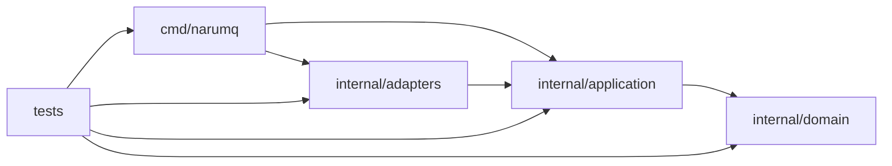

# Project structure

NaruMQ source tree는 MQTT·session·routing·delivery·tenancy·security·cluster lifecycle domain을 중심으로 구성한다. `cmd/narumq`만 concrete adapter를 조립한다. Unit test는 package와 함께 두고, system-level 검증과 deployment artifact는 production source에서 분리한다.

| 항목 | 값 |
| --- | --- |
| 관점 상태 | Current Phase 0 gate 4 / single-node ingress와 deterministic 3-node consensus-local-recovery spike |
| 문서 상태 | Draft |
| 구현 증거 | `cmd/narumq`, `internal/domain/mqtt`, `internal/domain/session`, `internal/domain/routing`, `internal/application/connect`, `internal/application/publish`, `internal/application/subscribe`, `internal/application/ports/deliveryqueue`, `internal/adapters/tcp`, `internal/adapters/memory/deliveryqueue`, `internal/adapters/memory/sessionstore`, `internal/adapters/clock`, `internal/adapters/raft`, `tests/integration/raft_consensus_test.go`와 각 package test |
| 범위 | Repository root와 Go package directory 배치 및 현재 source dependency |
| 관련 요구사항 | [PRD](../requirements/PRD.md) NFR-11~NFR-15, TEST-01~TEST-17, DEP-19~DEP-23 |
| 관련 결정 | [ADR-0001](../decisions/ADR-0001-core-implementation-language.md) Accepted |
| 관련 Architecture | [Broker core architecture](broker-core.md), [EKS on EC2 deployment](eks-ec2-deployment.md) |
| 관련 Convention | [Go coding conventions](../conventions/go-coding-conventions.md) |
| 최종 확인일 | 2026-09-19 |

## Target repository tree

아래 tree는 목표 구조다. Deliverable이 생기기 전에는 빈 directory를 미리 만들지 않는다.

```text
.
├── cmd/
│   └── narumq/
│       └── main.go
├── internal/
│   ├── domain/
│   │   ├── mqtt/
│   │   ├── session/
│   │   ├── routing/
│   │   ├── delivery/
│   │   ├── tenancy/
│   │   ├── security/
│   │   └── clusterlifecycle/
│   ├── application/
│   │   ├── connect/
│   │   ├── publish/
│   │   ├── subscribe/
│   │   ├── takeover/
│   │   ├── drain/
│   │   └── ports/
│   │       ├── audit/
│   │       ├── authentication/
│   │       ├── clock/
│   │       ├── consensus/
│   │       ├── deliveryqueue/
│   │       ├── logstore/
│   │       ├── metrics/
│   │       ├── nodediscovery/
│   │       ├── random/
│   │       ├── sessionstore/
│   │       └── transport/
│   └── adapters/
│       ├── audit/
│       ├── authentication/
│       ├── clock/
│       ├── kubernetes/
│       ├── managementapi/
│       ├── memory/
│       │   ├── deliveryqueue/
│       │   └── sessionstore/
│       ├── prometheus/
│       ├── raft/
│       ├── random/
│       ├── storage/
│       ├── tcp/
│       └── tls/
├── deploy/
│   └── profiles/
│       └── eks-ec2-ha/
├── tests/
│   ├── integration/
│   ├── conformance/
│   ├── compatibility/
│   ├── e2e/
│   ├── chaos/
│   └── benchmark/
├── tools/
├── docs/
├── go.mod
└── go.sum
```

현재 구현된 Phase 0 gate 3 + single-node ingress deliverable과 gate 4 consensus spike는 목표 tree의
`cmd/narumq`, `domain/mqtt`, `domain/session`, `domain/routing`, `application/connect`,
`application/publish`, `application/subscribe`, `application/ports/deliveryqueue`,
`adapters/tcp`, `adapters/memory/deliveryqueue`, `adapters/memory/sessionstore`,
`adapters/clock`, `adapters/raft`와 `tests/integration/raft_consensus_test.go`다.
`adapters/raft`의 WAL·snapshot은 이 spike 전용 experimental local format이며 production storage가
아니다. TLS, production peer transport, membership와 management API directory는 실제 deliverable이 생길 때 확장한다.

## Directory naming

- Go package directory는 package 이름과 같은 소문자 한 단어를 사용한다.
- Go package path에는 underscore, mixed caps와 역할 없는 `common`·`utils`를 사용하지 않는다.
- 실행 command directory는 binary 이름과 같은 `cmd/narumq`를 사용한다.
- Go package가 아닌 deployment profile directory는 kebab case를 사용한다. Profile ID `EKS_EC2_HA`는 `eks-ec2-ha/`에 대응한다.
- Test suite directory는 `integration`, `conformance`, `compatibility`, `e2e`, `chaos`, `benchmark`처럼 검증 목적을 이름으로 쓴다.
- Directory 이름에 team 이름이나 일시적인 issue 번호를 넣지 않는다.

## Root directory 책임

| Directory | 책임 | 금지 사항 |
| --- | --- | --- |
| `cmd/narumq` | Configuration load, concrete adapter 생성, lifecycle wiring과 process 시작·종료 | Domain rule, storage query와 protocol state machine |
| `internal/domain` | MQTT·session·routing·delivery·tenant·security·cluster invariant | Network, filesystem, Kubernetes, HTTP와 framework import |
| `internal/application` | Use case orchestration, transaction·commit boundary, application-owned port와 use case DTO | Concrete adapter 생성, external object 전달 |
| `internal/adapters` | TCP/TLS, storage, consensus, authentication, platform와 observability I/O | 새로운 business invariant 결정 |
| `deploy/profiles` | 지원 deployment profile의 manifest와 resolved configuration 입력 | Application source, secret 원문 |
| `tests` | 여러 package·process 또는 실제 dependency가 필요한 black-box 검증 | Package-local unit test 중복 |
| `tools` | Repository 검증·생성 도구와 pinning | Runtime product dependency와 business logic |
| `docs` | Requirement, architecture, decision, spec, contract와 guide | Generated binary와 runtime state |

`pkg/`는 초기 구조에 두지 않는다. 외부 project가 import해야 하는 안정된 public Go API가 실제로 생기고 compatibility 정책을 승인했을 때만 추가한다. `vendor/`도 dependency 공급 정책을 별도 결정하기 전에는 만들지 않는다.

## Source dependency

화살표는 허용된 source import 방향이다.



- Domain은 다른 계층을 import하지 않는다.
- Application은 domain과 자신이 소유한 port만 import한다.
- Adapter는 application port와 필요한 domain value에 의존한다.
- Composition root 밖에서 concrete adapter를 조립하지 않는다.
- `tests`의 source dependency는 허용하지만 production package가 `tests`를 import하지 않는다.
- Component graph에 cycle이 생기면 merge하지 않는다.

### Phase 0 gate 4 현재 package

| 실제 package | 책임 | 허용된 inward dependency |
| --- | --- | --- |
| `internal/domain/mqtt` | CONNECT/CONNACK, PUBLISH, ACK, SUBSCRIBE 계열과 PING/DISCONNECT wire validation·ownership | 표준 library만 |
| `internal/domain/session` | Clean Start, Session Expiry와 lifecycle invariant | 표준 library만 |
| `internal/domain/routing` | non-shared filter validation, wildcard match, overlap QoS와 session cleanup | `domain/mqtt`와 표준 library |
| `internal/application/connect` | lifecycle repository, queue/routing cleanup과 CONNACK orchestration | `domain/mqtt`, `domain/session`, `domain/routing`, `ports/deliveryqueue` |
| `internal/application/subscribe` | ordered SUBACK/UNSUBACK reason과 route mutation | `domain/mqtt`, `domain/routing` |
| `internal/application/publish` | route match와 shared delivery queue port, saturation result | `domain/mqtt`, `domain/routing`, `ports/deliveryqueue` |
| `internal/application/ports/deliveryqueue` | 여러 use case가 공유하는 queue capability와 error/DTO contract | application/domain value만 |
| `internal/adapters/memory/deliveryqueue` | session별 fixed item capacity와 FIFO ownership | `application/ports/deliveryqueue`, `domain/routing`, 표준 library |
| `internal/adapters/memory/sessionstore` | process-local lifecycle load/save/delete | `application/connect`, `domain/session`, 표준 library |
| `internal/adapters/clock` | system clock를 application port에 제공 | `application/connect`, 표준 library |
| `internal/adapters/tcp` | bounded MQTT ingress, single writer와 connection lifecycle | application use cases/ports와 `domain/mqtt` |
| `internal/adapters/raft` | etcd/raft 자료형, experimental WAL/snapshot format, deterministic node boundary를 adapter 안에 캡슐화 | `go.etcd.io/raft/v3`, `google.golang.org/protobuf`와 표준 library |

Application은 concrete adapter를 import하지 않는다. Queue, clock과 session repository
interface는 이를 사용하는 application package가 소유하고, composition root가 구현을
생성해 주입한다. `adapters/tcp`는 inbound adapter이므로 network 자료형을 packet과
application 결과로 변환하는 경계에만 둔다.

이번 spike는 application use case가 아직 소비하지 않는 algorithm·local recovery 증거다. 따라서
`internal/application/ports/consensus`와 `internal/application/ports/logstore`는 미리 만들지 않으며,
`cmd/narumq`에도 adapter를 조립하지 않는다. 실제 application replication port가 정의될 때 별도 변경으로
adapter DTO와 port를 연결한다.

정확한 package allowlist는 source tree가 생긴 뒤 architecture test로 고정한다.

## Domain과 use case package

Package 이름은 기술 계층보다 제품 책임을 드러낸다.

| 책임 | Domain package | Application package 예 |
| --- | --- | --- |
| MQTT 연결·packet | `domain/mqtt` | `application/connect`, `application/publish`, `application/subscribe` |
| Session·ownership | `domain/session` | `application/connect`, `application/takeover`, `application/drain` |
| Subscription route | `domain/routing` | `application/subscribe`, `application/publish` |
| Delivery·inflight | `domain/delivery` | `application/publish`, `application/takeover` |
| Tenant namespace·quota | `domain/tenancy` | 각 use case에서 policy 호출 |
| Authentication·authorization policy | `domain/security` | `application/connect`와 management use case 후보 |
| Membership·node lifecycle | `domain/clusterlifecycle` | `application/takeover`, `application/drain` |

새 package는 변경 이유와 invariant가 기존 package와 다를 때만 만든다. 단순히 file 수가 늘었다는 이유로 package를 나누지 않는다.

## 주요 port capability와 adapter map

아래 표는 use case가 외부 I/O를 위해 요구하는 주요 outbound capability를 보여준다. Port는 사용하는 application이 소유한다. 구현 package 옆에 공용 interface를 선언하지 않는다.

| Capability | Application-owned port | Concrete adapter | Adapter 내부 client·library |
| --- | --- | --- | --- |
| Session aggregate 저장·복구 (target) | `ports/sessionstore.SessionRepository` | `adapters/storage.WALSessionRepository` | Storage engine 또는 file I/O |
| 현재 session lifecycle | `application/connect.SessionRepository` | `adapters/memory/sessionstore.MemorySessionRepository` | mutex-protected process-local map |
| 현재 clock | `application/connect.Clock` | `adapters/clock.SystemClock` | Go system clock |
| Replicated log 저장 | `ports/logstore.LogStore` | `adapters/storage.WALLogStore` | WAL·snapshot codec |
| Consensus proposal·commit 관찰 | `ports/consensus.ReplicationService` | `adapters/raft.RaftReplicationService` 후보 | `etcd/raft` 후보 |
| Cluster peer message 송수신 | `ports/transport.PeerTransport` | `adapters/tcp.TCPPeerTransport` 후보 | TCP/TLS 또는 후속 RPC client |
| Credential 검증 | `ports/authentication.AuthenticationProvider` | `adapters/authentication.JWKSAuthenticationProvider`, `MTLSAuthenticationProvider` | `JWKSClient`, certificate verifier |
| Cluster node 발견 | `ports/nodediscovery.NodeDiscovery` | `adapters/kubernetes.KubernetesNodeDiscovery` | `KubernetesClient` |
| Metric 기록·노출 | `ports/metrics.MetricRecorder` 후보 | `adapters/prometheus.PrometheusMetricRecorder` 후보 | Prometheus registry와 OpenMetrics exposition |
| Audit event 발행 | `ports/audit.AuditPublisher` | `adapters/audit.ExternalAuditPublisher` 후보 | 외부 audit sink client 후보 |
| Jitter·identifier용 난수 제공 | `ports/random.RandomSource` | `adapters/random.CryptoRandomSource` 후보 | Go cryptographic random source |
| Session delivery queue | `application/ports/deliveryqueue.Queue` (`Register`/`Remove`/`TryEnqueue`/`Drain`) | `adapters/memory/deliveryqueue.Queue` | mutex-protected FIFO item slices |

화살표로 읽으면 `UseCase → Port ← Adapter → Client·SDK → External system`이다. Source dependency는 adapter에서 port를 향한다. `cmd/narumq`가 concrete adapter를 생성해 use case에 주입한다.

`*Client`는 외부 protocol 호출을 캡슐화하는 adapter 내부 구현체다. 범용 `Client` port를 만들지 않는다. Application port는 `AuthenticationProvider`, `NodeDiscovery`처럼 use case가 요구하는 capability로 이름을 짓는다. Adapter가 단순하면 concrete adapter가 SDK를 직접 사용할 수 있고, protocol 처리나 test seam이 필요하면 별도 `*Client`에 위임한다.

Management API와 MQTT listener는 inbound adapter이므로 이 outbound port 표에 넣지 않는다. `adapters/managementapi`와 `adapters/tcp`의 controller가 request를 DTO 또는 domain value로 변환한 뒤 해당 use case를 호출한다.

표의 interface와 concrete type 이름은 Target naming이다. 정확한 method signature는 source와 machine-readable contract가 생긴 뒤 확정한다. `etcd/raft`와 durable WAL 경계처럼 Proposed ADR에 의존하는 구현은 후보 상태를 유지한다.

외부 library type은 adapter 안에서 application DTO 또는 domain value로 변환한다.

## Model과 경계 자료형 배치

Package는 model 종류가 아니라 소유 책임과 변경 이유로 나눈다. `models`, `entities`, `persistence/models`처럼 여러 책임의 type을 한곳에 모으지 않는다.

| 분류 | 기본 위치 | 별도 package를 허용하는 조건 | 이름과 금지 사항 |
| --- | --- | --- | --- |
| Domain entity·value object | `internal/domain/<capability>` | 별도 공용 model package를 만들지 않는다. | `session.State`, `delivery.InflightMessage`처럼 domain 의미를 사용한다. Storage tag와 schema version을 넣지 않는다. |
| Use case DTO | `internal/application/<usecase>` | 여러 use case가 같은 안정된 application boundary를 공유할 때만 `internal/application/dto`를 추가한다. | 모든 human-written DTO는 [Go coding conventions](../conventions/go-coding-conventions.md#34-dto-이름)에 따라 `DTO` Postfix를 사용한다. |
| Management API wire type | `internal/adapters/managementapi` | OpenAPI 생성물은 같은 adapter 아래 `generated/`에 격리한다. | HTTP request·response type을 domain에 전달하지 않는다. |
| Persistence model | `internal/adapters/storage` | WAL·snapshot이 versioned schema를 공유하고 별도 compatibility lifecycle이 생길 때만 `internal/adapters/storage/record`를 추가한다. | WAL·snapshot은 `*Record`, SQL은 `*Row`, manifest는 `*Manifest`를 사용한다. `*Entity`, `*DBEntity`, `*DTO`를 사용하지 않는다. |
| 외부 API wire type | 이를 호출하는 `internal/adapters/<provider>` | 생성기 소유 type은 해당 adapter 아래 `generated/`에 격리한다. | Adapter가 application DTO 또는 domain value로 변환한다. |

Domain model은 business invariant와 행위를 소유한다. Persistence model은 schema version, encoding과 storage metadata만 소유한다. 양방향 mapper는 storage adapter에 두며 domain이 persistence model을 import하거나 반환하지 않게 한다.

```text
internal/domain/session/state.go
internal/application/drain/start_drain_command_dto.go
internal/adapters/storage/session_record.go
internal/adapters/storage/session_record_mapper.go
internal/adapters/managementapi/generated/
```

처음부터 `storage/record` package를 만들지는 않는다. Record와 codec을 여러 storage component가 공유하거나 [persisted state 호환성](../contracts/cluster-release-compatibility-v1.md#5-persisted-state와-snapshot)을 독립적으로 검증해야 할 때 분리한다.

## File 배치

- Package-local unit test와 fuzz test는 대상 file 옆의 `*_test.go`에 둔다.
- 여러 package가 필요한 integration test는 `tests/integration`에 둔다.
- MQTT wire 적합성은 `tests/conformance`, N-1↔N은 `tests/compatibility`에 둔다.
- Kubernetes·NLB·EBS가 필요한 시험은 `tests/e2e`, `tests/chaos` 또는 `tests/benchmark`에 목적별로 둔다.
- Test fixture가 한 package에서만 쓰이면 package 안 `testdata/`에 둔다. Repository-wide fixture는 이를 소비하는 test suite 아래에 둔다.
- Generated source는 이를 사용하는 adapter 아래 `generated/`에 격리하고 생성 원본과 command를 기록한다.

## 만들지 않는 포괄 directory

다음 이름은 책임과 dependency를 감추므로 새 top-level 또는 `internal` package로 만들지 않는다.

- `common`, `shared`, `utils`, `helpers`
- `models`, `types`, `interfaces`
- 모든 기능을 모은 `services`, `repositories`, `controllers`

공통 code가 필요하면 실제 소유 domain 또는 application client에 둔다. 두 package가 함께 쓰더라도 invariant와 변경 이유가 다르면 작은 value를 중복하는 편이 잘못된 공통 dependency보다 낫다.

## 변경 기준

- 새 top-level directory는 새로운 deliverable, 독립 검증 suite 또는 architecture boundary가 있을 때만 추가한다.
- Package 이동으로 import direction이 바뀌면 [Broker core architecture](broker-core.md)와 architecture test를 함께 갱신한다.
- Deployment profile을 추가하면 지원 상태, release evidence와 profile별 test directory를 연결한다.
- Public package를 만들면 compatibility contract와 version 정책을 먼저 정의한다.
- 이 view를 `Current / Verified`로 바꾸기 전에 실제 source tree와 import graph를 증거로 연결한다.
