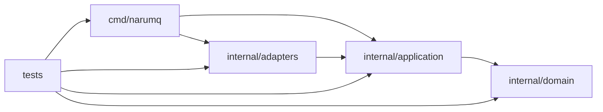

# Project structure

NaruMQ source tree는 MQTT·session·routing·delivery·tenancy·security·cluster lifecycle domain을 중심으로 구성한다. `cmd/narumq`만 concrete adapter를 조립한다. Unit test는 package와 함께 두고, system-level 검증과 deployment artifact는 production source에서 분리한다.

| 항목 | 값 |
| --- | --- |
| 관점 상태 | Active Phase 1 security and tenant isolation structure; Phase 0 gate 4와 BP-01/BP-03/BP-05 smoke harness 유지 |
| 문서 상태 | Active |
| 구현 증거 | Phase 0 gate 3·4, Phase 1 tenancy·security·mTLS, Phase 2 replicated session/backup/QoS 1/2와 broker-side drain slice가 source·test에 연결되어 있다. `TestDynamicClusterSessionMetadataProcessAcceptance`는 3-node process acceptance PASS (29.40s; [Cluster spec §11.24](../specs/cluster-session-and-delivery.md#1124-session-metadata-복제와-owner-손실-복구-수용-매핑)). BP-03 smoke harness source와 package tests는 추가되었으며, Docker 결과는 [performance spec §3.4](../specs/performance-and-verification.md#34-bp-03-durable-delivery-smoke-관찰-경계)에 별도로 기록한다. Node drain process acceptance 두 개는 PASS (combined 25.916s; [Drain spec §10](../specs/drain-and-rolling-update.md#10-broker-drain-수용-시험-매핑)); full rollout·SDK compatibility·production storage gate는 별도다. |
| 범위 | Repository root와 Go package directory 배치 및 현재 source dependency |
| 관련 요구사항 | [PRD](../requirements/PRD.md) NFR-11~NFR-15, TEST-01~TEST-17, DEP-19~DEP-23 |
| 관련 결정 | [ADR-0001](../decisions/ADR-0001-core-implementation-language.md) Accepted |
| 관련 Architecture | [Broker core architecture](broker-core.md), [EKS on EC2 deployment](eks-ec2-deployment.md) |
| 관련 Convention | [Go coding conventions](../conventions/go-coding-conventions.md) |
| 최종 확인일 | 2026-10-04 |

## 코드 지도: 실행 모드와 MQTT CONNECT 대표 흐름

이 절은 CLI 실행 모드와 standalone MQTT·관리 HTTP 진입점을 찾고, MQTT CONNECT 한 흐름을 대표 예시로 따라간다. 모든 패킷 handler와 cluster 내부 흐름을 나열하지는 않으며, 자세한 구조 책임은 아래 package map과 관련 architecture·spec·contract 문서를 따른다. 아래 `Target repository tree`는 별도의 목표 구조다.

| 진입점·흐름 | 코드 위치와 심볼 | 역할 |
| --- | --- | --- |
| 프로세스 시작 | `cmd/narumq/main.go` `main` → `run` → `runWithContext` | CLI 설정을 검사하고 아래 실행 모드 가운데 하나를 선택한다. |
| Dynamic cluster | 호출: `cmd/narumq/main.go` `runWithContext` → 정의: `cmd/narumq/cluster_runtime.go` `runClusterMode` | `-cluster-config`를 사용해 dynamic cluster 경로로 진입한다. |
| Dynamic cluster 빈 directory bootstrap | `cluster_runtime.go` `runClusterMode` → `cluster_bootstrap_probe.go` `clusterDirectoryEmpty`·`runClusterBootstrapProbe` → `internal/adapters/tcp/peer_bootstrap_probe.go` `ServeBootstrapProbe`·`ProbeBootstrapPeer` → `raftadapter.Open` | Open 전에 raw peer listener만 연다. Probe server의 연결을 종료하고 deadline을 초기화한 뒤 같은 listener를 running transport에 넘긴다. `BootstrapAllowedPeerIDs`는 transport가 process memory에 소유하며 `peer_transport_flow.go` `receiveRaftFrame`이 첫 Raft payload 수신에서 해제한다. 비어 있지 않은 volume과 joiner 경로는 기존 순서를 유지한다. [ADR-0022](../decisions/ADR-0022-bootstrap-volume-loss-guard.md) 참조. |
| Dynamic cluster joiner volume-loss 보호 | `cluster_runtime.go` `runClusterMode` → local snapshot/WAL 복구 → `runSeedAdmission`; fresh 경로 `DynamicTCPPeerTransport.RequestSeedAdmission` → seed `clusterRuntime.admitPeer` → `updateAdmissionIdentity` | 복구된 committed local voter는 seed 요청 없이 재개한다. Seed runtime은 VOTER 후보를 voter 수와 무관하게 거절하며 fresh STAGED client는 이전 seed의 VOTER 응답도 설치 전에 거절한다. 기록 손실은 새 ID 교체로 복구한다. [ADR-0024](../decisions/ADR-0024-joiner-voter-volume-loss-admission.md)·[Cluster §11.20](../specs/cluster-session-and-delivery.md#1120-voter-volume-손실-보호와-재시드-수용-매핑) 참조. |
| Dynamic cluster PUBLISH admission | `internal/adapters/tcp/server.go` `readLoop` → `server_phases.go` `dispatchPhased` → `server_submission.go` `beginInboundPublish` 또는 `dispatchPublishAt` → `cmd/narumq/cluster_runtime.go` `clusterProjectionReady` → Ready 진행 중이면 `clusterDriverProjection` → `resolveProjectionRequests` | Driver가 현재 commit index까지 apply/projection을 완료한 경계에서 local health와 applied index를 검사한다. Durable write마다 fresh ReadIndex proof를 얻는 `beginCommit`의 경계를 대신하지 않는다. |
| Dynamic cluster proposal 수집 | `cluster_runtime.go` `runDriver` → `resolveCommitReads` → `cluster_proposals.go` `submitCommitBatch` → `node.go` `ProposeBatchForwarded` | 독립 fresh proof를 완료한 FIFO command를 64개·64 KiB 예산으로 묶는다. 지금 대기 중인 inbound/request만 staging하고 8ms 추가 대기는 제거한다. |
| Raft 비동기 저장·apply 완료 | `node.go` `Open` → `node_ready.go` `ProcessReady` → `wal_worker.go` `WALAppendWorker.run`·`persistBatch` → `stable_store.go` `writeWALFrame`; 완료 → `applyRecord` → runtime `applyBatch`·`CompleteApply` | Disk 전용 단일 writer가 여러 CRC frame을 한 sync로 기록한다. Driver는 저장 중 tick·peer 응답을 처리하고 저장 의존 응답·application apply는 완료 경계를 지킨다. Snapshot·backup 대기는 driver가 소유하며 `Close`가 worker를 join한다. [ADR-0020](../decisions/ADR-0020-asynchronous-raft-wal-group-commit.md) 참조. |
| Local snapshot 저장 공간 회수 | `node.go` `Snapshot`·`SnapshotWithApplicationData` 또는 `node_ready.go` fixed bootstrap → `stable_store.go` `createSnapshotPayload` → `wal_compaction.go` `compactWAL` → `pruneSnapshotFiles`; 재시작 `openStableStoreMode` → stale `wal.bin.tmp` 삭제 → `readWALMode` | Node mutex 아래 append worker idle 경계를 유지한다. Snapshot 확정 뒤 영속 tail과 최신 HardState로 WAL을 atomic replace하고 새 handle을 append 위치로 연 뒤 이전 snapshot을 삭제한다. CRC 오류는 zero-sector 근거가 있을 때만 마지막 frame을 절단한다. [ADR-0023](../decisions/ADR-0023-raft-wal-compaction-and-snapshot-retention.md)·[Cluster §11.22](../specs/cluster-session-and-delivery.md#1122-wal-compactionsnapshot-retentiontorn-tail-수용-매핑) 참조. |
| Dynamic cluster fresh read 발행 제어 | `cluster_runtime.go` `runDriver` / `stageQueuedDriverRequests` → `cluster_read_admission.go` `tryDriverRequest` → `DynamicTCPPeerTransport.OutboundCapacity` → `Node.ReadIndex`; write 완료 → `OutboundReady` → 재판정 | 실제 peer count·byte 여유와 같은 Ready 앞의 발행량을 사용한다. 미발행 FIFO head는 원래 deadline을 보존하며 inbound·tick을 막지 않는다. Fresh proof 공유·cache나 outbound retry는 추가하지 않는다. |
| Dynamic cluster 병목 계측 | `internal/adapters/tcp/peer_transport.go` enqueue 시각 → `cluster_runtime.go` driver 인수·ReadIndex/proposal 완료 → `cluster_timing.go` → `internal/adapters/metrics/registry_raft.go`; `tests/benchmark/bp03/diagnostics.go`가 원시 scrape를 보존 | Queue 대기와 Ready/WAL·apply·transport enqueue·quorum 확인 구간을 분리한다. Duration은 완료된 stage의 진단값이며 ACK·fsync 보장이나 처리 순서를 바꾸지 않는다. |
| BP-03 persistent subscriber 재접속 | `tests/benchmark/bp03/runner.go` `executeBP03` → `closeClients` → 이전 session 수신 상태 인계 → `startReader` | Reader 종료 뒤 QoS 2 pending/completed Packet ID를 새 socket에 넘긴다. 기존 PUBREL 재개는 PUBCOMP로 응답하고 delivery를 다시 집계하지 않는다. Workload 종료 오류는 최초 reader 취소 원인을 보존한다. |
| Dynamic cluster readiness 거절 진단 | `cluster_runtime.go` `clusterReady` / `clusterHealthChecker.CheckReadiness` / `hasFreshProof`·`cluster_backup.go`·`cluster_drain.go` → `checkReadiness` → `cluster_readiness_diagnostics.go` `logReadinessFailure` | 기존 거절에 사용한 storage/local snapshot과 fresh proof 결과를 고정 purpose·stage로 기록한다. Management summary는 MQTT admission과 별도 집계한다. Ready sequence는 관찰만 하며 checkpoint 대기·재판정·quorum/ACK 정책을 바꾸지 않는다. |
| Dynamic Raft 수신 흐름 제어 | `peer_transport.go` `runConnection` → `peer_transport_flow.go` `receiveRaftFrame` → `reserveInbound` → `TakeInbound` → `PeerInboundDelivery.Complete` | Payload allocation 전에 bounded 공간을 예약한다. 포화 때 payload를 읽지 않고 기존 deadline 안에서 공간을 기다린다. Complete·identity 변경·연결 교체·shutdown이 대기를 깨우며 fixed-voter·forwarding lane은 기존 경로를 유지한다. |
| Dynamic cluster TCP phase 처리 | `internal/adapters/tcp/server.go` `readLoop` → `server_phases.go` `dispatchPhased` → 방향별 PacketID 순서 → `server_submission.go` 준비 → application `BeginPublish`/`BeginReceiveQoS2`/`BeginQoS2Release` → `clusterRuntime.beginCommit` → driver fresh proof·FIFO proposal → 완료 worker → 기존 writer | 두 lane은 independent exchange만 겹쳐 처리한다. Lane별 16개(준비·완료 대기 포함)·공용 byte 제한, control barrier, PacketID 예약, commit 뒤 ACK와 종료 시 모든 pending 값 회수를 지킨다. |
| Durable outbound batch와 ACK | `server.go` `writeDeliveries` → `deliveryqueue.Queue.PeekBatch`/`PromoteBatch` → `cmd/narumq/cluster_durable.go` pending SEND → proof·commit → prefix wire PUBLISH; 수신 ACK → `server_phases.go` → `BeginReplaceOutbound`/`BeginCompleteOutbound` → commit 뒤 PUBREL 또는 PacketID 해제 | Writer의 고정 배열은 최대 8개다. 부분 성공 오류와 뒤에서 이미 commit된 SEND를 숨기지 않고, 모든 suffix ID를 동일 ID 재시도 또는 연결 정리까지 보존한다. |
| Dynamic cluster tenant storage quota | `-cluster-config` → `cmd/narumq/cluster_config.go`의 `tenantQuotas` 엄격 파싱 → `cmd/narumq/cluster_tenant_quota.go`의 profile controller → `clusterRuntime.Commit` → 커밋된 membership quota profile과 사용량 계산 → `internal/adapters/metrics` | MQTT readiness는 quota profile의 quorum commit을 요구한다. Admission은 커밋된 profile을 따른다. 로컬 설정 version이 더 높으면 controller가 profile을 제안하며, mismatch 경보는 커밋된 version이 더 높거나 같은 version의 내용이 다를 때 발생한다. 수용 증거는 [Cluster spec §11.16](../specs/cluster-session-and-delivery.md#1116-tenant-storage-quota-수용-매핑)에 있다. |
| Dynamic cluster release profile | `-cluster-config` → `cmd/narumq/cluster_runtime.go` `runClusterMode`가 `clusterRuntime`과 controller를 구성하고 `serve`가 lifecycle을 관리 → `cmd/narumq/cluster_runtime.go` `applyBatch`는 committed local profile command·restored snapshot 뒤 gate를 무효화하고, applied feature activation이 build에서 지원되지 않으면 incompatibility를 latch한다 → `cmd/narumq/cluster_release_profile.go` `start`는 복구된 active feature를 barrier 없이 확인하고 500 ms `reconcile`은 `Members`→`ActiveFeatures` read barrier 뒤 `MemberProfileChange`를 제안한다. 두 read가 pending인 동안 마지막 synchronized 상태를 유지하고, 결과는 두 read가 모두 끝난 뒤 판정한다. Read error·wait·mismatch/proposal은 gate를 닫는다. Applied local profile change와 snapshot restore는 revision을 증가시켜 pre-change reconcile 완료가 gate를 다시 열지 못하게 한다. `releaseProfileSynced`는 readiness/admission snapshot을 gate한다. `clusterHealthChecker.CheckReadiness`는 storage·drain 확인 뒤 quorum read barrier 전에 latched incompatibility를 반환한다. | Committed profile이 running build와 일치하기 전에는 READY가 되지 않는다. Active feature를 지원하지 않는 build는 readiness 503을 반환한다. See [release compatibility contract](../contracts/cluster-release-compatibility-v1.md) and [Cluster spec §8/§11.17](../specs/cluster-session-and-delivery.md#8-mixed-version-compatibility). |
| Dynamic cluster node drain | Management API `POST/GET/DELETE /api/v1/nodes/{nodeId}/drain` → `membership.DrainService` → `clusterRuntime.Commit` → replicated `NodeDrain` apply; controller: `cmd/narumq/cluster_drain.go` → `internal/domain/nodedrain` barrier rules → MQTT admission and ownership transfer | Quorum-committed phase/state resumes after process restart; `SAFE_TO_STOP` does not approve Pod deletion. Process evidence is in [Drain spec §10](../specs/drain-and-rolling-update.md#10-broker-drain-수용-시험-매핑). |
| SDK drain 호환성 증거 | `tests/compatibility/mqtt-clients-v1/main.go` `--suite drain` → `RunDrain` → `runSuite` → `runDrainClusterCase` 또는 `runMalformedCase` → SDK `runDrainDriver` / `drain_main` → 결과·trace 검증 | Cluster 경로는 leader drain API와 readiness LB를 조립한다. 두 SDK의 callback adapter가 reference를 한 번 소비하고 permanent endpoint를 보존한다. Fake server 경로는 malformed vector 뒤 trap 접속과 configured endpoint 복귀를 검사한다. |
| Dynamic cluster session metadata 복구 | CONNECT → `internal/application/connect/connect.go` `UseCase.ConnectContext` / `connect/session_metadata.go` `sessionConnectDTO` → `cmd/narumq/cluster_session_metadata.go` `AcquireSessionOwnership` → ownership command의 atomic session metadata와 같은 committed apply; READY 뒤 `cluster_session_recovery.go` controller → `RecoverOwnedSession` | CONNECTED lifecycle과 pending Will·expiry metadata는 ownership epoch와 함께 replicated state에 저장된다. Metadata record는 현재 owner가 같은 epoch일 때만 변경·claim할 수 있다. READY 시 controller는 복구 후보를 use case goroutine으로 전달하고, committed CLAIM_WILL/DISCARD 결과만 발행 결정으로 쓴다. 구체 흐름은 [Cluster architecture](cluster-architecture.md#session-metadata-복구-경로)·[ADR-0025](../decisions/ADR-0025-replicated-session-metadata-and-owner-loss-recovery.md)·[Cluster spec §11.24](../specs/cluster-session-and-delivery.md#1124-session-metadata-복제와-owner-손실-복구-수용-매핑)에 있다. |
| 계획 인계 Will과 사유 집계 | `tcp/server.go` cleanup → `session.DisconnectTakeover`; 후계 `connect/session_metadata.go` `RecoverOwnedSession` → `disconnectLocked`·timer; 재접속 `membership/machine.go` `applyOwnership` → runtime `AcquireSessionOwnership` → `connect/will_outcome.go` `resolveSupersededWillLocked` | 이전 owner는 local Will만 폐기한다. 후계와 재접속 node는 committed claim·대체 결과로 표준 발행/예약/억제를 결정한다. `cmd/narumq/main.go`·`cluster_runtime.go`가 `WithWillOutcomeRecorder`를 주입하며 `adapters/metrics/registry.go`가 6개 reason을 render한다. 출처는 timer memory에만 둔다. [ADR-0028](../decisions/ADR-0028-planned-handoff-will-and-reason-metric.md)·[Drain §10](../specs/drain-and-rolling-update.md#10-broker-drain-수용-시험-매핑) 참조. |
| Dynamic cluster detach 전환 보호 | `internal/application/connect/connect.go` `disconnectLocked` → `deliveryqueue.BeginDetach` → `DetachSession` → `FinishDetach`; `internal/application/publish/publish.go` `deliverQoS0Candidate` → `ErrDetaching` → `AwaitDetach` → 재판정 | Memory queue가 capture와 enqueue 차단을 같은 lock 안에서 수행한다. Local publish는 최대 10초 대기하며 성공 뒤 offline ENQUEUE, 실패 뒤 local enqueue로 진행한다. Forward는 기다리지 않는다. [Cluster architecture](cluster-architecture.md#detach-전환-local-publish-보호)·[ADR-0026](../decisions/ADR-0026-detach-transition-local-qos0-gate.md)·[§11.25](../specs/cluster-session-and-delivery.md#1125-detach-전환-local-qos-0-보존-수용-매핑)를 따른다. [ADR-0027](../decisions/ADR-0027-detach-forward-and-owner-crash-qos0-boundary.md)은 전환 중 forward와 commit 전 local queue 손실을 허용하며, `cmd/narumq/cluster_offline.go` `DetachSession`의 proposal 직전·Applied 확인 직후에 `offline-detach-before-commit`·`offline-detach-after-commit` failpoint를 둔다. |
| Replicated session metadata state | `internal/application/membership/session_metadata.go` → `StateMachine.applySessionMetadata`, `SessionMetadata`/`GetSessionMetadata`; ownership apply and snapshot restore | Membership owns deterministic validation and committed lifecycle transitions; each tenant/client record is fenced by owner and epoch, and sorted deep copies feed snapshots and management/recovery reads. See [Cluster architecture](cluster-architecture.md#session-metadata-복구-경로), [ADR-0025](../decisions/ADR-0025-replicated-session-metadata-and-owner-loss-recovery.md), and [Cluster spec §11.24](../specs/cluster-session-and-delivery.md#1124-session-metadata-복제와-owner-손실-복구-수용-매핑). |
| Cluster management client view | `cmd/narumq/cluster_session_metadata.go` `ClusterSessions` → `internal/application/management.Service` cluster session source → `/api/v1/clients` | Feature 활성화 뒤 local committed metadata view를 기준으로 cluster-wide client 목록과 단건 조회를 제공한다. 비활성일 때 management service의 기존 local session 경로를 사용한다. |
| Cluster restore | 호출: `cmd/narumq/main.go` `runWithContext` → 정의: `cmd/narumq/cluster_backup_restore.go` `restoreClusterBackup` | `-cluster-config`와 `-cluster-restore`를 함께 지정하면 archive 복원 경로를 선택한다. |
| Fixed-voter peer-only | 호출: `cmd/narumq/main.go` `runWithContext` → 정의: `cmd/narumq/raft_peer_config.go` `runRaftPeerOnly` | `-raft-peer-config`로 MQTT/management listener와 분리된 peer-only 경로를 선택한다. |
| Standalone listener 시작 | `cmd/narumq/main.go` `runWithContext` → `serveServices`에 `mqttServer` (`*tcpadapter.Server`)와 `httpServer` (`*http.Server`) 인스턴스를 전달해 listener 실행을 맡긴다. | `-tcp-listen`/`-tls-listen` 및 `-http-listen` 설정에 따라 standalone MQTT와 management HTTP listener를 시작한다. |
| MQTT CONNECT 대표 흐름 | `cmd/narumq/main.go` `runWithContext` → `mqttServer.Serve` → `internal/adapters/tcp/server.go` `readLoop`·`activate` → `internal/application/connect/connect.go` `ConnectContext` | 인증 전 pending CONNECT는 raw Client ID로 묶고 committed fence는 tenant별 owner/epoch를 검사한다. Cleanup은 연결이 획득한 epoch를 사용하며 local epoch가 다르면 부작용 전에 중단한다. 원격 takeover는 이전 node의 local epoch map을 바꾸지 않는다. 이전 연결은 `DisconnectTakeover`로 local Will을 폐기하며 집계하지 않는다. 성공 CONNACK은 commit과 bind 뒤에만 전송한다. |
| 관리 HTTP | 생성 위치: `cmd/narumq/main.go` `runWithContext` → `internal/adapters/http/management/server.go` `NewServer` → `newServer` → `newRouter`; 호출 위치: `serveServices`가 `httpServer` 변수 (`*http.Server`)의 `Serve(httpListener)` 메서드를 호출 | Management API 요청은 HTTP 경계에서 처리한다. 정확한 경로와 응답 형식은 [management API contract](../contracts/management-api-v1.md)가 기준이다. |
| Storage-fault chaos | `tests/chaos/cluster-storage-v1/main.go` `runCLI` → `runner.go` `Run` → `scenario.go`/`power.go` 또는 `ext4.go`; 별도 node module: `node/chaosfs.go`, `node/chaosfs_journal.go`, `node/supervise.go`, `node/commands.go` | 기본 `local-fuse-v1`은 tmpfs/FUSE fault·power-cut simulation을 실행한다. `local-ext4-v1`은 `ext4-entrypoint.sh`의 제한된 loop image에서 실제 ext4 ENOSPC·process crash와 기존 recovery 수용 시험을 실행한다. 둘 다 production EBS·물리 전원 손실 증거가 아니다. |

대표 CONNECT 동작은 [MQTT protocol과 session 스펙](../specs/mqtt-protocol-and-session.md)의 CONNECT 처리 순서 및 [`tests/integration/mqtt_ingress_test.go`](../../tests/integration/mqtt_ingress_test.go)에서 확인한다. Dynamic cluster와 peer-only 흐름은 각각 [Cluster architecture](cluster-architecture.md), [Raft peer transport contract](../contracts/raft-peer-transport-v1.md)를 따른다. 이 표는 진입 경로 안내이며 내부 처리 전체를 검증하는 증거는 아니다.

Release-profile의 적용 이벤트는 `cluster_release_profile.go`의 `invalidate`에서 gate를 닫고 대기 알림 한 개를 남긴다. `run`은 다음 500ms 주기를 기다리지 않고 기존 `Members`·`ActiveFeatures` fresh read barrier를 다시 수행한다. 적용 전 revision의 완료는 gate를 열 수 없으며, snapshot restore 직후에도 재확인이 끝나기 전의 admission 거절은 유지한다.

## Target repository tree

아래 tree는 목표 구조다. Deliverable이 생기기 전에는 빈 directory를 미리 만들지 않는다.

```text
.
├── cmd/
│   └── narumq/
│       └── main.go
├── internal/
│   ├── domain/
│   │   ├── mqtt/
│   │   ├── session/
│   │   ├── routing/
│   │   ├── delivery/
│   │   ├── tenancy/
│   │   ├── security/
│   │   ├── clusterlifecycle/
│   │   └── nodedrain/
│   ├── application/
│   │   ├── connect/
│   │   ├── publish/
│   │   ├── subscribe/
│   │   ├── takeover/
│   │   ├── membership/
│   │   └── ports/
│   │       ├── audit/
│   │       ├── authentication/
│   │       ├── clock/
│   │       ├── consensus/
│   │       ├── deliveryqueue/
│   │       ├── logstore/
│   │       ├── metrics/
│   │       ├── nodediscovery/
│   │       ├── random/
│   │       ├── retained/
│   │       ├── sessionstore/
│   │       └── transport/
│   └── adapters/
│       ├── audit/
│       ├── authentication/
│       ├── clock/
│       ├── kubernetes/
│       ├── managementapi/
│       ├── memory/
│       │   ├── deliveryqueue/
│       │   ├── retained/
│       │   └── sessionstore/
│       ├── prometheus/
│       ├── random/
│       ├── raft/
│       │   └── records/
│       ├── runtimemetrics/
│       ├── storage/
│       ├── tcp/
│       └── tls/
├── deploy/
│   └── profiles/
│       └── eks-ec2-ha/
├── tests/
│   ├── integration/
│   ├── conformance/
│   │   └── mqtt-compliance-v1.json
│   ├── verification/
│   │   └── coverage-policy.json
│   ├── compatibility/
│   │   └── mqtt-clients-v1/
│   │       ├── clients/
│   │       │   ├── go/       # isolated nested Go module; Paho MQTT 3.1.1/5
│   │       │   └── python/  # pinned paho-mqtt 2.1.0 image source
│   │       ├── Dockerfile
│   │       ├── profile.json
│   │       ├── runner.go    # shared suite lifecycle and evidence artifacts
│   │       ├── drain-profile.json
│   │       ├── drain_profile.go
│   │       ├── drain_runner.go
│   │       ├── drain_fixture.go
│   │       └── drain_trace.go
│   ├── e2e/
│   ├── chaos/
│   │   └── cluster-storage-v1/
│   │       ├── node/       # isolated nested Go module; FUSE storage faults, fsync control and power-loss rollback
│   │       ├── Dockerfile
│   │       └── runner.go   # six-scenario Docker orchestration, process controls and evidence
│   └── benchmark/
│       ├── internal/
│       │   ├── environment/
│       │   ├── jsonl/
│       │   ├── mqttclient/
│       │   ├── runtimeartifact/
│       │   └── suiteartifact/
│       ├── bp01/
│       ├── bp03/
│       └── bp05/
├── tools/
│   └── verify/
│       ├── main.go
│       ├── matrix.go
│       ├── architecture.go
│       ├── coverage.go
│       └── runner.go
├── docs/
├── go.mod
└── go.sum
```

현재 구현된 Phase 0 gate 3 + single-node ingress, gate 4 consensus spike와 TLS/mTLS transport security deliverable에
Phase 1 security·tenant isolation slice, Phase 2 replicated session ownership core와 broker drain slice가 추가되어 목표 tree의
`cmd/narumq`, `domain/mqtt`, `domain/session`, `domain/routing`, `domain/tenancy`,
`domain/security`, `domain/nodedrain`, `application/connect`, `application/publish`,
`application/subscribe`, `application/takeover`, `application/membership`, `application/ports/authentication`,
`application/ports/deliveryqueue`, `application/ports/retained`,
`adapters/authentication`, `adapters/tcp`, `adapters/tls`,
`adapters/memory/deliveryqueue`, `adapters/memory/retained`,
`adapters/memory/sessionstore`, `adapters/clock`, `adapters/raft`가 해당한다.
`internal/domain/nodedrain`은 drain phase 전이와 safe-to-stop barrier를 표준 library 값으로 판정한다.
`internal/application/membership`은 drain 요청과 replicated state port를 연결하고, `cmd/narumq/cluster_drain.go`는 dynamic-cluster runtime의 admission, transfer driver, recovery와 lifecycle을 조립한다.
`internal/adapters/runtimemetrics`는 Go process 내부의 `runtime/metrics`를 고정 JSONL schema로 수집하는 outbound 진단 adapter다.
`tests/benchmark/internal/environment`는 BP-01/BP-03/BP-05의 immutable image, single-broker·3-node cluster container, readiness, resource limit, runner container, Docker stats와 artifact 수집 경계를 소유한다. BP-03에서 `bp03/compare.go`는 비교 실행을 조립하고, `fixture.go`는 target용 인증·cluster 설정을 임시 생성한다. Network owner에는 공개 JWKS만 mount하고 runner credential, broker별 private peer key와 admin token은 별도 directory로 분리한다. `runner.go`·`aggregate.go`·`metrics.go`·`resource.go`는 workload, message/WAL/resource summary를 만든다. `suite.go`는 BP-03 metric 선택과 반복 parent artifact를 소유한다.
BP-03의 Enterprise comparator 설정과 image digest는 `bp03/compare.go`가 소유한다. `fixture.go`는 EMQX 전용 ACL directory를 생성하며 NaruMQ secret directory와 분리한다. Shared environment의 `EnsureEMQXImage`는 호출자가 고른 pinned image를 확인하고, cluster readiness는 BP-03이 제공한 조건으로 실제 message shard의 세 replica·transition 완료와 JWT authenticator를 확인한 뒤 node별 `emqx-durability.txt`를 저장한다. BP-01/BP-05는 기존 OSS image를 전달하므로 comparator가 바뀌지 않는다.
`tests/benchmark/internal/mqttclient`는 benchmark 전용 MQTT 5 CONNECT 옵션과 frame I/O를 소유한다. `tests/benchmark/internal/jsonl`은 phase·event JSONL 파일의 공통 buffering/flush/close 동작을 소유하고, `tests/benchmark/internal/runtimeartifact`는 runtime 표본과 phase 경계를 검증해 target별 요약을 만든다. `tests/benchmark/internal/suiteartifact`는 반복 순서와 중앙값·MAD 계산만 소유하며 profile 의미와 BP별 metric 선택은 소유하지 않는다. 공유 package와 `bp01`, `bp03`, `bp05`는 product runtime이 import하지 않는 benchmark-only source다.
각 BP package는 profile 해석, workload 상태와 comparison 판정, suite parent·child artifact schema와 Docker 실행을 소유하며 shared package는 profile·summary 의미를 결정하지 않는다.
`tests/compatibility/mqtt-clients-v1`는 product runtime과 독립된 black-box evidence harness다. `clients/go`는 root `go.mod`에 Paho dependency를 추가하지 않는 nested Go module로 MQTT 3.1.1/5 Go SDK 역할을 격리하고, `clients/python`은 hash-pinned `paho-mqtt` runtime과 VERSION2 callback adapter를 격리한다. `Dockerfile`은 두 SDK 이미지와 retransmission proxy를 linux/amd64 digest-pinned image로 만들며, `runner.go`는 broker·proxy·client container를 case마다 새로 만들고 결과·trace·log·manifest를 수집한다. 이 directory의 source는 product runtime이 import하지 않는다.
`main.go`의 `--suite`는 기본 `phase1`과 `drain`을 구분한다. `runner.go`의 `runSuite`는 image 준비·manifest·case 실행·summary·container/network 정리를 공유한다. `result.go`는 envelope·role·aggregate 검증을 공유하며 drain observation은 `ValidateDrain`에서 별도로 검사한다.

Drain 경로에서 `drain_profile.go`와 `drain-profile.json`은 정확한 test-only 값과 10개 case 순서를 소유한다. `drain_runner.go`의 `RunDrain`은 cluster case와 fake-server case를 나눈다. `drain_fixture.go`는 임시 CA·peer certificate·JWT·security config를 만들고 종료 뒤 지운다. 다른 `package main`의 chaos fixture를 import할 수 없어 그 생성 패턴을 복제했다. Will CONNECT는 별도 `will` ACL을 요구하므로 fixture는 subscribe·publish·will을 허용한다. `drain_trace.go`는 driver readiness까지 node3 연결 하나와 fake server의 vector 한 번·CONNECT 두 번·trap 접속 부재를 검증한다. `drain_profile_test.go`, `drain_result_test.go`, `drain_trace_test.go`는 profile 변경과 결과·trace 위반을 검증한다.

Nested Go module의 `clients/go/drain.go`는 strict 입력, autopaho callback 결정 channel과 SDK result를 소유한다. `clients/python/client.py`의 `DrainSafeClient`는 VERSION2 callback과 수동 SDK loop thread를 소유한다. 두 adapter는 처음 분류한 disconnect와 permanent endpoint를 유지한다. `clients/go/jwks.go`는 공개 키 HTTP 응답, `lb.go`는 readiness 기반 새 TCP 연결 선택과 기존 연결 유지, `fakeserver.go`는 malformed DISCONNECT·trap listener·재접속 응답을 맡는다. `Dockerfile`은 Go helper를 같은 executable의 basename 분기로 조립한다. Broker product runtime과 의존 계층은 바꾸지 않는다. 수용 결과와 남은 SDK blocker는 [Client contract §6.2](../contracts/mqtt-client-compatibility-v1.md#62-drain-compatibility-suite)에 있다.

`tests/chaos/cluster-storage-v1`는 ENOSPC, 지연·실패하는 file/directory sync, 보류된 WAL fsync와 제어된 전원 차단을 broker process에 적용하는 black-box Docker 증거 harness다. `node/`는 go-fuse 의존성을 root `go.mod`에 추가하지 않도록 별도 Go module로 유지한다. `chaosfs_journal.go`는 전원 차단 뒤 동기화되지 않은 file bytes와 namespace 작업을 복원하며, `supervise.go`와 `commands.go`는 process-local fault control을 제공한다. `runner.go`, `scenario.go`, `power.go`는 cluster lifecycle, scenario assertion과 secret-free 증거 artifact를 관리한다. 이 harness는 production runtime이 아니며 물리 EBS 내구성을 입증하지 않는다.
`local-ext4-v1`은 같은 harness의 별도 profile이다. `ext4-entrypoint.sh`는 시험 전용 image의 ext4 mount·신호 전달·unmount·loop detach를 소유한다. `ext4.go`는 실제 mount/exit 증거와 필수 recovery test의 누락·skip·실패를 판정한다. 일반 broker 시나리오는 노드별 256 MiB image, recovery-boundary fixture는 별도 1 GiB image를 사용한다. Docker의 Linux host/kernel은 공유하며 production runtime·기존 FUSE storage 구현은 변경하지 않는다. 진입 명령과 수용 기준은 [검증 절차](../specs/performance-and-verification.md#local-ext4-filesystem-gate)·[Cluster §11.23](../specs/cluster-session-and-delivery.md#1123-local-ext4-filesystem-수용-매핑)에 연결한다.

`tests/conformance/mqtt-compliance-v1.json`은 현재 구현이 지원한다고 선언한 MQTT
3.1.1/5.0 normative statement와 source test function의 양방향 연결표다.
`tests/verification/coverage-policy.json`은 production coverage floor와 ratchet을
보유한다. `tools/verify`는 이 두 파일과 실제 Go package graph를 읽는 repository
검증 command이며, runtime product package가 import하지 않는다.

Integration process 시험의 호출 흐름은 `tests/integration/cluster_membership_process_test.go`의
`TestMain` → `m.Run` → 각 process 시험 → `newClusterMembershipProcessFixture` →
`clusterMembershipProcessSharedBinary` → `clusterMembershipProcessBuild`다.
`TestMain`은 실행 전체의 임시 directory를 만들고 마지막에 삭제한다.
`newClusterMembershipProcessFixture`는 build tag별 공유 실행 파일을 받지만 data directory,
인증서와 주소 lease는 시험마다 만든다. 기본 cluster process 시험은 `t.Parallel()`로 실행하며
`tools/verify/runner.go`의 `-parallel=2`가 동시에 실행할 시험 수를 제한한다.
`buildBinaryFrom`의 release/historical source 빌드는 fixture에 별도로 둔다.
검증 범위와 실행 조건은 [성능 및 검증 §8](../specs/performance-and-verification.md#8-coverage와-test-quality-gate)을 따른다.

## Directory naming

- Go package directory는 package 이름과 같은 소문자 한 단어를 사용한다.
- Go package path에는 underscore, mixed caps와 역할 없는 `common`·`utils`를 사용하지 않는다.
- 실행 command directory는 binary 이름과 같은 `cmd/narumq`를 사용한다.
- Go package가 아닌 deployment profile directory는 kebab case를 사용한다. Profile ID `EKS_EC2_HA`는 `eks-ec2-ha/`에 대응한다.
- Test suite directory는 `integration`, `conformance`, `compatibility`, `e2e`, `chaos`, `benchmark`처럼 검증 목적을 이름으로 쓴다.
- Directory 이름에 team 이름이나 일시적인 issue 번호를 넣지 않는다.

## Root directory 책임

| Directory | 책임 | 금지 사항 |
| --- | --- | --- |
| `cmd/narumq` | Configuration load, concrete adapter 생성, lifecycle wiring과 process 시작·종료 | Domain rule, storage query와 protocol state machine |
| `internal/domain` | MQTT·session·routing·delivery·tenant·security·cluster invariant | Network, filesystem, Kubernetes, HTTP와 framework import |
| `internal/application` | Use case orchestration, transaction·commit boundary, application-owned port와 use case DTO | Concrete adapter 생성, external object 전달 |
| `internal/adapters` | TCP/TLS, storage, consensus, authentication, platform와 observability I/O | 새로운 business invariant 결정 |
| `deploy/profiles` | 지원 deployment profile의 manifest와 resolved configuration 입력 | Application source, secret 원문 |
| `tests` | 여러 package·process 또는 실제 dependency가 필요한 black-box 검증; `benchmark`는 profile/workload/comparison을, `benchmark/internal/{environment,mqttclient}`는 두 BP가 공유하는 Docker·MQTT 경계를 소유 | Package-local unit test 중복, product runtime import |
| `tools` | Repository 검증·생성 도구와 pinning | Runtime product dependency와 business logic |
| `docs` | Requirement, architecture, decision, spec, contract와 guide | Generated binary와 runtime state |

`pkg/`는 초기 구조에 두지 않는다. 외부 project가 import해야 하는 안정된 public Go API가 실제로 생기고 compatibility 정책을 승인했을 때만 추가한다. `vendor/`도 dependency 공급 정책을 별도 결정하기 전에는 만들지 않는다.

## Source dependency

화살표는 허용된 source import 방향이다.



- Domain은 다른 계층을 import하지 않는다.
- Application은 domain과 자신이 소유한 port만 import한다.
- Adapter는 application port와 필요한 domain value에 의존한다.
- Composition root 밖에서 concrete adapter를 조립하지 않는다.
- `tests`의 source dependency는 허용하지만 production package가 `tests`를 import하지 않는다.
- Component graph에 cycle이 생기면 merge하지 않는다.

### Phase 1 security·tenant-aware single-node ingress package

| 실제 package | 책임 | 허용된 inward dependency |
| --- | --- | --- |
| `internal/domain/mqtt` | CONNECT/CONNACK, PUBLISH, ACK, SUBSCRIBE 계열과 PING/DISCONNECT wire validation·ownership | 표준 library만 |
| `internal/domain/session` | `tenancy.SessionKey`와 `security.Principal`을 포함한 Clean Start, Session Expiry와 lifecycle invariant | `domain/mqtt`, `domain/tenancy`, `domain/security`, 표준 library |
| `internal/domain/tenancy` | tenant/session/topic/filter typed value, MQTT filter validation·matching·containment·intersection | `domain/mqtt`와 표준 library |
| `internal/domain/security` | immutable principal, role/action/effect과 tenant-local default-deny ACL policy | `domain/tenancy`와 표준 library |
| `internal/domain/routing` | tenant-aware non-shared/shared filter matching, overlap QoS, NL/RAP option policy와 session cleanup | `domain/mqtt`, `domain/tenancy`와 표준 library |
| `internal/application/ports/authentication` | `Credential`과 verified client certificate DTO 및 binding result를 정의하는 authentication port | `domain/tenancy`, `domain/security`, 표준 library |
| `internal/application/connect` | authentication, Client ID binding, Will ACL, lifecycle repository, queue/routing cleanup과 CONNACK orchestration | `domain/mqtt`, `domain/session`, `domain/routing`, `domain/tenancy`, `domain/security`, application ports |
| `internal/application/subscribe` | tenant-aware ordered SUBACK/UNSUBACK reason, ACL preflight, retained replay와 route mutation | `domain/mqtt`, `domain/routing`, `domain/tenancy`, `domain/security`, application ports |
| `internal/application/publish` | tenant-aware publish/Will ACL, retained replace/delete, expiry deadline, offline/remote/local candidate precedence와 route delivery | `domain/mqtt`, `domain/routing`, `domain/tenancy`, `domain/security`, application ports |
| `internal/application/takeover` | typed ownership·persistent subscription·inbound/outbound QoS inflight session aggregate와 application committed-command sequence/fencing. Experimental codec은 acquire만 처리하며, 이 slice의 disposable routing projection은 3-node 시험 harness에만 있다. | `domain/session`, `domain/tenancy`, `domain/mqtt`, `domain/delivery`, `domain/routing`, 표준 library |
| `internal/application/ports/deliveryqueue` | `tenancy.SessionKey`와 `tenancy.Topic`을 운반하는 bounded queue capability | application/domain value만 |
| `internal/application/ports/retained` | `(tenant, topic)` retained ownership과 expiry-aware list contract | `domain/mqtt`, `domain/tenancy`, 표준 library |
| `internal/adapters/authentication` | JWKS fetch/cache, JWT signature·claim 검증, static identity binding과 mTLS certificate selector mapping | `application/ports/authentication`, `domain/tenancy`, `domain/security`, jwx와 표준 library |
| `internal/adapters/memory/deliveryqueue` | SessionKey별 fixed item capacity, FIFO ownership와 expiry purge | `application/ports/deliveryqueue`, `domain/tenancy`, 표준 library |
| `internal/adapters/memory/retained` | tenant/topic keyed bounded retained repository와 expiry byte purge | `application/ports/retained`, `domain/mqtt`, `domain/tenancy`, 표준 library |
| `internal/adapters/memory/sessionstore` | SessionKey별 process-local lifecycle load/save/delete | `application/connect`, `domain/session`, `domain/tenancy`, 표준 library |
| `internal/adapters/tcp` | bounded MQTT ingress와 connection lifecycle, fixed-voter Raft stream 및 dynamic v2의 독립 Raft/delivery-forwarding mTLS streams와 bounded queues | MQTT ingress는 application use cases/ports와 domain DTO; Raft/forward streams는 표준 library와 application boundary만 |
| `internal/adapters/tls` | TLS 1.2+ listener, AEAD cipher allowlist, mTLS trust anchor와 verified certificate DTO 추출 | `application/ports/authentication`과 표준 library |
| `internal/adapters/clock` | system clock와 scheduler를 공용 application port에 제공 | `application/ports/clock`, 표준 library |
| `internal/adapters/raft` | etcd/raft DTO, 영속 WAL/snapshot 파일, Raft backup/restore seed와 persistence boundary; replicated-state protobuf의 의미는 해석하지 않는다. | `go.etcd.io/raft/v3`, 표준 library |
| `internal/adapters/raft/records` | 버전이 있는 replicated-state/backup protobuf binding, deterministic encoding, archive framing, checksum과 summary validation | `google.golang.org/protobuf`, 표준 library |
| `internal/adapters/runtimemetrics` | Go process runtime metrics 표본을 JSONL로 수집 | 표준 library만 |

Application은 concrete adapter를 import하지 않는다. Queue, clock, authentication과 session repository
interface는 이를 사용하는 application package가 소유하고, composition root가 구현을
생성해 주입한다. `adapters/tcp`는 inbound adapter이므로 network 자료형을 packet과
application 결과로 변환하는 경계에만 둔다. `tenancy.SessionKey`, `tenancy.Topic`,
`tenancy.TopicFilter`와 `security.Principal`은 application·adapter 경계를 넘어도
private field와 accessor invariant를 유지한다. `ExpiresAt`은 application DTO 경계에서
소유하며 domain packet property와 adapter wire encoding을 직접 섞지 않는다.

Consensus와 durable log application port는 full MQTT replication use case가 정의될 때까지 이 slice의 범위 밖이며 임의로 만들지 않는다. 제한된 fixed-voter peer-only mode에서는 `cmd/narumq` composition root가 [ADR-0008](../decisions/ADR-0008-raft-peer-transport.md)에 따라 `internal/adapters/raft`와 `internal/adapters/tcp.TCPPeerTransport`를 직접 조립한다. 이는 MQTT broker runtime, replicated application state 또는 durable ACK 경로에 연결된다는 뜻이 아니다.

정확한 package allowlist는 source tree가 생긴 뒤 architecture test로 고정한다.

## Domain과 use case package

Package 이름은 기술 계층보다 제품 책임을 드러낸다.

| 책임 | Domain package | Application package 예 |
| --- | --- | --- |
| MQTT 연결·packet | `domain/mqtt` | `application/connect`, `application/publish`, `application/subscribe` |
| Session·ownership | `domain/session` | `application/connect`, `application/takeover`, `application/membership` |
| Node drain lifecycle·barrier | `domain/nodedrain` | `application/membership`, `cmd/narumq` runtime controller |
| Subscription route | `domain/routing` | `application/subscribe`, `application/publish` |
| Delivery·inflight | `domain/delivery` | `application/publish`, `application/takeover` |
| Tenant namespace·quota | `domain/tenancy` | 각 use case에서 policy 호출 |
| Replicated tenant storage quota | `domain/tenancy` tenant identity value | `application/membership` owns the committed profile, deterministic accounting and admission; `cmd/narumq/cluster_records.go` bridges DTOs; `adapters/raft/records` owns wire/snapshot validation and codec |
| Authentication·authorization policy | `domain/security` | `application/connect`와 management use case 후보 |
| Membership·node lifecycle | `domain/clusterlifecycle` | `application/takeover`, `application/membership` |

새 package는 변경 이유와 invariant가 기존 package와 다를 때만 만든다. 단순히 file 수가 늘었다는 이유로 package를 나누지 않는다.

## 주요 port capability와 adapter map

아래 표는 use case가 외부 I/O를 위해 요구하는 주요 outbound capability를 보여준다. Port는 사용하는 application이 소유한다. 구현 package 옆에 공용 interface를 선언하지 않는다.

| Capability | Application-owned port | Concrete adapter | Adapter 내부 client·library |
| --- | --- | --- | --- |
| Session aggregate 저장·복구 (target) | `ports/sessionstore.SessionRepository` | `adapters/storage.WALSessionRepository` | Storage engine 또는 file I/O |
| 현재 session lifecycle | `application/connect.SessionRepository` (`Load`/`Save`/`Delete` by `tenancy.SessionKey`) | `adapters/memory/sessionstore.MemorySessionRepository` | mutex-protected process-local map |
| Delivery queue | `application/ports/deliveryqueue.Queue` (`tenancy.SessionKey`, tenant-aware `DeliveryDTO`) | `adapters/memory/deliveryqueue.Queue` | mutex-protected FIFO item slices with lazy expiry purge |
| Retained message | `application/ports/retained.Repository` (tenant-aware `Topic`, expiry-aware list) | `adapters/memory/retained.Repository` | mutex-protected `(tenant, topic)` map with expiry-aware bounds |
| 현재 clock | `application/ports/clock.Clock` | `adapters/clock.SystemClock` | Go system clock |
| Replicated log 저장 | `ports/logstore.LogStore` | `adapters/storage.WALLogStore` | WAL·snapshot codec |
| Consensus proposal·commit 관찰 | `ports/consensus.ReplicationService` | `adapters/raft.RaftReplicationService` 후보 | `etcd/raft` 후보 |
| Cluster peer message 송수신 (현재 use case 없음) | — | `adapters/tcp.TCPPeerTransport` (composition-root-owned concrete service) | TCP/TLS framing과 bounded peer queues |
| Credential 검증 | `application/ports/authentication.AuthenticationProvider` 및 `ClientCertificateAuthenticationProvider` | `adapters/authentication.JWKSAuthenticationProvider`, `MTLSAuthenticationProvider` | `lestrrat-go/jwx/v3`와 Go TLS/X.509 |
| Cluster node 발견 | `ports/nodediscovery.NodeDiscovery` | `adapters/kubernetes.KubernetesNodeDiscovery` | `KubernetesClient` |
| Metric·audit | `ports/metrics.MetricRecorder`, `ports/audit.AuditPublisher` | 후속 observability adapters | 이번 slice에서는 조립하지 않음 |
| Jitter·identifier용 난수 제공 | `ports/random.RandomSource` | `adapters/random.CryptoRandomSource` 후보 | Go cryptographic random source |

화살표로 읽으면 `UseCase → Port ← Adapter → Client·SDK → External system`이다. Source dependency는 adapter에서 port를 향한다. `cmd/narumq`가 concrete adapter를 생성해 use case에 주입한다. 아직 application replication use case가 없는 capability는 임의의 공용 port로 추상화하지 않으며, 현재 fixed-voter peer transport는 `cmd/narumq`에서 Raft adapter와 함께 조립한다.

`*Client`는 외부 protocol 호출을 캡슐화하는 adapter 내부 구현체다. 범용 `Client` port를 만들지 않는다. Application port는 `AuthenticationProvider`, `NodeDiscovery`처럼 use case가 요구하는 capability로 이름을 짓는다. Adapter가 단순하면 concrete adapter가 SDK를 직접 사용할 수 있고, protocol 처리나 test seam이 필요하면 별도 `*Client`에 위임한다.

Management API와 MQTT listener는 inbound adapter이므로 이 outbound port 표에 넣지 않는다. `adapters/managementapi`와 `adapters/tcp`의 controller가 request를 DTO 또는 domain value로 변환한 뒤 해당 use case를 호출한다.

표의 interface와 concrete type 이름은 Target naming이다. 현재 `TCPPeerTransport`는 고정 voter transport service로 구현하되 Raft type을 import하지 않고, transport DTO 변환과 concrete 조립은 `cmd/narumq`가 소유한다. `etcd/raft`와 durable WAL 경계처럼 Proposed ADR에 의존하는 구현은 후보 상태를 유지한다.

외부 library type은 adapter 안에서 application DTO 또는 domain value로 변환한다.

## Model과 경계 자료형 배치

Package는 model 종류가 아니라 소유 책임과 변경 이유로 나눈다. `models`, `entities`, `persistence/models`처럼 여러 책임의 type을 한곳에 모으지 않는다.

| 분류 | 기본 위치 | 별도 package를 허용하는 조건 | 이름과 금지 사항 |
| --- | --- | --- | --- |
| Domain entity·value object | `internal/domain/<capability>` | 별도 공용 model package를 만들지 않는다. | `session.State`, `delivery.InflightMessage`처럼 domain 의미를 사용한다. Storage tag와 schema version을 넣지 않는다. |
| Use case DTO | `internal/application/<usecase>` | 여러 use case가 같은 안정된 application boundary를 공유할 때만 `internal/application/dto`를 추가한다. | 모든 human-written DTO는 [Go coding conventions](../conventions/go-coding-conventions.md#34-dto-이름)에 따라 `DTO` Postfix를 사용한다. |
| Management API wire type | `internal/adapters/managementapi` | OpenAPI 생성물은 같은 adapter 아래 `generated/`에 격리한다. | HTTP request·response type을 domain에 전달하지 않는다. |
| Persistence model | `internal/adapters/storage` | WAL·snapshot이 versioned schema를 공유하고 별도 compatibility lifecycle이 생길 때만 `internal/adapters/storage/record`를 추가한다. | WAL·snapshot은 `*Record`, SQL은 `*Row`, manifest는 `*Manifest`를 사용한다. `*Entity`, `*DBEntity`, `*DTO`를 사용하지 않는다. |
| 외부 API wire type | 이를 호출하는 `internal/adapters/<provider>` | 생성기 소유 type은 해당 adapter 아래 `generated/`에 격리한다. | Adapter가 application DTO 또는 domain value로 변환한다. |

Domain model은 business invariant와 행위를 소유한다. Persistence model은 schema version, encoding과 storage metadata만 소유한다. 양방향 mapper는 storage adapter에 두며 domain이 persistence model을 import하거나 반환하지 않게 한다.

```text
internal/domain/session/state.go
internal/application/drain/start_drain_command_dto.go
internal/adapters/storage/session_record.go
internal/adapters/storage/session_record_mapper.go
internal/adapters/managementapi/generated/
```

처음부터 `storage/record` package를 만들지는 않는다. Record와 codec을 여러 storage component가 공유하거나 [persisted state 호환성](../contracts/cluster-release-compatibility-v1.md#5-readiness와-persisted-state)을 독립적으로 검증해야 할 때 분리한다.

## File 배치

- Package-local unit test와 fuzz test는 대상 file 옆의 `*_test.go`에 둔다.
- 여러 package가 필요한 integration test는 `tests/integration`에 둔다.
- MQTT wire 적합성은 `tests/conformance`, N-1↔N은 `tests/compatibility`에 둔다.
- Kubernetes·NLB·EBS가 필요한 시험은 `tests/e2e`, `tests/chaos` 또는 `tests/benchmark`에 목적별로 둔다.
- Test fixture가 한 package에서만 쓰이면 package 안 `testdata/`에 둔다. Repository-wide fixture는 이를 소비하는 test suite 아래에 둔다.
- Generated source는 이를 사용하는 adapter 아래 `generated/`에 격리하고 생성 원본과 command를 기록한다.
`tests/benchmark/bp01`은 두 broker에 같은 MQTT workload를 순차 실행하는 독립 benchmark package다. 이 package는 `cmd/narumq` 또는 `internal` production package에서 import하지 않으며, 생성 결과는 `.artifacts/`에 둔다.

## 만들지 않는 포괄 directory

다음 이름은 책임과 dependency를 감추므로 새 top-level 또는 `internal` package로 만들지 않는다.

- `common`, `shared`, `utils`, `helpers`
- `models`, `types`, `interfaces`
- 모든 기능을 모은 `services`, `repositories`, `controllers`

공통 code가 필요하면 실제 소유 domain 또는 application client에 둔다. 두 package가 함께 쓰더라도 invariant와 변경 이유가 다르면 작은 value를 중복하는 편이 잘못된 공통 dependency보다 낫다.

## 변경 기준

- 새 top-level directory는 새로운 deliverable, 독립 검증 suite 또는 architecture boundary가 있을 때만 추가한다.
- Package 이동으로 import direction이 바뀌면 [Broker core architecture](broker-core.md)와 architecture test를 함께 갱신한다.
- Deployment profile을 추가하면 지원 상태, release evidence와 profile별 test directory를 연결한다.
- Public package를 만들면 compatibility contract와 version 정책을 먼저 정의한다.
- 이 view를 `Current / Verified`로 바꾸기 전에 실제 source tree와 import graph를 증거로 연결한다.
