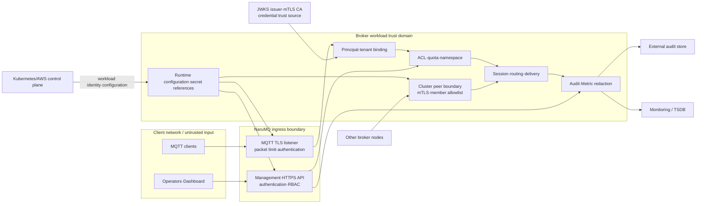

# Security boundaries

NaruMQ의 security architecture는 network 위치만으로 신뢰를 부여하지 않는다. Client, cluster peer와 관리 주체는 서로 다른 identity와 trust source를 사용한다. 인증 뒤에도 tenant binding, resource-level authorization, quota와 fencing을 각 경계에서 다시 적용한다.

| 항목 | 값 |
| --- | --- |
| 관점 상태 | Target |
| 문서 상태 | Draft |
| 구현 증거 | 없음 |
| 범위 | MQTT data plane, cluster peer와 management plane의 trust boundary |
| 관련 요구사항 | [PRD](../requirements/PRD.md) TEN-01~TEN-10, SEC-01~SEC-12, NFR-16~NFR-19 |
| 관련 스펙 | [Tenant와 security](../specs/tenancy-and-security.md), [Management API와 observability](../specs/management-api-and-observability.md) |
| 관련 Contract | [Management API v1](../contracts/management-api-v1.md), [Audit event v1](../contracts/audit-event-v1.md), [MQTT client compatibility v1](../contracts/mqtt-client-compatibility-v1.md) |
| 관련 결정 | API 인증 제품, secret 관리와 audit integrity ADR은 미작성 |
| 최종 확인일 | 2026-08-16 |

## Trust boundary view

아래 화살표는 credential·request·event의 runtime flow다. 각 boundary의 검증을 통과하기 전에는 안쪽 identity나 권한으로 승격하지 않는다.

Kubernetes workload identity나 network source만으로 management 또는 cluster 권한을 부여하지 않는다. 각 protocol boundary가 인증된 principal을 만들어야 한다.

## Principal과 trust source

| Principal 종류 | 신뢰 근거 | 허용 범위 |
| --- | --- | --- |
| MQTT client | JWT/JWKS, mTLS certificate 또는 승인된 password 방식 | Binding된 tenant·clientId의 MQTT action |
| Management user·service | Management API 인증과 role·tenant scope | Resource/action별 RBAC 범위 |
| Broker node | 별도 cluster trust domain의 mTLS와 member allowlist | 인증된 peer protocol과 membership 후보 |
| Rollout controller | Workload identity와 management API role | Drain 조회·시작과 승인된 workload control |
| Monitoring collector | 제한된 scrape identity | `/metrics` 조회만 |
| Dashboard | 사용자의 API identity 또는 위임된 backend identity | API와 TSDB가 허용한 조회·mutation |

Principal 종류를 공유 credential 하나로 합치지 않는다. 특히 MQTT client credential로 management API를 호출하거나 일반 management role로 cluster peer가 될 수 없어야 한다.

## Policy enforcement point

| 경계 | 검증 | 실패 결과의 기준 |
| --- | --- | --- |
| TLS listener | Protocol, cipher, certificate와 선택한 client authentication | Tenant와 security spec |
| MQTT CONNECT | Credential, tenant·clientId binding, blocklist와 connection quota | MQTT·security spec |
| Publish·subscribe·Will | Canonical topic, action ACL, quota와 owner epoch | Tenant·cluster spec |
| Session takeover | Authenticated session key와 quorum-committed epoch | Cluster spec, ADR-0004 |
| Management API | Principal, resource/action RBAC, tenant scope와 idempotency | Management API spec·contract |
| Cluster peer | Node certificate, member allowlist와 compatible release | Cluster spec·release contract |
| Audit·Metric export | Secret 제거, masking과 cardinality 제한 | Security·observability spec |
| Workload rollout | Controller identity, drain state와 `SAFE_TO_STOP` | Drain spec, ADR-0006 |

UI에서 control을 숨기거나 security group으로 port를 제한하는 것은 application authorization을 대신하지 않는다.

## Tenant isolation path

1. Authentication adapter가 외부 credential을 검증된 principal로 변환한다.
2. 신뢰된 binding이 `tenantId`, `subject`와 허용 `clientId`를 결정한다.
3. 외부 topic·filter를 tenant와 결합한 canonical 값으로 변환한다.
4. ACL과 quota가 canonical 값과 action을 평가한다.
5. Session key와 route key가 tenant 범위를 포함한다.
6. Storage, Metric, management query와 audit masking이 같은 tenant scope를 유지한다.

Client가 제출한 topic prefix나 token claim 하나만으로 tenant를 선택하지 않는다. Encoding의 정확한 형식은 spec과 후속 contract에서 확정한다.

## Sensitive data와 경계

| 데이터 | 허용된 위치 | 금지 또는 제한 |
| --- | --- | --- |
| Password·private key·bearer token | 입력 검증과 승인된 secret store | Log, Metric, audit event와 일반 API response 금지 |
| Client certificate identity | TLS/auth adapter와 논리 principal | Raw certificate를 domain policy 전체에 전달하지 않는다. |
| MQTT payload | Authorized data path와 durable storage | 기본 Metric label·audit event·client 목록 response 금지 |
| Client ID·IP·username | Session·security policy와 권한 있는 조회 | 기본 Metric label 금지, audit·UI masking 적용 |
| Session·inflight state | Broker cluster의 replicated state | Dashboard·operator에 payload를 기본 노출하지 않는다. |
| JWKS·CA public material | Auth adapter cache와 검증된 configuration | Cache TTL 이후 stale trust를 계속 사용하지 않는다. |

Secret 저장 제품, envelope encryption과 key rotation 절차는 아직 결정하지 않았다.

## TLS termination boundary

NLB의 TCP/TLS mode와 TLS termination 위치는 미결정이다.

- Broker가 TLS를 종료하면 client certificate와 MQTT connection의 identity를 같은 process에서 검증할 수 있다.
- 외부 component가 TLS를 종료하면 broker가 신뢰할 identity 전달 방식, hop encryption과 spoofing 방지를 별도 contract와 ADR로 검증해야 한다.
- mTLS profile은 verified client certificate identity가 broker authentication 경계까지 보존되지 않으면 지원할 수 없다.
- Proxy Protocol v2는 source address 전달 수단일 뿐 client authentication을 대신하지 않는다.

배포 편의를 위해 이 경계를 암묵적으로 바꾸지 않는다.

## Control plane과 data plane 분리

- Management API와 MQTT listener는 서로 다른 authentication·rate limit 정책을 갖는다.
- Cluster peer port는 client와 management network에 노출하지 않는다.
- Health probe는 필요한 최소 정보만 제공하며 mutation 권한을 갖지 않는다.
- Rollout controller는 session state를 직접 쓰지 않고 management API와 Kubernetes API를 사용한다.
- Dashboard는 broker storage를 직접 읽지 않는다.
- Observability failure가 authorization이나 durable write를 우회하게 해서는 안 된다.

## 미결정 사항

- Management API authentication product와 issuer model
- NLB TCP/TLS mode와 mTLS profile
- Broker node identity 발급·회전과 membership bootstrap
- Kubernetes secret 또는 외부 secret manager 선택
- Audit store, retention과 위변조 방지 방식
- At-rest encryption key 소유권과 rotation
- Security policy 배포·rollback과 cache TTL의 확정값

각 항목은 threat model과 운영 요구를 갖춘 별도 ADR 또는 spec으로 확정한다.
