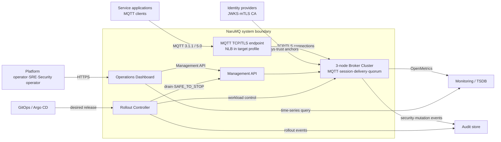

# System overview

NaruMQ의 목표 구조는 MQTT data plane을 제공하는 3-node broker cluster와 이를 배포·관측·운영하는 control component로 구성된다. Broker node가 제품의 핵심 정책과 상태를 소유한다. Dashboard, rollout controller와 외부 platform은 broker의 공개 경계를 통해서만 상호작용한다.

| 항목 | 값 |
| --- | --- |
| 관점 상태 | Target |
| 문서 상태 | Draft |
| 구현 증거 | 없음 |
| 범위 | System context와 주요 실행 단위 |
| 관련 요구사항 | [PRD 전체](../requirements/PRD.md), 특히 G-01~G-08과 12장 시스템 경계 |
| 관련 스펙 | [MQTT protocol과 session](../specs/mqtt-protocol-and-session.md), [Cluster session과 durable delivery](../specs/cluster-session-and-delivery.md), [Tenant와 security](../specs/tenancy-and-security.md), [Management API와 observability](../specs/management-api-and-observability.md), [Drain과 rolling update](../specs/drain-and-rolling-update.md) |
| 관련 결정 | [ADR catalog](../decisions/README.md). ADR-0002~0007은 Proposed |
| 최종 확인일 | 2026-08-16 |

## System context

아래 화살표는 runtime 통신 또는 운영 제어 흐름이다. 정확한 protocol과 schema는 관련 spec과 contract를 따른다.

AWS와 Kubernetes resource의 정확한 배치는 [EKS on EC2 deployment architecture](eks-ec2-deployment.md)에서 분리해 설명한다.

Diagram의 Management API는 broker가 제공하는 논리 interface다. 별도 service 배포를 확정한 것이 아니다.

## 주요 실행 단위

| 실행 단위 | 주된 책임 | 소유하지 않는 책임 |
| --- | --- | --- |
| Broker node | MQTT connection, protocol state, session ownership, routing, delivery, durable replication과 management endpoint | 장기 Metric 원본, GitOps desired state |
| Broker cluster | Quorum membership, replicated state와 single-owner fencing | Client 애플리케이션의 최종 DB transaction |
| Rollout controller | Drain 시작, barrier 관찰과 `SAFE_TO_STOP` 뒤 workload 교체 승인 | Session state 직접 변경, quorum 우회 |
| Dashboard | API·TSDB 기반 운영 view와 권한 있는 명령 UI | 독립 system of record, API 권한 우회 |
| External TSDB | 장기 Metric 저장과 query | Broker session·message 상태 |
| Audit store | 감사 이벤트 보존과 보안 조회 | 인증·인가 정책의 실시간 판정 |
| Identity provider | Token key, certificate trust와 principal 근거 | NaruMQ tenant namespace와 session ownership |

Dashboard를 broker binary와 함께 배포할지 별도 web artifact로 둘지는 아직 결정하지 않았다. 이 view에서 별도 실행 단위로 표시한 것은 책임과 경계를 드러내기 위한 목표 모델이다.

## 세 가지 plane

| Plane | 포함하는 흐름 | 실패 시 우선순위 |
| --- | --- | --- |
| Data plane | MQTT connect, publish, subscribe, delivery와 reconnect | Protocol·durability·tenant 격리를 유지한다. |
| Control plane | Management API, tenant policy, drain과 rollout | Quorum 또는 권한을 확인할 수 없으면 mutation을 거절한다. |
| Observability plane | Metric, log, audit와 Dashboard query | Data plane의 비밀정보를 노출하지 않고 실패를 관측 가능하게 만든다. |

Plane은 논리적 책임 구분이다. 초기 제품은 분산 service 수를 먼저 늘리지 않으며 여러 책임이 같은 broker process 안에 있을 수 있다.

## 핵심 구조 흐름

- MQTT 연결과 packet 동작은 [MQTT protocol과 session 스펙](../specs/mqtt-protocol-and-session.md)을 따른다.
- Durable publish와 takeover 구조는 [Cluster architecture](cluster-architecture.md)에서 구성요소로 보여준다.
- 배포 중 연결 인계는 [Drain과 rolling update 스펙](../specs/drain-and-rolling-update.md)이 규범적 기준이다.
- Tenant, 인증과 관리 권한의 구조는 [Security boundaries](security-boundaries.md)에서 보여준다.
- Management API field와 audit event 형식은 [Contract catalog](../contracts/README.md)를 기준으로 한다.

## 명시적으로 시스템 밖에 둔 책임

- Publisher가 성공 ACK 전에 보관해야 하는 local outbox
- Subscriber의 application DB transaction과 end-to-end exactly-once 처리
- 외부 identity provider의 account lifecycle
- 장기 Metric storage와 alert delivery
- 다중 Region active-active와 disaster recovery orchestration
- EMQX connector·rule engine에 해당하는 business integration

## 미결정 사항

- Dashboard framework와 배포 단위
- Management API ingress와 인증 제품
- Audit store와 위변조 방지 방식
- External TSDB 제품과 retention
- Multi-region disaster recovery 구조

미결정 사항은 구현 기본값으로 해석하지 않는다. 제품 선택이 필요하면 별도 ADR을 작성한다.
