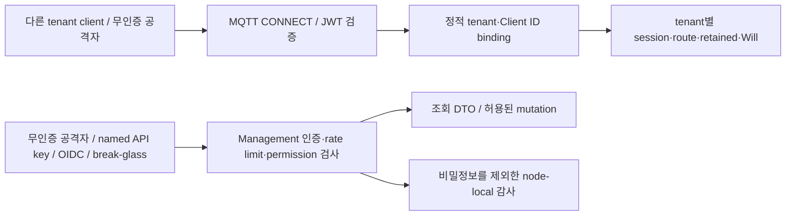

# Tenant isolation threat model

이 문서는 다른 tenant의 MQTT 데이터에 접근하거나 Management API 권한을 우회하는 공격과 현재 방어 위치를 연결한다. 자동 공격 시험은 사전 시험이다. 독립 penetration test(침투 시험)와 문서 승인은 아직 끝나지 않았다. NFR-19는 `미검증`으로 유지한다.

| 항목 | 값 |
| --- | --- |
| 구조 시점 | Current |
| 문서 상태 | Draft — 사용자 승인 전 |
| 구현 대조 | NFR-19 자동 사전 시험은 2026-10-09에, SEC-10 실제 3-node Management RBAC 수용 시험은 2026-10-10에, TEN-09 noisy-neighbor process 수용 시험은 2026-10-11에 통과했다. 각 실행 결과는 [NFR-19 증거](../specs/tenancy-and-security.md#93-nfr-19-자동-penetration-test-실행-증거), [SEC-10 증거](../specs/tenancy-and-security.md#96-sec-10-실행-증거), [TEN-09 증거](../specs/tenancy-and-security.md#99-ten-09-noisy-neighbor-실행-증거)에 기록한다. |
| 범위 | MQTT data plane, Management API. Cluster peer transport는 기존 시험만 참조한다. |
| 코드 지도 | [Project structure](project-structure.md#verification-and-integration-test-entrypoints) |
| 관련 PRD | [PRD](../requirements/PRD.md) NFR-19, TEN-01~TEN-05, TEN-09, SEC-02/04/06/10/11 |
| 관련 스펙·계약 | [Tenant와 security §9](../specs/tenancy-and-security.md#9-수용-시험과-범위), [Management API v1](../contracts/management-api-v1.md), [Audit event v1](../contracts/audit-event-v1.md) |
| 관련 ADR | [ADR-0039](../decisions/ADR-0039-management-audit-log.md), [ADR-0043](../decisions/ADR-0043-management-api-rate-limit.md), [ADR-0046](../decisions/ADR-0046-mqtt-data-plane-denial-audit.md), [ADR-0048](../decisions/ADR-0048-management-api-oidc-api-key-rbac.md), [ADR-0054](../decisions/ADR-0054-tenant-noisy-neighbor-latency-acceptance.md) |
| 최종 확인일 | 2026-10-11 |

## 1. 범위와 자산

보호 자산은 tenant payload(메시지 본문), retained message, session과 offline queue, Will, subscription 목록, management credential과 JWT다. Session은 재연결 때 복원할 상태다. Will은 연결이 비정상 종료될 때 발행할 메시지다.

공격자는 다른 tenant의 정상 credential 보유자, credential이 없는 network 공격자, Management API role을 가진 주체로 나눈다. MQTT ACL은 두 tenant 모두 넓게 허용한다. 따라서 MQTT 시험은 ACL 거절이 아니라 tenant 경계가 데이터를 나누는지 확인한다.

아래 화살표는 요청 흐름을 뜻한다. 인증 경계는 외부 credential을 내부 신원으로 바꾸는 지점이다. MQTT 신원과 Management API 신원은 서로 바꿔 쓸 수 없다.



## 2. 위협 목록

STRIDE는 신원 위장(S), 변조(T), 행위 부인(R), 정보 노출(I), 서비스 거부(D), 권한 상승(E)으로 위협을 나누는 방법이다. T-01~T-19의 공격 이름은 §3 NFR-19 시험의 subtest다. T-20·T-21은 SEC-10 실제 3-node process acceptance에서 확인한다. 자동 시험 통과는 해당 입력 범위에만 적용되며 모든 공격에 안전하다는 뜻은 아니다.

| ID | 경계 | 위협(STRIDE) | 대응 위치 | 검증 | 상태 |
| --- | --- | --- | --- | --- | --- |
| T-01 | JWT → principal | tenant claim 주입(S/E) | `internal/adapters/authentication`의 정적 `(issuer, subject)` binding | `T-01_T-05_WildcardWithInjectedTenantClaim` | 대응·자동 시험 통과 |
| T-02 | MQTT CONNECT | 위조·만료·누락 JWT credential(S) | `internal/adapters/authentication` JWT/JWKS validator | `T-02_ForgedExpiredMissingCredentials` | 대응·자동 시험 통과 |
| T-03 | principal → session | 다른 tenant Client ID 사용(S/E) | `allowedClientIds`, `internal/application/connect` | `T-03_ForeignClientIDRejected` | 대응·자동 시험 통과 |
| T-04 | session·offline queue | Client ID 충돌·session 인수·offline 재개(S/I) | `internal/domain/tenancy`의 `SessionKey`, session ownership·takeover | `T-04_ClientIDCollisionAndSessionResume` | 대응·자동 시험 통과 |
| T-05 | subscription → delivery | wildcard 도청(I) | tenant typed `TopicFilter`, `internal/domain/routing`과 committed route projection | `T-01_T-05_WildcardWithInjectedTenantClaim` | 대응·자동 시험 통과 |
| T-06 | system topic | `$SYS` 교차 tenant 수신(I) | tenant typed topic/filter와 routing | `T-06_SystemTopic` | 대응·자동 시험 통과 |
| T-07 | 외부 topic → 내부 topic | topic prefix 위장(S/E) | `internal/domain/tenancy`, `internal/application/publish` | `T-07_TopicNamespaceSpoof` | 대응·자동 시험 통과 |
| T-08 | retained → 재구독 | 다른 tenant retained 수신(I) | `(tenant, topic)` retained key, tenant별 replay | `T-08_Retained` | 대응·자동 시험 통과 |
| T-09 | shared group → delivery | 같은 shared group의 교차 tenant 분배(I) | `internal/domain/routing`의 `{tenant, filter}` cursor key와 tenant별 후보 선택 | `T-09_SharedSubscriptionGroup` | 대응·자동 시험 통과 |
| T-10 | 종료 → Will 발행 | Will의 교차 tenant 발행(I) | principal snapshot, tenant topic과 `internal/application/publish` | `T-10_Will` | 대응·자동 시험 통과 |
| T-11 | Management HTTP | 무인증·credential 혼동(S/E) | `Authenticator.authenticate`가 named API key, OIDC JWT와 break-glass bearer를 분리한다. | 기존 NFR-19 subtest와 `TestDynamicClusterManagementRBACProcessAcceptance` | 대응·자동 시험 통과 |
| T-12 | Role → Management action | permission 상승(E/T) | ADR-0048의 명시적 4-role permission matrix와 endpoint별 권한 검사 | `T-12_ReadOnlyEscalation`, `TestPermissionMatrixSeparatesManagementRoles`, `TestDynamicClusterManagementRBACProcessAcceptance` | 대응·자동 시험 통과 |
| T-13 | 인증 실패 → 요청 처리 | 인증 brute force(D/S) | ADR-0043의 node-local auth-failure bucket | `T-13_AuthFailureBruteForce` | 대응·자동 시험 통과 |
| T-14 | DTO·metrics·probe·audit | payload·secret 노출(I) | Management DTO, metric label 제한, audit secret 제외 | `T-14_NoPayloadOrSecretExposure` | 대응·자동 시험 통과 |
| T-15 | Management 조회 | role에 tenant 범위가 없음(I/E) | 대응 없음 → R-01 | SEC-10 process acceptance는 role만 검증하며 tenant-delegated access는 제공하지 않는다. | 잔여 위험(R-01) |
| T-16 | credential → audit actor | 공유 credential의 개인 식별 불가(R) | named API key id와 OIDC subject는 actor에 기록한다. 공유 API key와 break-glass bearer는 개인을 식별하지 못한다. | `TestDynamicClusterManagementRBACProcessAcceptance` | 잔여 위험(R-02) |
| T-17 | 공유 자원 | noisy neighbor(D) | TEN-06/07 tenant rate limit과 [ADR-0054](../decisions/ADR-0054-tenant-noisy-neighbor-latency-acceptance.md)의 local p99 기준 | [`TestDynamicClusterTenantNoisyNeighborProcessAcceptance`](../../tests/integration/cluster_tenant_noisy_neighbor_process_test.go) | 대응·자동 시험 통과 |
| T-18 | cluster peer | 비인가 node(S/E) | `internal/adapters/tcp`의 mTLS·peer identity 검증 | [TestRaftPeerTransportRejectsUnauthenticatedAndMalformedPeers](../../tests/integration/raft_peer_transport_test.go) — 이번 공격 범위 밖 | 대응·기존 시험 |
| T-19 | MQTT 거절 → audit | data-plane 거절 감사 누락(R) | [ADR-0046](../decisions/ADR-0046-mqtt-data-plane-denial-audit.md)의 bounded fail-open recorder와 node-local hash chain | [`TestDynamicClusterMQTTDenialAuditProcessAcceptance`](../../tests/integration/cluster_audit_process_test.go) | 대응·자동 시험 통과 |
| T-20 | OIDC JWT → Management role | JWT role claim으로 권한 상승(S/E) | OIDC 권한은 JWT claim이 아니라 설정된 subject-role binding에서만 가져온다. | `TestDynamicClusterManagementRBACProcessAcceptance`에서 ClusterAdmin claim이 있는 SecurityAdmin의 cluster-admin mutation `403`을 확인한다. | 대응·자동 시험 통과 |
| T-21 | Audit query → stored event | 비인가 조회 또는 query가 저장 record를 변경(I/T) | `GET /api/v1/nodes/{nodeId}/audit/events`는 SecurityAdmin·ClusterAdmin 전용이고 요청을 받은 node의 stored record를 읽기만 한다. path ID가 다른 node를 가리키면 409로 거절한다. | `TestAuditQueryHandlerResponsesMatchOpenAPI`, `TestAuditQueryReturnsStoredChainRecords`, `TestDynamicClusterManagementRBACProcessAcceptance`가 권한·저장 record 반환을 확인한다. | 대응·자동 시험 통과 |
| T-22 | Management API → node configuration | 적용 설정 조회가 secret·identity 정보를 노출하거나 다른 node 설정으로 오인(I/D) | `GET /api/v1/nodes/{nodeId}/config`는 ClusterAdmin 전용이며 node-local 조회다. 응답은 `tenantId`, `role`, `effect`, `action`, `topicFilter`가 있는 ACL 규칙과 identity 수를 보여 주지만 credential identity list, secret 원문·경로, password hash는 제외한다. | `TestNodeConfigurationHandlerRedactsSensitiveFields`, `TestDynamicClusterNodeConfigurationProcessAcceptance`가 ACL 값, redaction, 권한과 node-local 범위를 확인한다. | 대응·자동 시험 통과 |

## 3. 자동 penetration test

진입점은 [`tests/integration/cluster_tenant_isolation_pentest_process_test.go::TestDynamicClusterTenantIsolationPenetrationProcessAcceptance`](../../tests/integration/cluster_tenant_isolation_pentest_process_test.go)다. 실제 broker binary 세 개를 시작한다. JWT에는 정상 서명과 공격용 tenant claim을 함께 넣는다. 위조 token은 같은 `kid`와 다른 RSA key로 만든다.

| Node | MQTT client | Management 시험 |
| --- | --- | --- |
| 1 | `a-pub`, `b-pub`, `a-worker`, `a-will`, `a-probe`, A의 `shared-id` | 무인증 route·credential 혼동, ReadOnly 상승, DTO·metric·probe 노출 |
| 2 | `b-all`, `b-worker`, B의 최초 `shared-id` | 없음 |
| 3 | `a-all`, `a-late`, `b-late`, B의 재개 `shared-id` | authFailureRate 5에서 brute force와 정상 admin 대조 |

각 node의 tenant별 subscription projection이 일치한 뒤 공격을 시작한다. 정상 tenant 수신을 먼저 확인하고 다른 tenant가 1초 동안 아무 MQTT packet도 받지 않는지 확인한다. Retained replay, shared group, Will과 offline session 재개도 실제 socket으로 확인한다. 마지막에 세 node의 audit 파일을 읽어 credential 문자열이 없는지 확인한다.

저장소 루트에서 실행한다. Go 1.26.5가 필요하며 Docker는 필요 없다.

```sh
go test ./tests/integration -run '^TestDynamicClusterTenantIsolationPenetrationProcessAcceptance$' -count=1 -v -timeout 20m
```

단일 실행, 3회 반복, 민감도 확인과 원복 후 실행 결과는 [Tenant와 security §9.3](../specs/tenancy-and-security.md#93-nfr-19-자동-penetration-test-실행-증거)에 둔다. 이 시험은 독립 penetration test를 대신하지 않는다.

## 4. 경계와 제약

- 이번 자동 시험은 loopback MQTT 3.1.1과 Management HTTP를 사용한다. Production NLB와 TLS termination, secret 저장소, Kubernetes, MQTT 3.1.0, WebSocket은 시험 범위 밖이다.
- MQTT client mTLS와 cluster peer transport는 기존 시험을 참조한다. 이번 공격 입력으로 다시 검증한 것은 아니다.
- Management API credential은 tenant별 MQTT credential과 다르다. Management role은 cluster-wide이며 tenant 위임 권한을 제공하지 않는다. Tenant filter는 응답 범위를 고를 뿐 접근 권한을 제한하지 않는다. Audit query도 요청을 처리하는 node의 record만 반환한다.
- 1초 quiet 검사는 제한된 관찰 구간이다. 장기 부하, 자원 고갈, production 지연 목표를 증명하지 않는다.
- SEC-10 process acceptance는 test OIDC issuer를 사용해 실제 3-node cluster의 credential·role·audit-query 흐름을 확인한다. Production IdP, TLS termination, secret store와 Kubernetes integration은 검증하지 않는다.

## 5. 잔여 위험

위험 해결 또는 승인은 출시 판단 주체가 남겨야 한다. 이 문서의 작성과 자동 시험 통과를 위험 승인으로 처리하지 않는다.

| ID | 내용 | 영향 | 결정 주체·연결 항목 | 상태 |
| --- | --- | --- | --- | --- |
| R-01 | Management read permission은 tenant 범위로 나뉘지 않는다. 읽기 권한이 있는 주체는 모든 tenant의 client·subscription·retained metadata를 조회할 수 있다. | Tenant 위임 관리로 사용할 수 없으며 다른 tenant의 metadata가 보인다. | 사용자·제품/보안 담당: SEC-10, API-07, UI-06~09 | 위험 승인 대기 |
| R-02 | 공유 API key와 break-glass bearer는 actor를 개인으로 식별하지 못한다. Named key id와 OIDC subject는 credential/subject 단위 추적만 제공한다. | 공유 credential 사용 시 개인별 책임 추적과 권한 폐기가 제한된다. | 사용자·보안 담당: SEC-10 | 위험 승인 대기 |
| R-03 | TEN-09 local p99 기준은 정했지만 production tenant 부하와 절대 SLO는 미정이다. | Local 기준 통과만으로 production workload의 latency를 판단할 수 없다. | 사용자·성능 담당: TEN-09, PRD §18 질문 8 | 해소: [ADR-0054](../decisions/ADR-0054-tenant-noisy-neighbor-latency-acceptance.md) local 기준과 [`TestDynamicClusterTenantNoisyNeighborProcessAcceptance`](../../tests/integration/cluster_tenant_noisy_neighbor_process_test.go)로 확인됨. Production tenant 부하는 [PRD §18 질문 8](../requirements/PRD.md#18-미결정-사항)에서 추적 |
| R-04 | MQTT denial audit는 초당 20건·queue 256 bounded fail-open이다. 한도 초과·queue 포화·종료 중 event는 저장하지 않고 metric으로 센다. | 해당 조건에서 audit history가 누락될 수 있지만 MQTT 응답은 바뀌지 않는다. | SEC-11, ADR-0046; [`TestDynamicClusterMQTTDenialAuditProcessAcceptance`](../../tests/integration/cluster_audit_process_test.go) | 해소: 구현된 제한 동작과 metric이 process acceptance로 확인됨 |
| R-05 | Security config은 시작할 때만 읽는다. Runtime은 rolling-restart credential 회전, Dynamic cluster의 committed `credentialId` 폐기와 JWT `exp`·certificate `NotAfter` 만료 종료를 지원한다. MQTT 5 `AUTH` 재인증은 제공하지 않는다. | Production IdP·certificate lifecycle·deployment rollout은 저장소 acceptance에서 검증하지 않았다. Client는 새 credential로 재연결해야 한다. | SEC-07, ADR-0049; [`TestDynamicClusterCredentialRevocationProcessAcceptance`](../../tests/integration/cluster_credential_lifecycle_process_test.go), [`TestDynamicClusterCredentialExpiryProcessAcceptance`](../../tests/integration/cluster_credential_lifecycle_process_test.go) | 구현 acceptance 뒤에도 production 운영 경계 검증과 위험 승인 대기 |
| R-06 | 인증 실패 bucket은 `RemoteAddr` host 기준이다. Proxy·NAT 뒤에서 bucket을 공유한다. | 서로 다른 공격자·정상 사용자의 인증 실패가 같은 한도를 소모한다. | 사용자·배포/보안 담당: ADR-0043 | 위험 승인 대기 |
| R-07 | 독립 penetration test와 production 환경 시험을 하지 않았다. | 저장소 사전 시험 밖의 공격과 배포 경계는 확인하지 못했다. | 사용자·출시/보안 담당: NFR-19 | 위험 승인 대기 |
