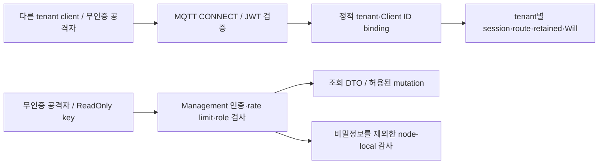

# Tenant isolation threat model

이 문서는 다른 tenant의 MQTT 데이터에 접근하거나 Management API 권한을 우회하는 공격과 현재 방어 위치를 연결한다. 자동 공격 시험은 사전 시험이다. 독립 penetration test(침투 시험)와 문서 승인은 아직 끝나지 않았다. NFR-19는 `미검증`으로 유지한다.

| 항목 | 값 |
| --- | --- |
| 구조 시점 | Current |
| 문서 상태 | Draft — 사용자 승인 전 |
| 구현 대조 | 2026-10-09 자동 사전 시험 통과. [시험 코드](../../tests/integration/cluster_tenant_isolation_pentest_process_test.go), [실행 증거](../specs/tenancy-and-security.md#93-nfr-19-자동-penetration-test-실행-증거) |
| 범위 | MQTT data plane, Management API. Cluster peer transport는 기존 시험만 참조한다. |
| 코드 지도 | [Project structure](project-structure.md#verification-and-integration-test-entrypoints) |
| 관련 PRD | [PRD](../requirements/PRD.md) NFR-19, TEN-01~TEN-05, SEC-02/04/06/10/11 |
| 관련 스펙·계약 | [Tenant와 security §9](../specs/tenancy-and-security.md#9-수용-시험과-범위), [Management API v1](../contracts/management-api-v1.md), [Audit event v1](../contracts/audit-event-v1.md) |
| 관련 ADR | [ADR-0039](../decisions/ADR-0039-management-audit-log.md), [ADR-0043](../decisions/ADR-0043-management-api-rate-limit.md), [ADR-0046](../decisions/ADR-0046-mqtt-data-plane-denial-audit.md) |
| 최종 확인일 | 2026-10-09 |

## 1. 범위와 자산

보호 자산은 tenant payload(메시지 본문), retained message, session과 offline queue, Will, subscription 목록, management credential과 JWT다. Session은 재연결 때 복원할 상태다. Will은 연결이 비정상 종료될 때 발행할 메시지다.

공격자는 다른 tenant의 정상 credential 보유자, credential이 없는 network 공격자, ReadOnly key 보유자로 나눈다. MQTT ACL은 두 tenant 모두 넓게 허용한다. 따라서 시험은 ACL 거절이 아니라 tenant 경계가 데이터를 나누는지 확인한다.

아래 화살표는 요청 흐름을 뜻한다. 인증 경계는 외부 credential을 내부 신원으로 바꾸는 지점이다. MQTT 신원과 Management API 신원은 서로 바꿔 쓸 수 없다.



## 2. 위협 목록

STRIDE는 신원 위장(S), 변조(T), 행위 부인(R), 정보 노출(I), 서비스 거부(D), 권한 상승(E)으로 위협을 나누는 방법이다. 아래 자동 시험 이름은 §3의 시험 함수 안에 있는 subtest다. T-01과 T-05는 같은 입력으로 확인하므로 하나의 subtest를 공유한다. `대응·자동 시험 통과`는 이 사전 시험의 입력 범위에서 통과했다는 뜻이며, 모든 공격에 안전하다는 뜻은 아니다.

| ID | 경계 | 위협(STRIDE) | 대응 위치 | 검증 | 상태 |
| --- | --- | --- | --- | --- | --- |
| T-01 | JWT → principal | tenant claim 주입(S/E) | `internal/adapters/authentication`의 정적 `(issuer, subject)` binding | `T-01_T-05_WildcardWithInjectedTenantClaim` | 대응·자동 시험 통과 |
| T-02 | MQTT CONNECT | 위조·만료·누락 credential(S) | `internal/adapters/authentication` JWT/JWKS validator | `T-02_ForgedExpiredMissingCredentials` | 대응·자동 시험 통과 |
| T-03 | principal → session | 다른 tenant Client ID 사용(S/E) | `allowedClientIds`, `internal/application/connect` | `T-03_ForeignClientIDRejected` | 대응·자동 시험 통과 |
| T-04 | session·offline queue | Client ID 충돌·session 인수·offline 재개(S/I) | `internal/domain/tenancy`의 `SessionKey`, session ownership·takeover | `T-04_ClientIDCollisionAndSessionResume` | 대응·자동 시험 통과 |
| T-05 | subscription → delivery | wildcard 도청(I) | tenant typed `TopicFilter`, `internal/domain/routing`과 committed route projection | `T-01_T-05_WildcardWithInjectedTenantClaim` | 대응·자동 시험 통과 |
| T-06 | system topic | `$SYS` 교차 tenant 수신(I) | tenant typed topic/filter와 routing | `T-06_SystemTopic` | 대응·자동 시험 통과 |
| T-07 | 외부 topic → 내부 topic | topic prefix 위장(S/E) | `internal/domain/tenancy`, `internal/application/publish` | `T-07_TopicNamespaceSpoof` | 대응·자동 시험 통과 |
| T-08 | retained → 재구독 | 다른 tenant retained 수신(I) | `(tenant, topic)` retained key, tenant별 replay | `T-08_Retained` | 대응·자동 시험 통과 |
| T-09 | shared group → delivery | 같은 shared group의 교차 tenant 분배(I) | `internal/domain/routing`의 `{tenant, filter}` cursor key와 tenant별 후보 선택 | `T-09_SharedSubscriptionGroup` | 대응·자동 시험 통과 |
| T-10 | 종료 → Will 발행 | Will의 교차 tenant 발행(I) | principal snapshot, tenant topic과 `internal/application/publish` | `T-10_Will` | 대응·자동 시험 통과 |
| T-11 | Management HTTP | 무인증·credential 혼동(S/E) | `internal/adapters/http/management/auth.go`의 `Authenticator.authenticate` | `T-11_UnauthenticatedAndConfusedCredentials` | 대응·자동 시험 통과 |
| T-12 | ReadOnly → mutation | ReadOnly 권한 상승(E/T) | `RequireRole`, `RequireMutationRole`과 route별 role | `T-12_ReadOnlyEscalation` | 대응·자동 시험 통과 |
| T-13 | 인증 실패 → 요청 처리 | 인증 brute force(D/S) | ADR-0043의 node-local auth-failure bucket | `T-13_AuthFailureBruteForce` | 대응·자동 시험 통과 |
| T-14 | DTO·metrics·probe·audit | payload·secret 노출(I) | Management DTO, metric label 제한, audit secret 제외 | `T-14_NoPayloadOrSecretExposure` | 대응·자동 시험 통과 |
| T-15 | Management 조회 | credential에 tenant 범위가 없음(I/E) | 대응 없음 → R-01 | 사전 시험은 credential 유무와 role만 확인한다. | 잔여 위험(R-01) |
| T-16 | credential → audit actor | 공유 credential의 개인 식별 불가(R) | 대응 없음 → R-02 | ADR-0039의 actor 제약 | 잔여 위험(R-02) |
| T-17 | 공유 자원 | noisy neighbor(D) | TEN-06/07 한도는 있으나 p99 수용 기준은 미정 → R-03 | 기존 tenant limit 시험. 지연 기준은 검증하지 않는다. | 잔여 위험(R-03) |
| T-18 | cluster peer | 비인가 node(S/E) | `internal/adapters/tcp`의 mTLS·peer identity 검증 | [TestRaftPeerTransportRejectsUnauthenticatedAndMalformedPeers](../../tests/integration/raft_peer_transport_test.go) — 이번 공격 범위 밖 | 대응·기존 시험 |
| T-19 | MQTT 거절 → audit | data-plane 거절 감사 누락(R) | [ADR-0046](../decisions/ADR-0046-mqtt-data-plane-denial-audit.md)의 bounded fail-open recorder와 node-local hash chain | [`TestDynamicClusterMQTTDenialAuditProcessAcceptance`](../../tests/integration/cluster_audit_process_test.go) | 대응·자동 시험 통과 |

## 3. 자동 penetration test

진입점은 [`tests/integration/cluster_tenant_isolation_pentest_process_test.go::TestDynamicClusterTenantIsolationPenetrationProcessAcceptance`](../../tests/integration/cluster_tenant_isolation_pentest_process_test.go)다. 실제 broker binary 세 개를 시작한다. JWT에는 정상 서명과 공격용 tenant claim을 함께 넣는다. 위조 token은 같은 `kid`와 다른 RSA key로 만든다.

| Node | MQTT client | Management 시험 |
| --- | --- | --- |
| 1 | `a-pub`, `b-pub`, `a-worker`, `a-will`, `a-probe`, A의 `shared-id` | 무인증 route·credential 혼동, ReadOnly 상승, DTO·metric·probe 노출 |
| 2 | `b-all`, `b-worker`, B의 최초 `shared-id` | 없음 |
| 3 | `a-all`, `a-late`, `b-late`, B의 재개 `shared-id` | authFailureRate 5에서 brute force와 정상 admin 대조 |

각 node의 tenant별 subscription projection이 일치한 뒤 공격을 시작한다. 정상 tenant 수신을 먼저 확인하고 다른 tenant가 1초 동안 아무 MQTT packet도 받지 않는지 확인한다. Retained replay, shared group, Will과 offline session 재개도 실제 socket으로 확인한다. 마지막에 세 node의 audit 파일을 읽어 credential 문자열이 없는지 확인한다.

저장소 루트에서 실행한다. Go 1.26.5가 필요하며 Docker는 필요 없다.

```sh
go test ./tests/integration -run '^TestDynamicClusterTenantIsolationPenetrationProcessAcceptance$' -count=1 -v -timeout 20m
```

단일 실행, 3회 반복, 민감도 확인과 원복 후 실행 결과는 [Tenant와 security §9.3](../specs/tenancy-and-security.md#93-nfr-19-자동-penetration-test-실행-증거)에 둔다. 이 시험은 독립 penetration test를 대신하지 않는다.

## 4. 경계와 제약

- 이번 자동 시험은 loopback MQTT 3.1.1과 Management HTTP를 사용한다. Production NLB와 TLS termination, secret 저장소, Kubernetes, MQTT 3.1.0, WebSocket은 시험 범위 밖이다.
- MQTT client mTLS와 cluster peer transport는 기존 시험을 참조한다. 이번 공격 입력으로 다시 검증한 것은 아니다.
- Management credential은 tenant별 MQTT credential과 다르다. 현재 ReadOnly·admin 조회는 tenant 위임 권한을 제공하지 않는다. 조회에서 tenant를 고르는 query는 접근 권한을 제한하는 장치가 아니다.
- 1초 quiet 검사는 제한된 관찰 구간이다. 장기 부하, 자원 고갈, production 지연 목표를 증명하지 않는다.
- 테스트 helper만 바꾼다. Broker runtime, 설정 계약과 ACL 정책은 변경하지 않는다.

## 5. 잔여 위험

위험 해결 또는 승인은 출시 판단 주체가 남겨야 한다. 이 문서의 작성과 자동 시험 통과를 위험 승인으로 처리하지 않는다.

| ID | 내용 | 영향 | 결정 주체·연결 항목 | 상태 |
| --- | --- | --- | --- | --- |
| R-01 | ReadOnly·admin credential은 모든 tenant의 client·subscription·retained metadata를 조회한다. | Tenant 위임 관리로 사용할 수 없으며 다른 tenant의 metadata가 보인다. | 사용자·제품/보안 담당: SEC-10, API-07, UI-06~09 | 위험 승인 대기 |
| R-02 | 공유 credential은 actor를 개인으로 식별하지 못한다. | 개인별 책임 추적과 권한 폐기가 제한된다. | 사용자·보안 담당: SEC-10 | 위험 승인 대기 |
| R-03 | TEN-09의 다른 tenant p99 한도가 정해지지 않았다. | 한 tenant의 부하가 다른 tenant 지연에 미치는 영향을 합격으로 판정할 수 없다. | 사용자·성능 담당: TEN-09 | 위험 승인 대기 |
| R-04 | MQTT data-plane 거절 감사가 구현되지 않은 상태(해결 전) | 해결 전에는 CONNECT·ACL 거절의 감사 추적이 빠진다. | SEC-11, ADR-0046; 3-process acceptance 통과 | 해소(자동 시험 통과) |
| R-05 | Credential·인증서 회전과 폐기, 기존 연결 재인증이 없다. | 탈취 credential과 기존 연결의 권한을 운영 중 회수하는 기준이 없다. JWT/JWKS cache 동작 시험만으로 이 요구를 충족하지 않는다. | 사용자·보안 담당: SEC-07 | 위험 승인 대기 |
| R-06 | 인증 실패 bucket은 `RemoteAddr` host 기준이다. Proxy·NAT 뒤에서 bucket을 공유한다. | 서로 다른 공격자·정상 사용자의 인증 실패가 같은 한도를 소모한다. | 사용자·배포/보안 담당: ADR-0043 | 위험 승인 대기 |
| R-07 | 독립 penetration test와 production 환경 시험을 하지 않았다. | 저장소 사전 시험 밖의 공격과 배포 경계는 확인하지 못했다. | 사용자·출시/보안 담당: NFR-19 | 위험 승인 대기 |
