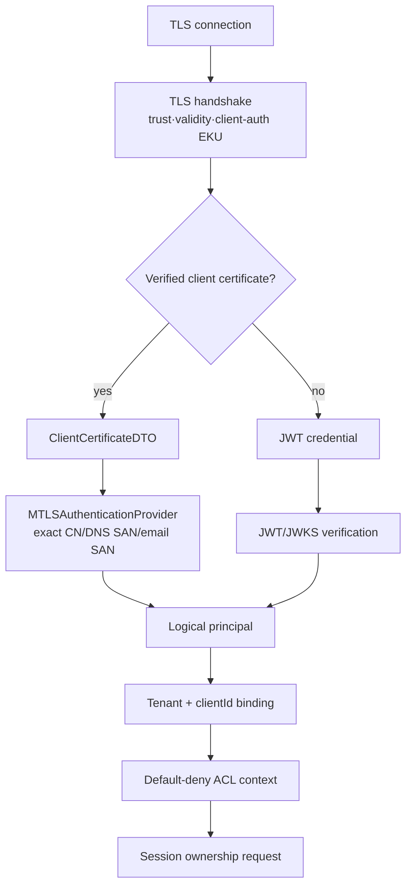

# Authentication, tenant binding과 접근 제어 목록

Authentication은 credential이 누구의 것인지 확인한다. Tenant binding은 그 principal이 어느 tenant와 client ID 범위를 사용할 수 있는지 결정한다. 접근 제어 목록(Access Control List, ACL)은 검증된 principal이 특정 topic에 publish·subscribe·Will 동작을 해도 되는지 판정한다. 세 단계 중 하나라도 실패하면 session이나 route를 만들지 않는다.

전송 계층 보안(Transport Layer Security, TLS)은 연결을 보호하고, 상호 TLS(mutual TLS, mTLS)는 client certificate도 검증한다. JSON Web Token(JWT)은 identity claim을 전달하며 JSON Web Key Set(JWKS)은 그 서명을 검증할 공개 key 집합을 제공한다. 이 수단들은 principal을 만드는 입력이지 tenant·topic 권한 그 자체는 아니다.

| 항목 | 값 |
| --- | --- |
| 기준 독자 | TLS, JWT 기초는 알지만 멀티테넌트 브로커의 테넌트 바인딩 및 ACL 평가 파이프라인이 생소한 주니어 개발자 |
| 선수 문서 | 없음 |
| 관련 기준 문서 | [PRD](../requirements/PRD.md) (SEC-01~12, TEN-01~10), [Tenant와 security spec](../specs/tenancy-and-security.md), [Security boundaries](../architectures/security-boundaries.md) |
| 대상 version·확인일 | Draft 0.6 · mTLS DTO/selector flow 반영 |

## 읽고 나면 답할 수 있는 질문

- TLS, mTLS, JWT, JWKS, principal과 ACL의 역할을 구분할 수 있는가?
- 외부 credential이 `(tenantId, clientId)` session key로 바뀌는 흐름을 설명할 수 있는가?
- JWKS 장애나 ACL timeout에서 fail-closed가 필요한 이유를 설명할 수 있는가?

## 문제 상황

Client가 JWT claim에 `tenantId=team-b`를 넣고 `clientId=sensor-7`로 CONNECT한다고 가정한다. Broker가 claim을 그대로 믿으면 team-a용 credential이 team-b session에 접근할 수 있다. 서명 검증만 성공했다고 authorization이 끝난 것이 아니다.

NaruMQ는 credential 원문을 domain으로 전달하지 않는다. Authentication adapter가 외부 형식을 검증된 logical principal로 바꾼 뒤 tenant binding과 ACL을 차례로 적용한다.

## 필수 용어

| 용어 | 역할 |
| --- | --- |
| TLS | Client와 broker 사이의 암호화, 무결성 및 server 인증을 제공하는 transport security |
| mTLS | TLS handshake에서 client certificate도 검증하는 mutual TLS |
| JWT | 서명되거나 보호된 claim 집합을 담는 JSON Web Token |
| JWKS | JWT 서명 검증에 사용할 public key들의 JSON Web Key Set |
| `kid` | JWKS 안에서 후보 key를 선택하는 key identifier |
| Principal | 검증이 끝난 logical identity와 권한 입력 |
| Tenant binding | Principal을 신뢰된 tenant와 허용 client ID 범위에 연결하는 규칙 |
| ACL | Action과 canonical topic/filter에 대한 allow·deny 정책 |

TLS 연결이 있다는 사실만으로 application identity가 생기지는 않는다. mTLS라면 검증된 certificate identity를 principal 입력으로 사용할 수 있지만, tenant mapping 규칙은 별도로 필요하다.

## 정상 CONNECT 흐름

아래 화살표는 transport 검증, credential 선택, tenant binding과 authorization의
runtime control flow다.



JWT를 사용하는 경우의 최소 흐름은 다음과 같다.

1. Listener가 허용한 token type과 algorithm 목록을 선택한다.
2. Header의 `kid`로 configured issuer의 JWKS에서 후보 key를 찾는다.
3. 서명을 검증한다. Token의 `alg` 값만 믿고 algorithm을 고르지 않는다.
4. `iss`, `aud`, `sub`, `exp`, `nbf`와 clock skew를 검증한다.
5. 신뢰된 configuration이 issuer·subject를 `tenantId`와 허용 `clientId`에 binding한다.
6. 현재 구현에서는 binding과 ACL을 통과한 뒤 session ownership을 요청한다.

검증된 client certificate를 사용하는 mTLS 흐름은 다음과 같다.

1. TLS listener가 trust chain, certificate validity와 client-auth EKU를 handshake에서
   검증한다. `VerifiedChains`가 없는 certificate는 인증 입력으로 사용하지 않는다.
2. TLS adapter가 verified leaf에서 `CommonName`, DNS SAN, email SAN과 `NotAfter`만
   복사해 `ClientCertificateDTO`로 만든다. raw certificate, chain과 private key는
   application으로 넘기지 않는다.
3. `MTLSAuthenticationProvider`가 configured `commonName`, `dnsSan`, `emailSan`
   selector를 case-sensitive exact match한다. zero match는 unmapped, multiple match는
   ambiguous로 fail-closed한다.
4. 하나의 binding이 선택되면 binding의 tenant, subject, credential ID, roles와 허용
   Client ID를 사용한다. `NotAfter`는 새 principal의 expiry가 된다.
5. Verified certificate가 있는 CONNECT는 mTLS만 사용한다. MQTT Username/Password를
   함께 보내면 dual credential로 거절하고, unmapped·expired·ambiguous certificate를
   JWT로 fallback하지 않는다.

현재 application 경계는 provider 자료형이나 raw certificate를 노출하지 않는다.
TLS adapter와 authentication port 사이에는 다음 DTO만 전달된다.

```go
type ClientCertificateDTO struct {
	CommonName      string
	DNSNames        []string
	EmailAddresses  []string
	NotAfter        time.Time
}
```

인증 provider의 `Result`를 받은 `application/connect`가 exact Client ID binding,
`security.NewPrincipal`, Will ACL 검사를 순서대로 수행한 뒤 session ownership을
요청한다. 인증·binding·Will 검증 전에는 session, route와 queue를 변경하지 않는다.

## Publish·subscribe ACL 흐름

CONNECT 성공은 모든 topic 접근 허가가 아니다.

1. 외부 topic 또는 filter를 tenant와 결합한 canonical 값으로 변환한다.
2. ACL 입력에 principal, client ID, action, canonical topic/filter와 listener context를 넣는다.
3. 명시적 deny를 먼저 적용한다.
4. 일치하는 allow가 없으면 default deny한다.
5. 허용된 publish만 durable log와 routing으로 보낸다.
6. 허용된 subscribe만 route index에 추가한다.

Will은 CONNECT 전에 인증된 principal과 Will ACL을 판정한다. 현재 구현은 certificate
revocation/rotation과 기존 connection re-authentication을 수행하지 않으며, 이 기능은
후속 security scope다.

## 실패 흐름

| 실패 | 처리 |
| --- | --- |
| Token의 algorithm이 allowlist 밖 | 서명 시도 전에 거절한다. |
| `kid`를 찾을 수 없음 | 제한된 refresh를 시도할 수 있지만 무제한 retry하지 않는다. |
| JWKS refresh 실패, cache TTL 유효 | 정책이 허용한 기존 key만 제한적으로 사용할 수 있다. |
| JWKS cache TTL 만료 | 새 인증을 fail-closed로 거절한다. |
| `iss`·`aud`·`sub` 불일치 | 서명이 맞아도 거절한다. |
| `VerifiedChains`가 없는 client certificate | mTLS 인증 입력으로 사용하지 않는다. |
| certificate 만료·zero selector match | mTLS 인증을 fail-closed로 거절한다. |
| certificate가 여러 binding과 match | ambiguous 인증으로 fail-closed 처리한다. |
| certificate와 MQTT Username/Password 동시 제출 | dual credential로 거절하며 JWT fallback하지 않는다. |
| Tenant·client ID binding 실패 | Session ownership을 요청하지 않는다. |
| ACL backend timeout | Allow로 추정하지 않고 deny한다. |
| 인증 뒤 policy 폐기 | revocation/reauthentication은 현재 구현 범위 밖이며 후속 security scope다. |
| mTLS principal의 `NotAfter` 도달 | 새 CONNECT를 거절한다. |

실패 log와 Metric에는 token, password, private key와 원문 certificate를 넣지 않는다. Audit event에는 안정된 reason code와 masking된 identity만 기록한다.

## 자주 생기는 오해와 trade-off

- JWT는 암호화된 사용자 정보 상자가 아니다. 서명된 token도 payload를 읽을 수 있는 경우가 많다.
- `kid`는 신뢰의 근거가 아니다. Configured issuer의 검증된 JWKS 안에서 후보를 찾는 힌트다.
- Authentication 성공은 authorization 성공이 아니다.
- JWT claim 하나만으로 tenant를 선택하면 issuer 설정 오류가 tenant 격리 오류로 확대된다.
- 짧은 JWKS cache TTL은 key 폐기를 빨리 반영하지만 issuer 장애의 영향을 키운다. 긴 TTL은 availability를 높이지만 stale key 허용 시간을 늘린다.

## NaruMQ에서 찾을 위치

- 규범 동작: [Tenant와 security](../specs/tenancy-and-security.md)
- Trust boundary: [Security boundaries](../architectures/security-boundaries.md)
- Port·adapter: `AuthenticationProvider`, `ClientCertificateAuthenticationProvider`,
  `MTLSAuthenticationProvider` — [Project structure](../architectures/project-structure.md#주요-port-capability와-adapter-map)
- Audit payload: [Audit event v1](../contracts/audit-event-v1.md)

## 확인 질문

1. JWT 서명이 유효해도 `aud`가 다르면 거절해야 하는 이유는 무엇인가?
2. Client가 보낸 `tenantId`를 그대로 session key에 사용할 수 없는 이유는 무엇인가?
3. Verified certificate와 `ClientCertificateDTO`를 분리하는 이유는 무엇인가?
4. CONNECT 인증과 publish ACL은 각각 언제 실행되는가?

## 참고 자료

- [RFC 8725: JWT Best Current Practices](https://www.rfc-editor.org/rfc/rfc8725.html)
- [RFC 7517: JSON Web Key](https://www.rfc-editor.org/rfc/rfc7517.html)
- [RFC 8446: TLS 1.3](https://www.rfc-editor.org/rfc/rfc8446.html)
- [Tenant와 security](../specs/tenancy-and-security.md)
