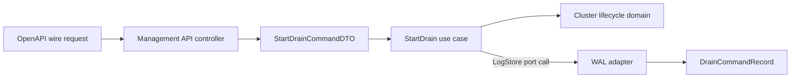

# 경계 model과 mapping

같은 session 정보라도 domain entity, use case의 데이터 전송 객체(Data Transfer Object, DTO), API wire type과 persistence record는 목적이 다르다. NaruMQ는 이 type들을 하나로 합치지 않는다. 경계의 adapter가 외부 표현을 안쪽 표현으로 바꾸고, domain은 HTTP·OpenAPI·write-ahead log(WAL) 형식을 알지 못하게 한다.

| 항목 | 값 |
| --- | --- |
| 기준 독자 | Go 기초는 알지만 Entity, DTO, Wire type, Record 간의 모델 분리와 계층 매핑 경계가 생소한 주니어 개발자 |
| 선수 문서 | [Broker core의 계층 경계](broker-core-boundaries.md) |
| 관련 기준 문서 | [PRD](../requirements/PRD.md) (NFR-11~14), [Broker core architecture](../architectures/broker-core.md), [Project structure](../architectures/project-structure.md) |
| 대상 version·확인일 | Target Draft |

아래 package와 type 이름은 아직 production source가 없는 `Target` 예시다.

## 읽고 나면 답할 수 있는 질문

- Domain entity, DTO, wire type과 persistence record의 책임을 구분할 수 있는가?
- HTTP request가 use case와 domain을 거쳐 저장 record로 바뀌는 위치를 설명할 수 있는가?
- 언제 별도 model이 필요하고 언제 같은 package의 작은 type이면 충분한가?

## 문제 상황

Management API로 node drain을 시작한다고 가정한다. HTTP body, application command, cluster lifecycle state와 WAL record에는 비슷한 field가 있다. 하나의 struct를 네 곳에서 함께 쓰면 처음에는 편하지만 다음 변경이 서로 전파된다.

- API field rename이 domain을 바꾼다.
- WAL schema version을 추가하자 API response에 storage metadata가 노출된다.
- Domain invariant를 위해 추가한 private state가 JSON으로 직렬화된다.
- OpenAPI generator가 만든 type이 application import에 들어온다.

문제는 field 중복이 아니다. 서로 다른 이유로 바뀌는 type이 하나가 된 것이다.

## 필수 용어

| 용어 | 책임 | 기본 위치 |
| --- | --- | --- |
| Domain entity·value object | Business invariant와 행위 | `internal/domain/<capability>` |
| Use case DTO | Application 명령·조회의 입력과 출력 | `internal/application/<usecase>` |
| Wire type | HTTP, MQTT 또는 외부 SDK가 요구하는 표현 | 해당 `internal/adapters/<provider>` |
| Persistence record | WAL·snapshot·SQL schema와 version | `internal/adapters/storage` |
| Mapper | 두 경계 표현을 명시적으로 변환 | 변환을 수행하는 adapter |

DTO는 data transfer object의 약자다. NaruMQ가 직접 작성한 DTO에는 `DTO` Postfix를 붙인다. Persistence record는 전달 객체가 아니므로 `*DTO`가 아니라 `*Record`, `*Row`, `*Manifest`로 이름을 짓는다.

## 정상 흐름

아래 화살표는 runtime data flow다. Source dependency는 adapter에서 application과 domain 쪽을 향한다.



1. Controller가 generated HTTP request를 검증한다.
2. Controller가 필요한 값만 `StartDrainCommandDTO`로 옮긴다.
3. Use case가 DTO를 domain value로 바꾸고 lifecycle invariant를 실행한다.
4. Use case가 `LogStore` port에 domain 의미의 command 저장을 요청한다.
5. WAL adapter가 command를 versioned `DrainCommandRecord`로 encoding한다.
6. 조회 결과는 반대 방향으로 변환한다. Persistence record를 API에 바로 반환하지 않는다.

```go
// Target example: internal/application/drain
type StartDrainCommandDTO struct {
	NodeID    string
	RequestID string
}

// Target example: internal/adapters/storage
type drainCommandRecord struct {
	SchemaVersion uint16
	NodeID        string
	RequestID     string
}
```

두 type의 field가 지금 같더라도 변경 이유는 다르다. 전자는 use case 계약이 바뀔 때, 후자는 persisted schema와 rollback 정책이 바뀔 때 수정한다.

## 별도 type을 만드는 기준

다음 중 하나라도 해당하면 경계 type을 분리한다.

- 외부 schema, generator, storage tag 또는 version field가 필요하다.
- 내부에서는 허용하지만 외부에 노출하면 안 되는 field가 있다.
- Nullability, 단위, enum 또는 error 의미가 경계마다 다르다.
- N-1↔N 호환성 때문에 persisted representation을 독립적으로 유지해야 한다.
- Mapping 과정에서 인증, masking, canonicalization 또는 validation이 필요하다.

같은 package 안에서 같은 invariant를 따르고 함께 변경되는 작은 value까지 복제하지 않는다. 경계가 실제로 없는데 DTO와 mapper를 미리 만드는 것도 비용이다.

## 실패 흐름

| 잘못된 경계 | 발생하는 문제 | 고치는 위치 |
| --- | --- | --- |
| OpenAPI type이 application으로 이동 | Generator 변경이 use case를 깨뜨린다. | Management API controller·mapper |
| Domain entity를 JSON으로 직접 반환 | 비공개 state와 새 field가 노출된다. | Response DTO·wire mapper |
| WAL record를 domain에서 사용 | Schema version과 checksum이 business rule에 섞인다. | Storage adapter·record mapper |
| 외부 provider error를 그대로 반환 | 안정된 application error 분류가 사라진다. | Provider adapter의 error mapper |
| 하나의 `models` package에 모두 저장 | Dependency와 변경 owner가 보이지 않는다. | 소유 domain·use case·adapter package |

Mapper가 실패하면 원본을 일부 적용한 상태로 넘어가면 안 된다. Decode와 validation이 끝난 뒤 domain operation을 시작한다. Persisted record의 schema major를 이해하지 못하면 node를 READY로 만들지 않는다.

## 자주 생기는 오해와 trade-off

- DTO는 모든 struct를 뜻하지 않는다. 경계를 넘는 단순 전달 객체다.
- Domain entity는 database row가 아니다. Identity와 invariant를 소유하는 business type이다.
- Type이 많을수록 architecture가 깨끗한 것은 아니다. 독립적인 변경 이유가 있을 때만 분리한다.
- 자동 mapper는 반복 code를 줄이지만 암묵적 field 복사로 민감정보를 노출할 수 있다. Security 경계는 명시적 mapping을 우선한다.
- Mapping은 allocation을 늘릴 수 있다. 먼저 correctness를 지키고 benchmark로 확인한 hot path만 최적화한다.

## NaruMQ에서 찾을 위치

- 기준 package와 model 배치: [Project structure](../architectures/project-structure.md#model과-경계-자료형-배치)
- Component dependency: [Broker core architecture](../architectures/broker-core.md)
- DTO와 identifier 규칙: [Go coding conventions](../conventions/go-coding-conventions.md)
- Persisted schema 호환성: [Cluster release compatibility v1](../contracts/cluster-release-compatibility-v1.md#5-persisted-state와-snapshot)

## 확인 질문

1. `SessionRecord`에 `SchemaVersion`이 필요한데 `session.State`에는 없어야 하는 이유는 무엇인가?
2. OpenAPI generated request를 use case가 직접 받으면 어떤 dependency가 생기는가?
3. 새 mapper를 만들지 않고 같은 type을 재사용해도 되는 조건은 무엇인가?

## 참고 자료

- [The Clean Architecture](https://blog.cleancoder.com/uncle-bob/2012/08/13/the-clean-architecture.html)
- [Project structure](../architectures/project-structure.md)
- [Broker core의 계층 경계](broker-core-boundaries.md)
