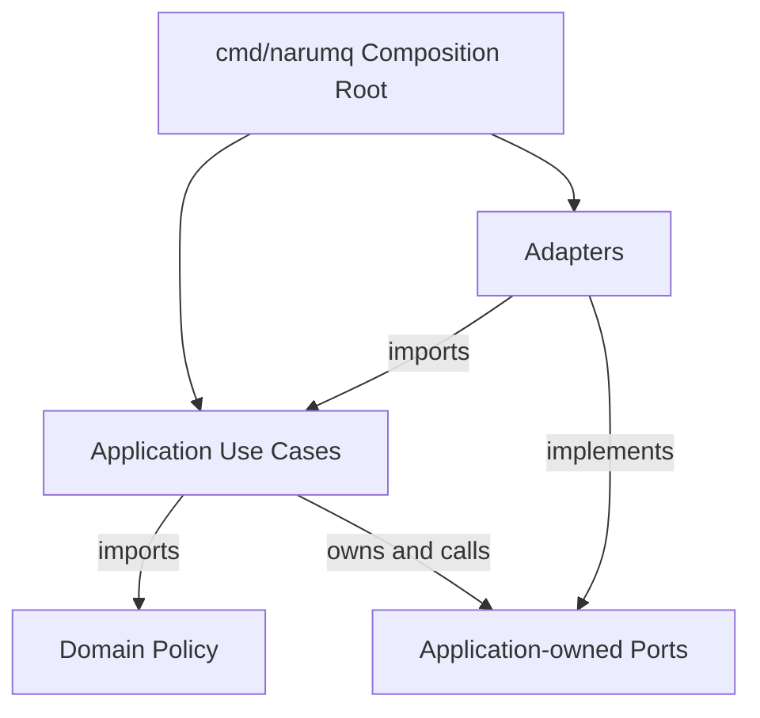
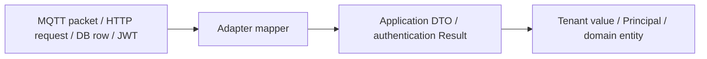

# Broker core의 계층 경계

NaruMQ의 계층 경계는 storage나 Kubernetes를 제거하기 위한 구조가 아니다. MQTT와 session 규칙이 외부 제품의 type과 lifecycle에 종속되지 않게 하는 구조다. 핵심 정책을 담는 domain을 향해 source dependency를 제한한다. 외부 연결부인 adapter는 application이 요구한 interface인 port를 구현하므로 runtime call은 다시 바깥으로 나갈 수 있다.

| 항목 | 값 |
| --- | --- |
| 기준 독자 | Go 기초는 알지만 육각형/클린 아키텍처의 의존성 역전(DIP)과 Port-Adapter 패턴이 생소한 주니어 개발자 |
| 선수 문서 | [Boundary model과 mapping](boundary-models-and-mapping.md) |
| 관련 기준 문서 | [PRD](../requirements/PRD.md) (NFR-11~15), [ADR-0001: Broker core를 Go로 구현한다](../decisions/ADR-0001-core-implementation-language.md) (Accepted), [Broker core architecture](../architectures/broker-core.md) |
| 대상 version·확인일 | Target Draft |

이 문서는 [ADR-0001](../decisions/ADR-0001-core-implementation-language.md)의 계층 제약을 설명한다. 새로운 package 구조를 결정하지 않는다.

## 읽고 나면 답할 수 있는 질문

- Source dependency와 runtime call이 반대 방향으로 보일 수 있는 이유를 설명할 수 있다.
- Domain, application use case, port, adapter와 composition root의 책임을 구분할 수 있다.
- Port interface를 adapter가 아니라 use case 쪽에서 소유하는 이유를 설명할 수 있다.
- 외부 type이 domain까지 들어왔을 때 어떤 변경이 전파되는지 찾을 수 있다.

## 문제 상황: storage 교체가 MQTT 정책까지 흔든다

Publish use case가 특정 database client와 Raft library type을 직접 사용한다고 하자. Storage schema나 library API가 바뀌면 application과 domain도 함께 수정된다. Unit test를 실행하려 해도 실제 database와 consensus node가 필요해진다.

문제는 database를 썼다는 사실이 아니다. 바깥 구현의 변경 이유가 안쪽 MQTT 정책까지 건너온 것이다. 경계는 이 변경 방향을 끊는다.

## 필수 용어

| 용어 | 뜻 | 누가 소유하는가 |
| --- | --- | --- |
| Domain | MQTT·session·routing처럼 외부 제품과 무관한 핵심 규칙 | 해당 domain package |
| Use case | 한 사용자·protocol 목적을 위해 domain과 외부 작업을 순서대로 조정하는 application logic | application package |
| Port | Use case가 외부 기능에 요구하는 최소 interface | 그 interface를 호출하는 application 쪽 |
| Adapter | TCP, storage, Kubernetes 같은 외부 세계를 port·DTO로 변환하는 구현 | adapters package |
| Composition root | Concrete adapter를 생성하고 use case에 연결하는 시작 지점 | `cmd/narumq` Target package |
| Dependency inversion | 안쪽 정책이 바깥 구현에 맞추지 않고 바깥 구현이 안쪽 interface에 맞추는 구조 | Source dependency 규칙으로 유지한다. |

## Source dependency와 호출 방향

의존성 방향과 함수 호출 방향은 같지 않을 수 있다.

아래 화살표는 runtime packet 흐름이 아니라 Go source의 import·interface 구현 관계를 뜻한다.



예를 들어 publish use case가 `SessionStore` port를 호출하면 runtime control은 application에서 storage adapter로 이동한다. 그러나 interface를 application이 소유하고 storage adapter가 구현하므로 source dependency는 adapter에서 application을 향한다.

## 계층별 책임

| 계층 | NaruMQ의 예 | 책임 | 알면 안 되는 것 |
| --- | --- | --- | --- |
| Domain | MQTT, session, routing, delivery, tenancy, security | Protocol invariant와 제품 정책 | Kubernetes, HTTP, Raft library, DB row, JWT/JWKS, configuration |
| Application | connect, publish, subscribe, takeover, drain | Authentication→binding→authorization→mutation 순서, transaction과 port 호출 | Concrete storage와 framework API |
| Ports | consensus, logstore, sessionstore, authentication, clock | Use case가 외부에 요구하는 최소 계약 | 구현 제품의 설정·자료형 |
| Adapters | TCP/TLS, authentication, Raft, storage, Kubernetes, Prometheus, management API | 외부 protocol과 product API를 안쪽 계약으로 변환 | Domain 정책의 재구현 |
| Composition root | `cmd/narumq` | Strict configuration, concrete adapter 생성과 wiring | MQTT business rule |

`domain/tenancy`는 문자열 prefix를 만들지 않고 private field의 comparable
`TenantID`, `SessionKey`, `Topic`, `TopicFilter`를 제공한다. `domain/security`의
immutable `Principal`은 tenant와 Client ID를 snapshot으로 보유하며, JWT/JWKS
자료형은 `application/ports/authentication`의 logical Result에서 끊긴다.

Domain은 port도 import하지 않는다. 외부 시간이 필요한 domain 계산은 application이 clock port에서 값을 얻어 domain value로 전달한다. 이렇게 해야 domain test에 실제 clock이나 network가 나타나지 않는다.

## Port를 사용하는 쪽이 소유하는 이유

Port는 adapter가 제공하고 싶은 기능 목록이 아니다. Use case가 실제로 필요한 계약이다.

나쁜 방향:

```text
application -> storage package의 Repository interface
```

의도한 방향:

```text
storage adapter -> application이 소유한 SessionStore port
```

첫 번째 구조에서는 storage package가 바뀔 때 application import도 바뀐다. 두 번째 구조에서는 application이 안정된 요구를 정의하고 adapter가 그 요구에 맞춘다.

Port는 작게 유지한다. Publish use case가 session을 읽고 한 메시지를 commit하는 기능만 필요하다면 관리용 전체 조회 API까지 같은 interface에 넣지 않는다.

## 경계를 넘는 데이터

외부 자료형을 그대로 domain에 넘기면 framework가 안쪽 정책으로 스며든다.



- TCP adapter는 packet parser 결과를 application command로 변환하고 CONNECT Password bytes만 authentication port에 전달한다.
- Authentication adapter는 JWT/JWKS 자료형과 HTTP 오류를 검증된 `Result`로 바꾼다. token, Username, claims와 raw JWKS는 application·domain에 노출하지 않는다.
- Application은 CONNECT Client ID를 `Result.AllowedClientIDs`에 exact-match하고, `security.NewPrincipal`과 `tenancy.NewSessionKey`를 만든 뒤 session ownership을 요청한다.
- Publish·subscribe·unsubscribe entry는 외부 raw topic/filter를 즉시 tenant value로 변환한다. Routing, retained와 delivery port는 raw string key를 받지 않는다.
- Storage adapter는 DB row를 session snapshot value로 변환한다.
- Management API adapter는 HTTP request와 RBAC context를 DTO로 변환한다.
- Domain entity를 JSON encoder나 storage driver에 직접 노출하지 않는다.

경계 변환은 비용이 든다. 성능이 중요한 payload는 불필요한 복사를 피해야 하지만, 최적화 전에는 allocation profile로 병목을 확인한다. 외부 buffer의 수명과 domain의 소유권을 문서화하지 않은 zero-copy는 경계를 흐릴 수 있다.

## 정상 흐름: 하나의 publish가 경계를 지난다

1. TCP adapter가 MQTT PUBLISH packet을 검증 가능한 command로 변환한다.
2. Publish use case가 인증 identity와 tenant policy를 조회한다.
3. Domain이 topic, ACL, QoS와 quota invariant를 판단한다.
4. Use case가 logstore·replication port를 호출한다.
5. Storage와 consensus adapter가 외부 library를 사용해 commit한다.
6. Use case가 protocol 결과를 반환한다.
7. TCP adapter가 PUBACK 또는 PUBREC packet으로 encode한다.

Domain은 이 흐름에서 socket, WAL format, HTTP status와 Raft entry type을 알지 못한다.

## 실패 흐름: 외부 type이 안쪽으로 새어 들어왔다

| 경계 누수 | 즉시 보이는 편의 | 나중에 남는 문제와 수정 위치 |
| --- | --- | --- |
| Domain entity에 DB tag·row field 추가 | 별도 mapper가 줄어든다. | Schema 변경이 domain 수정이 된다. Storage adapter record로 이동한다. |
| Use case가 concrete Raft client 호출 | Adapter 작성이 줄어든다. | Consensus library 없이는 unit test가 불가능하다. Application-owned port 뒤로 옮긴다. |
| TCP handler가 ACL 규칙 계산 | 호출 단계가 짧아진다. | 다른 adapter가 규칙을 복제한다. Domain policy와 use case 호출로 이동한다. |
| Adapter package가 port interface 소유 | 구현과 interface가 한 폴더에 있다. | Application이 infrastructure를 import한다. 호출자인 application으로 interface를 옮긴다. |

이미 누수가 생겼다면 한 번에 모든 layer를 다시 만들 필요는 없다. 변경 이유가 다른 type부터 mapper로 분리하고, use case가 실제로 쓰는 method만 작은 port로 뽑는다. Architecture test로 같은 방향의 재발을 막는다.

## Architecture test가 필요한 이유

문서만으로는 경계가 유지되지 않는다. 작은 편의를 위해 domain에서 adapter를 import하기 시작하면 의존성은 시간이 지날수록 바깥으로 흐른다.

CI는 최소한 다음 규칙을 검사해야 한다.

- `internal/domain`은 application과 adapters를 import하지 않는다.
- `internal/application`은 domain과 자신이 소유한 port만 import한다.
- `internal/adapters` 사이에 의도하지 않은 cycle이 없다.
- `cmd/narumq` 밖에서 concrete adapter를 조립하지 않는다.
- Framework와 storage 자료형이 application·domain public API에 나타나지 않는다.

실제 검사 도구와 package allowlist는 구현 저장소가 생길 때 정한다.

## 자주 하는 오해와 trade-off

- 계층과 mapper가 늘어 초기 코드량이 증가한다.
- 지나치게 작은 port는 interface 수를 늘린다.
- 지나치게 큰 port는 use case를 외부 제품에 결합한다.
- 모든 domain module을 독립 service로 만들 필요는 없다. 초기 NaruMQ는 하나의 broker process 안에서 source boundary만 유지한다.

경계의 목적은 추상화 자체가 아니다. MQTT 정책의 변화와 infrastructure 제품의 변화를 서로 다른 이유로 수정할 수 있게 만드는 것이다.

## NaruMQ에서 찾을 위치

제품 제약은 [PRD](../requirements/PRD.md)의 NFR-11~15를 따른다. 목표 component와 source dependency는 [Broker core architecture](../architectures/broker-core.md), repository 배치는 [Project structure](../architectures/project-structure.md), identifier와 file 규칙은 [Go coding conventions](../conventions/go-coding-conventions.md), Go 선택 근거는 [ADR-0001: Broker core를 Go로 구현한다](../decisions/ADR-0001-core-implementation-language.md) (Accepted)을 기준으로 한다.

## 확인 질문

1. Publish use case가 `SessionStore`를 호출할 때 runtime call은 바깥으로 가지만 source dependency는 안쪽을 향하게 만드는 방법은 무엇인가?
2. Port interface가 storage adapter package에 있으면 application dependency에 어떤 문제가 생기는가?
3. MQTT packet type과 DB row가 domain entity를 직접 통과하면 어느 변경이 함께 전파되는가?
4. Controller, use case와 domain entity가 각각 담당해야 할 validation을 예로 들어 구분해 보라.

## 참고 자료

- [The Clean Architecture](https://blog.cleancoder.com/uncle-bob/2012/08/13/the-clean-architecture.html)
- [ADR-0001: NaruMQ broker core를 Go로 구현한다](../decisions/ADR-0001-core-implementation-language.md)
