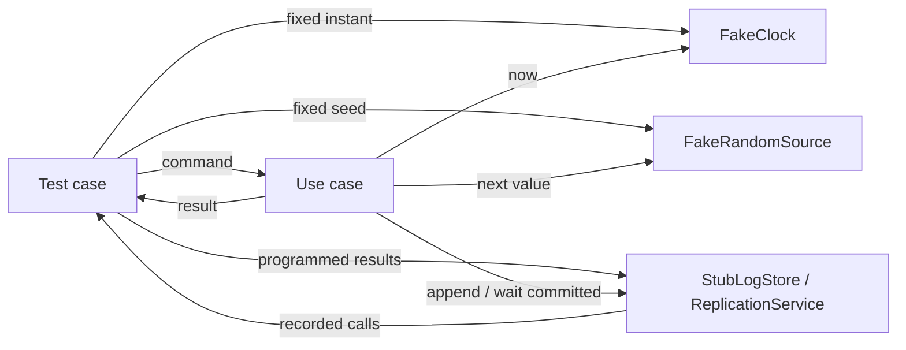

# 결정적 test와 failure injection

결정적 test는 같은 초기 상태와 입력을 주면 wall clock, goroutine scheduling이나 외부 서비스 상태와 무관하게 같은 관찰 결과를 내는 test다. NaruMQ에서는 clock, random, network, storage, consensus와 auth 경계를 port로 두고 test double로 바꾸면 timeout·crash·partition을 재현할 수 있다. `time.Sleep`으로 우연히 상태가 바뀌기를 기다리는 대신 명시적인 완료 조건과 저장된 상태를 검증해야 한다. 특히 승인 응답(acknowledgment, ACK)은 durable 경계를 통과했다는 관찰 결과로 다룬다.

| 항목 | 값 |
| --- | --- |
| 기준 독자 | 단위 테스트 기초는 알지만 시계, 네트워크, 저장소 failure injection과 비결정성 제어 기법이 생소한 주니어 개발자 |
| 선수 문서 | [Broker core의 계층 경계](broker-core-boundaries.md) |
| 관련 기준 문서 | [PRD](../requirements/PRD.md) (TEST-01~17, NFR-07~15), [Performance와 verification 스펙](../specs/performance-and-verification.md) |
| 대상 version·확인일 | Draft 0.5 |

## 읽고 나면 답할 수 있는 질문

- clock과 storage를 test double로 바꾸면 timeout과 crash를 어떻게 재현하는지 설명할 수 있다.
- `time.Sleep` 기반 test가 flaky해지는 이유와 명시적인 완료 조건의 차이를 설명할 수 있다.
- unit, integration, conformance와 chaos test에서 실제로 둘 경계를 구분할 수 있다.
- failure injection 지점마다 남는 상태와 안전한 retry 조건을 표로 만들 수 있다.

## 문제 상황: ACK 직전 crash를 재현해야 한다

QoS 1 `PUBLISH`를 처리하던 node가 log를 local disk에 기록한 직후, quorum commit 전 crash했다고 하자. 이때 `PUBACK`을 보내면 안 된다는 test가 필요하다. 실제 process를 무작위 시점에 종료하는 test만으로는 원하는 한 줄 사이를 매번 맞출 수 없고, 실패해도 같은 순서를 재현하기 어렵다.

해결 방법은 use case가 호출하는 `LogStore`와 `ReplicationService`를 제어 가능한 test double로 바꾸는 것이다. `Append`는 성공시키고 `WaitCommitted`에서 정해 둔 오류를 반환하면 정확한 실패 지점을 반복해서 만들 수 있다.

## 필수 용어

| 용어 | 뜻 | 이 문서에서의 역할 |
| --- | --- | --- |
| Deterministic | 같은 초기 상태와 입력에서 같은 관찰 결과가 나오는 성질 | 실행 시간이나 scheduler 운에 test 결과가 의존하지 않게 한다. |
| Test double | 실제 dependency를 대신하는 test용 구현의 총칭 | clock, storage, transport와 auth의 결과를 제어한다. |
| Fake | 실제보다 단순하지만 동작하는 구현 | in-memory log store나 수동 clock에 적합하다. |
| Stub | 미리 정한 값을 반환하는 구현 | 특정 auth 오류나 quorum timeout을 반환한다. |
| Spy | 호출과 인자를 기록하는 구현 | ACK가 commit 뒤에 호출됐는지 순서를 확인한다. |
| Seed | pseudo-random sequence를 다시 만들 수 있는 시작값 | property test와 workload를 재현한다. |
| Quiescence | 더 진행할 runnable 작업이나 timer가 없는 안정 상태 | 비동기 test의 명시적인 완료 조건으로 쓸 수 있다. |
| Failure injection | 정한 경계와 시점에 오류, 지연, drop 또는 crash를 넣는 기법 | 희귀 장애 분기를 의도적으로 실행한다. |

## 정상 흐름

아래 화살표는 test가 use case에 dependency를 주입하고 실행 결과와 관찰 기록을 되돌려 받는 runtime control flow다.



### 1. 관찰할 결과를 먼저 정한다

Test는 내부 goroutine 수보다 외부에서 의미 있는 결과를 확인한다.

- 반환된 application result와 protocol packet
- domain state transition
- outbound port 호출 순서와 인자
- log에 persisted·committed·applied로 남은 index
- retry 가능 여부와 공개 error code

### 2. 비결정적인 입력을 port 뒤로 보낸다

다음은 아직 구현되지 않은 `Target` 예시다. Production adapter는 실제 시각을 반환하고 test는 수동 시각을 주입한다.

```go
type Clock interface {
	Now() time.Time
}

type FakeClock struct {
	now time.Time
}

func (c *FakeClock) Now() time.Time { return c.now }
func (c *FakeClock) Advance(d time.Duration) { c.now = c.now.Add(d) }
```

Use case 안에서 `time.Now()`를 직접 호출하면 Session Expiry 경계를 기다리거나 process clock을 바꿔야 한다. `Clock`을 주입하면 `expiry-1ns`, 정확한 expiry, `expiry+1ns`를 즉시 검증할 수 있다. Random ID와 backoff jitter도 global random 대신 seed가 고정된 `RandomSource`를 사용한다.

### 3. 명시적인 완료 조건까지 진행한다

`time.Sleep(100 * time.Millisecond)`은 “100ms면 아마 끝날 것”이라는 추측이다. 느린 CI에서는 아직 끝나지 않을 수 있고 빠른 환경에서는 불필요하게 test를 늦춘다. 대신 다음 중 하나를 기다린다.

- 결과 channel 또는 future 완료
- test double에 특정 호출이 도착함
- state machine이 목표 상태에 도달함
- 제어 가능한 executor가 quiescence에 도달함

Timeout은 test가 영원히 멈추는 것을 막는 상한으로만 사용하고, 성공 조건 자체로 쓰지 않는다.

## 실패 흐름과 failure injection 설계

먼저 정상 test를 통과시킨 뒤 실패를 한 지점씩 추가한다.

| 경계와 주입 지점 | 주입하는 실패 | 확인할 남은 상태와 결과 |
| --- | --- | --- |
| `LogStore.Append` 전 | disk full | 새 record 없음, 성공 ACK 없음, 정책에 맞는 retryable error |
| Append 뒤 stable 저장 전 | simulated crash | 복구 뒤 unstable record가 없을 수 있음, ACK 없음 |
| local persist 뒤 quorum 전 | peer timeout·partition | local record는 있을 수 있으나 committed 아님, ACK 없음 |
| quorum commit 뒤 apply 전 | process crash | replay 후 apply 가능, 이미 허용된 ACK의 durability 유지 |
| `PeerTransport` | drop, duplicate, reorder, delay | state machine 불변식 유지, stale term·fencing 거절 |
| `Clock` | expiry 경계로 advance | 경계 전후 session·token 결과가 정확히 달라짐 |
| `AuthProvider` | timeout, invalid token, stale key | fail-open하지 않고 안정된 공개 error 반환 |
| `RandomSource` | 고정 seed | 같은 workload와 ID sequence를 재생 가능 |

이 표의 durable ACK 시점은 [WAL, snapshot과 crash recovery](wal-snapshot-and-crash-recovery.md)와 [Raft quorum과 durable ACK](raft-quorum-and-durable-ack.md)의 Proposed 결정이 확정될 때 contract test로 고정해야 한다.

## Verification 계층에서 실제 dependency를 둘 위치

| Test 계층 | 대체하는 것 | 실제로 두는 것 |
| --- | --- | --- |
| Unit | clock, random, network, storage, consensus, auth 전부 | domain과 application logic |
| Property/fuzz | 외부 I/O 전부 | parser, encoder, topic matching과 state invariant |
| Integration | test가 제어하지 않는 외부 service | 선택한 listener, storage 또는 transport adapter |
| Conformance | broker 내부 dependency는 환경에 따라 격리 | 실제 MQTT wire behavior와 test client |
| End-to-end | 가능한 한 적게 대체 | production-like cluster와 외부 API |
| Chaos | 오류 자체는 injector가 제어 | 실제 process, network와 storage 조합 |

Unit test가 실제 network를 사용하면 느린 integration test가 된다. 반대로 storage adapter integration test를 in-memory fake만으로 끝내면 실제 flush, corruption과 reopen 동작을 검증하지 못한다. 빠른 결정적 test와 적은 수의 실제 dependency test가 서로 다른 위험을 담당한다.

## 실패하는 test 자체를 진단하는 법

- 같은 seed와 입력 artifact를 보존해 로컬에서 다시 실행한다.
- 실패 순간의 fake clock, state index, injected fault와 outbound call 순서를 출력한다.
- race detector로 shared memory 접근을 확인한다. Race가 있으면 seed만 고정해도 scheduler 순서까지 같아진다고 보장할 수 없다.
- Fuzz test가 찾은 최소 입력을 regression corpus에 저장한다.
- Flaky test 격리는 임시 조치로만 쓰고 owner와 해소 기한을 남긴다.

## 자주 하는 오해와 trade-off

- **“Mock이 많으면 unit test가 좋다.”** 호출 세부를 과도하게 고정하면 안전한 refactoring도 실패한다. Business 결과와 중요한 경계 순서만 검증한다.
- **“고정 seed면 concurrency test도 완전히 결정적이다.”** Seed는 pseudo-random 입력만 고정한다. Goroutine scheduling과 data race는 별도 제어와 race 검사가 필요하다.
- **“`time.Sleep`을 길게 하면 안정적이다.”** 느려질 뿐 완료 조건을 증명하지 못한다.
- **“Fake storage가 durable 저장을 증명한다.”** Fake는 use case 분기를 검증한다. 실제 `fsync`, reopen과 corruption은 adapter integration·crash test가 담당한다.
- **“Chaos test가 unit test를 대신한다.”** Chaos는 component 조합과 운영 환경을 검증하지만 정확한 instruction 사이의 모든 분기를 빠르게 재현하지 못한다.

## NaruMQ에서 찾을 위치

| 관심사 | 기준 문서 또는 Target 위치 |
| --- | --- |
| Test 계층과 gate | [Performance와 verification 스펙](../specs/performance-and-verification.md) 7~10절 |
| Application port 경계 | [Broker core의 계층 경계](broker-core-boundaries.md), [Project structure](../architectures/project-structure.md) |
| Storage·consensus failure point | [WAL, snapshot과 crash recovery](wal-snapshot-and-crash-recovery.md), [Raft quorum과 durable ACK](raft-quorum-and-durable-ack.md) |
| Concurrency와 bounded queue | [Go 동시성과 backpressure](go-concurrency-and-backpressure.md) |
| 요구사항 | TEST-01~17, NFR-07~15 |

`Clock`, `RandomSource`, fake와 spy type의 정확한 package 이름은 아직 Target이다. Test 편의를 위해 domain에 framework type을 넣는 대신 application이 소유하는 port와 test package 구현으로 경계를 유지한다.

## 확인 질문

1. Local persist 뒤 quorum 전 timeout을 재현하려면 어떤 port에 어떤 결과를 주입하고 무엇을 assert해야 하는가?
2. Session Expiry 경계를 `time.Sleep` 없이 검증하는 순서를 설명해 보라.
3. 같은 seed인데 concurrency test 결과가 달라질 수 있는 이유는 무엇인가?
4. In-memory `LogStore` unit test와 실제 disk adapter integration test가 각각 증명하는 범위를 구분해 보라.

## 참고 자료

- [Go: Testing Time](https://go.dev/blog/testing-time)
- [Go data race detector](https://go.dev/doc/articles/race_detector)
- [Go fuzzing](https://go.dev/doc/security/fuzz/)
- [Go package testing](https://pkg.go.dev/testing)
