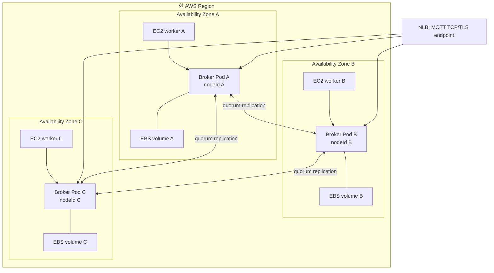

# EKS 고가용성과 장애 도메인

Amazon Elastic Kubernetes Service(EKS)에 broker Pod를 세 개 띄우는 것만으로 3-node 고가용성이 생기지는 않는다. 세 Pod를 서로 다른 Amazon Elastic Compute Cloud(EC2) instance와 가용 영역에 배치하고, 각각 독립된 Amazon Elastic Block Store(EBS) volume과 논리 `nodeId`를 사용해야 한다. 그래야 한 번의 물리 장애가 quorum member 둘 이상을 함께 잃게 하지 않는다.

| 항목 | 값 |
| --- | --- |
| 기준 독자 | Kubernetes Pod 배포 경험은 있으나 다중 AZ 토폴로지 스프레드 및 EBS 볼륨 결합 분산 고가용성 설계가 생소한 주니어 개발자 |
| 선수 문서 | [세션 소유권과 fencing](session-ownership-and-fencing.md) |
| 관련 기준 문서 | [PRD](../requirements/PRD.md) (DEP-19~23, CLU-01~14), [ADR-0003: Durable ACK barrier](../decisions/ADR-0003-durable-ack-barrier.md) (Proposed), [ADR-0007: AWS production deployment platform](../decisions/ADR-0007-aws-production-deployment-platform.md) (Proposed), [EKS on EC2 deployment architecture](../architectures/eks-ec2-deployment.md) |
| 대상 version·확인일 | `EKS_EC2_HA` Profile, 2026-08-16 |

## 읽고 나면 답할 수 있는 질문

- Broker process, Pod, EC2 instance, 가용 영역과 `nodeId`의 수명을 구분할 수 있다.
- 3-node cluster에서 한 가용 영역을 잃어도 quorum 2가 남는 배치를 설명할 수 있다.
- EBS 내부 durability와 NaruMQ quorum replication이 서로 다른 이유를 설명할 수 있다.
- Replacement Pod를 `READY`로 만들기 전에 확인할 상태를 설명할 수 있다.

## 문제 상황: Pod 셋이 한 EC2 instance에 모였다

Broker Pod가 세 개 모두 `Running`이라고 하자. 그러나 세 Pod가 같은 EC2 instance에 배치됐다면 instance 한 대의 장애로 모두 사라진다. 서로 다른 instance에 있어도 같은 가용 영역에 모였다면 한 영역 장애로 quorum 전체를 잃는다.

Replica 수는 장애 복구 능력과 같지 않다. Replica가 서로 다른 장애 원인에 노출돼야 고가용성이 생긴다.

## 필수 용어: 먼저 구분할 identity와 수명

“노드”라는 말은 다음 대상을 모두 가리킬 수 있어 혼동하기 쉽다.

| 대상 | 일반적인 수명 | 사라질 때 영향 | NaruMQ에서의 의미 |
| --- | --- | --- | --- |
| Broker process | Container 재시작까지 | 메모리와 TCP 연결 손실 | 복구 가능한 실행 단위 |
| Pod | 재생성까지 | IP·process와 connection 변경 | Kubernetes scheduling 단위 |
| EC2 instance | Instance 교체까지 | 그 위의 Pod와 local disk 손실 | Host 장애 도메인 |
| 가용 영역(AZ) | 지역적 장애까지 | 해당 AZ의 instance와 EBS 접근 손실 | 기준 profile의 물리 장애 도메인 |
| EBS volume | 명시적 삭제까지 | WAL·snapshot·broker stable state 보존 | 한 broker의 stable storage |
| NaruMQ `nodeId` | Cluster membership에서 제거할 때까지 | Ownership·replica 추적 기준 | Pod 이름·IP·instance ID와 다른 논리 identity |

`nodeId`를 Pod 이름이나 IP와 같게 두면 재시작과 재스케줄링을 새 논리 member로 잘못 해석할 수 있다. 반대로 새 저장 상태를 이전 `nodeId`로 무조건 시작하면 stale member가 될 수 있다. Membership join·replace 절차가 identity와 저장 상태의 관계를 검증해야 한다.

## 정상 흐름: 기준 3-AZ 구조

아래 실선 화살표는 scheduling·traffic data flow를, Pod와 EBS 사이의 선은 stable storage attachment를 뜻한다.

3-node cluster의 majority quorum은 2다. Member 하나를 잃어도 둘이 남아 commit할 수 있다. 그러나 Pod A와 B가 같은 EC2 instance에 있거나 같은 가용 영역에 몰려 있다면 host 또는 AZ 한 번의 장애로 둘을 함께 잃는다. Replica 수가 3이어도 실제 장애 독립성은 1이 될 수 있다.

## 장애 도메인을 분리하는 Kubernetes 제약

기준 profile에는 다음 제약이 함께 필요하다.

| 제약 | 막으려는 상태 | 한계 |
| --- | --- | --- |
| Required Pod anti-affinity | Quorum Pod 둘이 같은 worker에 배치됨 | 가용 영역 분리는 별도 topology key가 필요하다. |
| Topology spread constraint | 세 Pod가 특정 가용 영역에 몰림 | `DoNotSchedule`과 label selector가 실제 workload를 정확히 선택해야 한다. |
| EBS volume node affinity | Pod가 volume과 다른 가용 영역에 배치됨 | AZ 전체를 잃으면 기존 volume을 다른 AZ에 바로 attach할 수 없다. |
| PodDisruptionBudget | Voluntary disruption이 여러 Pod를 동시에 제거함 | Host·AZ 장애와 강제 삭제는 막지 못한다. Application drain 완료도 증명하지 않는다. |
| Readiness gate | 동기화되지 않은 replacement가 traffic을 받음 | Quorum과 replica health를 실제로 검사해야 한다. |

`preferred` anti-affinity는 자원이 부족할 때 같은 host 배치를 허용할 수 있다. 기준 production profile은 장애 독립성이 수용 조건이므로 필요한 제약을 `required` 또는 `DoNotSchedule` 수준으로 적용하고, 배치 불가를 잘못된 배치보다 우선해야 한다.

## EBS 복제와 NaruMQ quorum 복제는 다르다

Amazon EBS는 volume 데이터를 해당 가용 영역 안에서 복제한다. 이 복제는 device 장애 내성을 높이지만 다음을 의미하지 않는다.

- 다른 가용 영역에 NaruMQ message copy가 있다는 뜻이 아니다.
- 다른 broker가 최신 session owner epoch를 commit했다는 뜻이 아니다.
- NaruMQ의 write quorum 2가 완료됐다는 뜻이 아니다.
- AZ 전체 손실 때 같은 volume을 다른 AZ에서 즉시 attach할 수 있다는 뜻이 아니다.

NaruMQ의 기준 durable write는 다음 두 층을 모두 통과한다.

1. 각 broker가 자기 stable storage에 WAL과 필요한 consensus state를 영속화한다.
2. 서로 다른 장애 도메인의 broker 둘 이상이 이를 확인하고 quorum commit한다.

따라서 broker마다 독립 EBS volume을 사용한다. ReadWriteOnce volume 하나를 여러 quorum member의 공통 저장소처럼 사용하지 않는다. EBS snapshot은 backup·restore 수단이며 실행 중인 application quorum을 대신하지 않는다.

## 실패 흐름: 장애별 기대 동작

| 장애 | 직접 잃는 것 | 남아야 하는 것 | 복구의 핵심 |
| --- | --- | --- | --- |
| Broker process crash | TCP 연결, process memory | Pod의 volume, 다른 두 member의 quorum | 같은 또는 replacement process가 저장 상태를 검증하고 재참여한다. |
| Pod 삭제·재생성 | Pod identity, IP, 연결 | EBS volume과 논리 membership 기록 | Volume 재연결, log catch-up과 readiness 뒤 traffic을 받는다. |
| EC2 instance loss | 그 host의 Pod와 연결 | 해당 AZ의 EBS, 다른 AZ의 quorum | 같은 AZ의 새 worker에 volume을 연결하고 member를 복구한다. |
| EBS I/O 오류 | 해당 member의 stable write 능력 | 다른 두 독립 volume의 committed state | 해당 member를 unhealthy로 만들고 durable ACK quorum을 다시 평가한다. |
| 단일 AZ loss | 그 AZ의 EC2·Pod·EBS 접근 | 다른 두 AZ의 broker와 volume | Quorum 2로 서비스를 유지하고 별도 AZ에 replacement를 재동기화한다. |
| Region loss | 세 AZ와 NLB endpoint | 이 profile 안에는 없음 | 다중 Region DR은 초기 범위 밖이며 backup RPO/RTO가 별도로 필요하다. |

Process crash, Pod 교체와 EC2 loss를 모두 “노드 장애” 하나로 합치면 volume 재사용 가능 여부와 복구 시간이 보이지 않는다. 시험과 metric은 장애 층을 구분해야 한다.

## Replacement가 READY가 되는 조건

새 Pod가 실행 중이라는 이유만으로 READY가 되면 안 된다. 최소한 다음을 확인해야 한다.

- 기대한 `nodeId`와 EBS volume의 cluster identity가 일치한다.
- WAL·snapshot checksum과 schema version을 읽을 수 있다.
- 필요한 log와 snapshot 동기화가 끝났다.
- 현재 membership, quorum과 owner epoch를 확인했다.
- Stale epoch write가 최종 저장 경계에서 거절된다.
- N-1 traffic을 처리 중인 기존 member의 replication backlog가 허용 범위다.

이 중 하나라도 `unknown`이면 replacement를 MQTT target으로 포함하지 않는다.

## 자주 하는 오해와 trade-off: 다른 profile은 같은 증거가 아니다

- **EKS Fargate:** Fargate Pod에는 Amazon EBS volume을 mount할 수 없다. 현재 stable storage 전제를 그대로 검증할 수 없다.
- **ECS on EC2:** EC2와 EBS를 사용할 수 있어도 Task identity, volume attachment, target 제외와 stop 승인을 연결하는 별도 lifecycle adapter가 필요하다.
- **Docker Compose:** Container가 셋이어도 단일 host, 전원, kernel과 network를 공유한다. 3-AZ failure test를 대체하지 못한다.

Profile 간 기능 이름이 비슷해도 장애 도메인과 종료 주체가 다르면 같은 지원 수준으로 선언할 수 없다.

## NaruMQ에서 찾을 위치

규범적 배포 요구는 [PRD](../requirements/PRD.md)의 DEP-19~DEP-23과 CLU-01~CLU-14를 따른다. Resource mapping은 [EKS on EC2 deployment architecture](../architectures/eks-ec2-deployment.md), 초기 배포 선택은 [ADR-0007: AWS production deployment platform](../decisions/ADR-0007-aws-production-deployment-platform.md) (Proposed), durable ACK 경계는 [ADR-0003: Durable ACK barrier](../decisions/ADR-0003-durable-ack-barrier.md) (Proposed), 논리 identity와 ownership은 [세션 소유권과 fencing](session-ownership-and-fencing.md)을 참고한다. 계획된 Pod 교체와 연결 제외는 [안전한 노드 drain과 Will](safe-node-drain-and-will.md) 및 [AWS NLB와 MQTT 연결 lifecycle](aws-nlb-mqtt-connection-lifecycle.md)에서 설명한다.

## 확인 질문

1. 세 broker Pod가 서로 다른 Pod 이름을 가져도 같은 장애에서 모두 사라질 수 있는 배치를 두 가지 들어 보라.
2. 3-node cluster에서 한 가용 영역을 잃었을 때 몇 member가 남고 quorum을 만들 수 있는가?
3. EBS volume 하나가 durable하다는 사실이 왜 두 broker replica의 quorum 저장을 대신하지 못하는가?
4. Replacement Pod가 process 시작 직후가 아니라 recovery·membership 검증 뒤 `READY`가 돼야 하는 이유는 무엇인가?

## 참고 자료

- [Amazon EBS volume](https://docs.aws.amazon.com/ebs/latest/userguide/ebs-volumes.html)
- [Amazon EBS의 가용성과 내구성](https://docs.aws.amazon.com/ebs/latest/userguide/ebs-volumes.html#ebs-volume-durability)
- [Amazon EKS EBS CSI driver](https://docs.aws.amazon.com/eks/latest/userguide/ebs-csi.html)
- [Amazon EKS Fargate 고려 사항](https://docs.aws.amazon.com/eks/latest/userguide/fargate.html)
- [Kubernetes topology spread constraints](https://kubernetes.io/docs/concepts/scheduling-eviction/topology-spread-constraints/)
- [Kubernetes assign Pod to node](https://kubernetes.io/docs/concepts/scheduling-eviction/assign-pod-node/)
- [Kubernetes PodDisruptionBudget](https://kubernetes.io/docs/concepts/workloads/pods/disruptions/)
