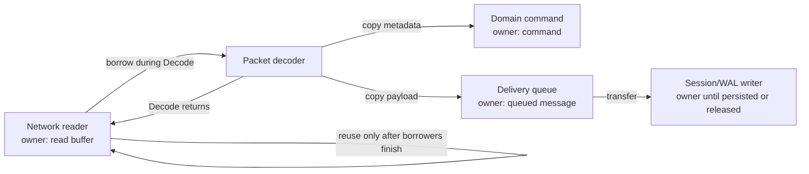

# Go buffer ownership와 zero-copy

Go slice는 payload 자체가 아니라 underlying array의 일부를 가리키는 작은 descriptor다. Zero-copy는 같은 array를 복사 없이 빌려 쓰는 방식이므로 빠를 수 있지만, owner와 lifetime이 불명확하면 다음 read가 data를 덮어쓰거나 큰 array가 오래 살아남고 goroutine 간 data race가 생긴다. NaruMQ에서는 call 안에서 동기적으로 읽는 값만 borrow하고, queue·WAL·retained message·offline session처럼 call 이후 보존하는 값은 copy하거나 명시적으로 ownership을 transfer해야 한다.

| 항목 | 값 |
| --- | --- |
| 기준 독자 | Go 슬라이스 기초는 알지만 언더라잉 배열 공유로 인한 데이터 오염과 버퍼 소유권(Borrow/Copy/Transfer) 규칙이 생소한 주니어 개발자 |
| 선수 문서 | [Go 동시성과 backpressure](go-concurrency-and-backpressure.md) |
| 관련 기준 문서 | [PRD](../requirements/PRD.md) (NFR-01~06), [Performance와 verification 스펙](../specs/performance-and-verification.md) |
| 대상 version·확인일 | Target Draft |

## 읽고 나면 답할 수 있는 질문

- Slice를 전달했는데 payload가 나중에 바뀌는 이유를 underlying array 관점에서 설명할 수 있다.
- borrow, copy와 ownership transfer 중 어느 방식을 packet 처리 단계마다 선택할지 설명할 수 있다.
- buffer pool에 값을 돌려줄 수 있는 정확한 시점을 판단할 수 있다.
- 작은 subslice가 큰 packet buffer의 garbage collection을 막는 상황을 설명할 수 있다.

## 문제 상황: 두 번째 packet이 첫 번째 payload를 바꿨다

Network reader가 64 KiB buffer 하나를 반복 사용한다고 하자. 첫 `PUBLISH`의 payload slice를 delivery queue에 넣은 직후 같은 buffer로 다음 packet을 읽으면, queue에 있던 slice도 같은 array를 가리키므로 내용이 바뀔 수 있다. Queue 전송은 slice descriptor만 복사하며 payload byte를 복사하지 않는다.

문제는 compiler나 garbage collector의 오류가 아니다. Reader가 buffer를 재사용할 수 있는 시점과 queue consumer가 읽기를 끝낸 시점 사이에 소유권 계약이 없기 때문에 생긴다.

## 필수 용어

| 용어 | 뜻 | owner와 lifetime |
| --- | --- | --- |
| Slice | underlying array의 구간을 나타내는 pointer, length와 capacity의 descriptor | Slice 값이 달라도 같은 array를 공유할 수 있다. |
| Owner | buffer를 수정하거나 재사용·반납할 수 있는 component | 동시에 하나의 명확한 owner를 두는 것이 기본이다. |
| Borrow | owner가 정한 짧은 기간 동안 buffer를 읽도록 빌리는 것 | borrower는 보관하거나 수정하지 않고 call이 끝나기 전에 사용을 마친다. |
| Ownership transfer | 기존 owner가 재사용 권리를 포기하고 다음 component에 넘기는 것 | 새 owner가 처리 완료 후 release한다. |
| Copy | 필요한 byte를 새 array에 복제해 독립 lifetime을 만드는 것 | 복사본을 받은 component가 새 owner가 된다. |
| Zero-copy | payload byte 복사를 피하고 같은 memory를 공유하거나 ownership을 넘기는 것 | “비용 0”이 아니라 copy 비용을 줄이는 전략이다. |
| Buffer pool | 재사용 가능한 buffer를 임시 보관하는 cache | checkout한 component가 일시 owner이며 모든 borrower 종료 후 반납한다. |
| Memory retention | 작은 reference 때문에 더 큰 underlying allocation 전체가 살아 있는 상태 | reference가 제거되거나 작은 값으로 copy될 때 해제 가능해진다. |

## 정상 흐름

아래 화살표는 packet byte의 runtime data flow다. `borrow`는 원본 owner가 유지되고, `copy`와 `transfer` 뒤에는 표시된 component가 새 owner가 된다.



### 1. Decoder는 input을 call 동안만 borrow한다

Decoder가 packet boundary와 field를 검사하는 동안에는 input slice를 복사하지 않아도 된다. 하지만 반환하는 domain command가 그 slice를 계속 참조한다면 decoder call이 끝나도 borrow가 끝난 것이 아니다. API에서 반환 값의 lifetime을 명시하지 못하면 필요한 field를 copy한다.

### 2. 비동기 경계를 넘으면 독립 lifetime을 만든다

다음은 아직 구현되지 않은 `Target` 예시다. 입력은 `frame`, 기대 출력은 queue consumer가 이후에도 읽을 수 있는 독립 payload다.

```go
// Bad: frame owner가 다음 read에서 underlying array를 재사용할 수 있다.
payload := frame[start:end]
deliveryQueue <- payload

// Good: queue가 독립 array의 owner가 된다.
owned := append([]byte(nil), frame[start:end]...)
deliveryQueue <- owned
```

Copy가 항상 정답이라는 뜻은 아니다. Reader가 전체 frame의 ownership을 queue에 transfer하고 새 buffer를 checkout할 수도 있다. 다만 transfer 뒤 reader는 그 frame을 읽거나 pool에 반납해서는 안 되며, 마지막 consumer가 release하는 경로가 하나여야 한다.

### 3. 저장 상태는 소유권을 더 길게 가진다

다음 상태는 decode call보다 오래 존재하므로 borrowed network buffer를 그대로 가리키면 안 된다.

- WAL에 append될 record와 flush 대기 data
- retained message
- persistent session의 offline queue
- inflight QoS 1·2 packet
- 다른 goroutine으로 넘기는 delivery work item

Serialization이 동기적으로 끝나고 writer가 입력을 보관하지 않는다는 contract가 있으면 그 call 동안 borrow할 수 있다. Async writer가 나중에 encode한다면 enqueue 전에 copy하거나 buffer ownership을 넘겨야 한다.

### 4. Pool 반납은 마지막 사용 뒤에 한다

`sync.Pool`은 사용하지 않는 임시 object를 재사용하는 cache다. Pool에 넣은 item은 언제든 제거될 수 있으므로 durable store도 아니고 object lifetime 추적기도 아니다.

Buffer를 pool에 돌려주는 조건은 “producer가 enqueue했다”가 아니라 “모든 consumer가 더 이상 읽거나 쓰지 않는다”이다. 여러 consumer가 공유하면 다음 전략 중 하나가 필요하다.

- 각 consumer에게 copy한다.
- 하나의 owner에게 transfer하고 consumer는 그 owner가 정한 call 동안만 borrow한다.
- Reference count로 마지막 consumer를 추적한다. 다만 누락·이중 release 위험과 atomic 비용이 생긴다.
- Immutable segment 단위로 저장하고 명시적인 segment lifecycle을 관리한다.

## 실패 흐름

| 잘못된 경계 | 증상 | 남은 상태와 해결 |
| --- | --- | --- |
| Queue에 borrowed slice 저장 후 reader 재사용 | payload corruption, protocol decode 오류 | 이미 오염된 queue item은 안전하게 복구할 수 없다. enqueue 전에 copy/transfer하고 regression test를 추가한다. |
| Consumer 완료 전 pool 반납 | 다른 connection data가 섞임 | logical use-after-release다. release owner와 완료 신호를 하나로 만든다. |
| 두 goroutine이 같은 byte를 동시에 수정 | data race, 비결정적 결과 | immutable borrow 또는 단일 owner로 바꾸고 race detector로 검증한다. |
| 작은 subslice를 장기 session에 저장 | heap 사용량이 payload 크기보다 크게 유지됨 | 장기 보존할 작은 field만 새 slice로 copy한다. |
| Release 누락 | pool 재사용률 저하와 memory 증가 | ownership state와 release path를 계측하고 모든 오류·취소 경로를 검증한다. |

## Memory retention 작은 계산

1 MiB packet buffer에서 20 byte `clientId`만 subslice로 잘라 session에 보관해도 그 slice가 원본 array를 가리키면 최대 1 MiB allocation이 계속 살아 있을 수 있다. 이런 session이 10,000개면 단순 상한은 약 10,000 MiB다. 20 byte만 copy하면 payload 외 overhead를 제외한 byte 수는 약 0.19 MiB다.

실제 heap 크기는 allocator와 object layout에 따라 다르므로 이 계산은 benchmark 결과가 아니라 retention 위험을 보여주는 예다. Heap profile로 allocation owner와 live object를 확인한 뒤 최적화해야 한다.

## 자주 하는 오해와 trade-off

- **“Slice를 channel에 보내면 data도 복사된다.”** Slice descriptor만 값으로 복사되고 underlying array는 공유될 수 있다.
- **“Zero-copy는 항상 더 빠르다.”** Reference tracking, pool contention과 긴 lifetime이 copy 비용보다 클 수 있다. End-to-end benchmark와 heap profile로 결정한다.
- **“Read-only라고 선언하면 안전하다.”** Go slice type 자체는 immutable이 아니다. 모든 alias가 수정하지 않는다는 component contract가 필요하다.
- **“`sync.Pool`에 넣었으니 memory가 계속 있다.”** Runtime은 pool item을 언제든 제거할 수 있다. Pool은 cache일 뿐 보존 보장이 아니다.
- **“Copy를 없애면 garbage collection 비용도 무조건 준다.”** 큰 array가 작은 reference 때문에 오래 살면 live heap과 garbage collection scan 부담이 오히려 커질 수 있다.

## NaruMQ에서 찾을 위치

| 경계 | 권장 ownership 원칙 | 관련 문서 |
| --- | --- | --- |
| MQTT listener → decoder | decoder가 call 동안 borrow | [Broker core](../architectures/broker-core.md) |
| Decoder → application command | 장기 보관 field는 copy, 즉시 읽는 field만 borrow | [Boundary model과 mapping](boundary-models-and-mapping.md) |
| Application → delivery queue | copy 또는 명시적 ownership transfer | [Go 동시성과 backpressure](go-concurrency-and-backpressure.md) |
| Delivery → WAL/session/retained | 저장 component가 독립 lifetime을 소유 | [WAL, snapshot과 crash recovery](wal-snapshot-and-crash-recovery.md) |
| 성능·race 검증 | benchmark, heap profile와 race gate | [Performance와 verification 스펙](../specs/performance-and-verification.md) |

구체적인 packet type, pool과 release API는 아직 Target이다. 구현 전에 각 port method에 “입력은 call 동안만 유효한가”, “callee가 보관할 수 있는가”, “누가 release하는가”를 Go doc과 test로 고정해야 한다.

## 확인 질문

1. Network read buffer의 payload subslice를 queue에 바로 넣으면 왜 다음 packet이 기존 payload를 바꿀 수 있는가?
2. Copy 없이 reader에서 writer로 ownership을 transfer하려면 reader와 writer가 각각 무엇을 하지 말아야 하는가?
3. 20 byte field가 1 MiB array를 계속 살려 둘 수 있는 이유와 해결 방법을 설명해 보라.
4. Buffer를 `sync.Pool`에 돌려줄 수 있는 시점은 enqueue 시점과 어떻게 다른가?

## 참고 자료

- [The Go Programming Language Specification: slice types](https://go.dev/ref/spec#Slice_types)
- [Go Slices: usage and internals](https://go.dev/blog/slices-intro)
- [Go slices: keeping unwanted references alive](https://go.dev/blog/generic-slice-functions)
- [Go `sync.Pool`](https://pkg.go.dev/sync#Pool)
- [Go data race detector](https://go.dev/doc/articles/race_detector)

