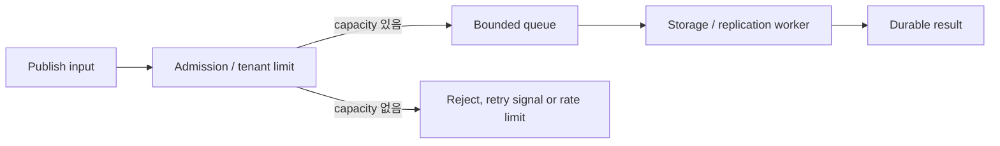
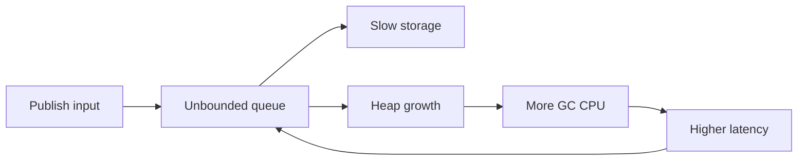

# Go 동시성과 backpressure

Goroutine은 Go runtime이 scheduling하는 경량 실행 단위다. 많은 MQTT 연결을 표현하기 쉽지만 장애 격리, queue 제한과 종료 순서를 자동으로 제공하지 않는다. Backpressure는 처리 한계를 upstream에 알려 입력 속도를 낮추는 제어다. NaruMQ의 동시성 모델은 각 goroutine의 owner, 입력 queue, cancellation, 종료 조건과 자원 한도를 명시하는 데서 시작한다.

| 항목 | 값 |
| --- | --- |
| 기준 독자 | Go 고루틴과 채널 기본 문법은 알지만 장기 연결 환경에서의 배압(Backpressure) 및 고루틴 수명주기 통제가 생소한 주니어 개발자 |
| 선수 문서 | [Broker core의 계층 경계](broker-core-boundaries.md) |
| 관련 기준 문서 | [PRD](../requirements/PRD.md) (MQTT-11~12, CLU-12, NFR-01~06), [ADR-0001: Broker core를 Go로 구현한다](../decisions/ADR-0001-core-implementation-language.md) (Accepted) |
| 대상 version·확인일 | Go 1.26 계열, 2026-08-16 |

이 문서는 layer가 아니라 한 process 안의 work ownership과 resource limit에 집중한다.

## 읽고 나면 답할 수 있는 질문

- Goroutine, queue와 owner를 함께 설계해야 하는 이유를 설명할 수 있다.
- Bounded queue가 overload를 앞에서 드러내는 흐름을 설명할 수 있다.
- Context cancellation과 goroutine 완료 대기가 다른 이유를 설명할 수 있다.
- Data race, allocation 증가와 slow consumer를 각각 어떤 도구와 metric으로 찾는지 구분할 수 있다.

## 문제 상황: storage가 느려지자 memory가 계속 늘었다

Broker가 초당 20,000개 publish를 받고 storage는 초당 15,000개만 처리한다고 하자. 초당 5,000개가 queue에 남는다. 이 상태가 60초 이어지면 payload 크기를 제외해도 300,000개 work item이 쌓인다.

무제한 queue는 overload를 해결하지 않는다. 실패를 늦추고 heap에 옮겨 놓는다. NaruMQ는 queue의 owner, 최대 크기와 가득 찼을 때의 응답을 함께 정해야 한다.

## 필수 용어와 broker의 동시 실행 단위

| 용어 | 뜻 | 확인할 질문 |
| --- | --- | --- |
| Goroutine | Go runtime이 scheduling하는 경량 실행 단위 | 누가 시작하고 누가 완료를 기다리는가? |
| Bounded queue | 최대 item 또는 byte 수가 정해진 대기열 | 가득 차면 block, reject, drop 중 무엇을 하는가? |
| Backpressure | 처리 한계를 upstream에 알려 입력 속도를 낮추는 제어 | 어느 protocol 결과나 rate limit으로 전달하는가? |
| Cancellation | 작업을 중단하라는 신호 | 신호 뒤 실제 종료를 어떤 completion으로 확인하는가? |
| Data race | 동기화 없이 같은 memory를 동시에 읽고 쓰는 상황 | State owner 또는 mutex·channel 규칙이 있는가? |
| Garbage collection(GC) | 더 이상 도달할 수 없는 heap object를 회수하는 runtime 작업 | Live heap과 allocation rate가 latency에 어떤 영향을 주는가? |

초기 설계에서 다음 역할은 서로 다른 부하와 실패 특성을 가진다.

| 역할 | 주요 작업 | 제한해야 할 자원 |
| --- | --- | --- |
| Connection reader | Socket read, packet parse, protocol validation | packet size, read deadline, parse buffer |
| Connection writer | Outbound packet serialize와 write | queue depth, write deadline, slow client 시간 |
| Session owner | QoS state와 delivery 순서 관리 | inflight, offline queue, 처리율 |
| Routing shard | Topic match와 fan-out | route 수, fan-out, work queue |
| Storage writer | WAL append와 fsync batching | batch 크기, pending bytes, I/O latency |
| Consensus apply loop | Committed entry를 순서대로 적용 | apply lag, snapshot barrier |

역할을 goroutine과 일대일로 매핑해야 한다는 뜻은 아니다. 중요한 것은 소유권과 queue 경계가 보이는 것이다.

## 정상 흐름: bounded queue로 overload를 앞에서 막는다

아래 화살표는 publish work가 ingress에서 storage로 이동하고 처리 용량이 부족할 때 결과가 upstream으로 돌아가는 runtime control flow다.

1. Admission 단계가 tenant quota, inflight와 queue capacity를 확인한다.
2. 공간이 있을 때만 bounded queue가 work ownership을 인수한다.
3. Consumer가 storage·replication을 끝내면 durable result를 반환한다.
4. 공간이 없으면 정책에 맞는 명시적 실패나 속도 제한을 upstream에 돌려준다.

## 실패 흐름: 무제한 queue가 장애를 키우는 과정

입력 속도가 처리 속도보다 빠르면 queue는 대기 시간을 숨길 뿐 부하를 없애지 않는다. Queue가 커지면 payload와 metadata가 heap에 남고 GC scan 비용과 tail latency가 증가한다. 늦게 실패하기 때문에 publisher는 이미 많은 메시지를 broker에 보낸 뒤다.

Bounded queue는 overload를 앞에서 드러낸다.

- Queue가 가득 차기 전에 publish rate를 제한한다.
- MQTT 5 reason code 또는 connection 정책으로 명시적 거부를 반환한다.
- Durable ACK는 storage·replication capacity가 있을 때만 보낸다.
- Tenant별 queue와 rate limit으로 noisy neighbor를 격리한다.

Backpressure는 drop과 다르다. 처리할 수 없다는 신호를 upstream에 전달해 입력 속도를 낮추는 것이다.

## Cancellation과 종료 순서

Go `context.Context`는 deadline과 cancellation signal을 API boundary 사이에 전달한다. Cancel 함수 호출은 작업이 실제로 끝날 때까지 기다리지 않는다. 따라서 각 loop에는 별도의 join 또는 completion 확인이 필요하다.

일반적인 종료 순서는 다음과 같다.

1. 새 입력을 차단한다.
2. Root context를 cancel한다.
3. Producer가 queue를 더 쓰지 않게 한다.
4. Consumer가 남은 작업을 정책에 따라 flush하거나 중단한다.
5. Goroutine completion을 기다린다.
6. Network, storage와 Metric exporter를 닫는다.

Channel을 누가 닫는지도 명시해야 한다. 여러 sender가 임의로 channel을 닫으면 panic이나 data race가 생길 수 있다. Context를 struct에 장기 저장하기보다 작업을 시작하는 함수에 명시적으로 전달한다.

## 공유 상태와 data race

Go memory model은 여러 goroutine이 동시에 읽고 쓰는 데이터를 channel, mutex 또는 atomic operation으로 동기화하도록 요구한다. “실제로는 동시에 실행되지 않을 것”이라는 가정은 안전한 동기화가 아니다.

NaruMQ에서 특히 주의할 상태는 다음과 같다.

- Session owner와 epoch
- Packet ID allocator와 inflight map
- Routing index와 subscription update
- Drain state와 remaining connection count
- Metrics counter가 아닌 복합 상태 snapshot

`go test -race`는 실행된 code path에서 발생한 race만 찾는다. 따라서 unit test뿐 아니라 reconnect, takeover, drain과 failure workload에도 race detector를 적용해야 한다. Race build는 CGO와 지원 compiler가 필요할 수 있지만 production binary가 CGO를 사용해야 한다는 뜻은 아니다.

## Allocation과 GC

Go GC의 비용은 주로 live heap 크기, allocation rate와 scan해야 하는 pointer 수에 영향을 받는다. MQTT broker에서는 작은 allocation도 연결 수와 메시지율에 곱해진다.

측정할 항목:

- Connection·session당 live heap
- Packet당 allocated bytes와 allocation count
- Payload copy 횟수
- GC CPU와 pause
- Queue depth와 oldest message age
- p99·p99.9 publish-to-delivery latency

GC tuning부터 시작하지 않는다. CPU, heap과 allocation profile로 병목을 확인한 뒤 buffer reuse, batching과 자료 구조 변경을 적용한다. `GOGC`와 memory limit은 CPU와 memory 사이의 trade-off를 바꾸지만 무제한 queue를 고치지는 못한다.

## 진단과 검증 도구

| 도구 | 찾는 문제 | 주의점 |
| --- | --- | --- |
| `go test -race` | 실제 실행에서 발생한 data race | 실행되지 않은 경로는 검사하지 못한다. |
| Fuzzing | Parser와 state machine의 예상하지 못한 입력 | Seed corpus와 invariant가 필요하다. |
| CPU profile | CPU를 많이 쓰는 code path | 짧은 표본은 왜곡될 수 있다. |
| Heap profile | Live object와 allocation hot spot | RSS 전체와 같지 않다. |
| Goroutine profile | Blocked·누수 의심 goroutine | 순간 snapshot이므로 반복 비교가 필요하다. |
| Block profile | Channel·mutex 등에서 대기한 위치 | 계측 자체의 비용이 있다. |
| Mutex profile | Lock contention | 기본 활성화가 아니며 표본율을 정해야 한다. |
| Runtime trace | Scheduler, GC와 goroutine 상호작용 | 다른 profiler와 동시 사용하면 결과에 영향을 줄 수 있다. |

Profile은 원인을 찾는 도구다. SLO 통과 여부는 실제 EMQX와 같은 조건의 반복 benchmark와 failure test로 판단한다.

## 자주 하는 오해와 trade-off

- Queue를 너무 작게 잡으면 짧은 burst도 거부한다.
- Queue를 너무 크게 잡으면 overload 발견이 늦어진다.
- Lock을 없애기 위해 state ownership을 지나치게 잘게 나누면 cross-shard coordination이 늘어난다.
- Batching은 throughput을 높일 수 있지만 ACK latency를 늘린다.
- Zero-copy는 allocation을 줄일 수 있지만 buffer lifetime과 ownership 결함을 만들 수 있다.

값은 추정으로 고정하지 않는다. Phase 0 benchmark에서 connection 규모, payload 분포와 storage latency를 재현해 정한다.

## NaruMQ에서 찾을 위치

제품 계약은 [PRD](../requirements/PRD.md)의 MQTT-11~12, CLU-12, NFR-01~06과 TEST-13~16을 따른다. Go 선택과 검증 gate는 [ADR-0001: Broker core를 Go로 구현한다](../decisions/ADR-0001-core-implementation-language.md) (Accepted)을 기준으로 한다. 목표 component는 [Broker core architecture](../architectures/broker-core.md), source 작성 규칙은 [Go coding conventions](../conventions/go-coding-conventions.md), 계층 원리는 [Broker core의 계층 경계](broker-core-boundaries.md)를 참고한다.

Buffer의 copy·borrow·transfer 규칙은 [Go buffer ownership와 zero-copy](go-buffer-ownership-and-zero-copy.md), clock과 scheduler 의존성을 줄이는 test 방법은 [결정적 test와 failure injection](deterministic-testing-and-failure-injection.md)에서 이어서 설명한다.

## 확인 질문

1. 초당 입력 20,000개, 처리 15,000개가 60초 이어질 때 queue에는 몇 개가 추가로 남는가?
2. Root context를 cancel한 직후 network와 storage를 닫으면 어떤 goroutine 문제가 생길 수 있는가?
3. Slow client 하나가 writer queue를 채울 때 다른 tenant까지 영향을 받지 않게 하려면 어느 경계를 제한해야 하는가?
4. `go test -race`가 통과해도 실행하지 않은 reconnect 경로의 race가 없다고 말할 수 없는 이유는 무엇인가?

## 참고 자료

- [Go `context` package](https://pkg.go.dev/context)
- [The Go Memory Model](https://go.dev/ref/mem)
- [Go Data Race Detector](https://go.dev/doc/articles/race_detector)
- [Go Fuzzing](https://go.dev/doc/security/fuzz/)
- [Go Diagnostics](https://go.dev/doc/diagnostics)
- [A Guide to the Go Garbage Collector](https://go.dev/doc/gc-guide)
- [ADR-0001: NaruMQ broker core를 Go로 구현한다](../decisions/ADR-0001-core-implementation-language.md)
