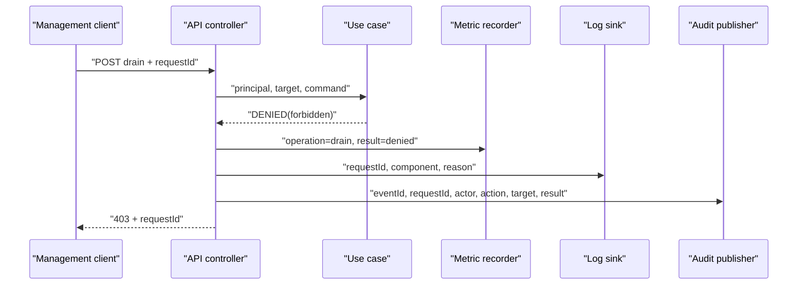

# Metric, log와 audit event의 역할

Metric은 많은 실행 결과를 숫자로 집계해 시스템의 추세와 이상을 찾는 신호다. Log는 한 실행에서 무슨 일이 일어났는지 진단하는 기록이고, audit event는 누가 어떤 보호 대상에 어떤 행위를 시도해 어떤 결과가 났는지를 추적하는 보안 기록이다. 같은 관리 요청에서 세 신호를 함께 만들 수 있지만 목적, 보존 정책과 허용 field가 다르므로 서로 대신할 수 없다.

| 항목 | 값 |
| --- | --- |
| 기준 독자 | 로깅과 모니터링 기초는 알지만 메트릭 라벨 카디널리티 폭발과 감사 이벤트의 비가역적 보안 요구사항이 생소한 주니어 개발자 |
| 선수 문서 | 없음 |
| 관련 기준 문서 | [PRD](../requirements/PRD.md) (API-01~09, SEC-11, NFR-16~17), [Management API와 observability 스펙](../specs/management-api-and-observability.md), [Audit event v1 Contract](../contracts/audit-event-v1.md) |
| 대상 version·확인일 | Draft 0.5 |

## 읽고 나면 답할 수 있는 질문

- 같은 관리 API 요청에서 metric, log와 audit event가 각각 무엇을 기록하는지 설명할 수 있다.
- metric label에 `clientId`나 `requestId`를 넣으면 왜 위험한지 작은 계산으로 설명할 수 있다.
- `requestId`와 `eventId`의 역할, audit 중복을 처리하는 주체를 구분할 수 있다.
- 관측 신호의 sink가 실패했을 때 남는 상태와 필요한 가시성을 설명할 수 있다.

## 문제 상황: drain 요청이 권한 검사에서 거절됐다

운영자가 `POST /api/v1/nodes/node-2/drain`을 호출했지만 `Operator` 권한이 없어 `403`을 받았다고 하자. 운영 대시보드는 거절률 증가를 알아야 하고, 개발자는 특정 요청의 판정 이유를 찾아야 하며, 보안 관리자는 누가 어느 node에 drain을 시도했는지 확인해야 한다.

하나의 거대한 log line에 모든 정보를 넣는 것만으로는 세 요구를 만족하지 못한다. 집계를 위해 log 전체를 비싼 질의로 반복해서 읽어야 하고, 진단용 세부 정보가 감사 저장소에 과도하게 남으며, 민감한 identity가 metric label로 유출될 수 있다.

## 필수 용어

| 용어 | 뜻 | owner와 lifetime |
| --- | --- | --- |
| Metric | 측정값을 counter, gauge, histogram 같은 숫자 시계열로 집계한 신호 | recorder가 생성하고 monitoring backend가 보존한다. 개별 요청 본문은 저장하지 않는다. |
| Counter | 재시작 전까지 누적 증가하는 값 | process가 증가시키고 조회 계층이 `rate`나 `increase`로 해석한다. |
| Gauge | 현재 상태처럼 오르내릴 수 있는 값 | 현재 상태의 owner가 갱신한다. 합계가 의미 있는 값만 node 간 합산한다. |
| Histogram | 관측값을 미리 정한 bucket에 누적하는 metric | recorder가 bucket counter를 갱신하고 backend가 분포와 quantile을 계산한다. |
| Structured log | field 이름이 고정된 진단 event | component가 생성하고 log backend가 운영 보존 정책에 따라 제거한다. |
| Audit event | actor, action, target과 result를 담는 append-only 보안 event | broker 또는 rollout controller가 생성하고 audit store가 보존한다. |
| Cardinality | 한 metric 이름에서 생성될 수 있는 서로 다른 label 조합 수 | label 값의 조합이 늘 때마다 시계열 수도 늘어난다. |
| `requestId` | 한 HTTP 요청과 그 요청에서 나온 response·log·audit를 연결하는 불투명 ID | API 경계에서 수신하거나 생성하며 요청 추적 기간 동안 유지한다. |
| `eventId` | audit event 하나를 식별하는 전역 고유 ID | producer가 event 생성 시 만들고 consumer가 중복 제거에 사용한다. |

## 정상 흐름

아래 화살표는 한 관리 요청이 실행될 때 생기는 runtime call과 관측 data flow를 뜻한다.



### 1. Metric은 질문에 답할 만큼만 분류한다

예를 들어 다음 counter는 “최근 drain 요청 중 거절 비율이 증가했는가?”에 답할 수 있다.

```text
narumq_management_requests_total{operation="drain",result="denied",reason="forbidden"} 17
```

`operation` 5개, `result/reason` 조합 4개, node 3개가 모두 조합된다고 단순 가정하면 최대 `5 × 4 × 3 = 60`개 시계열이다. 여기에 원문 `clientId` 100만 개를 label로 추가하면 이론상 조합이 최대 6천만 개까지 커질 수 있다. 실제 조합 수는 traffic에 따라 다르지만, 요청마다 거의 고유한 label은 memory와 저장 비용을 예측하기 어렵게 만든다.

따라서 원문 `clientId`, username, IP, 임의 topic, `requestId`와 token claim은 기본 metric label에 넣지 않는다. 개별 요청은 log와 audit에서 찾고 metric은 제한된 상태 집계에 집중한다.

### 2. Log는 진단에 필요한 실행 맥락을 남긴다

구조화 log는 `requestId`, component, 안정된 error code와 node 같은 정보를 담을 수 있다. Stack trace와 내부 원인은 진단에 필요할 때 제한적으로 기록하되 password, bearer token, session cookie, MQTT payload와 원문 secret은 기록하지 않는다.

Log의 목적은 구현 문제를 찾는 것이다. Actor의 법적·보안상 행위 이력을 보장하는 append-only 기록으로 취급하지 않는다.

### 3. Audit event는 보안 행위의 결과를 남긴다

NaruMQ의 `narumq-audit-event` v1은 한 actor가 한 target에 action을 시도한 결과 하나를 나타낸다. Mutation 성공뿐 아니라 권한 거절과 policy 변경 실패도 대상이다.

- `eventId`: 최소 한 번 전달에서 생긴 중복을 consumer가 제거하는 key
- `requestId`: API response와 구조화 log를 연결하는 key
- `result`: `ALLOWED`, `DENIED`, `FAILED` 중 하나
- `reason`: machine-readable한 안정된 판정 code

Audit consumer는 모르는 `action`과 `reason`도 버리지 않고 저장해야 한다. 전역 순서는 보장하지 않으므로 같은 요청의 event도 `occurredAt`과 `eventId`를 이용해 해석한다.

## 실패 흐름

| 실패 위치 | 남는 상태 | retry와 처리 원칙 |
| --- | --- | --- |
| Metric scrape/export 실패 | broker의 현재 counter는 남을 수 있지만 backend 구간 data가 비거나 늦어진다. | broker 요청을 재실행하지 않는다. scrape/export 자체를 재시도하고 신호 공백을 alert한다. |
| Log sink 지연·실패 | bounded buffer에 일부 log가 남거나 overflow로 유실될 수 있다. | 요청 결과와 log 전송을 혼동하지 않는다. drop 수와 buffer 포화를 별도 metric으로 드러낸다. |
| Audit sink가 ACK 전에 timeout | producer buffer 또는 retry queue에 event가 남을 수 있다. | 같은 `eventId`로 재전송하고 consumer가 중복 제거한다. 새 ID로 만들면 같은 행위가 별개 event처럼 보인다. |
| Audit event schema 검증 실패 | 정상 audit stream에는 쓰지 않는다. | 별도 오류 경로와 metric으로 보내고 secret을 포함하지 않은 원인을 조사한다. |

Audit sink 장애가 management mutation 자체를 실패시킬지는 아직 security operation policy의 미결정 사항이다. 어느 정책을 택해도 event loss와 buffer overflow를 숨겨서는 안 된다는 점은 [Audit event v1 Contract](../contracts/audit-event-v1.md)에 정의돼 있다.

## 자주 하는 오해와 trade-off

- **“Log가 자세하면 audit은 필요 없다.”** Log는 변경되거나 운영 보존 기간이 짧을 수 있다. Audit은 actor와 보호 대상의 행위를 append-only 형식으로 추적하는 별도 계약이다.
- **“Metric label이 많을수록 분석하기 쉽다.”** 개별 identity를 label로 넣으면 cardinality와 정보 노출 위험이 함께 커진다. 먼저 집계할 질문을 정하고 제한된 값만 사용한다.
- **“`requestId`가 audit 중복 제거 key다.”** 한 요청에서 audit event가 여러 개 나올 수 있다. 중복 제거는 event마다 고유한 `eventId`를 사용한다.
- **“세 신호가 같은 기간 보존돼야 한다.”** 진단, 운영 추세와 보안 증거의 보존 목적이 다르다. 기간과 접근 권한을 신호별로 정해야 한다.
- **“Trace도 이미 NaruMQ 계약이다.”** OpenTelemetry는 trace를 공식 관측 신호로 설명하지만 현재 NaruMQ 요구사항은 metric, log와 audit을 중심으로 한다. Trace 도입은 별도 요구와 contract가 필요하다.

## NaruMQ에서 찾을 위치

| 관심사 | 기준 문서 또는 Target 위치 |
| --- | --- |
| Metric 종류, 집계와 금지 label | [Management API와 observability 스펙](../specs/management-api-and-observability.md) 7절 |
| Audit payload, 중복과 개인정보 | [Audit event v1 Contract](../contracts/audit-event-v1.md) |
| 접근 경계와 masking | [Security boundaries](../architectures/security-boundaries.md) |
| Metric·audit outbound port | [Project structure](../architectures/project-structure.md)의 `MetricRecorder`, `AuditPublisher` Target capability |
| 요구사항 | API-07~09, SEC-11, NFR-16~17 |

구현 type과 package는 아직 Target이다. Application use case가 구체적인 Prometheus client나 SIEM(Security Information and Event Management) SDK에 직접 의존하지 않고 outbound port를 호출하는 구조를 따른다.

## 확인 질문

1. Drain 거절 한 건에서 metric, log와 audit event에 각각 어떤 field를 넣고 무엇을 제외해야 하는가?
2. `requestId`를 metric label로 쓰지 않고도 dashboard에서 오류 증가 후 특정 요청을 찾는 흐름을 설명해 보라.
3. Audit publisher가 같은 event를 두 번 전송했을 때 어느 ID로 어느 component가 중복을 제거해야 하는가?
4. Audit sink 장애 시 mutation을 허용할지 거절할지는 왜 이 해설이 아니라 policy 결정에 남겨야 하는가?

## 참고 자료

- [Prometheus metric and label naming](https://prometheus.io/docs/practices/naming/)
- [Prometheus instrumentation practices](https://prometheus.io/docs/practices/instrumentation/)
- [OpenTelemetry signals](https://opentelemetry.io/docs/concepts/signals/)
- [OpenTelemetry logs data model](https://opentelemetry.io/docs/specs/otel/logs/)

