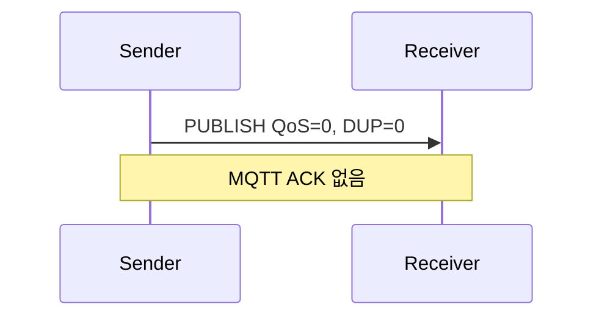
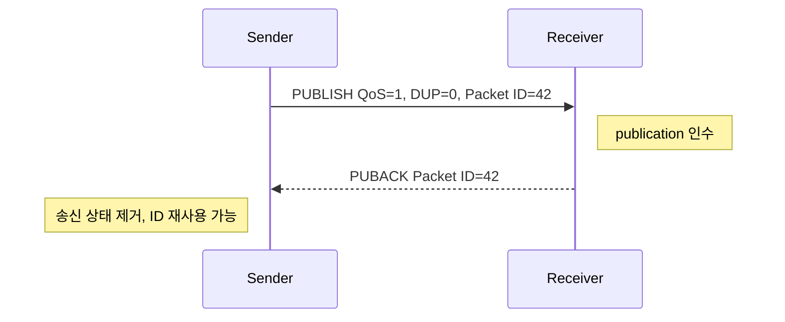
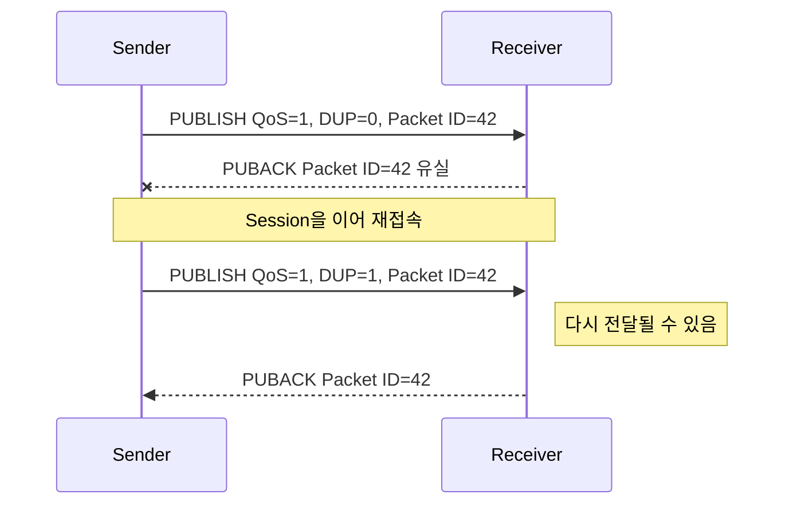
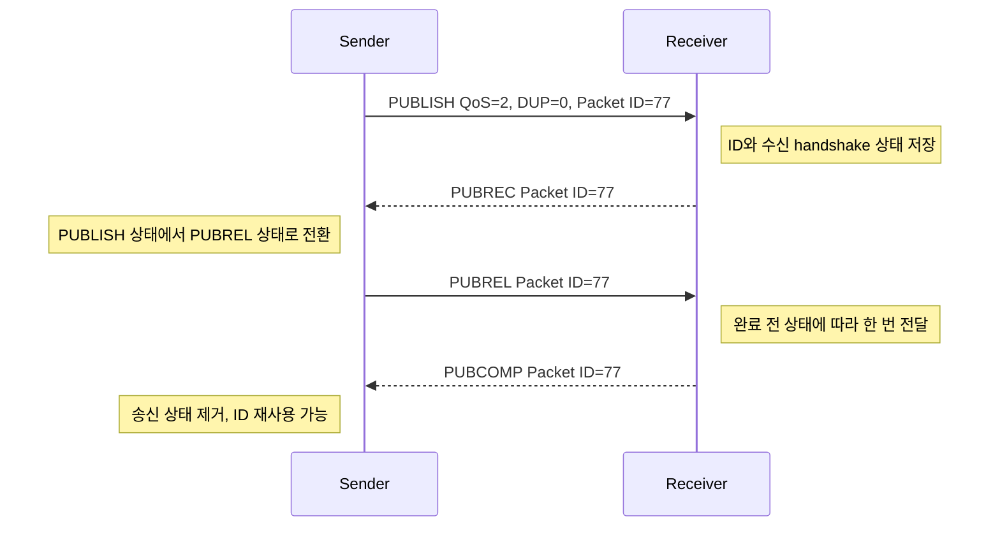
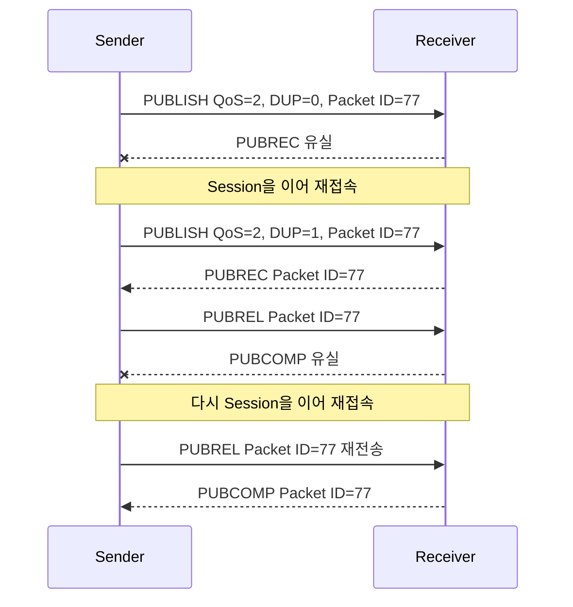
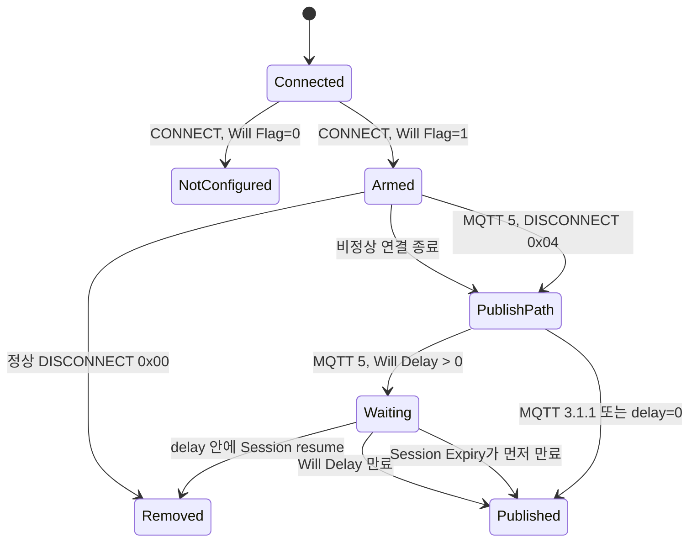

# MQTT 전달 보장과 QoS·Session·Will protocol 흐름

MQTT의 QoS는 한 sender와 receiver 사이의 한 protocol hop을 보장한다. `PUBACK`을 받았다는 사실은 publisher와 broker 사이의 인수가 끝났다는 뜻이지, subscriber application의 DB transaction까지 끝났다는 뜻은 아니다. 이 문서는 QoS packet handshake, Session 복구, Will 발행, NaruMQ durable ACK의 경계를 한 흐름으로 설명한다.

| 항목 | 값 |
| --- | --- |
| 기준 독자 | Go 문법과 HTTP/TCP 기초는 알지만 MQTT broker, Session, 분산 저장소가 생소한 주니어 개발자 |
| 선수 문서 | [MQTT의 역사와 버전 진화: MQIsdp부터 MQTT 5.0까지](mqtt-history-and-version-evolution.md) |
| 관련 기준 문서 | [PRD](../requirements/PRD.md), [MQTT protocol과 session spec](../specs/mqtt-protocol-and-session.md), [Cluster session spec](../specs/cluster-session-and-delivery.md) |
| 대상 version·확인일 | MQTT 3.1.1 / MQTT 5.0, 2026-09-19 |

## 1. 한눈에 보는 답

- QoS는 publisher→broker와 broker→subscriber 각각의 hop에 적용된다. 두 hop의 QoS, Packet Identifier와 완료 시점은 서로 독립적이다.
- QoS 1은 `PUBLISH → PUBACK`이고 중복될 수 있다. QoS 2는 `PUBLISH → PUBREC → PUBREL → PUBCOMP`이며 protocol receiver가 handshake 상태를 보존할 때 중복 전달을 막는다.
- Session Expiry가 살아 있어야 끊긴 연결 뒤 미완료 QoS 상태를 재개할 수 있다. Session이 만료되면 이전 Packet Identifier만으로 exchange를 이어갈 수 없다.
- NaruMQ의 quorum durable ACK는 MQTT 표준의 hop 보장 위에 추가되는 broker 내구성 조건이다. 최종 application DB의 exactly-once는 별도 책임이다.

## 2. 읽고 나면 답할 수 있는 질문

- QoS 1의 `PUBACK`과 QoS 2의 `PUBREC`·`PUBCOMP`가 각각 어느 상태의 소유권을 확인하는가?
- ACK 또는 connection이 유실됐을 때 sender가 `PUBLISH`와 `PUBREL` 중 무엇을 재전송하는가?
- Clean Start와 Session Expiry가 Session Present와 미완료 handshake 복구에 어떤 영향을 주는가?
- MQTT ACK, NaruMQ quorum durability, subscriber DB transaction이 왜 서로 다른 완료 경계인가?

## 3. 문제 상황: PUBACK을 받았는데 DB에는 없다

Publisher가 QoS 1 주문 event를 보내고 `PUBACK`을 받았지만, 잠시 뒤 subscriber DB에 주문이 없다고 하자. 이 상황을 MQTT가 메시지를 잃었다고 바로 해석하면 안 된다.

메시지는 적어도 두 개의 독립된 hop을 지난다.


Hop 1의 성공 `PUBACK`은 broker가 publisher의 메시지를 해당 hop에서 인수했다는 뜻이다. Hop 2의 전달, subscriber의 ACK, DB transaction과 quorum 복제는 각각 별도 경계다. 먼저 각 상태의 owner와 완료 신호를 나눠야 한다.

## 4. 필수 용어

| 용어 | 뜻 | 상태 owner와 수명 |
| --- | --- | --- |
| QoS | 한 sender와 receiver 사이의 `PUBLISH` 전달·확인 수준 | 각 hop의 sender와 receiver가 독립적으로 관리한다. |
| Hop | 직접 packet을 주고받는 한 구간 | publisher↔broker와 broker↔subscriber는 서로 다른 exchange다. |
| ACK | 다음 protocol 단계나 인수를 알리는 packet | QoS 1은 `PUBACK`, QoS 2는 `PUBREC`·`PUBREL`·`PUBCOMP`를 사용한다. |
| Inflight state | ACK를 기다리는 미완료 packet과 handshake 단계 | exchange 시작 때 생성하고 최종 ACK 뒤 제거한다. |
| Packet Identifier | 한 Session의 한 방향 QoS 1·2 exchange를 구분하는 0이 아닌 번호 | sender가 배정하고 exchange가 끝난 뒤 재사용한다. 전역 message ID가 아니다. |
| `DUP` | `PUBLISH`가 이전 전송의 재전송일 수 있음을 표시하는 flag | sender가 재전송 때 설정한다. 중복 도착을 확정하는 flag는 아니다. |
| Session | connection이 끝난 뒤에도 이어질 수 있는 client별 protocol 상태 | broker와 client가 각자 필요한 절반을 보존한다. |
| Session Expiry | MQTT 5에서 disconnect 뒤 Session을 유지할 시간 | disconnect 시 deadline을 만들고 만료 시 Session state를 제거한다. |
| Durable | process나 node 재시작 뒤 복구할 수 있게 안정적으로 저장된 상태 | NaruMQ storage와 replica가 보존한다. |
| Idempotent | 같은 입력을 여러 번 처리해도 결과가 한 번 처리한 것과 같은 성질 | 최종 subscriber application이 보장한다. |
| Will | 비정상 종료 때 broker가 client 대신 발행하도록 `CONNECT`에 등록한 publication | 정상 종료·재접속·Will Delay·Session 종료 조건에 따라 제거 또는 발행한다. |

## 5. 정상 흐름

### 5.1 QoS가 보장하는 범위

| QoS | 단일 hop의 의미 | 재전송과 중복 |
| --- | --- | --- |
| 0 | 최대 한 번 전달한다. 도착하지 않을 수 있다. | protocol 재전송과 ACK가 없다. |
| 1 | receiver가 메시지 소유권을 인수하면 최소 한 번 전달한다. | ACK 손실이나 재접속으로 중복될 수 있다. |
| 2 | 한 protocol receiver에게 네 단계 handshake로 전달한다. | 양쪽이 handshake 상태를 보존해야 중복을 막는다. |

Broker가 subscriber에게 전달할 때는 publisher QoS와 granted subscription QoS 중 낮은 수준을 적용할 수 있다. 따라서 QoS 2 publish가 subscriber에게 QoS 1로 전달될 수 있다.

### 5.2 PUBLISH에서 함께 보는 값

| 값 | 역할 | 주의점 |
| --- | --- | --- |
| QoS | 이 hop이 사용할 handshake 수준 | `0`, `1`, `2` 중 하나다. |
| `DUP` | 이 `PUBLISH`가 이전 전송의 재전송일 수 있음을 표시 | QoS 0에서는 `0`이어야 한다. `1`이라고 receiver가 반드시 이전 packet을 받았다는 뜻은 아니다. |
| `RETAIN` | Broker가 이 publication을 topic의 retained state로 저장할지 표시 | Will의 `Will Retain`도 실제 발행 시 이 의미가 된다. |
| Packet Identifier | QoS 1·2 exchange를 ACK와 연결 | 현재 사용 중이지 않은 0이 아닌 값이어야 한다. QoS 0 `PUBLISH`에는 없다. |

Packet Identifier는 전역 message ID가 아니다. 한 Session의 한 방향에서 진행 중인 exchange를 구분하는 짧은 수명 식별자다. QoS 1은 대응하는 `PUBACK`을 받은 뒤, QoS 2는 `PUBCOMP`를 받은 뒤 재사용할 수 있다. MQTT 5에서 실패 reason을 담은 `PUBACK` 또는 `PUBREC`을 받은 경우에도 그 exchange가 종료되면 재사용할 수 있다.

Broker가 메시지를 subscriber에게 새로 보낼 때는 inbound Packet Identifier를 복사하지 않고 outbound exchange에 맞는 식별자를 별도로 배정한다. `DUP`도 broker가 outbound hop의 재전송 여부로 새로 결정한다.

### 5.2.1 Message Expiry: wire interval을 absolute deadline으로 바꾸기

MQTT 5 PUBLISH의 Message Expiry Interval은 “지금부터 몇 초”라는 입력이다.
브로커는 packet을 받은 순간 `T0`를 한 번 잡고 `deadline = T0 + interval`을
계산해야 한다. NaruMQ는 [`mqtt.Publish` codec](../../internal/domain/mqtt/publish.go)에서
property를 검증하고, [`publish.UseCase.Publish`](../../internal/application/publish/publish.go)
에서 이 deadline을 `deliveryqueue.DeliveryDTO.ExpiresAt`와 retained DTO에 복사한다.
QoS 2는 PUBLISH와 PUBREL이 다른 시점에 도착해도 첫 PUBLISH의 `T0`를 유지한다.

```text
T0       수신: Message Expiry Interval = 10
T0+3 sec  전달 준비: deadline = T0+10, 남은 시간 = 7 sec
T0+10 sec 경계: now >= deadline 이므로 queue·retained에서 제거하고 전달하지 않음
```

남은 초는 버림이 아니라 올림으로 계산한다. 예를 들어 6.1초가 남으면 MQTT 5
outbound PUBLISH에는 `7`을 넣는다. MQTT 3.1.1 wire에는 Message Expiry property가
없으므로 property를 쓰지 않지만, MQTT 5에서 온 publication의 `ExpiresAt` 판정은
그대로 적용한다. 즉 version 차이는 metadata 표현 차이이지 만료 정책의 우회가 아니다.
관련 경계는 [`Queue`](../../internal/application/ports/deliveryqueue/queue.go),
[`writeDeliveries`](../../internal/adapters/tcp/server.go), 그리고 실제 loopback의
[`TestMQTTIngressMessageExpiry`](../../tests/integration/mqtt_ingress_test.go)에서 확인한다.


### 5.3 QoS 0: PUBLISH 한 번



Sender는 packet을 transport에 넘긴 뒤 MQTT 완료 응답을 기다리지 않는다. 연결이 전송 중 끊기면 도착 여부를 protocol만으로 확인하거나 재개할 Packet Identifier가 없으므로 손실될 수 있다.

### 5.4 QoS 1: PUBLISH와 PUBACK



1. Sender가 사용하지 않는 Packet Identifier를 배정한다.
2. `PUBACK`을 받을 때까지 payload와 identifier를 inflight state로 보관한다.
3. Receiver가 인수하면 같은 identifier로 `PUBACK`을 보낸다.
4. Sender가 `PUBACK`을 받으면 exchange를 완료하고 상태를 제거한다.

#### 5.4.1 PUBACK이 유실된 경우



Sender는 ACK를 보지 못했으므로 Session을 이어갈 때 같은 exchange를 재전송한다. 재전송 `PUBLISH`는 같은 Packet Identifier를 사용하고 `DUP=1`로 표시한다. Receiver는 첫 publication을 이미 처리했더라도 다시 받을 수 있으므로 QoS 1은 최소 한 번 전달이며 중복이 가능하다.

`DUP=1`은 중복 확정 표시가 아니다. 첫 전송이 receiver에 도달하지 않았을 수도 있다. 반대로 `DUP=0` packet도 network 밖의 application 재발행 때문에 business message가 중복일 수 있다. End-to-end 중복 제거에는 Packet Identifier가 아니라 application message ID가 필요하다.


### 5.5 QoS 2: 네 단계 handshake



Sender는 `PUBREC` 전에는 payload와 `PUBLISH` 재전송 정보를 보관하고, 성공 `PUBREC` 뒤에는 `PUBREL` 미완료 상태만 보관한다. Receiver도 같은 identifier의 중복 `PUBLISH`와 `PUBREL`을 다시 처리하지 않도록 상태를 유지한다.

Receiver가 `PUBREC`이나 `PUBCOMP` 전에 onward delivery를 끝내도록 요구되는 것은 아니다. 어느 시점을 택하든 중복 `PUBLISH`나 `PUBREL` 때문에 같은 publication을 두 번 전달해서는 안 되며, 그 선택과 완료 state를 Session에 일관되게 보존해야 한다.

#### 5.5.1 packet 유실과 재개



- `PUBREC` 전에는 sender가 같은 Packet Identifier의 `PUBLISH`를 `DUP=1`로 다시 보낸다.
- 성공 `PUBREC` 뒤에는 `PUBLISH`로 되돌아가지 않고 `PUBREL`을 보낸다.
- `PUBCOMP`를 받지 못하면 같은 Packet Identifier의 `PUBREL`을 다시 보낸다. `DUP`는 `PUBLISH` header의 flag이므로 `PUBREL` 재전송에 별도의 `DUP` 값을 붙이지 않는다.
- Receiver는 중복 packet에 맞는 ACK를 다시 보내면서도 publication을 다시 onward delivery하지 않도록 상태를 보존한다.

MQTT 표준이 정의하는 미완료 exchange 재전송의 핵심 시점은 기존 Session을 이어 재접속할 때다. 임의의 새 Packet Identifier로 두 번째 exchange를 만들면 원래 handshake와 다른 publication이 되어 중복 방지 근거를 잃는다.

### 5.6 세 QoS의 상태와 비용 비교

| 항목 | QoS 0 | QoS 1 | QoS 2 |
| --- | --- | --- | --- |
| Packet 흐름 | `PUBLISH` | `PUBLISH → PUBACK` | `PUBLISH → PUBREC → PUBREL → PUBCOMP` |
| Packet Identifier | 없음 | 있음 | 있음 |
| Sender 완료 상태 | 없음 | `PUBACK`까지 | `PUBCOMP`까지 |
| Receiver protocol 상태 | ACK용 장기 상태 없음 | 중복 전달 허용, ACK 반환 | 중복 없는 전달을 위해 handshake 상태 필요 |
| 단일 hop 결과 | 최대 한 번 | 최소 한 번 | protocol receiver에 중복 없이 한 번 |
| 비용 | 가장 낮음 | ACK round trip과 inflight 저장 | 두 번의 왕복과 양쪽 상태 저장 |

MQTT 5의 `Receive Maximum`은 현재 Network Connection에서 아직 `PUBACK`, `PUBCOMP` 또는 실패 `PUBREC`(Reason Code `0x80` 이상)를 받지 않은 QoS 1·2 `PUBLISH` 수를 제한한다. 상대가 광고한 수를 넘겨 새 QoS 1·2 publication을 보내면 안 된다. QoS 0은 이 protocol credit의 대상은 아니지만 구현의 memory·socket backpressure 제한은 여전히 적용된다. 이 quota는 Session state가 아니라 현재 connection에 속한다.


### 5.7 Session과 Session Expiry

QoS handshake가 TCP connection보다 오래 살려면 Session이 이어져야 한다.

- MQTT 3.1.1은 같은 Client ID와 `Clean Session=0`으로 persistent Session을 유지한다.
- MQTT 5는 같은 Client ID, `Clean Start=0`, 만료되지 않은 Session Expiry와 `Session Present`를 사용한다.
- MQTT 5 `Session Expiry Interval=0`은 disconnect 시 Session을 즉시 제거한다.
- finite interval은 disconnect 시점에 `disconnect time + interval` deadline을 만들고 `now >= deadline`에서 만료한다.
- `0xFFFFFFFF`는 무기한 유지한다.
- Session state에는 구독, 미완료 QoS 상태, offline queue, Will과 expiry 정보가 포함될 수 있다.

Retained Message는 client Session이 아니라 topic에 붙는 broker state이므로 Session 만료와 함께 자동으로 같은 수명으로 삭제된다고 가정하면 안 된다.

### 5.8 Will 등록과 발행



Will은 별도 packet type이 아니다. `CONNECT`에서 등록하고, 정상 `DISCONNECT`면 제거하며, 비정상 종료 조건이면 일반 `PUBLISH` 경로로 발행한다. MQTT 5에서는 Will Delay와 Session Expiry 중 빠른 시점이 발행 판단에 영향을 준다.

#### 5.8.1 Will 설정 값

| CONNECT 설정 | 의미 |
| --- | --- |
| Will Flag | `1`이면 Will Topic과 Will Payload가 존재한다. |
| Will QoS | Will이 실제로 발행될 때 사용할 QoS다. |
| Will Retain | 발행된 Will을 retained message로도 저장할지 정한다. |
| Will Delay Interval | MQTT 5 전용. 연결 종료 뒤 발행을 기다릴 초 단위 시간이며 기본값은 `0`이다. |
| Will properties | MQTT 5의 Payload Format, Message Expiry, Content Type, Response Topic, Correlation Data, User Property 등 publication metadata다. |

Will QoS 1·2는 “Will을 발행할지” 결정하는 수준이 아니라 발행이 시작된 뒤 각 subscriber hop에서 적용할 전달 수준이다. Subscription의 granted QoS가 더 낮으면 실제 outbound QoS도 낮아질 수 있다.


## 6. 실패 흐름: 남는 상태와 retry

### 6.1 ACK 또는 connection 유실

| 끊기기 전 sender 상태 | Session resume 뒤 재전송 | 남겨야 할 receiver 상태 |
| --- | --- | --- |
| QoS 0 전송 중 | MQTT exchange를 재개하지 않는다. | 장기 ACK 상태가 없다. |
| QoS 1 `WAIT_PUBACK` | 같은 identifier의 `PUBLISH`, `DUP=1` | 중복을 받을 수 있고 `PUBACK`을 다시 보낸다. |
| QoS 2 `WAIT_PUBREC` | 같은 identifier의 `PUBLISH`, `DUP=1` | 이미 받은 ID면 중복 전달 없이 `PUBREC`을 다시 보낸다. |
| QoS 2 `WAIT_PUBCOMP` | 같은 identifier의 `PUBREL` | 완료 전·후 상태에 맞춰 `PUBCOMP`을 다시 보낸다. |

`PUBREC`을 받은 뒤에는 `PUBLISH`로 되돌아가지 않고 `PUBREL`을 보낸다. `DUP`는 `PUBLISH` fixed header의 flag이므로 `PUBREL` 재전송에는 별도 DUP flag가 없다. Sender와 receiver 모두 마지막 완료 단계의 state를 보존해야 retry가 같은 exchange를 이어간다.

새 Session이 시작됐거나 기존 Session이 만료됐다면 이전 identifier만으로 handshake를 계속할 근거가 없다. Application이 다시 발행한다면 새 business 시도로 보고 application message ID로 중복을 제어한다.

### 6.2 Session과 Will의 만료

Session Expiry가 Will Delay보다 먼저 끝나면 MQTT 5는 더 이른 Session 종료 시점에 Will을 처리할 수 있다. 반대로 Will Delay 안에 동일 Session을 실제로 resume하면 대기 중인 Will을 제거할 수 있다. 단순히 같은 Client ID로 빨리 연결했다는 사실만으로 Will 억제를 보장할 수 없다.

Session Expiry가 `0`이면 offline queue와 미완료 handshake를 복구할 수 있다고 기대하면 안 된다. Message Expiry가 먼저 끝나면 Session은 살아 있어도 해당 메시지는 제거될 수 있다.

#### 6.2.1 MQTT 5의 두 타이머

비정상 종료 뒤 MQTT 5 Will은 다음 두 시점 중 빠른 때 발행된다.

1. `disconnect time + Will Delay Interval`
2. `disconnect time + Session Expiry Interval`

따라서 발행 예정 시점은 유효한 두 interval의 최솟값으로 이해할 수 있다. Session Expiry가 `0`이면 두 번째 시점이 disconnect 직후가 된다. 무기한 Session Expiry라면 Will Delay가 발행 시점을 결정한다. 정상 `DISCONNECT`는 타이머 계산 전에 Will을 제거한다.

반대로 만료되지 않은 기존 Session을 같은 Client ID로 Will Delay 안에 실제로 resume하면 broker는 대기 중인 Will을 제거하고 발행하지 않는다. 새 연결이 이전 Session을 이어받지 않고 `Clean Start=1`로 교체하면 이전 Session이 끝날 수 있으므로 단순히 “같은 Client ID로 빨리 접속했다”는 사실만으로 Will 억제를 보장할 수 없다.

MQTT 3.1.1에는 Will Delay가 없다. Broker가 비정상 종료를 감지하면 Will을 발행하고, client의 정상 `DISCONNECT`를 받았을 때만 저장한 Will을 버린다.

#### 6.2.2 대표 상황 판정

| 상황 | 결과 | 이유 |
| --- | --- | --- |
| Client가 정상 `DISCONNECT`를 보냄 | 발행하지 않음 | Will을 제거하는 명시적 정상 종료다. |
| MQTT 5 client가 `DISCONNECT 0x04`를 보냄 | Will 발행 경로 | client가 Will 발행을 명시적으로 요청한다. |
| Network 단절 또는 Keep Alive timeout | 발행 경로 | 정상 `DISCONNECT`를 받지 못했다. |
| MQTT 5, delay 안에 기존 Session 재연결 | 발행하지 않음 | 대기 중인 Will을 제거한다. |
| MQTT 5, Will Delay보다 Session Expiry가 먼저 끝남 | Session 종료 시 발행 | 두 시점 중 빠른 시점을 사용한다. |
| MQTT 5, Will Delay가 먼저 끝남 | delay 만료 시 발행 | 이후 재접속해도 이미 발행한 Will을 취소할 수 없다. |
| MQTT 3.1.1 connection을 server가 닫음 | Will이 설정됐다면 발행 | 표준에 delay나 server redirect 기반 억제 절차가 없다. |
| Broker process가 Will 처리 전에 중단됨 | 재시작 뒤 발행될 수 있음 | 표준은 server 장애 동안 발행이 지연되는 경우를 허용한다. |

Will이 `Will Retain=1`로 발행되면 Will 예약 상태는 끝나지만 topic의 retained state가 남을 수 있다. 둘은 수명이 다른 상태이므로 혼동하면 안 된다.


### 6.3 Durable ACK와 quorum 장애

MQTT 표준은 broker 노드 간 quorum 복제를 정의하지 않는다. NaruMQ가 추가하는 durable ACK 경계는 다음과 같다.

1. Broker가 PUBLISH와 protocol state를 검증한다.
2. 메시지와 필요한 상태를 WAL과 replica에 기록한다.
3. 설정된 write quorum이 안정 저장을 확인한다.
4. 그 뒤 성공 `PUBACK` 또는 `PUBREC`을 반환한다.

Quorum을 잃으면 성공 ACK를 늦추거나 backpressure·오류를 반환해야 한다. ACK 뒤 node가 사라져도 남은 replica가 복구할 수 있어야 한다. 이 durable 경계는 subscriber DB transaction을 대신하지 않는다.

Volume 복제와 NaruMQ quorum 복제는 같은 보장이 아니다. Durable ACK에 필요한 독립 stable copy와 가용 영역 배치는 [EKS 고가용성과 장애 도메인](eks-ha-failure-domains.md)에서 설명한다.

## 7. 오해와 trade-off

### 7.1 자주 생기는 오해

- **QoS 2면 전체 경로가 exactly-once다:** 아니다. MQTT protocol receiver hop의 중복 방지와 application DB 처리는 다른 경계다.
- **Offline queue quota가 가득 차면 항상 저장된다:** 아니다. Broker는 새 메시지 인수를 거부하거나 정책에 따라 만료해야 한다.
- **긴 Session Expiry가 항상 더 안전하다:** 복구 가능성을 높이지만 저장 공간과 reconnect 복구 시간을 늘린다.
- **`PUBACK`을 받으면 subscriber DB에도 값이 있다:** 아니다. publisher→broker hop의 완료일 뿐이다.
- **`DUP=1`이면 receiver가 이미 같은 packet을 받았다:** 아니다. 첫 전송이 도착하지 않았을 수도 있다.
- **Packet Identifier를 전역 중복 제거 ID로 사용할 수 있다:** 아니다. 한 Session의 한 방향 exchange에서만 유효하다.
- **QoS를 높이면 항상 더 안전하다:** QoS 2는 왕복, 상태 저장, 복구 비용이 늘고 Session·quorum 조건도 필요하다.
- **Will Delay를 길게 하면 Will이 항상 억제된다:** 아니다. Session Expiry가 먼저 끝날 수 있다.
- **EBS 복제만으로 quorum durable ACK가 된다:** 아니다. volume 복제와 독립 broker replica·quorum 복제는 다른 보장이다.

### 7.2 Application이 책임질 부분

- Publisher는 성공 PUBACK 또는 PUBREC 전 메시지를 local outbox에 보관한다.
- QoS 1 subscriber는 중복 메시지를 견디도록 consumer를 idempotent하게 만든다.
- Subscriber는 MQTT ACK와 DB transaction 사이의 실패를 별도로 처리한다.
- 최종 처리 결과가 중요하면 application message ID와 처리 ledger를 사용한다.

## 8. NaruMQ에서 찾을 위치

- 제품 계약: [PRD](../requirements/PRD.md)의 MQTT-02~05, CLU-06~09, CLIENT-01~09, NFR-07
- Protocol 규범: [MQTT protocol과 session spec](../specs/mqtt-protocol-and-session.md)
- Cluster runtime 구조: [Cluster architecture](../architectures/cluster-architecture.md)
- Client 설정 계약: [MQTT client compatibility v1](../contracts/mqtt-client-compatibility-v1.md)
- MQTT wire codec: [`internal/domain/mqtt`](../../internal/domain/mqtt/doc.go)의 CONNECT/CONNACK, QoS 0·1·2 PUBLISH, ACK와 PING/DISCONNECT packet
- Session lifecycle: [`internal/domain/session`](../../internal/domain/session/doc.go)의 `Open`·`Disconnect`·deadline 판정
- QoS inflight 정책: [`internal/domain/delivery`](../../internal/domain/delivery/doc.go)의 `NewOutbound`·`NewInbound` value-state machine
- Domain 경계: [Broker core의 계층 경계](broker-core-boundaries.md)
- Application lifecycle: [`internal/application/connect`](../../internal/application/connect/connect.go)의 session/queue 조정
- Routing과 delivery orchestration: [`internal/domain/routing`](../../internal/domain/routing/routing.go), [`internal/application/subscribe`](../../internal/application/subscribe/subscribe.go), [`internal/application/publish`](../../internal/application/publish/publish.go)
- Development ingress: [`internal/adapters/tcp`](../../internal/adapters/tcp/server.go)의 loopback-only bounded TCP runtime과 [`cmd/narumq`](../../cmd/narumq/main.go)의 composition root
- Session fencing: [세션 소유권과 fencing](session-ownership-and-fencing.md)
- Durable ACK: [Raft quorum과 durable ACK](raft-quorum-and-durable-ack.md), [ADR-0003](../decisions/ADR-0003-durable-ack-barrier.md)
- 계획 drain과 Will: [안전한 노드 drain과 Will](safe-node-drain-and-will.md)

Current Go implementation은 MQTT packet codec, delivery/session value-state, routing, publish/subscribe orchestration과 TCP ingress를 제공한다. Dynamic cluster mode에서는 QoS 0 retained PUBLISH와 detached persistent session의 QoS 0 offline queue를 Raft에 commit한 뒤 tenant-scoped state를 다른 node의 replay projection에 반영하며, NMQBKUP3 archive가 retained state와 offline queue를 restore한다. Process acceptance는 cross-node replay, restore, restart와 joiner catch-up을 확인했다.

이 결과는 일반 QoS 1/2 durable publish ACK를 보증하지 않는다. Durable QoS 1/2 ACK, full CLU-14, release 간 archive compatibility와 production EBS/power-loss는 별도 acceptance가 필요하다. 위 protocol flow는 표준 동작과 제품 목표를 설명하며, 각 구현 범위는 [Cluster spec](../specs/cluster-session-and-delivery.md)과 [Cluster backup v3 contract](../contracts/cluster-backup-v3.md)의 검증 상태를 따른다.

## 9. 확인 질문

1. Publisher가 `PUBACK`을 받았는데 subscriber DB에 값이 없을 수 있는 경계를 두 hop으로 나눠 설명해 보라.
2. QoS 2 sender가 성공 `PUBREC` 뒤에 `PUBLISH`가 아니라 `PUBREL`을 재전송하는 이유는 무엇인가?
3. Session Expiry가 `0`일 때 reconnect 뒤 복구할 수 없는 상태는 무엇인가?
4. quorum을 잃은 broker가 durable ACK를 멈춰야 하는 이유는 무엇인가?

## 10. 참고 자료

- [OASIS MQTT Version 5.0, §4.1 Session State와 §4.3 QoS](https://docs.oasis-open.org/mqtt/mqtt/v5.0/mqtt-v5.0.html)
- [OASIS MQTT Version 3.1.1](https://docs.oasis-open.org/mqtt/mqtt/v3.1.1/os/mqtt-v3.1.1-os.html)
- [Cluster session과 durable delivery spec](../specs/cluster-session-and-delivery.md)
- [MQTT의 역사와 버전 진화](mqtt-history-and-version-evolution.md)
- [Go buffer ownership와 zero-copy](go-buffer-ownership-and-zero-copy.md)
