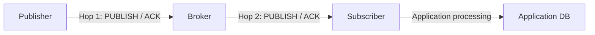

# MQTT 전달 보장과 세션

MQTT는 broker를 통해 message를 전달하는 publish-subscribe protocol이다. 서비스 품질(Quality of Service, QoS)은 메시지를 보낸 한 주체와 받은 한 주체 사이의 단일 hop을 보장한다. Publisher가 QoS 2로 보냈다고 해서 subscriber application의 database(DB) 반영까지 정확히 한 번 처리되는 것은 아니다. NaruMQ는 이 표준 보장 위에 session 복제와 durable 승인 응답(acknowledgment, ACK) 조건을 추가한다.

| 항목 | 값 |
| --- | --- |
| 기준 독자 | MQTT Pub/Sub 기본 개념은 알지만 QoS 레벨별 1-hop 보장 한계와 분산 브로커의 쿼럼 내구성 경계가 생소한 주니어 개발자 |
| 선수 문서 | [MQTT의 역사와 버전 진화: MQIsdp부터 MQTT 5.0까지](mqtt-history-and-version-evolution.md) |
| 관련 기준 문서 | [PRD](../requirements/PRD.md) (MQTT-02~05, CLU-06~09, CLIENT-01~07), [Cluster session spec](../specs/cluster-session-and-delivery.md) |
| 대상 version·확인일 | MQTT 3.1.1 / MQTT 5.0, 2026-08-16 |

## 읽고 나면 답할 수 있는 질문

- QoS 보장이 publisher→broker와 broker→subscriber에서 각각 끝나는 지점을 설명할 수 있다.
- QoS 1의 중복과 QoS 2의 protocol상 중복 방지가 application 처리와 다른 이유를 설명할 수 있다.
- TCP connection이 끊어진 뒤에도 session에 남아야 하는 상태를 구분할 수 있다.
- NaruMQ가 성공 ACK 전에 quorum durability를 추가하려는 이유를 설명할 수 있다.

## 문제 상황: PUBACK을 받았는데 DB에는 없다

Publisher가 QoS 1로 주문 event를 보냈고 `PUBACK`을 받았다고 하자. 잠시 뒤 subscriber의 DB를 확인했지만 주문이 없다. 이때 “MQTT가 메시지를 잃었다”고 바로 결론 내리면 안 된다. `PUBACK`은 publisher와 broker 사이의 첫 번째 hop이 끝났다는 뜻이다. Subscriber application의 DB transaction까지 끝났다는 뜻은 아니다.

먼저 메시지가 지나는 경계를 나눠야 한다. 각 경계의 owner와 완료 신호가 다르다.

## 필수 용어

| 용어 | 뜻 | 상태 owner |
| --- | --- | --- |
| QoS | 한 sender와 receiver 사이에서 `PUBLISH`를 어떻게 전달하고 확인할지 정하는 수준 | 각 protocol hop의 sender와 receiver |
| Hop | 직접 packet을 주고받는 한 구간 | publisher↔broker와 broker↔subscriber가 서로 다른 hop이다. |
| ACK | Receiver가 protocol 단계의 인수 또는 완료를 알리는 packet | QoS 1은 `PUBACK`, QoS 2는 `PUBREC`·`PUBCOMP`를 사용한다. |
| Session | connection이 끝난 뒤에도 이어질 수 있는 client별 protocol 상태 | broker와 client가 각자 필요한 절반을 보존한다. |
| Durable | process나 node가 재시작해도 복구할 수 있게 안정적으로 저장된 상태 | NaruMQ storage와 replica가 보존한다. |
| Idempotent | 같은 입력을 여러 번 처리해도 결과가 한 번 처리한 것과 같은 성질 | 최종 subscriber application이 보장한다. |

## 정상 흐름: 두 개의 독립된 hop

MQTT broker는 publisher와 subscriber 사이에 있다. 따라서 한 메시지에는 최소 두 개의 protocol hop이 있다.

아래 화살표는 publication과 ACK이 이동하는 runtime packet flow다.

Hop 1의 QoS와 Hop 2의 QoS는 다를 수 있다. Broker가 publisher의 메시지를 인수한 사실도 subscriber가 처리한 사실과 다르다. 이 경계를 섞으면 “ACK를 받았는데 최종 DB에는 없다”와 같은 상황을 잘못 해석하게 된다.

## QoS가 보장하는 범위

| QoS | 단일 hop의 의미 | 재전송과 중복 |
| --- | --- | --- |
| 0 | 최대 한 번 전달한다. 도착하지 않을 수 있다. | protocol 재전송이 없다. |
| 1 | 수신자가 메시지 소유권을 인수하면 최소 한 번 전달한다. | ACK 손실이나 재접속으로 중복될 수 있다. |
| 2 | 4단계 handshake로 한 protocol receiver에 중복 없이 전달한다. | handshake 상태를 잃지 않아야 한다. |

QoS 1의 receiver는 성공 PUBACK으로 메시지 소유권 인수를 알린다. QoS 2의 receiver는 성공 PUBREC으로 소유권을 인수하고 PUBREL·PUBCOMP로 handshake를 마친다. Receiver는 ACK 전에 이후 전달이 실패할 조건을 검사해야 하지만, downstream 애플리케이션 처리를 완료할 필요는 없다.

Broker가 subscriber에게 보낼 때는 publisher가 사용한 QoS와 granted subscription QoS 중 낮은 수준을 적용할 수 있다. 따라서 QoS 2 publish가 subscriber에게 QoS 1로 전달될 수 있다.

## 세션이 연결보다 오래 남기는 상태

MQTT 세션은 하나의 TCP 연결과 같지 않다. MQTT 5 세션은 마지막 Network Connection과 Session Expiry Interval 동안 이어질 수 있다. 서버 세션 상태에는 다음 정보가 포함된다.

- 구독과 Subscription Identifier
- subscriber에게 보냈지만 완료되지 않은 QoS 1/2 메시지
- subscriber에게 보낼 QoS 1/2 대기 메시지
- publisher에게 받은 QoS 2 handshake 상태
- Will Message와 Will Delay
- 세션 만료 시각

Retained Message는 특정 클라이언트 세션이 아니라 토픽에 연결된 broker 상태다. 세션이 끝나도 retained 상태가 함께 지워지지 않는다.

Clean Start와 Session Expiry가 세션 복구 여부를 결정한다. Session Expiry가 0이면 연결이 끝난 뒤 구독과 offline queue를 이어받는 보장을 기대할 수 없다. Message Expiry가 먼저 끝나면 세션이 살아 있어도 해당 메시지는 제거할 수 있다.

## NaruMQ가 추가하는 내구성 경계

MQTT 표준은 여러 broker 노드의 quorum 복제를 정의하지 않는다. NaruMQ의 내구성 ACK는 제품이 추가하는 조건이다.

1. Broker가 QoS 1 PUBLISH를 검증한다.
2. 메시지와 필요한 전달 상태를 WAL과 replica에 기록한다.
3. 설정된 write quorum이 영속화를 확인한다.
4. 그 뒤 성공 PUBACK을 반환한다.

QoS 2도 성공 PUBREC 전에 메시지와 수신 handshake를 같은 내구성 경계까지 저장한다. 구체적인 replication factor, write quorum과 fsync 정책은 별도 저장소·consensus ADR에서 정한다.

이 경계가 필요한 이유는 ACK가 소유권 이전을 뜻하기 때문이다. Broker가 ACK한 직후 한 노드가 사라져도 남은 quorum이 메시지를 복구해야 한다.

각 broker가 Amazon EBS를 사용할 때도 volume 내부 복제와 NaruMQ quorum 복제는 같은 보장이 아니다. Durable ACK에 필요한 독립 stable copy와 가용 영역 배치는 [EKS 고가용성과 장애 도메인](eks-ha-failure-domains.md)에서 설명한다.

## 애플리케이션이 책임질 부분

MQTT QoS만으로 end-to-end exactly-once 처리를 만들 수 없다.

- Publisher는 성공 PUBACK 또는 PUBREC 전 메시지를 local outbox에 보관한다.
- QoS 1 subscriber는 중복 메시지를 견디도록 consumer를 idempotent하게 만든다.
- Subscriber는 MQTT ACK와 DB transaction 사이의 실패를 별도로 처리한다.
- 최종 처리 결과가 중요하면 application message ID와 처리 ledger를 사용한다.

## 실패 흐름과 trade-off

- Offline queue quota가 가득 차면 broker는 새 메시지 인수를 거부하거나 정책에 따라 만료해야 한다.
- 긴 Session Expiry는 복구 가능성을 높이지만 저장 공간과 복구 시간을 늘린다.
- QoS 2는 중복 전달을 줄이지만 packet round trip과 저장 상태가 늘어난다.
- QoS를 높여도 잘못된 Client ID, Clean Start 또는 짧은 expiry로 사라진 세션은 복구할 수 없다.

## NaruMQ에서 찾을 위치

규범적 제품 계약은 [PRD](../requirements/PRD.md)의 메시지 보장 모델과 MQTT-02~05, CLU-06~09, CLIENT-01~07, NFR-07을 따른다. Durable publish의 구조적 경로는 [Cluster architecture](../architectures/cluster-architecture.md), packet별 handshake와 Will 상태 전이는 [MQTT QoS 0·1·2와 Will protocol 흐름](mqtt-qos-and-will-protocol-flows.md), 세션 복구 원리는 [세션 소유권과 fencing](session-ownership-and-fencing.md)에서 설명한다.

## 확인 질문

1. Publisher가 `PUBACK`을 받았는데 subscriber DB에 값이 없을 수 있는 경로를 두 hop으로 나눠 설명해 보라.
2. QoS 2가 보장하는 “중복 없이 한 번”과 end-to-end exactly-once 처리는 어디에서 갈라지는가?
3. Session Expiry가 `0`인 client가 연결을 잃었을 때 어떤 상태를 복구할 수 없는가?
4. Quorum을 잃은 NaruMQ가 durable ACK를 멈추는 이유와 남을 수 있는 local 상태를 설명해 보라.

## 참고 자료

- [OASIS MQTT Version 5.0, §4.1 Session State와 §4.3 QoS](https://docs.oasis-open.org/mqtt/mqtt/v5.0/mqtt-v5.0.html)
- [OASIS MQTT Version 3.1.1](https://docs.oasis-open.org/mqtt/mqtt/v3.1.1/os/mqtt-v3.1.1-os.html)
- [NaruMQ 제품 요구사항 정의서](../requirements/PRD.md)
