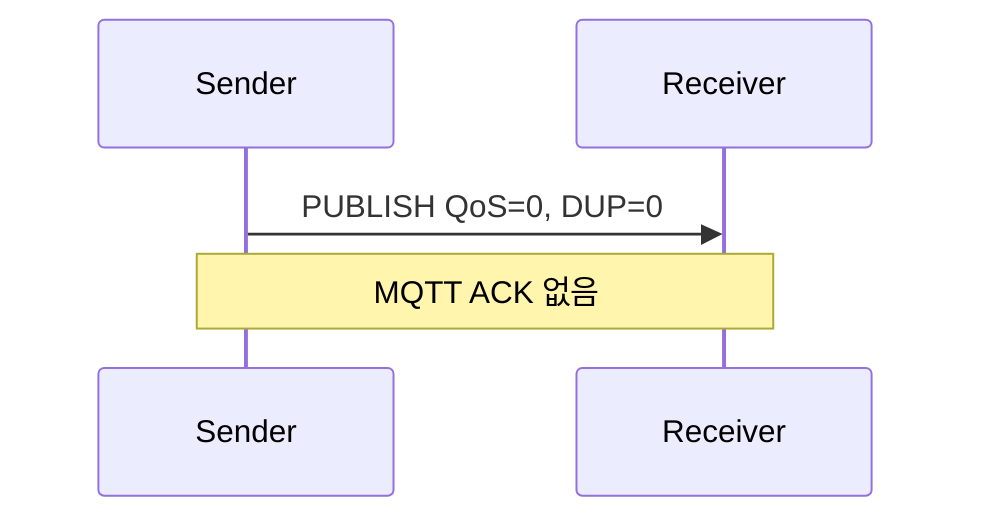
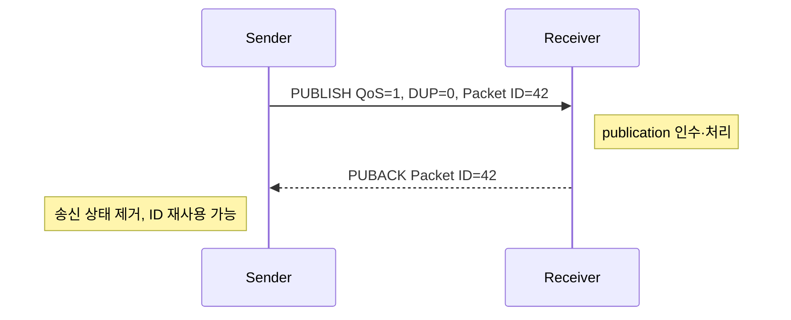
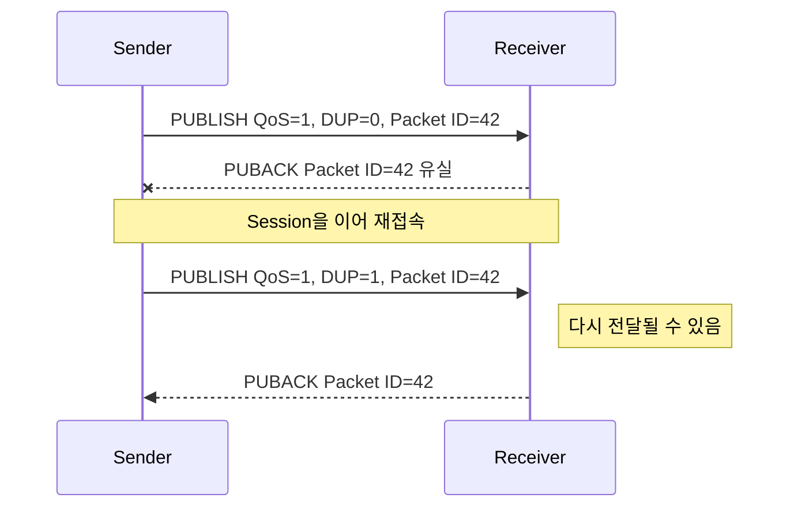
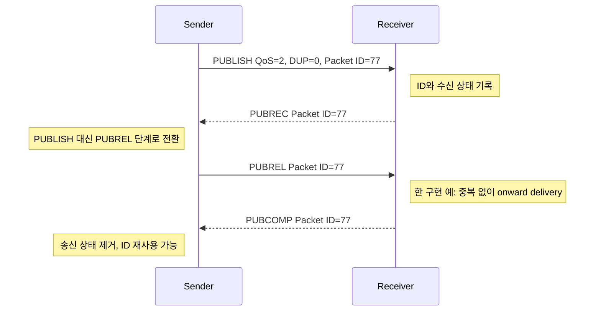
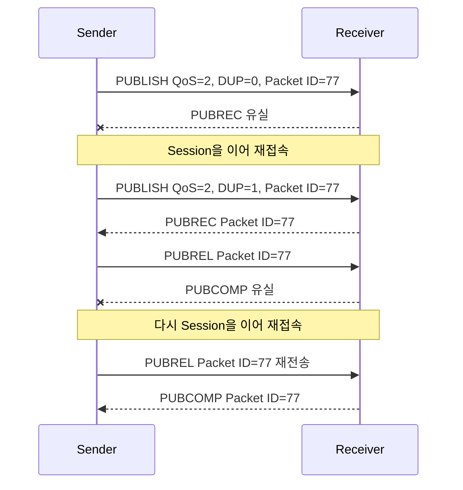
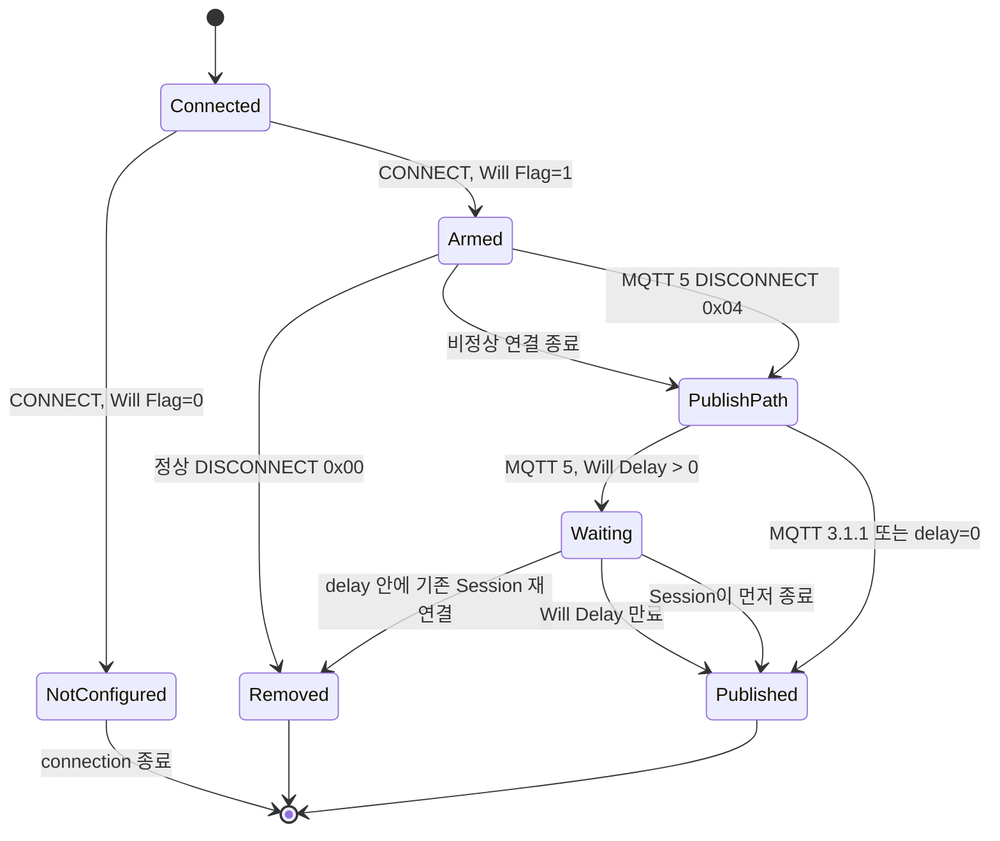

# MQTT QoS 0·1·2와 Will protocol 흐름

MQTT의 서비스 품질(Quality of Service, QoS)은 `PUBLISH` 한 건을 보내는 쪽과 받는 쪽 사이에서 어떤 packet을 교환하고 얼마 동안 상태를 보존할지 정한다. QoS 0은 승인 응답(acknowledgment, ACK)과 protocol 재전송 상태가 없다. QoS 1은 `PUBACK`까지 한 건의 송신 상태를 보존한다. QoS 2는 `PUBREC`·`PUBREL`·`PUBCOMP`가 끝날 때까지 양쪽 상태를 유지한다. Will은 `CONNECT` 때 등록했다가 연결이 정상적으로 끝나지 않았을 때 broker가 대신 발행하는 message다.

| 항목 | 값 |
| --- | --- |
| 기준 독자 | MQTT 개요는 알지만 패킷 레벨의 핸드셰이크(PUBREC/PUBREL/PUBCOMP) 상태 머신과 유언(Will) 지연 발행 규칙이 생소한 주니어 개발자 |
| 선수 문서 | [MQTT 전달 보장과 세션](mqtt-delivery-guarantees.md) |
| 관련 기준 문서 | [PRD](../requirements/PRD.md) (MQTT-02~05, CLU-06~09, CLIENT-01~09), [MQTT protocol과 session 스펙](../specs/mqtt-protocol-and-session.md) |
| 대상 version·확인일 | MQTT 3.1.1 / MQTT 5.0, 2026-08-16 |

이 문서는 packet 흐름을 설명한다. NaruMQ의 규범적 동작은 [MQTT protocol과 session 스펙](../specs/mqtt-protocol-and-session.md)을 따른다.

## 읽고 나면 답할 수 있는 질문

- QoS 0·1·2의 packet 순서와 sender·receiver가 제거하는 상태를 설명할 수 있다.
- `PUBACK`, `PUBREC` 또는 `PUBCOMP`가 유실됐을 때 어느 packet을 다시 보내는지 구분할 수 있다.
- Will이 등록·대기·발행·제거되는 조건을 MQTT 3.1.1과 MQTT 5.0으로 나눠 설명할 수 있다.
- Packet Identifier와 application message ID가 다른 이유를 설명할 수 있다.

## 문제 상황: ACK이 사라진 뒤 무엇을 다시 보내야 하는가

Client가 Packet Identifier `77`로 QoS 2 `PUBLISH`를 보낸 뒤 연결이 끊겼다고 하자. 재접속한 client가 `PUBLISH`를 다시 보내야 하는지 `PUBREL`을 보내야 하는지는 끊기기 전 마지막 상태에 달려 있다. Broker도 그 상태를 기억하지 못하면 같은 publication을 두 번 onward delivery할 수 있다.

Will도 비슷하다. Socket이 끊겼다는 사실만으로 즉시 발행하는 것이 아니다. 정상 `DISCONNECT`인지, Session을 이어 재접속했는지, MQTT 5의 Will Delay가 남았는지를 함께 봐야 한다.

## 필수 용어

| 용어 | 뜻 | 생성·제거 시점 |
| --- | --- | --- |
| Packet Identifier | 한 Session의 한 방향에서 진행 중인 QoS 1·2 exchange를 구분하는 0이 아닌 번호 | Sender가 배정하고 exchange가 끝난 뒤 재사용한다. |
| `DUP` | `PUBLISH`가 이전 전송의 재전송일 수 있음을 표시하는 flag | 재전송 `PUBLISH`에서 sender가 설정한다. 중복 확정 표시는 아니다. |
| Inflight state | ACK을 기다리는 미완료 packet과 현재 handshake 단계 | Exchange 시작 때 만들고 최종 ACK 뒤 제거한다. |
| Session resume | 같은 client가 만료되지 않은 기존 Session을 이어 쓰는 것 | MQTT version별 CONNECT 조건과 `Session Present`로 판정한다. |
| Will | 비정상 연결 종료 시 broker가 client 대신 발행하도록 `CONNECT`에서 맡긴 publication | CONNECT 때 저장하고 정상 종료·재연결 시 제거하거나 조건 충족 시 발행한다. |
| Will Delay | MQTT 5에서 비정상 종료 후 Will 발행을 미루는 시간 | 연결 종료 때 timer를 만들고 재연결·발행·Session 종료 때 제거한다. |

## 정상 흐름을 읽는 기준: 세 경계

Publisher에서 subscriber까지의 전달은 하나의 QoS exchange가 아니다. Broker가 가운데서 두 개의 독립적인 exchange를 수행한다.

아래 화살표는 두 독립 hop의 runtime packet flow를 뜻한다.

- Hop마다 Packet Identifier, `DUP`와 ACK 상태가 다르다.
- Broker의 outbound QoS는 publish QoS와 granted subscription QoS 중 낮은 값이 될 수 있다.
- Subscriber의 MQTT ACK는 subscriber 애플리케이션의 DB transaction 완료를 뜻하지 않는다.

따라서 QoS 2의 “정확히 한 번”은 한 protocol receiver에게 중복 없이 전달하는 범위다. 전체 경로의 business 처리를 정확히 한 번 보장한다는 뜻은 아니다. 보장 범위 자체는 [MQTT 전달 보장과 세션](mqtt-delivery-guarantees.md)에서 더 자세히 설명한다.

## PUBLISH에서 함께 보는 값

| 값 | 역할 | 주의점 |
| --- | --- | --- |
| QoS | 이 hop이 사용할 handshake 수준 | `0`, `1`, `2` 중 하나다. |
| `DUP` | 이 `PUBLISH`가 이전 전송의 재전송일 수 있음을 표시 | QoS 0에서는 `0`이어야 한다. `1`이라고 receiver가 반드시 이전 packet을 받았다는 뜻은 아니다. |
| `RETAIN` | Broker가 이 publication을 topic의 retained state로 저장할지 표시 | Will의 `Will Retain`도 실제 발행 시 이 의미가 된다. |
| Packet Identifier | QoS 1·2 exchange를 ACK와 연결 | 현재 사용 중이지 않은 0이 아닌 값이어야 한다. QoS 0 `PUBLISH`에는 없다. |

Packet Identifier는 전역 message ID가 아니다. 한 Session의 한 방향에서 진행 중인 exchange를 구분하는 짧은 수명 식별자다. QoS 1은 대응하는 `PUBACK`을 받은 뒤, QoS 2는 `PUBCOMP`를 받은 뒤 재사용할 수 있다. MQTT 5에서 실패 reason을 담은 `PUBACK` 또는 `PUBREC`을 받은 경우에도 그 exchange가 종료되면 재사용할 수 있다.

Broker가 메시지를 subscriber에게 새로 보낼 때는 inbound Packet Identifier를 복사하지 않고 outbound exchange에 맞는 식별자를 별도로 배정한다. `DUP`도 broker가 outbound hop의 재전송 여부로 새로 결정한다.

## QoS 0: PUBLISH 한 번

Sender는 packet을 network transport에 넘긴 뒤 MQTT 수준의 완료 응답을 기다리지 않는다. Receiver도 `PUBACK` 같은 응답을 보내지 않는다.

연결이 packet 전송 도중 끊기면 sender는 이 publication이 도착했는지 protocol만으로 알 수 없다. MQTT QoS 0 exchange에는 재전송을 이어갈 Packet Identifier나 session state가 없으므로 손실될 수 있다. TCP가 같은 연결 안에서 순서와 byte 전송을 돕지만, connection 종료를 넘어 MQTT delivery를 보장하지는 않는다.

## QoS 1: PUBLISH와 PUBACK

### 가능한 정상 흐름

1. Sender는 사용 중이지 않은 Packet Identifier를 배정하고 `PUBLISH`를 보낸다.
2. Sender는 `PUBACK`을 받을 때까지 payload와 Packet Identifier를 미완료 상태로 보관한다.
3. Receiver가 publication의 소유권을 인수하면 같은 Packet Identifier로 `PUBACK`을 보낸다.
4. Sender가 `PUBACK`을 받으면 exchange가 끝난다.

NaruMQ에서는 성공 `PUBACK` 전에 필요한 WAL과 quorum 내구성 경계를 통과하도록 [ADR-0003](../decisions/ADR-0003-durable-ack-barrier.md)이 제안한다. 이는 MQTT 표준 자체가 정한 cluster 복제 방식이 아니라 NaruMQ가 성공 ACK에 추가하는 의미다.

### PUBACK이 유실된 경우

Sender는 ACK를 보지 못했으므로 session을 이어갈 때 같은 exchange를 재전송한다. 재전송 `PUBLISH`는 같은 Packet Identifier를 사용하고 `DUP=1`로 표시한다. Receiver는 첫 publication을 이미 처리했더라도 다시 받을 수 있으므로 QoS 1은 최소 한 번 전달이며 중복이 가능하다.

`DUP=1`은 중복 확정 표시가 아니다. 첫 전송이 receiver에 도달하지 않았을 수도 있다. 반대로 `DUP=0` packet도 network 밖의 application 재발행 때문에 business message가 중복일 수 있다. End-to-end 중복 제거에는 Packet Identifier가 아니라 application message ID가 필요하다.

## QoS 2: 네 단계 handshake

### 정상 흐름

Sender 상태는 크게 두 단계다.

| Sender 상태 | 보관할 것 | 받으면 일어나는 일 |
| --- | --- | --- |
| `WAIT_PUBREC` | payload, Packet Identifier, 재전송 정보 | 성공 `PUBREC`을 받으면 payload 재전송을 멈추고 `PUBREL` 단계로 이동한다. |
| `WAIT_PUBCOMP` | Packet Identifier와 `PUBREL` 미완료 상태 | `PUBCOMP`를 받으면 exchange를 제거한다. |

Receiver는 같은 Packet Identifier의 QoS 2 publication을 한 번만 onward delivery하도록 완료 전 상태를 기억한다. 위 diagram은 `PUBREL`을 받은 뒤 onward delivery하는 한 가지 구현 예다. 표준은 receiver가 `PUBREC`이나 `PUBCOMP` 전에 onward delivery를 끝내도록 요구하지 않지만, 어느 시점을 택하든 중복 `PUBLISH`나 `PUBREL` 때문에 두 번 전달해서는 안 된다. NaruMQ는 성공 `PUBREC` 전에 메시지와 수신 handshake를 내구성 경계까지 저장한다.

### packet 유실과 재개

- `PUBREC` 전에는 sender가 같은 Packet Identifier의 `PUBLISH`를 `DUP=1`로 다시 보낸다.
- 성공 `PUBREC` 뒤에는 `PUBLISH`로 되돌아가지 않고 `PUBREL`을 보낸다.
- `PUBCOMP`를 받지 못하면 같은 Packet Identifier의 `PUBREL`을 다시 보낸다. `DUP`는 `PUBLISH` header의 flag이므로 `PUBREL` 재전송에 별도의 `DUP` 값을 붙이지 않는다.
- Receiver는 중복 packet에 맞는 ACK를 다시 보내면서도 publication을 다시 onward delivery하지 않도록 상태를 보존한다.

MQTT 표준이 정의하는 미완료 exchange 재전송의 핵심 시점은 기존 Session을 이어 재접속할 때다. 임의의 새 Packet Identifier로 두 번째 exchange를 만들면 원래 handshake와 다른 publication이 되어 중복 방지 근거를 잃는다.

## 세 QoS의 상태와 비용 비교

| 항목 | QoS 0 | QoS 1 | QoS 2 |
| --- | --- | --- | --- |
| Packet 흐름 | `PUBLISH` | `PUBLISH → PUBACK` | `PUBLISH → PUBREC → PUBREL → PUBCOMP` |
| Packet Identifier | 없음 | 있음 | 있음 |
| Sender 완료 상태 | 없음 | `PUBACK`까지 | `PUBCOMP`까지 |
| Receiver protocol 상태 | ACK용 장기 상태 없음 | 중복 전달 허용, ACK 반환 | 중복 없는 전달을 위해 handshake 상태 필요 |
| 단일 hop 결과 | 최대 한 번 | 최소 한 번 | protocol receiver에 중복 없이 한 번 |
| 비용 | 가장 낮음 | ACK round trip과 inflight 저장 | 두 번의 왕복과 양쪽 상태 저장 |

MQTT 5의 `Receive Maximum`은 동시에 처리할 수 있는 QoS 1·2 `PUBLISH` 수를 제한한다. 상대가 광고한 수를 넘겨 새 QoS 1·2 publication을 보내면 안 된다. `PUBACK` 또는 성공 경로의 `PUBCOMP`로 exchange가 끝나면 quota를 되돌린다. QoS 0은 이 protocol credit의 대상은 아니지만 구현의 memory·socket backpressure 제한은 여전히 적용된다.

## 실패 흐름: 마지막 완료 상태에서 재개한다

| 연결이 끊기기 전 sender 상태 | Session resume 뒤 재전송 | Receiver가 남겨야 할 상태 |
| --- | --- | --- |
| QoS 0 전송 중 | MQTT exchange를 재개하지 않는다. | 장기 ACK 상태 없음 |
| QoS 1 `WAIT_PUBACK` | 같은 Packet Identifier의 `PUBLISH`, `DUP=1` | 중복을 받을 수 있고 다시 `PUBACK`한다. |
| QoS 2 `WAIT_PUBREC` | 같은 Packet Identifier의 `PUBLISH`, `DUP=1` | 이미 받은 ID라면 onward delivery를 반복하지 않고 `PUBREC`을 다시 보낸다. |
| QoS 2 `WAIT_PUBCOMP` | 같은 Packet Identifier의 `PUBREL` | 완료 전·후 상태에 맞춰 `PUBCOMP`를 다시 보내고 중복 delivery를 막는다. |

새 Session이 시작됐거나 기존 Session이 만료됐다면 이 표의 미완료 exchange를 이어갈 근거도 사라진다. Application이 재발행해야 한다면 새 business 시도로 보고 application message ID로 중복을 통제한다.

## Session이 끊겼을 때 무엇을 복구하는가

QoS handshake가 connection보다 오래 살려면 Session이 이어져야 한다.

- MQTT 3.1.1은 같은 Client ID와 `Clean Session=0`으로 persistent session을 이어간다.
- MQTT 5는 같은 Client ID, `Clean Start=0`과 만료되지 않은 Session Expiry를 사용하고 `Session Present` 결과를 확인한다.
- 새 session을 시작했거나 기존 session이 만료됐다면 예전 inflight Packet Identifier만으로 handshake를 계속할 수 없다.
- 송신 QoS 1·2 미완료 상태와 수신 QoS 2 미완료 상태가 session state에 포함된다.

Cluster broker에서는 이 상태를 어느 node가 이어받아도 같은 단계에서 재개할 수 있어야 한다. NaruMQ의 ownership과 복제 원리는 [세션 소유권과 fencing](session-ownership-and-fencing.md) 및 [Cluster session과 durable delivery 스펙](../specs/cluster-session-and-delivery.md)을 따른다.

## Will: CONNECT 때 예약하는 대리 publication

Will은 별도의 packet type이 아니다. Client가 `CONNECT`에 Will 설정을 넣으면 broker가 보관했다가 조건이 충족될 때 일반 publication으로 만들어 발행한다.

| CONNECT 설정 | 의미 |
| --- | --- |
| Will Flag | `1`이면 Will Topic과 Will Payload가 존재한다. |
| Will QoS | Will이 실제로 발행될 때 사용할 QoS다. |
| Will Retain | 발행된 Will을 retained message로도 저장할지 정한다. |
| Will Delay Interval | MQTT 5 전용. 연결 종료 뒤 발행을 기다릴 초 단위 시간이며 기본값은 `0`이다. |
| Will properties | MQTT 5의 Payload Format, Message Expiry, Content Type, Response Topic, Correlation Data, User Property 등 publication metadata다. |

Will QoS 1·2는 “Will을 발행할지” 결정하는 수준이 아니라 발행이 시작된 뒤 각 subscriber hop에서 적용할 전달 수준이다. Subscription의 granted QoS가 더 낮으면 실제 outbound QoS도 낮아질 수 있다.

### 등록부터 제거까지

정상 `DISCONNECT`는 broker가 Will을 제거한 뒤 connection을 닫게 한다. 반면 network I/O 실패, Keep Alive timeout, client가 정상 `DISCONNECT` 없이 socket을 닫은 경우, protocol 오류에 따른 server 종료 등은 Will 발행 경로로 들어간다. MQTT 5 client의 `DISCONNECT 0x04`(`Disconnect with Will Message`)도 의도적으로 그 경로를 선택한다.

### MQTT 5의 두 타이머

비정상 종료 뒤 MQTT 5 Will은 다음 두 시점 중 빠른 때 발행된다.

1. Will Delay가 끝나는 시점
2. Session Expiry 등으로 Session이 끝나는 시점

따라서 Will Delay를 길게 설정해도 Session Expiry가 `0`이면 connection 종료와 함께 session이 끝나 Will이 바로 발행될 수 있다. 반대로 만료되지 않은 기존 Session을 같은 Client ID로 delay 안에 다시 이어 붙이면 broker는 Will을 제거하고 발행하지 않는다.

새 연결이 이전 Session을 이어받지 않고 `Clean Start=1`로 교체하면 이전 Session이 끝날 수 있으므로 단순히 “같은 Client ID로 빨리 접속했다”는 사실만으로 Will 억제를 보장할 수 없다. Session resume 조건과 `Session Present`를 함께 확인해야 한다.

MQTT 3.1.1에는 Will Delay가 없다. Broker가 비정상 종료를 감지하면 Will을 발행하고, client의 정상 `DISCONNECT`를 받았을 때만 저장한 Will을 버린다.

### 대표 상황 판정

| 상황 | 결과 | 이유 |
| --- | --- | --- |
| Client가 정상 `DISCONNECT`를 보냄 | 발행하지 않음 | Will을 제거하는 명시적 정상 종료다. |
| MQTT 5 client가 `DISCONNECT 0x04`를 보냄 | Will 발행 경로 | client가 Will 발행을 명시적으로 요청한다. |
| Network 단절 또는 Keep Alive timeout | 발행 경로 | 정상 `DISCONNECT`를 받지 못했다. |
| MQTT 5, delay 안에 기존 Session 재연결 | 발행하지 않음 | 대기 중인 Will을 제거한다. |
| MQTT 5, Will Delay보다 Session Expiry가 먼저 끝남 | Session 종료 시 발행 | 두 시점 중 빠른 시점을 사용한다. |
| MQTT 5, Will Delay가 먼저 끝남 | delay 만료 시 발행 | 이후 재접속해도 이미 발행한 Will을 취소할 수 없다. |
| MQTT 3.1.1 connection을 server가 닫음 | Will이 설정됐다면 발행 | 표준에 delay나 server redirect 기반 억제 절차가 없다. |
| Broker process가 Will 처리 전에 중단됨 | 재시작 뒤 발행될 수 있음 | 표준은 server 장애 동안 발행이 지연되는 경우를 허용한다. |

Will이 `Will Retain=1`로 발행되면 Will 예약 상태는 끝나지만 topic의 retained state가 남을 수 있다. 둘은 수명이 다른 상태이므로 혼동하면 안 된다.

## 자주 생기는 오해와 trade-off

- **QoS 2면 subscriber business logic도 exactly-once다:** 아니다. MQTT receiver 경계 뒤의 DB 처리에는 별도 idempotency 또는 ledger가 필요하다.
- **`DUP=1`이면 무조건 같은 메시지다:** 아니다. 이전 전송이 도착했는지 sender는 모른다. 반대로 Packet Identifier는 application deduplication key도 아니다.
- **Broker가 inbound QoS와 Packet Identifier를 그대로 전달한다:** 아니다. Broker 양쪽은 독립된 hop이다.
- **Will은 connection 종료 packet이다:** 아니다. `CONNECT`에서 예약하고 broker가 조건에 따라 대신 만드는 `PUBLISH`다.
- **Will Delay만 길면 계획 drain의 Will은 항상 억제된다:** 아니다. 기존 Session을 delay 안에 실제로 이어야 하고 Session Expiry가 먼저 끝나서도 안 된다.
- **계획된 server 종료면 Will을 버려도 된다:** 아니다. Client의 정상 종료나 MQTT 5의 재연결 조건이 없으면 표준상 발행 경로일 수 있다.

## NaruMQ에서 찾을 위치

- 제품 보장과 수용 기준: [PRD](../requirements/PRD.md)의 메시지 보장 모델, MQTT-02~05, CLU-06~09, CLIENT-01~09
- Protocol 규범: [MQTT protocol과 session 스펙](../specs/mqtt-protocol-and-session.md)
- MQTT wire codec: [`internal/domain/mqtt`](../../internal/domain/mqtt/doc.go)의 PUBLISH QoS 0·1·2와 PUBACK/PUBREC/PUBREL/PUBCOMP
- 송신·수신 inflight 정책: [`internal/domain/delivery`](../../internal/domain/delivery/doc.go)의 `NewOutbound`·`NewInbound` value-state machine
- Session Expiry lifecycle: [`internal/domain/session`](../../internal/domain/session/doc.go)의 `Open`·`Disconnect`·deadline 계산
- Cluster runtime 구조: [Cluster architecture](../architectures/cluster-architecture.md)
- Cluster 복구: [Cluster session과 durable delivery 스펙](../specs/cluster-session-and-delivery.md)
- Client 설정 계약: [MQTT client compatibility v1](../contracts/mqtt-client-compatibility-v1.md)
- 계획 drain과 Will 운영 맥락: [안전한 노드 drain과 Will](safe-node-drain-and-will.md)

현재 Go 구현은 위의 packet codec과 순수 value-state policy까지다. TCP/TLS listener, application orchestration, routing, persistence, quorum durability와 Will timer는 아직 이 package들에 없다. 따라서 이 문서의 normative flow와 실제 API state transition은 같은 규칙을 설명하지만, network·storage 동작을 이미 제공한다는 뜻은 아니다.

## 확인 질문

1. QoS 1 `PUBACK`이 유실됐을 때 sender와 receiver에 각각 어떤 상태가 남고 무엇을 재전송하는가?
2. QoS 2 sender가 성공 `PUBREC`을 받은 뒤에는 왜 `PUBLISH`가 아니라 `PUBREL`을 재전송해야 하는가?
3. MQTT 5에서 Will Delay가 30초여도 Session Expiry가 `0`이면 Will이 바로 발행될 수 있는 이유는 무엇인가?
4. Packet Identifier를 application의 전역 중복 제거 key로 사용할 수 없는 이유를 설명해 보라.

## 참고 자료

- [OASIS MQTT Version 5.0](https://docs.oasis-open.org/mqtt/mqtt/v5.0/mqtt-v5.0.html)
- [OASIS MQTT Version 3.1.1](https://docs.oasis-open.org/mqtt/mqtt/v3.1.1/os/mqtt-v3.1.1-os.html)
- [MQTT 전달 보장과 세션](mqtt-delivery-guarantees.md)
- [안전한 노드 drain과 Will](safe-node-drain-and-will.md)
