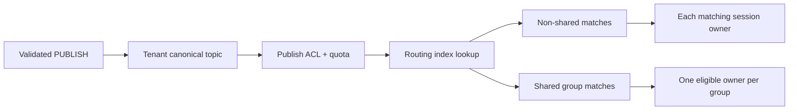

# MQTT topic routing, retained message와 shared subscription

Topic Name은 publisher가 메시지를 보내는 정확한 주소이고 Topic Filter는 subscriber가 받을 주소 집합을 표현한다. Retained message는 exact topic마다 broker가 보관하는 최신 값 하나다. Shared subscription은 같은 group의 여러 session 중 한 곳에만 각 matching publication을 보내 load를 나눈다.

| 항목 | 값 |
| --- | --- |
| 기준 독자 | MQTT 토픽 발행/구독 기초는 알지만 와일드카드 매칭 트리, 보존 메시지(Retained) 및 공유 구독($share) 라우팅 원리가 생소한 주니어 개발자 |
| 선수 문서 | [MQTT 전달 보장과 QoS·Session·Will protocol 흐름](mqtt-delivery-guarantees-and-protocol-flows.md) |
| 관련 기준 문서 | [PRD](../requirements/PRD.md) (MQTT-06~10), [MQTT protocol과 session 스펙](../specs/mqtt-protocol-and-session.md), [MQTT client compatibility v1](../contracts/mqtt-client-compatibility-v1.md) |
| 대상 version·확인일 | MQTT 3.1.1 / MQTT 5.0 |

이 문서는 MQTT 3.1.1과 MQTT 5.0의 공통 topic 원리와 MQTT 5.0 shared subscription을 기준으로 설명한다. NaruMQ의 version별 지원 범위는 [MQTT client compatibility v1](../contracts/mqtt-client-compatibility-v1.md)이 최종 기준이다.

## 읽고 나면 답할 수 있는 질문

- Topic Name과 Topic Filter, `+`와 `#` wildcard를 구분할 수 있는가?
- Retained message가 offline queue와 다른 이유를 설명할 수 있는가?
- Shared subscription group에서 publication 하나가 어느 session으로 가는지 설명할 수 있는가?

## 문제 상황

세 client가 다음 subscription을 가진다고 가정한다.

```text
dashboard: sensors/+/temperature
archive:   sensors/#
worker-a:  $share/alerts/alerts/+
worker-b:  $share/alerts/alerts/+
```

`sensors/room-1/temperature` publication은 dashboard와 archive에 각각 한 copy씩 전달된다. `alerts/high` publication은 `alerts` shared group의 worker-a와 worker-b 중 한 session에만 전달된다.

## 필수 용어

| 용어 | 뜻 |
| --- | --- |
| Topic Name | PUBLISH가 사용하는 정확한 topic 문자열. Wildcard를 포함하지 않는다. |
| Topic Filter | SUBSCRIBE가 사용하는 matching 표현 |
| Topic level | `/`로 구분되는 한 구간 |
| `+` | 정확히 한 topic level을 대신하는 single-level wildcard |
| `#` | 남은 모든 level을 대신하는 multi-level wildcard. Filter의 마지막에만 온다. |
| Subscription | 한 session과 Topic Filter·QoS·option의 연결 |
| Retained message | Broker가 tenant와 exact Topic Name별로 보관하는 최신 publication |
| Shared subscription | `$share/{group}/{filter}`를 공유하는 session 중 하나에 전달하는 subscription |

Topic 문자열을 일반 filesystem path처럼 정규화하면 안 된다. 연속 `/`, 대소문자와 Unicode를 임의로 바꾸면 MQTT matching 의미가 달라질 수 있다.

## Topic matching

| Filter | Match | Match하지 않음 |
| --- | --- | --- |
| `sensors/+/temperature` | `sensors/a/temperature` | `sensors/a/b/temperature` |
| `sensors/#` | `sensors`, `sensors/a`, `sensors/a/temp` | `sensor/a` |
| `+/status` | `device/status` | `a/device/status` |
| `alerts/high` | `alerts/high` | `alerts/low` |

`#`와 `+`는 Topic Filter에서만 특별한 의미를 가진다. Topic Name에 wildcard 문자가 들어간 PUBLISH는 protocol validation에서 거절한다.

`$`로 시작하는 system topic은 root level의 `#` 또는 `+`와 별도 matching 규칙을 가진다. NaruMQ는 tenant namespace를 적용한 뒤에도 MQTT system topic 규칙을 보존해야 한다.

## 정상 routing 흐름

아래 화살표는 PUBLISH의 runtime data flow다.



1. MQTT adapter가 Topic Name과 packet을 검증한다.
2. Security 경계가 인증된 tenant와 외부 Topic Name을 canonical topic으로 바꾼다.
3. Publish ACL과 quota를 적용한다.
4. Routing index가 canonical filter와 matching한다.
5. Non-shared subscription에는 session별 copy를 만든다.
6. Shared group에는 eligible session 하나를 선택한다.
7. 각 owner가 granted QoS, inflight와 offline queue 규칙으로 전달한다.

Route metadata에는 session key, owner node, owner epoch와 subscription option이 연결돼야 한다. Stale owner가 만든 route는 제거하거나 선택에서 제외한다.

## Retained message 흐름

Retain flag가 설정된 PUBLISH는 일반 publication 전달과 별개로 exact topic의 retained slot을 갱신한다.

```text
retained[tenant-a, sensors/room-1/status] = latest publication
```

- 새 retained publication은 같은 key의 이전 값을 대체한다.
- Zero-byte payload retained PUBLISH는 해당 retained value를 삭제한다.
- 새 non-shared subscription은 version과 Retain Handling option에 따라 matching retained value를 받을 수 있다.
- Retained message도 ACL, granted QoS, expiry와 tenant 경계를 통과한다.
- MQTT 5 shared subscription에 session을 추가할 때 retained message를 보내지 않는다.

Retained message는 “마지막으로 알려진 값”이다. Offline queue처럼 특정 session이 접속하지 않은 동안의 모든 publication을 쌓는 구조가 아니다.

## Shared subscription 흐름

`$share/alerts/alerts/+`는 다음 세 부분으로 읽는다.

```text
$share / alerts / alerts/+
marker   group    underlying filter
```

같은 full shared filter를 subscribe한 session들은 한 group을 이룬다. Matching publication 하나는 그 group의 session 하나에만 간다. 다른 group이나 non-shared subscription은 각각 별도 copy를 받을 수 있다.

Member 선택 algorithm은 MQTT가 고정하지 않는다. NaruMQ는 tenant, availability, owner epoch, inflight와 backpressure를 고려하되 unavailable owner를 계속 선택해서는 안 된다.

## 실패 흐름

| 실패 | 남는 상태와 처리 |
| --- | --- |
| Invalid wildcard 위치 | SUBACK에서 해당 filter를 거절하고 route를 만들지 않는다. |
| Subscribe ACL 거절 | 다른 허용 filter와 분리해 거절하고 금지 route를 만들지 않는다. |
| Selected shared owner 장애 | Committed delivery state와 QoS 규칙에 따라 eligible member로 이어받는다. |
| Stale owner epoch route | Routing과 delivery에서 거절하고 최신 route를 다시 구성한다. |
| Retained write durability 실패 | Durable 설정이면 성공 ACK하지 않고 기존 retained value를 조용히 덮지 않는다. |
| Tenant canonicalization 실패 | Publish·subscribe를 거절하고 외부 문자열로 fallback하지 않는다. |

## 자주 생기는 오해와 trade-off

- QoS는 routing fan-out 수를 정하지 않는다. 각 matching subscription의 전달 품질을 제한한다.
- Retained message는 session에 속하지 않는다. Tenant와 exact topic에 속한다.
- Shared subscription은 broadcast가 아니다. Group별 한 member에게 분배한다.
- Wildcard filter를 매 publish마다 전체 scan하면 구현은 쉽지만 subscription 수가 늘 때 비용이 커진다. Index 최적화는 canonical matching 의미를 바꾸면 안 된다.
- MQTT 3.1.1 표준에는 MQTT 5.0의 shared subscription 정의가 없다. NaruMQ가 확장으로 제공한다면 지원 client와 동작을 compatibility contract에 명시해야 한다.

## NaruMQ에서 찾을 위치

- 외부 protocol 동작: [MQTT protocol과 session](../specs/mqtt-protocol-and-session.md#4-subscribe와-routing-입력)
- Cluster route와 owner epoch: [Cluster session과 durable delivery](../specs/cluster-session-and-delivery.md#3-routing)
- Tenant canonicalization과 ACL: [Tenant와 security](../specs/tenancy-and-security.md)
- Target domain package: `internal/domain/routing`, `internal/domain/delivery` — [Project structure](../architectures/project-structure.md)

## 확인 질문

1. `sensors/+/temperature`가 `sensors/a/b/temperature`와 match하지 않는 이유는 무엇인가?
2. Retained message와 persistent session의 offline queue는 각각 어떤 key와 목적을 가지는가?
3. 같은 shared group에 session 세 개가 있을 때 publication 하나는 몇 session에 전달되는가?

## 참고 자료

- [OASIS MQTT 3.1.1](https://docs.oasis-open.org/mqtt/mqtt/v3.1.1/mqtt-v3.1.1.html)
- [OASIS MQTT 5.0](https://docs.oasis-open.org/mqtt/mqtt/v5.0/mqtt-v5.0.html)
- [MQTT protocol과 session](../specs/mqtt-protocol-and-session.md)
