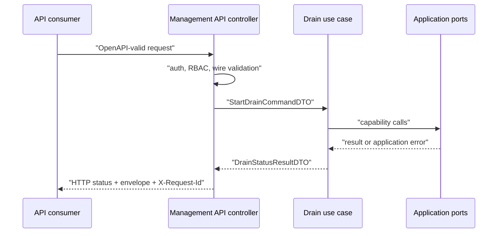

# OpenAPI, controller와 error mapping

OpenAPI document는 HTTP method, path, parameter와 JSON schema의 기준 artifact다. Generated wire type은 이 contract를 Go로 표현하지만 application model은 아니다. Controller가 wire request를 use case의 데이터 전송 객체(Data Transfer Object, DTO)로 변환하고, application error를 안정된 HTTP status와 error code로 바꾸는 경계를 소유한다.

| 항목 | 값 |
| --- | --- |
| 기준 독자 | REST/HTTP API 개발 경험은 있으나 OpenAPI 자동생성 코드와 애플리케이션 계층 간 DTO 매핑 및 오류 격리가 생소한 주니어 개발자 |
| 선수 문서 | [Boundary model과 mapping](boundary-models-and-mapping.md) |
| 관련 기준 문서 | [PRD](../requirements/PRD.md) (API-01~09, SEC-10~11), [Management API OpenAPI JSON](../contracts/management-api-v1.openapi.json), [ADR-0005: Management API contract format](../decisions/ADR-0005-management-api-contract-format.md) (Proposed) |
| 대상 version·확인일 | OpenAPI 3.1.2, Draft 0.5 |

NaruMQ의 OpenAPI 3.1.2 선택은 [ADR-0005](../decisions/ADR-0005-management-api-contract-format.md)의 `Proposed` 결정이다. 아래 Go 이름은 `Target` 예시다.

## 읽고 나면 답할 수 있는 질문

- OpenAPI version, API major version과 contract revision을 구분할 수 있는가?
- Generated request가 controller를 거쳐 use case DTO로 바뀌는 이유를 설명할 수 있는가?
- Domain·application error를 HTTP response로 mapping하는 위치를 찾을 수 있는가?

## 문제 상황

`POST /api/v1/nodes/{nodeId}/drain` handler가 generated request struct를 use case에 직접 전달한다고 가정한다. OpenAPI field가 nullable로 바뀌거나 generator를 교체하면 application code까지 수정된다. Storage error를 그대로 JSON으로 반환하면 내부 key와 구현 정보가 외부 contract가 된다.

Controller는 HTTP와 application 사이의 번역기다. Business rule을 만들지는 않지만 경계의 형식과 오류 의미를 정확히 보존해야 한다.

## 필수 용어

| 용어 | 뜻 |
| --- | --- |
| OpenAPI document | HTTP API 구조와 schema를 기계가 읽을 수 있게 정의한 artifact |
| OAS version | OpenAPI Specification 자체의 version. NaruMQ 제안은 3.1.2다. |
| API major version | Consumer compatibility 경계. NaruMQ path의 `/api/v1`이다. |
| Contract revision | 같은 API major 안의 문서 revision. OpenAPI `info.version`에 기록한다. |
| Wire type | HTTP JSON·header·path parameter의 generated 표현 |
| Controller | HTTP 입력을 application input으로, application 결과를 HTTP 출력으로 변환하는 inbound adapter |
| Error mapping | 내부 error를 안정된 status, code와 retry 의미로 변환하는 규칙 |

OAS 3.1의 Schema Object는 JSON Schema Draft 2020-12 계열 dialect와 정렬된다. 이것이 domain struct에 JSON tag를 붙여 source of truth로 사용한다는 뜻은 아니다.

## 정상 request 흐름

아래 화살표는 HTTP request와 response의 runtime data flow다.

1. Router가 method와 path를 controller에 연결한다.
2. Generated decoder가 path, header와 JSON body를 wire type으로 읽는다.
3. Controller가 request ID, authentication, RBAC와 schema validation 결과를 확인한다.
4. Controller가 필요한 값만 `StartDrainCommandDTO`로 옮긴다.
5. Use case가 domain과 port를 조정한다.
6. Controller가 result DTO를 OpenAPI response type으로 mapping한다.
7. Contract에 정의된 status, envelope와 `X-Request-Id`를 반환한다.

Generated code는 adapter 아래 `generated/`에 둔다. Application은 generated package를 import하지 않는다.

## Error mapping

Error는 가장 안쪽 의미에서 가장 바깥 contract로 한 번씩 변환한다.

| 내부 결과 | Application 분류 | HTTP mapping 예 |
| --- | --- | --- |
| 요청한 node 없음 | `ErrNodeNotFound` | `404 node_not_found` |
| 이미 다른 lifecycle transition 진행 중 | `ErrLifecycleConflict` | `409 lifecycle_conflict` |
| Quorum 없음 | `ErrQuorumUnavailable` | `503 quorum_unavailable`, `retryable=true` |
| Policy·quota 제약 | `ErrPolicyViolation` | `422`와 안정된 code |
| 알 수 없는 구현 오류 | 내부 error | `500 internal_error` |

`error.message`는 운영자에게 보여줄 설명이다. Consumer는 `error.code`와 `retryable`로 분기한다. Stack, storage key, token과 credential은 response에 포함하지 않는다.

## 호환 변경 흐름

- Optional response field 추가는 기존 consumer가 unknown field를 무시할 때 호환될 수 있다.
- Required response field 추가, field 삭제·rename·type 변경은 `/api/v1` breaking change다.
- Server는 request의 unknown field를 `400 invalid_request`로 거절한다.
- Consumer는 모르는 response enum을 `UNKNOWN`으로 보존하고 mutation 판단에 사용하지 않는다.
- Breaking change는 `/api/v2`와 새 contract artifact를 요구한다.

API contract diff는 Go generated code diff보다 먼저 검토한다. Generator output은 파생물이다.

## 실패 흐름

| 실패 | 처리 |
| --- | --- |
| Malformed JSON | Use case를 호출하지 않고 `400`을 반환한다. |
| 인증·RBAC 실패 | Resource lookup 전에 `401` 또는 scope를 숨기는 `403`·`404`를 적용한다. |
| Wire→DTO mapping 실패 | Stable `invalid_request` 계열로 반환한다. |
| Use case timeout | 결과를 성공으로 추정하지 않고 retry 가능성을 명시한다. |
| 같은 idempotency key, 다른 body | `409 idempotency_conflict`를 반환한다. |
| 예상하지 못한 내부 error | 한 process boundary에서 기록하고 `500 internal_error`로 숨긴다. |

## 자주 생기는 오해와 trade-off

- OpenAPI는 business rule 전체를 표현하지 않는다. Cross-field invariant와 state transition은 use case·domain이 소유한다.
- Generated handler가 있다고 authorization이 자동 완성되는 것은 아니다.
- Wire type과 DTO의 field가 같아도 변경 owner가 다르면 분리한다.
- 모든 error를 `500`으로 바꾸면 consumer가 안전하게 retry할 수 없다. 반대로 내부 error 종류를 그대로 code로 노출하면 contract가 불안정해진다.
- Strict request와 tolerant response 정책은 typo를 빨리 찾고 consumer upgrade를 유연하게 만드는 대신 양방향 규칙을 다르게 관리해야 한다.

## NaruMQ에서 찾을 위치

- 기준 artifact: [Management API OpenAPI JSON](../contracts/management-api-v1.openapi.json)
- 호환성 정책: [Management API v1](../contracts/management-api-v1.md)
- 외부 동작: [Management API와 observability](../specs/management-api-and-observability.md)
- Target adapter와 DTO 배치: [Project structure](../architectures/project-structure.md#model과-경계-자료형-배치)
- 기술 선택 제안: [ADR-0005: Management API contract format](../decisions/ADR-0005-management-api-contract-format.md) (Proposed)

## 확인 질문

1. OpenAPI `3.1.2`, `/api/v1`과 `info.version`은 각각 무엇을 versioning하는가?
2. Generated request type을 application에서 직접 사용하면 어떤 변경이 안쪽으로 전파되는가?
3. `quorum_unavailable`과 알 수 없는 storage error는 controller에서 어떻게 다르게 반환해야 하는가?

## 참고 자료

- [OpenAPI Specification 3.1.2](https://spec.openapis.org/oas/v3.1.2.html)
- [JSON Schema Draft 2020-12](https://json-schema.org/draft/2020-12)
- [Management API v1](../contracts/management-api-v1.md)
