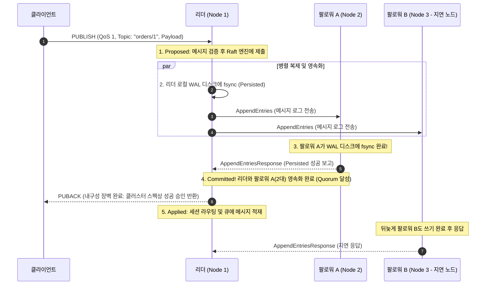

# Raft quorum과 durable ACK: 다수결 합의와 디스크 영속성 경계

Raft의 커밋(Commit)은 클러스터 과반수가 로그의 순서를 영구히 확정한 상태를 뜻하고, 영속성(Persistence)은 노드가 재시작되어도 디스크에서 해당 기록을 온전히 읽을 수 있음을 뜻합니다. NaruMQ가 약속하는 내구성 승인(Durable ACK: QoS 1 `PUBACK`, QoS 2 `PUBREC`)은 이 두 가지 조건을 모두 만족해야 합니다. 단순히 리더 노드의 메모리에 적재되었거나 네트워크로 전달되었다는 사실만으로는 절대 클라이언트에게 성공 응답을 반환하지 않습니다.

| 항목 | 값 |
| --- | --- |
| 기준 독자 | Raft 분산 합의 개념을 처음 접하거나, 5단계 로그 상태(Proposed~Applied)와 클라이언트 Durable ACK 반환 시점 구분이 어려운 주니어 개발자 |
| 선수 문서 | [MQTT 전달 보장과 세션](mqtt-delivery-guarantees.md) |
| 관련 기준 문서 | [PRD](../requirements/PRD.md) (CLU-01~12), [Cluster session spec](../specs/cluster-session-and-delivery.md), [ADR-0002: Cluster consensus library](../decisions/ADR-0002-cluster-consensus-library.md) (Proposed), [ADR-0003: Durable ACK barrier](../decisions/ADR-0003-durable-ack-barrier.md) (Proposed) |
| 대상 version·확인일 | Draft 0.5 |

NaruMQ의 합의 라이브러리(`etcd/raft`) 및 내구성 장벽 선택은 아직 [ADR-0002](../decisions/ADR-0002-cluster-consensus-library.md)와 [ADR-0003](../decisions/ADR-0003-durable-ack-barrier.md)의 `Proposed`(제안) 결정입니다.

## 읽고 나면 답할 수 있는 질문

- Raft 로그의 5단계 상태(Proposed, Replicated, Persisted, Committed, Applied)의 차이를 설명할 수 있는가?
- 3노드 클러스터에서 Quorum 2가 형성될 때, 왜 1개 노드가 죽거나 지연되어도 성공적으로 커밋되는가?
- 왜 메모리 큐에만 넣고 클라이언트에게 `PUBACK`을 보내면 분산 환경에서 데이터가 유실되는가?
- `etcd/raft` 라이브러리를 임포트하는 것만으로는 왜 내구성이 보장되지 않는가?

---

## 문제 상황: "PUBACK을 보낸 직후 두 노드가 리셋된다면?"

클라이언트가 중요한 결제 완료 메시지를 QoS 1으로 발행(`PUBLISH`)했습니다.

```text
[치명적인 조기 ACK 시나리오]
클라이언트 ──(1) PUBLISH──> 리더 노드 (메모리 버퍼에만 보관!) ──(2) PUBACK 반환──> 클라이언트 "성공 안심!"
                               │ (디스크 fsync 안 됨)
                               ▼
                   [정전 발생! 리더 노드 리셋] -> 메모리 증발, 메시지 영구 유실! (RPO > 0 발생)
```

1. **메모리 기반 조기 ACK의 위험**: 리더가 디스크에 물리적으로 기록(`fsync`)하지 않고 메모리에만 올린 채 `PUBACK`을 보내면, 직후 서버가 재부팅될 때 메시지가 영구 소멸합니다.
2. **모든 노드(3/3) 대기의 문제**: 반대로 3대 노드가 모두 디스크에 쓸 때까지 기다리면, 가장 느린 노드 1대의 네트워크 지연이나 디스크 I/O 병목이 전체 브로커의 지연 시간(Latency)을 결정합니다.
3. **NaruMQ의 균형점 (Quorum 2/3)**: 3개 노드 중 **과반수(2개 노드)의 디스크(WAL) 영속화와 합의 커밋**을 내구성 장벽(Durable Barrier)으로 삼아, 1대 장애를 완벽히 견디면서도 빠른 응답 속도를 확보합니다.

---

## 필수 용어: 로그 엔트리의 5단계 생명주기

Raft 합의 파이프라인을 통과하는 메시지는 다음 5단계를 거치며 점진적으로 보장 범위를 넓혀갑니다.

```text
[클라이언트 입력]
      │
      ▼
┌──────────────┐   1. 리더가 Raft 엔진에 합의 안건으로 제출
│ 1. Proposed  │   (아직 다른 노드는 모르며, 디스크에도 없음)
└──────┬───────┘
       ├─────────────────────────────────┐
       ▼ (네트워크 전송)                  ▼ (로컬 디스크 fsync)
┌──────────────┐                  ┌──────────────┐
│2. Replicated │ 팔로워 메모리 도착   │ 3. Persisted │ 리더/팔로워 WAL 기록 완료!
└──────────────┘                  └──────┬───────┘
                                         ▼
                                  ┌──────────────┐
                                  │ 4. Committed │ 과반수(2/3) 영속화 확인! (순서 영구 불변)
                                  └──────┬───────┘
                                         │ ──> [PRD 내구성 장벽 충족: 성공 PUBACK/PUBREC 반환 가능!]
                                         ▼
                                  ┌──────────────┐
                                  │  5. Applied  │ 도메인 상태 머신(세션/큐)에 반영
                                  └──────────────┘
```

| 상태 | 의미 | 아직 보장되지 않는 것 | 클라이언트 ACK 가능 여부 |
| --- | --- | --- | --- |
| **Proposed** | 리더가 클라이언트 명령을 수신하여 Raft 코어에 제안함 | 다른 노드 수신 여부, 디스크 저장 여부 | ❌ 절대 불가 |
| **Replicated** | 하나 이상의 팔로워가 네트워크로 패킷을 수신함 | 디스크 영속화, 과반수 합의 | ❌ 절대 불가 (메모리 증발 위험) |
| **Persisted** | 해당 노드의 비휘발성 저장소(WAL 파일)에 물리적으로 기록됨 | 다른 노드의 동의 (혼자만 쓴 상태일 수 있음) | ❌ 단독으로는 불가 |
| **Committed** | **과반수(2개 노드 이상)가 Persisted를 보고하여 로그 순서가 영구 확정됨** | 비즈니스 상태 머신 반영 완료 | **✅ PRD 내구성 장벽 충족 (성공 ACK 반환 허용 시점)** |
| **Applied** | 커밋된 엔트리를 세션 오프라인 큐와 라우팅 상태에 반영함 | - | ✅ 로컬 상태 머신 반영 완료 |

---

## 정상 흐름: QoS 1 PUBLISH의 내구성 합의 시퀀스

클라이언트가 QoS 1 메시지를 발행했을 때 NaruMQ 3노드 클러스터 내부에서 일어나는 실제 흐름입니다.



- **팔로워 B가 느리거나 다운되어도**: 리더와 팔로워 A가 디스크에 쓰는 순간 Quorum(2/3)이 충족되어 커밋이 확정됩니다. 팔로워 B의 장애가 클라이언트의 `PUBACK` 응답 시간을 지연시키지 않습니다.
- **RPO = 0 달성**: 이 시점에서 리더 노드가 갑자기 폭발하더라도, 팔로워 A가 동일한 커밋 로그를 디스크에 온전히 갖고 있으므로 새 리더로 선출되어 데이터를 복구할 수 있습니다.

---

## `etcd/raft` 라이브러리가 해주는 일과 브로커가 해야 하는 일

NaruMQ가 채택을 검토 중인 `etcd/raft`([ADR-0002](../decisions/ADR-0002-cluster-consensus-library.md))는 순수 결정론적 상태 머신(Deterministic State Machine) 엔진입니다.

```text
┌────────────────────────────────────────────────────────┐
│ etcd/raft가 해주는 일 (수학적 알고리즘)                      │
│  - 리더 선출 투표 집계                                  │
│  - 로그 인덱스와 Term 관리                               │
│  - Quorum 계산 및 Commit Index 전진                      │
└───────────────────────────┬────────────────────────────┘
                            │ Ready 구조체 출력 (다음에 할 일 목록)
                            ▼
┌────────────────────────────────────────────────────────┐
│ NaruMQ 코어가 직접 구현해야 하는 일 (물리적 I/O)           │
│  - 디스크 파일 I/O (`os.File.Sync` / WAL 쓰기)          │
│  - 네트워크 통신 (TCP/gRPC로 피어 간 패킷 전송)             │
│  - Committed 엔트리를 MQTT 도메인 상태(세션/큐)로 적용     │
│  - 스냅샷 생성 및 디스크 공간 절삭 (Compaction)           │
└────────────────────────────────────────────────────────┘
```

즉, 라이브러리가 `"이 로그들을 디스크에 쓰고 피어들에게 보내라"`는 작업 지시서(`Ready` 구조체)를 내놓으면, **실제 디스크 fsync를 수행하고 결과를 통보하는 것은 NaruMQ 스토리지 엔진의 책임**입니다.

---

## 실패 흐름: 장애 상황별 올바른 판정

| 장애 상황 | 시스템 동작 및 남는 상태 | 클라이언트 관찰 결과 |
| --- | --- | --- |
| **리더가 Proposed 직후 크래시** | 리더 디스크에 미반영, 팔로워 미전달. 로그 소멸 | 클라이언트는 타임아웃 발생. 재전송(QoS 1 DUP) 필요 |
| **Quorum 미달 (팔로워 2대 모두 응답 없음)** | 리더 혼자 Persisted 상태이나 Committed 불가. 배압(Backpressure) 적용 | 클라이언트는 `PUBACK`을 받지 못함 (성공 오인 차단) |
| **Committed 후 클라이언트에 PUBACK 전송 전 리더 크래시** | 다수 노드 디스크에 커밋 로그 보존됨. 새 리더 선출 후 정상 복구 | 클라이언트는 타임아웃 뒤 동일 Packet Identifier로 재전송(DUP)하며, 복구된 세션의 Inflight 상태를 통해 재전송이 동일한 결과로 수렴함 |
| **소수파(Minority) 노드에 고립된 리더** | 과반수를 얻지 못하므로 커밋 불가. 클라이언트 요청 거부 | 클라이언트는 즉시 실패 또는 연결 재시도 |

---

## 자주 생기는 오해와 실무 Trade-off

1. **"복제본 수(Replication Factor)가 3이면 3대가 항상 똑같은 상태인가요?"**
   - **아닙니다.** 비동기 네트워크 특성상 일시적으로 1대는 뒤처져 있을 수 있습니다. 중요한 것은 "과반수가 항상 최신 상태를 유지하며 합의한다"는 점입니다.
2. **"디스크 fsync를 매 패킷마다 부르면 브로커가 너무 느려지지 않나요?"**
   - **맞습니다.** 디스크 I/O는 메모리보다 수천 배 느립니다. 디스크 I/O 병목을 완화하고 처리량(Throughput)을 끌어올리기 위해 여러 명령을 묶어 한 번의 fsync로 처리하는 **그룹 커밋(Group Commit)**이 [ADR-0003](../decisions/ADR-0003-durable-ack-barrier.md)의 핵심 설계 옵션으로 제안(Proposed)되어 있습니다.
3. **"Raft가 MQTT의 QoS나 메시지 만료 시간을 알아서 처리해주나요?"**
   - **아닙니다.** Raft는 임의의 바이트 배열(Payload)의 순서만 맞춰줄 뿐입니다. QoS 1/2의 재전송 규칙과 세션 만료 처리는 NaruMQ 애플리케이션 계층이 소유합니다.

---

## 프로젝트에서 찾을 위치

- **요구사항 정의**: `docs/requirements/PRD.md` (제8절 메시지 보장 모델, CLU-01~12)
- **클러스터 스펙**: `docs/specs/cluster-session-and-delivery.md` (제4절 Replicated state 및 제5절 Publish commit과 delivery)
- **아키텍처 뷰**: `docs/architectures/cluster-architecture.md`
- **아키텍처 결정**:
  - [ADR-0002: Cluster consensus library](../decisions/ADR-0002-cluster-consensus-library.md) (Proposed)
  - [ADR-0003: Durable ACK barrier](../decisions/ADR-0003-durable-ack-barrier.md) (Proposed)
- **관련 기술 해설**: [MQTT 전달 보장과 세션](mqtt-delivery-guarantees.md), [WAL, snapshot과 crash recovery](wal-snapshot-and-crash-recovery.md)

---

## 확인 질문

1. 클라이언트가 QoS 1 `PUBLISH`를 보냈을 때, 리더 노드가 클러스터 스펙상 성공 `PUBACK`을 전송할 수 있는 가장 이른 시점은 5단계 중 언제인가?
   *(답: 과반수 노드의 영속화가 확인되어 로그 순서가 영구 확정된 4. Committed 시점 (PRD 내구성 장벽 충족))*
2. 3노드 클러스터에서 1개 팔로워 노드의 디스크가 가득 차서 쓰기가 실패해도 나머지 2개 노드가 정상이라면 메시지 발행이 계속 성공하는 이유는 무엇인가?
   *(답: 3노드 중 과반수인 2노드(리더 + 정상 팔로워 1대)만으로 Quorum을 형성하여 합의 커밋을 진행할 수 있기 때문)*
3. `etcd/raft` 라이브러리를 사용할 때, 메시지가 영구 소실되지 않도록 NaruMQ 스토리지 계층이 반드시 수행해야 하는 물리적 작업은 무엇인가?
   *(답: Raft 엔진이 Ready 구조체로 내놓은 로그 엔트리를 운영체제 버퍼가 아닌 물리 디스크에 확실히 기록하는 `os.File.Sync` / fsync 작업)*

---

## 참고 자료

- [Diego Ongaro and John Ousterhout - In Search of an Understandable Consensus Algorithm (Raft Paper)](https://raft.github.io/raft.pdf)
- [etcd-io/raft 공식 GitHub Repository](https://github.com/etcd-io/raft)
- [NaruMQ PRD - 메시지 보장 모델 및 내구성 ACK 규칙](../requirements/PRD.md)
