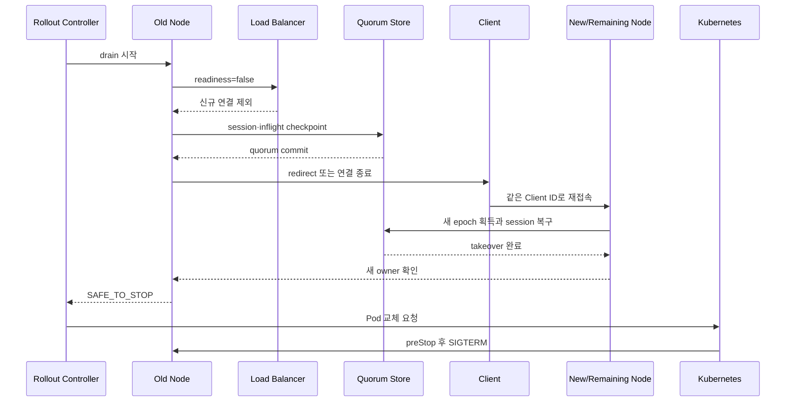

# 안전한 노드 drain과 Will

안전한 rolling update는 Pod가 종료된 뒤 복구하는 절차가 아니다. Pod 삭제를 요청하기 전에 broker가 새 연결을 차단해야 한다. 승인 응답을 기다리는 inflight 상태와 session을 다수 replica의 합의인 quorum에 반영한 뒤 client 재접속과 takeover도 확인해야 한다. Kubernetes의 종료 직전 lifecycle hook인 `preStop`은 이 과정을 승인하는 gate가 아니라 최후 방어선이다.

| 항목 | 값 |
| --- | --- |
| 기준 독자 | Kubernetes 롤링 업데이트 경험은 있으나 MQTT 장기 연결 세션 인계 및 비정상 유언(Will) 발행 차단 라이프사이클이 생소한 주니어 개발자 |
| 선수 문서 | [세션 소유권과 fencing](session-ownership-and-fencing.md) |
| 관련 기준 문서 | [PRD](../requirements/PRD.md) (DEP-01~23, CLIENT-03~09), [Drain과 rolling update 스펙](../specs/drain-and-rolling-update.md), [ADR-0006: External rollout controller](../decisions/ADR-0006-external-rollout-controller.md) (Proposed), [ADR-0007: AWS production deployment platform](../decisions/ADR-0007-aws-production-deployment-platform.md) (Proposed) |
| 대상 version·확인일 | Draft 0.5, 2026-08-16 |

## 읽고 나면 답할 수 있는 질문

- Readiness 실패, drain 완료와 `SAFE_TO_STOP`을 서로 다른 상태로 설명할 수 있다.
- Pod 삭제 요청 전에 session checkpoint와 takeover가 끝나야 하는 이유를 설명할 수 있다.
- `preStop`과 `terminationGracePeriodSeconds`가 보장하는 범위를 구분할 수 있다.
- MQTT version과 Will Delay에 따라 계획된 drain의 Will 결과가 달라지는 이유를 설명할 수 있다.

## 문제 상황: Pod부터 삭제했더니 Will이 쏟아졌다

Rolling update controller가 broker의 session 상태를 확인하지 않고 Pod 삭제부터 요청했다고 하자. 기존 TCP connection은 끊기고 client가 한꺼번에 재접속한다. Session checkpoint가 quorum에 반영되지 않았다면 새 node는 inflight 상태를 이어받지 못한다. 비정상 종료로 판정된 client의 Will도 대량 발행될 수 있다.

안전한 drain은 “SIGTERM을 잘 처리하는 코드” 하나가 아니다. Load balancer, broker, client와 rollout controller가 순서대로 상태를 바꾸는 protocol이다.

## 필수 용어와 세 가지 협력 주체

| 용어 | 뜻 | owner와 종료 조건 |
| --- | --- | --- |
| Drain | Node를 죽이기 전에 새 유입을 막고 기존 연결·상태를 안전하게 넘기는 과정 | Rollout controller가 시작하고 broker가 barrier 결과를 보고한다. |
| Readiness | Pod가 새 service traffic을 받을 후보인지 나타내는 Kubernetes 상태 | Broker가 실패로 바꾸고 controller·load balancer가 반영한다. 종료 승인은 아니다. |
| `SAFE_TO_STOP` | NaruMQ의 모든 종료 barrier가 통과됐음을 뜻하는 drain 상태 | Broker가 계산하고 rollout controller가 확인한 뒤 Pod 삭제를 허용한다. |
| `preStop` | Container 종료 직전에 kubelet이 실행하는 lifecycle hook | Kubelet이 실행하며 grace period 안에 끝나야 한다. |
| `terminationGracePeriodSeconds` | `preStop`과 process의 graceful shutdown에 함께 주어지는 Pod 종료 유예 시간 | 시간이 끝나면 강제 종료 단계로 진행할 수 있다. |

안전한 drain에는 세 주체가 필요하다.

| 주체 | 책임 |
| --- | --- |
| Rollout controller | Pod 삭제 전에 drain을 시작하고 `SAFE_TO_STOP`을 확인한다. |
| Broker node | 새 연결 차단, checkpoint, 속도 제한, redirect와 takeover 확인을 수행한다. |
| MQTT client | 같은 Client ID로 재접속하고 backoff·jitter·session resume 계약을 지킨다. |

Broker 혼자 TCP 연결을 다른 Pod로 옮길 수 없다. 기존 연결을 끝내고 클라이언트가 새 연결을 만들어야 한다.

## 정상 흐름: 종료 전에 session을 넘긴다

아래 화살표는 rollout controller가 drain을 시작하고 Kubernetes에 Pod 교체를 승인할 때까지의 runtime control flow다.

Readiness를 먼저 내리는 이유는 drain 중인 노드에 새 연결이 계속 유입되는 것을 막기 위해서다. Load balancer가 endpoint 변경을 반영하는 데 시간이 걸릴 수 있으므로 기존 연결을 끊기 전에 전파 대기 시간을 둔다.

## `SAFE_TO_STOP`의 의미

`SAFE_TO_STOP`은 단순히 현재 TCP connection 수가 0이라는 뜻이 아니다. 최소한 다음 조건을 함께 확인해야 한다.

- 신규 연결을 받지 않는다.
- 남은 연결이 정책상 허용된 수에 도달했다.
- 세션과 QoS inflight 상태가 필요한 quorum에 commit되었다.
- 새 owner가 takeover한 세션을 이전 owner가 더 수정할 수 없다.
- 미반영 WAL과 필수 replica 부족이 없다.
- Drain 실패와 강제 종료 사유가 메트릭·로그에 남았다.

이 조건의 정확한 계산은 향후 cluster lifecycle spec에서 정의한다.

## 자주 하는 오해: `preStop`만으로 충분하지 않다

Kubernetes는 Pod의 termination grace period를 시작한 뒤 `preStop`을 실행한다. Hook이 오래 걸리거나 실패해도 grace period가 끝나면 컨테이너는 종료된다. Hook은 at-least-once로 호출될 수 있으므로 중복 실행도 견뎌야 한다.

따라서 `preStop`의 non-zero 종료 코드를 “Pod 삭제 거부”로 사용할 수 없다. NaruMQ의 흐름은 다음처럼 역할을 나눈다.

1. 외부 controller가 실행 중인 Pod에 drain을 요청한다.
2. Controller가 `SAFE_TO_STOP`을 확인하기 전에는 Pod 삭제를 요청하지 않는다.
3. 삭제가 시작된 뒤 `preStop`은 drain 상태를 idempotent하게 다시 확인한다.
4. `terminationGracePeriodSeconds`는 `preStop`과 SIGTERM 이후 정상 종료 시간을 모두 포함한다.

PodDisruptionBudget은 voluntary disruption의 동시 수를 제한하는 도구다. Broker의 application-level drain 완료를 증명하지는 않는다. Topology spread와 required anti-affinity도 별도로 적용해야 단일 zone·node 장애가 여러 quorum member를 동시에 제거하지 않는다.

`EKS_EC2_HA`에서는 readiness, Kubernetes endpoint와 NLB target state가 서로 다른 시점에 바뀔 수 있다. Readiness 실패만 관찰하고 기존 MQTT connection을 종료해서는 안 된다. Controller와 NLB의 target 제외가 전파되는 동안 새 connection을 흡수한 뒤 broker가 session 인계를 시작해야 한다. 구체적인 target lifecycle은 [AWS NLB와 MQTT 연결 lifecycle](aws-nlb-mqtt-connection-lifecycle.md)을 참고한다.

Pod, EC2 instance, 가용 영역과 EBS volume도 서로 다른 장애 범위다. PDB나 replica count만으로 이 독립성을 증명할 수 없으며, 기준 배치는 [EKS 고가용성과 장애 도메인](eks-ha-failure-domains.md)을 따른다.

## Will 동작

Will은 연결이 비정상적으로 끝났음을 다른 subscriber에게 알리는 MQTT 기능이다. 운영자가 계획한 종료라는 이유만으로 broker가 Will을 임의로 버리면 표준 동작을 어길 수 있다.

| 상황 | 예상 동작 |
| --- | --- |
| Client가 정상 DISCONNECT를 보냄 | Will을 제거하고 발행하지 않는다. |
| MQTT 5 client가 Will Delay 안에 같은 세션으로 재접속 | Will을 발행하지 않는다. |
| MQTT 5에서 Will Delay가 0인 연결을 server가 종료 | Will이 즉시 발행될 수 있다. |
| MQTT 5 server가 `DISCONNECT 0x9C`와 Server Reference를 보냄 | Redirect 정보만 제공한다. 이것만으로 Will이 제거되지는 않는다. |
| MQTT 3.1.1 연결을 server가 종료 | Client가 먼저 DISCONNECT하지 않았다면 Will을 발행한다. |

MQTT 3.1.1에는 Will Delay와 server redirect가 없다. 따라서 Will을 사용하는 3.1.1 클라이언트에 server 주도 drain과 no-Will을 동시에 보장할 수 없다. No-Will이 필요하면 클라이언트가 정상 DISCONNECT에 협력하거나 MQTT 5와 충분한 Will Delay를 사용해야 한다.

## Reconnect storm 제어의 trade-off

한 노드의 모든 연결을 동시에 닫으면 남은 노드와 인증 backend에 부하가 집중된다.

- Broker는 초당 종료·redirect 수를 제한한다.
- Client는 exponential backoff와 jitter를 적용한다.
- N-1 상태에서 기준 트래픽을 처리할 용량을 미리 확보한다.
- Load balancer 전파 시간을 고려해 재접속을 시작한다.
- Drain ETA가 termination grace period를 넘으면 controller가 배포를 중단한다.

속도 제한은 drain 시간을 늘린다. 너무 빠르면 reconnect storm이 생기고 너무 느리면 배포가 끝나지 않는다. 실제 연결 수와 N-1 용량으로 비율을 측정해야 한다.

## 실패 흐름과 보장하지 않는 범위

- Node process crash에는 외부 gate와 `preStop`이 동작하지 않는다. 남은 quorum과 클라이언트 재접속으로 복구한다.
- 강제 Pod 삭제와 node loss는 graceful drain 보장 대상이 아니다.
- Session Expiry보다 재접속이 늦으면 세션을 복구할 수 없다.
- 새 Client ID로 접속하면 이전 세션을 이어받지 않는다.
- MQTT 3.1.1의 표준상 예상 Will은 비정상 Will 지표와 분리한다.

## NaruMQ에서 찾을 위치

규범적 계약은 [PRD](../requirements/PRD.md)의 DEP-01~23과 CLIENT-03~09를 따른다. Logical-to-physical 배치는 [EKS on EC2 deployment architecture](../architectures/eks-ec2-deployment.md), Will의 등록·발행 상태 전이는 [MQTT 전달 보장과 QoS·Session·Will protocol 흐름](mqtt-delivery-guarantees-and-protocol-flows.md), takeover의 fencing 원리는 [세션 소유권과 fencing](session-ownership-and-fencing.md), 초기 AWS 배포 선택은 [ADR-0007: AWS production deployment platform](../decisions/ADR-0007-aws-production-deployment-platform.md) (Proposed)을 참고한다.

## 확인 질문

1. Readiness가 `false`가 된 직후 Pod를 삭제하면 안 되는 이유를 NLB 전파와 session owner 상태로 나눠 설명해 보라.
2. `preStop`이 시작된 시간도 `terminationGracePeriodSeconds`에 포함된다는 사실이 drain 설계에 어떤 제약을 주는가?
3. MQTT 5 client가 Will Delay 안에 기존 Session을 resume하면 대기 중 Will은 어떻게 되는가?
4. Process crash와 계획된 drain이 같은 보장을 제공하지 못하는 이유는 무엇인가?

## 참고 자료

- [Kubernetes Container Lifecycle Hooks](https://kubernetes.io/docs/concepts/containers/container-lifecycle-hooks/)
- [Kubernetes Pod Lifecycle](https://kubernetes.io/docs/concepts/workloads/pods/pod-lifecycle/)
- [Kubernetes Disruptions와 PodDisruptionBudget](https://kubernetes.io/docs/concepts/workloads/pods/disruptions/)
- [Kubernetes Pod Topology Spread Constraints](https://kubernetes.io/docs/concepts/scheduling-eviction/topology-spread-constraints/)
- [OASIS MQTT Version 5.0](https://docs.oasis-open.org/mqtt/mqtt/v5.0/mqtt-v5.0.html)
- [OASIS MQTT Version 3.1.1](https://docs.oasis-open.org/mqtt/mqtt/v3.1.1/os/mqtt-v3.1.1-os.html)
