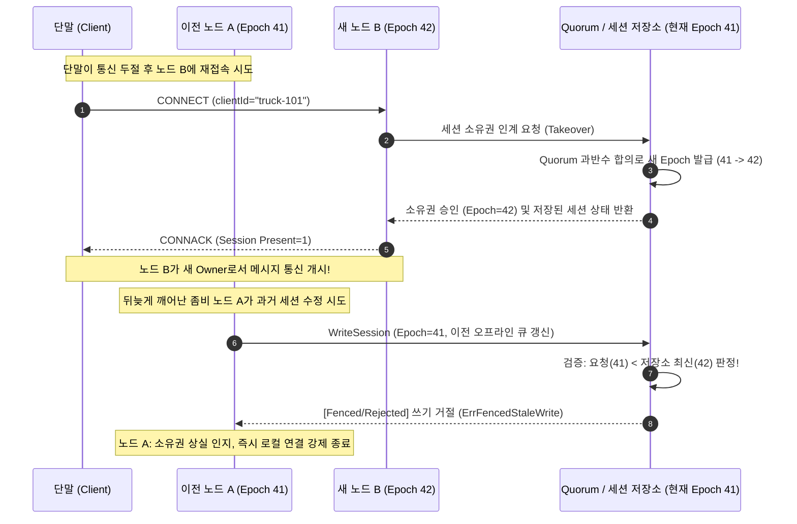

# 세션 소유권과 fencing: 분산 환경에서 이중 쓰기를 막는 원리

분산 MQTT 브로커에서 세션 데이터를 여러 노드에 복제(Replication)하는 것만으로는 데이터 무결성을 보장할 수 없습니다. 일시적인 네트워크 지연이나 GC 정지로 인해 두 노드가 동시에 같은 세션의 주인(Owner)으로 행세하는 두뇌 분열(Split-Brain)이 발생할 수 있기 때문입니다. NaruMQ는 클러스터 다수결 합의(Quorum)를 통해 단일 노드에게만 세션 소유권을 부여하고, 단조 증가하는 번호표인 에포크(Epoch, Fencing Token)를 발행하여 과거 노드의 뒤늦은 쓰기(Stale Write)를 저장소 수준에서 원천 차단합니다.

이 문서는 PRD의 설계 의도와 Fencing Token의 기본 원리를 설명합니다. 합의 라이브러리(`etcd/raft`) 선택은 [ADR-0002](../decisions/ADR-0002-cluster-consensus-library.md), 세션 소유권과 펜싱 전략은 [ADR-0004](../decisions/ADR-0004-session-ownership-and-fencing.md)의 `Proposed`(제안) 단계이며, 구체적인 세션 저장소 및 파티션 구현은 후속 ADR에서 결정해야 합니다.

| 항목 | 값 |
| --- | --- |
| 기준 독자 | Go 기초와 HTTP/TCP 통신은 알지만, 분산 시스템의 Split-Brain 문제와 Fencing Token 개념이 생소한 주니어 개발자 |
| 선수 문서 | [MQTT 전달 보장과 QoS·Session·Will protocol 흐름](mqtt-delivery-guarantees-and-protocol-flows.md) |
| 관련 기준 문서 | [PRD](../requirements/PRD.md) (CLU-04~10, DEP-08~10), [Cluster session spec](../specs/cluster-session-and-delivery.md), [ADR-0002](../decisions/ADR-0002-cluster-consensus-library.md), [ADR-0004](../decisions/ADR-0004-session-ownership-and-fencing.md), [Cluster architecture](../architectures/cluster-architecture.md) |
| 대상 version·확인일 | Draft 0.5 |

## 읽고 나면 답할 수 있는 질문

- 단순히 세션 데이터를 여러 노드에 복제하는 것과 단일 쓰기 소유권(Write Ownership)을 보장하는 것은 왜 다른가?
- 왜 분산 락(Distributed Lock)이나 Lease TTL만으로는 "좀비 노드(Zombie Node)"의 쓰기를 완벽히 막을 수 없는가?
- 펜싱 토큰(Fencing Token, Epoch)은 저장소 수준에서 어떻게 과거 노드의 잘못된 쓰기를 차단하는가?
- 네트워크 단절로 Quorum(과반수)을 상실한 노드(Minority)는 왜 세션 쓰기를 즉시 중단해야 하는가?

---

## 문제 상황: 달리는 트럭과 두 노드의 착각

물류 트래킹 단말인 `truck-101`이 고속도로를 달리며 브로커 노드 A에 연결되어 1초마다 GPS 좌표를 발행하고 있습니다.

```text
[정상 연결 상태]
단말 (truck-101) ────── TCP 연결 ──────> 노드 A (세션 소유자, Epoch 41) ────> 세션 저장소
```

1. **터널 진입과 연결 단절**: 트럭이 긴 산악 터널에 진입하며 통신이 일시적으로 끊겼습니다.
2. **노드 B로 재접속**: 터널을 빠져나온 트럭은 로드밸런서를 통해 새로운 **노드 B**로 재접속(`CONNECT clientId="truck-101"`)했습니다.
3. **노드 A의 착각 (Zombie Node)**: 그런데 노드 A는 TCP KeepAlive 타이머(예: 60초)가 만료되지 않아 `truck-101`과의 연결이 여전히 정상이라고 믿고 있습니다.
4. **두 노드의 동시 쓰기 시도**:
   - 노드 B는 트럭의 새 구독(`SUBSCRIBE`)을 받아 오프라인 큐의 메시지를 전달하기 시작합니다.
   - 동시에 노드 A는 자신이 보관하던 이전 메시지가 타임아웃되었다고 판단하여 재전송(QoS 1 DUP)을 시도하거나, 세션 상태를 저장소에 기록하려 합니다.

```text
[두뇌 분열(Split-Brain) 상황]
단말 (truck-101) ────── TCP 연결 ──────> 노드 B (자신이 주인이라 판단!) ──┐
                                                                          ├──> 같은 세션 동시 수정 충돌!
                      [단절 인지 못함] -> 노드 A (자신도 주인이라 판단!) ──┘
```

결과적으로 두 노드가 동시에 세션을 수정하면 **메시지 중복 전송**, **패킷 ID 상태 오염**, **새 구독 정보 유실**, **비정상 유언(Will) 발행**이라는 치명적인 데이터 손상이 발생합니다.

---

## 왜 단순한 분산 락(Lock)이나 TTL로는 안 되는가?

주니어 개발자가 흔히 떠올리는 해결책은 "Redis나 분산 락을 걸고 5초짜리 TTL(Time-To-Live)을 주면 되지 않나요?"라는 방법입니다. 하지만 분산 시스템에서는 **런타임 지연(GC Pause, OS Swap, 네트워크 패킷 지연)** 때문에 이 방법이 반드시 실패합니다.

```text
(1) 노드 A: 세션 락 획득 (유효기간 5초) ──┐
                                         │ 노드 A에서 긴 GC Pause(Stop-the-World) 발생! (8초 동안 완전 정지)
                                         │ 5초 경과 → 락 자동 만료!
(2) 노드 B: 만료된 락 확인 후 새 락 획득 ─┼── 노드 B가 세션 데이터 정상 갱신
                                         │
(3) 노드 A: 8초 뒤 깨어남! ───────────────┴── 노드 A는 자기가 멈췄던 줄 모르고 과거 데이터를 DB에 덮어씀!
                                              (Silent Data Corruption 발생!)
```

노드 A는 자신이 멈춰 있는 동안 락이 풀렸다는 사실을 알 방법이 없습니다. 이처럼 살아있으나 죽은 상태로 과거 쓰기를 날리는 프로세스를 **좀비 노드(Zombie Node)**라고 부릅니다.

---

## 필수 용어

| 용어 | 뜻 | NaruMQ에서의 역할 |
| --- | --- | --- |
| **Session Key** | `(tenantId, clientId)`로 이루어진 세션의 고유 식별자 | 멀티테넌트 환경에서 특정 클라이언트 세션을 격리하고 식별하는 기준 키 |
| **Owner (소유자)** | 특정 세션에 대한 독점적인 읽기·쓰기 및 클라이언트 통신 권한을 가진 단일 노드 | 한 순간에 오직 하나의 노드만 활성 Owner가 될 수 있음 |
| **Epoch (Fencing Token)** | 소유권이 바뀔 때마다 1씩 단조 증가(Monotonically Increasing)하는 정수 번호표 | 이전 Owner의 지연된 쓰기를 저장소에서 판별하고 걸러내는 방패 |
| **Quorum (과반수)** | 클러스터 전체 노드 중 과반수(예: 3노드 중 2노드)의 합의 집합 | 새 Owner 선출과 Epoch 증가를 공식 승인하는 신뢰 경계 |
| **Fenced Write (차단 쓰기)** | 저장소가 자신이 알고 있는 최신 Epoch보다 낮은 요청을 무조건 거부하는 동작 | 좀비 노드의 쓰기가 영속 저장소에 도달했을 때 최종 방어선 역할 |

---

## 해결책: Fencing Token(Epoch)의 동작 원리

분산 시스템의 권위자 마틴 클레프만(Martin Kleppmann)이 제시한 해결책은 **"저장소 수준의 번호표 검증(Fencing Token)"**입니다.

NaruMQ는 새 노드가 세션 소유권을 가져올 때마다 Quorum을 통해 **이전보다 반드시 큰 번호(Epoch)**를 발급받게 합니다. 그리고 영속 저장소는 데이터를 기록할 때 **항상 번호표를 비교**합니다.

### 저장소의 Fencing 검증 의사코드 (Compare-and-Swap)
```go
func (s *SessionStore) WriteSession(req *WriteRequest) error {
    s.mu.Lock()
    defer s.mu.Unlock()

    // 저장소에 기록된 현재 세션의 최신 epoch를 확인
    currentEpoch := s.getStoredEpoch(req.SessionKey)

    // 요청에 담긴 번호표가 저장소의 최신 번호표보다 과거라면 문전박대!
    if req.Epoch < currentEpoch {
        return ErrFencedStaleWrite // "당신은 이미 해임된 과거의 노드입니다!" 거절
    }

    // 최신 번호표이거나 새 번호표라면 승인 및 epoch 갱신
    s.currentEpoch[req.SessionKey] = req.Epoch
    s.commitData(req.SessionKey, req.Data)
    return nil
}
```

---

## 정상 흐름: Session Takeover (인계) 시퀀스

클라이언트가 노드 A에서 노드 B로 재접속할 때, 펜싱 토큰을 활용한 안전한 세션 인계 과정은 다음과 같습니다.



1. **소유권 획득 먼저**: 새 노드 B는 클라이언트에게 응답하기 전에 **반드시 Quorum 과반수로부터 새 Epoch(42) 커밋을 먼저 받아야** 합니다.
2. **저장소가 최종 심판**: 이전 노드 A가 아무리 늦게 쓰기 요청을 보내더라도, 저장소가 `Epoch 41 < 42`임을 확인하고 거부하므로 데이터가 오염되지 않습니다.
3. **알림에 의존하지 않음**: B가 A에게 "너 이제 소유자 아니야"라고 네트워크 메시지를 보낼 필요가 없습니다. 네트워크가 단절되어 알림이 유실되더라도 저장소의 Fencing 규칙 덕분에 시스템 전체가 안전합니다.

---

## 소유권 전환 시 복제되어야 하는 세션 상태

Owner 노드가 변경되었을 때, 클라이언트가 끊김 없이 QoS 핸드셰이크를 이어가려면 단순 메타데이터뿐 아니라 다음 상태들이 모두 공유 저장소에 안전하게 복제되어 있어야 합니다.

1. **구독 목록 및 옵션**: 클라이언트가 등록한 Topic Filter, QoS 레벨, No Local, Retain Handling 설정
2. **미완료 Inflight 패킷**: 클라이언트와 브로커 사이에 송수신 중이던 QoS 1/2 메시지와 각 Packet Identifier
3. **QoS 2 상태 머신**: `PUBREC` 수신 후 `PUBREL`을 기다리거나, `PUBREL` 전송 후 `PUBCOMP`를 기다리는 중간 진행 상태
4. **오프라인 큐 (Offline Queue)**: 클라이언트가 잠시 연결을 끊은 동안 쌓인 미전달 QoS 1/2 메시지 목록
5. **만료 시각**: MQTT 5.0 Session Expiry Interval 및 각 메시지의 Message Expiry Interval 잔여 시간
6. **유언(Will) 정보**: 연결이 비정상 종료되었을 때 발행할 Will Topic, Will Payload 및 Will Delay 타이머
7. **현재 소유권 메타데이터**: 현재 활성 Owner 노드 ID 및 공인된 최신 Epoch 값

---

## 실패 흐름: Quorum을 잃었을 때 (Minority 분리)

네트워크 파티션으로 인해 클러스터가 둘로 쪼개졌을 때(예: 3개 노드 중 1개 노드가 고립된 경우), 고립된 노드(Minority)의 세션 동작 원칙은 다음과 같습니다.

```text
[Quorum 다수파: 노드 B, 노드 C (2/3)]  │  [고립된 소수파: 노드 A (1/3)]
  -> 과반수 합의 가능 (정상 운영)       │    -> 과반수 미달 (합의 불가)
  -> 새 Epoch 발급 및 세션 인계 가능     │    -> 새 Epoch 획득 절대 불가!
```

- **쓰기 및 Durable ACK 전면 차단**: 노드 A는 다수결(Quorum)의 승인을 받을 수 없으므로 새 세션을 생성하거나 소유권을 갱신할 수 없습니다.
- **클라이언트 보호**: 노드 A에 붙어 있는 클라이언트가 QoS 1/2 메시지를 발행하면, 브로커는 내구성 ACK(`PUBACK`/`PUBREC`)를 반환하지 않고 연결을 일시 중단하거나 거절합니다.
- **안전 우선(Safety over Availability)**: 분산 시스템의 CAP 정리에서 NaruMQ는 일시적으로 가용성을 희생하더라도, 두 개의 서로 다른 세션 이력이 발생하는 데이터 불일치를 원천 차단합니다.

---

## 자주 하는 오해와 실무 Trade-off

1. **"Raft Consensus의 Term과 Session Epoch는 같은 것인가요?"**
   - **다릅니다.** Raft의 Term은 *전체 클러스터 리더의 세대*를 뜻하고, Session Epoch는 *특정 클라이언트 세션 소유자의 세대*를 뜻합니다. 리더가 바뀌지 않아도 세션 소유자는 A에서 B로 바뀔 수 있습니다.
2. **"세션 인계 시 오프라인 큐가 너무 크면 재접속이 느려지지 않나요?"**
   - **맞습니다.** 수만 건의 메시지가 쌓인 오프라인 큐를 CONNECT 순간에 동기식으로 모두 읽으면 재접속 지연 시간(Latency)이 급증합니다. 따라서 전달에 필요한 최소 상태(구독, Inflight)와 백그라운드 복구 범위를 나누는 최적화가 필요할 수 있습니다. 단, 대용량 큐의 구체적인 분할 인계 및 파티션 전략은 [ADR-0004](../decisions/ADR-0004-session-ownership-and-fencing.md)를 비롯한 후속 스토리지 ADR에서 확정해야 하는 미결정(Proposed) 사항입니다.
3. **"Fencing Token 검사는 애플리케이션 메모리에서만 하면 되나요?"**
   - **안 됩니다.** 노드 A의 애플리케이션 로직 자체가 멈췄다가 깨어나는 좀비 상태이므로, Fencing 검사는 반드시 데이터가 영구 기록되는 **최종 저장소(Database / Storage Engine / State Machine)** 계층에서 강제되어야 합니다.

---

## 프로젝트에서 찾을 위치

- **요구사항 정의**: `docs/requirements/PRD.md` (CLU-04, CLU-05, CLU-06)
- **시스템 스펙**: `docs/specs/cluster-session-and-delivery.md` (제2절 Session ownership and fencing)
- **아키텍처 뷰**: `docs/architectures/cluster-architecture.md`
- **아키텍처 결정**: [ADR-0002: Cluster consensus library](../decisions/ADR-0002-cluster-consensus-library.md) (Proposed), [ADR-0004: Session ownership and fencing](../decisions/ADR-0004-session-ownership-and-fencing.md) (Proposed)
- **관련 기술 해설**: `docs/explainers/raft-quorum-and-durable-ack.md`

---

## 확인 질문

1. 노드 A가 살아있다고 착각하는 상태에서 노드 B가 클라이언트의 세션 소유권을 안전하게 이어받기 위해 가장 먼저 수행해야 하는 작업은 무엇인가?
   *(답: Quorum 과반수의 합의를 통해 이전보다 단조 증가한 새 Epoch를 발급받아 저장소에 커밋하는 것)*
2. 왜 단순 TTL 방식의 분산 락은 긴 GC Pause가 발생했을 때 데이터 오염을 막지 못하는가?
   *(답: 프로세스가 멈춰 있는 동안 TTL이 만료되어 다른 노드가 락을 가져가지만, 깨어난 이전 노드는 락 상실을 인지하지 못하고 지연된 쓰기를 그대로 실행하기 때문)*
3. 저장소 계층에서 과거의 좀비 노드가 보낸 쓰기 요청을 판정하고 차단하는 구체적인 비교 조건은 무엇인가?
   *(답: `요청에 담긴 Epoch < 저장소에 기록된 최신 Epoch`이면 Stale Write로 판정하여 무조건 거절함)*

---

## 참고 자료

- [Martin Kleppmann - How to do distributed locking (Fencing Token 원전)](https://martin.kleppmann.com/2016/02/08/how-to-do-distributed-locking.html)
- [Diego Ongaro and John Ousterhout - In Search of an Understandable Consensus Algorithm (Raft Paper)](https://raft.github.io/raft.pdf)
- [NaruMQ 제품 요구사항 정의서 - 세션 복제 및 격리 규칙](../requirements/PRD.md)
