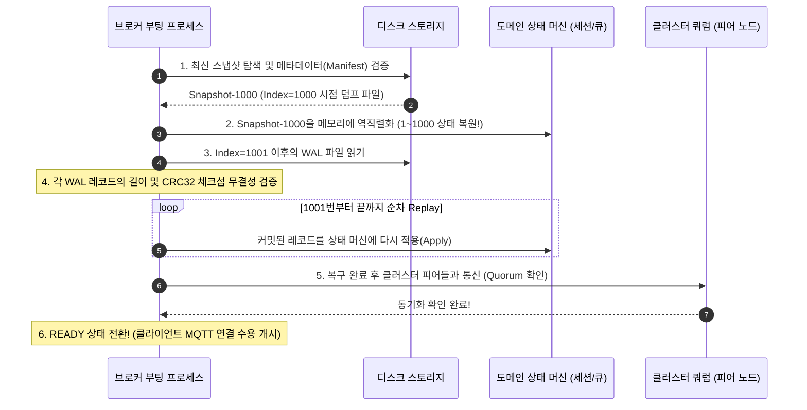

# WAL, snapshot과 crash recovery: 서버가 재부팅되어도 데이터를 지키는 원리

서버가 예고 없이 전원 차단이나 운영체제 크래시로 멈췄을 때, 메모리에만 있던 세션 정보와 메시지는 증발합니다. 데이터베이스의 모든 곳을 무작위로 뒤져서 복구하려면 엄청난 시간이 걸립니다. NaruMQ는 변경 사항을 디스크에 순차적으로만 빠르게 덧붙이는 **WAL(Write-Ahead Log)**과, 특정 시점의 전체 메모리 상태를 사진 찍듯 굳혀두는 **스냅샷(Snapshot)**, 그리고 재시작 시 둘을 결합해 초고속으로 복원하는 **크래시 복구(Crash Recovery)** 파이프라인을 사용합니다.

| 항목 | 값 |
| --- | --- |
| 기준 독자 | DB 트랜잭션 개념은 접해보았으나, 순차 로그(WAL)의 성능 이점, 스냅샷 절삭(Compaction), CRC32 손상 검증 및 크래시 복구 Replay 원리가 생소한 주니어 개발자 |
| 선수 문서 | [Raft quorum과 durable ACK](raft-quorum-and-durable-ack.md) |
| 관련 기준 문서 | [PRD](../requirements/PRD.md) (CLU-06~12, NFR-07~10), [Cluster session spec](../specs/cluster-session-and-delivery.md) (제10절 Snapshot, backup과 restore), [ADR-0003: Durable ACK barrier](../decisions/ADR-0003-durable-ack-barrier.md) (Proposed) |
| 대상 version·확인일 | Draft 0.5 |

이 문서는 일반 원리와 NaruMQ 구현을 구분해 설명합니다. File WAL·snapshot과 module pin은 [ADR-0009](../decisions/ADR-0009-raft-production-state-profile.md), 비동기 저장 실행 구조는 [ADR-0020](../decisions/ADR-0020-asynchronous-raft-wal-group-commit.md)의 제한된 범위에서 채택했습니다. Production filesystem·전원 손실 수용과 ADR-0003 전체 승인은 별도입니다.

## 읽고 나면 답할 수 있는 질문

- 왜 B-Tree 같은 복잡한 인덱스에 바로 쓰지 않고 단순한 순차 로그(WAL)에 먼저 기록하는가?
- WAL만 있으면 충분할 텐데, 왜 주기적으로 스냅샷(Snapshot)을 생성하고 컴팩션(Compaction)을 해야 하는가?
- 쓰기 도중 정전이 발생해 잘려나간 불완전 레코드(Torn Write)는 어떻게 감지하고 복구하는가?
- 서버 재부팅 시 스냅샷과 WAL Replay가 결합되어 최신 커밋 상태로 복구되는 순서를 설명할 수 있는가?

---

## 문제 상황: "초당 수만 건의 쓰기와 느린 디스크의 딜레마"

MQTT 브로커는 초당 수만 건의 QoS 1/2 메시지를 쏟아붓는 수많은 센서 연결을 처리해야 합니다.

```text
[나쁜 예: 임의 디스크 쓰기 (Random Write)]
메시지 도착 ──> 세션 테이블 수정 ──> 토픽 라우팅 트리 갱신 ──> 큐 포인터 갱신 ──> 디스크 헤드 무작위 이동!
               (디스크 여러 블록에 무작위로 쓰느라 극심한 IO 병목 발생, 초당 수백 건도 버거움)

[좋은 예: WAL 순차 추가 (Sequential Append-Only)]
메시지 도착 ──> 파일 맨 끝에 바이너리 덩어리를 덧붙이고(Append) fsync! ──> 초당 수만 건 고속 처리!
```

1. **디스크 I/O 특성**: HDD든 SSD든 디스크의 여러 파일 블록을 무작위로 찾아다니는 Random Write는 느립니다. 반면 파일 끝에 연속된 바이트를 쭉 밀어 넣는 **순차 쓰기(Sequential Append)**는 디스크 대역폭을 100% 활용합니다.
2. **WAL만 무한정 쌓아둘 때의 문제**: 모든 변경을 WAL 파일에만 계속 추가하면 파일 크기가 수십 GB로 불어납니다. 서버가 재부팅되면 **수십 GB의 과거 로그를 1번부터 수억 번까지 전부 다시 실행(Replay)**해야 하므로 서버 부팅에 수십 분~수 시간이 걸립니다.
3. **해법 (WAL + Snapshot)**: 평소에는 빠른 WAL에 순차 기록하고, 주기적으로 현재 메모리 상태를 한 덩어리로 덤프하는 **스냅샷**을 만든 뒤, 이미 스냅샷에 포함된 과거 WAL을 디스크에서 지워버리는 **컴팩션(Compaction)**을 수행합니다.

---

## 필수 용어

| 용어 | 뜻 | NaruMQ에서의 역할 |
| --- | --- | --- |
| **WAL (Write-Ahead Log)** | 메모리 상태를 바꾸기 전에 디스크에 "앞서(Ahead) 순차 기록(Log)"하는 파일 | 정전 발생 시 날아간 메모리 데이터를 재현하기 위한 1차 영속화 원장 |
| **Append** | 파일의 맨 끝 포인터에 새로운 바이트 레코드를 추가하는 동작 | 디스크 헤드의 탐색 비용 없이 최고 속도로 디스크에 기록하는 방법 |
| **Snapshot** | 특정 합의 인덱스(Commit Index $K$) 시점까지 완전히 반영된 전체 메모리 상태의 불변 이미지 | 재부팅 시 과거 로그를 일일이 재실행하지 않고 한 번에 상태를 복원하는 지름길 |
| **Compaction (절삭)** | 스냅샷에 이미 반영된 $K$ 이전의 불필요한 WAL 레코드를 디스크에서 삭제하는 작업 | 디스크 용량 고갈을 막고 복구 시간을 항상 일정 범위(수 초 이내)로 유지하는 청소 작업 |
| **Replay (재실행)** | 스냅샷 이후의 WAL 레코드($K+1$부터 끝까지)를 순서대로 읽어 상태 머신에 다시 적용하는 과정 | 스냅샷 생성 이후부터 크래시 직전까지 커밋된 최신 데이터를 빈틈없이 복원하는 단계 |
| **Torn Write (부분 파손 쓰기)**| 디스크에 바이트를 쓰는 도중 전원이 나가 레코드의 뒷부분이 잘려나간 불완전 상태 | 체크섬(CRC32)으로 무결성을 검사해 복구 대상에서 안전하게 잘라내야 하는 쓰레기 데이터 |

---

## WAL 레코드 구조와 무결성 검증

일반적인 순차 로그(WAL) 파일은 부분 파손 쓰기(Torn Write)를 감지하고 안전하게 복구할 수 있도록 다음과 같은 개념적 프레임(Framing) 구조를 가집니다. (NaruMQ의 구체적인 바이너리 저장 인코딩과 필드 규격은 클러스터 세션 스펙 제4절 및 후속 스토리지 ADR에서 확정됩니다.)

```text
[개념적 WAL 레코드 프레이밍 예시]
┌──────────────┬──────────────┬──────────────┬──────────────┬─────────────────────────┐
│ Length       │ RecordType   │ LogIndex     │ Checksum     │ Payload                 │
└──────────────┴──────────────┴──────────────┴──────────────┴─────────────────────────┘
  총 레코드 길이   엔트리 유형     Raft 로그 번호   무결성 검증값     실제 메시지/세션 데이터
```

- **CRC32 체크섬의 역할**: 크래시 발생 시 OS 버퍼에 있던 바이트가 절반만 기록되고 잘릴 수 있습니다. 복구 시 `Length`만큼 바이트를 읽은 뒤 `CRC32`를 계산하여 레코드 헤더의 체크섬과 비교합니다.
- **불일치 시 판정**: 파일 맨 끝부분의 체크섬 불일치는 크래시 당시의 미완료 쓰기(Torn Write)이므로 안전하게 버립니다. 만약 파일 중간에서 체크섬이 깨졌다면 하드웨어 결함이므로 복구를 즉시 중단하고 경보를 울립니다.

### 현재 코드: 저장 대기와 driver 진행 분리

`internal/adapters/raft/node_ready.go`의 `ProcessReady`는 저장 요청을 `wal_worker.go`의 단일 worker에 넘깁니다. Worker는 이미 대기 중인 여러 요청을 기존 CRC frame으로 각각 기록한 뒤 한 번 fsync합니다. 세 frame A·B·C가 같은 sync를 기다려도 frame 형식과 복구 순서는 바뀌지 않습니다. 성공 완료 뒤에만 `stable_store.go`의 `applyRecord`로 memory index를 갱신하고 저장 의존 응답을 전달합니다.

이를 group commit이라고 합니다. 여러 요청이 동기화 비용을 나누지만, sync 실패 시 그 batch는 성공 완료를 내지 않습니다. Worker가 디스크를 기다리는 동안 driver는 heartbeat·tick을 처리할 수 있습니다. Application apply는 앞선 저장 요청이 모두 완료된 뒤 반환하며, runtime의 `applyBatch`·`CompleteApply`와 projection 확인을 거쳐 MQTT ACK로 이어집니다. `TestNodeHeldAppendWithholdsReplicationAndApply`와 `TestWALWorkerGroupsQueuedFramesAndFailsClosed`가 이 경계를 확인합니다.

현재 local snapshot은 pending WAL·apply가 없는 경계에서 파일을 확정합니다. 아래 백그라운드 snapshot·과거 WAL 삭제 그림은 일반적인 목표 흐름이며, 현재 adapter가 WAL segment 삭제나 지연 없는 snapshot을 구현했다는 뜻은 아닙니다.

---

## 스냅샷 생성과 WAL 컴팩션(절삭) 흐름

스냅샷은 실행 중인 브로커를 멈추지 않고 백그라운드에서 안전하게 생성됩니다.

```text
[시간 흐름과 WAL 컴팩션 타임라인]

1. 스냅샷 생성 시작: Commit Index = 1,000 기준점 포착
   WAL 파일: [Index 1 ~ 1,000 (과거 로그)] | [Index 1,001 ~ (새로 유입되는 실시간 로그)]
                   │                                         │
                   ▼ (백그라운드 파일 기록)                     │ (새 쓰기는 WAL에 계속 추가!)
   [Snapshot 파일 생성: Index 1,000까지의 세션·큐 덤프]          │
                   │
2. 스냅샷 기록 및 검증 완료! (체크섬 일치)
                   │
3. Compaction (과거 로그 청소):
   [Index 1 ~ 1,000 구간의 WAL 파일 영구 삭제!]
                   │
   남은 상태: [Snapshot-1000] + [WAL: 1,001부터 시작]
```

- **무중단 스냅샷**: 스냅샷을 뜨는 도중에도 클라이언트의 새로운 PUBLISH는 `Index 1,001` 이후의 WAL 끝에 계속 기록되므로 지연(Latency)이 발생하지 않습니다.
- **원자적 게시**: 임시 파일(`.tmp`)에 스냅샷을 완전히 기록하고 체크섬 검증을 마친 뒤, 파일 이름을 바꾸는 원자적 연산(Atomic Rename)으로 정식 스냅샷으로 승격시킵니다.

---

## 크래시 복구(Crash Recovery) 4단계 파이프라인

서버가 다운된 후 다시 켜졌을 때 NaruMQ 브로커가 최신 상태로 살아나는 복구 파이프라인입니다.



1. **지름길 복원 (스냅샷 로드)**: 수억 개의 로그 대신 1,000번까지의 압축된 상태 이미지를 단 몇 초 만에 메모리에 올립니다.
2. **꼬리 로그 재실행 (WAL Replay)**: 스냅샷 이후(1,001번부터 크래시 직전까지)의 로그만 디스크에서 순서대로 읽어 상태 머신에 적용합니다.
3. **결정적 적용 (Deterministic Apply)**: 재실행되는 명령들은 반드시 순서대로, 중복 적용되어도 안전하게 설계된 멱등성(Idempotent) 연산이어야 합니다.
4. **준비 완료 (READY)**: 로컬 복구가 끝난 뒤 클러스터 다수파(Quorum)와 통신하여 자신의 상태가 유효함을 확인하고 트래픽을 받기 시작합니다.

---

## 실패 흐름: 크래시 발생 지점별 복구 판단

| 크래시 발생 시점 | 디스크 상태 | 복구 원리 및 최종 판단 |
| --- | --- | --- |
| **WAL 순차 쓰기 도중 정전** | 파일 끝에 불완전한 파손 레코드(Torn Write) 잔존 | CRC32 불일치를 감지하여 파일 끝부분을 잘라내고(Truncate), 이전 정상 커밋까지만 복구함 |
| **로컬 WAL 기록 완료 후 Quorum 합의 전 크래시** | 로컬 디스크에는 있으나 과반수 노드 합의(Committed) 안 됨 | 재부팅 시 로컬 로그를 무조건 믿지 않고, Raft 클러스터 리더의 커밋 인덱스에 맞춰 무효화 처리함 |
| **스냅샷 임시 파일 작성 중 정전** | `.tmp` 불완전 스냅샷 파일 잔존 | 검증 매니페스트가 없으므로 임시 파일을 삭제하고, 이전 세대의 정상 스냅샷과 전체 WAL을 이용해 복구함 |
| **스냅샷 게시 완료 후 과거 WAL 삭제 중 크래시** | 신규 스냅샷과 과거 WAL이 공존함 | 신규 스냅샷의 `Last Included Index`가 우선하므로 중복 로그를 무시하고 안전하게 복구함 |

---

## 자주 생기는 오해와 실무 Trade-off

1. **"WAL이 있으면 별도의 백업(Backup)이 필요 없나요?"**
   - **아닙니다.** WAL은 같은 서버의 디스크 장애나 복구를 위한 국소 복구 수단입니다. 디스크 볼륨 전체가 물리적으로 타버리거나 데이터센터가 침수되는 재난을 대비하려면 다른 가용 영역이나 S3 같은 원격 스토리지로 보내는 스냅샷 백업이 반드시 병행되어야 합니다.
2. **"스냅샷을 1분마다 만들면 복구 시간이 엄청 빨라지지 않나요?"**
   - **맞습니다. 하지만 디스크 I/O가 폭발합니다.** 스냅샷을 너무 자주 뜨면 수 기가바이트의 메모리를 디스크에 쓰느라 정작 실시간 MQTT 트래픽을 처리할 디스크 대역폭이 고갈됩니다. 시스템 부하와 허용 가능한 복구 시간(RTO) 사이의 균형을 맞춰 스냅샷 주기를 튜닝해야 합니다.
3. **"복구할 때 WAL 파일 끝에 알 수 없는 레코드가 있으면 어떻게 하나요?"**
   - 파일의 가장 마지막(Uncommitted Tail)에 위치한 오류만 크래시로 인한 손상으로 간주해 잘라낼 수 있습니다. 만약 파일 중간에서 레코드 구조가 깨졌다면 이는 디스크 배드섹터나 메모리 손상이므로, 잘못된 복구로 시스템을 오염시키지 않도록 즉시 프로세스를 중단(Panic)하고 관리자 개입을 요청해야 합니다.

---

## 프로젝트에서 찾을 위치

- **요구사항 정의**: `docs/requirements/PRD.md` (CLU-06~12, NFR-07~10)
- **클러스터 스펙**: `docs/specs/cluster-session-and-delivery.md` (제10절 Snapshot, backup과 restore)
- **아키텍처 위치**: [Project structure](../architectures/project-structure.md)의 `ports/logstore.LogStore`, `adapters/storage.WALLogStore` Target capability
- **아키텍처 결정**: [ADR-0003: Durable ACK barrier](../decisions/ADR-0003-durable-ack-barrier.md) (Proposed)
- **관련 기술 해설**: [Raft quorum과 durable ACK](raft-quorum-and-durable-ack.md)

---

## 확인 질문

1. 데이터베이스의 무작위 수정(Random Write) 대신 WAL 순차 추가(Sequential Append) 방식을 채택하는 핵심적인 성능 이유는 무엇인가?
   *(답: 디스크 헤드의 탐색 비용 없이 연속된 블록에 순차적으로 바이트를 기록하여 디스크의 최대 순차 I/O 대역폭을 100% 활용할 수 있기 때문)*
2. 스냅샷(Snapshot) 생성 후 이전 세대의 WAL을 삭제(Compaction)하지 않으면 서버 운영에 어떤 문제가 발생하는가?
   *(답: WAL 파일이 무한정 커져 디스크가 고갈되고, 서버 재부팅 시 수년 치의 과거 로그를 전부 재실행하느라 복구 시간(RTO)이 비정상적으로 길어짐)*
3. WAL 파일의 마지막 레코드를 읽던 중 CRC32 체크섬이 일치하지 않을 때, 크래시 복구 엔진은 이를 어떻게 처리해야 하는가?
   *(답: 쓰기 도중 정전으로 인해 잘려나간 불완전한 Torn Write로 판정하고, 해당 손상 부분을 잘라내어(Truncate) 이전 정상 커밋까지만 안전하게 복구함)*

---

## 참고 자료

- [Diego Ongaro and John Ousterhout - In Search of an Understandable Consensus Algorithm (Raft Paper, §7 Log Compaction)](https://raft.github.io/raft.pdf)
- [etcd-io/raft storage and WAL conventions](https://github.com/etcd-io/raft)
- [NaruMQ 클러스터 세션 및 내구성 스펙 - Snapshot, backup과 restore](../specs/cluster-session-and-delivery.md)
