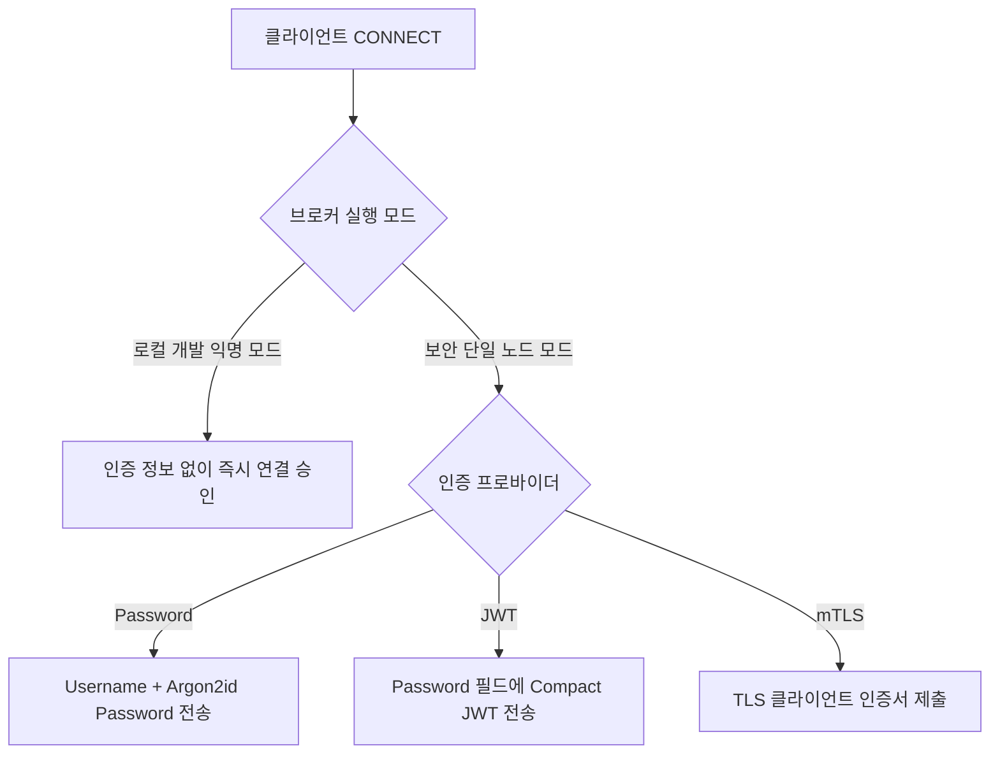

# MQTT 연결 및 인증 가이드

| 항목 | 내용 |
| :--- | :--- |
| **대상 독자** | NaruMQ 브로커에 연결하여 메시지를 통신하려는 클라이언트 애플리케이션 개발자 |
| **문서 목적** | MQTT 클라이언트의 연결 수립 요건, 인증 방식(익명, Password, JWT, mTLS), 연결 오류 코드를 이해한다. |
| **지원 버전** | MQTT v3.1.1, MQTT v5.0 |

---

## 1. 연결 방식 개요

NaruMQ 브로커에 연결할 때 브로커가 실행된 모드에 따라 필요한 인증 정보가 달라집니다.



---

## 2. 인증 방식별 연결 방법

### 방식 1: 로컬 개발 익명 연결 (Plaintext Anonymous)

브로커가 `-allow-insecure-anonymous-mqtt` 플래그로 실행된 경우에만 사용 가능합니다.

- **포트:** `1883` (루프백 `127.0.0.1`)
- **전송 방식:** 표준 TCP (비암호화)
- **인증 플래그:** Username 및 Password를 지정하지 않고 빈 상태로 연결합니다.

```sh
# mosquitto CLI 예제
mosquitto_sub -h 127.0.0.1 -p 1883 -i "dev-client-1" -t "sensor/#"
```

---

### 방식 2: 사용자명 및 비밀번호 인증 (Username & Password)

브로커 보안 정책(`security.json`)에 Password 프로바이더가 활성화된 경우 사용합니다.

- **전송 방식:** TLS 1.2+ 암호화 포트(`8883`) 권장
- **CONNECT 속성:**
  - `Username`: 브로커에 사전 등록된 사용자 식별자 (대소문자 구분)
  - `Password`: 해당 사용자의 원문 비밀번호 바이트열
- **주의:** 브로커는 내부적으로 Argon2id 알고리즘으로 비밀번호 해시를 검증합니다.

```sh
# mosquitto CLI 예제
mosquitto_sub -h broker.example.com -p 8883 --cafile ca.crt \
  -u "sensor-device-01" -P "secret-device-password" \
  -i "sensor-client-01" -t "devices/sensor-01/telemetry"
```

---

### 방식 3: JWT 토큰 기반 인증 (Token Authentication)

OpenID Connect / OAuth2 환경에서 발급된 JWT(JSON Web Token)로 인증할 때 사용합니다.

- **전송 방식:** TLS 1.2+ 포트(`8883`)
- **CONNECT 속성:**
  - `HasUsername`: `true` (MQTT 라이브러리에 따라 빈 문자열 또는 임의 문자열 입력)
  - `Password`: 서명된 UTF-8 Compact JWT 문자열 (`header.payload.signature`)
- **브로커 검증 규칙:**
  1. 토큰 헤더의 `kid` 및 서명 알고리즘(`alg`: RS256, ES256 등) 검증
  2. 사전 설정된 JWKS 엔드포인트의 공개키로 서명 검증
  3. 토큰의 발급자(`iss`), 대상자(`aud`), 만료 시각(`exp`) 확인

```python
# Python Paho 예제 발췌
client.username_pw_set(username="jwt-user", password="eyJhGciOiJSUzI1NiIs...")
client.connect("broker.example.com", 8883)
```

---

### 방식 4: mTLS 상호 인증 (Client Certificate)

클라이언트가 X.509 디지털 인증서를 제출하여 브로커와 상호 인증합니다.

- **전송 방식:** TLS 1.2+ 포트(`8883`)
- **CONNECT 속성:**
  - MQTT `Username` 및 `Password` 플래그를 **보내지 않아야 합니다.**
  - TLS 핸드셰이크 단계에서 인증서의 Common Name(CN) 또는 SAN(Subject Alternative Name)이 브로커의 테넌트/클라이언트 식별자와 매핑됩니다.

---

## 3. Client Identifier (ClientId) 규칙

- **형식:** 1자 이상의 영숫자(`[a-zA-Z0-9]`), 하이픈(`-`), 언더스코어(`_`)를 권장합니다.
- **격리 원칙:** 같은 테넌트 내에서 각 클라이언트는 고유한 ClientId를 사용해야 합니다.
- **중복 연결 처리:** 동일한 ClientId로 새 세션이 접속하면 기존 연결은 연결 종료(`DISCONNECT`) 처리됩니다.
- **클린 세션(Clean Session / Clean Start):**
  - 현재 단일 노드 standalone 런타임은 인메모리 세션을 사용하므로 `CleanSession=true`(MQTT 3.1.1) 또는 `CleanStart=true`(MQTT 5.0) 설정을 권장합니다.

---

## 4. 주요 연결 오류 코드 (CONNACK Return Codes)

연결에 실패하면 브로커가 반환하는 CONNACK 코드와 원인은 다음과 같습니다.

| MQTT 3.1.1 코드 | MQTT 5.0 Reason Code | 오류 원인 | 조치 사항 |
| :--- | :--- | :--- | :--- |
| **0x02** | `0x85` (Client ID not valid) | 허용되지 않은 형식의 ClientId 사용 | ClientId 규칙 및 영숫자 여부 확인 |
| **0x04** | `0x86` (Bad user name or password) | 비밀번호 불일치, 토큰 만료 또는 서명 검증 실패 | 자격 증명, JWT 유효기간 및 비밀번호 재확인 |
| **0x05** | `0x87` (Not authorized) | 테넌트 바인딩 실패 또는 차단 목록(Blocklist) 등록됨 | 보안 정책의 ClientId 허용 패턴 및 인가 권한 확인 |
| **연결 즉시 단절** | - | 평문 포트에 TLS 연결 또는 외부 주소에 익명 접근 시도 | TLS 인증서 및 브로커 리스너 설정 확인 |

---

## 5. 다음 단계

- 연결 후 토픽을 발행하고 구독하는 규칙은 [메시지 발행 및 구독 가이드](./pub-sub.md)를 참조하십시오.
- 실제 언어별(Go, Python, Node.js) 구현 코드는 [언어별 클라이언트 예제](./client-examples.md)에서 확인할 수 있습니다.
