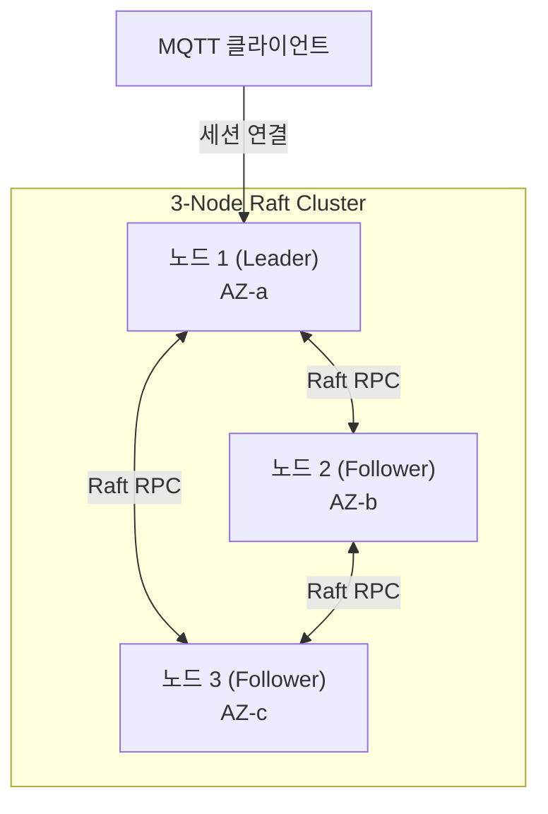

# Raft 클러스터 평가 가이드 (Phase 2 Preview)

| 항목 | 내용 |
| :--- | :--- |
| **대상 독자** | NaruMQ의 고가용성 분산 아키텍처를 사전에 검토하고 평가하려는 시스템 아키텍트 및 분산 시스템 엔지니어 |
| **문서 목적** | Raft 기반 클러스터링 목표, Phase 2 개발 진행 상태, 현재 지원 경계 및 로컬 시험 절차를 이해한다. |
| **현재 상태** | Phase 2 개발 진행 중 (Preview / Target Architecture) |
| **관련 아키텍처** | [Cluster architecture (GitHub)](https://github.com/kayden-kim/narumq/blob/main/docs/architectures/cluster-architecture.md), [Raft quorum explainer (GitHub)](https://github.com/kayden-kim/narumq/blob/main/docs/explainers/raft-quorum-and-durable-ack.md) |

---

## 1. 개요 및 설계 목표

NaruMQ의 핵심 비전은 컨테이너 기반 클라우드 환경에서도 연결과 메시지가 유실되지 않는 고가용성 분산 브로커를 제공하는 것입니다.



- **RPO 0 목표:** 3개 노드를 서로 다른 가용 영역(AZ)에 배치하고, 과반수(Quorum = 2) 노드 복제를 통해 1개 노드 장애 시에도 메시지 유실이 없도록 설계합니다.
- **단일 세션 소유권과 펜싱 (Fencing):** 분산 환경에서 동일한 ClientId가 여러 노드에 동시 접속하여 발생할 수 있는 스플릿 브레인(Split-brain)을 방지합니다.

---

## 2. 현재 구현 상태 및 경계 (Important Boundaries)

::: warning 프로덕션 적용 경계 안내
NaruMQ는 현재 **Phase 2 개발 진행 중** 상태입니다.

- **지원 범위:** 현재 고정 voter Raft 피어 전송, 리더 선출, 동적 멤버십 변경 스파이크 및 오프라인 백업 복원 절차가 개발 및 로컬 시험용으로 제공됩니다.
- **주의 사항:** 무중단 롤링 업데이트([Drain 스펙 (GitHub)](https://github.com/kayden-kim/narumq/blob/main/docs/specs/drain-and-rolling-update.md))는 현재 **Draft** 상태이며, 프로덕션 HA 인스톨러나 공식 Helm 차트는 제공하지 않습니다.
- **권장 사항:** 실제 운영 환경에서는 Phase 1의 단일 노드 보안 런타임을 우선 사용하시고, 클러스터 모드는 개발 및 평가 용도로만 검증하십시오.
:::

---

## 3. 클러스터 모드 시험 실행 개요

클러스터 모드는 단일 노드 실행과 달리 전용 설정 파일을 사용합니다.

### 1) 고정 Voter 피어 전송 모드
MQTT 리스너 없이 3개 프로세스 간 Raft 피어 통신과 리더 선출만을 시험하는 개발 모드입니다.

```sh
./bin/narumq -raft-peer-config node1-peer.json
```

### 2) 동적 클러스터 모드
동적 멤버십 변경과 복제 상태 머신을 포함하는 클러스터 프로세스를 기동합니다.

```sh
./bin/narumq -cluster-config cluster-node1.json
```

---

## 4. 로드맵 및 향후 릴리스

1. **Phase 2 완료 목표:**
   - 3개 가용 영역 분산 배포 시 1개 노드 하드웨어 장애 상황에서 RPO 0 달성 검증
   - 분산 세션 인계 및 에포크(Epoch) 기반 펜싱 검증
2. **Phase 3 목표:**
   - Kubernetes Operator를 통한 무중단 롤링 배포 자동화
   - 대규모 벤치마크 및 장기 장애 내구성 검증

---

## 5. 다음 단계

- 자주 발생하는 오류 및 문제 해결 절차는 [자주 묻는 질문 및 오류 해결](../troubleshooting/troubleshooting.md)을 참조하십시오.
- 기본 시작 절차로 돌아가려면 [5분 빠른 시작](../getting-started/quick-start.md)을 확인하십시오.
