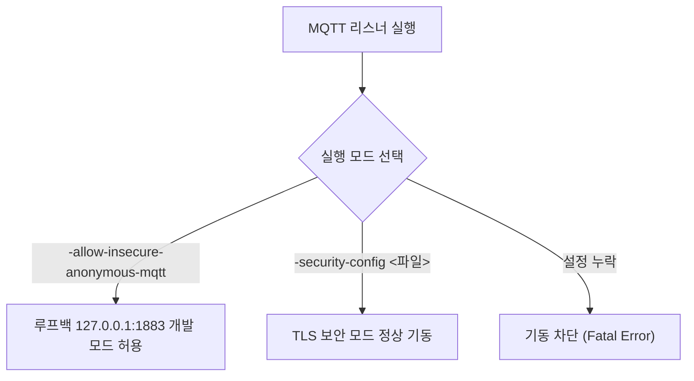

# 프로세스 및 CLI 설정 가이드

| 항목 | 내용 |
| :--- | :--- |
| **대상 독자** | NaruMQ 브로커 프로세스의 실행 옵션 및 튜닝 파라미터를 설정하는 시스템 엔지니어 |
| **문서 목적** | CLI 명령행 플래그, 네트워크 리스너, 접속 제한(Admission) 및 큐 용량 설정 기준을 파악한다. |
| **기준 계약** | [Process configuration v1 contract (GitHub)](https://github.com/kayden-kim/narumq/blob/main/docs/contracts/process-configuration-v1.md) |

---

## 1. 리스너 바인딩 옵션

NaruMQ는 용도에 따라 서로 다른 프로토콜 리스너를 개방할 수 있습니다.

| 플래그 | 자료형 | 기본값 | 설명 및 제약 |
| :--- | :--- | :--- | :--- |
| `-tcp-listen` | string | `""` | 평문 MQTT TCP 리스너 주소입니다. 보안 정책상 **루프백(`127.0.0.0/8`, `::1`) 주소만 바인딩을 허용**합니다. |
| `-tls-listen` | string | `""` | TLS MQTT 리스너 주소입니다. (예: `0.0.0.0:8883`) `-tls-cert`, `-tls-key`가 필수입니다. |
| `-ws-listen` | string | `""` | 평문 MQTT over WebSocket 리스너 주소입니다. 루프백 주소만 허용됩니다. |
| `-wss-listen` | string | `""` | 암호화된 MQTT over WebSocket (WSS) 리스너 주소입니다. |
| `-http-listen` | string | `""` | 관리 REST API, 헬스 프로브 및 메트릭 포트입니다. (예: `127.0.0.1:8080`) |
| `-ws-allowed-origins` | string | `""` | WSS 요청에 허용할 Origin 목록입니다. |

WebSocket MQTT 접속은 `/mqtt` 경로에서 subprotocol `mqtt`를 사용합니다. 클러스터 구성에서는 `mqtt.wsListenAddress`, `mqtt.wssListenAddress`, `mqtt.wsAllowedOrigins` 필드로 같은 리스너 설정을 지정합니다.

---

## 2. 보안 및 인증 필수 플래그

브로커 기동 시 보안 정책을 강제하기 위한 플래그입니다.

- `-security-config <경로>`: 테넌트, 인증 자격 증명, ACL 정책이 정의된 JSON 파일 경로입니다.
- `-allow-insecure-anonymous-mqtt`: 개발용 루프백 익명 모드를 활성화합니다. `-tls-listen` 또는 `-security-config`와 동시에 사용할 수 없습니다.
- `-http-auth-token-file <경로>`: 관리 HTTP API 인증용 토큰 파일입니다. `-http-listen`을 외부 IP로 개방할 경우 반드시 지정해야 합니다.

---

## 3. 연결 제한 및 유입 제어 (Admission Control)

대량의 연결 시도로 인한 브로커 자원 고갈을 방지합니다.

| 플래그 | 기본값 | 허용 범위 | 설명 |
| :--- | :--- | :--- | :--- |
| `-tls-max-connections` | `0` (제한 없음) | `0..1,000,000` | TLS 리스너의 최대 동시 활성 연결 수 |
| `-tls-connection-rate` | `0` (제한 없음) | `0..1,000,000` | TLS 리스너의 초당 최대 신규 연결 수락 한도 |
| `-http-request-rate` | `50` | `1..1,000,000` | 관리 HTTP API의 초당 요청 허용 한도 (Token Bucket) |
| `-http-auth-failure-rate`| `5` | `1..1,000,000` | 관리 HTTP API의 초당 인증 실패 허용 한도 (무차별 대입 방어) |

---

## 4. MQTT 패킷 및 버퍼 튜닝 옵션

네트워크 대역폭과 메모리 사용량을 제어하기 위한 세부 파라미터입니다.

| 플래그 | 기본값 | 설명 |
| :--- | :--- | :--- |
| `-max-packet-size` | `1048576` (1 MB) | 단일 MQTT 패킷의 최대 크기 바이트입니다. 초과 패킷은 거절됩니다. |
| `-receive-maximum` | `64` | 클라이언트별 동시 인플라이트(In-flight) 메시지 처리 한도입니다. |
| `-delivery-queue-capacity` | `64` | 클라이언트 세션별 아웃바운드 메시지 버퍼 큐 용량입니다. |
| `-retained-message-capacity` | `1024` | 브로커 메모리에 보관할 수 있는 최대 Retained 메시지 개수입니다. |
| `-retained-byte-capacity` | `16777216` (16 MB) | 브로커 메모리에 보관할 수 있는 Retained 메시지 총 바이트입니다. |

---

## 5. 네트워크 타임아웃 옵션

비정상 연결이나 행(Hang) 상태의 소켓을 감지하여 정리합니다.

- `-connect-timeout` (기본값: `10s`): TCP 연결 수립 후 첫 CONNECT 패킷 수신 대기 제한 시간.
- `-packet-read-timeout` (기본값: `30s`): 소켓 읽기 타임아웃.
- `-write-timeout` (기본값: `5s`): 소켓 쓰기 타임아웃.

---

## 6. 다음 단계

- `security.json`의 세부 작성 형식은 [TLS 및 보안 정책 설정 가이드](./security.md)를 참조하십시오.
- 관리 API의 상세 엔드포인트 목록은 [관리 REST API 가이드](./management-api.md)를 참조하십시오.
