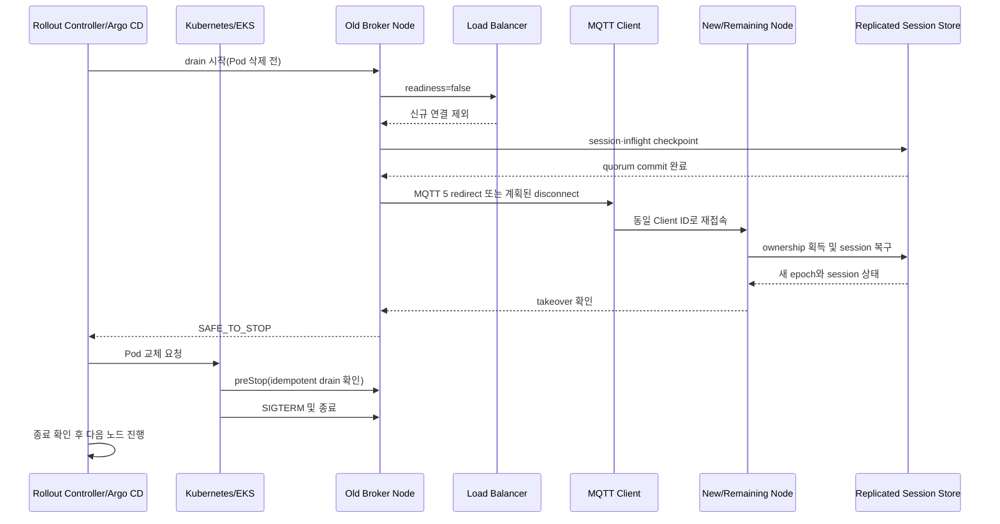

# NaruMQ 제품 요구사항 정의서

> 연결은 이동해도, 메시지는 남는다.

| 항목 | 내용 |
| --- | --- |
| 문서 상태 | Draft |
| 버전 | 0.5 |
| 작성일 | 2026-08-16 |
| 제품명 | NaruMQ |
| 대상 독자 | 제품 책임자, 플랫폼 엔지니어, 백엔드 개발자, SRE, 보안 담당자 |
| 기준 제품 | EMQX 5.x/6.x의 MQTT·클러스터·운영 기능 |
| 관련 스펙 | [NaruMQ 시스템 스펙](../specs/README.md) |
| 관련 Architecture | [NaruMQ Architecture Views](../architectures/README.md) |
| 관련 Convention | [NaruMQ Conventions](../conventions/README.md) |
| 관련 결정 | [NaruMQ ADR catalog](../decisions/README.md) |
| 관련 Contract | [NaruMQ Contract catalog](../contracts/README.md) |

## 1. 문서 목적

이 문서는 NaruMQ가 해결할 문제와 제품 범위를 정의한다. 구현 언어, 저장소 제품, 웹 프레임워크 같은 세부 기술은 별도 ADR에서 결정한다. 이 문서는 기술 선택보다 사용자가 얻어야 할 결과와 검증 기준을 우선한다.

NaruMQ의 목표는 EMQX 전체를 복제하는 것이 아니다. 여러 서비스가 함께 사용할 수 있고, 장애와 재배포에도 세션과 메시지를 지키는 경량 MQTT 클러스터를 만드는 것이다.

### 표기 원칙

일반 문장에서는 노드, 세션, 클라이언트, 테넌트, 메트릭, 대시보드, 브로커와 토픽을 기본 표기로 사용한다. MQTT packet·property·reason code, API field, Metric name, source code identifier와 제품 고유명은 원문 표기를 유지하고 필요한 경우 backtick으로 구분한다. 요구사항을 추가하거나 수정할 때 이 원칙을 적용한다.

## 2. 배경과 문제

현재 MQTT 인프라는 EMQX를 사용한다. 라이선스와 장기 유지보수 불확실성 때문에 핵심 데이터 경로를 직접 통제할 필요가 생겼다.

기존 운영 환경에는 다음 문제가 있다.

1. MQTT가 장기 연결 프로토콜이라 Pod 교체만으로 연결이 새 노드로 고르게 이동하지 않는다.
2. Argo CD 기반 배포에서는 일반적인 rolling update만 사용한다. Pod가 종료되면 클라이언트가 한꺼번에 재접속하고, 세션 상태에 따라 메시지를 잃을 수 있다.
3. 하나의 클러스터를 여러 서비스가 공유하려면 topic, Client ID, 인증 정보, quota를 서비스별로 격리해야 한다.
4. 클러스터 장애, 복제 지연, session takeover, drain 진행 상태를 한눈에 확인할 운영 도구가 필요하다.
5. QoS 수준과 세션 설정에 따라 달라지는 메시지 보장 범위가 명확하지 않다.

## 3. 제품 비전

NaruMQ는 Kubernetes 환경에 최적화된 고가용성 MQTT 클러스터다. 초기 production 기준 배포는 Amazon EKS의 EC2 기반 3-AZ 프로필이다. 클라이언트 연결은 어느 노드에서나 수용한다. 세션과 메시지는 노드 수명보다 오래 유지한다. 배포 전에는 연결을 안전하게 비우고, 다른 노드가 세션을 이어받도록 한다.

제품의 핵심 가치는 세 가지다.

- **연속성:** 노드가 바뀌어도 persistent session과 미전달 메시지를 이어받는다.
- **공유성:** 여러 서비스가 한 클러스터를 사용하되 서로의 데이터와 자원을 침범하지 않는다.
- **운영성:** API, Metric, 대시보드로 클러스터 상태와 배포 안전성을 확인한다.

## 4. 목표

### 4.1 제품 목표

| ID | 목표 | 성공 판단 |
| --- | --- | --- |
| G-01 | 클러스터 고가용성 | 3노드 중 1노드 장애에도 MQTT 데이터 플레인이 동작한다. |
| G-02 | 다중 서비스 공유 | 서비스별 namespace, ACL, quota가 강한 보안 경계를 이룬다. |
| G-03 | EMQX 수준의 운영 안정성 | 장애, 복구, 재배포 시나리오를 정량 SLO로 검증한다. |
| G-04 | Metric API | 노드·클러스터·서비스 단위 핵심 Metric을 API로 제공한다. |
| G-05 | 운영 대시보드 | 토폴로지, 부하, 메시지, 세션, drain 상태를 조회한다. |
| G-06 | 안전한 rolling update | 종료할 노드가 연결을 drain하고 세션을 인계한 뒤에만 종료된다. |
| G-07 | 클라이언트 보안 | TLS, mTLS, JWT/JWKS, ACL, 감사 로그를 제공한다. |
| G-08 | 검증 가능한 구현 | 모든 기능을 unit test로 검증하고 MQTT 표준 조항, 요구사항, 테스트를 추적한다. |

### 4.2 초기 성공 지표

아래 값은 초기 목표다. 현행 EMQX 트래픽 기준값을 수집한 뒤 확정한다.

| 지표 | 초기 목표 |
| --- | --- |
| 월간 데이터 플레인 가용성 | 99.99% 이상 |
| 허용 장애 | `EKS_EC2_HA` 프로필에서 3개 가용 영역에 1노드씩 배치하고 1노드 또는 단일 AZ 장애 허용 |
| broker가 승인한 durable QoS 1/2 메시지 RPO | 0 |
| 설정·ACL·retained message RPO | 0 |
| 비정상 노드 장애 RTO | 지원 클라이언트 기준 p99 30초 이하 |
| graceful drain 후 재접속 | 지원 클라이언트 기준 p99 10초 이하 |
| rolling update 중 persistent session 손실 | 0 |
| rolling update 중 비정상 Will 발행 | 지원 클라이언트 계약을 충족한 연결에서 0 |
| 연속 100회 rolling update의 강제 종료 | 0 |
| N-1 처리 용량 | 현행 최대 트래픽 이상 |
| 전체 production code coverage | line/function 90% 이상, branch 85% 이상 |
| MQTT·session·routing·security·drain 핵심 모듈 coverage | line/function 95% 이상, branch 90% 이상 |
| 변경 코드 coverage | line/branch 95% 이상 |

## 5. 비목표

초기 제품은 다음 기능을 만들지 않는다.

- EMQX SQL Rule Engine 호환 구현
- Kafka, DB, 오브젝트 스토리지 등 대규모 connector 묶음
- MQTT-SN, CoAP, STOMP, LwM2M 등 비-MQTT 게이트웨이
- 범용 스트림 처리 또는 ETL 엔진
- 자체 시계열 데이터베이스
- 공용 SaaS를 위한 billing과 요금제
- WAN을 가로지르는 active-active 다중 리전 클러스터
- QoS 0 메시지의 유실 없음 보장
- TCP 연결 자체를 다른 Pod로 투명 이전하는 기능
- MQTT 3.1.0(protocol level 3) 지원
- MQTT 3.1.0 호환 코드를 broker core에 포함하는 기능
- Docker Compose 또는 단일 Docker host의 3개 container를 production HA 배포로 지원하는 기능
- 초기 production release에서 Amazon ECS와 Amazon EKS Fargate를 지원 배포 프로필로 선언하는 기능

Webhook, Kafka 연동 등이 필요하면 일반 MQTT subscriber 또는 별도 adapter 서비스로 구현한다. 브로커 코어에 비즈니스 통합 기능을 넣지 않는다.

## 6. 사용자와 주요 시나리오

### 6.1 사용자

| 사용자 | 필요한 결과 |
| --- | --- |
| 플랫폼 운영자 | 안전하게 배포하고 노드·quorum·복제 상태를 확인한다. |
| 서비스 소유자 | 자기 서비스의 namespace, credential, ACL, quota를 관리한다. |
| 애플리케이션 개발자 | 표준 MQTT 클라이언트로 연결하고 재접속 후 세션을 이어받는다. |
| SRE | SLO, 지연, drop, 복제 지연, drain 실패에 경보를 설정한다. |
| 보안 담당자 | 인증 정책, tenant 격리, 감사 로그와 credential 회전을 검증한다. |

### 6.2 핵심 사용자 여정

#### UJ-01: 서비스 온보딩

1. 서비스 소유자가 namespace를 생성한다.
2. 연결 수, publish rate, 저장 용량 quota를 설정한다.
3. JWT issuer 또는 mTLS CA를 연결한다.
4. publish/subscribe ACL을 등록한다.
5. 클라이언트가 인증 후 자기 namespace 안에서만 메시지를 교환한다.

#### UJ-02: 노드 장애 복구

1. 연결을 가진 노드가 예고 없이 종료된다.
2. 클라이언트가 load balancer를 통해 다른 노드에 재접속한다.
3. 새 노드가 session ownership을 획득한다.
4. 구독, QoS handshake, 미전달 메시지를 복구한다.
5. 운영자는 장애와 복구 시간을 Metric과 대시보드에서 확인한다.

#### UJ-03: 안전한 rolling update

1. 외부 rollout controller가 종료할 노드의 drain API를 호출한다. 이때 Pod 삭제는 아직 요청하지 않는다.
2. 노드는 readiness를 내리고 새 연결을 받지 않는다.
3. 기존 연결을 제한된 속도로 다른 노드에 재접속시킨다.
4. 새 노드가 각 persistent session을 이어받는다.
5. 잔여 연결과 복제 의무가 0이 되면 이전 노드가 `SAFE_TO_STOP`을 반환한다.
6. rollout controller가 `SAFE_TO_STOP`을 확인한 뒤에만 Kubernetes에 Pod 교체를 요청한다.
7. `preStop`은 drain API를 idempotent하게 다시 호출하고 남은 grace period 안에서 완료 여부를 확인한다.
8. Kubernetes가 Pod를 종료한 뒤 rollout controller가 다음 노드를 갱신한다.

## 7. 제품 원칙

1. **프로토콜 보장을 과장하지 않는다.** QoS 0은 유실될 수 있다. QoS 1은 중복될 수 있다.
2. **ACK가 내구성 경계다.** durable 메시지는 필요한 복제가 끝난 뒤 publisher에 ACK한다.
3. **세션에는 단일 소유자만 존재한다.** network partition 중에도 두 노드가 같은 세션을 수정하지 못한다.
4. **격리는 기본값이다.** 인증과 ACL을 설정하지 않은 tenant는 연결할 수 없다.
5. **배포는 제품 기능이다.** drain과 session takeover를 운영 스크립트에만 맡기지 않는다.
6. **구현 기술은 교체 가능해야 한다.** MQTT 도메인은 Kubernetes, 저장소, Metric 제품을 알지 못한다.
7. **Metric의 cardinality를 통제한다.** clientId와 임의 topic을 기본 label로 노출하지 않는다.
8. **테스트는 구현의 일부다.** 테스트와 기준 coverage가 없는 기능은 완료로 보지 않는다.
9. **비교는 같은 조건에서 한다.** 성능 주장은 실제 EMQX와 동일 조건에서 반복 측정한 결과로만 판단한다.

## 8. 메시지 보장 모델

NaruMQ가 말하는 “메시지 유실 없음”은 MQTT hop별 조건으로 한정한다. publisher와 broker 사이의 소유권 이전과 broker와 subscriber 사이의 전달은 서로 다른 보장이다.

| 범위 | 조건 | 제품 보장 |
| --- | --- | --- |
| publisher → broker, QoS 0 | 모든 연결 | 최선 노력. 유실 없음 보장 대상이 아니다. |
| publisher → broker, QoS 1 | broker가 성공 PUBACK을 반환 | 설정된 replica와 write quorum이 WAL 영속화 기준을 충족한 뒤 메시지 소유권을 인수한다. |
| publisher → broker, QoS 2 | broker가 성공 PUBREC을 반환 | QoS 2 수신 handshake와 메시지를 같은 내구성 경계까지 저장한 뒤 소유권을 인수한다. PUBCOMP까지 handshake를 복구할 수 있다. |
| broker → durable subscriber, QoS 1 | persistent session, 미만료 메시지, 저장 quota와 quorum 유지 | offline queue가 메시지를 인수한 뒤 최소 한 번 전달한다. 중복될 수 있다. |
| broker → durable subscriber, QoS 2 | 위 조건과 송신 QoS 2 handshake 복제 | MQTT protocol receiver에 중복 없이 전달하도록 handshake를 재개한다. 애플리케이션 처리를 정확히 한 번 보장하지 않는다. |
| subscription의 최대 QoS가 더 낮음 | 모든 전달 | publisher QoS와 granted subscription QoS 중 낮은 수준으로 전달하며, 낮아진 QoS의 보장만 적용한다. |
| matching durable subscriber가 없음 | publisher ACK 완료 | broker의 메시지 소유권 인수만 의미한다. 미래 subscriber 전달을 보장하지 않는다. |
| PUBACK 또는 성공 PUBREC 이전 publisher 장애 | QoS 1/2 | 클라이언트가 local outbox와 재전송을 책임진다. |
| Clean Start 또는 Session Expiry 0 | 연결 종료 | session과 offline message를 보장하지 않는다. |
| Session Expiry 또는 Message Expiry 경과 | 만료 이후 | session 또는 미전달 메시지를 제거할 수 있다. |
| 변경된 Client ID | 재접속 | 이전 session을 이어받지 않는다. |
| quorum 상실 | 내구성 ACK 전 | 내구성 기준을 충족할 수 없으면 성공 ACK를 반환하지 않고 backpressure 또는 오류를 적용한다. |

이 문서에서 **내구성 ACK**는 QoS 1의 성공 PUBACK과 QoS 2의 성공 PUBREC을 뜻한다. 구체적인 WAL fsync, replication factor와 write quorum의 최솟값은 저장소·consensus ADR에서 정한다. 해당 값은 1노드 장애 RPO 0 목표를 약화할 수 없다.

보장 범위는 publisher와 broker, broker와 subscriber 사이의 MQTT protocol hop까지다. subscriber가 ACK한 메시지를 애플리케이션 DB에 반영하는 것은 NaruMQ의 책임이 아니다.

기술 배경은 [MQTT 전달 보장과 세션](../explainers/mqtt-delivery-guarantees.md), 분산 복구 원리는 [세션 소유권과 fencing](../explainers/session-ownership-and-fencing.md)을 참고한다.

## 9. 기능 요구사항

우선순위는 다음과 같다.

- **P0:** EMQX 대체 전 필수
- **P1:** 운영 안정화 전 필수
- **P2:** 사용량과 필요성을 확인한 뒤 구현

### 9.1 MQTT 프로토콜

| ID | 우선순위 | 요구사항 | 수용 기준 |
| --- | --- | --- | --- |
| MQTT-01 | P0 | MQTT 3.1.1(protocol level 4)과 MQTT 5.0(protocol level 5)을 지원한다. | 표준 적합성 시험을 통과하고 두 버전의 클라이언트가 같은 topic에서 통신한다. |
| MQTT-02 | P0 | QoS 0, 1, 2 상태 머신을 구현한다. | 정상, 중복, 재전송, 연결 단절 시나리오를 자동 시험한다. |
| MQTT-03 | P0 | Clean Start, Session Present, Session Expiry를 지원한다. | 재접속 시 만료되지 않은 session의 구독과 전달 상태가 복구된다. |
| MQTT-04 | P0 | Retained Message를 지원한다. | 새 subscriber가 권한 있는 topic의 최신 retained message를 받는다. |
| MQTT-05 | P0 | Will Message와 MQTT 5 Will Delay를 표준대로 지원한다. | 클라이언트의 정상 DISCONNECT를 받았거나 MQTT 5 클라이언트가 Will Delay 안에 같은 session으로 재접속하면 Will을 발행하지 않는다. 그 밖의 연결 종료는 프로토콜 버전과 Will 설정에 따라 표준대로 처리한다. |
| MQTT-06 | P0 | `+`, `#` wildcard subscription을 지원한다. | 겹치는 subscription과 wildcard 경계 사례를 표준대로 처리한다. |
| MQTT-07 | P0 | `$share/{group}/...` shared subscription을 지원한다. | 그룹당 한 subscriber에 전달되고 subscriber 장애 시 다른 멤버가 이어받는다. |
| MQTT-08 | P0 | MQTT 5 subscription options와 message expiry를 지원한다. | No Local, Retain As Published, Retain Handling, expiry 시험을 통과한다. |
| MQTT-09 | P0 | TCP와 TLS listener를 제공한다. | listener별 인증 정책과 연결 제한을 독립 설정한다. |
| MQTT-10 | P1 | WebSocket과 WSS listener를 제공한다. | 기존 사용 현황에서 필요가 확인되면 TCP와 같은 MQTT 의미를 제공한다. |
| MQTT-11 | P0 | packet size, receive maximum, inflight, queue 한도를 적용한다. | 제한 초과 시 표준 reason code 또는 연결 종료로 자원을 보호한다. |
| MQTT-12 | P0 | 비정상 packet과 slow client를 방어한다. | parser fuzzing과 slowloris 시험에서 메모리·goroutine/thread 누수가 없다. |
| MQTT-13 | P0 | MQTT 3.1.0 연결을 지원하지 않는다. | protocol name `MQIsdp` 또는 protocol level 3 연결을 unsupported protocol version으로 거절하고 session을 생성하지 않으며 Metric과 구조화 로그를 남긴다. |

#### MQTT 3.1.0 비지원과 이전 정책

NaruMQ v1은 MQTT 3.1.0을 지원하지 않는다. MQTT 3.1.1과 MQTT 5.0만 제품 지원 범위와 compliance matrix에 포함한다. MQTT 3.1.0과 3.1.1을 통칭해 MQTT v3으로 표기하지 않고 정확한 버전을 사용한다.

EMQX에서 NaruMQ로 전환하기 전에는 모든 연결 이벤트의 `proto_name`, `proto_ver`, `clientId`, tenant 또는 서비스 식별자와 timestamp를 외부 저장소에 적재한다. 관찰 기간은 최소 90일과 정상 클라이언트의 최장 재접속 주기 중 더 긴 기간으로 한다. 현재 연결 목록의 일회성 snapshot만으로 호환성을 판정하지 않는다.

다음 조건을 모두 충족해야 MQTT 3.1.0 비지원 상태로 production 전환할 수 있다.

1. 관찰 기간 동안 MQTT 3.1.0 연결이 없거나 발견된 모든 client의 소유자와 전환 계획이 확인된다.
2. 장기 미접속 장비, 원격 갱신이 불가능한 firmware와 외부 공급사 장비를 별도로 확인한다.
3. 지원 대상 저장소에서 `MQIsdp`, protocol level 3, `MQTTv31`, `MQTT_VERSION_3_1`, `V310`과 Flutter `mqtt_client`의 3.1.1 미설정 여부를 검사한다.
4. MQTT 3.1.0 client가 남아 있으면 firmware 또는 client 설정을 3.1.1 이상으로 올리거나 별도의 legacy broker/gateway로 격리한다.

legacy broker/gateway는 NaruMQ core와 별도 배포·수명 주기·Metric을 가져야 한다. MQTT 3.1.0 client 발견만으로 broker core의 지원 범위를 확장하지 않는다. canary 배포에서는 MQTT 3.1.0 연결 거절 Metric을 경보로 감시한다.

### 9.2 클러스터와 세션

| ID | 우선순위 | 요구사항 | 수용 기준 |
| --- | --- | --- | --- |
| CLU-01 | P0 | 최소 3노드 클러스터를 구성한다. | 1노드 장애 후에도 새 연결, publish, subscribe가 동작한다. |
| CLU-02 | P0 | 자동 discovery와 안전한 join/leave를 제공한다. | 재시작한 노드가 수동 데이터 수정 없이 복구하고 ready가 된다. |
| CLU-03 | P0 | 어느 노드에 연결해도 클러스터 전체 subscription으로 routing한다. | publisher와 subscriber가 다른 노드에 있어도 메시지를 전달한다. |
| CLU-04 | P0 | `(tenantId, clientId)`별 단일 활성 session ownership을 보장한다. | 동시 접속과 network partition 시험에서 활성 owner가 하나뿐이다. |
| CLU-05 | P0 | session ownership에 epoch 또는 fencing token을 적용한다. | 이전 owner의 stale write가 저장소에서 거부된다. |
| CLU-06 | P0 | persistent subscription과 QoS inflight 상태를 복제한다. | owner 노드 kill 후 새 owner가 handshake를 이어간다. |
| CLU-07 | P0 | durable subscriber용 미전달 메시지를 복제한다. | quorum이 유지되는 단일 노드 장애에서 ACK된 메시지 누락이 없다. |
| CLU-08 | P0 | retained message와 session metadata를 복제한다. | 한 노드 소실 후 동일 데이터가 조회되고 전달된다. |
| CLU-09 | P0 | 설정 가능한 replication factor와 write quorum을 제공한다. | 설정값보다 적은 replica에서 durable ACK를 반환하지 않는다. |
| CLU-10 | P0 | partition 정책을 문서화하고 자동 복구한다. | minority가 session ownership을 새로 획득하지 못하고 복구 후 상태가 수렴한다. |
| CLU-11 | P0 | 현재 release N과 직전 지원 release N-1의 혼합 버전 호환을 지원한다. | N-1↔N rolling update와 rollback 시험을 통과한다. release N+1이 출시될 때 N↔N+1을 같은 방식으로 검증한다. |
| CLU-12 | P0 | 복제 지연과 디스크 압력에 backpressure를 적용한다. | 한도 초과 시 drop보다 publish 제한을 우선하고 Metric을 기록한다. |
| CLU-13 | P1 | 연결과 session rebalance를 제공한다. | 노드 증설 후 설정한 편차 안으로 연결 수가 수렴한다. |
| CLU-14 | P0 | snapshot, backup, restore를 제공한다. | 빈 클러스터에 백업을 복원하고 검증 checksum과 개체 수가 일치한다. |

### 9.3 멀티테넌시

| ID | 우선순위 | 요구사항 | 수용 기준 |
| --- | --- | --- | --- |
| TEN-01 | P0 | 모든 MQTT 연결을 인증된 tenant에 귀속한다. | client가 임의 tenantId를 제출해 다른 tenant로 연결할 수 없다. |
| TEN-02 | P0 | Client ID 유일성 범위를 tenant 안으로 제한한다. | 서로 다른 tenant가 같은 clientId를 안전하게 사용한다. |
| TEN-03 | P0 | 내부 topic prefix로 namespace를 격리한다. | 같은 외부 topic을 사용해도 tenant 간 메시지가 섞이지 않는다. |
| TEN-04 | P0 | canonical topic을 기준으로 ACL을 평가한다. | mount prefix 우회와 wildcard 우회 보안 시험을 통과한다. |
| TEN-05 | P0 | system topic, retained, shared subscription, Will을 tenant별로 격리한다. | 교차 tenant 접근 시험이 모두 거부된다. |
| TEN-06 | P0 | tenant별 연결, session, subscription quota를 제공한다. | quota를 넘긴 tenant만 제한되고 다른 tenant의 지연은 목표 범위에 머문다. |
| TEN-07 | P0 | tenant별 message rate, byte rate, payload size 제한을 제공한다. | burst 시 backpressure 또는 rate-limit reason을 반환한다. |
| TEN-08 | P0 | tenant별 offline queue, retained bytes, 저장 용량 quota를 제공한다. | 저장 quota 초과 정책이 일관되게 적용되고 경보가 발생한다. |
| TEN-09 | P0 | noisy neighbor를 완화한다. | 단일 tenant 부하 시험 중 다른 tenant의 p99 지연이 합의한 한도를 넘지 않는다. |
| TEN-10 | P1 | tenant 위임형 관리 권한을 제공한다. | 서비스 관리자는 자기 namespace의 credential, ACL, quota만 변경한다. |

### 9.4 인증과 보안

| ID | 우선순위 | 요구사항 | 수용 기준 |
| --- | --- | --- | --- |
| SEC-01 | P0 | TLS 1.2 이상을 지원하고 평문 listener를 기본 비활성화한다. | 취약 프로토콜과 cipher 연결을 거부한다. |
| SEC-02 | P0 | JWT 서명·claim 검증과 JWKS key rotation을 지원한다. | 허용 알고리즘 목록, issuer, audience, subject binding, `exp`, `nbf`, clock skew와 `kid` 처리 규칙을 적용한다. key 추가·교체·폐기와 JWKS 장애 중 정책에 맞는 token만 허용한다. |
| SEC-03 | P0 | mTLS/X.509 인증을 지원한다. | 신뢰하지 않는 CA, 만료 인증서, identity 불일치를 거부한다. |
| SEC-04 | P0 | 인증 identity와 Client ID를 결합한다. | 하나의 credential로 허가되지 않은 clientId를 만들 수 없다. |
| SEC-05 | P0 | username/password가 필요하면 salted hash만 저장한다. | 평문 password가 저장, 로그, Metric에 나타나지 않는다. |
| SEC-06 | P0 | publish, subscribe, unsubscribe, Will에 default-deny ACL을 적용한다. | 정책이 없거나 backend가 실패하면 기본 거부한다. |
| SEC-07 | P0 | credential과 인증서의 회전·폐기를 지원한다. | 연결 중 정책과 재인증 전략이 문서화되고 감사된다. |
| SEC-08 | P0 | 외부 인증 장애 정책을 제공한다. | cache TTL 이후 fail-closed로 동작하고 장애 Metric을 기록한다. |
| SEC-09 | P0 | 노드 간 통신을 mTLS와 member allowlist로 보호한다. | 비인가 노드의 join과 cluster RPC를 거부한다. |
| SEC-10 | P0 | Management API와 Dashboard에 OIDC/API key, RBAC를 적용한다. | Read-only, Operator, Security Admin, Cluster Admin 권한이 분리된다. |
| SEC-11 | P0 | 관리 작업을 감사 로그로 남긴다. | actor, action, target, result, timestamp, request ID를 검색할 수 있다. |
| SEC-12 | P1 | clientId, username, certificate, IP 차단을 지원한다. | 차단 전파가 목표 시간 안에 모든 노드에 반영된다. |

### 9.5 Metric과 관리 API

| ID | 우선순위 | 요구사항 | 수용 기준 |
| --- | --- | --- | --- |
| API-01 | P0 | `/metrics`에서 Prometheus/OpenMetrics 형식을 제공한다. | Prometheus가 인증된 endpoint를 scrape하고 형식 검증을 통과한다. |
| API-02 | P0 | 버전이 명시된 JSON 관리 API를 제공한다. | `/api/v1` 명세와 OpenAPI 문서가 일치한다. |
| API-03 | P0 | node와 cluster 집계 Metric을 구분한다. | 집계 방식이 gauge, counter, histogram별로 문서화된다. |
| API-04 | P0 | startup, liveness, readiness, drain-complete probe를 분리한다. | quorum과 초기 동기화 전에는 readiness가 성공하지 않는다. |
| API-05 | P0 | 인증, RBAC, pagination, filtering, rate limit을 적용한다. | 대량 조회와 권한 우회 시험을 통과한다. |
| API-06 | P0 | 무제한 cardinality label을 금지한다. | 기본 Metric에 원문 clientId와 임의 topic label이 없다. |
| API-07 | P1 | 선택한 정확한 topic의 Metric을 제공한다. | wildcard를 받지 않고 최대 등록 수와 TTL을 제한한다. |
| API-08 | P1 | mutation API에 idempotency와 감사 추적을 제공한다. | 같은 idempotency key의 재시도가 중복 작업을 만들지 않는다. |
| API-09 | P0 | GitOps와 runtime 변경의 source of truth를 구분한다. | 설정 충돌 시 우선순위와 reconciliation 결과가 명확하다. |

필수 Metric 범위는 다음과 같다.

- 연결: current/max connection, session, subscription, topic
- 이벤트: connect, disconnect, reconnect, takeover와 reason
- 메시지: received, sent, delivered, dropped, expired와 QoS
- 프로토콜: packet, ACK, malformed packet, inflight, queue depth
- 호환성: protocol version별 connect와 `narumq_mqtt_connect_rejected_total{reason="unsupported_protocol_version", protocol="3.1.0"}`
- 지연: broker processing과 delivery latency histogram
- 클러스터: member, quorum, leader, term, commit/apply index
- 복제: replica count, replication lag, route propagation lag
- 저장소: disk usage, WAL, snapshot, compaction, oldest queued message
- 보안: authentication, authorization, deny, cache hit, backend latency
- 배포: drain state, remaining connection, takeover, ETA, forced termination
- 시스템: CPU, memory, file descriptor, socket, runtime scheduler

### 9.6 대시보드

| ID | 우선순위 | 요구사항 | 수용 기준 |
| --- | --- | --- | --- |
| UI-01 | P0 | cluster topology와 node 상태를 표시한다. | node, role, version, uptime, readiness, drain 상태가 보인다. |
| UI-02 | P0 | quorum과 복제 상태를 강조한다. | quorum 위험과 replica 부족을 첫 화면에서 식별한다. |
| UI-03 | P0 | 연결, session, subscription, message rate, drop 추이를 표시한다. | cluster와 node 범위를 전환하고 protocol version별 connect와 reject를 확인할 수 있다. |
| UI-04 | P0 | 노드별 연결 수와 부하 편차를 표시한다. | 불균형 노드를 정렬하고 rebalance 필요성을 판단할 수 있다. |
| UI-05 | P0 | drain 진행률과 종료 안전 상태를 표시한다. | 잔여 연결, takeover, 속도, ETA, 실패 이유를 보여준다. |
| UI-06 | P1 | tenant, clientId, node, IP, protocol로 client를 검색한다. | pagination된 검색 결과에서 session 상세로 이동한다. |
| UI-07 | P1 | client session과 subscription을 조회한다. | inflight, offline queue, 인증 identity는 권한에 따라 마스킹한다. |
| UI-08 | P1 | client disconnect와 MQTT 5 redirect를 실행한다. | 권한 확인, 확인 절차, 감사 로그가 남는다. |
| UI-09 | P1 | retained message와 선택 topic Metric을 조회한다. | tenant 권한 밖의 데이터는 표시하지 않는다. |
| UI-10 | P0 | 외부 TSDB를 사용한다. | Dashboard가 장기 시계열 원본을 자체 저장하지 않는다. |

### 9.7 안전한 종료와 rolling update

| ID | 우선순위 | 요구사항 | 수용 기준 |
| --- | --- | --- | --- |
| DEP-01 | P0 | node lifecycle을 `JOINING`, `READY`, `DRAINING`, `SAFE_TO_STOP`으로 관리한다. | 허용되지 않은 상태 전이를 거부하고 Metric과 로그를 남긴다. |
| DEP-02 | P0 | drain 시작·조회·취소 API를 제공한다. | API가 idempotent하고 node 장애 후 상태를 복구한다. |
| DEP-03 | P0 | drain 시작 시 즉시 새 연결 수용을 중단한다. | readiness가 내려간 뒤 신규 연결이 해당 node에 정착하지 않는다. |
| DEP-04 | P0 | load balancer 전파 대기 시간을 설정한다. | 대기 중 기존 연결은 유지하고 신규 연결은 받지 않는다. |
| DEP-05 | P0 | 연결 종료·이동 속도를 제한한다. | reconnect storm이 설정한 connection rate를 넘지 않는다. |
| DEP-06 | P0 | MQTT 5 client에 `DISCONNECT 0x9C`와 Server Reference를 제공한다. | 지원 client가 지정 endpoint 또는 공통 load balancer로 재접속한다. |
| DEP-07 | P0 | MQTT 3.1.1 client를 표준 동작을 유지하며 재접속시킨다. | checkpoint 후 연결을 닫고 client가 공통 endpoint로 돌아온다. Will이 설정된 연결은 서버 종료 시 Will이 발행될 수 있음을 호환성 표와 Metric에 명시한다. |
| DEP-08 | P0 | 종료 전 session과 inflight 상태의 quorum 복제를 확인한다. | 복제 확인 전 `SAFE_TO_STOP`을 반환하지 않는다. |
| DEP-09 | P0 | 새 owner의 session takeover를 확인한다. | 이전 owner는 takeover 뒤 session을 수정하지 못한다. |
| DEP-10 | P0 | 종료 안전 barrier를 제공한다. | 잔여 연결, 미반영 WAL, 필요한 replica가 기준을 충족해야 성공한다. |
| DEP-11 | P0 | drain timeout과 Pod 삭제 승인을 분리한다. | 외부 rollout gate는 timeout 또는 drain 실패 시 배포를 실패 처리하고 Pod 삭제를 요청하지 않는다. |
| DEP-12 | P0 | 계획된 drain의 Will을 MQTT 표준과 클라이언트 계약에 따라 처리한다. | 지원 클라이언트 계약을 충족한 연결의 비정상 Will은 연속 rolling test에서 0이다. MQTT 3.1.1 또는 Will Delay 0처럼 서버 종료 시 표준이 요구하는 Will은 별도 사유로 집계한다. |
| DEP-13 | P0 | Kubernetes `preStop` 연동을 최후 방어선으로 제공한다. | hook은 drain을 idempotent하게 시작·조회하고 결과를 기록한다. hook 종료 코드가 Pod 삭제를 막는 수단이라고 가정하지 않는다. |
| DEP-14 | P0 | 적절한 termination grace period를 배포 템플릿에 설정한다. | drain, `preStop`, SIGTERM 후 정상 종료에 필요한 최악 시간을 합산한다. 이보다 짧은 값은 검증 단계에서 거부하고 강제 종료를 경보한다. |
| DEP-15 | P0 | PodDisruptionBudget, required anti-affinity, topology spread와 rollout 동시성 제한을 제공한다. | 기준 3-AZ 프로필은 가용 영역마다 quorum 노드 1개를 배치하고 계획 배포 중 한 번에 1개 노드만 중단한다. |
| DEP-16 | P0 | 초기 동기화 후에만 신규 node를 ready로 만든다. | 필요한 route와 replica를 받기 전 load balancer에 포함되지 않는다. |
| DEP-17 | P0 | 비정상 종료 복구를 지원한다. | kill 시 drain 없이도 persistent session이 다른 node에서 복구된다. |
| DEP-18 | P0 | Argo CD health check, hook 또는 전용 rollout controller로 외부 종료 gate를 제공한다. | controller는 `SAFE_TO_STOP` 전에 Pod 삭제를 요청하지 않고 drain 실패 시 현재와 다음 Pod 갱신을 중단한다. |
| DEP-19 | P0 | 초기 production 지원 배포 프로필을 `EKS_EC2_HA`로 고정한다. | release artifact가 지원 Kubernetes·EKS version, EC2 node group, 3-AZ topology, storage, load balancer와 rollout 설정을 식별하고 자동 검증한다. |
| DEP-20 | P0 | `EKS_EC2_HA`에서 quorum node 3개를 서로 다른 가용 영역과 EC2 failure domain에 배치한다. | node와 AZ failure injection 중 두 quorum node가 같은 EC2 instance 또는 가용 영역에 함께 배치되지 않고, 단일 node·AZ 장애에서 데이터 플레인이 복구된다. |
| DEP-21 | P0 | 각 quorum node에 독립된 persistent volume과 검증된 block storage profile을 제공한다. | Amazon EBS CSI 기반 volume의 node별 분리, encryption, AZ binding, snapshot·restore와 disk pressure를 시험하고 durable ACK RPO 0을 충족한다. |
| DEP-22 | P0 | Amazon NLB의 TCP/TLS listener와 target lifecycle을 MQTT 장기 연결에 맞게 구성한다. | readiness 실패 뒤 신규 연결 제외, deregistration 전파 지연, 기존 연결 drain, idle timeout, client IP 정책과 connection termination 결과를 자동 시험한다. |
| DEP-23 | P0 | 배포 프로필별 지원 상태와 보장 범위를 명시한다. | `Supported`, `Experimental`, `Unsupported`를 release artifact에 표시하고 Compose·단일 host·ECS·EKS Fargate 결과를 `EKS_EC2_HA`의 HA·RPO·rolling update 근거로 사용하지 않는다. |
| DEP-24 | P2 | Amazon ECS on EC2 지원은 별도 lifecycle adapter와 검증 프로필로 제공할 수 있다. | ECS Task Scale-in Protection, Cloud Map, NLB, persistent volume, stable node identity, `stopTimeout`과 `SAFE_TO_STOP` gate가 DEP-01~DEP-12 및 DEP-16~DEP-17을 통과하기 전에는 `Experimental`을 넘지 않는다. |

#### 지원 배포 프로필

| Profile | 초기 상태 | 사용 범위 | 보장 |
| --- | --- | --- | --- |
| `EKS_EC2_HA` | Supported 목표 | Production | P0 HA, durable ACK, 3-AZ와 rolling update 출시 gate의 기준 |
| `ECS_EC2` | Experimental 후보 | 후속 compatibility 검증 | 별도 lifecycle adapter와 전체 수용 시험 전 production 보장 없음 |
| `EKS_FARGATE` | Unsupported | 후속 storage·drain 검토 | EBS 기반 WAL과 종료 시간 조건을 충족했다는 근거 없음 |
| `COMPOSE_LOCAL` | Unsupported production | 개발·CI artifact를 제공할 수 있음 | 단일 host failure를 견디는 HA·RPO 근거로 사용하지 않음 |

초기 AWS profile의 선택 근거는 [ADR-0007](../decisions/ADR-0007-aws-production-deployment-platform.md)에서 제안한다. 세 가용 영역·EC2·EBS의 장애 범위는 [EKS 고가용성과 장애 도메인](../explainers/eks-ha-failure-domains.md), NLB target 제외와 MQTT connection 인계는 [AWS NLB와 MQTT 연결 lifecycle](../explainers/aws-nlb-mqtt-connection-lifecycle.md)을 참고한다. ADR이 Accepted 되기 전에는 release 기본값으로 확정된 것으로 간주하지 않는다.

#### Rolling update 흐름

Kubernetes와 EKS의 종료 순서, `preStop`의 한계와 MQTT Will 동작은 [안전한 노드 drain과 Will](../explainers/safe-node-drain-and-will.md)을 참고한다. ECS는 같은 diagram의 Kubernetes actor를 그대로 대체한다고 간주하지 않으며 DEP-24의 별도 adapter와 검증을 요구한다.

## 10. 클라이언트 호환 계약

서버만으로 무중단 session 인계를 완성할 수 없다. 공식 지원 클라이언트는 다음 조건을 지켜야 한다.

| ID | 요구사항 |
| --- | --- |
| CLIENT-01 | 재접속해도 동일한 tenant와 Client ID를 사용한다. |
| CLIENT-02 | 메시지 보존이 필요하면 persistent session을 사용한다. |
| CLIENT-03 | Session Expiry를 최대 배포 시간보다 길게 설정한다. |
| CLIENT-04 | exponential backoff와 jitter를 포함한 자동 재접속을 구현한다. |
| CLIENT-05 | MQTT 5 Server Reference를 처리하거나 공통 load balancer endpoint로 재접속한다. |
| CLIENT-06 | PUBACK/PUBCOMP 전 publish를 local outbox에 보관하고 재전송한다. |
| CLIENT-07 | QoS 1 중복을 견디도록 consumer를 idempotent하게 구현한다. |
| CLIENT-08 | disconnect reason과 session resume 결과를 관측 가능하게 기록한다. |
| CLIENT-09 | 계획된 drain에서 Will 억제가 필요하면 MQTT 5 Will Delay를 최악 재접속 목표와 안전 여유보다 길게 설정하거나, 클라이언트가 정상 DISCONNECT를 보내는 협력형 drain을 사용한다. MQTT 3.1.1에서 Will을 설정한 연결은 서버 주도 종료 시 no-Will 보장 대상이 아니다. |

NaruMQ는 지원 SDK별 호환성 표와 기준 설정 예시를 제공한다.

## 11. 비기능 요구사항

### 11.1 성능과 용량

| ID | 요구사항 |
| --- | --- |
| NFR-01 | `B_conn`, `B_pub`, `B_sub`, `B_msg_size`, `B_topic`으로 현행 최대 트래픽 기준값을 정의한다. |
| NFR-02 | 정상 3노드와 N-1 상태에서 기준 부하를 견딘다. |
| NFR-03 | 용량 시험은 QoS 비율, wildcard, shared subscription, retained, offline session 분포를 재현한다. |
| NFR-04 | p50, p95, p99 publish-to-delivery 지연 목표를 부하 프로필별로 정의한다. |
| NFR-05 | overload 시 무제한 queue 증가보다 backpressure와 명시적 거부를 우선한다. |
| NFR-06 | node 추가·복구 중 초기 동기화가 데이터 플레인 SLO를 깨지 않아야 한다. |

Go runtime에서 bounded queue, cancellation, GC와 진단 도구가 이 요구사항에 미치는 영향은 [Go 동시성과 backpressure](../explainers/go-concurrency-and-backpressure.md)를 참고한다.

실제 EMQX 비교를 위한 요구사항은 다음과 같다.

| ID | 요구사항 |
| --- | --- |
| PERF-01 | 동일한 benchmark harness가 NaruMQ와 실제 EMQX 배포를 선택해 실행할 수 있어야 한다. |
| PERF-02 | EMQX version, image digest, 설정 파일과 license/edition을 결과에 기록한다. |
| PERF-03 | broker node 수, CPU, memory, storage class, network, AZ 배치를 동일하게 맞춘다. |
| PERF-04 | MQTT version, TLS, 인증, QoS, durability, session, topic, payload와 subscription 조건을 기능적으로 동등하게 맞춘다. |
| PERF-05 | 기능을 동등하게 설정할 수 없는 시험은 비동등 항목을 표시하고 직접 우열 비교에서 제외한다. |
| PERF-06 | 부하 발생기는 broker와 분리하고 두 제품에 동일한 client 구현, 연결 ramp와 message stream을 사용한다. |
| PERF-07 | 각 profile은 고정된 warm-up과 측정 구간으로 최소 5회 독립 실행한다. 중앙값과 편차를 함께 보고한다. |
| PERF-08 | throughput, p50/p95/p99/p99.9 latency, CPU, memory, network, disk I/O와 error/drop을 수집한다. |
| PERF-09 | connection, session, subscription당 memory와 메시지당 CPU·network·disk 비용을 비교한다. |
| PERF-10 | 정상 처리뿐 아니라 node failure, recovery, reconnect storm과 rolling drain 시간도 비교한다. |
| PERF-11 | benchmark 명령, 설정, raw result와 보고서를 version control 또는 artifact storage에 보관한다. |
| PERF-12 | release마다 이전 NaruMQ 안정 버전과 고정 EMQX 기준 버전을 다시 측정해 regression을 확인한다. |

### 11.2 신뢰성

| ID | 요구사항 |
| --- | --- |
| NFR-07 | quorum이 유지되는 단일 node 장애에서 durable ACK 메시지 RPO 0을 보장한다. |
| NFR-08 | 모든 상태 변경은 재시도 가능하거나 idempotent해야 한다. |
| NFR-09 | process crash, host loss, packet loss, latency, partition, disk full을 chaos test로 검증한다. |
| NFR-10 | snapshot과 log recovery는 crash 중단 후에도 원자성을 유지한다. |

### 11.3 유지보수성

| ID | 요구사항 |
| --- | --- |
| NFR-11 | MQTT domain은 storage, Kubernetes, HTTP, UI framework에 의존하지 않는다. |
| NFR-12 | session, routing, delivery, tenancy, security, cluster lifecycle을 독립 모듈로 구분한다. |
| NFR-13 | 외부 시스템은 port/interface 뒤에 둔다. 구현체 교체가 domain 변경을 요구하지 않아야 한다. |
| NFR-14 | dependency 방향과 금지 import를 CI architecture test로 검증한다. |
| NFR-15 | release N은 직전 지원 release N-1과의 양방향 rolling upgrade·rollback 호환성을 문서화하고 검증한다. N↔N+1 호환성은 release N+1의 출시 조건으로 검증한다. |

목표 repository와 package 배치는 [Project structure](../architectures/project-structure.md), Go identifier·file·error·test 작성 규칙은 [Go coding conventions](../conventions/go-coding-conventions.md)을 따른다.

### 11.4 보안과 개인정보

| ID | 요구사항 |
| --- | --- |
| NFR-16 | secret, token, password, 인증서 private key를 로그와 Metric에 기록하지 않는다. |
| NFR-17 | 감사 로그의 보존 기간, 접근 권한, 위변조 방지 정책을 정의한다. |
| NFR-18 | parser와 network listener는 비신뢰 입력을 전제로 fuzzing과 resource exhaustion 시험을 수행한다. |
| NFR-19 | release 전에 threat modeling과 tenant isolation penetration test를 수행한다. |

### 11.5 테스트와 coverage

Unit test는 모든 기능의 기본 검증 수단이다. 그러나 분산 동작과 실제 protocol wire compatibility는 unit test만으로 증명할 수 없다. NaruMQ는 unit, property, integration, conformance, end-to-end, chaos test를 계층별로 함께 운영한다.

| ID | 요구사항 |
| --- | --- |
| TEST-01 | 모든 production 기능과 함수에 정상, 오류, 경계 조건 unit test를 작성한다. |
| TEST-02 | 기능 추가와 bug fix는 실패를 재현하는 unit test를 먼저 포함해야 한다. |
| TEST-03 | MQTT 3.1.1/5.0 지원 범위의 모든 normative statement를 test case와 연결한 compliance matrix로 관리한다. |
| TEST-04 | packet parser, encoder, QoS state machine, session expiry, topic matching, ACL, quota, drain state transition의 모든 분기를 unit test한다. |
| TEST-05 | 시간, 난수, network, storage, consensus와 인증 backend는 port/test double로 대체해 unit test를 결정적이고 빠르게 실행한다. |
| TEST-06 | 전체 production code는 line/function 90% 이상, branch 85% 이상의 coverage를 유지한다. |
| TEST-07 | protocol, session, routing, delivery, tenancy, security, cluster lifecycle 핵심 모듈은 line/function 95% 이상, branch 90% 이상을 유지한다. |
| TEST-08 | pull request의 변경 코드는 line/branch 95% 이상의 diff coverage를 충족한다. |
| TEST-09 | coverage 기준은 ratchet 방식으로 운영한다. 현재 기준보다 높은 coverage를 달성하면 이후 release에서 낮출 수 없다. |
| TEST-10 | test 실패, coverage 하락, 미매핑 P0 요구사항 또는 미매핑 MQTT normative statement가 있으면 CI가 merge를 차단한다. |
| TEST-11 | generated code, vendor code와 단순 선언을 coverage에서 제외할 수 있다. 제외 사유와 경로는 설정 파일과 review에 남긴다. |
| TEST-12 | critical state machine에 mutation test를 적용하고 mutation score 80% 이상을 유지한다. |
| TEST-13 | packet, topic filter, session transition에 property-based test와 fuzz test를 적용한다. |
| TEST-14 | concurrency 관련 코드는 race detector 또는 동등한 도구를 CI에서 실행한다. |
| TEST-15 | flaky test는 허용하지 않는다. 격리는 임시 조치로만 허용하고 owner와 해소 기한을 기록한다. |
| TEST-16 | unit test는 외부 network, 실제 clock, 실행 순서와 공유 mutable state에 의존하지 않는다. |
| TEST-17 | MQTT 3.1.0 CONNECT의 `MQIsdp`, protocol level 3과 비정상 버전 조합을 unit·integration test로 검증한다. 거절 시 session이 생성되지 않고 Metric과 구조화 로그가 기록되어야 한다. |

Coverage 수치는 검증의 하한이다. 높은 coverage만으로 기능 완료를 주장할 수 없다. 요구사항 수용 기준과 MQTT 표준 동작을 실제 assertion으로 확인해야 한다.

## 12. 시스템 경계

초기 제품은 하나의 broker 배포 단위 안에 명확한 모듈 경계를 둔다. 분산 서비스 수를 먼저 늘리지 않는다.

제품 경계는 다음 원칙을 따른다.

- MQTT client는 공개 listener와 MQTT protocol을 통해서만 data plane에 접근한다.
- Dashboard, operator와 rollout controller는 management API와 공개된 Metric·audit 경계를 사용한다.
- Broker node는 MQTT, session, routing, delivery, tenancy와 cluster lifecycle 정책을 소유한다.
- 외부 identity provider, TSDB, audit store와 Kubernetes는 adapter 경계 밖에 둔다.
- Domain source는 application, framework, storage, network와 Kubernetes를 참조하지 않는다.
- Application use case가 필요한 port를 소유하고 adapter가 구현한다.
- 저장소·consensus·framework 자료형을 domain 경계 안으로 전달하지 않는다.

외부 actor와 실행 단위는 [System overview](../architectures/system-overview.md), broker component와 source dependency는 [Broker core architecture](../architectures/broker-core.md)를 기준 view로 사용한다. 계층 원리는 [Broker core의 계층 경계](../explainers/broker-core-boundaries.md)에서 설명한다.

Architecture view는 현재 `Target / Draft`이며 구현 완료 증거가 아니다. 구현 언어, consensus, storage, transport, Dashboard, API 인증과 Kubernetes 배포 선택은 [ADR catalog](../decisions/README.md)에서 상태를 확인한다.

## 13. 주요 도메인 개념

| 개념 | 정의 |
| --- | --- |
| Tenant | 독립된 Client ID, topic, ACL, quota 공간을 가진 서비스 단위 |
| Client Identity | 인증 결과에서 얻은 tenant, subject, 허용 Client ID와 역할 |
| Session | Client ID에 연결된 구독, QoS handshake, queue, expiry 상태 |
| Session Owner | 현재 session의 네트워크 연결과 delivery를 처리하는 유일한 node |
| Epoch | session owner 세대를 나타내는 fencing 값 |
| Route | topic filter와 subscriber session/node의 연결 정보 |
| Durable Message | ACK 전에 정해진 복제 기준을 충족한 메시지 |
| Drain | 신규 연결을 차단하고 기존 session을 다른 node로 인계하는 절차 |
| Safe-to-stop Barrier | node 종료 전 충족해야 하는 연결·복제·저장 조건 |

## 14. 관리 API 초안

세부 schema는 OpenAPI 설계에서 확정한다.

| Method | Path | 용도 |
| --- | --- | --- |
| GET | `/health/live` | process liveness |
| GET | `/health/ready` | traffic readiness |
| GET | `/health/startup` | 초기 동기화 완료 여부 |
| GET | `/health/drain` | drain-complete 여부. Pod 삭제 승인은 외부 rollout gate가 별도 판단 |
| GET | `/api/v1/cluster` | cluster와 quorum 요약 |
| GET | `/api/v1/nodes` | node 목록과 상태 |
| GET | `/api/v1/nodes/{nodeId}` | node 상세 |
| POST | `/api/v1/nodes/{nodeId}/drain` | drain 시작 |
| GET | `/api/v1/nodes/{nodeId}/drain` | drain 진행 조회 |
| DELETE | `/api/v1/nodes/{nodeId}/drain` | drain 취소 |
| GET | `/api/v1/tenants` | tenant 목록 |
| POST | `/api/v1/tenants` | tenant 생성 |
| GET/PUT | `/api/v1/tenants/{tenantId}/quotas` | quota 조회·수정 |
| GET/PUT | `/api/v1/tenants/{tenantId}/policies` | ACL 조회·수정 |
| GET | `/api/v1/clients` | client 검색 |
| GET | `/api/v1/clients/{tenantId}/{clientId}` | session 상세 |
| DELETE | `/api/v1/clients/{tenantId}/{clientId}` | client disconnect |
| POST | `/api/v1/clients/{tenantId}/{clientId}/redirect` | MQTT 5 redirect |
| GET | `/api/v1/subscriptions` | subscription 조회 |
| GET | `/api/v1/retained` | retained 조회 |
| DELETE | `/api/v1/retained/{topic}` | retained 삭제 |
| GET | `/metrics` | OpenMetrics endpoint |

## 15. 검증 전략과 출시 게이트

### 15.1 프로토콜 검증

- MQTT 3.1.1/5.0 normative statement와 test case의 compliance matrix
- 각 기능의 정상, 오류, 경계 조건 unit test
- QoS 1/2 packet state, DUP, 재전송과 session resume의 분기별 unit test
- malformed packet, 최대 길이, UTF-8, packet ID 경계 시험
- parser, encoder, topic matcher의 property-based test와 fuzzing
- protocol과 session state machine mutation test
- 주요 클라이언트 SDK 상호 운용 시험

Unit test suite는 외부 서비스 없이 실행되어야 한다. 개발자 환경과 CI에서 같은 결과를 내야 한다. 전체 suite와 핵심 모듈 coverage는 TEST-06부터 TEST-10까지의 기준을 충족해야 한다.

### 15.2 분산 시스템 검증

- 연결 처리 중 broker process kill
- host 또는 AZ 단절
- node 사이 packet loss, latency, reorder, partition
- leader/owner 경쟁과 stale write
- quorum 상실과 복구
- disk full, 느린 I/O, snapshot 중 crash
- node join, leave, restart, data resync

### 15.3 배포 검증

- 최대 예상 트래픽에서 연속 100회 rolling update
- drain 중 publish, subscribe, unsubscribe, retained, Will
- MQTT 3.1.1과 MQTT 5 client 혼합
- reconnect storm과 rate control
- drain timeout 및 Argo CD 중단
- 직전 지원 release N-1과 현재 release N의 혼합 버전과 rollback

배포 시험은 모든 payload에 단조 증가 message ID를 넣는다. 누락, 중복, 순서 변경, ACK 후 미전달을 분리해 측정한다.

### 15.4 보안 검증

- tenant topic prefix와 wildcard 우회
- 동일 Client ID와 credential 재사용 공격
- JWT issuer, audience, expiry, JWKS rotation
- mTLS CA와 certificate identity binding
- 관리 API RBAC와 IDOR
- secret 노출, audit log 무결성
- connection/message flood와 slow client

### 15.5 실제 EMQX 성능 비교

성능 기준선은 홍보 자료나 외부 benchmark 수치가 아니다. 지정된 환경에 실제 EMQX와 NaruMQ를 차례로 배포하고 같은 부하를 재생해 만든다.

필수 비교 profile은 다음과 같다.

| Profile | 조건 | 주요 목적 |
| --- | --- | --- |
| BP-01 Protocol Baseline | MQTT 5, QoS 0, non-persistent session, 고정 payload | protocol과 network 기본 비용 비교 |
| BP-02 Production Mix | 실제 QoS·payload·topic·TLS·인증 분포 | 현행 workload 대체 가능성 판단 |
| BP-03 Durable Delivery | QoS 1/2, persistent session, offline queue, 동등한 replication | ACK latency와 내구성 비용 비교 |
| BP-04 Subscription Stress | wildcard, overlapping, shared subscription, 높은 fan-out | routing과 delivery 확장성 비교 |
| BP-05 Connection Scale | 연결 ramp, keepalive, reconnect | 연결당 memory와 reconnect storm 비교 |
| BP-06 Failure Recovery | 단일 node kill과 재합류 | RTO, message gap, recovery 부하 비교 |
| BP-07 Rolling Drain | 동일 connection 수에서 node 순차 교체 | drain 시간, reconnect 분산, message 보장 비교 |

각 실행은 다음 조건을 결과와 함께 보관한다.

- Git commit, NaruMQ version, EMQX version과 image digest
- Kubernetes manifest와 broker 설정 전체
- node·load generator의 instance 사양과 resource limit
- storage class, volume 크기, network와 AZ topology
- client SDK version, 연결 수, ramp, payload와 topic 생성 규칙
- TLS·인증·ACL·durability 설정
- warm-up·측정 시간, 반복 횟수와 실행 순서
- raw sample, aggregate report, test log와 오류 목록

보고서는 최소 다음 값을 같은 표와 그래프로 비교한다.

- 성공 connection 수와 connection 생성률
- publish, delivery throughput
- p50, p95, p99, p99.9 latency
- CPU와 memory 사용량 및 단위 작업당 비용
- node 간 network traffic과 disk IOPS/throughput
- error, reject, drop, duplicate와 message gap
- failover RTO, data resync 시간, drain 완료 시간

Phase 0에서는 실제 EMQX 기준선과 현행 트래픽을 측정하고, Phase 1에 들어가기 전에 부하 profile별 최소 throughput, 최대 p99·p99.9 latency, 연결당 memory와 복구 RTO를 수치로 확정한다. NaruMQ 비교는 각 profile에 필요한 기능이 완성된 phase에서 실행한다. BP-03은 Phase 2, BP-07은 Phase 3의 출시 gate다. 확정 전에도 raw 결과와 차이는 공개한다. NaruMQ 자체 회귀는 이전 안정 버전보다 throughput 또는 p99 latency가 5% 이상 악화되면 release를 차단한다. 측정 편차가 5%보다 크면 원인을 확인한 뒤 반복 횟수를 늘린다.

### 15.6 P0 출시 게이트

다음 조건을 모두 충족해야 제한된 production traffic을 받는다.

1. P0 기능 요구사항에 unit test와 자동 수용 시험이 연결된다.
2. MQTT 지원 범위의 normative statement가 compliance matrix와 test case에 연결된다.
3. TEST-06부터 TEST-10까지의 coverage와 CI 기준을 충족한다.
4. 같은 환경에서 실제 EMQX와 모든 필수 benchmark profile을 실행하고 결과를 보관한다.
5. 현행 EMQX 트래픽 프로필의 N-1 부하 시험을 통과한다.
6. 단일 node kill에서 durable ACK 메시지 누락이 없다.
7. 연속 rolling update 시험에서 persistent session 손실이 없고, 지원 클라이언트 계약을 충족한 연결의 비정상 Will 발행이 없다. 표준에 따라 예상되는 Will은 별도로 보고한다.
8. tenant isolation 보안 시험을 통과한다.
9. backup/restore runbook과 rollback 절차를 검증한다.
10. 주요 Metric, alert, Dashboard가 운영 환경에서 동작한다.
11. MQTT 3.1.0 관찰 기간과 client inventory를 완료하고, 남은 legacy client는 3.1.1 이상으로 전환하거나 별도 broker/gateway로 격리한다.
12. `EKS_EC2_HA`의 3-AZ 배치, EBS CSI 복구, NLB drain과 단일 node·AZ failure 수용 시험을 통과한다.

## 16. 단계별 제공 범위

Phase 0은 기준과 도구를 확정하는 단계다. Phase 1부터 기능을 구현하고, 관련 기능이 준비되는 phase마다 NaruMQ와 EMQX를 같은 조건으로 비교한다. 제한된 production traffic은 Phase 4를 완료하고 15.6의 P0 출시 gate를 모두 통과한 뒤에만 허용한다.

### Phase 0: 기준선과 위험 제거

- 현행 EMQX 트래픽·기능 사용 현황 수집
- EMQX 연결 이벤트의 `proto_name`과 `proto_ver`를 최소 90일과 최장 재접속 주기 중 더 긴 기간 동안 수집
- 고정 version의 실제 EMQX만 사용해 BP-01부터 BP-07까지의 성능 기준선 수집
- Phase 1 진입 전에 부하 profile별 성능·메모리·복구 SLO 수치 확정
- MQTT client SDK와 재접속 설정 조사
- MQTT 3.1.0 client 소유자·firmware 갱신 가능성·격리 계획 확정
- 프로토콜 parser와 단일 node spike
- consensus, session store, routing ADR 작성
- MQTT normative statement compliance matrix 작성
- unit test, coverage ratchet, mutation test CI gate 구축
- NaruMQ와 EMQX에 공통으로 사용하는 적합성·부하·chaos test harness 구축
- `EKS_EC2_HA`의 지원 EKS version, EC2 instance·node group, EBS CSI, NLB와 3-AZ topology 기준 확정

### Phase 1: 단일 node MQTT broker

- MQTT 3.1.1/5.0
- MQTT 3.1.0 거절과 호환성 Metric
- QoS 0/1/2
- session, retained, Will, shared subscription
- TLS, JWT/JWKS, mTLS, ACL
- 기본 Metric과 관리 API

### Phase 2: 3노드 고가용성

- cluster routing
- session ownership과 fencing
- durable session과 replicated message
- node failure recovery
- tenant isolation과 quota
- snapshot, backup, restore와 복구 runbook

### Phase 3: 안전한 재배포

- drain API와 lifecycle
- MQTT 5 redirect
- session takeover 확인
- Kubernetes lifecycle와 PDB
- Argo CD health 연동
- `EKS_EC2_HA` 배포 artifact, EBS CSI·NLB 설정과 3-AZ failure test
- 반복 rolling·chaos test

### Phase 4: 운영 제품화와 P0 출시 준비

- Dashboard
- client/session 관리
- alarm과 audit
- rebalance와 capacity planning

### Phase 5: 선택적 adapter

- WebSocket/WSS
- opt-in topic Metric
- HTTP webhook adapter
- MQTT bridge
- Kafka adapter
- 검증 결과가 DEP-24를 충족할 때만 Amazon ECS on EC2 deployment adapter
- Storage와 종료 시간 제약을 별도로 통과한 경우에만 EKS Fargate profile 재검토

## 17. 위험과 대응

| 위험 | 영향 | 대응 |
| --- | --- | --- |
| MQTT state machine 결함 | 메시지 중복·유실·호환성 장애 | 표준 적합성, model/property test, fuzzing을 구현보다 먼저 구축한다. |
| 분산 session 이중 소유 | 중복 전달과 상태 손상 | quorum ownership, epoch, fencing, partition test를 P0로 둔다. |
| ACK 시점 오류 | ACK 후 메시지 손실 | durability level별 ACK barrier를 명시하고 fault injection으로 검증한다. |
| reconnect storm | 배포 중 전체 cluster 과부하 | drain rate, jitter, N-1 capacity, overload backpressure를 적용한다. |
| multi-tenant 우회 | 서비스 간 데이터 노출 | canonical topic ACL, default deny, 침투 시험을 적용한다. |
| Metric cardinality 폭증 | Prometheus와 broker 메모리 장애 | clientId/topic label 금지, opt-in topic Metric과 TTL을 적용한다. |
| mixed-version 비호환 | rolling update 중 cluster 분리 | 인접 버전 wire/storage 호환 계약과 CI matrix를 운영한다. |
| 구현 범위 팽창 | 일정과 신뢰성 악화 | Rule Engine과 connector를 core 범위 밖에 유지한다. |
| 특정 저장소 결합 | 교체 비용 증가 | domain port와 adapter 경계를 유지하고 ADR로 결정을 기록한다. |
| MQTT 3.1.0 legacy client 잔존 | NaruMQ 전환 시 연결 실패 | 장기간 연결 이벤트를 수집하고 client를 3.1.1 이상으로 갱신한다. 갱신할 수 없으면 별도 legacy broker/gateway로 격리한다. |
| 기존 제품 구현 모방 | 라이선스·법적 위험 | OASIS MQTT 표준에 따른 clean-room 구현과 법무 검토를 수행한다. |
| coverage 수치만 충족하는 약한 테스트 | 결함이 검출되지 않은 채 출시 | branch·diff coverage, mutation test, 요구사항·표준 조항 추적을 함께 강제한다. |
| 불공정한 EMQX 비교 | 잘못된 성능 결론 | 동일 자원·기능·부하 조건, 실제 EMQX 실행, raw artifact 보관을 강제한다. |
| AWS deployment profile의 잘못된 동등성 주장 | 단일 host·미검증 ECS/Fargate 결과로 HA 출시 | `EKS_EC2_HA`만 초기 production 기준으로 사용하고 profile별 지원 상태와 축소된 보장을 artifact에 표시한다. |
| NLB와 EBS 설정 불일치 | 신규 연결 유입, 강제 연결 종료 또는 durable state 위험 | NLB target lifecycle과 EBS CSI topology·snapshot을 failure·rolling test에 포함한다. |

## 18. 미결정 사항

아래 항목은 Phase 0에서 결정한다.

1. 현재 최대 동시 연결과 1일·1시간 peak는 얼마인가?
2. publish/subscribe 초당 처리량과 평균·최대 payload는 얼마인가?
3. QoS 0/1/2 비율은 얼마인가?
4. persistent session, retained, shared subscription 사용량은 얼마인가?
5. wildcard topic cardinality와 subscription fan-out은 얼마인가?
6. MQTT 3.1.0과 WebSocket을 사용하는 client가 각각 있는가? 3.1.0 client가 있다면 누가 소유하며 3.1.1 이상으로 갱신하거나 격리할 수 있는가?
7. 현재 Session Expiry와 reconnect backoff 설정은 무엇인가?
8. tenant 수와 tenant별 최대 부하 편차는 얼마인가?
9. 현재 인증 방식과 외부 인증 backend는 무엇인가?
10. 기준 3-AZ 프로필에서 허용할 AZ 간 지연, storage topology와 장애 domain은 무엇인가? 단일 AZ 배포 같은 비기준 프로필의 보장 축소를 어떻게 표시할 것인가?
11. durable 메시지를 모든 QoS 1/2 publish에 적용할지, durable subscriber가 있는 경우에만 적용할지? [ADR-0003](../decisions/ADR-0003-durable-ack-barrier.md)은 전자를 제안하며 아직 Proposed다.
12. disaster recovery의 RPO/RTO와 백업 보존 기간은 얼마인가?
13. 지원할 클라이언트 SDK와 최소 버전은 무엇인가?
14. 실제 EMQX 대비 허용할 throughput, p99 latency와 자원 효율 비율은 얼마인가?
15. 장기 benchmark에 사용할 고정 EMQX version과 edition은 무엇인가?
16. `EKS_EC2_HA`에서 지원할 EKS minor version, EC2 instance family, EBS volume type·IOPS와 NLB target mode는 무엇인가?
17. ECS adapter 검토를 시작할 실제 운영 수요와 ECS Task Protection·stop timeout·persistent volume의 합격 기준은 무엇인가?

## 19. 요구사항 추적성

구현 이슈, ADR, 테스트는 요구사항 ID를 제목 또는 metadata에 포함한다. MQTT protocol test는 관련 OASIS normative statement ID도 함께 기록한다.

요구사항에서 파생된 외부 동작 계약은 다음 문서를 기준으로 한다.

| 요구사항 | 관련 스펙 | 관련 Contract |
| --- | --- | --- |
| MQTT-01~MQTT-13, CLIENT-01~CLIENT-08 | [MQTT protocol과 session](../specs/mqtt-protocol-and-session.md) | [MQTT client compatibility v1](../contracts/mqtt-client-compatibility-v1.md) |
| CLU-01~CLU-14, NFR-07~NFR-10, NFR-15 | [Cluster session과 durable delivery](../specs/cluster-session-and-delivery.md) | [Cluster release compatibility v1](../contracts/cluster-release-compatibility-v1.md) |
| TEN-01~TEN-10, SEC-01~SEC-12, NFR-16~NFR-19 | [Tenant와 security](../specs/tenancy-and-security.md) | [Audit event v1](../contracts/audit-event-v1.md), [Management API v1](../contracts/management-api-v1.md) |
| API-01~API-09, UI-01~UI-10 | [Management API와 observability](../specs/management-api-and-observability.md) | [Management API v1](../contracts/management-api-v1.md), [Audit event v1](../contracts/audit-event-v1.md) |
| DEP-01~DEP-24, CLIENT-01~CLIENT-09 | [Drain과 rolling update](../specs/drain-and-rolling-update.md) | [Management API v1](../contracts/management-api-v1.md), [MQTT client compatibility v1](../contracts/mqtt-client-compatibility-v1.md) |
| NFR-01~NFR-06, NFR-11~NFR-15, PERF-01~PERF-12, TEST-01~TEST-17 | [Performance와 verification](../specs/performance-and-verification.md) | [Cluster release compatibility v1](../contracts/cluster-release-compatibility-v1.md) |

예시:

- Issue: `[DEP-08] drain 종료 전 session quorum 확인`
- ADR: `ADR-0003: CLU-04 session ownership 모델`
- Unit Test: `MQTT-3.1.4-2 / MQTT-01 invalid CONNECT rejection`
- Test: `test_DEP_12_no_unexpected_will_for_supported_clients`
- Benchmark: `PERF-04 / BP-03 durable delivery EMQX comparison`
- Dashboard: `API-03 cluster aggregation 패널`

모든 기능은 최소 하나의 unit test와 연결한다. P0 요구사항은 자동 수용 시험도 가져야 한다. 지원한다고 선언한 MQTT normative statement는 compliance test가 있어야 한다. 문서에만 존재하는 요구사항은 완료로 처리하지 않는다.

## 20. 참고 자료

- [OASIS MQTT Version 5.0](https://docs.oasis-open.org/mqtt/mqtt/v5.0/mqtt-v5.0.html)
- [OASIS MQTT Version 3.1.1](https://docs.oasis-open.org/mqtt/mqtt/v3.1.1/os/mqtt-v3.1.1-os.html)
- [MQTT Specification](https://mqtt.org/mqtt-specification/)
- [RFC 7519: JSON Web Token](https://datatracker.ietf.org/doc/rfc7519/)
- [RFC 8725: JSON Web Token Best Current Practices](https://datatracker.ietf.org/doc/rfc8725/)
- [EMQX MQTT Core Concepts](https://docs.emqx.com/en/emqx/latest/messaging/mqtt-concepts.html)
- [EMQX Rule Engine Event Fields](https://docs.emqx.com/en/emqx/latest/data-integration/rule-sql-events-and-fields.html)
- [EMQX Cluster Design](https://docs.emqx.com/en/emqx/latest/design/clustering.html)
- [EMQX Durable Sessions](https://docs.emqx.com/en/emqx/latest/durability/durability_introduction.html)
- [EMQX Node Evacuation and Rebalancing](https://docs.emqx.com/en/emqx/latest/deploy/cluster/rebalancing.html)
- [EMQX Authentication](https://docs.emqx.com/en/emqx/latest/access-control/authn/authn.html)
- [EMQX Authorization](https://docs.emqx.com/en/emqx/latest/access-control/authz/authz.html)
- [EMQX Namespace](https://docs.emqx.com/en/emqx/latest/multi-tenancy/namespace-overview.html)
- [EMQX Metrics and Statistics](https://docs.emqx.com/en/emqx/latest/observability/metrics-and-stats.html)
- [Kubernetes Container Lifecycle Hooks](https://kubernetes.io/docs/concepts/containers/container-lifecycle-hooks/)
- [Kubernetes Pod Lifecycle](https://kubernetes.io/docs/concepts/workloads/pods/pod-lifecycle/)
- [Amazon EKS Kubernetes version lifecycle](https://docs.aws.amazon.com/eks/latest/userguide/kubernetes-versions.html)
- [Amazon EKS EBS CSI driver](https://docs.aws.amazon.com/eks/latest/userguide/ebs-csi.html)
- [Amazon EKS Network Load Balancer](https://docs.aws.amazon.com/eks/latest/userguide/network-load-balancing.html)
- [Amazon ECS Task Scale-in Protection](https://docs.aws.amazon.com/AmazonECS/latest/developerguide/task-scale-in-protection.html)
- [NaruMQ 시스템 스펙](../specs/README.md)
- [NaruMQ ADR catalog](../decisions/README.md)
- [NaruMQ Contract catalog](../contracts/README.md)
- [NaruMQ 기술 해설](../explainers/README.md)

---

NaruMQ는 노드의 생존을 보장하지 않는다. 노드가 사라져도 연결과 메시지가 이어지도록 만든다.
