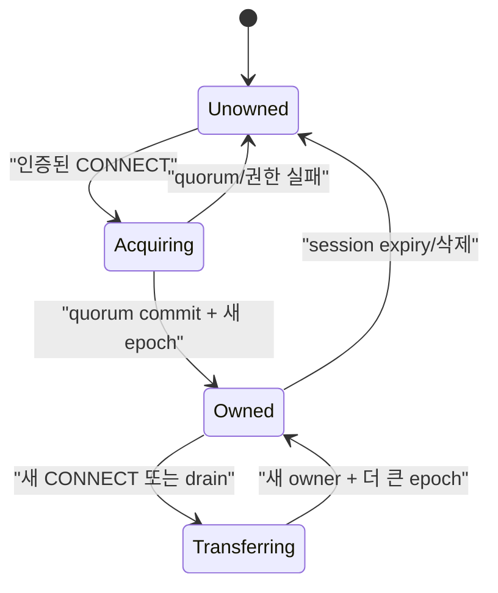
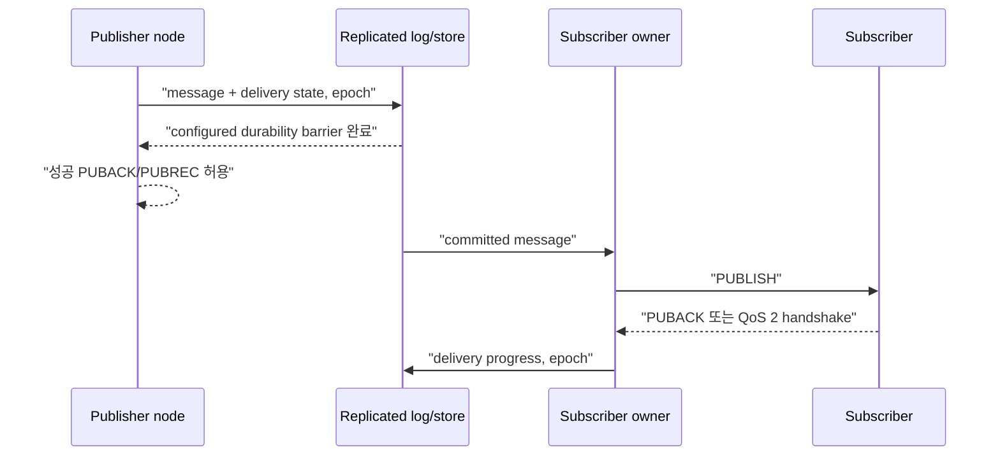

# Cluster session과 durable delivery 스펙

이 문서는 여러 NaruMQ node가 membership, session ownership, routing과 durable state를 외부에서 일관되게 제공하는 동작을 정의한다. Storage와 consensus target은 ADR에서 결정하며, target 선택만으로 runtime 수용이 완료되지는 않는다.

| 항목 | 값 |
| --- | --- |
| 상태 | Draft |
| 관련 요구사항 | CLU-01~CLU-14, NFR-07~NFR-10, NFR-15 |
| 근거 | [PRD 8장, 9.2절과 11.2절](../requirements/PRD.md) |
| 관련 Architecture | [Cluster architecture](../architectures/cluster-architecture.md), [EKS on EC2 deployment](../architectures/eks-ec2-deployment.md) |
| 관련 결정 | [ADR-0001](../decisions/ADR-0001-core-implementation-language.md), [ADR-0002](../decisions/ADR-0002-cluster-consensus-library.md), [ADR-0003](../decisions/ADR-0003-durable-ack-barrier.md), [ADR-0004](../decisions/ADR-0004-session-ownership-and-fencing.md), [ADR-0007](../decisions/ADR-0007-aws-production-deployment-platform.md), [ADR-0008](../decisions/ADR-0008-raft-peer-transport.md), [ADR-0009](../decisions/ADR-0009-raft-production-state-profile.md) |
| 관련 Contract | [Cluster release compatibility v1](../contracts/cluster-release-compatibility-v1.md), [Raft peer transport v1](../contracts/raft-peer-transport-v1.md) |
| 해설 | [세션 소유권과 fencing](../explainers/session-ownership-and-fencing.md), [EKS 고가용성과 장애 도메인](../explainers/eks-ha-failure-domains.md) |

## 1. Cluster membership

1. 기준 배포는 quorum에 참여하는 node 3개로 구성해야 한다.
2. node는 `JOINING` 중 discovery, member 인증, log/snapshot 동기화와 committed persistent subscription에서 route projection을 rebuild하는 작업을 마쳐야 한다.
3. 초기 동기화와 route projection rebuild가 끝나고 quorum을 확인하기 전에는 MQTT traffic readiness를 성공으로 반환해서는 안 된다.
4. join, 정상 leave와 재시작은 수동 데이터 수정 없이 재시도할 수 있어야 한다.
5. 비인가 member와 지원하지 않는 cluster protocol version은 membership에 추가해서는 안 된다.

외부 cluster 조회는 최소한 node별 `nodeId`, lifecycle state, release version, member role, readiness, replication health와 마지막 오류를 제공해야 한다.

## 2. Session identity와 ownership

session key는 `(tenantId, clientId)`다. 각 key에는 한 시점에 쓰기 권한을 가진 owner가 최대 하나만 존재해야 한다.

ownership record는 최소 `sessionKey`, `ownerNodeId`, 단조 증가 `epoch`, 상태와 `commit identifier`를 가져야 한다. 이 Phase 2 evidence에서 `commit identifier`는 ownership aggregate가 opaque committed-command stream을 소비할 때 부여하는 application committed-command sequence position이다. 이는 consensus adapter의 Raft `StatusDTO.CommitIndex`나 snapshot index와 다르다. [ADR-0009](../decisions/ADR-0009-raft-production-state-profile.md)는 protobuf encoding family만 선택했으며 exact persisted schema는 별도 contract에서 정한다.

Phase 2의 첫 단계인 replicated ownership core는 다음 관찰 계약을 만족해야 한다.
1. 최초 acquire의 `expectedEpoch`는 `0`이어야 하며 성공 시 `epoch`는 `1`이 된다.
2. 이후 모든 ownership 획득 및 reconnect는 현재 `epoch`와 일치하는 `expectedEpoch`를 요구하며 성공 시 `epoch`가 정확히 `1` 단조 증가한다.
3. `epoch`가 `uint64` 최대값에 도달하면 wrap-around하지 않고 mutation을 영구 중단한다.
4. quorum commit 없는 proposal은 어떤 node의 state machine에도 반영되지 않는다.
5. majority takeover 후 이전 `(ownerNodeId, epoch)`의 인가 요청은 거절되어야 한다.
6. restart 및 snapshot replay 후에도 마지막 application committed-command sequence position과 epoch가 정확히 보존된다.
7. 이미 quorum에 commit된 동일 ownership acquire command를 commit 응답 유실 후 재시도하면, retry도 다음 application committed-command sequence position으로 commit되어 `stale_epoch`로 결정적으로 거절되어야 한다. 이때 `ownerNodeId`, `epoch`와 성공한 ownership record의 `commit identifier`는 바뀌지 않아야 한다.

### 2.1 Fencing 규칙

- session aggregate를 바꾸는 acquire 이외의 command의 의미상 envelope 필드는 `sessionKey`, `ownerNodeId`, `epoch`와 operation-specific subscription 또는 inflight mutation으로 한정한다. 이 이름은 필요한 의미 정보이며 serialized field나 byte format을 정하지 않는다.
- committed apply는 `ownerNodeId == currentOwnerNodeId`이고 `epoch == currentEpoch`인 경우에만 acquire 이외의 session mutation을 인가한다.
- ownership record가 없거나 owner가 다르거나 epoch가 다르면 stale/not-authorized mutation으로 결정적으로 거절한다.
- 성공한 `Acquire`만 owner와 epoch를 설치하거나 증가시킬 수 있다. Subscription 또는 inflight mutation은 epoch가 현재 값보다 크더라도 새 owner나 epoch를 설치할 수 없다.
- 문법적으로 유효하지만 stale한 committed mutation은 application committed-command sequence position을 소비하지만 ownership, persistent subscription, QoS inflight와 route projection은 바꾸지 않는다.
- 새 owner는 더 큰 epoch가 quorum commit된 뒤에만 client traffic을 처리해야 한다.
- 이전 owner는 takeover를 관찰한 즉시 read·write와 delivery를 중단하고 connection을 종료해야 한다.
- timeout만으로 ownership을 추정하거나 임대 만료 전 stale owner write를 허용해서는 안 된다.

Production error/DTO와 serialized bytes는 [ADR-0009](../decisions/ADR-0009-raft-production-state-profile.md)가 선택한 encoding family에 맞춰 별도 replicated-state contract에서 정한다. ADR-0009는 exact message schema나 wire bytes를 정의하지 않는다.

### 2.2 Session aggregate와 route projection

`sessionKey`마다 ownership record, persistent subscription, inbound QoS inflight와 outbound QoS inflight를 하나의 논리적 replicated session aggregate로 취급한다. 한 `sessionKey`에 대한 command는 같은 committed ordering을 공유하고 하나의 aggregate 경계에서 원자적으로 적용해야 한다. Subscription 또는 inflight 변경 결과를 ownership 권한 판정 결과와 분리해 외부에 노출해서는 안 된다.

Route metadata는 committed persistent subscription에서만 계산하는 node-local disposable projection이다. 이 projection은 authoritative aggregate에서 다시 만들 수 있어야 하며, node는 routing readiness를 광고하기 전에 rebuild를 완료해야 한다. Route projection은 ownership, checkpoint 또는 drain barrier의 근거로 사용할 수 없다.

WAL·snapshot target, protobuf encoding family와 단일 group profile은 scoped [ADR-0009](../decisions/ADR-0009-raft-production-state-profile.md)에 기록한다. Exact persisted bytes/schema, Active Raft peer transport v1 범위 밖의 peer compatibility, production application port와 `cmd/narumq` 조립 방식은 여전히 미정이다. Durable offline message의 저장·전달 경계도 이 slice에서 확정하지 않는다.

### 2.3 Takeover ordering

- Drain 중인 owner는 successor의 더 큰 epoch `Acquire`가 commit되기 전에 현재 epoch로 최종 persistent subscription·QoS inflight checkpoint mutation을 quorum에 commit해야 한다.
- Successor `Acquire`가 commit된 뒤 그보다 뒤에 committed ordering된 old owner의 route-affecting subscription 또는 inflight command는 exact owner/epoch check에서 거절되어야 한다. Command 도착 시각이나 locally cached route는 이 결과를 우회할 수 없으며 authoritative aggregate와 route projection은 바뀌지 않는다.

동시 CONNECT 또는 partition 시험에서 성공 owner가 둘로 관찰되면 spec 위반이다.

## 3. Routing

1. 어느 READY node에 publisher와 subscriber가 연결돼도 cluster 전체의 matching subscription으로 전달해야 한다.
2. route key는 tenant 격리가 끝난 canonical topic/filter를 사용해야 한다.
3. Route-affecting subscription mutation은 authoritative fenced command로 `sessionKey`, `ownerNodeId`, `epoch`와 subscription option을 전달한다. Committed apply 뒤 route projection은 committed persistent subscription state에서 파생하며, 별도의 authorized route mutation으로 처리하지 않는다.
4. 이전 owner 또는 stale owner/epoch의 route-affecting subscription add·remove mutation은 거절해야 한다.
5. route propagation 지연은 측정 가능해야 한다. 지연 중에도 권한 또는 tenant 경계를 우회해서는 안 된다.
6. shared subscription member 선택은 tenant와 group 경계를 지켜야 하며, unavailable owner를 계속 선택해서는 안 된다.

## 4. Replicated state

다음 상태는 configured replication factor와 write quorum을 적용해야 한다.

| 상태 | 복구 계약 |
| --- | --- |
| persistent subscription | owner 장애 뒤 같은 filter와 options를 복구한다. |
| 수신·송신 QoS inflight | packet identifier, 단계와 재전송 의미를 복구한다. |
| durable offline message | expiry·quota 안에서 전달을 재개한다. |
| retained message | tenant와 canonical topic별 최신 값을 복구한다. |
| session metadata | expiry, Will, owner epoch와 client protocol 정보를 복구한다. |
| ownership·route metadata | stale owner를 fence하고 routing을 다시 구성한다. |

replica 수가 configured write quorum보다 적으면 durable write를 성공 처리해서는 안 된다. replication lag 또는 disk pressure가 한도를 넘으면 publish admission을 늦추거나 거절해야 하며, 이미 성공 ACK한 durable state를 임의로 drop해서는 안 된다.

## 5. Publish commit과 delivery

- 성공 PUBACK/PUBREC은 PRD의 내구성 ACK 경계 뒤에만 반환해야 한다.
- matching durable subscriber가 없으면 publisher ACK가 미래 subscriber 전달을 뜻하지 않는다.
- owner 장애 뒤 새 owner는 committed inflight 단계에서 handshake를 재개해야 한다.
- QoS 1 중복은 허용되지만 durable ACK 뒤 message gap은 허용되지 않는다.
- QoS 2는 MQTT receiver와의 protocol handshake에서 중복 전달을 막아야 한다. subscriber 애플리케이션의 정확히 한 번 처리는 보장하지 않는다.

## 6. Partition과 quorum loss

| 상태 | Majority/quorum side | Minority 또는 quorum 없는 side |
| --- | --- | --- |
| 기존 non-durable traffic | 설정 정책과 자원 한도 안에서만 처리할 수 있다. | 데이터 일관성을 해치지 않는 범위로 제한한다. |
| 새 session ownership | 획득할 수 있다. | 획득해서는 안 된다. |
| durable publish ACK | barrier 충족 시 반환한다. | 성공 ACK을 반환해서는 안 된다. |
| ownership transfer | 새 epoch를 commit할 수 있다. | 수행해서는 안 된다. |
| 관리 mutation | quorum이 필요한 변경만 commit한다. | `quorum_unavailable`로 실패해야 한다. |

partition이 복구되면 committed log가 기준이 된다. minority의 speculative state가 있었다면 폐기하고 route·session state를 다시 구성해야 한다. 자동 수렴 전 node를 READY로 표시해서는 안 된다.

## 7. Failure recovery

1. process crash 또는 host loss가 감지되면 다른 node가 quorum을 통해 새 epoch를 획득해야 한다.
2. 새 owner는 persistent session, subscription, inflight와 offline queue를 복구한 뒤 connection을 수용해야 한다.
3. 단일 node 장애에서 durable ACK가 끝난 message의 RPO는 0이어야 한다.
4. crash 중 snapshot 또는 log append가 중단돼도 마지막 유효 commit 이전 상태로 원자적으로 복구해야 한다.
5. disk full과 느린 I/O는 해당 node의 replication health와 readiness에 반영해야 한다. 오류를 성공 commit으로 보고해서는 안 된다.

## 8. Mixed-version compatibility

- release N은 N-1의 cluster wire, persisted state, snapshot과 관리 동작을 읽고 안전하게 상호 운용해야 한다.
- N-1이 해석할 수 없는 상태를 N이 기록해야 한다면 feature activation을 모든 필수 node의 upgrade 이후로 미뤄야 한다.
- N에서 N-1로 rollback할 때 이미 기록된 상태를 손상하거나 silent downgrade해서는 안 된다.
- 호환할 수 없는 변경은 rolling update를 시작하기 전에 preflight에서 거절해야 한다.
- 호환 matrix는 release artifact에 포함해야 한다.

## 9. Rebalance

P1 rebalance가 활성화되면 target 편차, 최대 동시 이동 수와 이동 rate를 설정해야 한다. Rebalance는 ownership transfer와 같은 fencing·checkpoint 규칙을 따라야 한다. QoS state를 복제하기 전에 기존 owner를 종료해서는 안 된다.

## 10. Snapshot, backup과 restore

1. snapshot은 포함된 commit index와 checksum을 가져야 한다.
2. backup은 복원에 필요한 snapshot, 후속 log와 schema/version metadata를 포함해야 한다.
3. 빈 cluster restore는 tenant, session, subscription, retained, inflight·offline 상태의 개체 수와 checksum을 검증해야 한다.
4. 검증이 실패한 restore는 cluster를 READY로 만들면 안 된다.
5. backup 중 write와 crash가 발생해도 복원 결과는 선언된 commit 경계에서 일관돼야 한다.

보존 기간과 disaster recovery RPO/RTO는 `SPEC-TBD-09`다.

## 11. 수용 시험

- 3-node에서 publisher와 subscriber를 서로 다른 node에 연결해 모든 QoS와 subscription 유형을 시험한다.
- 동시 CONNECT, owner kill, packet partition과 stale epoch write 거절을 검증한다.
- quorum 상실 중 새 ownership과 durable ACK가 성공하지 않는지 검증한다.
- 성공 durable ACK 직후 각 node를 kill해 message gap이 없는지 확인한다.
- disk full, snapshot crash, restore와 resync 중 원자성·readiness를 확인한다.
- N-1↔N rolling upgrade와 rollback을 양방향으로 시험한다.

### 11.1 Phase 0 gate 4 deterministic spike mapping

아래 첫 표의 네 시나리오는 `internal/adapters/raft`의 in-process deterministic harness가 검증하는 제한된 증거다. 각 시나리오는 독립 temporary directory와 FIFO `MessageDTO` delivery를 사용한다. 이어지는 두 failure-bound 시험은 각각 WAL adapter unit test와 in-process cluster harness를 쓰는 부분 증거이며, 실제 디스크 장애나 production transport를 검증하지 않는다.

| Spike scenario | 관찰할 결과 | Test mapping |
| --- | --- | --- |
| `leader failure preserves committed state` | node 1 장애 뒤 node 2가 증가한 term으로 선출되고 `[alpha,beta]`가 surviving node에 유지된다. | `TestRaftConsensusSpike/leader_failure_preserves_committed_state` |
| `quorum loss cannot commit` | quorum 없는 old leader가 `gamma`를 apply하지 않으며 반복 proposal은 `ErrBackpressure`로 수렴한다. | `TestRaftConsensusSpike/quorum_loss_cannot_commit` |
| `WAL replay restores commit` | bootstrap snapshot 뒤 reopen한 node가 `[alpha]`를 복구하고 재가입 뒤 `[alpha,beta]`로 수렴한다. | `TestRaftConsensusSpike/WAL_replay_restores_commit` |
| `snapshot plus WAL tail restores state` | snapshot index 이후 WAL tail을 replay해 `[alpha,beta,gamma]`와 동일한 applied/commit 경계를 복구한다. | `TestRaftConsensusSpike/snapshot_plus_WAL_tail_restores_state` |

첫 표 mapping은 CLU-01/02/06/07/09/10과 ADR-0001 gate 4, ADR-0002 §7의 skeleton·local recovery 항목을 연결한다. Fixed-voter peer transport v1의 별도 evidence는 §11.3에 있다. Session ownership, durable MQTT ACK barrier, 실제 disk-full/readiness, 느린 I/O와 membership-change 수용 시험은 여전히 미완료이며 §11.3을 cluster 전체 수용 완료로 간주하지 않는다.

#### WAL write failure와 slow-follower 제한의 부분 증거

아래 시험은 특정 어댑터 동작과 Raft의 in-process flow-control window에 관한 부분 증거다. `Open`의 `MaxInflightMsgs=16`은 entry가 포함된 고유 `MsgApp` 범위에 적용된다. entry가 없는 `MsgApp`은 commit index를 전달할 수 있어 이 계수에 포함하지 않는다. 측정값은 총 outbound 메시지 수, transport queue 크기 또는 retained Raft log 크기의 한계를 뜻하지 않는다.

| Evidence case | 관찰한 결과 | Test mapping |
| --- | --- | --- |
| `WAL write failure stops outbound` | bootstrap 이후 해당 node의 `wal.bin` write에만 주입한 `ENOSPC`가 `ErrFailed`를 반환하고 node는 terminal failed state로 전이한다. Ready batch는 비고 `persisted`/`outbound` event와 applied command는 바뀌지 않는다. 주입 제거 후 `Campaign`, `Propose`, `ProcessReady`도 계속 `ErrFailed`이며 `Close`는 정상 작동한다. | `TestNodeWALWriteFailureStopsOutbound` (`internal/adapters/raft/stable_store_test.go`) |
| `slow follower keeps outbound append window bounded` | 1↔3 및 2↔3 route를 막은 동안 node 1·2가 순서가 고유한 1 KiB command 64개를 모두 같은 순서로 적용하고 node 3은 적용하지 않는다. node 1→3의 미응답 entry-bearing `MsgApp` 고유 범위는 `Open`의 `MaxInflightMsgs=16`에 따라 16개 이하로 제한된다. route 복구 뒤 최대 20 logical tick 안에 세 node가 같은 command 순서로 수렴한다. | `TestRaftConsensusSpike/slow_follower_keeps_outbound_append_window_bounded` (`tests/integration/raft_consensus_test.go`) |

WAL 쓰기 시험의 `ENOSPC`는 `filePersistenceOps.write`에서 주입한 오류로 실제 파일시스템 용량 고갈을 재현하지 않는다. 느린 follower 시험은 in-process route 차단이며 실제 peer transport, 느린 I/O, production queue의 메시지·byte 사용량 또는 전체 retained log를 측정하지 않는다. 두 시험 모두 node readiness, MQTT durable ACK, production durability나 전체 수용 시험 완료를 증명하지 않는다.

### 11.2 Phase 2 replicated session ownership core mapping

아래 다섯 시나리오는 `internal/application/takeover`가 application committed-command 순서로 세션 상태를 적용하고 `internal/adapters/raft`가 opaque bytes를 운반하는 in-process deterministic 3-node harness의 제한된 증거다. Acquire bytes는 `takeover`의 experimental codec으로 해석하며, subscription·inflight bytes는 해당 시험 안에서만 typed DTO를 찾는 token으로 해석한다. NMQSTATE1 snapshot/WAL의 재시작 복구 증거는 acquire command에만 해당하고 새 mutation type의 persisted encoding·재시작 replay를 증명하지 않는다.

| Scenario | 관찰할 결과 | Test mapping |
| --- | --- | --- |
| `concurrent acquire elects single owner` | 동일 `(tenantId, clientId)`에 동시 acquire 시 leader에서 먼저 commit된 owner만 epoch 1을 얻고 후속 제안은 `stale_epoch`로 거절되며 모든 node가 동일 상태로 수렴한다. | `TestReplicatedSessionOwnership/concurrent_acquire_elects_single_owner` |
| `minority cannot acquire or advance epoch` | partition된 minority node의 ownership proposal은 commit되지 않으며 majority에서 새 leader가 epoch 2를 commit한 뒤 takeover한다. partition 복구 시 minority는 majority의 epoch 2로 수렴하고 이전 epoch 1 owner의 authorize는 거절된다. | `TestReplicatedSessionOwnership/minority_cannot_acquire_or_advance_epoch` |
| `restart recovers ownership epoch and command sequence` | snapshot과 WAL tail을 가진 node가 재시작 후 opaque command stream을 replay했을 때 restart 전과 동일한 session owner, epoch, application committed-command sequence position으로 복구된다. | `TestReplicatedSessionOwnership/restart_recovers_ownership_epoch_and_command_sequence` |
| `lost commit response retry preserves owner and epoch` | 동일한 opaque command payload 두 개가 모든 node에 commit되고 두 번째 retry가 `stale_epoch`로 거절되며, ownership은 node 1 / epoch 1 / sequence position 1에 남고 state machine은 application sequence position 2까지 진행한다. | `TestReplicatedSessionOwnership/lost_commit_response_retry_preserves_owner_and_epoch` |
| `stale owner session mutations are fenced after takeover` | 5개 명령이 적용된 뒤 node 2/epoch 2 takeover의 ownership position은 5다. 미리 준비한 이전 owner의 persistent subscription 및 inbound/outbound QoS inflight 명령 세 개가 뒤이어 commit되어 3개 node 모두 application sequence 8까지 진행하지만 각각 `stale_epoch`로 거절된다. 구독 `orders/#` QoS 1, inbound `[10]`, outbound `[20]`과 각 node의 파생 route projection은 takeover 직후와 동일하게 유지된다. | `TestReplicatedSessionOwnership/stale_owner_session_mutations_are_fenced_after_takeover` |

이 mapping은 CLU-04, CLU-05, CLU-10과 ADR-0004 §8 항목 1~5의 in-process session ownership/fencing core를 연결한다. 실제 MQTT CONNECT 경로와의 결합, multi-node TCP connection teardown, production peer transport, subscription·inflight persisted encoding/replay, durable message ACK barrier는 이 core slice에 포함되지 않으며 수용 시험 전체 완료로 간주하지 않는다.

### 11.3 Phase 0 gate 4 production peer transport mapping

이 mapping은 Accepted [ADR-0008](../decisions/ADR-0008-raft-peer-transport.md)과 Active [Raft peer transport v1 contract](../contracts/raft-peer-transport-v1.md)의 고정 voter `{1,2,3}` 전송 경로만 닫는다. 실행 가능한 composition root는 `cmd/narumq -raft-peer-config`이며 일반 MQTT listener와 통합되지 않는다.

| Scenario | 관찰할 결과 | Test mapping | 실행 증거 |
| --- | --- | --- | --- |
| Contract wire vectors와 framing limits | Canonical hello/frame bytes, protocol version validation, zero/oversized/truncated frame 경계가 contract와 일치한다. | `TestPeerTransportHelloGoldenVector`, `TestPeerTransportHelloRejectsInvalidFields`, `TestPeerTransportFrameGoldenVectorAndLengthBounds` | `go test ./internal/adapters/tcp -run '^TestPeerTransport' -count=1` |
| mTLS identity 및 invalid peer 입력 | Foreign CA, allowlisted 다른 identity 주장, cluster/version mismatch, protobuf envelope mismatch, malformed protobuf, oversized/truncated frame은 state/command에 적용되지 않는다. Production driver는 malformed protobuf를 보낸 peer 연결을 종료한다. | `TestPeerTransportRejectsInboundCertificateForWrongVoter`, `TestRaftPeerTransportRejectsUnauthenticatedAndMalformedPeers`, `TestRaftPeerDriverTicksQueuesAndStops` | `go test ./internal/adapters/tcp -run '^TestPeerTransport' -count=1`; `go test ./tests/integration -run '^TestRaftPeerTransport' -count=1`; `go test ./cmd/narumq -run '^TestRaftPeerDriverTicksQueuesAndStops$' -count=1` |
| Bounded queue, backpressure와 quorum progress | Queue count/byte cap을 지킨다. Peer 3 outbound queue가 가득 차도 node 1·2는 election과 command apply를 진행하고, queue가 drain된 뒤 Raft가 peer traffic을 재생성한다. 같은 Ready batch의 거절된 peer 후속 frame은 건너뛰며 healthy peer 전송은 계속한다. Inbound staging overflow는 해당 connection을 닫고 cancellation은 queued-byte accounting을 비운다. 초과 inbound socket도 accept되지 않는다. | `TestPeerTransportSendQueueBoundsCountAndTracksWriter`, `TestPeerTransportSendQueueBoundsFramedBytes`, `TestPeerTransportInboundQueueBoundsFramedBytes`, `TestPeerTransportInboundCancellationDrainsStagedFrames`, `TestPeerTransportConnectionBoundsAndCancellation`, `TestPeerTransportLimitsConcurrentInboundConnections`, `TestProcessRaftMessagesContinuesOtherPeersAndSkipsRejectedFIFO`, `TestRaftPeerDriverTicksQueuesAndStops` | `go test ./internal/adapters/tcp -run '^TestPeerTransport' -count=1`; `go test ./cmd/narumq -run '^(TestProcessRaftMessagesContinuesOtherPeersAndSkipsRejectedFIFO|TestRaftPeerDriverTicksQueuesAndStops)$' -count=1` |
| TLS 3-node replication과 reconnect | Node 3을 끊은 동안 majority가 progress하고, 재연결 후 Node 3이 commit된 command까지 catch up한다. | `TestRaftPeerTransportThreeNodeReplicationAndCatchup` | `go test ./tests/integration -run '^TestRaftPeerTransport' -count=1` |
| Peer-only CLI lifecycle | 3개 별도 peer-only process가 TLS election을 수행하고 WAL을 남긴다. Cancellation 뒤 listener/socket이 닫히며 MQTT `READY`는 출력되지 않는다. | `TestRaftPeerOnlyStartsThreePeersAndStops` | `go test ./cmd/narumq -run '^(TestRaftPeerOnlyRejectsOtherFlags|TestRaftPeerOnlyStartsThreePeersAndStops)$' -count=1` |

이 evidence는 dynamic membership, join/leave, N/N-1 release compatibility, production snapshot transfer, 실제 disk-full·slow-I/O, replicated MQTT message/session state, durable ACK 또는 readiness를 닫지 않는다. ADR-0002는 `Proposed`로 남으며 peer-only executable을 전체 production broker cluster로 해석하지 않는다.

### 11.4 ADR-0009 design target과 module checksum 증거

[ADR-0009](../decisions/ADR-0009-raft-production-state-profile.md)은 네 가지 design target만 채택하며 runtime acceptance는 아니다. 2026-09-24 실행에서 `go mod verify`는 `all modules verified`를 출력했고, `go mod download -json go.etcd.io/raft/v3@v3.7.0`은 아래 값을 반환했다.

| 항목 | 검증 결과 |
| --- | --- |
| Version | `v3.7.0` |
| `Sum` | `h1:BGzlwx07bLv8PW6OU5HObuz1y4hlPZUXA07pM1mPUh4=` |
| `GoModSum` | `h1:6gX6T2X907DjnjsFLODnTxba77stjs84W9gTTI0GUNA=` |

두 checksum은 `go.sum`과 ADR-0009의 선택값에 일치한다. 이는 Go module checksum 검증 결과이며 production code, file/directory sync의 power-loss 보장, snapshot recovery, backup·restore, quorum ACK 또는 N/N-1 호환성 증거가 아니다. 이 decision-only 결과로 기존 acceptance row나 미실행 기준을 통과 처리하지 않는다.
