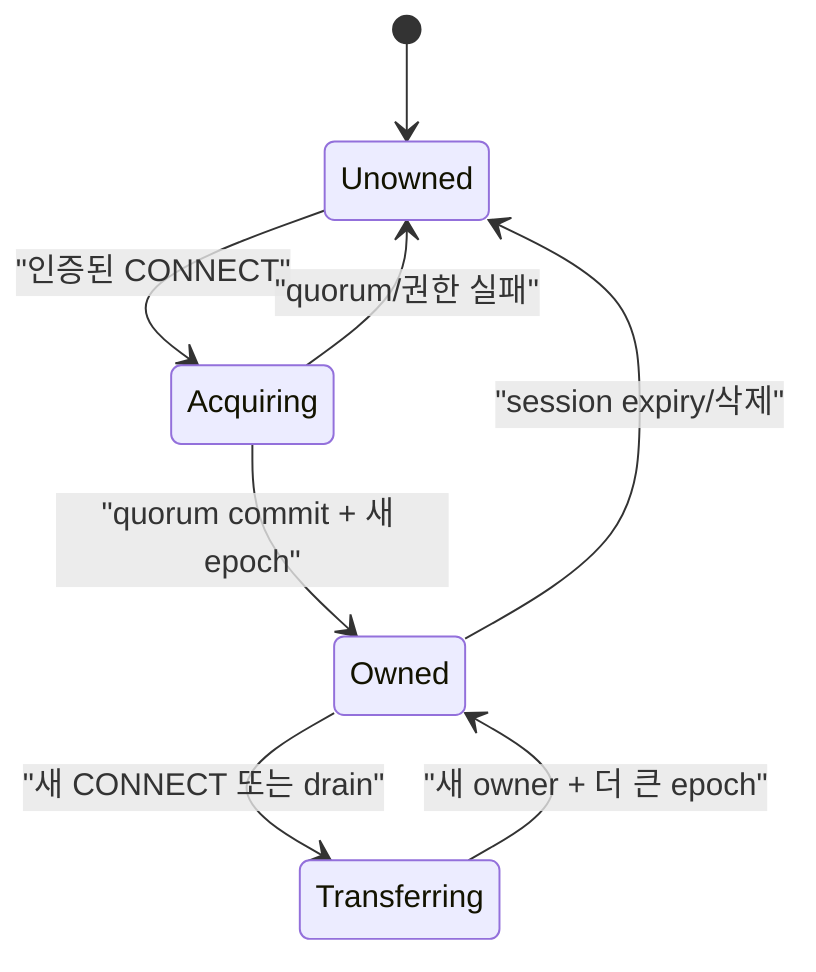
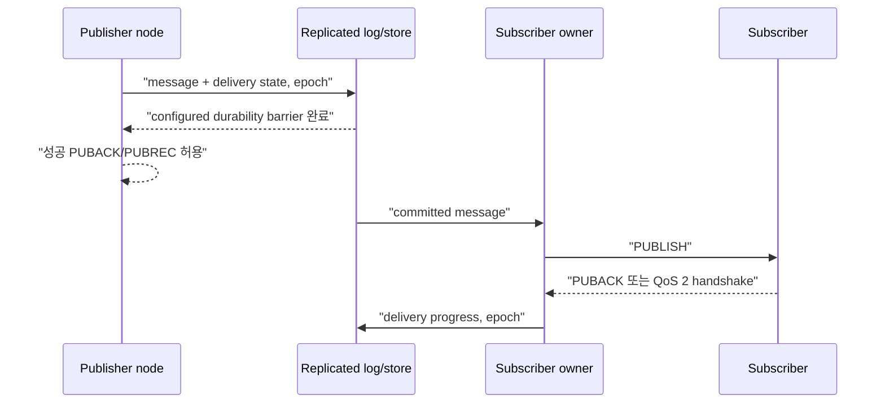

# Cluster session과 durable delivery 스펙

이 문서는 여러 NaruMQ node가 membership, session ownership, routing과 durable state를 외부에서 일관되게 제공하는 동작을 정의한다. Storage와 consensus target은 ADR에서 결정하며, target 선택만으로 runtime 수용이 완료되지는 않는다.

| 항목 | 값 |
| --- | --- |
| 상태 | Draft |
| 관련 요구사항 | CLU-01~CLU-14, NFR-07~NFR-10, NFR-15 |
| 근거 | [PRD 8장, 9.2절과 11.2절](../requirements/PRD.md) |
| 관련 Architecture | [Cluster architecture](../architectures/cluster-architecture.md), [EKS on EC2 deployment](../architectures/eks-ec2-deployment.md) |
| 관련 결정 | [ADR-0001](../decisions/ADR-0001-core-implementation-language.md), [ADR-0002](../decisions/ADR-0002-cluster-consensus-library.md), [ADR-0003](../decisions/ADR-0003-durable-ack-barrier.md), [ADR-0004](../decisions/ADR-0004-session-ownership-and-fencing.md), [ADR-0007](../decisions/ADR-0007-aws-production-deployment-platform.md), [ADR-0008](../decisions/ADR-0008-raft-peer-transport.md), [ADR-0009](../decisions/ADR-0009-raft-production-state-profile.md), [ADR-0011](../decisions/ADR-0011-cluster-backup-restore-v1.md) (historical v1 boundary), [ADR-0012](../decisions/ADR-0012-retained-replication-and-cluster-backup-v2.md) (retained scope), [ADR-0013](../decisions/ADR-0013-offline-queue-replication-and-cluster-backup-v3.md), [ADR-0014](../decisions/ADR-0014-cross-node-live-qos0-forwarding.md), [ADR-0015](../decisions/ADR-0015-cluster-durable-qos-delivery.md) (cluster QoS 1/2 durable delivery scope), [ADR-0017](../decisions/ADR-0017-tenant-storage-quota.md) (TEN-08 storage quota scope), [ADR-0018](../decisions/ADR-0018-release-compatibility-window.md) (N/N-1 release profile and feature activation), [ADR-0019](../decisions/ADR-0019-untargeted-durable-publish-quorum-barrier.md) (target 0 command 생략 범위), [ADR-0027](../decisions/ADR-0027-detach-forward-and-owner-crash-qos0-boundary.md), [ADR-0060](../decisions/ADR-0060-shared-subscription-durable-owner-loss-reroute.md) (공유 구독 durable 전달의 owner 손실) |
| 관련 Contract | [Cluster release compatibility v1](../contracts/cluster-release-compatibility-v1.md), [Raft peer transport v1](../contracts/raft-peer-transport-v1.md), Draft [Cluster backup v3](../contracts/cluster-backup-v3.md), Superseded [Cluster backup v2](../contracts/cluster-backup-v2.md), Superseded [Cluster backup v1](../contracts/cluster-backup-v1.md) |
| 해설 | [세션 소유권과 fencing](../explainers/session-ownership-and-fencing.md), [EKS 고가용성과 장애 도메인](../explainers/eks-ha-failure-domains.md) |

## 1. Cluster membership

1. 기준 배포는 quorum에 참여하는 node 3개로 구성해야 한다.
2. node는 `JOINING` 중 discovery, member 인증, log/snapshot 동기화와 committed persistent subscription에서 route projection을 rebuild하는 작업을 마쳐야 한다.
3. 초기 동기화와 route projection rebuild가 끝나고 quorum을 확인하기 전에는 MQTT traffic readiness를 성공으로 반환해서는 안 된다.
4. join, 정상 leave와 재시작은 수동 데이터 수정 없이 재시도할 수 있어야 한다.
5. 비인가 member와 지원하지 않는 cluster protocol version은 membership에 추가해서는 안 된다.
6. data directory가 없거나 빈 bootstrap voter는 다른 bootstrap voter 모두에게 진행 여부를 확인한 뒤에만 Raft를 bootstrap한다. 어느 voter라도 term 1·commit 3을 넘었고 이 voter를 함께 시작한 peer로 허용하지 않으면 시작하지 않고 `cluster bootstrap refused` 오류로 종료한다. 확인 중에는 management·MQTT listener를 열지 않는다.
7. 승격된 joiner voter가 영속 기록을 잃으면 같은 ID를 seed admission으로 다시 참여시키지 않는다. Seed runtime은 committed VOTER 후보를 거절하며 fresh STAGED client는 이전 seed의 VOTER 응답도 설치하지 않는다. 정상 same-volume 재시작은 persisted committed local identity로 재개한다([ADR-0024](../decisions/ADR-0024-joiner-voter-volume-loss-admission.md)).

외부 cluster 조회는 최소한 node별 `nodeId`, lifecycle state, release version, member role, readiness, replication health와 마지막 오류를 제공해야 한다. `replicationHealth`는 조회 node 자신에 대해서는 local Raft storage 상태를, 원격 peer 행에 대해서는 조회 node에서 관찰한 peer 연결 상태를 나타내며 원격 peer의 storage 상태를 뜻하지 않는다. `lastErrorCode`는 내부 오류 원문 대신 안정된 오류 code를 제공한다. `replicationQueue`는 조회 node에서 해당 원격 peer로 보내는 outbound 대기열을 나타낸다. 정확한 field 형식은 [Management API v1 Contract](../contracts/management-api-v1.md)과 OpenAPI 문서를 따른다.

## 2. Session identity와 ownership

session key는 `(tenantId, clientId)`다. 각 key에는 한 시점에 쓰기 권한을 가진 owner가 최대 하나만 존재해야 한다.



ownership record는 최소 `sessionKey`, `ownerNodeId`, 단조 증가 `epoch`, 상태와 `commit identifier`를 가져야 한다. 이 Phase 2 evidence에서 `commit identifier`는 ownership aggregate가 opaque committed-command stream을 소비할 때 부여하는 application committed-command sequence position이다. 이는 consensus adapter의 Raft `StatusDTO.CommitIndex`나 snapshot index와 다르다. [ADR-0009](../decisions/ADR-0009-raft-production-state-profile.md)는 protobuf encoding family만 선택했으며 exact persisted schema는 별도 contract에서 정한다.

Phase 2의 첫 단계인 replicated ownership core는 다음 관찰 계약을 만족해야 한다.
1. 최초 acquire의 `expectedEpoch`는 `0`이어야 하며 성공 시 `epoch`는 `1`이 된다.
2. 이후 모든 ownership 획득 및 reconnect는 현재 `epoch`와 일치하는 `expectedEpoch`를 요구하며 성공 시 `epoch`가 정확히 `1` 단조 증가한다.
3. `epoch`가 `uint64` 최대값에 도달하면 wrap-around하지 않고 mutation을 영구 중단한다.
4. quorum commit 없는 proposal은 어떤 node의 state machine에도 반영되지 않는다.
5. majority takeover 후 이전 `(ownerNodeId, epoch)`의 인가 요청은 거절되어야 한다.
6. restart 및 snapshot replay 후에도 마지막 application committed-command sequence position과 epoch가 정확히 보존된다.
7. 이미 quorum에 commit된 동일 ownership acquire command를 commit 응답 유실 후 재시도하면, retry도 다음 application committed-command sequence position으로 commit되어 `stale_epoch`로 결정적으로 거절되어야 한다. 이때 `ownerNodeId`, `epoch`와 성공한 ownership record의 `commit identifier`는 바뀌지 않아야 한다.

### 2.1 Fencing 규칙

- session aggregate를 바꾸는 acquire 이외의 command의 의미상 envelope 필드는 `sessionKey`, `ownerNodeId`, `epoch`와 operation-specific subscription 또는 inflight mutation으로 한정한다. 이 이름은 필요한 의미 정보이며 serialized field나 byte format을 정하지 않는다.
- committed apply는 `ownerNodeId == currentOwnerNodeId`이고 `epoch == currentEpoch`인 경우에만 acquire 이외의 session mutation을 인가한다.
- ownership record가 없거나 owner가 다르거나 epoch가 다르면 stale/not-authorized mutation으로 결정적으로 거절한다.
- 성공한 `Acquire`만 owner와 epoch를 설치하거나 증가시킬 수 있다. Subscription 또는 inflight mutation은 epoch가 현재 값보다 크더라도 새 owner나 epoch를 설치할 수 없다.
- 문법적으로 유효하지만 stale한 committed mutation은 application committed-command sequence position을 소비하지만 ownership, persistent subscription, QoS inflight와 route projection은 바꾸지 않는다.
- 새 owner는 더 큰 epoch가 quorum commit된 뒤에만 client traffic을 처리해야 한다.
- 이전 owner는 takeover를 관찰한 즉시 read·write와 delivery를 중단하고 connection을 종료해야 한다.
- node가 더 새로운 owner/epoch를 적용하면 이전 owner/epoch로 이미 bind된 연결은 종료하고, 아직 bind하지 않은 이전 epoch의 CONNECT는 session binding과 성공 CONNACK 전에 거절해야 한다.
- 연결 정리와 session bind 전에 거절된 CONNECT 정리는 해당 연결이 획득한 ownership epoch를 사용한다. 현재 local session epoch가 다르면 timer, repository, delivery, Will을 변경하기 전에 정리를 중단한다. epoch가 일치하면 기존 local session 정리 절차를 실행하고, replicated mutation은 committed owner/epoch 검증을 다시 거친다.
- 원격 takeover apply는 이전 node의 application `ownershipEpochs`를 새 epoch로 덮어쓰지 않는다. 이전 연결은 `DisconnectTakeover`로 local lifecycle을 정리하고 Will을 억제하며 집계하지 않는다. 이전 epoch로 제안된 DETACH·DISCARD 등 replicated session mutation은 committed owner/epoch 검증에서 거절된다.
- 인증으로 tenant-scoped session identity가 만들어지기 전 ingress는 raw MQTT Client ID로 pending CONNECT를 묶을 수 있다. committed ownership fence는 group 안에서 tenant별로 분리하므로 같은 raw Client ID를 쓰는 다른 tenant의 CONNECT를 거절하지 않는다.
- timeout만으로 ownership을 추정하거나 임대 만료 전 stale owner write를 허용해서는 안 된다.

CONNECT를 받은 ingress node와 Raft leader가 다를 수 있다. Ingress node는 ownership proposal을 현재 leader까지 전달해야 하며, follower는 인증된 peer transport를 통한 Raft proposal forwarding을 사용할 수 있다. Quorum commit을 확인한 뒤에만 성공 CONNACK을 반환한다. Leader 또는 quorum가 없으면 CONNECT를 거절하고 node-local ownership을 설치해서는 안 된다.

Production error/DTO와 serialized bytes는 [ADR-0009](../decisions/ADR-0009-raft-production-state-profile.md)가 선택한 encoding family에 맞춰 별도 replicated-state contract에서 정한다. ADR-0009는 exact message schema나 wire bytes를 정의하지 않는다.

### 2.2 Session aggregate와 route projection

`sessionKey`마다 ownership record, persistent subscription, inbound QoS inflight와 outbound QoS inflight를 하나의 논리적 replicated session aggregate로 취급한다. 한 `sessionKey`에 대한 command는 같은 committed ordering을 공유하고 하나의 aggregate 경계에서 원자적으로 적용해야 한다. Subscription 또는 inflight 변경 결과를 ownership 권한 판정 결과와 분리해 외부에 노출해서는 안 된다.

Route metadata는 committed persistent subscription에서만 계산하는 node-local disposable projection이다. 이 projection은 authoritative committed subscription state에서 다시 만들 수 있어야 하며, node는 routing readiness를 광고하기 전에 rebuild를 완료해야 한다. Route projection은 ownership 또는 fencing authority로 사용할 수 없다.

WAL·snapshot target, protobuf encoding family와 단일 group profile은 scoped [ADR-0009](../decisions/ADR-0009-raft-production-state-profile.md)에 기록한다. Exact replicated-state message schema는 [replicated-state-v1.proto](../contracts/replicated-state-v1.proto)에 정의한다. N-1 compatibility와 production storage 보장은 검증되지 않았다. Detached persistent session의 QoS 0 offline queue 경계는 §4.1과 [ADR-0013](../decisions/ADR-0013-offline-queue-replication-and-cluster-backup-v3.md)이 정하고, QoS 1/2 durable message·inflight state와 전달 경계는 §4.2와 [ADR-0015](../decisions/ADR-0015-cluster-durable-qos-delivery.md)가 정한다.
### 2.3 Takeover ordering

- Outbound `SEND`, `ADVANCE`, `COMPLETE`는 각각 PUBLISH, PUBREL 또는 packet identifier 해제의 wire effect보다 먼저 commit해야 한다. Successor의 더 큰 epoch `Acquire`가 commit되면 이전 owner의 후속 command는 exact owner/epoch check에서 거절되며, successor는 ATTACH로 committed delivery state를 재개한다. 이 ordering 규칙만으로 drain lifecycle이 충족되지는 않으며, broker drain contract는 [Drain spec](drain-and-rolling-update.md)을 따른다.

동시 CONNECT 또는 partition 시험에서 성공 owner가 둘로 관찰되면 spec 위반이다.

## 3. Routing

1. 어느 READY node에 publisher와 subscriber가 연결돼도 cluster 전체의 matching subscription으로 전달해야 한다.
2. route key는 tenant 격리가 끝난 canonical topic/filter를 사용해야 한다.
3. Route-affecting subscription mutation은 authoritative fenced command로 `sessionKey`, `ownerNodeId`, `epoch`와 subscription option을 전달한다. Committed apply 뒤 route projection은 committed persistent subscription state에서 파생하며, 별도의 authorized route mutation으로 처리하지 않는다.
4. 이전 owner 또는 stale owner/epoch의 route-affecting subscription add·remove mutation은 거절해야 한다.
5. route propagation 지연은 측정 가능해야 한다. 지연 중에도 권한 또는 tenant 경계를 우회해서는 안 된다.
6. shared subscription member 선택은 tenant와 group 경계를 지켜야 하며, unavailable owner를 계속 선택해서는 안 된다. Ingress node는 owner node가 현재 이 node의 peer 연결 상태로 도달할 수 없는 member를 primary에서 제외하고 `Fallbacks` 끝으로 보낸다. Owner가 local node이거나 transport가 모르는 node인 member는 도달 가능으로 본다. 도달 가능한 member가 없으면 전체 member에서 고른다. 이 선호는 node-local이며 ownership·epoch와 replicated state를 바꾸지 않는다. Timeout으로 owner를 실패 처리하지 않는다([ADR-0060](../decisions/ADR-0060-shared-subscription-durable-owner-loss-reroute.md)). Durable QoS 1/2와 QoS 0 선택이 같은 순서를 쓴다.

### 3.1 Live cross-node QoS 0 전달

`-cluster-config` mode에서 ingress node는 local committed route projection으로 publish 대상과 각 candidate의 effective QoS, Retain 및 shared-subscription 선택을 계산한다. Candidate마다 다음 순서를 적용한다.

1. Detached persistent session은 §4.1의 Raft offline `ENQUEUE` 경로를 먼저 사용한다.
2. Connected candidate의 committed owner가 local node와 다르면 QoS 0 delivery를 owner node로 forwarding한다.
3. Owner가 local node이거나 ownership row가 없으면 node-local delivery queue에 넣는다.

Detached 확인을 먼저 해야 한다. 연결이 끊긴 session은 이전 owner의 ownership row를 계속 가질 수 있으므로, 원격 전달보다 offline `ENQUEUE`가 우선한다. Ingress는 local committed ownership을 읽으며 publish message마다 Raft read barrier를 수행하지 않는다. QoS 0 PUBLISH ingress admission은 local storage가 정상이고 runtime과 projection이 초기화되어 있으며 projection index가 applied index 이상일 때만 허용한다. Driver가 Ready batch를 처리 중이면 cached readiness snapshot을 사용해 local projection refresh를 기다리되, `clusterReadTimeout`(2초) 뒤에도 처리가 끝나지 않거나 storage health가 `DEGRADED`/`FAILED`이면 기다림을 끝내고 delivery 전에 연결을 닫는다. 그 밖의 uninitialized·failed·stale projection은 즉시 거절한다. Quorum만 사용할 수 없는 경우에는 local projection이 정상인 QoS 0 경로를 막지 않는다.

Forwarding은 인증된 peer listener의 별도 `NMQFWRD2` stream을 사용한다. Stream queue는 방향·peer마다 최대 1,024 frame 및 8 MiB이며, Raft queue와 독립적이다. Queue admission 이후 receiver ACK나 retry는 없다. 따라서 전달은 at-most-once이고 FIFO는 같은 `(ingress node, owner node)` 쌍 안에서만 보장된다. Peer queue가 가득 차면 해당 candidate는 `Saturated`, 전달 lane/peer를 사용할 수 없으면 `Unavailable`로 처리하고 shared-subscription 선택은 다음 candidate를 시도한다.

Receiver는 자기 local committed ownership이 해당 session의 owner라고 나타내고 session이 local delivery queue에 등록된 경우에만 enqueue한다. Ownership이 다르거나 session이 등록되지 않으면 조용히 버린다. Receiver queue가 가득 차면 local queue saturation과 같이 해당 subscriber connection을 닫는다. Will publish도 동일한 routing·forwarding 경로를 사용한다. QoS 1/2는 §4.2의 Raft 경로를 사용한다.

이 경로의 live message는 Raft log, snapshot, backup 또는 detached offline queue에 기록하지 않는다.

## 4. Replicated state

다음 상태는 configured replication factor와 write quorum을 적용해야 한다.

| 상태 | 복구 계약 |
| --- | --- |
| persistent subscription | owner 장애 뒤 같은 filter와 options를 복구한다. |
| 수신·송신 QoS inflight | packet identifier, 단계와 재전송 의미를 복구한다. |
| durable offline message | expiry·quota 안에서 전달을 재개한다. |
| retained message | tenant와 canonical topic별 최신 값을 복구한다. |
| session metadata | expiry, Will, owner epoch와 client protocol 정보를 복구한다. |
| ownership·route metadata | stale owner를 fence하고 routing을 다시 구성한다. |

replica 수가 configured write quorum보다 적으면 durable write를 성공 처리해서는 안 된다. replication lag 또는 disk pressure가 한도를 넘으면 publish admission을 늦추거나 거절해야 하며, 이미 성공 ACK한 durable state를 임의로 drop해서는 안 된다. (§4.4, §4.5)

### 4.1 Offline message capture와 전달

Cluster mode에서 persistent session(MQTT 3.1.1 CleanSession=0 또는 MQTT 5 CleanStart=0 및 Session Expiry Interval > 0)이 연결을 종료한 뒤부터 다음 재접속 전까지의 구간을 **detached** 상태로 취급한다. Detached session에 도착한 QoS 0 message만 Raft committed state machine에 저장한다. Connected session은 local owner의 node-local queue를 사용하거나, 다른 node가 owner이면 §3.1에 따라 live QoS 0 delivery를 forward한다. QoS 1/2 offline entry와 durable ACK의 동작은 §4.2에서 정한다.

1. **Key와 복제 상태:** 각 `(tenantId, clientId)` session key마다 `OfflineSessionState`를 둔다. 필드는 `tenantId`, `clientId`, 단조 증가 `epoch`, `sessionExpiresAtUnixMillis`, 단조 증가 `nextSequence`와 `messages[]`다. 각 `OfflineMessage`는 `sequence`, `topic`, `payload`, `qos(=0)`, `retain`, `expiresAtUnixMillis`를 가진다. Message identity는 session 안에서 1부터 단조 증가하는 `sequence`이며 FIFO 순서다.
2. **명령:** `OfflineChange`는 세 action을 가진다.
   - `DETACH`: owner node가 persistent session disconnect 시 제안한다. `(ownerNodeId, epoch)`가 현재 ownership과 정확히 일치해야 한다(아니면 `stale_epoch`). Record가 없으면 `nextSequence=1`로 생성한다. 동일 epoch record가 이미 있으면 no-op `Applied`다. 더 작은 epoch record가 있으면 기존 message를 보존하고 epoch를 올린 뒤 이어 붙인다. Local queue 잔여 FIFO message는 최대 64개, `topic+payload` 합계 최대 768 KiB까지 함께 싣는다.
   - `ENQUEUE`: 어느 node든 publish 대상이 detached session이면 제안한다. `ownerNodeId=0`, message 정확히 1개다. Record가 존재하고 `record.epoch == command.epoch`여야 한다(아니면 `offline_session_missing`).
   - `CLAIM`: CONNECT가 새 ownership epoch를 commit한 직후 새 owner가 제안한다. `(ownerNodeId, epoch)`가 현재 ownership과 같아야 한다(아니면 `stale_epoch`). Record를 삭제하고 그 message들을 apply 결과로 반환한다. Record가 없으면 `Found=false`다.
3. **전달 의미:** at-most-once다. CLAIM commit이 record를 먼저 지우고 그 다음 local queue로 전달한다. CLAIM 성공 뒤 전송 전 crash하면 해당 QoS 0 message는 유실될 수 있다. 자동 재시도는 하지 않는다. Commit timeout 뒤 늦게 commit된 ENQUEUE는 queue에 남는다.
4. **결정적 한도:** Apply는 session당 64 message, 전체 tenant 합산 4,096 message·16 MiB, payload당 1,000,000 bytes를 제한한다. DETACH 한 command의 `topic+payload` 합계는 768 KiB 이하여야 한다. 크기는 `len(tenantId)+len(clientId)+len(topic)+len(payload)`의 합이다. 한도를 넘으면 command 전체를 `offline_capacity_exceeded`로 거절하고 기존 state를 보존한다(같은 apply의 만료 purge는 유지). Detached session record 수는 ownership row 수를 넘지 않으므로 별도 상한을 두지 않는다. Tenant quota profile이 있으면 QoS 0 offline message와 durable delivery outbound message를 합산한 tenant usage에 `offline_queue_messages`와 `offline_queue_bytes`를 추가 적용한다. Global limits가 먼저이며 구체적인 quota 차원 순서와 profile 적용은 [ADR-0017](../decisions/ADR-0017-tenant-storage-quota.md)을 따른다.
5. **만료:** 모든 offline command apply는 먼저 proposer 시각(`proposedAtUnixMillis`) 기준으로 `0 < expiresAt <= proposedAt`인 message와 `0 < sessionExpiresAt <= proposedAt`인 session record를 지운다. Local replica clock은 읽지 않는다. `sessionExpiresAt`은 disconnect 시각 + MQTT 5 Session Expiry Interval이며, 만료가 없으면 0이다.
6. **Ownership 연동:** Ownership `Release`가 apply되면 같은 key의 offline record도 지운다. Transfer/acquire는 record를 보존하며 새 owner의 CLAIM이 가져간다. 모든 offline record는 `record.epoch` 이상의 ownership row를 가져야 한다.
7. **SessionPresent:** `CleanStart=0` CONNECT의 CLAIM이 `Found=true`이면 다른 node로 reconnect해도 CONNACK `SessionPresent=1`이고 message를 sequence FIFO로 전달한다. `CleanStart=1`이면 CLAIM으로 record를 지우고 message는 버린다.
8. **Fallback:** DETACH가 quorum/compatibility/stale-epoch 이유로 실패하면 local queue를 그대로 둔다. CLAIM이 실패하면 CONNECT를 ownership-unavailable reason으로 거절하고 local session 변경을 rollback한다. 기존 local session이 없었던 시도는 새 delivery queue 등록과 tenant route binding도 제거한다. 기존 local session이 있으면 CLAIM 성공 전까지 기존 expiry/WILL timer를 유지하고, 실패 시 기존 timer와 session 상태를 보존한다. ENQUEUE 실패는 해당 대상만 `Saturated`(capacity) 또는 `Unavailable`(그 외)로 보고한다.
9. **알려진 한계:** Feature 비활성 시 owner node가 연결 중에 crash하면 DETACH가 없어 이후 message는 capture되지 않는다. Feature 활성 시 replicated session metadata로 owner 재시작 뒤 expiry와 session 복구를 수행한다(§4.3). Detach 전환 중 owner node에서 publish된 QoS 0 message는 유실하지 않는다(11항). 다른 node에서 forward된 QoS 0 delivery는 전환 중이거나 local queue 제거 뒤 도착하면 §3.1의 at-most-once에 따라 유실될 수 있다. 연결 중 owner가 offline DETACH commit 전에 끝나면 그 local queue는 복구하지 않는다. DETACH commit 뒤 crash하면 record와 이후 ENQUEUE를 보존한다. Feature 활성 시 owner 재시작 recovery가 빈 DETACH를 commit해 capture를 재개한다. 이미 전달한 message를 다시 보내지 않는다. 이 경계는 [ADR-0027](../decisions/ADR-0027-detach-forward-and-owner-crash-qos0-boundary.md)을 따른다. ENQUEUE는 대상 session마다 commit 1회다.
10. **Schema와 profile gate:** Replicated-state schema는 `1.0`을 유지하고 unknown field를 거절한다. Offline command는 fresh read barrier 뒤 모든 non-retired member의 cluster protocol/state schema가 exact match이고 release가 같은 major의 인접 minor window 안에 있는지 확인한 뒤 제안한다.
11. **Detach 전환 보호:** [ADR-0026](../decisions/ADR-0026-detach-transition-local-qos0-gate.md)에 따라 전환 중 owner-node local publish는 DETACH 결과를 기다린 뒤 다시 판정한다. 성공하면 offline ENQUEUE로 보내고 실패하면 유지된 local queue로 보낸다. 최대 대기는 10초이며 이를 넘기면 해당 대상을 `Unavailable`로 보고한다. 캡처한 message와 같은 publisher의 이후 message 순서는 FIFO다. Local queue 제거 직후 도착한 publish도 offline 경로를 한 번 재판정한다. 각 판정은 새 현재 시각으로 기존 absolute Message Expiry deadline을 검사한다. 대기 중 만료되면 ENQUEUE·forward·local enqueue를 실행하지 않고 전달 결과에도 넣지 않는다. Forward 경로는 기다리지 않는다. 기존 capacity·expiry·commit timeout 경계는 유지한다.

### 4.2 QoS 1/2 durable delivery

Cluster mode에서 publisher가 보낸 QoS 1/2 PUBLISH 및 QoS 1/2 Will의 처리는 Raft quorum 경계를 따른다. QoS 1 client PUBLISH는 retained mutation이 있으면 이를 먼저 commit한다. Prepare 시점 ingress route projection에 durable target 후보가 하나 이상 있으면 `publish_qos=1` delivery command를 commit한 뒤 effective QoS 0 대상 lane을 처리하고 PUBACK을 보낸다. 후보가 없으면 delivery PUBLISH command 없이 fresh, proposal 없는 quorum ReadIndex barrier를 기다리고, 그 index까지 local apply와 route projection이 끝난 뒤 QoS 0 lane을 처리하고 PUBACK을 보낸다. QoS 2 client PUBLISH 수신은 target 수와 무관하게 publisher session inbound 상태를 RECEIVE로 commit한 뒤 PUBREC을 보낸다. QoS 1/2 Will은 publisher inbound RECEIVE 없이 전달하며, retained mutation이 있으면 기존 순서로 먼저 commit한다. Target 후보가 있으면 `publish_qos=1/2` durable PUBLISH command를 commit하고 없으면 같은 fresh ReadIndex barrier를 통과한 뒤 QoS 0 lane을 처리한다. Will에는 publisher ACK가 없다. PUBREL 수신은 target 수와 무관하게 retained state와 `publish_qos=2`인 RELEASE를 commit하고 QoS 0 대상 lane을 처리한 뒤 PUBCOMP을 보낸다. RELEASE가 이미 완료된 tombstone을 찾거나 packet을 찾지 못하면 QoS 0 lane 없이 성공 PUBCOMP을 보낸다.

Client QoS 1/2 PUBLISH ingress admission은 local projection readiness만 먼저 확인하며 별도 quorum readiness barrier를 수행하지 않는다. Admission은 Ready drain이 진행 중일 때 atomic cached readiness snapshot을 확인하고 route projection refresh를 기다리며, storage health는 그 대기와 독립적으로 확인한다. `DEGRADED`/`FAILED` storage 또는 `clusterReadTimeout`(2초) 내에 끝나지 않은 Ready drain은 전달 전에 연결을 닫는다. Ready 처리 중이 아닐 때 projection이 초기화되지 않았거나 rebuild에 실패했거나 applied index보다 뒤처지면 즉시 닫는다. Runtime은 staged proposal 결과를 Ready drain이 끝나고 refreshed projection이 최신 applied index를 반영한 뒤 해제한다. Fatal Ready 처리 오류는 admission-failed 상태를 기록한 뒤 sequence를 닫아 이후 PUBLISH admission이 실패하도록 하며, driver exit은 request queue에 남은 proposal과 driver-local waiter의 미적용·stage된 결과를 포함한 pending proposal 전체를 non-success error로 해제한다. Fresh quorum proof는 durable command의 bounded commit 경계에서 확인한다. 성공 응답 전에 quorum이 없거나 commit이 실패·timeout되면 PUBACK/PUBREC/PUBCOMP 성공 응답을 보내지 않고 연결을 닫는다. RECEIVE capacity 초과 또는 command 크기 초과 시 MQTT 5는 reason `0x97`을 보내고 MQTT 3.1.1은 연결을 닫는다. PUBLISH/RELEASE 대상별 durable queue가 포화되면 그 대상은 `Saturated`로 건너뛰지만 publish 전체는 성공할 수 있다. 이는 PRD CLU-12의 한도 도달 시 publish 제한 요구와 다른, 승인된 결정이다. 로컬 연결 중인 포화 대상은 기존 정책에 따라 연결을 닫으며, 재접속 시 queue 적재가 다시 시도된다.

리더를 아직 모르는 동안에는 새 ReadIndex를 Raft에 넘기지 않는다. Driver가 기존 미발행 FIFO head로 보관하며 inbound·tick 처리는 계속한다. 리더를 다시 알게 되면 같은 요청을 발행한다. 원래 context와 deadline을 유지하며 proof를 공유하거나 성공으로 간주하지 않는다.

발행한 read가 완료되기 전에 leader·term·role이 바뀌면 driver는 미완료 proof를 다시 발행 대상으로 돌린다. 새 proof는 현재 Raft의 리더가 분명하고 기존 outbound 예산이 있을 때만 발행한다. Request context에는 origin node ID와 발행마다 바뀌는 nonce를 넣는다. Caller의 원래 key·context·deadline과 FIFO commit 순서는 유지한다. 이전 발행의 ReadState는 새 proof를 완료할 수 없다. Proof를 다른 caller와 공유하지 않는다. Application 재제안은 아래의 `proposal-recovery` 활성화 경로에서만 허용한다.

리더 이전이나 리더 선출 중 정상 forwarded proposal이 `raft.ErrProposalDropped`로 거절될 수 있다. 이 오류는 Raft log에 append하지 않았다는 뜻이다. Dynamic adapter는 이 경우 요청을 bounded FIFO에 보관한다. [ADR-0035](../decisions/ADR-0035-failover-aware-commit-lag-and-unsent-proposal-reclaim.md)에 따라 socket write를 한 번도 시작하지 않은 raft-lane `MsgProp`도 같은 FIFO로 회수한다. 대상은 연결 없는 peer의 outbox ring에 남은 frame과 transport가 `ErrPeerBackpressure`로 받지 않은 frame이다. Write를 시작한 `outCurrent`는 회수하지 않고 기존처럼 재연결 뒤 다시 보낸다. 리더와 저장 공간을 다시 사용할 수 있으면 같은 요청을 Raft에 넘긴다. 새 forwarded proposal도 보관 중인 요청 뒤에 정렬한다. 서로 다른 peer에 동시에 남은 proposal의 상대 순서와 FIFO overflow 때 남은 frame의 순서는 보장하지 않는다. 일반 leader-only `Propose`와 membership change의 계약은 바꾸지 않는다.

FIFO는 최대 64 message와 기존 `maxWALFramePayload-1024` byte 예산으로 제한한다. Ready 입력과 보관 요청의 합도 같은 byte 한도를 지킨다. 가득 차면 기존 `ErrBackpressure`로 거절한다. 인증된 inbound frame의 보관은 adapter가 이미 소유한 decoded 값으로 처리한다. Transport lease는 즉시 반환하며 Raft tick과 peer message 처리는 계속한다. Runtime membership reconciliation은 기존 stable checkpoint 조건을 유지하므로 보관분이 남아 있으면 기다린다. Raft의 선출·리더 이전 자체는 peer message와 tick으로 진행한다. 미처리 FIFO는 `StoragePending`에 포함해 checkpoint나 안전한 stop의 완료로 숨기지 않는다. 저장 장애와 Close는 기존 실패 계약을 따른다.

Follower가 보관 요청을 넘길 때는 `Config.ForwardedProposalCapacity`로 현재 리더의 outbound count·byte 여유를 확인한다. 기존 Ready·append·apply 처리가 idle일 때만 FIFO를 그 여유 안에서 발행한다. 그렇지 않으면 64개 보관 요청을 32개 peer FIFO로 한꺼번에 넘겨 다시 유실할 수 있다. 이 callback은 기존 observer처럼 composition root에서 제공하며 Node를 다시 호출하거나 대기하지 않는다. Production cluster는 TCP의 실제 여유에서 기존 2-frame·512-byte reserve를 뺀 값을 제공한다. Transport가 없는 Batch consumer는 callback 없이 기존처럼 전체 output을 소비할 수 있다. 이전 node가 다시 leader가 되기를 기다리지 않는다.

Leader peer에 연결되어 있지 않으면 forwarded FIFO flush credit은 0이다.

Test-only fault control을 쓰면 driver가 Node lock을 얻기 전에 해당 Ready turn의 isolation 파일을 읽는다. Callback은 이 snapshot만 확인하며 파일 I/O를 하지 않는다. 이 값은 fault 주입의 발행 제어에만 쓰며 fresh quorum proof를 저장하거나 공유하지 않는다.

Adapter 보관은 log append 전의 명확한 거절과 socket write를 시작하지 않은 frame만 다룬다. Write를 시작하지 않은 frame은 전송 결과를 알 수 없는 요청이 아니다. `proposal-recovery` 비활성 상태에서는 Raft가 이미 수락해 전송을 시작한 요청, 전송 결과를 알 수 없는 요청, ACK가 없는 요청을 재제안하지 않는다. 보관을 성공 commit이나 성공 MQTT ACK로 바꾸지 않는다. 원래 caller의 context와 deadline도 늘리지 않는다. 정상 거절을 malformed peer로 분류하거나 peer를 reset하지 않으며, frame·identity 검증 실패는 기존 `ErrInvalidMessage` 경로를 유지한다.

Caller deadline은 결과를 기다리는 시간의 상한이다. Adapter FIFO에는 원래 context·deadline이 전달되지 않으므로 deadline 만료만으로 보관 요청을 폐기하지 않는다. 이 구조에서는 timeout 뒤에도 요청이 나중에 commit될 수 있다. Timeout을 미적용의 증거로 쓰거나 새 OperationID로 자동 재제안하지 않는다. Timeout을 반환한 원래 호출에는 이후 성공 ACK를 보내면 안 된다. MQTT 재접속·재전송은 기존 PacketID 상태와 session ownership·epoch 규칙을 따른다.

이 경계는 `TestClusterDurableCommitCallerTimeoutLateReplayAppliesOnceWithoutSuccess`와 `TestTCPDurablePublishFailureDrainsPendingWithoutSuccessAck`를 함께 실행해 확인했다. 통합 시험의 범위는 in-process 3-node runtime + 실제 dynamic Raft adapter·WAL·`BeginDelivery`·`Wait`다. Caller timeout 뒤 FIFO 재생 순서·각 command의 1회 적용·원래 `Wait`의 `ErrQuorumUnavailable` 반환과 늦은 결과의 buffer 보관을 확인했다. TCP 시험은 같은 오류에서 QoS 1/2 성공 ACK 없이 연결을 닫고 pending 값을 회수하는지 확인했다. MQTT process 수준에서 이 late commit 경합을 재현하지는 않았다. 실행 명령과 시간은 [§11.11의 Caller timeout 뒤 late commit 행](#1111-qos-12-durable-delivery-수용-매핑)에 기록한다. 기존 FIFO 재생·fresh-proof 취소 회귀와 BP-07 valid 결과로 이 경계를 대신 검증했다고 판단하지 않는다.

`proposal-recovery`를 활성화하면 [ADR-0036](../decisions/ADR-0036-replicated-proposal-receipts-and-safe-reproposal.md)과 [ADR-0037](../decisions/ADR-0037-proposal-request-identity.md)에 따라 이미 전송한 application command도 재제안할 수 있다. Runtime은 command별 RequestID를 만들고 최초 fresh proof index와 원래 RequestID·OperationID·payload·digest를 유지한다. Leader·term 변경 뒤 새 nonce의 proof를 얻고 local apply·projection이 완료된 뒤 미완료 요청만 FIFO 순서로 재제안한다. Caller의 기존 deadline은 유지한다.

복제된 receipt는 최초 성공·conflict 결과를 보관한다. 같은 origin·RequestID·digest의 중복은 상태와 외부 효과를 반복하지 않는다. 같은 RequestID의 다른 payload나 최초 proof index는 conflict다. 같은 논리 OperationID를 쓰는 별도 RequestID는 서로 다른 command다. Origin별 retirement floor 이하의 proof index는 receipt 삭제 뒤에도 거절한다. Node별 receipt 최대 1024개, cluster 전체 최대 4096개, 결과 bytes 전체 최대 32 MiB다. Snapshot은 floor와 receipt를 함께 보존한다. 기존 64 MiB 직렬화 한도는 우선한다. Activation 전 baseline bytes와 일반 ConfChangeV2 경로는 유지한다.

Count 한도 초과 요청은 origin별 capacity fence로 기억한다. 결과 byte 공간은 mutation 전에 예약한다. 공간이 나중에 생겨도 처음 거절한 요청은 성공으로 바꾸지 않는다. 개별 receipt와 count 거절의 index 의미는 [ADR-0038](../decisions/ADR-0038-proposal-receipt-capacity-fences.md)을 따른다. 실행 증거는 [§11.33](#1133-안전한-proposal-복구-수용-매핑)에 기록한다.

`proposal-recovery`를 활성화하면 리더 kill 때 전송 중이던 PUBACK COMPLETE와 PUBREL RELEASE commit도 같은 재제안 경로를 탄다. 생존 node의 persistent subscriber 연결은 닫히지 않고, publisher는 같은 연결에서 PUBCOMP을 받는다. 두 command의 RequestID·OperationID와 payload는 바뀌지 않으며 원래 5초 deadline도 늘리지 않는다. 비활성 상태에서는 같은 commit이 5초 deadline에서 `ErrQuorumUnavailable`을 반환하고 연결을 닫는다. 위 비활성 계약은 그대로다. 따라서 N-1에서 계획 밖 disconnect 0을 요구하는 용량 시험은 `proposal-recovery`를 활성화한 cluster에서 실행해야 한다. 이 feature는 기본 비활성이며 활성화와 rollback 제약은 [ADR-0036](../decisions/ADR-0036-replicated-proposal-receipts-and-safe-reproposal.md)과 [feature activation 절차](../how-to/cluster-feature-activation.md)를 따른다. 비활성·활성 비교는 [§11.33](#1133-안전한-proposal-복구-수용-매핑)의 leader kill 행에 기록한다.

각 `(tenantId, clientId)` session에는 Raft 복제 durable queue와 QoS inflight state가 있다. Apply 단계의 target 판정은 committed ownership과 subscription으로 다시 검증하며, 현재 owner/epoch에 묶인 matching subscription 가운데 QoS 1 이상이 있어야 한다. `DeliveryChange.publish_qos`는 PUBLISH/RELEASE에서 각각 1 또는 2이며 RELEASE는 2여야 한다. Apply는 이 값을 사용해 `min(publish_qos, matching subscription QoS 최대값)`을 대상의 effective QoS로 계산한다. 각 session message는 1부터 증가하는 sequence를 가져 FIFO로 복구된다. Session당 message 64개 및 inbound 64개, tenant 전체 합계 4,096 entries와 16 MiB, payload 1,000,000 bytes, command당 1,024 targets 제한을 둔다. Committed tenant quota profile은 offline queue와 durable delivery outbound message를 함께 집계하고 `offline_queue_messages`·`offline_queue_bytes`를 적용한다. `storage_bytes`에는 retained, offline, durable delivery outbound·inbound state를 포함한다. 전체 quota 규칙은 [ADR-0017](../decisions/ADR-0017-tenant-storage-quota.md)을 따른다.

Delivery command를 만들지 여부를 결정하는 target 후보는 prepare 시점 ingress projection의 primary 후보 가운데 effective QoS가 1 이상인 matching subscription이다. Session의 persistent 여부는 후보 포함 여부를 바꾸지 않으며, Apply는 기존대로 committed ownership과 subscription을 다시 검증한다. Ingress node에 아직 적용되지 않은 SUBSCRIBE는 publish보다 뒤에 정렬된다. Target 없는 경로에서 barrier가 실패하거나 timeout되면 성공 ACK와 QoS 0 lane 처리를 막는다. QoS 1 client PUBLISH는 기존 commit 실패와 같이 연결을 닫으며, Will에는 원래 publisher ACK가 없다. Barrier timeout은 5초다. 이 경로는 별도 release profile compatibility gate나 feature activation을 추가하지 않는다.

`NextSequence`는 wrap-around하지 않는다. `uint64` 최대값에 도달한 target은 새 message를 받지 않고 `Saturated`로 보고한다.

Owner는 outbound PUBLISH 쓰기 전에 SEND를 commit하고, subscriber의 PUBREC 뒤 PUBREL 쓰기 전에 ADVANCE를 commit한다. PUBACK/PUBCOMP 또는 실패 PUBREC 처리 뒤에는 COMPLETE를 commit한 뒤 packet identifier를 해제한다. 이전 owner의 명령은 새 ownership epoch에서 fencing된다. Reconnect/takeover 시 새 owner는 할당된 inflight를 packet identifier 순서로 재전송한다(PUBLISH는 `DUP=1`, PUBREL 대기 단계는 PUBREL). 이어 QUEUED message를 sequence 순서로 보내고, claimed offline QoS 0 message는 그 뒤에 보낸다. CleanStart는 durable state를 reset하며, CONNACK SessionPresent는 offline CLAIM 또는 durable ATTACH 중 하나가 기존 state를 찾았고 CleanStart가 아닌 경우에만 설정한다.

`SEND` commit에서 quorum을 일시적으로 사용할 수 없으면 replicated message와 local queue head를 소비하거나 승격해서는 안 된다. 이 사유만으로 subscriber TCP connection을 닫거나 PUBLISH를 보내지 않는다. `ErrRetryableUnavailable`은 SEND commit 결과를 확인할 수 없는 상태를 나타내며, local queue head와 pending Packet Identifier를 보존하고 같은 ID로 재시도한다. Writer는 최대 초당 한 번 자동 재시도하고, 다음 durable-delivery notification은 retry timer보다 먼저 처리를 깨울 수 있다. 일반 `ErrUnavailable`은 missing session/state를 뜻하므로 일시적 quorum 오류로 취급하지 않는다.

`ATTACH`는 command 전부터 `DeliverySessionState` record가 있으면 message/inbound가 비어 있어도 `Found=true`를 반환한다. `Reset=true`인 CleanStart는 delivery/inbound state와 committed persistent subscriptions를 지우고 `Found=false`를 반환하며, record가 있으면 `next_sequence`는 단조 증가를 유지한다.

공유 구독의 durable message 재배분은 `shared-subscription-reroute` feature 활성화 뒤의 동작이다([ADR-0060](../decisions/ADR-0060-shared-subscription-durable-owner-loss-reroute.md)). 모든 build는 이 feature를 광고하지만 `FeatureActivation`이 commit되기 전에는 `shared_filter`를 제안하거나 저장하지 않는다. 비활성 cluster의 동작과 wire bytes는 기존과 같다. 활성화 뒤 ingress는 group 선택의 결과인 durable target에 group을 포함한 전체 filter(`$share/<group>/<filter>`)를 `shared_filter`로 싣는다. 같은 client가 비공유 구독으로도 match하면 싣지 않는다. Apply는 대상이 현재 owner/epoch로 그 filter를 구독 중일 때만 message에 기록한다. 저장한 `shared_filter`의 byte 길이는 그 message의 byte 수에 더해 전체 16 MiB와 tenant quota에 포함한다.

Delivery record를 지우는 apply(CleanStart `Reset=true` ATTACH, DISCARD, session expiry purge, ownership Release)는 지우기 전에 `shared_filter`가 있고 만료되지 않은 message 가운데 `QUEUED`와 QoS 1 `AWAIT_PUBACK`을 같은 group의 다른 member queue로 옮긴다. QoS 2 `AWAIT_PUBREC`·`AWAIT_PUBCOMP`는 이미 보내기 시작한 message라서 옮기지 않는다(MQTT-4.8.2-5). 목적지는 같은 tenant에서 같은 filter를 현재 owner/epoch로 QoS 1 이상 구독 중인 다른 client다. 그 command를 제안한 owner node(CleanStart 재접속이면 재접속한 node)가 owner인 member를 먼저 고른다. 그 node는 방금 command를 보냈으므로 살아 있다. Expiry purge처럼 제안한 node를 알 수 없으면 이 단계를 건너뛴다. 각 단계에서 client ID 오름차순으로 정렬하고 지워지는 client의 다음부터 한 건씩 돌려 가며 고른다. Session당 64개, 전체·tenant 한도 또는 sequence가 가득 찬 member는 건너뛴다. 받을 member가 없으면 message를 버린다. 새 message는 새 sequence의 `QUEUED`이고 만료 시각과 `shared_filter`를 유지한다. QoS는 `min(원래 QoS, 목적지 구독 QoS)`이고 RETAIN은 저장된 RETAIN이 true이며 목적지가 Retain As Published를 요청했을 때만 true다. 한 message는 한 member에게만 간다. Persistent session의 member가 살아 있으면 queue는 그대로 남고 그 member가 돌아올 때 전달된다. 옮긴 message는 목적지 owner node가 기존 durable 알림 경로로 전달한다.

QoS 2 publisher inbound record는 PUBREL 전 상태 또는 완료 tombstone을 복구한다. Tombstone은 RELEASE 뒤 PUBCOMP가 유실되어 client가 PUBREL을 재시도할 때 성공 PUBCOMP을 보장하며, 같은 packet identifier의 새 RECEIVE, capacity eviction, ATTACH reset 또는 record 삭제까지만 유지된다. QoS 1 중복은 같은 connection에서 기존 inbound 상태로 억제하지만, reconnect 뒤 DUP 재전송은 새 PUBLISH로 처리될 수 있어 중복 전달이 가능하다. QoS 2는 publisher inbound state로 connection/node를 넘어 중복을 억제한다.

QoS 1/2 PUBLISH에서 effective QoS가 0인 subscriber는 durable queue가 아니라 기존 QoS 0 경로를 따른다. 이 at-most-once lane은 delivery commit 뒤 detached session이면 offline ENQUEUE, remote owner이면 `NMQFWRD2` forwarding, 그 밖에는 local queue를 사용한다. PUBACK/PUBCOMP 뒤 lane 실패 또는 ingress node crash로 전달이 유실될 수 있다. 이는 MQTT QoS 0 및 ADR-0013의 보장 범위와 같다.

SUBSCRIBE 중 retained message 재생과 DETACH 실패 뒤 남은 local QoS 0 message는 node-local 예외이며 owner crash/takeover 시 복구되지 않는다. Local QoS 0 message는 durable queue 뒤 순서로 유지되고 capacity 초과분은 잘릴 수 있다. Feature 비활성 시 connected session의 owner node가 crash하고 client가 돌아오지 않아 DETACH가 없으면 session expiry 갱신이 없을 수 있다. Feature 활성 시 owner restart recovery와 expiry 회수는 §4.3을 따른다. Record는 session당 64개까지 찬 뒤 이후 matching target은 `Saturated`로 건너뛰며 global quota도 고갈될 수 있다.

이 범위는 ADR-0015가 정한 cluster QoS 1/2 durable delivery 동작이다. §11.11은 detached session queue 전달, QoS inflight takeover, QoS 2 Will reconnect/takeover 전달, backup restore, ACK 뒤 process kill 및 quorum-loss 거절을 확인한 unit/process evidence를 기록한다. Drain/`SAFE_TO_STOP`은 ADR-0015 범위에 포함되지 않으며 broker drain 동작과 process evidence는 [Drain spec §10](drain-and-rolling-update.md#10-broker-drain-수용-시험-매핑)에 별도로 기록한다. Production storage/EBS power-loss, BP-03, N-1 compatibility와 TEN-08 quota도 별도 gate다.
Target 없는 QoS 1 client PUBLISH와 QoS 1/2 Will의 delivery command 생략 및 quorum barrier는 [ADR-0019](../decisions/ADR-0019-untargeted-durable-publish-quorum-barrier.md)가 ADR-0015 §1–8을 제한된 범위에서 대체한다.

### 4.3 Session metadata 복제와 owner 손실 복구

이 절은 `session-metadata` feature 활성화 뒤의 동작이다. 모든 build는 이 feature를 광고하지만 `FeatureActivation`이 commit되기 전에는 session metadata를 제안하거나 저장하지 않는다. 비활성 cluster는 기존 동작과 wire bytes를 유지한다. 활성화는 영구적이며 release-profile feature 규칙에 따른다.

각 `(tenantId, clientId)`마다 committed `SessionMetadataState`를 두며 기록 epoch, MQTT protocol version(4 또는 5), retention(`IMMEDIATE`, `FINITE`, `INFINITE`), expiry interval, connected 상태, detached 시각, session 만료 시각, 남은 Will과 그 예정 시각, Will ACL 재검사용 principal(subject·credential ID·roles·만료)을 포함한다. Principal은 Will이 있을 때만 저장한다. Will과 principal의 cluster 전체 byte 합은 8 MiB(`MaxSessionWillBytes`) 이하이며 tenant storage quota에는 포함하지 않는다.

1. **CONNECT와 ownership:** CONNECT는 session metadata를 포함한 ownership `Acquire`/`Transfer` 하나를 commit해 새 `CONNECTED` record를 ownership과 원자적으로 설치한다(별도 metadata commit은 없다). 새 record는 이전 record와 pending Will을 대체한다. 예약 Will은 `suppressed_reconnected_within_delay`로 집계한다. 계획 인계 recovery 전에 재접속해 이전 epoch의 `CONNECTED` record를 대체하면, MQTT 3.1.1·Will Delay 0·retention `IMMEDIATE` Will은 재접속 node가 발행한다. 나머지는 같은 재접속 억제 사유로 집계한다. 같은 epoch의 live takeover는 기존 억제를 유지한다. `Session`은 `Acquire` 및 `Transfer`에서만 허용한다. Feature가 비활성이면 metadata proposal은 `feature_inactive`로 거절한다.
2. **유효성:** protocol version은 4 또는 5다. MQTT 3.1.1은 retention이 `IMMEDIATE` 또는 `INFINITE`, expiry interval 0, Will delay 0이어야 한다. MQTT 5는 `IMMEDIATE` iff interval 0, `INFINITE` iff interval `0xFFFFFFFF`, `FINITE` iff interval이 그 사이 값이다. Will topic은 유효하고 payload는 최대 65,535 bytes, QoS는 최대 2다. Principal은 Will이 없으면 허용되지 않으며, 있을 경우 subject·credential ID 각각 UTF-8 1..1,024 bytes, expiry 양수, roles 최대 64개, 각 role UTF-8 1..256 bytes이고 중복이 없어야 한다. 어긋난 session metadata는 `session_metadata_invalid`로 거절한다.
3. **Fenced metadata commands:** `DETACH`, `CLAIM_WILL`, `DISCARD`는 committed current ownership의 owner/epoch가 정확히 일치해야 하며 아니면 `stale_epoch`이고 state를 바꾸지 않는다. 모든 change는 identity 및 owner·epoch·proposal 시각이 유효해야 한다. `DETACH` disposition은 `DISCARD`, `CLAIM`, `SCHEDULE` 중 하나다. `SCHEDULE`은 0이 아닌 `WillDueAt >= ProposedAt`을 요구하며 다른 disposition은 Will due를 0으로 둔다. Session expiry는 0 또는 `ProposedAt`보다 커야 한다. `CLAIM_WILL`은 disposition과 두 시각이 0/unspecified이고, `DISCARD`는 disposition `DISCARD`/`CLAIM` 및 두 시각 0이어야 한다. Valid command에 record가 없으면 `Applied, Found=false`다.
4. **Apply와 Will disposition:** `DETACH`는 record epoch를 갱신하고 disconnected로 설정해 proposal 시각을 detached 시각으로, command의 session expiry를 만료 시각으로 저장한다. `DISCARD` disposition은 Will/principal을 버린다. `CLAIM`은 Will을 apply 결과로 반환한 뒤 Will/principal을 제거한다. `SCHEDULE`은 Will이 있으면 due 시각을 저장하며 Will이 없으면 due 0, principal 없음으로 만든다. `CLAIM_WILL`은 Will(없으면 nil)을 결과로 반환하고 Will/principal/due를 제거하되 connected 상태는 유지한다. `DISCARD` action은 record를 삭제하며 disposition `CLAIM`에서만 Will을 결과로 반환한다. 모든 transition은 global Will/principal bytes를 갱신한다. Bytes 한도 초과는 `session_metadata_capacity_exceeded`이며 실패 command는 기존 state를 보존한다.
5. **State 및 snapshot invariant:** Connected record는 detached·session expiry·Will due 시각이 모두 0이어야 한다. Disconnected record는 detached 시각 양수, retention 비-`IMMEDIATE`여야 하며 `FINITE`는 expiry가 detached 시각보다 크고 `INFINITE`는 expiry 0이어야 한다. Will 존재와 양수 Will due는 동치다. Snapshot record는 `(tenantId, clientId)` 순으로 정렬·유일하고 ownership row가 있으며 record epoch는 ownership epoch 이하이어야 한다. Metadata가 하나라도 있으면 `session-metadata` active feature가 필요하다. Record 개수는 snapshot object count에 포함한다. 전체 byte 합은 각 record Will이 없으면 0, 있으면 `len(topic)+len(payload)+len(subject)+len(credentialId)+Σlen(roles)`로 계산한다.
6. **Owner 재시작 recovery:** READY된 node는 자기 node가 owner인 metadata와 local 연결이 없는 session을 복구한다. Record epoch가 현재 ownership epoch와 같고 record가 `CONNECTED`이면 재시작 recovery 시각을 disconnect 시각으로 하는 비정상 종료로 처리한다. Will 규칙을 적용하고 expiry를 시작한다. Recovery 전에 local lifecycle이 connected이거나 이미 처리한 epoch 이상이면 건너뛴다.
7. **Handoff:** 새 client CONNECT 없이 drain 또는 planned removal로 record가 successor에 이전되면, 이전 epoch의 `CONNECTED` record에 서버 주도 비정상 종료 규칙을 적용한다. MQTT 3.1.1·Will Delay 0·retention `IMMEDIATE`이면 즉시 claim·발행한다. 나머지는 successor recovery 시각부터 Will Delay로 예약하며 session expiry로 제한한다. Expiry도 recovery 시각부터 시작한다. `DETACHED` record는 저장된 절대 Will due/session expiry 시각을 기준으로 timer를 다시 설정한다. Host를 영구히 잃은 owner의 session은 planned removal handoff 전까지 복구되지 않으며 그 handoff에서 같은 규칙으로 Will을 발행한다. [ADR-0028](../decisions/ADR-0028-planned-handoff-will-and-reason-metric.md)을 따른다.
8. **Will at-most-once 및 만료 회수:** Will은 Will을 claim하는 command가 commit된 뒤에만 claim한 node에서 발행한다. Claim commit 실패(예: quorum 없음)면 발행하지 않는다. Owner-local expiry timer는 metadata `DISCARD`와 기존 durable delivery `DISCARD`를 commit한다. Metadata `DISCARD` 또는 ownership `Release`는 metadata record를 제거하며 만료 때 ownership row를 `Release`하지 않아 epoch ABA를 막는다. Offline record는 기존 lazy purge가 제거한다. Disconnect·지연 Will 처리마다 metadata commit 1회가 추가된다. Quorum 손실 중 Will은 발행되지 않는다.
9. **조회와 backup:** 활성화 후 `/api/v1/clients` 및 `/api/v1/clients/{tenantId}/{clientId}`는 어느 node에서나 committed metadata를 반환한다. Backup에는 metadata를 typed snapshot과 whole-state digest에 포함하되 별도 kind summary를 추가하지 않는다. Archive format `3.0`을 유지한다. Feature 활성화 전에 연결된 session은 재접속 전까지 metadata가 없어 crash recovery나 cluster session 조회 대상이 아니다.

### 4.4 Replication factor와 write quorum profile

[ADR-0029](../decisions/ADR-0029-replication-factor-write-quorum-profile.md)에 따라 지원 profile은 replication factor 3 / write quorum 2 하나다. Replication factor는 유지할 최소 voter 수다. Write quorum은 durable write 성공에 필요한 최소 영속 replica 수다.

Cluster config의 선택 객체 `replication`을 생략하면 3/2다. 객체가 있으면 정수 key `factor`와 `writeQuorum`이 모두 있어야 한다. 3/2 외의 값, 누락 key와 unknown key는 startup에서 거절한다. Durable write는 기존 Raft 과반수 commit 뒤에만 성공한다. Voter가 3 이상이면 과반수도 2 이상이므로 write quorum을 충족한다.

Planned removal은 대상 외의 committed `VOTER`가 3 미만이면 non-retryable `409 replication_factor_unsatisfied`를 반환한다. 이 요청은 commit하지 않고 member와 operation을 바꾸지 않는다. Leader는 실제 Raft voter 집합도 다시 검사한다. 경합으로 남은 voter가 부족하면 session transfer와 removal ConfChange를 제안하지 않고 operation을 `REMOVING`에 둔다. 새 voter를 먼저 추가한 4→3 교체는 허용한다. Drain은 voter를 제거하지 않으므로 이 보호의 대상이 아니다.

`GET /api/v1/cluster`는 dynamic cluster의 `replicationFactor=3`, `writeQuorum=2`를 반환한다. Standalone은 1/1을 반환한다. Replicated schema·wire·apply 의미는 바꾸지 않는다. Mixed N-1/N removal 보호와 경합 operation의 자동 해제 부재는 ADR-0029 §1 항목 7의 결정한 한계다.

### 4.5 Publish backpressure admission

[ADR-0030](../decisions/ADR-0030-publish-backpressure-admission.md)을 따른다. Admission은 새 durable 저장을 제안하기 전에 압력과 저장 한도를 검사한다. Replicated apply 결과는 바꾸지 않는다.

- 대상은 QoS 1 client PUBLISH의 phased·inline 경로, QoS 2 첫 수신, payload가 있는 retained QoS 0이다. Retained QoS 1도 포함한다.
- QoS 2 RELEASE(PUBREL), 서버 Will, non-retained QoS 0의 live·offline·forward, 빈 payload의 retained 삭제와 SEND/ADVANCE/COMPLETE/ATTACH/DETACH/DISCARD는 제외한다.
- 검사 순서는 disk → commit lag → retained commit·route match → delivery capacity다. QoS 1 retained commit 뒤 capacity 거절은 retained mutation을 되돌리지 않는다. QoS 2 첫 수신은 retained를 commit하지 않고 route match와 capacity를 검사한다.
- Capacity는 local committed view에서 eligible target의 합계를 계산한다. 전역 delivery 4,096 entry·16 MiB와 tenant quota 초과는 ingress에서 publish를 거절한다. Session당 64개 및 sequence 소진 target은 기존 `Saturated` 처리다. Record를 만들거나 만료 purge를 미리 수행하지 않는다. 만료 message 때문에 보수적으로 거절할 수 있다. Apply 시점 경합과 RELEASE 시점 포화는 기존 결과를 유지한다.
- Commit backlog는 이 node의 `BeginDelivery` 미완료 command만 추적한다. 다른 `Commit` 경로는 추적하지 않는다. 나이 계산은 [ADR-0035](../decisions/ADR-0035-failover-aware-commit-lag-and-unsent-proposal-reclaim.md)를 따른다.
  1. Local Raft status의 `LeaderID != 0`이고 local NodeID와 같거나 dynamic transport의 `Status(LeaderID).Connected == true`이면 도달 가능한 leader다.
  2. 도달 가능한 leader가 없으면 `commit_lag`는 활성화되지 않는다.
  3. `(LeaderID, Term)`이 바뀌거나 도달 가능한 leader가 도달 불가능해지면 backlog `generation`을 1 증가시킨다.
  4. Raft에 제출한 순간의 generation을 entry에 기록한다. 현재 generation과 다른 제출 entry는 나이 계산에서 영구히 제외한다. 미제출 entry는 계속 포함한다.
  5. 포함된 가장 오래된 entry의 나이는 `now - max(startedAt, reachableSince)`다. `reachableSince`는 현재 leader에 도달할 수 있게 된 시각이다.
  6. 이 나이가 `maxCommitLagMillis` 이상이면 거절한다. `narumq_cluster_commit_backlog_oldest_seconds`도 같은 값을 출력한다.
  7. Failover 지연과 quorum 손실 뒤 leader가 물러난 구간은 기존 5초 `clusterDurableCommitTimeout`이 처리한다. 결과가 확정되지 않은 commit의 timeout과 연결 종료는 §4.2·ADR-0015 §13을 유지한다. Leader의 follower별 지연은 metric으로만 보고한다.
  8. Driver가 local apply와 projection을 완료하면 caller가 `Wait()`를 호출하기 전에도 해당 entry를 제거한다. Fresh proof·제출 실패나 driver 종료로 오류 결과를 확정한 entry도 제거한다. Begin 오류로 driver에 전달하지 못한 entry는 caller가 제거한다. Wait의 timeout·취소는 이미 수락된 proposal의 entry를 제거하지 않는다. 그 entry는 늦은 apply·projection 완료나 driver 종료까지 유지한다. 이전 generation의 entry를 나이에서 제외하는 규칙은 그대로다. 따라서 TCP의 순서 대기나 SEND batch의 앞선 요청 timeout은 이미 완료된 command의 backlog 나이를 늘리지 않는다.
- Disk는 local data directory filesystem을 시작 때와 1초마다 측정한다. `free < minFreeBytes`이면 진입한다. `free >= minFreeBytes + minFreeBytes/8`이면 해제한다. `minFreeBytes=0`이면 disk admission만 끄고 gauge는 유지한다. 측정 오류는 이전 상태를 유지한다. 초기 상태는 압력 없음이다. 연속 오류는 Warn을 한 번만 남긴다. ENOSPC는 기존 `FAILED` 처리다.

| 요청 | MQTT 5 거절 | MQTT 3.1.1 거절 |
| --- | --- | --- |
| QoS 1 PUBLISH | PUBACK `0x97`, 연결 유지 | 연결 종료 |
| QoS 2 첫 PUBLISH | PUBREC `0x97` | 연결 종료 |
| payload가 있는 retained QoS 0 | DISCONNECT `0x97` 뒤 종료 | 연결 종료 |

PUBACK에 `0x89`를 쓰지 않는다. PUBCOMP에 `0x97`이 없으므로 RELEASE를 막지 않는다.

`publishBackpressure`의 JSON 구조, 기본값과 허용 범위는 [Process configuration v1 §1.3](../contracts/process-configuration-v1.md)에서 정한다. 설정은 해당 field를 아는 binary와 함께 배포해야 한다. 이전 binary는 알 수 없는 key를 거절한다([Process configuration v1 §3](../contracts/process-configuration-v1.md#3-호환성-규칙)). Wire·schema·apply 동작은 바뀌지 않으므로 feature gate는 추가하지 않는다.

| Metric | 값과 label |
| --- | --- |
| `narumq_publish_backpressure_rejections_total{reason}` | `commit_lag`, `disk_free`, `delivery_capacity`, `tenant_quota` counter를 항상 출력한다. |
| `narumq_publish_backpressure_active{reason}` | `commit_lag`, `disk_free`의 0/1 gauge를 항상 출력한다. |
| `narumq_storage_free_bytes` | 첫 측정 성공 뒤 local 여유 공간을 출력한다. |
| `narumq_cluster_commit_backlog_oldest_seconds` | `commit_lag` 판정에 쓰는 포함 entry의 최대 나이를 초 단위 소수점 여섯 자리로 출력한다. |
| `narumq_durable_delivery_saturated_targets_total` | Apply의 포화 target 수를 누적한다. |
| `narumq_raft_peer_replication_lag_entries{peer}` | Leader에서 non-retired peer별 `max(CommitIndex-match, 0)`를 출력한다. Follower에서는 series가 없다. |

Tenant quota 거절은 기존 `narumq_tenant_quota_rejections_total{tenant,dimension}`에도 기록한다. 거절 Warn은 reason별 10초에 한 번이다. 압력 진입은 Warn, 해제는 Info다. Readiness·lifecycle·`replicationHealth`·`lastErrorCode`는 바꾸지 않는다. Local disk 압력만 `storagePressure`에 추가한다. 다른 voter volume의 압력은 전파하지 않는다.

## 5. Publish commit과 delivery




- 성공 PUBACK/PUBREC은 PRD의 내구성 ACK 경계 뒤에만 반환해야 한다.
- matching durable subscriber(durable target)가 없으면 publisher ACK는 quorum 확인만 뜻하며 payload를 저장하지 않는다. 미래 subscriber 전달을 뜻하지 않는다.
- owner 장애 뒤 새 owner는 committed inflight 단계에서 handshake를 재개해야 한다.
- QoS 1 중복은 허용되지만 durable ACK 뒤 message gap은 허용되지 않는다.
- 공유 구독 group에 살아 있는 member가 있으면 durable ACK된 message는 어느 member에게든 전달돼야 한다. Ingress는 도달 불가 owner의 member를 고르지 않고(§3), 이미 그 member queue에 들어간 message는 record가 지워질 때 다른 member로 옮긴다(§4.2). Persistent session member의 queue는 그 member가 돌아올 때 전달되어도 된다.
- QoS 2는 MQTT receiver와의 protocol handshake에서 중복 전달을 막아야 한다. subscriber 애플리케이션의 정확히 한 번 처리는 보장하지 않는다.

## 6. Partition과 quorum loss

| 상태 | Majority/quorum side | Minority 또는 quorum 없는 side |
| --- | --- | --- |
| 기존 non-durable traffic | 설정 정책과 자원 한도 안에서만 처리할 수 있다. | 데이터 일관성을 해치지 않는 범위로 제한한다. |
| 새 session ownership | 획득할 수 있다. | 획득해서는 안 된다. |
| durable publish ACK | barrier 충족 시 반환한다. | 성공 ACK을 반환해서는 안 된다. |
| ownership transfer | 새 epoch를 commit할 수 있다. | 수행해서는 안 된다. |
| 관리 mutation | quorum이 필요한 변경만 commit한다. | `quorum_unavailable`로 실패해야 한다. |

partition이 복구되면 committed log가 기준이 된다. minority의 speculative state가 있었다면 폐기하고 route·session state를 다시 구성해야 한다. 자동 수렴 전 node를 READY로 표시해서는 안 된다.

## 7. Failure recovery

1. process crash 또는 host loss가 감지되면 다른 node가 quorum을 통해 새 epoch를 획득해야 한다.
2. 새 owner는 persistent session, subscription, inflight와 offline queue를 복구한 뒤 connection을 수용해야 한다.
3. 단일 node 장애에서 durable ACK가 끝난 message의 RPO는 0이어야 한다.
4. crash 중 snapshot 또는 log append가 중단돼도 마지막 유효 commit 이전 상태로 원자적으로 복구해야 한다.
   - Joiner voter의 기록 손실은 3-voter·승격 직후 4-voter 상태 모두 seed 단계에서 재참여를 막고 새 ID로 교체한다. Joiner 초기 metadata/WAL·listener 생성은 허용되나 성공 MQTT admission과 Raft 참여는 허용하지 않는다. 정상 NOT_READY 거절과 Raft panic을 구분한다.
5. 실제 disk full과 느린 I/O는 해당 node의 복제 상태, readiness와 commit 결과에 반영해야 한다. 저장 오류를 성공 commit으로 보고해서는 안 된다.
   - Local `replicationHealth`는 terminal Raft 실패 시 `FAILED`, WAL Ready 기록과 `fsync` 또는 snapshot 영속화 한 건이 1초 이상 걸리거나 진행 중인 시간이 1초에 도달하면 `DEGRADED`, 나머지는 `HEALTHY`다. 느린 작업이 끝난 뒤 10초 동안 다시 느린 영속화 작업이 없으면 `HEALTHY`로 돌아간다.
   - `DEGRADED`는 `/health/ready`를 503으로 만들고 liveness는 200으로 유지한다. `FAILED`는 `/health/ready`와 `/health/live`를 모두 503으로 만들며 readiness 원인은 `raft storage failed: no space left; restart required`, `raft storage failed: I/O error; restart required`, `raft node failed; restart required` 중 원인에 맞는 문자열이어야 한다. 느린 I/O readiness 원인은 `raft storage I/O is slow`다. `FAILED` node는 관리 HTTP 응답을 유지하고 MQTT 신규 연결을 거절하며, 저장 공간을 확보해도 process를 재시작하기 전에는 복구하지 않는다.
   - Storage health는 membership lifecycle `state`를 바꾸지 않는다. local `DEGRADED` 또는 `FAILED` node의 summary는 `ready=false`, 해당 readiness 원인과 `storagePressure`를 보고해야 한다.
   - Local data directory 여유 공간이 `publishBackpressure.minFreeBytes` 미만일 때도 `storagePressure=true`다. 해제는 기준값의 1/8 hysteresis를 따른다(§4.5). Readiness와 `replicationHealth`는 바꾸지 않는다.
   - `FAILED` node는 새로운 commit을 성공으로 반환해서는 안 된다. Quorum이 남아 있는 healthy node는 진행할 수 있고, quorum이 없으면 commit을 거절해야 한다. `DEGRADED`는 commit을 계속 시도할 수 있다.
   - `lastErrorCode`는 내부 오류 문자열 대신 `storage_no_space`, `storage_io_error`, `storage_slow`, `raft_node_failed`, `peer_disconnected`, `peer_queue_full`, `peer_invalid_message`, `peer_transport_error` 중 안정된 code만 제공한다. local slow-I/O code는 상태가 회복된 뒤에도 최근 원인으로 남는다.
   - 원격 node 행의 `replicationHealth`는 조회 node에서 관찰한 peer 연결 상태다. 연결되어 있으면 `HEALTHY`, 끊겼으면 `UNREACHABLE`이며, `lastErrorCode`는 연결 상태와 별개로 마지막 알려진 transport 오류를 안정된 code로 나타낸다. 이 값은 원격 node의 Raft 또는 storage health를 의미하지 않는다. `replicationQueue`는 조회 node에서 해당 peer로 보내는 outbound message 수, byte 수와 거절 수를 나타내며 실제 transport 제한을 넘지 않아야 한다. 원시 transport 오류 문자열은 API 응답에 포함하지 않는다.
6. volume을 잃은 voter는 같은 ID로 다시 bootstrap하지 않는다. 새 ID를 stage·join해 voter로 승격한 뒤 잃은 member를 planned removal로 제거한다. Removal은 잃은 member의 session ownership을 남은 voter로 이전한다.

## 8. Mixed-version compatibility

- Dynamic cluster release compatibility follows the [release compatibility contract](../contracts/cluster-release-compatibility-v1.md): same major and minor distance at most one; patch does not affect the compatibility decision. N-1 and N must safely interoperate for cluster wire, persisted state, snapshot and management behavior.
- Replicated state는 strict decode다. 새 field·command는 feature activation 뒤에만 기록하며 activation이 해당 feature의 rollback window를 끝낸다([Replicated-state v1 §3](../contracts/replicated-state-v1.md#3-호환성-규칙)).
- Rollback window가 끝나기 전에는 N-1이 해석하지 못하는 persisted state를 기록하는 irreversible migration을 해서는 안 된다. Window 종료 판단과 activation 승인 절차는 [Release contract §4.1](../contracts/cluster-release-compatibility-v1.md#41-운영-승인과-rollback-window-종료)을 따른다.
- N에서 N-1로 rollback할 때 이미 기록된 상태를 손상하거나 silent downgrade해서는 안 된다.
- 호환할 수 없는 변경은 rolling update를 시작하기 전에 preflight에서 거절해야 한다.
- 호환 matrix는 release artifact에 포함해야 한다.

Retained, offline, durable delivery, node drain and tenant quota replication require a fresh read barrier and a profile gate across all non-retired members. Cluster ID, cluster protocol and state schema remain exact; releases must share a major and fit the one-minor compatibility window. Member release and features are mutable committed profiles. After restart, a node is not READY until its committed profile matches its build identity. Feature advertisement is carried by committed member profile, not peer hello. `FeatureActivation` commits only when every non-retired member advertises the feature. A build that does not support an active feature is not READY and reports `incompatible_state_schema: ...`; its profile update is rejected. Periodic profile reconciliation keeps the last synchronized state while the sequential `Members` and `ActiveFeatures` reads are pending, then applies the decision only after both complete. A read error, wait, mismatch/proposal, local committed profile change or snapshot restore closes the gate. A local committed profile change or snapshot restore increments the revision, so completion from a pre-change read cannot reopen readiness. Unsupported feature activation or restored unsupported feature state latches incompatibility before readiness can reopen.

Session metadata는 `FeatureActivation`으로 `session-metadata`가 활성화된 뒤에만 제안한다. 비활성 상태에서는 session metadata payload를 포함하지 않는다.

## 9. Rebalance

[ADR-0033](../decisions/ADR-0033-connection-rebalance-operation.md)에 따라 `connection-rebalance` feature 활성화 뒤 운영자가 `POST /api/v1/cluster/rebalance`로 일회성 operation을 시작해야 한다. `maxDeviationConnections`는 절대 연결 수 `1..1_000_000`이며 rate·LB 전파 대기·timeout과 함께 필수다. 제품 기본값은 없다. GET은 committed 상태를 조회하고 DELETE는 Running operation을 취소해야 한다.

Participant는 START 시점 VOTER로 고정하며 최소 2개여야 한다. 각 participant는 CONNECT로 묶인 자기 연결 수를 보고해야 한다. `fairShare = ceil(total/n)`, `ceiling = fairShare + maxDeviationConnections`다. 모든 보고가 fresh이고 모든 연결 수가 ceiling 이하이며 shedding 중인 node가 없으면 COMPLETED로 commit해야 한다. 미보고 또는 나이가 15초를 넘는 보고는 stale이다. 같은 값도 5초마다 다시 보고해야 한다.

Fresh 보고에서 local 연결 수가 ceiling을 초과하면 신규 CONNECT admission과 readiness를 닫아야 한다. Readiness reason은 `connection rebalance shedding`이다. 설정한 LB 전파 대기 뒤 fairShare까지 rate 제한 TRANSFER를 수행해야 한다. 이전 뒤 5초간 재접속을 기다리고 admission을 열어야 한다. MQTT 5는 `DISCONNECT 0x9C`와 선택 Server Reference로 종료하고 MQTT 3.1.1은 packet 없이 닫아야 한다.

Running rebalance와 active drain은 apply에서 서로 배제해야 한다. Timeout은 `FAILED`와 `rebalance_timeout`으로 commit해야 한다. 취소는 `CANCELLED`로 commit하며 이미 이전한 epoch를 되돌리지 않는다. Completed·Failed의 취소는 `409 rebalance_not_cancellable`이다. Terminal 상태에서 rebalance admission은 열어야 한다. Participant 손실·제거는 stale 보고로 timeout이 될 수 있다. Client가 LB를 통해 재접속할 node는 broker가 통제하지 않는다.

Rebalance는 ownership fencing과 이미 복제된 delivery state를 보존해 successor가 새 epoch의 ATTACH로 재개하도록 해야 한다. QoS 전송·진행 상태는 wire effect보다 먼저 replicated command로 commit되며, rebalance를 위해 별도의 checkpoint authority를 두지 않는다.

## 10. Snapshot, backup과 restore

1. Snapshot은 포함한 commit index와 typed-state checksum을 가져야 한다. Finalize는 snapshot file sync, close, atomic rename, directory sync 순서이며, 그 경계에서 process crash가 발생해도 재시작 시 완전한 snapshot/WAL만 replay한다.
2. Backup은 commit 경계와 일치하는 typed snapshot, 그 뒤의 committed application/configuration 기록, schema/release metadata 및 checksum을 포함해야 한다. Backup capture는 fresh quorum/read barrier를 거쳐야 한다.
3. 전체 CLU-14 target에는 tenant, session ownership, persistent subscription, retained, QoS delivery/inflight, offline state와 committed tenant quota profile이 포함된다. Current [Cluster backup v3](../contracts/cluster-backup-v3.md)는 archive format `3.0`을 유지하고 required `inflight` kind summary에 delivery session의 outbound message와 inbound QoS 2 상태를 포함한다. Count는 모든 `DeliverySessionState`의 `len(messages)+len(inbound)` 합이며 digest는 `delivery_sessions`만 가진 typed snapshot을 사용한다. Tenant digest에도 delivery record tenant를 포함한다. Tenant quota profile은 replicated typed snapshot과 whole-state SHA-256에 포함하고 별도 kind summary를 만들지 않는다. Historical v2는 retained만, historical v1은 retained/offline 모두 제외했다. 이전 §11.9 acceptance는 QoS 0 offline/retained만 검증했으며 durable QoS 1/2 backup/restore 증거는 §11.11에 기록한다. Linux/EBS power-loss와 retention/RPO/RTO는 여전히 미완료다.
4. Restore는 snapshot과 committed tail을 replay한 뒤 manifest의 commit-boundary count/checksum과 비교해야 한다. Format, identity, version, member identity 또는 summary가 일치하지 않으면 target storage를 바꾸기 전에 거절한다.
5. Current v3 restore는 동일 cluster·protocol/schema를 요구하고 producer와 모든 voter release는 restore build와 같은 major·minor 차이 1 이하인 N/N-1 window 안이어야 한다 ([ADR-0021](../decisions/ADR-0021-backup-archive-release-window.md)). Commit 경계 state의 active feature를 restore build가 지원하지 않으면 target storage 변경 전에 거절한다. 기존 strict decode·replay·summary 검증은 유지하며 모르는 state를 무시하지 않는다. 정확히 세 bootstrap voter ID와 동일 address/DNS SAN/certificate fingerprint를 요구하며 learner ID가 있으면 거절한다. V1/v2 archive, cross-cluster migration과 voter-set 변경은 지원하지 않는다. Restore는 member profile을 바꾸지 않으며 startup 뒤 build profile commit·재확인 전에는 READY가 되지 않는다.
6. Restore는 offline CLI로 voter별 빈 target directory를 seed한 뒤 종료한다. Durable restore marker가 남은 node는 일반 startup에서 READY가 되면 안 된다.
7. Retention 기간과 disaster-recovery RPO/RTO(`SPEC-TBD-09`)는 2026-10-13 사용자 결정으로 일 1회 정기 백업, 30일 보존, 전체 클러스터 재해 복구 RPO 24시간·RTO 1시간으로 정한다(단일 노드 장애는 3-node Raft quorum으로 RPO 0 유지). S3는 새 백업의 30일 보존 권위자이고 기존 PVC는 staging만 담당한다. Bucket은 same-region private이며 public access block, TLS-only policy, SSE-S3, 30일 lifecycle expiration, incomplete multipart upload 1일 abort를 적용한다.
   2026-10-14 기존 live EKS evidence는 온라인 NMQBKUP3 backup(commit index 100, archive SHA256 일치)과 clean-directory 3-voter offline `-cluster-restore` seed 총 0.070s에 한정된다. 이 seed 시간은 voter 기동·readiness·quorum·복구된 서비스 행동을 포함하는 전체 RTO가 아니다. S3 lifecycle 설정은 경과 30일 retention을 증명하지 않으며 한 번의 smoke로 지속적인 일일 실행에 의한 RPO ≤ 24시간도 증명할 수 없다. Full RTO는 source와 network가 분리된 fixture에서 restore start부터 세 voter의 readiness·quorum·복구 동작까지 측정해야 한다. 30일 경과 retention과 지속적 RPO/RTO는 열린 acceptance gate다.
8. 새 archive는 backup API의 기존 commit-index와 body/trailer SHA 검증을 통과한 뒤 persistent backup PVC의 비공개 임시 directory에 bounded JSON request record와 함께 준비한다. Request record는 UTC timestamp, commit index, full-file SHA-256, safe staged filename을 가진다. 두 파일이 모두 준비된 directory를 같은 PVC의 `<archive filename>.staged`로 원자적으로 rename해 게시한다. 업로더는 게시된 directory만 처리한다. 게시 전 Pod가 종료되면 불완전한 임시 directory는 업로드하지 않는다. 게시 후에는 archive와 request가 함께 살아남아 Pod/Job 교체 뒤에도 재시도된다. S3 활성 mode에서는 per-run ready/done/result marker를 Pod UID별 ephemeral directory에 두고, 각 새 backup 전에 request-backed pending archive를 먼저 업로드한다. S3 요청 실패나 checksum mismatch 때 archive와 request를 보존하고, matching `PutObject` SHA256 response 뒤에만 두 파일과 빈 게시 directory를 제거한다. Request record가 없는 legacy file은 자동 이전하지 않으며, 기존 `mtime +30` 로컬 정리 경계를 유지한다. 이는 Pod 종료 경계의 규칙이며 물리 전원 손실 내구성 증거를 대신하지 않는다.
   미게시 잔여의 복구·정리는 운영자가 모든 backup producer·uploader를 중지한 maintenance 상태에서만 수행한다. CronJob suspend만으로 수동 Job의 중지를 보장하지 않는다. `s3_uploader.py recover-stage <정확한 .staging-* 이름> --offline`은 한 요청·archive 쌍의 metadata와 전체 파일 SHA-256을 확인한 뒤 기존 게시 directory를 덮어쓰지 않고 함께 게시한다. 새 metadata나 commit index를 추정하지 않는다. 불완전·손상 잔여는 다른 유효한 백업과 필요한 증거를 보존한 뒤 `discard-stage <정확한 이름> --offline`으로 그 directory만 정리할 수 있다. 두 명령 모두 자동 스캔·나이 기준 삭제·AWS 호출을 하지 않는다. 경로 이탈, symlink·하위 directory·예상 밖 파일은 거절하고 원본을 남긴다. 동시에 다른 쓰기 작업을 실행하면 안 된다. 이 절차는 물리 전원 손실의 directory durability나 archive 복원 적합성을 보장하지 않는다.
9. Object key는 cluster prefix, UTC date, UTC timestamp, commit index와 full-file SHA-256을 포함한다. Response-loss retry는 같은 SHA-derived key에 같은 bytes만 다시 `PutObject`하며 `If-None-Match`를 사용하지 않는다. Writer IRSA trust는 `system:serviceaccount:narumq:narumq-backup`만 허용하고 해당 prefix의 `s3:PutObject`만 부여한다. Writer는 list/read/delete 권한을 갖지 않는다. 기본 `deploy/kubernetes/eks-ec2-ha` CronJob은 S3 설정이나 sidecar 없이 로컬 timestamp archive를 생성한다. Production shared Terraform root `deploy/terraform`의 optional `backup_s3_enabled`(default `false`)를 켠 뒤에만 `deploy/kubernetes/eks-ec2-ha-s3` overlay를 적용한다. Separate `deploy/terraform-acceptance-s3` acceptance root에는 이 변수가 없고 `main.tf`가 S3 module을 직접 호출하므로, 해당 fixture resources는 operator가 그 root를 명시적으로 apply할 때만 생성된다. 선택한 root가 필요한 resources를 설치한 뒤에만 S3 overlay를 적용한다. 이 overlay는 pinned AWS CLI Python native sidecar, S3 설정 ConfigMap 참조와 helper ConfigMap을 추가한다. AWS credential projection은 transfer sidecar에만 두고 broker container에는 AWS CLI나 runtime package installation을 추가하지 않는다.
10. 별도 restore IRSA trust는 `system:serviceaccount:narumq:narumq-backup-restore`만 허용한다. `s3:ListBucket`은 정확한 cluster prefix로 제한하며 `s3:GetObject`는 그 prefix object만 허용한다. S3 overlay 디렉터리의 on-demand list Job으로 operator가 exact content-addressed key를 선택하고, on-demand per-voter seed Jobs가 그 exact key를 내려받는다. 이 Job manifest는 기본과 S3 apply Kustomize package 모두에 포함하지 않는다. Download helper는 exact-key S3 checksum response, content length와 full-file SHA-256을 검증한 뒤 기존 offline `-cluster-restore` CLI에 전달한다. `deploy/kubernetes/eks-ec2-ha-restore-mode`는 S3 자원 없는 local restore overlay로 유지한다. S3 restore에는 `deploy/kubernetes/eks-ec2-ha-s3-restore-mode`를 사용한다. 이 overlay는 S3-enabled CronJob을 suspend하고 StatefulSet replicas를 0으로 유지하며 volumeClaimTemplate과 같은 이름의 세 빈 voter PVC를 제공한다. Non-empty target을 지우거나 덮지 않고 거절한다. Existing source/fixture PVC에 적용해서는 안 된다.
11. 원래 commit-index header를 갖지 않는 legacy PVC archive는 S3로 자동 이전하지 않고, `NMQBKUP3`를 파싱하거나 metadata를 추정하지 않는다. Legacy archive는 기존 local `mtime +30` cleanup 경계를 유지한다. S3 30일 retention과 연관 acceptance는 새 CronJob이 생성하고 업로드한 request-backed archive부터 시작한다.

## 11. 수용 시험

- 3-node에서 publisher와 subscriber를 서로 다른 node에 연결해 모든 QoS와 subscription 유형을 시험한다.
- 동시 CONNECT, owner kill, packet partition과 stale epoch write 거절을 검증한다.
- quorum 상실 중 새 ownership과 durable ACK가 성공하지 않는지 검증한다.
- 성공 durable ACK 직후 각 node를 kill해 message gap이 없는지 확인한다.
- disk full, snapshot finalize crash, archive/restore·restart/resync 중 consistency와 readiness를 확인한다. Production EBS/power-loss는 별도 미완료 기준이다.
- N-1↔N rolling upgrade와 rollback을 양방향으로 시험한다.

### 11.1 Phase 0 gate 4 deterministic spike mapping

아래 첫 표의 네 시나리오는 `internal/adapters/raft`의 in-process deterministic harness가 검증하는 제한된 증거다. 각 시나리오는 독립 temporary directory와 FIFO `MessageDTO` delivery를 사용한다. 이어지는 두 failure-bound 시험은 각각 WAL adapter unit test와 in-process cluster harness를 쓰는 부분 증거이며, 실제 디스크 장애나 production transport를 검증하지 않는다.

| Spike scenario | 관찰할 결과 | Test mapping |
| --- | --- | --- |
| `leader failure preserves committed state` | node 1 장애 뒤 node 2가 증가한 term으로 선출되고 `[alpha,beta]`가 surviving node에 유지된다. | `TestRaftConsensusSpike/leader_failure_preserves_committed_state` |
| `quorum loss cannot commit` | quorum 없는 old leader가 `gamma`를 apply하지 않으며 반복 proposal은 `ErrBackpressure`로 수렴한다. | `TestRaftConsensusSpike/quorum_loss_cannot_commit` |
| `WAL replay restores commit` | bootstrap snapshot 뒤 reopen한 node가 `[alpha]`를 복구하고 재가입 뒤 `[alpha,beta]`로 수렴한다. | `TestRaftConsensusSpike/WAL_replay_restores_commit` |
| `snapshot plus WAL tail restores state` | snapshot index 이후 WAL tail을 replay해 `[alpha,beta,gamma]`와 동일한 applied/commit 경계를 복구한다. | `TestRaftConsensusSpike/snapshot_plus_WAL_tail_restores_state` |

첫 표 mapping은 CLU-01/02/06/07/09/10과 ADR-0001 gate 4, ADR-0002 §7의 skeleton·local recovery 항목을 연결한다. Fixed-voter peer transport v1의 별도 evidence는 §11.3에 있다. Session ownership, durable MQTT ACK barrier, 실제 disk-full/readiness, 느린 I/O와 membership-change 수용 시험은 여전히 미완료이며 §11.3을 cluster 전체 수용 완료로 간주하지 않는다.

#### WAL write failure와 slow-follower 제한의 부분 증거

아래 시험은 특정 어댑터 동작과 Raft의 in-process flow-control window에 관한 부분 증거다. `Open`의 `MaxInflightMsgs=16`은 entry가 포함된 고유 `MsgApp` 범위에 적용된다. entry가 없는 `MsgApp`은 commit index를 전달할 수 있어 이 계수에 포함하지 않는다. 측정값은 총 outbound 메시지 수, transport queue 크기 또는 retained Raft log 크기의 한계를 뜻하지 않는다.

| Evidence case | 관찰한 결과 | Test mapping |
| --- | --- | --- |
| `WAL write failure stops outbound` | bootstrap 이후 해당 node의 `wal.bin` write에만 주입한 `ENOSPC`를 WAL worker 완료에서 인수하면 `ErrFailed`를 반환하고 node는 terminal failed state로 전이한다. 실패 batch는 비고 applied command는 바뀌지 않는다. 주입 제거 후 `Campaign`, `Propose`, `ProcessReady`도 계속 `ErrFailed`이며 `Close`는 worker를 join하고 정상 작동한다. | `TestNodeWALWriteFailureStopsOutbound` (`internal/adapters/raft/stable_store_test.go`) |
| `slow follower keeps outbound append window bounded` | 1↔3 및 2↔3 route를 막은 동안 node 1·2가 순서가 고유한 1 KiB command 64개를 모두 같은 순서로 적용하고 node 3은 적용하지 않는다. node 1→3의 미응답 entry-bearing `MsgApp` 고유 범위는 `Open`의 `MaxInflightMsgs=16`에 따라 16개 이하로 제한된다. route 복구 뒤 최대 20 logical tick 안에 세 node가 같은 command 순서로 수렴한다. | `TestRaftConsensusSpike/slow_follower_keeps_outbound_append_window_bounded` (`tests/integration/raft_consensus_test.go`) |

WAL 쓰기 시험의 `ENOSPC`는 `filePersistenceOps.write`에서 주입한 오류로 실제 파일시스템 용량 고갈을 재현하지 않는다. 느린 follower 시험은 in-process route 차단이며 실제 peer transport, 느린 I/O, production queue의 메시지·byte 사용량 또는 전체 retained log를 측정하지 않는다. 두 시험 모두 node readiness, MQTT durable ACK, production durability나 전체 수용 시험 완료를 증명하지 않는다.

### 11.2 Phase 2 replicated session ownership core mapping

아래 다섯 시나리오는 `internal/application/takeover`가 application committed-command 순서로 세션 상태를 적용하고 `internal/adapters/raft`가 opaque bytes를 운반하는 in-process deterministic 3-node harness의 제한된 증거다. Acquire bytes는 `takeover`의 experimental codec으로 해석하며, subscription·inflight bytes는 해당 시험 안에서만 typed DTO를 찾는 token으로 해석한다. NMQSTATE1 snapshot/WAL의 재시작 복구 증거는 acquire command에만 해당하고 새 mutation type의 persisted encoding·재시작 replay를 증명하지 않는다.

| Scenario | 관찰할 결과 | Test mapping |
| --- | --- | --- |
| `concurrent acquire elects single owner` | 동일 `(tenantId, clientId)`에 동시 acquire 시 leader에서 먼저 commit된 owner만 epoch 1을 얻고 후속 제안은 `stale_epoch`로 거절되며 모든 node가 동일 상태로 수렴한다. | `TestReplicatedSessionOwnership/concurrent_acquire_elects_single_owner` |
| `minority cannot acquire or advance epoch` | partition된 minority node의 ownership proposal은 commit되지 않으며 majority에서 새 leader가 epoch 2를 commit한 뒤 takeover한다. partition 복구 시 minority는 majority의 epoch 2로 수렴하고 이전 epoch 1 owner의 authorize는 거절된다. | `TestReplicatedSessionOwnership/minority_cannot_acquire_or_advance_epoch` |
| `restart recovers ownership epoch and command sequence` | snapshot과 WAL tail을 가진 node가 재시작 후 opaque command stream을 replay했을 때 restart 전과 동일한 session owner, epoch, application committed-command sequence position으로 복구된다. | `TestReplicatedSessionOwnership/restart_recovers_ownership_epoch_and_command_sequence` |
| `lost commit response retry preserves owner and epoch` | 동일한 opaque command payload 두 개가 모든 node에 commit되고 두 번째 retry가 `stale_epoch`로 거절되며, ownership은 node 1 / epoch 1 / sequence position 1에 남고 state machine은 application sequence position 2까지 진행한다. | `TestReplicatedSessionOwnership/lost_commit_response_retry_preserves_owner_and_epoch` |
| `stale owner session mutations are fenced after takeover` | 5개 명령이 적용된 뒤 node 2/epoch 2 takeover의 ownership position은 5다. 미리 준비한 이전 owner의 persistent subscription 및 inbound/outbound QoS inflight 명령 세 개가 뒤이어 commit되어 3개 node 모두 application sequence 8까지 진행하지만 각각 `stale_epoch`로 거절된다. 구독 `orders/#` QoS 1, inbound `[10]`, outbound `[20]`과 각 node의 파생 route projection은 takeover 직후와 동일하게 유지된다. | `TestReplicatedSessionOwnership/stale_owner_session_mutations_are_fenced_after_takeover` |

이 mapping은 CLU-04, CLU-05, CLU-10과 ADR-0004 §8 항목 1~5의 in-process session ownership/fencing core를 연결한다. 실제 MQTT CONNECT 경로와의 결합 및 multi-node TCP connection teardown은 §11.12에서 process 수준으로 별도 검증했다. Production peer transport와 durable message ACK barrier는 이 core slice 범위에 포함되지 않는다. Persistent subscription·inflight의 production encoding/replay와 route projection rebuild 수용 증거는 §11.14에 기록한다. 어느 한 mapping도 수용 시험 전체 완료를 뜻하지 않는다.

### 11.3 Phase 0 gate 4 production peer transport mapping

이 mapping은 Accepted [ADR-0008](../decisions/ADR-0008-raft-peer-transport.md)과 Active [Raft peer transport v1 contract](../contracts/raft-peer-transport-v1.md)의 고정 voter `{1,2,3}` 전송 경로만 닫는다. 실행 가능한 composition root는 `cmd/narumq -raft-peer-config`이며 일반 MQTT listener와 통합되지 않는다.

| Scenario | 관찰할 결과 | Test mapping | 실행 증거 |
| --- | --- | --- | --- |
| Contract wire vectors와 framing limits | Canonical hello/frame bytes, protocol version validation, zero/oversized/truncated frame 경계가 contract와 일치한다. | `TestPeerTransportHelloGoldenVector`, `TestPeerTransportHelloRejectsInvalidFields`, `TestPeerTransportFrameGoldenVectorAndLengthBounds` | `go test ./internal/adapters/tcp -run '^TestPeerTransport' -count=1` |
| mTLS identity 및 invalid peer 입력 | Foreign CA, allowlisted 다른 identity 주장, cluster/version mismatch, protobuf envelope mismatch, malformed protobuf, oversized/truncated frame은 state/command에 적용되지 않는다. Production driver는 malformed protobuf를 보낸 peer 연결을 종료한다. | `TestPeerTransportRejectsInboundCertificateForWrongVoter`, `TestRaftPeerTransportRejectsUnauthenticatedAndMalformedPeers`, `TestRaftPeerDriverTicksQueuesAndStops` | `go test ./internal/adapters/tcp -run '^TestPeerTransport' -count=1`; `go test ./tests/integration -run '^TestRaftPeerTransport' -count=1`; `go test ./cmd/narumq -run '^TestRaftPeerDriverTicksQueuesAndStops$' -count=1` |
| Bounded queue, backpressure와 quorum progress | Queue count/byte cap을 지킨다. Peer 3 outbound queue가 가득 차도 node 1·2는 election과 command apply를 진행하고, queue가 drain된 뒤 Raft가 peer traffic을 재생성한다. 같은 Ready batch의 거절된 peer 후속 frame은 건너뛰며 healthy peer 전송은 계속한다. Inbound staging overflow는 해당 connection을 닫고 cancellation은 queued-byte accounting을 비운다. 초과 inbound socket도 accept되지 않는다. | `TestPeerTransportSendQueueBoundsCountAndTracksWriter`, `TestPeerTransportSendQueueBoundsFramedBytes`, `TestPeerTransportInboundQueueBoundsFramedBytes`, `TestPeerTransportInboundCancellationDrainsStagedFrames`, `TestPeerTransportConnectionBoundsAndCancellation`, `TestPeerTransportLimitsConcurrentInboundConnections`, `TestProcessRaftMessagesContinuesOtherPeersAndSkipsRejectedFIFO`, `TestRaftPeerDriverTicksQueuesAndStops` | `go test ./internal/adapters/tcp -run '^TestPeerTransport' -count=1`; `go test ./cmd/narumq -run '^(TestProcessRaftMessagesContinuesOtherPeersAndSkipsRejectedFIFO|TestRaftPeerDriverTicksQueuesAndStops)$' -count=1` |
| TLS 3-node replication과 reconnect | Node 3을 끊은 동안 majority가 progress하고, 재연결 후 Node 3이 commit된 command까지 catch up한다. | `TestRaftPeerTransportThreeNodeReplicationAndCatchup` | `go test ./tests/integration -run '^TestRaftPeerTransport' -count=1` |
| Peer-only CLI lifecycle | 3개 별도 peer-only process가 TLS election을 수행하고 WAL을 남긴다. Cancellation 뒤 listener/socket이 닫히며 MQTT `READY`는 출력되지 않는다. | `TestRaftPeerOnlyStartsThreePeersAndStops` | `go test ./cmd/narumq -run '^(TestRaftPeerOnlyRejectsOtherFlags|TestRaftPeerOnlyStartsThreePeersAndStops)$' -count=1` |

이 evidence는 dynamic membership, join/leave, N/N-1 release compatibility, production snapshot transfer, 실제 disk-full·slow-I/O, replicated MQTT message/session state, durable ACK 또는 readiness를 닫지 않는다. ADR-0002는 `Proposed`로 남으며 peer-only executable을 전체 production broker cluster로 해석하지 않는다.

### 11.4 ADR-0009 design target과 module checksum 증거

[ADR-0009](../decisions/ADR-0009-raft-production-state-profile.md)은 네 가지 design target만 채택하며 runtime acceptance는 아니다. 2026-09-24 실행에서 `go mod verify`는 `all modules verified`를 출력했고, `go mod download -json go.etcd.io/raft/v3@v3.7.0`은 아래 값을 반환했다.

| 항목 | 검증 결과 |
| --- | --- |
| Version | `v3.7.0` |
| `Sum` | `h1:BGzlwx07bLv8PW6OU5HObuz1y4hlPZUXA07pM1mPUh4=` |
| `GoModSum` | `h1:6gX6T2X907DjnjsFLODnTxba77stjs84W9gTTI0GUNA=` |

두 checksum은 `go.sum`과 ADR-0009의 선택값에 일치한다. 이는 Go module checksum 검증 결과이며 production code, file/directory sync의 power-loss 보장, snapshot recovery, backup·restore, quorum ACK 또는 N/N-1 호환성 증거가 아니다. 이 decision-only 결과로 기존 acceptance row나 미실행 기준을 통과 처리하지 않는다.

### 11.5 Dynamic membership·restart convergence·MQTT readiness mapping

아래 표의 동적 membership 시나리오는 각 시험 위치의 실행 결과로 확인한다. 이 section은 production storage·disk-full·backup/restore를 판정하지 않는다. Backup v1의 별도 process evidence는 §11.7이며, durable QoS ACK·release N/N-1은 미완료 수용 범위다.

| Scenario | 관찰할 결과 | 시험 위치 | 실행 증거 |
| --- | --- | --- | --- |
| Three-voter replacement and retired ID | `{1,2,3}`에서 새 ID `4` learner를 catch up·promote하고 planned removal로 `{1,2,4}`가 된다. ID `3` 재사용은 거절되고 나머지 두 voter는 한 node loss 뒤 quorum을 유지한다. | `tests/integration.TestDynamicClusterMembershipProcessAcceptance` | PASS: member 4가 catch-up/promotion 후 voter가 됐고, member 3 removal 뒤 voter 집합 `{1,2,4}`와 retired 상태를 확인했다. ID 3 재사용은 409 `member_id_reserved`로 거절됐으며, survivor 1대 crash 뒤 2 voter가 quorum readiness와 MQTT CONNECT를 유지했다. `go test ./tests/integration -run '^TestDynamicClusterMembershipProcessAcceptance$' -count=1 -v` |
| Idempotent join/leave | Stage, promotion, leave/remove 각 응답을 유실한 뒤 같은 key로 재요청하면 같은 operation ID와 최종 voter set으로 수렴한다. 중복 promotion/config change는 없다. | `tests/integration.TestDynamicClusterMembershipProcessAcceptance` | PASS: stage 직후, promotion 완료 후, planned removal 완료 후 같은 idempotency key 재요청이 동일 operation ID와 committed phase로 수렴했고 중복 config change/promotion이 없었다. 위 process acceptance 실행 |
| Compatibility and identity rejection | Foreign CA, SAN/fingerprint/cluster/ID mismatch, unsupported release/protocol/schema, malformed hello/state record는 membership log에 commit되지 않고 `Step`에 도달하지 않는다. | `TestDynamicPeerRejectsTLSCertificateIdentityMismatchBeforeRaftDelivery`, `TestDynamicPeerRejectsForeignCAAndSANAndClusterMismatchBeforeRaftDelivery` (`internal/adapters/tcp/peer_transport_v2_test.go`); `tests/integration.TestDynamicClusterMembershipProcessAcceptance` | PASS: foreign CA, SAN, cluster ID, peer fingerprint 및 malformed hello가 transport/Raft delivery 전에 거절됐다. Unsupported release/protocol/schema는 422 `compatibility_unsupported`, retired ID는 409 `member_id_reserved`로 거절됐다. TCP transport 및 process acceptance test가 통과했다. |
| Learner TCP dial and peer-phase delivery boundary | Unchanged peer identity updates retain queued/in-progress outbound frames. `InboundReady` coalesces staged-frame notifications; `TakeInbound` leases one frame, and the cluster driver completes it after `Step`. Reconciliation blocks new leases and waits for active leases before advancing identity revision and discarding prior staging. Forwarded Raft requests preserve their original requester only when both it and the authenticated relay are committed members. | `TestDynamicPeerTransportPreservesQueuedFramesAcrossPhaseChange`, `TestDynamicPeerPhaseRefreshPreservesInProgressOutboundFrame`, `TestDynamicPeerPhaseRefreshDiscardsInboundAndRejectsStaleFrames`, `TestDynamicPeerPhaseRefreshWaitsForInboundDeliveryCompletion` (`internal/adapters/tcp/peer_transport_v2_test.go`); `TestDynamicStepAllowsOnlyAuthenticatedForwardedRequests` (`internal/adapters/raft/node_dynamic_test.go`); process acceptance | PASS: adapter tests verify queued/in-progress outbound retention, inbound lease/reconciliation, and authorized Raft forwarding while rejecting spoofed replication and unknown members. Process acceptance confirmed learner peer delivery and catch-up after the queued peer connection became available. `go run ./tools/verify local` |
| Transition-boundary crash/restart | ConfChangeV2 Ready persistence 전후, snapshot transfer 중, local finalize 후, promotion/remove 전후에서 같은 volume으로 재시작하면 committed ConfState·phase·operation·tombstone·typed state가 수동 수정 없이 수렴한다. 빈 Raft entry가 typed event 뒤에 오더라도 snapshot index는 Raft applied index와 일치한다. | `tests/integration.TestDynamicClusterMembershipTransitionCrashRecovery`; `TestAdvanceAppliedIndexPreservesCommittedStateAcrossEmptyRaftEntries` (`internal/application/membership/machine_test.go`) | PASS: failpoint로 membership persistence/apply 및 snapshot install 경계에서 process를 중단하고 같은 data directory로 재시작해 committed voter set, operation phase, retired identity와 readiness 수렴을 확인했다. 빈 entry 뒤 typed snapshot index 및 복원된 state 일치는 unit test로 확인했다. `go test -race ./tests/integration -run '^TestDynamicClusterMembershipTransitionCrashRecovery$' -count=2`; `go run ./tools/verify local` |
| Readiness and MQTT admission | Fresh join/restart, applied-index gap, route projection rebuild failure or quorum barrier failure 시 `/health/ready`는 503이고 신규 CONNECT는 긍정 CONNACK을 받지 않는다. Committed subscription projection과 fresh quorum proof 후에만 readiness가 200이 되고 cross-node routing이 일치한다. | `TestClusterReadinessGate` (`cmd/narumq/cluster_runtime_test.go`); `tests/integration.TestDynamicClusterMembershipTransitionCrashRecovery`; `tests/integration.TestDynamicClusterMembershipRemovalHandoffWaitsForQuorum` | PASS: readiness snapshot의 projection 실패와 applied-index gap을 unit test로 확인했다. Process failpoint에서 projection rebuild 실패 중 readiness 503 및 MQTT 거절, route projection 재구성, quorum 복귀 후 readiness/MQTT 수락을 확인했다. `go test ./cmd/narumq -run '^TestClusterReadinessGate$' -count=1`; `go test ./tests/integration -run '^(TestDynamicClusterMembershipTransitionCrashRecovery|TestDynamicClusterMembershipRemovalHandoffWaitsForQuorum)$' -count=1 -v` |
| Quorum loss and planned leave | quorum loss 또는 successor ownership transfer 실패 중 readiness와 admission이 내려가고 기존 voter removal은 commit되지 않는다. Transfer가 commit되면 replicated subscription과 durable delivery state를 새 owner가 다음 CONNECT의 ATTACH로 재개하고, 그 뒤에만 planned removal이 완료된다. | `tests/integration.TestDynamicClusterMembershipRemovalHandoffWaitsForQuorum` | PASS: active MQTT session의 ownership Transfer가 quorum 복귀 전 commit되지 않고 연결도 유지됨을 확인했다. 복귀 뒤 old owner가 committed Transfer 적용 시 기존 socket을 takeover로 닫고, survivor에서 removal 완료와 최종 voter set/MQTT admission 수렴을 확인했다. `go test ./tests/integration -run '^TestDynamicClusterMembershipRemovalHandoffWaitsForQuorum$' -count=1 -v` |

Membership acceptance 실행 증거:

```text
go test ./tests/integration -run '^TestDynamicClusterMembershipProcessAcceptance$' -count=1 -v
go test ./tests/integration -run '^TestDynamicClusterMembershipTransitionCrashRecovery$' -count=1 -v
go test ./tests/integration -run '^TestDynamicClusterMembershipRemovalHandoffWaitsForQuorum$' -count=1 -v
go test ./tests/integration -run '^(TestDynamicClusterMembershipProcessAcceptance|TestDynamicClusterMembershipTransitionCrashRecovery|TestDynamicClusterMembershipRemovalHandoffWaitsForQuorum)$' -count=1
```

각 실행은 `PASS`였다. 첫 process acceptance는 기존 voter 교체, idempotency, compatibility, readiness와 quorum-loss 동작을 확인한다. Failpoint recovery 시험은 transition 경계의 process crash/restart, readiness failure와 projection recovery를 확인한다. Planned-leave 시험은 active session handoff를 quorum loss 동안 보류하고 quorum 복구 후 완료한다. 이 증거는 해당 membership scenario만 검증하며 production storage, 실제 disk-full, §11.7 backup/restore acceptance, durable QoS ACK 및 release N/N-1 완료를 뜻하지 않는다.

실행 증거와 시험 매핑은 위 표와 [ADR-0010 §7](../decisions/ADR-0010-dynamic-cluster-membership.md#7-검증)에 기록한다.

**검증 결과 및 잔여 범위:**

- `go run ./tools/verify local` PASS: gofmt, vet, `go test ./...`, fuzz 4종, `go test -race ./...`, traceability, architecture, coverage와 mutation gate가 모두 통과했다. 전체 production line coverage 91.59% (15,988/17,457; 기준 90%), function coverage 99.24% (914/921; 기준 90%)이며 두 mutation 대상군에서 각각 25/25와 46/46 killed, lived·uncovered 0이었다. Branch coverage는 승인된 계측 도구가 없어 `not_evaluated`로 기록됐다. 이전에는 learner 추가 뒤 빈 Raft entry 때문에 typed state index와 Raft applied index가 달라 snapshot 저장이 건너뛰어질 수 있었다. 이제 빈 entry까지 index를 전진시킨 후 동일 index로 snapshot을 저장한다. 추가로 forwarding 중 원래 요청자가 남은 Raft `From`과 인증된 직접 송신자를 구분해 검증한다. 이는 §11.5의 membership 시나리오 검증 결과이며 실제 disk-full, backup/restore, durable QoS ACK, rolling upgrade 등 다른 cluster 수용 기준의 완료를 뜻하지 않는다.

### 11.6 Storage fault chaos mapping

이 시험은 용량 제한 tmpfs를 ENOSPC까지 채우고 FUSE에서 file/directory sync 지연·오류, 보류된 WAL fsync와 제어된 power cut을 주입한다. MQTT CONNECT/SUBSCRIBE 결과는 readiness와 admission 관찰이며 durable ACK가 아니다. 각 scenario는 applied index와 peer queue도 별도로 기록한다. Raft follower의 authenticated proposal forwarding은 `internal/adapters/raft.TestDynamicFollowerForwardsApplicationProposal`로 검증한다. §11.6의 durable ACK extension은 별도 MQTT PUBLISH·ACK·delivery sentinel을 확인한다. Held fsync의 cut-generation 회귀 시험은 release→remount→late-resume 순서에서 stale callback을 거부한다. FUSE journal의 rollback은 실제 전원 손실이나 production EBS 검증이 아니다.

| Scenario | 관찰할 결과 | 시험 위치 | 실행 증거 |
| --- | --- | --- | --- |
| `follower-disk-full` | Follower의 filesystem이 실제 ENOSPC에 도달하고 `FAILED`, `/health/ready`·`/health/live` 503, `storage_no_space`, `storagePressure=true`를 보인다. 관리 HTTP는 유지되고 Follower의 MQTT probe는 거절된다. Leader의 progress probe는 성공하고 outbound queue count/bytes가 제한 안에 있으며 queue cap 도달을 관찰한다. Leader와 healthy follower의 applied index가 증가한다. 공간 확보·restart 뒤 follower가 READY로 돌아와 leader를 따라잡고 fresh client와 원래 baseline client의 MQTT CONNECT/SUBSCRIBE가 수락된다. | `go run ./tests/chaos/cluster-storage-v1`; Docker process runner | PASS (`storage-power-loss-20260930g`): node 2에서 67,096,576 bytes 기록 뒤 `ENOSPC`, free 0; 9ms 내 `FAILED`; leader progress 59/59, queue 30 samples·최대 32 messages/1,706 bytes, recovery 3.010s, applied index 397로 수렴했다. Leader와 healthy follower의 QoS 1/2 여섯 topic이 fault 중 ACK됐고 recovery 뒤 각 payload가 한 번 전달됨; missing/duplicates 없음. |
| `quorum-disk-full` | 두 follower가 실제 ENOSPC로 `FAILED`가 된 뒤 leader의 readiness는 503, `quorumAvailable=false`다. 20초 동안 leader MQTT progress probe는 성공하지 않고 applied index는 변하지 않으며 peer queue는 제한 안에 있다. 두 follower의 공간 확보·restart 뒤 세 node가 READY가 되고 applied index가 수렴하며 각 node의 MQTT probe와 원래 baseline client reconnect가 수락된다. | `go run ./tests/chaos/cluster-storage-v1`; Docker process runner | PASS (`storage-power-loss-20260930g`): nodes 2·3에서 각각 67,092,480 bytes 기록 뒤 `ENOSPC`, free 0; quorum loss 21.069s 동안 applied index 40으로 유지, recovery 4.813s. Fault 중 QoS 1/2 ACK 없음; recovery 뒤 persistent QoS 2가 같은 packet identifier로 재개되고 `SessionPresent=true`로 한 번 전달됨. QoS 1은 at-most-once로 미재전송; missing/duplicates 없음. |
| `follower-slow-io` | 별도 I/O probe가 FUSE write/`fsync` 지연을 확인한다. Follower는 `DEGRADED`, readiness 503, liveness 200, `storage_slow`, `storagePressure=true`를 보이고 MQTT admission을 거절한다. Leader progress probe는 성공하고 peer queue가 제한 안에 있다. Delay 제거와 10초 recovery window 뒤 follower는 `HEALTHY`가 되며 process 재시작은 없다. Recovery 후 fresh client와 원래 baseline client의 MQTT CONNECT/SUBSCRIBE가 수락된다. | `go run ./tests/chaos/cluster-storage-v1`; Docker process runner | PASS (`storage-power-loss-20260930g`): I/O probe 4.001s, `DEGRADED` 감지 1.950s, liveness 200; leader progress 58/58, queue 29 samples·최대 32 messages/28,807 bytes; recovery 12.207s, uptime 11.967→54.145s. Leader와 healthy follower의 QoS 1/2 여섯 topic이 fault 중 ACK됐고 recovery 뒤 각 payload가 한 번 전달됨; missing/duplicates 없음. |
| `follower-sync-error` | Follower file `fsync` 실패 뒤 `FAILED`, `storage_io_error`, readiness/liveness 503 및 MQTT rejection을 보인다. Leader는 READY 상태로 progress를 계속하고 bounded peer queue를 유지한다. 오류가 남은 상태의 broker reopen은 fail-closed로 종료되거나 readiness 503을 유지해야 한다. 오류 제거·restart 뒤 follower가 applied index를 따라잡고 fault 중 ACK된 QoS 1/2를 sentinel 이전에 전달한다. | `tests/chaos/cluster-storage-v1/power.go::runFollowerSyncError`; `durable.go::verifyDurableDelivery` | PASS (`storage-power-loss-20260930g`): readiness/liveness 503, `storage_io_error`; leader progress 57/57, queue cap 32, reopen exit code 1과 `reopenFailClosed=true`; recovery 3.019s, ACK된 7개 QoS 1/2 topic 모두 전달, missing/duplicates 없음. |
| `follower-torn-power-loss` | Follower의 WAL fsync를 보류한 동안 healthy quorum이 durable QoS 1을 ACK한다. Follower 전원 차단에서 unsynced WAL tail을 torn 상태로 남기고, power-on·recovery 뒤 commit과 applied index를 수렴시키며 ACK된 payload를 한 번 전달한다. | `tests/chaos/cluster-storage-v1/power.go::runFollowerTornPowerLoss`, `validateTornWALCut` | PASS (`storage-power-loss-20260930g`): mounted path `node/wal.bin`, held WAL fsync 1회, torn cut에서 `unsyncedBytes=16`, `keptBytes=8`, broker exit 137; power-on 뒤 cluster readiness와 applied index convergence, ACKed QoS 1 delivery 확인, missing/duplicates 없음. |
| `cluster-power-loss` | In-flight QoS 1 publisher가 네 건의 ACK를 받은 뒤 `client.publish`로 PUBLISH packet을 성공적으로 쓴다. Write 완료 뒤 barrier를 signal하고 `awaitAck` 전에 대기한다. Barrier 뒤 세 노드의 power cut을 동시에 시작하며 모든 cut 완료 전에는 전원을 켜지 않는다. 한 follower에는 WAL fsync 보류와 torn tail을, 나머지 노드에는 clean cut을 적용한다. 복구 뒤 readiness, leader 합의, applied-index 수렴과 persistent `SessionPresent`를 확인한다. 원래 leader와 복구 후 leader를 별도로 기록한다. Cut이 connection을 끊어 PUBACK 관찰을 중단한 해당 PUBLISH만 `unknown`으로 기록한다. 알려진 `timeout`/`closed` 결과는 unacked로 남기되 unknown evidence에 포함하지 않는다. 해당 payload는 0회 또는 1회 전달을 허용하고 중복은 거부한다. | `tests/chaos/cluster-storage-v1/power.go::runClusterPowerLoss`; `durable.go::startInflightPublisher`, `verifyDurableDelivery` | PASS (`storage-power-loss-20260930g`): leader 1→recovery leader 1, index 39→42, 세 broker 모두 exit 137. Node 2의 `node/wal.bin` torn tail은 held fsync 1회, unsynced 16 bytes 중 8 bytes 보존. 네 during-cut QoS 1 ACK와 `qos1-05`의 `unknown` outcome을 기록했고 `AckOutcomeUnknownDuringFault`에는 해당 topic만 포함됐다. Persistent `SessionPresent=true`; cut 전·중 ACKed 여섯 topic에 누락·중복 없음. |

최종 실행 검증: `GOMAXPROCS=2 go run ./tests/chaos/cluster-storage-v1 --run-id storage-power-loss-20260930g --output .artifacts/chaos/cluster-storage-v1/storage-power-loss-20260930g`는 exit code 0으로 여섯 scenario 모두 PASS했다. 기존 세 scenario의 disk-full·quorum·slow-I/O 관측값과 새 sync-error·torn-cut·cluster power-loss ACK/recovery 결과는 `summary.json`과 scenario별 `events.jsonl`에 보존했다.
추가 실행 검증: `GOMAXPROCS=2 go run ./tests/chaos/cluster-storage-v1 --run-id storage-power-20260930-walskip3 --output .artifacts/chaos/cluster-storage-v1/storage-power-20260930-walskip3`는 exit code 0, `summary.json` status `passed`, 여섯 scenario 모두 PASS였다. `follower-slow-io`는 probe 4.002s, DEGRADED 감지 6.030s, 회복 11.204s, leader progress 58/58; fault 중 QoS 1/2 6개 모두 ACK되고 missing/duplicates는 비어 있었다. `follower-torn-power-loss`와 `cluster-power-loss`는 각각 held WAL fsync 1회를 확인했으며 torn cut은 `unsyncedBytes=102`, `keptBytes=51`이었다. Cluster cut 전 ACK된 message는 한 번 전달됐고 persistent `SessionPresent=true`로 수렴했다. 첫 두 실행의 slow-I/O subscriber EOF는 durable `SEND` quorum 실패가 delivery writer에서 연결 종료로 이어진 문제였으며, transient quorum-unavailable 시 local queue head와 TCP connection을 보존하는 수정 뒤 이 실행이 통과했다. 상세 결과는 run `summary.json`과 scenario별 `events.jsonl`에 있다.
최신 코드의 전체 재검증: `GOMAXPROCS=2 go run ./tests/chaos/cluster-storage-v1 --run-id storage-power-20260930-walskip4 --output .artifacts/chaos/cluster-storage-v1/storage-power-20260930-walskip4`는 `quorum-disk-full`의 persistent client `chaos-durable-halt-2` 재연결에서 CONNACK body `0003`을 받아 실패했고, 나머지 다섯 scenario는 통과했다. 이어서 실행한 `GOMAXPROCS=2 go run ./tests/chaos/cluster-storage-v1 --run-id storage-power-20260930-walskip5 --output .artifacts/chaos/cluster-storage-v1/storage-power-20260930-walskip5`는 exit code 0, 여섯 scenario 모두 PASS였다. Quorum 복구는 4.699s, applied index 59로 수렴했고 persistent QoS 2 재개에서 `SessionPresent=true`, missing·duplicates 없음이었다. 두 실행의 `summary.json`, scenario별 `events.jsonl`, node log를 artifact에 보존했다. 첫 run의 CONNACK 실패 원인은 확인되지 않았다. 이는 반복 실행의 재현되지 않은 실패이지 원인을 확정한 flake 판정은 아니다.

후속 batch·transport 안전성 수정 뒤 실행한 `GOMAXPROCS=2 go run ./tests/chaos/cluster-storage-v1 --run-id storage-batch-20261001 --output .artifacts/chaos/cluster-storage-v1/storage-batch-20261001`는 exit 0, 여섯 scenario 모두 PASS였다(263.29s). 모든 scenario의 `missingAcked`·`duplicates`는 비어 있었다. Quorum disk-full 중 성공 ACK는 없고 applied index는 57로 유지됐으며, 복구 뒤 persistent QoS 2의 `SessionPresent=true`와 index 59 수렴을 확인했다. Slow-I/O에서는 fault 중 QoS 1/2 여섯 ACK가 유지되고 leader progress 54/54, 회복 12.244s였다. Sync-error reopen은 exit 1로 fail-closed였다. Follower torn-cut은 보류된 WAL fsync 1개에서 unsynced 102 bytes 중 51 bytes를 보존했다. 동시 three-node cut 뒤 index 39→42, `SessionPresent=true`와 ACKed delivery 복구를 확인했다. In-flight `qos1-05` ACK outcome은 `unknown`이며 성공/실패로 추정하지 않는다. 이 결과는 local Docker/FUSE simulation이며 production storage gate를 닫지 않는다.

2026-10-02 proposal batching 뒤 `GOMAXPROCS=2 go run ./tests/chaos/cluster-storage-v1 --run-id storage-proposals-20261002 --output .artifacts/chaos/cluster-storage-v1/storage-proposals-20261002`는 exit 0, 여섯 scenario 모두 PASS(259.07s wall)했다. `summary.json`의 모든 `missingAcked`·`duplicates`는 비어 있었다. Quorum disk-full 중 성공 ACK는 없었고 복구 뒤 `SessionPresent=true`, applied index 59 수렴을 확인했다. Follower disk-full·slow-I/O·sync-error 중 ACKed QoS 1/2는 복구 후 누락·중복 없이 전달됐다. Follower torn cut 뒤 index 21, simultaneous cluster cut 뒤 index 42로 수렴했으며 cluster cut의 in-flight `qos1-05`는 `unknown`으로 보존됐다. 이 Docker/FUSE 결과는 BP-03 성능 또는 production physical power-loss 수용을 대신하지 않는다.

최종 bounded Raft inbound 코드의 `GOMAXPROCS=2 go run ./tests/chaos/cluster-storage-v1 --run-id storage-flow-20261002 --output .artifacts/chaos/cluster-storage-v1/storage-flow-20261002`는 exit 1(255.22s wall), **5/6 PASS**였다. `follower-slow-io`는 follower의 HEALTHY·READY 복구, leader/follower applied index 373 수렴과 recovery·baseline MQTT 접속 수락을 확인했다. 그러나 leader에서 durable sentinel CONNECT가 CONNACK `0003`(Server unavailable)으로 거절되어 최종 delivery 검증을 완료하지 못했다. 다른 다섯 scenario는 PASS였다. 실패 scenario의 비어 있는 missing/duplicate 배열은 sentinel 이전 중단 때문에 delivery 수용 증거가 아니다. 원인은 미확정이며 이 실행을 여섯 scenario 통과로 표시하지 않는다.

Readiness 판정을 유지한 거절 계측 뒤 `GOMAXPROCS=2 go run ./tests/chaos/cluster-storage-v1 --run-id storage-readiness-20261002 --output .artifacts/chaos/cluster-storage-v1/storage-readiness-20261002`는 exit 0, **6/6 PASS**(249.71s wall)였다. Slow-I/O는 leader progress 55/55, recovery 12.213s, index 373 수렴 뒤 sentinel·ACKed delivery 검증을 완료했다. 모든 scenario의 missing/duplicate가 없었으며, quorum loss 중 no-ACK·복구 후 persistent QoS 2 `SessionPresent=true`, sync-error reopen exit 1, torn cut index 21, cluster cut index 42 복구를 확인했다. Cluster cut의 in-flight `qos1-05`는 `unknown`으로 보존했다. Fault 중 MQTT 거절은 실제 storage `FAILED`·`DEGRADED` 또는 fresh quorum proof deadline으로 구분됐다([성능 검증의 진단 계약](performance-and-verification.md#readiness-진단-계약)). 이전 복구 후 sentinel 실패는 재현되지 않았으며 projection checkpoint 대기나 다른 readiness 정책 변경으로 해결했다고 주장하지 않는다. BP-03·production durability 수용은 계속 미완료다.

마지막 typed 로그 attr 구성 뒤 `storage-readinessattrs-20261002`도 여섯 scenario 모두 PASS했다(scenario 247.896s; 이어진 local gate와 합계 558.26s wall). Slow-I/O는 progress 55/55, recovery 12.195s, index 373과 최종 sentinel·ACKed delivery를 확인했다. 모든 scenario의 missing/duplicate가 없고, 기존 disk-full·quorum loss·sync-error·torn-cut·cluster cut 검증도 통과했다. Readiness 판정·ACK·fsync 정책은 바꾸지 않았다. Repository 완료 gate는 integration 279.091s, traceability·fuzz·architecture·package/integration·race·coverage PASS였다.

Fresh ReadIndex 발행 제어와 origin별 예산 분할 뒤 `GOMAXPROCS=2 go run ./tests/chaos/cluster-storage-v1 --run-id storage-readcredit-20261002 --output .artifacts/chaos/cluster-storage-v1/storage-readcredit-20261002`는 exit 0, **6/6 PASS**(248.43s wall)였다. Slow-I/O는 healthy quorum progress 55/55, recovery 12.198s, index 373 수렴과 최종 ACKed delivery를 완료했다. 모든 scenario의 `missingAcked`·`duplicates`는 비어 있었다. Quorum disk-full 중 성공 ACK는 없고 복구 뒤 persistent QoS 2 `SessionPresent=true`를 확인했다. Sync-error의 reopen은 exit 1로 fail-closed됐으며 follower torn cut·동시 cluster cut도 복구 검증을 통과했다. Queue cap·readiness·fresh proof·ACK·fsync 계약은 그대로다. Artifact는 `.artifacts/chaos/cluster-storage-v1/storage-readcredit-20261002/summary.json`에 보존했다.

2026-10-03 immutable image ID 보완 뒤 최종 FUSE 회귀: `go run ./tests/chaos/cluster-storage-v1 --run-id fuse-ext4-final-20261003 --output .artifacts/chaos/cluster-storage-v1/fuse-ext4-final-20261003`는 exit 0, **6/6 PASS**(241.99s wall)였다. 위 여섯 scenario의 최신 전체 회귀 증거이며, profile은 기존 `local-fuse-v1`이다. 실행 증거는 `.artifacts/chaos/cluster-storage-v1/fuse-ext4-final-20261003/summary.json`, manifest와 scenario별 `events.jsonl`·node log에 보존했다. Immutable image ID는 검사한 동일 Docker image를 후속 container가 사용하게 하는 변경이다. 별도 ext4 profile의 수용은 [§11.23](#1123-local-ext4-filesystem-수용-매핑)에 기록한다. 이 FUSE 결과는 production filesystem/EBS 또는 실제 전원 손실 증거가 아니다.

Publish admission의 여유 공간 압력 scenario `follower-disk-pressure`가 기본 `local-fuse-v1`에 추가됐다. 현재 전체 runner는 일곱 scenario를 실행한다. 기존 여섯 scenario와 새 scenario의 재검증 증거는 [§11.28](#1128-publish-backpressure-수용-매핑)에 기록한다. 위의 historical 실행 결과는 바꾸지 않는다.

Harness는 certificate, JWT와 token을 임시 fixture directory에만 두고 `.artifacts/chaos/cluster-storage-v1/<run-id>/`에는 manifest, probe/control event, summary, image metadata와 node log만 보존한다. Historical `storage-fault-20260925d`는 disk-full·slow-I/O replication health, readiness, commit progress/halt, bounded transport queue와 MQTT admission만 확인했다. `storage-fault-durable-20260927d`는 durable ACK extension의 최초 세 scenario 증거다. `storage-power-loss-20260930g`는 disk/quorum/slow-I/O와 file `fsync` failure, fail-closed reopen, held WAL fsync, torn-tail rollback, simultaneous three-node cut 및 delivery recovery를 Docker/FUSE에서 확인했다. 이 evidence는 실제 power loss, production filesystem/EBS, N/N-1 compatibility를 증명하지 않는다. 별도 backup acceptance는 §11.7~§11.11에 기록한다.

**ADR-0003 durable ACK 확장:** Runner는 durable subscriber의 persistent subscription을 세 node에 복제했는지 확인하고, follower disk-full·slow-I/O·sync-error에서 leader와 healthy follower가 fault 중 QoS 1/2를 성공 ACK한 뒤 sentinel 이전에 한 번 전달하는지 확인한다. Slow-I/O scenario의 durable subscriber는 fault target follower에 둔다. Quorum disk-full에서는 fault 전 QoS 1/2 publish를 ACK하고, quorum loss 뒤 QoS 1/2 no-ACK, persistent QoS 2 same-packet 재개 및 QoS 1 at-most-once를 확인한다. Torn-power-loss에서는 held WAL fsync 중 ACK된 QoS 1을 torn cut 뒤 복구한다. Cluster-power-loss에서는 세 node 동시 power-cut과 in-flight publisher를 거친 뒤 ACK된 QoS 1/2를 복구하고 persistent SessionPresent를 확인한다. 실행 매핑과 실제 결과는 [§11.13](#1113-adr-0003-durable-ack-fault-수용-매핑)에 기록한다.


### 11.7 Cluster backup/restore와 snapshot finalize 수용 매핑

이 수용 시험은 historical v2 archive의 commit 경계, identity와 local process restore/restart 범위를 확인한다. Retained-specific assertions는 §11.8에 연결하며, current archive와 offline queue는 §11.9를 따른다. Restore는 정확히 세 bootstrap voter를 요구하고 learner archive와 v1 bytes를 거절한다. Production EBS power-loss, retention/RPO/RTO와 archive N/N-1 compatibility는 미완료다.

| Scenario | 관찰할 결과 | 시험 위치 | 실행 증거 |
| --- | --- | --- | --- |
| Online boundary archive | ClusterAdmin API가 fresh quorum barrier 뒤 v2 binary archive를 반환한다. Commit header가 manifest commit과 같고 committed tail이 snapshot 뒤 archive에 포함된다. | `cmd/narumq.TestRunClusterModeInProcess`; `tests/integration.TestClusterBackupRestoreProcessCrashAndResync` | PASS: in-process API 시험이 archive를 decode하고 committed tail을 재구성했다. Process 시험은 v2 format, retained summary, commit header와 SHA-256 trailer digest를 확인했다. |
| Archive validation and identity | Corrupt/noncanonical/checksum·summary 오류, cluster/member ID·address/SAN/certificate·release/schema mismatch, learner 및 v1 archive는 target을 바꾸기 전에 거절한다. | `internal/adapters/raft/records` archive tests; `cmd/narumq` restore tests | PASS: focused package suite에서 archive codec와 restore package가 통과했다. `NMQBKUP1`은 명시적 unsupported-format 오류로 거절한다. |
| Offline restore, crash/restart and resync | 같은 v2 archive를 세 bootstrap voter directory에 seed한다. Staged operation과 retained state가 유지되고, restored node crash/restart 뒤 quorum READY, 신규 joiner catch-up과 replay가 수렴한다. | `tests/integration.TestClusterBackupRestoreProcessCrashAndResync` | PASS: process test가 세 offline restore, cross-node·restored·restarted·joiner retained replay, staged state와 summary convergence를 관찰했다. |
| Snapshot finalize process crash | Temp file Sync 뒤 rename 전 crash와 rename/directory sync 후 crash에서 process restart 뒤 committed membership과 readiness가 수렴한다. | `tests/integration.TestSnapshotFinalizationCrashRecoveryAcrossProcessRestart` | PASS: build-tagged failpoint supervisor가 두 process exit를 확인하고 disarmed restart 뒤 bootstrap 및 membership operation convergence를 확인했다. |
| Production volume boundary | EBS/전원 손실 경계에서 durable commit을 보존한다. | Production-like filesystem/EBS acceptance | 미실행. Retained/offline process pass로 scope를 줄여 통과 처리하지 않는다. |
Process·membership·retained regression 검증:

```text
go build ./...
go test ./tests/integration -parallel=2 -run '^(TestClusterBackupRestoreProcessCrashAndResync|TestDynamicClusterMembershipProcessAcceptance|TestDynamicClusterMembershipTransitionCrashRecovery|TestDynamicClusterMembershipRemovalHandoffWaitsForQuorum|TestSnapshotFinalizationCrashRecoveryAcrossProcessRestart)$' -count=1 -v
```

`-parallel=2 -count=3` focused stability run passed all five process tests three times (`narumq/tests/integration`, 190.857s). This focused run excludes the full repository suite, race/fuzz/mutation gates and production power-loss tests.

`go run ./tools/verify local` PASS: 현재 tree에서 일반·race package suite, 제한 fuzz, traceability, architecture와 coverage gate가 통과했다. Mutation gate는 delivery target 25/25 kill, session/ownership target 45/46 kill·1 timeout, lived/uncovered mutant 0으로 끝났으며 verifier는 `local: PASS`를 반환했다. Timeout은 완료된 kill로 계산하지 않았다. 이 local gate는 production storage나 전체 CLU-14 acceptance를 대체하지 않는다.

### 11.8 Retained replication과 backup v2 수용 매핑

Retained key는 `(tenantId, exact Topic Name)`이다. 이 매핑의 cluster MQTT ingress 범위는 QoS 0 PUBLISH다. QoS 1/2 retained PUBLISH는 [§11.32](#1132-qos-12-retained-수용-매핑)에서 확인한다. Retained mutation은 Raft commit 뒤 다른 node의 replay projection에 반영되고, v2 snapshot/archive는 같은 committed retained state와 kind summary를 보존한다. Offline queue와 durable QoS 1/2 ACK는 이 acceptance 범위가 아니다.

| Scenario | 관찰할 결과 | 시험 위치 | 실행 증거 |
| --- | --- | --- | --- |
| Tenant-scoped retained state와 deterministic limits | 같은 topic의 다른 tenant 값은 분리된다. Replace/delete, proposal-time expiry, 전체 tenant 합산 1,024 object/16 MiB/1,000,000-byte payload limit, per-tenant quota 미제공과 canonical snapshot을 검증한다. | `internal/application/membership/retained_test.go`; `internal/adapters/raft/records/retained_codec_test.go` | PASS: focused package suite에서 tenant boundary, expiry, capacity conflict, snapshot과 codec tests가 통과했다. |
| Commit-before-route와 projection recovery | Retained commit은 route matching보다 먼저 일어난다. Commit error에서 fan-out하지 않고, snapshot/startup projection은 committed state에서 rebuild한다. | `internal/application/publish/retained_commit_test.go`; `cmd/narumq/cluster_retained_test.go`; `cmd/narumq/cluster_runtime_test.go` | PASS: focused package suite에서 publish commit behavior, exact profile/read-barrier gate, projection rebuild/incremental sync와 failure/readiness tests가 통과했다. |
| Live cross-node retained replay | Node 1에서 retained `a=alpha`, `b=beta`를 publish하고 `b`를 삭제한 뒤 `c=gamma`를 publish한다. 다른 node가 정확히 `{a:alpha,c:gamma}`를 replay하며 삭제한 값은 나타나지 않는다. | `tests/integration.TestClusterBackupRestoreProcessCrashAndResync` | PASS: process acceptance가 실제 MQTT QoS 0 PUBLISH/SUBSCRIBE로 cross-node replay를 확인했다. |
| v2 backup, restore, restart와 catch-up | Archive format major 2, retained summary count 2와 `not_replicated_kinds=["offline"]`를 확인한다. 세 voter restore, restored-node crash/restart와 learner catch-up 뒤 모두 `{a:alpha,c:gamma}`를 replay한다. | `tests/integration.TestClusterBackupRestoreProcessCrashAndResync` | PASS: process acceptance가 archive metadata, API commit/checksum header, restore, restart와 joiner replay/convergence를 확인했다. |
| Focused package regression | Membership, records, retained repository, publish/subscribe/management, runtime와 contract consumers가 일관되게 동작한다. | `go test ./internal/application/membership/... ./internal/adapters/raft/records/... ./internal/adapters/memory/retained/... ./internal/application/publish/... ./internal/application/subscribe/... ./internal/application/management/... ./internal/adapters/http/management/... ./cmd/narumq/... ./tests/contracts/... -count=1` | PASS: 전체 지정 package suite 통과. |
| Process/membership regression | Backup/restore retained replay, dynamic join, transition recovery, removal handoff와 snapshot finalize crash recovery가 통과한다. | §11.7의 다섯-test command | PASS: `ok narumq/tests/integration 90.062s`. |
| Full local repository gate | 현재 package/integration suite, race suite, 제한 fuzz, traceability, architecture, coverage와 mutation 검증이 통과한다. | `go run ./tools/verify local` | PASS: `local: PASS`; mutation은 25/25 및 45/46 kill, 두 번째 target에서 1 timeout, lived/uncovered 0이다. |
| Offline queue, durable QoS ACK, mixed-release rolling upgrade와 production power-loss | 해당 state와 보장이 요구된 수용 시나리오에서 통과한다. | Offline/durable-delivery 및 production-like storage acceptance | 미실행. 전체 CLU-14나 production readiness를 승인하지 않는다. |

이 local gate PASS는 offline queue replication, archive N/N-1 compatibility, retention/RPO/RTO, durable QoS 1/2 ACK 또는 production EBS/power-loss 수용을 의미하지 않는다. Retained acceptance는 위의 제한된 process proof이며 전체 CLU-14가 아니다.

### 11.9 Offline queue replication과 backup v3 수용 매핑

Offline key는 `(tenantId, clientId)`다. Cluster mode에서 persistent session이 detached 상태일 때 도착한 QoS 0 message를 Raft committed state machine에 복제하고, reconnect 때 새 owner가 CLAIM으로 가져간다. Backup v3(`NMQBKUP3`)는 retained와 offline kind summary를 필수로 포함하고 v1/v2 archive를 거절한다.

| Scenario | 관찰할 결과 | 시험 위치 | 실행 증거 |
| --- | --- | --- | --- |
| Offline FIFO, fencing and capacity limits | Detach, enqueue, claim이 sequence 1..N 순서와 payload를 복구한다. Stale epoch/non-owner claim과 epoch 불일치 enqueue는 거절된다. Session당 64개, 전체 4,096개·16 MiB, payload 1,000,000 bytes 초과는 `offline_capacity_exceeded`로 거절되며 기존 state를 보존한다. Expiry purge는 proposer 시각 기준이다. | `internal/application/membership/offline_test.go`; `internal/adapters/raft/records/offline_codec_test.go` | PASS: `go test ./internal/application/membership/... ./internal/adapters/raft/records/... -count=1` |
| Connect and publish offline integration | Disconnect 시 persistent session pending queue를 DETACH하고 local queue를 제거한다. DETACH 실패 시 local queue를 보존한다. CleanStart=0 CONNECT의 CLAIM 성공 시 SessionPresent=true와 복구 queue를 설치한다. CLAIM 실패 시 CONNECT와 local session 변경을 rollback하며, 새 session이면 queue 등록 및 tenant route binding을 제거하고, 기존 session이면 queue·route·expiry timer를 보존한다. Detached 대상 publish는 Raft ENQUEUE를 호출한다. | `internal/application/connect/offline_test.go`; `internal/application/publish/offline_commit_test.go`; `cmd/narumq/cluster_offline_test.go` | PASS: connect/publish/runtime focused suites 통과. 마지막 route/timer rollback 수정 뒤 `go test ./internal/application/connect/... -count=1` 통과. |
| Backup v3 and historical v1/v2 archive rejection | V3 archive format major 3, required `offline` kind count/digest와 offline tenant digest를 검증한다. Format 1과 format 2 archive는 `unsupported archive format N`으로 명시 거절하며 target directory를 변경하지 않는다. | `internal/adapters/raft/records/backup_test.go`; `cmd/narumq/cluster_backup_restore_test.go` | PASS: `go test ./internal/adapters/raft/records/... ./cmd/narumq/... -run 'TestBackupArchive|TestClusterRestore' -count=1` |
| Real-cluster cross-node offline enqueue and owner crash delivery | Node 1 detached subscriber로 Node 2가 publish한 QoS 0 message 세 개를 복제한다. Owner node 1 crash 뒤 Node 3으로 reconnect 시 CONNACK `SessionPresent=true`와 세 message가 FIFO 순서로 1회씩 도착한다. | `tests/integration/cluster_backup_restore_process_test.go` | PASS: `TestClusterBackupRestoreProcessCrashAndResync` (17.62s); Node 1 crash 뒤 Node 3 reconnect에서 `SessionPresent=true`와 `[offline/1, offline/2, offline/3]`이 FIFO 순서로 정확히 1회 수신됨. |
| Backup v3 restore, restart and joiner convergence | Node 1 재시작 후 네 번째 message가 offline queue에 든 상태에서 backup v3를 뜬다(format 3, retained count 2, offline count 3). 세 voter restore 후 restored node 2 reconnect에서 네 번째 message가 도착한다. 이후 발행된 다섯 번째 message는 joiner reconnect에서 도착한다. Restored node와 joiner의 backup summary가 동일 commit index에서 일치한다. | `tests/integration/cluster_backup_restore_process_test.go` | PASS: `TestClusterBackupRestoreProcessCrashAndResync`; format major 3, retained 2, offline 3, restored node 2에서 `offline/4`, joiner에서 `offline/5` 수신, 동일 commit index에서 summary 완전 일치. |
| Full local repository verification | Current package suite, race suite, fuzz, traceability, architecture, coverage and mutation checks pass. | `GOMAXPROCS=4 go run ./tools/verify local` | PASS after route/timer rollback fixes: `local: PASS`; unit/integration suites, four fuzz targets, all-package race, traceability, architecture and coverage pass. Mutation reports: 17 killed/8 timed out and 42 killed/4 timed out; 0 lived/uncovered. Timeout은 kill로 계산하지 않았다. Windows의 unconstrained race run은 system commit limit 1455로 실패해 제한 실행했다. |
| Live EKS backup와 offline seed 부분 검증 (2026-10-14) | 정기 backup CronJob(`0 2 * * *`) 배포와 local PVC `mtime +30` cleanup policy, 온라인 NMQBKUP3 backup integrity와 Commit Index 100, ConfigMap 설정을 이용한 clean-directory 3-voter offline seed 소요 시간을 확인한다. 전체 cluster RTO는 복원 node 기동·quorum 회복까지 포함한다. | 라이브 `narumq-eks` 백업 및 임시 in-cluster restore Job; `.artifacts/verification/dr-backup-restore-rto-report.json` | 부분 검증: 아카이브 SHA256 일치, format 3.0/protocol 2.0/schema 1.0, 3 voter 각각의 snapshot/WAL/cluster metadata 생성 및 commit index 100 확인; 오프라인 시드 합계 0.070s. 복원 3-voter cluster boot/quorum recovery의 전체 RTO는 미측정(스플릿 브레인 방지를 위한 격리된 네트워크 환경 필요). 30일 경과 retention 실측 및 외부 분리 저장소(S3 등) 연동도 미검증. |
| EKS backup PVC retention script probe (2026-10-14) | 실제 backup PVC에 둔 단 하나의 빈 `backup-*.nrbak` probe를 30일보다 오래된 synthetic mtime으로 설정하면 배포된 CronJob script가 삭제하고, 기존 archive를 보존하며 새 backup을 생성한다. | Live EKS `narumq-backup-pvc`; CronJob template에서 수동 생성한 Job; [retention report](../../.artifacts/verification/backup-retention-verification-report.json) | 부분 검증: `backup-retention-probe-20261014.nrbak`만 삭제, 기존 두 archive 유지, 신규 archive 한 개 생성. 실제 scheduled 실행/주기, 30일 경과, 외부 분리 저장소와 full RTO는 미검증. |
| S3 요청 기록 기반 백업 전송과 오프라인 복원 | 새 격리 시험 환경에서 새 아카이브를 S3에 업로드한다. `PutObject`의 SHA-256 응답이 요청 기록과 일치할 때만 PVC의 아카이브와 요청 기록을 삭제한다. 실패나 응답 유실 시 두 파일을 보존해 같은 키로 재시도한다. 복원 역할은 지정 prefix만 조회하고 정확한 객체 키를 내려받아 checksum과 전체 파일 SHA-256을 검증한 뒤 기존 오프라인 복원에 전달한다. | `tests/test_backup_s3.py`; `tests/integration/eks_deployment_test.go::TestEKSDeployment`; `tests/integration/eks_deployment_test.go::TestEKSDeploymentS3OptInBoundary`; `deploy/kubernetes/eks-ec2-ha`; `deploy/kubernetes/eks-ec2-ha-s3`; `deploy/kubernetes/eks-ec2-ha-restore-mode`; `deploy/kubernetes/eks-ec2-ha-s3-restore-mode`; `deploy/kubernetes/eks-ec2-ha-restore-targets`; `deploy/terraform-acceptance-s3` | 2026-10-15 KST 이전 local run에서 Python helper suite 17개 테스트, 네 overlay의 별도 local `kubectl kustomize` render, acceptance root의 Terraform fmt/init/validate, AWS CLI runtime, `backup.sh` Docker smoke를 확인했다. 이름 변경 뒤 `go test ./tests/integration -run '^(TestEKSDeployment|TestEKSDeploymentS3OptInBoundary)$' -count=1` PASS(1.631s). `TestEKSDeploymentS3OptInBoundary`는 YAML manifest parser만 사용해 기본 package의 optional S3 ServiceAccount/ConfigMap 부재, S3 overlay의 참조, 두 restore overlay의 resource/suspension boundary를 검사하며 외부 binary를 호출하지 않는다. 네 실제 Kustomize render는 CI 필수 Go test가 아닌 별도 local smoke다. 배포 경계는 production shared root `deploy/terraform`가 `backup_s3_enabled`(default `false`)로 S3 module을 선택하고, 별도 `deploy/terraform-acceptance-s3` root는 해당 변수가 없이 module을 직접 호출하며 operator의 명시적 apply 때만 fixture resources를 만든다는 것이다. 이 acceptance root의 local checks는 `fmt/init/validate`만 포함하며 plan/apply는 실행하지 않았다. Live S3 권한·upload/list/download/restore, 실제 30일 retention, 지속 RPO ≤ 24시간, 전체 3-voter RTO ≤ 1시간은 미실행이며 열린 acceptance gate다. |
| S3 archive/request 게시 중단 (2026-10-15 KST) | 게시 전 종료는 업로드 가능한 불완전 archive를 남기지 않는다. 게시 후 종료는 archive와 요청을 함께 남긴다. 새 Pod UID의 Job이 pending archive를 먼저 전송하고 legacy archive는 보존한다. | `tests/test_backup_publication.py::BackupPublicationTests.test_interrupted_publication_then_new_pod_upload` | 수정 전 실제 shell 강제 종료 시험 FAIL(`archive became visible before its request`), directory 단위 게시로 수정 후 PASS(4.190s). `NARUMQ_BACKUP_PUBLICATION_SMOKE=1`, `NARUMQ_BACKUP_SMOKE_IMAGE=narumq-compat-python-drain-paho-go-python-will-acl-final:phase1`, `python -B tests/test_backup_publication.py`. Docker `--network none`, AWS CLI 대역이며 실제 S3 호출은 없다. 기존 `python -B tests/test_backup_s3.py` 17개 PASS. 증거: `.artifacts/verification/eks-final-20261014T221024Z/backup-publication-before.json`, `backup-publication-after-complete.json`, `backup-s3-regression.json`. |
| DR isolation preflight (2026-10-14) | Establish whether full three-voter restore/quorum RTO can safely start. | Read-only AWS/EKS inventory and repository IaC inspection; [preflight report](../../.artifacts/verification/dr-isolation-preflight-report.json) | Not run: the checked account/regions contain only source EKS `narumq-eks`; no separate DR cluster/VPC or restore fixture was found. Booting restored voters with archive-required identities/addresses on a network that can reach the source risks split-brain. Prerequisite: separate, verified isolated EKS runtime plus safe archive transfer; verify voter addresses/identities, DNS SANs and certificate fingerprints before boot. Least-risk path is a separate Terraform root/state, distinct VPC and no peering/TGW/VPN route; repo has no cost estimate. |
| Production storage boundary | Linux/EBS power-loss, WAL torn-tail, volume loss/reseed와 retention/RPO/RTO를 검증한다. | Linux/EBS production acceptance | 미실행. EKS live seed 실측은 end-to-end RTO나 실제 power-loss/volume-loss acceptance를 대체하지 않으며, 이 결과는 TEN-08 storage quota acceptance와 별도다. |
| 격리 EKS 실제 S3·IRSA·전체 복원 (2026-10-15 재개) | 실제 S3 archive를 정확한 prefix/key로 목록 조회·다운로드하고, 기존 데이터 PVC는 보존한 채 새 PVC 3개에 seed한다. 세 voter 기동·Ready·quorum과 MQTT session/retained 복구까지 측정한다. | `deploy/terraform-acceptance-s3`; 실제 backup/list/seed Job, 합성 MQTT process smoke | **PASS, 합성 fixture 범위**: commit index 52의 새 archive 업로드·S3 checksum 확인, writer list/outside-prefix write 거절, restore write/outside-prefix list 거절. 기존 `data-narumq-*` 대신 새 `restore-data-narumq-*`만 seed했다. 전체 RTO **124.79초**, Ready 3·quorum, 발행 없이 `SessionPresent=true`와 retained SHA-256 일치. 증거: `.artifacts/verification/eks-resume-20261015T000337Z-21df3b/s3-full-restore-result.json`, `s3-restore-seed.json`, `s3-live-configuration.json`, `writer-irsa-permissions.json`, `restore-irsa-permissions.json`. 실제 30일 경과·지속 RPO·production 데이터 크기는 미검증. |
| 미게시 staging의 명시적 offline 복구·정리 (2026-10-15) | 모든 backup writer를 중지한 maintenance에서 정확한 임시 directory 하나를 처리한다. 완성된 쌍은 metadata·SHA 검증 뒤 게시하고 다음 uploader가 원래 key로 전송한다. 불완전·손상 복구, 기존 게시 덮어쓰기, 경로 이탈·symlink·예상 밖 파일은 거절해 원본을 보존한다. 삭제는 `discard-stage --offline`의 명시적 선택에만 허용한다. | `tests/test_backup_s3.py::S3TransferTests.test_unpublished_complete_pair_recovers_and_uploads_with_original_identity`, `test_unpublished_missing_or_invalid_request_and_bad_hash_preserve_files`, `test_unpublished_recovery_never_overwrites_existing_publication`, `test_discard_removes_only_explicit_incomplete_stage`, `test_unsafe_stage_names_and_unexpected_entries_never_delete_data`, `test_stage_symlinks_never_follow_or_delete_external_data`, `test_maintenance_requires_offline_acknowledgement_before_mutation`; `tests/test_backup_publication.py::BackupPublicationTests.test_interrupted_publication_then_new_pod_upload` | **PASS, 로컬 maintenance 범위**. `python -B tests/test_backup_s3.py -v`: Windows 24개 중 23개 PASS·symlink 1개 skip. Linux Docker에서는 24개 모두 PASS. 기존 opt-in publication smoke도 실제 shell 강제 종료·불완전 잔여 명시적 정리·완성된 쌍 복구·다음 uploader 전송·legacy 및 symlink target 보존 PASS(6.609s). 상세 명령과 실행 출력은 [smoke 기록](../../.artifacts/verification/todo-refresh-20261015T073649Z/backup-stage-smoke.json), [검증 기록](../../.artifacts/verification/todo-refresh-20261015T073649Z/final-summary.json)을 따른다. 실제 AWS 호출·EBS 물리 전원 손실·지속 보존 수용은 아니다. |

이 local gate와 process acceptance는 QoS 0 offline queue 복제와 backup v3 검증 결과다. 2026-10-14 EKS에서 정기 backup 매니페스트·온라인 NMQBKUP3 archive와 0.070s 오프라인 seed 단계를 부분 검증했으나, 전체 3-voter 기동·쿼럼 복구 RTO, 30일 retention 실측, 외부 분리 저장소 연동 또는 production EBS/power-loss acceptance 완료를 뜻하지 않는다. Durable QoS 1/2 ACK, archive N/N-1 compatibility도 별도 gate다. PRD TEN-08 tenant storage quota acceptance와 실행 증거는 §11.16에 연결한다.

2026-10-14 EKS retention probe는 실제 backup PVC에서 deployed CronJob script의 synthetic-age deletion 경로만 확인했다. 수동 생성한 Job이 성공했고, 빈 probe 하나를 제거하면서 기존 두 archive를 보존하고 새 archive 하나를 만들었다. 이 결과는 실제 scheduled backup 실행·cadence 또는 실제 30일 경과 retention을 입증하지 않으며, SPEC-TBD-09는 격리 네트워크에서의 full RTO, elapsed 30-day retention 및 S3 등 외부 분리 저장소 검증이 끝날 때까지 열린 상태다. 상세 실행 결과는 [retention verification report](../../.artifacts/verification/backup-retention-verification-report.json)에 있다.

2026-10-15 재개 시험은 외부 S3 연동과 합성 fixture의 전체 복원 RTO를 위 새 행에서 검증했다. 앞선 “미검증” 표기는 당시 실행의 경계로 보존한다. SPEC-TBD-09 전체는 매일 백업의 지속 RPO와 실제 30일 경과 보존, 남은 실패 경계가 확인될 때까지 열린다.

2026-10-15 미게시 staging 보완은 `s3_uploader.py`의 명시적 maintenance 명령과 관련 Python 시험·절차·코드 지도만 변경했다. 기준 커밋은 `ef6e561`이며 검증 당시 이 변경과 TODO/P0 예외 사유 정리는 미커밋 작업 트리였다. 위 Linux container는 `--network none`과 tmpfs를 사용했고 종료 후 제거했다. AWS 자원은 생성하지 않았다. `go test ./tests/integration -run '^(TestEKSDeployment|TestEKSDeploymentS3OptInBoundary)$' -count=1` PASS(1.858s), `go run ./tools/verify traceability` PASS(P0 71/81, 예외 10개)였다. 전체 Go local gate와 원격 CI는 실행하지 않았고 기존 전체 local 실패는 해소했다고 주장하지 않는다.


### 11.10 Live cross-node QoS 0 forwarding 수용 매핑

Ingress는 cluster-wide committed route projection으로 remote candidate를 선택하고, bounded `NMQFWRD2` lane에 admitted 된 QoS 0 delivery를 subscriber owner로 보낸다. Receiver는 committed local ownership과 등록된 session queue를 확인한다. 전달은 at-most-once이며 Raft state에는 포함되지 않는다. QoS 1/2, stale-epoch end-to-end fencing과 quorum-loss durable ACK는 이 mapping의 범위 밖이다.

| Scenario | 관찰할 결과 | 시험 위치 | 실행 증거 |
| --- | --- | --- | --- |
| Forwarded-delivery codec and framing | Canonical v1 bytes가 opaque non-UTF-8 routing ID를 포함해 round-trip한다. Unknown version/flags, 잘못된 topic UTF-8, 길이 오류, trailing bytes와 oversized payload는 거절하며 idle stream은 length prefix를 기다리는 동안 만료되지 않는다. | `internal/adapters/tcp/peer_forward_test.go` | PASS: focused package run에서 golden bytes, malformed frame과 idle-reader 시험 통과. |
| Independent forward lane and bounds | `NMQFWRD2` delivery는 `TakeForward`에서만 수신하고 Raft는 기존 `TakeInbound` 경로를 유지한다. Raft 32-frame/4-MiB와 forwarding 1,024-frame/8-MiB queue는 독립적이다. | `internal/adapters/tcp/peer_forward_test.go`; `internal/adapters/tcp/peer_transport_v2_test.go` | PASS: `go test ./internal/adapters/tcp/... -count=1` 통과. |
| Publish candidate precedence and receiver validation | Detached candidate는 forwarder를 호출하지 않는다. Remote-handled는 local enqueue를 생략하고 unhandled는 local fallback을 사용한다. Full은 shared fallback의 `Saturated`가 된다. 만료, 잘못된 session/topic 및 QoS 0이 아닌 input은 enqueue하지 않는다. | `internal/application/publish/remote_forward_test.go` | PASS: `go test ./internal/application/publish/...` 포함 focused run 통과. |
| Local subscriber queue outcome | Registered session에 enqueue한 뒤 connection을 깨운다. Full queue는 connection을 닫고 `ErrFull`, 등록되지 않은 session은 `ErrUnavailable`을 반환한다. | `internal/adapters/tcp/server_coverage_test.go::TestCSVDeliverForwardedRoutingOutcomes` | PASS: TCP focused package suite 통과. |
| Local projection admission without quorum barrier | 이미 연결된 session의 QoS 0 PUBLISH는 local projection으로 처리하며 별도 quorum read를 하지 않는다. Projection이 초기화되지 않았거나 실패했거나 applied index보다 뒤처지면 기다리지 않고 전달 전에 거절한다. | `internal/adapters/tcp/server_test.go::TestTCPClusterQoS0UsesLocalProjectionWithoutQuorumBarrier`, `TestTCPClusterQoS0RejectsWhenLocalProjectionIsNotReady`; `cmd/narumq/cluster_runtime_test.go::TestClusterProjectionReadyRequiresInitializedCurrentProjection`; `tests/integration.TestDynamicClusterLiveQoS0CrossNodeForwardingProcessAcceptance` | PASS: TCP package 10.629s, runtime index-gap test 0.02s (focused package 0.293s), full `cmd/narumq` package 14.549s, and three-node QoS 0 process acceptance 9.10s. Adapter callback tests prove PUBLISH does not call `ClusterReady`; runtime-level coverage proves initialization, projection failure, index gating, and prompt fail-closed return. Process acceptance separately covers network forwarding and owner movement. |
| Runtime owner validation and error mapping | Ingress는 다른 committed owner에게만 보낸다. Receiver는 local owner만 sink로 전달하며 malformed frame을 warning과 함께 버린다. Peer backpressure는 `Saturated`로 이어진다. | `cmd/narumq/cluster_forward_test.go` | PASS: `go test ./cmd/narumq/... -count=1` 통과. |
| Three-node live delivery, order and ownership move | Node 1 publisher가 Node 2·3 subscriber에 각각 한 번 전달된다. Node 2 ingress는 local·remote fan-out을 수행한다. Subscriber가 Node 1로 reconnect하면 Node 3 publish가 새 owner에 도달한다. | `tests/integration.TestDynamicClusterLiveQoS0CrossNodeForwardingProcessAcceptance` | PASS: `go test ./tests/integration -run '^TestDynamicClusterLiveQoS0CrossNodeForwardingProcessAcceptance$' -count=1 -v`; test 9.10s, package 9.311s. |
| Offline/membership regression | Publish forwarding 변경 뒤 offline backup/restore/resync와 planned removal handoff가 유지된다. | `tests/integration.TestClusterBackupRestoreProcessCrashAndResync`; `tests/integration.TestDynamicClusterMembershipRemovalHandoffWaitsForQuorum` | PASS: targeted 두 process test 통과; `ok narumq/tests/integration 27.528s`. |
| Focused packages and full local gate | Build, TCP/publish/runtime unit tests, integration, race, fuzz, architecture, traceability and coverage 검증이 모두 통과한다. | `go build ./...`; `go test ./internal/adapters/tcp/... ./internal/application/publish/... ./cmd/narumq/... ./tests/contracts/... -count=1`; `GOMAXPROCS=4 go run ./tools/verify local` | Current change: build, full TCP (11.169s), full `cmd/narumq` (13.204s), and the immediate consecutive-publish backup/restore test (three runs, 30.153s) passed. Final standard local gate passed all checks after the evidence update in 209.92s (integration coverage 164.207s). Earlier reduced-resource attempts had intermittent failures; see §11.14. |

§11.10의 focused·process acceptance와 local gate는 이전 verification run에서 통과했다. Process acceptance는 subscriber socket의 실제 전달과 owner 이전을 확인했다. Queue admission만으로 QoS 1/2 durability를 증명하지는 않으며 durable ACK 경계는 §§11.11, 11.13에 기록한다. Cross-node QoS/subscription matrix, concurrent CONNECT와 stale-epoch end-to-end는 §11.15에서 확인한다.

### 11.11 QoS 1/2 durable delivery 수용 매핑

ADR-0015의 cluster QoS 1/2 delivery scope는 아래 focused unit suite와 네 process acceptance test로 검증했다. Process test는 persistent session이 detached된 동안의 QoS 1/2 queue, owner takeover 뒤 inflight 재개, backup v3 restore와 tombstone, 성공 ACK 뒤 process kill 및 quorum loss 중 성공 ACK 부재, 그리고 QoS 2 Will reconnect/takeover 전달을 확인한다. 이 evidence는 production storage·EBS power-loss, BP-03, N-1 compatibility, TEN-08 tenant quota 또는 drain/SAFE_TO_STOP를 승인하지 않는다.


PUBLISH admission이 진행 중인 Ready drain을 만났을 때는 driver queue에 local projection checkpoint(새 quorum 조회가 아닌 현재 commit 경계의 projection 상태 확인)를 요청한다. Driver는 현재 commit index까지 local apply/projection이 끝난 경계에서 health와 applied index를 검사해 응답한다. 따라서 ingress가 10ms마다 짧은 drain 종료 구간을 우연히 찾아야 하는 대기는 제거한다. 최대 대기 2초와 대기 중 10ms 간격의 storage health 확인은 유지하며, driver 종료·projection 실패·applied-index gap은 거절한다. Durable 변경은 driver의 FIFO pending 목록에서 각 변경의 고유 ReadIndex proof를 확인한 뒤 입력 순서대로 proposal을 제출한다. 해당 Ready의 WAL sync·apply·projection·outbound 완료 뒤 proposal result를 반환하며, TCP 완료 worker는 그 결과 뒤에만 성공 ACK를 만든다. 후속 batch 회귀 결과는 아래 수용 표에, 변경 후 process crash·Docker/FUSE 재검증은 §§11.6, 11.13의 2026-10-01 실행에 연결한다. 다른 행의 과거 실행 증거와 구분하며, BP-03 수용은 별도다.

변경 후 전체 local gate: 최종 BP-03 compare 이후 `GOMAXPROCS=4 go run ./tools/verify local` PASS (306.35s, integration package 267.290s). Package/race suite, 네 fuzz target, traceability, architecture와 coverage가 통과했다. Test fixture의 publications 설정은 listener 시작 전 완료하여 앞선 local run의 data race를 수정했다. 이 결과는 BP-03 invalid 상태를 변경하지 않는다([성능 검증 §3.4](performance-and-verification.md#34-bp-03-durable-delivery-smoke-관찰-경계)).

아래 Caller timeout 뒤 late commit 행의 “1회 적용”은 각 node의 `Batch.Commands`에 원래 command가 한 번씩 나오는 범위를 뜻한다. 시험은 ingress에서 `stageProposalResult`와 `resolveAppliedProposals`를 직접 호출해 proposal 완료를 연결한다. `clusterRuntime.applyBatch`나 membership state machine의 delivery 상태 변경은 이 시험에서 실행하지 않는다. TCP의 성공 ACK 부재는 별도 오류 시험으로 확인한다.

| Scenario | 관찰할 결과 | 시험 위치 | 실행 증거 |
| --- | --- | --- | --- |
| Leadership transition의 fresh read | 리더를 모를 때는 발행을 보류한다. 발행 뒤 leader·term·role이 바뀌면 원래 deadline 안에서 새 proof를 확인한다. 이전 발행의 quorum 결과는 새 proof를 완료하지 않는다. | `cmd/narumq/cluster_read_admission_test.go::TestClusterLeaderlessReadCompletesWhenLeaderReturns`; `TestClusterIssuedReadRecoversAcrossLeadershipTransfer`; `TestClusterReissuedReadRejectsPreviousQuorumProof` | Leaderless·issued-read 시험은 수정 전 FAIL, 수정 뒤 PASS다. Issued-read와 실제 이전 quorum 결과의 거절 시험은 후속 `-race -count=5` 모두 PASS다. Build와 runtime·Raft·TCP·benchmark package 전체 시험도 PASS다. 실제 3-round BP-07의 두 target은 모두 valid였으며 [성능 §3.5](performance-and-verification.md#35-bp-07-rolling-drain-smoke-관찰-경계)에 run ID·수치를 기록했다. |
| Append 전에 거절된 proposal의 새 leader 전달 | 리더를 모를 때 받은 정상 peer proposal을 보관한다. 리더 이전 중 local·batch·인증된 inbound proposal도 FIFO로 보관한다. 이전 노드가 follower인 상태에서 새 leader로 전달하고, 세 노드 모두 각 command를 한 번씩 같은 순서로 apply한다. Invalid identity와 malformed frame은 거절한다. | `internal/adapters/raft/node_dynamic_test.go::TestDynamicRejectedProposalsReplayAfterLeadershipTransfer` | 수정 전 FAIL: unknown-leader proposal에 `raft proposal backpressure: raft proposal dropped`를 반환했다. 수정 뒤 PASS(0.08s). 이전 노드가 다시 leader가 되는 조건은 사용하지 않는다. |
| 보관 FIFO의 count·byte 상한과 downstream credit | 64개까지 보관한 뒤 65번째 요청은 거절한다. Ready input과 보관분의 합이 frame byte 예산을 넘으면 거절한다. Follower는 실제 count·byte credit 안에서만 전달한다. Credit이 부족하면 앞선 command까지만 commit하며, credit 복귀 뒤 남은 command가 한 번 commit한다. | `internal/adapters/raft/node_dynamic_test.go::TestDynamicRejectedProposalStagingHasItemAndByteBounds`; `TestDynamicDeferredProposalsRespectDownstreamCredits` | Count·byte 시험은 수정 전 FAIL, 수정 뒤 PASS(0.09s). Downstream credit 시험을 포함한 전체 Raft package PASS(3.952s). 이어 build와 runtime·TCP·benchmark package 전체 시험 PASS(27.54s wall). |
| Batch SEND 오류와 모든 suffix PacketID 보존 | 앞선 SEND의 commit 뒤 quorum 오류와 뒤 SEND의 성공이 겹쳐도 동일 ID 재시도로 수렴한다. TCP는 일부 prefix 전송 뒤 모든 suffix 예약을 지키고, durable sequence가 없는 local 메시지에도 ID를 중복 사용하지 않는다. | `cmd/narumq/cluster_durable_test.go::TestClusterDurableBatchRetriesCommittedSuffixWithSameIdentifiers`; `internal/adapters/tcp/server_phases_test.go::TestTCPPartialPromotionPreservesEverySuffixIdentifier` | PASS: cmd runtime package `-race` 12.766s, TCP package `-race` 13.691s. TCP 시험은 실제 `net.Pipe`에서 세 PUBLISH의 topic·PacketID를 decode하고, runtime 시험은 실제 membership state machine에서 retry·ADVANCE·COMPLETE 뒤 replicated message 제거를 확인한다. |
| Durable state transitions, capacity, fencing and targets | Action별 전이, proposal-time expiry, stale epoch fencing, target 재검증, session/global saturation 시 나머지 target 처리, tombstone·snapshot 유효성을 확인한다. | `internal/application/membership/delivery_test.go`, `machine_test.go`, `coverage_test.go` | PASS: focused membership package suite에서 transition, capacity, ownership release와 snapshot 복구 시험 통과. |
| Delivery command and snapshot codec | Action validation 경계, `publish_qos` 범위 및 RELEASE QoS 2 강제, nested canonical order와 1 MiB 초과 command 처리를 확인한다. | `internal/adapters/raft/records/codec_coverage_test.go` | PASS: focused records package suite에서 command size, nested ordering과 snapshot codec 시험 통과. |
| Backup v3 delivery state | Backup `inflight` count/digest에 delivery session message와 inbound tombstone이 포함되고, restore 뒤 같은 commit-boundary state가 takeover에 사용된다. 손상된 membership ID와 tail entry는 거부한다. | `cmd/narumq/cluster_backup_restore_test.go::TestClusterBackupArchivePreservesDurableQoSState`, `internal/adapters/raft/records/backup_test.go::TestBackupArchiveRejectsInconsistentMembershipAndEntries`, `tests/integration.TestDynamicClusterDurableQoSBackupRestoreProcessAcceptance` | PASS: unit test가 QoS 2 queue와 inflight summary를 확인하고, archive validator가 잘못된 voter/learner와 entry를 거부했다. Process test는 QoS 1/2 inflight와 publisher tombstone을 backup v3로 restore해 재전송 중 중복 전달이 없는지 확인했다. |
| Backup v3 membership configuration tail | Snapshot 뒤의 learner 추가·promotion·제거 entry를 정렬해 replay하고, restore seed가 원래 3-voter 상태와 retired member를 보존한다. | `cmd/narumq/cluster_backup_restore_test.go::TestClusterRestoreSeedReplaysConfigurationTail`, `TestClusterBackupConfigurationActionsRoundTrip` | PASS: focused `cmd/narumq` suite에서 세 configuration action의 archive mapping 왕복과 commit-boundary 복원 통과. |
| Durable queue replacement | Durable outbound 교체, packet identifier 충돌, durable queued 우선순위, local queued 유지 및 capacity 절단을 확인한다. | `internal/adapters/memory/deliveryqueue/queue_test.go::TestQueueResetDurableReplacesStateAndBoundsLocalQueue`, `TestQueueResetDurablePacketIDConflictIsAtomic` | PASS: focused queue package suite에서 state replacement, FIFO precedence, expiry filtering, local-state preservation/truncation과 실패 atomicity 통과. |
| Publish commit boundary and QoS 0 lane | QoS 1/2 durable target과 effective-QoS-0 lane 분리, QoS 2 Will의 publish QoS 보존, commit 실패 시 QoS 0 fan-out 금지, target 없는 QoS 1 PUBLISH/Will의 proposal-free ReadIndex barrier, RELEASE not-found 시 QoS 0 lane 생략, unauthorized QoS 2 RECEIVE의 commit 금지를 확인한다. | `internal/application/publish/durable_delivery_test.go::TestPublishDurableWithoutTargetsUsesQuorumBarrier` | PASS: sync/begin 두 경로에서 barrier 시작·대기 오류가 QoS 0 전달을 막고, BeginPublish만 호출한 시점에는 전달이 없음을 확인했다. Retained·RELEASE 및 기존 QoS 2 경계도 focused package suite에서 PASS (전체 명령·시간은 Acceptance commands 행). |
| Resume, detach and rollback | Resume 뒤 durable delivery가 claimed offline QoS 0보다 먼저 오고, SessionPresent/CleanStart, reset-before-activation, durable ATTACH conflict rollback, detach expiry/discard를 확인한다. | `internal/application/connect/durable_delivery_test.go` | PASS: focused connect package suite에서 durable attach/reset, offline claim ordering, ATTACH conflict 시 negative CONNACK 및 lifecycle rollback 통과. |
| MQTT ACK ordering and inbound recovery | QoS 1 PUBACK은 commit 뒤에만 오고 실패 시 성공 ACK 없이 종료한다. Target 없는 QoS 1은 barrier 대기 중 PUBACK을 보내지 않으며, 성공 완료 뒤에만 PUBACK을 보내고 실패하면 ACK 없이 연결을 종료한다. QoS 2 RECEIVE/PUBREC·RELEASE/PUBCOMP 순서, capacity reason, inbound recovery와 unknown/tombstone PUBREL 처리를 확인한다. | `internal/adapters/tcp/server_durable_test.go::TestTCPDurableQoS1WithoutTargetAcknowledgesAfterQuorumBarrier`, `TestTCPDurablePhasesWithoutTargetWaitForQuorumBarrier`, `server_qos_delivery_test.go` | PASS: channel로 barrier 완료를 보류한 실제 TCP phase worker에서 pending ACK 차단·완료 후 PacketID 42 PUBACK·실패 시 연결 종료와 ACK 부재를 확인했다. Focused TCP package PASS (10.080s). |
| Durable promotion retry and Packet ID reuse | `ErrRetryableUnavailable` 경로에서 reserved Packet ID를 보존하고, 후속 notification 또는 timer retry 뒤 동일 Packet ID로 재시도하여 eventual PUBLISH를 보내며 다음 메시지에는 다른 Packet ID를 할당한다. | `internal/adapters/tcp/server_qos_delivery_test.go::TestDeliveryWriterRetainsStateOnQueueAndWireErrors` | PASS: focused TCP package suite에서 retryable quorum unavailability 발생 시 동일 Packet ID 보존, timer retry 및 후속 메시지 분리 할당 검증 통과. |
| Publish readiness and durable commit boundary | QoS 1/2 PUBLISH ingress는 별도 full quorum-readiness preflight 없이 stable atomic view 또는 driver 소유 projection checkpoint를 사용한다. Ready 진행 중에도 최대 2초와 10ms 간격 storage-health 검사로 fail closed다. 변경마다 고유 ReadIndex proof를 요청하고 proof index까지 apply/projection한 뒤 FIFO 순서로 proposal을 제출한다. Proposal 결과는 해당 Ready의 WAL sync·apply/projection·outbound 완료 뒤 반환하며 이후 unrelated Ready 전체가 끝날 때까지 기다리지 않는다. 실패·cancel·driver exit은 queued checkpoint, pending fresh-proof 변경, staged·unapplied proposal 모두 non-success로 해제한다. TCP의 두 lane과 완료 worker는 같은 방향·ID 순서, 입력 제한, PacketID 예약과 commit 뒤 성공 ACK를 지킨다. | `internal/adapters/tcp/server_durable_test.go::TestTCPClusterDurablePublishUsesCommitWithoutReadinessPreflight`, `TestTCPDurableQoS1AcknowledgesOnlyAfterCommit`; `server_phases_test.go::TestTCPDurablePublishSubmitsBeforePriorCommitCompletes`, `TestTCPDurablePublishFailureDrainsPendingWithoutSuccessAck`, `TestTCPDurablePhasesCompleteIndependentExchangeDuringReceiveCommit`, `TestTCPDurablePhasesPreserveDuplicateReleaseBeforeIdentifierReuse`, `TestWriteDeliveriesReservesPacketIDWhilePromotionWaits`; `cmd/narumq/cluster_runtime_test.go::TestResolveProposalAndCompleteReadStates`, `TestClusterProjectionReadyRequiresInitializedCurrentProjection`, `TestClusterCommitReadProofPreservesSubmissionOrderAndCancellation`, `TestFailPendingProposalsOnDriverExit`, `TestDriverRequestsRejectAfterExit`; `tests/integration.TestDynamicClusterCrossNodeDeliveryMatrixProcessAcceptance`, `TestDynamicClusterDurableQoSBackupRestoreProcessAcceptance`, `TestDynamicClusterDurableQoSTakeoverProcessAcceptance`, `TestDynamicClusterDurableQoSAckThenKillProcessAcceptance` | 현재 변경: focused TCP ordering·PacketID 및 runtime checkpoint 회귀 PASS; fresh-proof 순서·projection gap·취소가 실제 3-node Raft에 잘못된 command를 제출하지 않는 회귀 PASS (0.205s). 전체 process·local gate 증거는 실행 후 갱신한다. |
| Caller timeout 뒤 late commit | Fresh proof 뒤 leader를 잊은 follower의 두 QoS 1 command를 adapter FIFO에 보관한다. 원래 `Wait`는 caller deadline 뒤 `ErrQuorumUnavailable`을 반환한다. Leader 복구 뒤 세 node가 FIFO 순서로 각 command를 한 번만 apply하고 늦은 결과는 버려진 waiter의 buffer에 남는다. 추가 8 turn에도 중복 command가 없다. TCP는 같은 오류에서 QoS 1/2 성공 ACK 없이 연결을 닫는다. | `cmd/narumq/cluster_read_admission_test.go::TestClusterDurableCommitCallerTimeoutLateReplayAppliesOnceWithoutSuccess`; `internal/adapters/tcp/server_phases_test.go::TestTCPDurablePublishFailureDrainsPendingWithoutSuccessAck` | PASS: 저장소 root에서 `go test ./cmd/narumq -run '^TestClusterDurableCommitCallerTimeoutLateReplayAppliesOnceWithoutSuccess$' -count=1 -v` (시험 1.65s; 원복 후 package 1.898s), `go test -race ./cmd/narumq -run '^TestClusterDurableCommitCallerTimeoutLateReplayAppliesOnceWithoutSuccess$' -count=10` (17.421s), `go test ./internal/adapters/tcp -run '^TestTCPDurablePublishFailureDrainsPendingWithoutSuccessAck$' -count=1 -v` (시험 0.05s; package 0.871s). Caller 취소를 임시로 제거한 음성 대조는 원래 Wait가 반환하지 않아 FAIL (5.10s)했고 원복 후 PASS했다. 범위는 in-process 3-node runtime + 실제 dynamic Raft adapter와 별도 TCP 시험이며 MQTT process 수준 경합 재현은 제외한다. |
| Runtime notification, recovery and fencing | Durable notifier의 `loadedThrough`, local sink 실패 뒤 reconnect 재투영, non-owner skip, missing message 처리, epoch detach, error mapping, committed command/configuration의 정렬 replay와 duplicate/malformed tail 거부, ownership epoch 전환과 subscription commit/fencing, proposal 없는 quorum ReadIndex barrier를 확인한다. | `cmd/narumq/cluster_durable_test.go::TestClusterQuorumBarrierUsesReadIndexWithoutProposal`, `cmd/narumq/cluster_runtime_test.go::TestReplayClusterAppliedRestoresDurableDeliveryWithoutDuplicateTail`, `TestClusterRuntimeCommitsOwnershipAndEpochFencedSubscriptions` | PASS: focused `cmd/narumq` tests에서 ReadIndex-only barrier, projection retry, SEND/ADVANCE/COMPLETE ordering, missing head, stale epoch fencing, durable delivery replay, learner configuration 복원, ownership 재획득 및 stale subscription 거부 통과. |
| Detached queue, cross-node takeover and publisher recovery | Detached subscriber에 쌓인 QoS 1/2를 reconnect 뒤 FIFO로 재개하고, subscriber owner crash 뒤 QoS 1 PUBLISH 및 QoS 2 PUBREL을 이어 보내며 중복을 만들지 않는다. | `tests/integration.TestDynamicClusterDurableQoSTakeoverProcessAcceptance` | PASS: 3-process MQTT acceptance에서 detached QoS 1/2 전달, owner takeover, publisher QoS 2 inbound recovery와 sentinel 순서를 확인했다. |
| ACK-then-crash and quorum loss | QoS 1 PUBACK 뒤 publisher process를 중단하고 persistent subscriber를 reconnect해 message가 복구되는지 확인한다. Target 없는 QoS 1 PUBLISH는 quorum이 있을 때 barrier 뒤 성공 PUBACK을 받고, quorum 상실 중에는 성공 PUBACK을 보내지 않는지 확인한다. | `tests/integration.TestDynamicClusterDurableQoSAckThenKillProcessAcceptance` | PASS: subscriber가 reconnect 뒤 `SessionPresent=true`와 committed message를 받았고, quorum-loss QoS 1/2에서 성공 ACK가 없었다. No-quorum targetless QoS 1 PUBLISH도 성공 ACK가 없었다. |
| QoS 2 Will reconnect and takeover | 비정상 종료한 publisher의 QoS 2 Will이 detached QoS 2 subscriber reconnect 뒤 한 번 전달된다. Subscriber owner가 `AWAIT_PUBCOMP`에서 crash한 뒤 takeover는 같은 packet ID의 PUBREL만 재전송하고, sentinel 전에 중복이 없다. Clean-session DISCARD 뒤에도 인증된 tenant key로 Will을 route해 tenant 격리와 기존 PUBLISH session 검증을 유지한다. | `tests/integration.TestDynamicClusterDurableQoS2WillProcessAcceptance` | PASS: QoS 0 observer가 Will을 확인했고, subscriber reconnect 뒤 QoS 2 Will을 처리했다. Owner restart/takeover 뒤 PUBREL과 sentinel만 순서대로 수신했다. |
| Acceptance commands | Focused package suite and the four process acceptance tests above. | Focused package command below; `GOMAXPROCS=4 go test ./tests/integration -run '^(TestDynamicClusterDurableQoSTakeoverProcessAcceptance|TestDynamicClusterDurableQoSAckThenKillProcessAcceptance|TestDynamicClusterDurableQoSBackupRestoreProcessAcceptance|TestDynamicClusterDurableQoS2WillProcessAcceptance)$' -count=1 -v` | 검증 보강 후 PASS: all seven focused packages (14.91s wall; TCP 10.080s, `cmd/narumq` 12.373s), four process tests (43.353s; takeover 11.19s, ACK-then-kill 14.90s, backup/restore 8.88s, QoS 2 Will 8.24s). |
| Matched-target ACK fault 재검증 | ACK 직후 replica kill, WAL/commit crash 및 leader/follower partition에서 기존 matched-target 저장·전달 경계를 유지한다. | `GOMAXPROCS=4 NARUMQ_DURABLE_ACK_FAULTS=1 go test ./tests/integration -run '^TestDynamicClusterDurableAck(ReplicaKill|CrashPoint|Partition)ProcessAcceptance$' -count=1 -v -timeout 30m` | 회귀 보강 후 PASS (156.803s); replica kill 31.28s, partition 25.80s와 WAL/commit crash 조합 통과. |
| Full local repository gate | 회귀 보강 후 package·integration·race, 네 fuzz target, traceability, architecture와 coverage를 확인한다. | 저장소 root에서 `cmd /d /c "set GOMAXPROCS=4&& go run ./tools/verify local"` | Caller timeout 뒤 late commit 시험 추가 후 최신 `local: PASS` (131.61s wall; integration package 84.991s). 첫 실행은 새 시험의 `gofmt` 누락으로 중단했고 서식 적용 뒤 통과했다. 네 fuzz target은 각각 10,000회 실행했다. BP-07 broker 수정과 5회 교차 suite 뒤 이전 PASS는 157.45s wall (integration 85.797s)이다. 이전 286.65s PASS와 두 실패·ownership 수정 이력은 §11.15에 보존한다. BP-07 실행 수치는 [성능 §3.5](performance-and-verification.md#35-bp-07-rolling-drain-smoke-관찰-경계)에 있다. Retained readiness timeout의 과거 원인 미확정 상태를 이 PASS로 변경하지 않는다. |

Focused verification:

```text
GOMAXPROCS=4 go test ./internal/application/membership ./internal/adapters/raft/records ./internal/adapters/memory/deliveryqueue ./internal/application/publish ./internal/application/connect ./internal/adapters/tcp ./cmd/narumq -count=1
```

이전 verification run에서 네 process acceptance test PASS (38.493s)와 `GOMAXPROCS=4 go run ./tools/verify local` PASS (188.23s)를 관찰했다. 이는 waiter-release 변경 전 evidence이며 현재 full gate 결과는 §11.14에 기록한다. Drain/`SAFE_TO_STOP`은 별도 broker-side scope이며 [Drain spec §10](drain-and-rolling-update.md#10-broker-drain-수용-시험-매핑)에 process evidence를 연결한다. Production storage/EBS power-loss, BP-03, N-1 compatibility와 TEN-08은 계속 별도 상태다.

### 11.12 MQTT CONNECT ownership acquisition과 takeover 수용 매핑

이 절은 §2·§2.1의 quorum commit 뒤에만 성공 CONNACK을 보내고 takeover 뒤 이전 owner의 client connection을 종료해야 하는 규칙을 실제 3-process MQTT 경로에서 확인한다. `ownership-acquire-after-commit` failpoint는 ownership `Acquire`가 apply된 뒤 CONNECT local activation 전에 node 2를 종료해 CONNACK이 commit보다 먼저 반환되지 않는 경계를 확인한다.

Persistent subscription·inflight의 production encoding/replay와 route projection rebuild 수용은 §11.14에서 별도로 확인한다. 동시 CONNECT 및 stale-epoch end-to-end는 §11.15에 연결한다. Broker drain acceptance는 [Drain spec §10](drain-and-rolling-update.md#10-broker-drain-수용-시험-매핑)에 별도 기록한다.

| Scenario | 관찰할 결과 | 시험 위치 | 실행 증거 |
| --- | --- | --- | --- |
| Live takeover | SessionPresent=1, 이전 owner socket 종료, 새 owner 전달 | `tests/integration.TestDynamicClusterMQTTConnectOwnershipTakeoverProcessAcceptance` | PASS: node 1에서 node 3으로 takeover 후 SessionPresent=1, node 1 socket 종료, node 3이 `after-takeover`를 수신했다. |
| Commit-before-CONNACK failpoint | Node 2 exit 86과 failpoint marker, CONNACK 없음, node 3 socket 종료, node 1 복구 reconnect와 전달 | `tests/integration.TestDynamicClusterMQTTConnectOwnershipTakeoverProcessAcceptance` | PASS: armed node 2가 TCP 연결에서 MQTT CONNECT packet을 받은 뒤 CONNACK header read 중 socket close를 관찰했다. `ownership-acquire-after-commit` marker와 exit 86도 확인했고, node 3 socket 종료 뒤 node 1이 SessionPresent=1로 복구해 `after-recovery`를 받았다. |
| Failpoint parse/boundary unit | failpoint 문자열을 parse하고 ownership acquire 경계에만 일치한다. | `cmd/narumq/cluster_failpoint_test.go` | PASS: `go test ./cmd/narumq -run '^TestClusterFailpoint' -count=1`. |
| Acceptance commands and duration | Both builds, failpoint unit, process acceptance, ownership/takeover regression, and local gate | Commands below | PASS: failpoint unit 0.318s; final process test 8.15s; regression tests 49.425s; final local gate 165.53s. Both builds passed. In the strict pre-commit negative control, the established CONNECT attempt closed while reading the CONNACK header, but node 3's owner socket remained open and the 30s close assertion timed out as expected (test 36.83s). Restoring the post-commit boundary made the process test pass. |

실행한 명령:

```text
go build ./...
go build -tags narumq_failpoint ./...
go test ./cmd/narumq -run '^TestClusterFailpoint' -count=1
go test ./tests/integration -run '^TestDynamicClusterMQTTConnectOwnershipTakeoverProcessAcceptance$' -count=1 -v
go test ./tests/integration -run '^(TestDynamicClusterLiveQoS0CrossNodeForwardingProcessAcceptance|TestDynamicClusterDurableQoSTakeoverProcessAcceptance|TestDynamicClusterMembershipRemovalHandoffWaitsForQuorum)$' -count=1
GOMAXPROCS=4 go run ./tools/verify local
```

### 11.13 ADR-0003 durable ACK fault 수용 매핑

이 매핑은 ADR-0003 §9의 process-crash, partition 및 storage-fault evidence를 연결한다. Process crash는 실제 프로세스를 종료하지만 OS·filesystem cache를 비우는 전원 손실 시험은 아니다. `WALAfterSync`는 `File.Sync`가 성공을 반환한 뒤 process를 종료하며 physical power-loss durability를 증명하지 않는다. 새 Docker/FUSE power-cut 시나리오는 held fsync와 journal rollback을 시험하지만 production filesystem/EBS 또는 실제 전원 손실의 증거가 아니다. QoS 1 reconnect retry는 ADR-0015 §1.13의 at-least-once 의미를 따라 새 command일 수 있어 중복을 허용한다. QoS 2는 동일 packet identifier 재개 후 중복 전달이 없어야 한다.

| Scenario | 관찰할 결과 | 시험 위치 | 실행 증거 |
| --- | --- | --- | --- |
| ACK 뒤 replica kill | QoS 1/2 성공 ACK 직후 각 세 replica를 차례로 종료한다. 재접속 subscriber가 ACKed message를 정확히 한 번 받는다. Leader와 follower 역할 모두 두 QoS에서 시험한다. | `tests/integration.TestDynamicClusterDurableAckReplicaKillProcessAcceptance` | PASS: 세 node를 victim으로 순회하고 QoS 1/2를 각각 실행했다. Leader/follower 역할을 두 QoS 모두에서 확인하고, 각 ACK 직후 종료·재시작 뒤 topic count가 1임을 assertion으로 검증했다. 개별 여섯 실행 모두 top-level acceptance 23.31s 안에 통과했다. |
| WAL·commit crash matrix | `delivery-wal-before-write`, `delivery-wal-before-sync`, `delivery-wal-after-sync`, `delivery-commit-before-apply`, `delivery-commit-after-apply` 각각에 leader/follower와 QoS 1/2 조합을 주입한다. | `tests/integration.TestDynamicClusterDurableAckCrashPointProcessAcceptance`; `internal/adapters/raft.TestWALBoundaryHookReportsNormalEntryStages` | PASS: 20 subtest가 모두 통과했다. Follower WAL crash 6건과 commit crash 4건은 QoS 1/2 모두 ACK=true, count=1이었다. Leader WAL crash 3개 지점은 QoS 1 ACK=false/count=0, QoS 2 ACK=false/count=1이었다. Leader commit-before/after-apply 4건은 QoS 1/2 ACK=true/count=1이었다. QoS 1 no-ACK 경로는 at-most-once 허용으로 검증했다. |
| Follower·leader partition | Isolated node는 quorum을 잃고 QoS 1 PUBACK/QoS 2 PUBREC를 성공 반환하지 않는다. Majority는 QoS 1/2를 계속 ACK한다. Heal 뒤 동일 QoS 2 packet을 재개해 한 번 전달하고 QoS 1은 at-most-once로 취급한다. | `tests/integration.TestDynamicClusterDurableAckPartitionProcessAcceptance` | PASS: follower-isolated 및 leader-isolated 두 subtest가 통과했다. 양쪽에서 majority QoS 1/2 각 1건, isolated QoS 2 1건, isolated QoS 1 0건을 관찰했다. |
| Storage-fault/power-loss durable ACK chaos | §11.6의 disk-full, quorum-loss, slow-I/O, sync-error, follower torn-power-loss와 cluster power-loss scenario에서 ACK·recovery 경계를 확인한다. Cluster publisher는 PUBLISH packet write 성공 뒤 in-flight barrier를 signal하고 `awaitAck` 전에 멈춘다. Cut으로 PUBACK 관찰이 끊긴 이 QoS 1 결과만 `unknown`이며, known timeout/closed 결과는 unacked로 남고 unknown evidence에서는 제외한다. Unknown payload delivery는 0회 또는 1회로 허용하되 중복은 거부한다. | `tests/chaos/cluster-storage-v1`; §7.4의 Docker command | PASS (`storage-power-loss-20260930g`): 여섯 scenario 모두 통과했다. Sync-error reopen은 fail-closed(exit 1)됐고 복구 뒤 ACKed QoS 1/2 7개가 전달됐다. Torn WAL cut은 held fsync 1회, unsynced 16 bytes 중 8 bytes 보존과 recovery delivery를 확인했다. Cluster cut 뒤 index 39→42 수렴, `SessionPresent=true`, ACKed QoS 1/2 6개를 누락·중복 없이 전달했다. `qos1-05`만 `AckOutcomeUnknownDuringFault`에 기록됐다. FUSE 결과는 production EBS·전원 손실 검증이 아니다. |

실행한 process acceptance와 regression 명령:

```text
GOMAXPROCS=4 NARUMQ_DURABLE_ACK_FAULTS=1 go test ./tests/integration -run '^TestDynamicClusterDurableAck(ReplicaKill|CrashPoint|Partition)ProcessAcceptance$' -count=1 -v -timeout 30m
go test ./tests/integration -run '^(TestDynamicClusterDurableQoSTakeoverProcessAcceptance|TestDynamicClusterDurableQoSAckThenKillProcessAcceptance|TestDynamicClusterDurableQoSBackupRestoreProcessAcceptance|TestDynamicClusterDurableQoS2WillProcessAcceptance|TestDynamicClusterMembershipTransitionCrashRecovery)$' -count=1
go test ./tests/chaos/cluster-storage-v1 -count=1
```

실행 결과: process acceptance `ok narumq/tests/integration 111.707s`, 기존 durable regression `ok narumq/tests/integration 86.549s`, runner unit suite `go test ./tests/chaos/cluster-storage-v1 -count=1` PASS했다. Mounted FUSE node suite도 pinned container에서 PASS했다. Docker run `storage-fault-durable-20260927d`의 기존 세 scenario와 최종 `storage-power-loss-20260930g`의 여섯 scenario가 모두 통과했다. Artifact `.artifacts/chaos/cluster-storage-v1/storage-power-loss-20260930g/summary.json`에 ACK, in-flight `unknown`, cut 및 recovery 결과가 남아 있다. `GOMAXPROCS=4 go run ./tools/verify local` PASS (282.51s; traceability, four fuzz targets, architecture, package/race tests, coverage). Final evidence edit 뒤 `go run ./tools/verify traceability`도 PASS했다. 일반 local verification은 Docker/FUSE chaos나 production storage 검증을 대체하지 않는다. BP-03 및 Linux/EBS·physical power-loss gate는 미실행이다.

2026-10-01 재검증: `GOMAXPROCS=4 NARUMQ_DURABLE_ACK_FAULTS=1 go test ./tests/integration -run '^TestDynamicClusterDurableAck(ReplicaKill|CrashPoint|Partition)ProcessAcceptance$' -count=1 -v -timeout 30m` PASS (package 161.165s). 세 replica × QoS 1/2 ACK 뒤 kill, WAL/commit crash 20개 조합과 leader/follower partition 두 시나리오 모두 통과했다. 후속 Docker/FUSE 여섯 scenario는 run `storage-batch-20261001`로 §11.6에 연결한다. 이 결과는 유효한 BP-03 ACK/WAL 비교 또는 production power-loss 증거가 아니다.
2026-10-02 fault regression: the first run failed the QoS 1 replica-kill role-coverage assertion because the test killed nodes in fixed ID order while leadership changed. `cluster_durable_ack_fault_process_test.go` now selects the current untested leader, then a remaining follower, before the final replica. The full rerun passed: replica kill 31.21s, WAL/commit crash matrix 98.37s, partition 25.89s; package `narumq/tests/integration` 155.608s. These matched-target scenarios revalidate existing ACK/WAL behavior; they do not exercise targetless barriers or production power-loss.

2026-10-02 proposal batching 재검증: `GOMAXPROCS=4 NARUMQ_DURABLE_ACK_FAULTS=1 go test ./tests/integration -run 'TestDynamicClusterDurableAck.*ProcessAcceptance' -count=1 -v -timeout 30m` PASS (`narumq/tests/integration` 159.235s). Replica kill 32.39s, WAL/commit crash 20개 조합 100.14s, leader/follower partition 26.54s에서 기존 ACK·복구 불변식을 확인했다. Batch는 command별 fresh proof와 독립 log entry를 유지한다. 이 결과는 [BP-03 invalid 실행](performance-and-verification.md#34-bp-03-durable-delivery-smoke-관찰-경계)의 성능 수용을 대신하지 않는다.

Fresh ReadIndex 발행 제어의 최종 matched-target fault suite: `GOMAXPROCS=4 NARUMQ_DURABLE_ACK_FAULTS=1 go test ./tests/integration -run '^TestDynamicClusterDurableAck(ReplicaKill|CrashPoint|Partition)ProcessAcceptance$' -count=1 -v -timeout 30m` PASS(package 158.343s; 159.65s wall). Replica kill 여섯 조합 31.34s, WAL/commit crash 20개 조합 100.74s, follower/leader partition 26.11s에서 기존 quorum-before-ACK·재전송 복구 불변식을 유지했다. Docker/FUSE의 여섯 scenario는 §11.6의 `storage-readcredit-20261002`에 연결한다. 고정 BP-03는 전체 메시지 invariant를 만족해 완주했지만 Step 3 generator overload로 invalid였으며, 해당 성능 수용을 이 fault suite로 대체하지 않는다([성능 검증 §3.4](performance-and-verification.md#34-bp-03-durable-delivery-smoke-관찰-경계)).

같은 최종 코드의 `GOMAXPROCS=4 go run ./tools/verify local` PASS(299.58s wall; integration 262.907s): traceability, 네 fuzz target 각각 10,000회, architecture, package/integration 시험, package race와 coverage를 확인했다. 실제 fresh-proof burst·3-process summary와 runner의 persistent QoS 2 재개 회귀를 포함한다. 유효한 BP-03와 production Linux/EBS gate는 별도 미완료다.

### 11.14 Persistent subscription·inflight replay와 route projection rebuild 수용 매핑

이 매핑은 production `replicated-state-v1` command codec과 typed snapshot을 거친 persistent subscription·QoS inflight 복구, 전체 process 재시작 뒤 route projection 재구성, dynamic joiner의 첫 READY 경계를 확인한다. Unit test는 index 9 snapshot 뒤 command tail을 재생하고, process test는 MQTT client의 관찰 결과와 node-local management projection을 확인한다.

| Scenario | 관찰 결과 | 시험 위치 | 실행 증거 |
| --- | --- | --- | --- |
| Production codec snapshot + WAL-tail replay | Snapshot index 9의 subscription option과 outbound QoS 1 `AWAIT_PUBACK` 상태를 복원하고 index 10~13 tail을 적용한다. Takeover 후 owner/epoch는 2/2이며 `opts/#`, `plain/+/x`, `late/+`만 남고 stale subscription·SEND는 상태를 바꾸지 않는다. Route rebuild 결과도 authoritative subscription과 일치한다. | `cmd/narumq/cluster_runtime_test.go::TestClusterSnapshotAndWALTailReplayRestoresSessionAggregateAndRouteProjection` | PASS: focused test 0.01s. `opts/#`의 QoS 2, No Local, RAP, Retain Handling 2와 committed packet ID 7이 보존되고 `gone/#`, `stale/#`는 route lookup에 없다. |
| Full cluster crash, WAL replay and ingress routing | 세 bootstrap process 전체 종료·재시작 뒤 두 persistent filter를 모두 복구한다. Node 1 ingress의 exact·wildcard publish가 각각 `exact-1`, `plus-1`로 재생되고, 제거한 `gone/#` 대상은 sentinel 앞에서 전달되지 않는다. | `tests/integration.TestDynamicClusterPersistentSubscriptionReplayProcessAcceptance` | PASS: 세 process run 연속 통과(각 14.63s, 16.31s, 16.10s; paired package run 47.460s). Final local gate에서도 Ready-batch admission synchronization을 포함한 현재 runtime으로 재검증했다. |
| Joiner first READY has complete projection | Joiner의 첫 `/health/ready` 200을 관찰한 같은 probe에서 exact·wildcard subscription 두 개를 확인한다. Node 4 ingress가 rebuilt projection으로 subscriber를 찾아 `via-joiner`를 전달하고 세 bootstrap node의 snapshot index가 모두 증가한다. | `tests/integration.TestDynamicClusterPersistentSubscriptionReplayProcessAcceptance` | PASS: 같은 세 process run에서 첫 readiness 당시 filter 목록이 일치했고 joiner ingress publish가 subscriber에 도달했다. |
| Inflight and subscription WAL tail after join snapshot | Configuration snapshot 뒤 `SEND`와 `late/+` ADD가 snapshot index를 바꾸지 않는다. 네 process 재시작 뒤 subscription 세 개가 복원되고, 같은 packet ID의 DUP `inflight-1`과 새 `late-1`을 전달한다. | `tests/integration.TestDynamicClusterPersistentSubscriptionReplayProcessAcceptance` | PASS: 같은 세 process run에서 id 12 PUBLISH 전 node 1 `/health/ready`를 확인했고, 세 번 모두 Phase D를 EOF 없이 완료했다. |
| Unsubscribe and stale mutation absence | `replay/gone/#` UNSUBSCRIBE 뒤 projection에서 filter를 제거한다. Takeover 전 owner/epoch의 stale subscription과 SEND는 committed aggregate 및 route를 바꾸지 않는다. | `tests/integration.TestDynamicClusterPersistentSubscriptionReplayProcessAcceptance`; `cmd/narumq/cluster_runtime_test.go::TestClusterSnapshotAndWALTailReplayRestoresSessionAggregateAndRouteProjection` | PASS: process test 세 번 모두 stale filter 없이 sentinel을 받았고, current `cmd/narumq` package suite 11.860s 통과. |

실행 명령:

```text
go build ./...
go test ./cmd/narumq -run '^TestClusterSnapshotAndWALTailReplayRestoresSessionAggregateAndRouteProjection$' -count=1 -v
go test ./tests/integration -run '^(TestClusterSubscriptionReplaySnapshotIndexRejectsNonDecimalDigits|TestDynamicClusterPersistentSubscriptionReplayProcessAcceptance)$' -count=3 -v -timeout 20m
go test ./tests/integration -run '^(TestDynamicClusterDurableQoSTakeoverProcessAcceptance|TestDynamicClusterDurableQoSBackupRestoreProcessAcceptance|TestDynamicClusterMembershipProcessAcceptance)$' -count=1 -timeout 30m
go test ./tests/integration -run '^TestDynamicClusterDurableQoSBackupRestoreProcessAcceptance$' -count=3 -v -timeout 20m
GOMAXPROCS=4 go run ./tools/verify local
```

After PUBLISH proposal-release and Ready-admission synchronization, `go build ./...`, the TCP and `cmd/narumq` suites, and the immediate cross-node QoS matrix passed. The matrix sends the QoS 0/1/2 combinations before draining subscriber deliveries and passed in the combined process acceptance recorded in §11.15.

The final standard `GOMAXPROCS=4 go run ./tools/verify local` passed traceability, architecture, fuzz, coverage, race and local checks in 224.94s; integration coverage took 197.686s. This gate ran after final acceptance evidence update.

Earlier reduced-resource attempts had intermittent failures: a `GOMAXPROCS=2` gate saw a JWKS request-count mismatch and ThreadSanitizer allocation failure; a `GOGC=75` run observed EOF for QoS 2 packet 42 while the old test still read subscriber delivery before sending that packet. The test now exercises the immediate sequence and passed in the final process acceptance and full local gate. Earlier EOFs for packet IDs 11 and 21 lack readiness/index evidence, so their causes remain unconfirmed. PUBLISH ingress admission serializes the local projection check with Ready-batch application and does not add a quorum ReadIndex. CONNECT/SUBSCRIBE retain their separate read-barrier readiness path. Process readiness waits remain test-only.

이 process acceptance는 MQTT 3.1.1 경로를 사용한다. MQTT 5 subscription option의 cross-node matrix, 동시 CONNECT와 stale-epoch end-to-end는 §11.15에서 확인한다. Broker drain/`SAFE_TO_STOP`은 이 mapping의 범위 밖이며 별도 수용 결과를 [Drain spec §10](drain-and-rolling-update.md#10-broker-drain-수용-시험-매핑)에 기록한다.

### 11.15 Cross-node delivery matrix·동시 CONNECT·stale-epoch 수용 매핑

이 절은 Cluster §3·§3.1·§4.2의 remote-owner delivery 조합과 §2·§2.1의 session ownership·fencing 결과를 연결한다. 세 process acceptance는 production MQTT 경로를 사용한다. 별도 drain/`SAFE_TO_STOP`, N-1 compatibility, production storage/EBS와 power-loss gate를 닫지 않는다.

| Scenario | 관찰 결과 | 시험 위치 | 실행 증거 |
| --- | --- | --- | --- |
| Cross-node QoS × filter matrix | Node 1 publisher가 Node 2·3의 exact, single-level `+`, multi-level `#` subscriber에 QoS 0/1/2 각각 발행한다. 각 subscriber는 `p0`, `p1`, `p2`를 한 번씩 받고 delivery QoS가 `min(publish QoS, subscription QoS)`이며 QoS>0 packet ID가 0이 아니다. DUP/RETAIN은 모두 0이다. | `tests/integration.TestDynamicClusterCrossNodeDeliveryMatrixProcessAcceptance/qos-filter-matrix` | PASS: 아홉 subscriber가 각각 세 메시지를 받고 payload 집합, topic, effective QoS, packet ID, DUP/RETAIN을 확인했다. |
| Shared subscription with mixed QoS | MQTT 5 `$share` group의 Node 2·3 member에 QoS 1 세 건과 QoS 0 세 건을 모두 보낸 뒤에만 subscriber read/ACK를 시작한다. 여섯 topic은 각각 정확히 한 번 전달되고 두 member 모두 선택되며 추가 전달은 없다. | `tests/integration.TestDynamicClusterCrossNodeDeliveryMatrixProcessAcceptance/shared-group` | PASS: 6개 unique topic과 두 member의 수신을 확인했다. 모든 publish가 subscriber drain/ACK보다 먼저 완료됐다. |
| MQTT 5 retained subscription options | Retained publish is delivered to an MQTT 3.1.1 subscriber. RH 0/1 delivers one retained message, RH 2 delivers none, and repeating RH 1 does not replay. RAP 1/0 sets RETAIN 1/0. No Local suppresses self-publish but delivers remote publish. The No Local client setup retries MQTT 5 Server Unavailable (`0x88`) CONNACK for up to 15 seconds; all other reason codes fail immediately and persistent unavailability emits broker diagnostics. | `tests/integration.TestDynamicClusterCrossNodeDeliveryMatrixProcessAcceptance/retained-and-options` | PASS: final focused suite PASS (`GOMAXPROCS=4 go test ./tests/integration -run '^(TestClusterFencingAliveDeadlineFailureStopsProbe|TestDynamicClusterConcurrentConnectProcessAcceptance|TestDynamicClusterCrossNodeDeliveryMatrixProcessAcceptance)$' -count=1 -v -timeout 15m`; package 29.822s; matrix 22.51s, concurrent CONNECT 7.14s, deadline-failure regression 0.01s). |
| Concurrent CONNECT ownership | Forced hold에서 두 node가 동일한 expected epoch를 읽은 뒤 하나만 CONNACK success를 받고, 다른 하나는 stale-epoch conflict를 받는다. 자연 경합 10회마다 정확히 한 accepted owner가 살아 있고 유효한 SUBSCRIBE를 처리한다. 자연 경합에서 먼저 commit한 연결이 local bind 또는 CONNACK 전에 더 큰 epoch의 takeover를 적용받으면 CONNACK 없이 닫힐 수 있다. 이 종료는 다른 연결 하나가 살아 있을 때만 허용하며, 그 밖의 연결 오류와 0·3 이외의 return code는 실패다. CONNACK을 한 byte라도 받은 뒤의 EOF는 부분 frame 오류이므로 허용하지 않는다. TCP regression은 epoch 1 commit 뒤 local bind 전 epoch 2 takeover를 적용해 stale 연결 bind를 거절하고 epoch 2 owner만 등록한다. | `internal/adapters/tcp.TestCommittedTakeoverFencesConnectBeforeSessionBinding`; `tests/integration.TestDynamicClusterConcurrentConnectProcessAcceptance`; `tests/integration.TestClusterFencingNaturalRaceWinner`; `tests/integration.TestClusterFencingConnectOnceConnAckBoundary` | PASS: TCP/runtime package suites와 deterministic bind regression PASS. Concurrent CONNECT process acceptance PASS (6.645s), including all 10 natural-race rounds. Combined matrix/CONNECT/stale-epoch process acceptance PASS (36.611s; concurrent CONNECT 6.35s). |
| 연결 정리 epoch fence와 tenant 분리 | 현재 local epoch와 다르면 cleanup은 timer·repository·delivery·Will을 변경하지 않는다. 원격 takeover는 이전 node의 local epoch map을 바꾸지 않는다. 이전 연결은 `DisconnectTakeover`로 local Will을 폐기하며 집계하지 않는다. 이전 epoch의 replicated mutation은 committed owner/epoch 검사에서 거절된다. 같은 raw Client ID의 서로 다른 tenant fence는 독립적이다. | `internal/application/connect.TestDisconnectIfOwnershipEpochLeavesReplacementSessionUntouched`; `internal/adapters/tcp.TestOldConnectionCleanupCannotDisconnectReplacementEpoch`, `TestCommittedTakeoverFencesConnectBeforeSessionBinding`, `TestPendingOwnershipFenceIsTenantScoped` | 이전 focused·race·process 증거 유지. ADR-0028 cutover 뒤 connect/TCP 전체 focused PASS(0.649s/11.352s), ownership takeover process PASS(9.49s). |
| Stale subscription fencing | Takeover 뒤 이전 epoch에서 시작한 SUBSCRIBE는 success SUBACK을 내지 않고 새 projection에 stale filter를 추가하지 않는다. 현재 owner의 sentinel subscription은 계속 전달된다. | `tests/integration.TestDynamicClusterStaleEpochFencingProcessAcceptance/stale-subscription` | PASS: held stale mutation은 `conflict=stale_epoch`로 끝났고 `stale/b` 전달 없이 `stale/a` sentinel만 도착했다. |
| Stale inflight completion fencing | 이전 owner의 held `DeliveryActionComplete`는 takeover 뒤 거절된다. 새 owner와 이후 owner takeover는 같은 packet ID의 inflight PUBLISH를 DUP로 다시 전달하며 ACK 뒤 sentinel 전에 중복이 없다. | `tests/integration.TestDynamicClusterStaleEpochFencingProcessAcceptance/stale-inflight-complete` | PASS: stale COMPLETE는 `conflict=stale_epoch`; 새 owner와 node 2 takeover에서 같은 packet ID의 `DUP=1`을 확인하고 ACK 뒤 sentinel을 받았다. |
| Ready-drain PUBLISH admission and projection regressions | PUBLISH는 stable atomic admission view 또는 driver checkpoint로 local projection을 확인한다. CONNECT/SUBSCRIBE의 별도 read-barrier readiness는 유지한다. Checkpoint는 현재 commit index까지 적용한 경계에서만 성공하고 2초 제한·storage health·fatal Ready 오류·driver exit에는 fail closed다. Durable write마다 새 ReadIndex context와 적용된 proof를 요구하며, 앞선 proof가 지연되어도 뒤 command가 추월하지 않는다. Proposal 결과는 해당 Ready의 sync·apply·projection·outbound 완료 뒤 반환한다. Tenant-scoped shared cursor와 RH 1 first-subscription 확인은 기존 회귀가 담당한다. | `cmd/narumq/cluster_runtime_test.go::TestClusterProjectionReadyRequiresInitializedCurrentProjection`, `TestResolveProposalAndCompleteReadStates`, `TestClusterCommitReadProofPreservesSubmissionOrderAndCancellation`, `TestFailPendingProposalsOnDriverExit`, `TestDriverRequestsRejectAfterExit`; `internal/domain/routing/routing_test.go::TestReplaceProjectionPreservesTenantSharedRoundRobinCursor`; `internal/application/subscribe/subscribe_test.go::TestSubscribeRetainHandlingIfNewChecksBeforeCommittedProjection`; `tests/integration.TestDynamicClusterCrossNodeDeliveryMatrixProcessAcceptance` | 현재 변경: focused runtime checkpoint·driver-exit regressions PASS (0.184s), fresh proof와 cancellation의 실제 Raft 순서 회귀 PASS (0.205s). Standard local-gate 결과는 아래에 기록하며, 후속 전체 gate rerun에서 발생한 실패도 함께 남긴다. |
| Combined process acceptance | Matrix, concurrent CONNECT, stale subscription/inflight fencing을 한 번의 failpoint·non-failpoint process suite에서 실행한다. | `GOMAXPROCS=4 go test ./tests/integration -run '^(TestDynamicClusterCrossNodeDeliveryMatrixProcessAcceptance|TestDynamicClusterConcurrentConnectProcessAcceptance|TestDynamicClusterStaleEpochFencingProcessAcceptance)$' -count=1 -v -timeout 20m` | PASS: `tests/integration` 35.480s; matrix 21.56s, concurrent CONNECT 5.82s, stale-epoch fencing 7.95s. |

TCP cleanup 시험의 범위: `TestOldConnectionCleanupCannotDisconnectReplacementEpoch`는 `CloseSessionForTakeover`가 시작한 cleanup을 `deliveryMu`로 보류하고 시험에서 local `Disconnect`를 실행하여 epoch 2 replacement를 만든다. 이는 주입한 lifecycle 전이에서 정리 fence를 확인하는 계약 시험이지 자연 발생하는 production race의 재현이 아니다. Application 단위 시험은 stale epoch가 replacement의 repository·queue·Will에 영향을 주지 않는 계약을 따로 검증한다. `old.cleanup()`은 `sync.Once`의 기존 실행 완료를 기다릴 수 있으며 cleanup을 두 번 실행하지 않는다.

2026-10-02 verification history: a pre-fence local gate passed (287.75s; integration 255.837s). Two later pre-fence reruns failed: retained-and-options (`retain-rh1` received MQTT 5 Server Unavailable after read-barrier deadline logs) and concurrent CONNECT natural-race (round 9 reported two live connections). The latter matches a confirmed apply-before-bind race: takeover apply searched only `bySession`, while `activate` binds after `ConnectContext` returns; the deterministic regression now rejects stale epoch 1 after epoch 2 applies. Post-fence combined process acceptance PASS (36.611s), and `GOMAXPROCS=4 go run ./tools/verify local` PASS (291.84s; integration package 260.099s). The earlier retained readiness timeout cause remains unconfirmed; that scenario passed in the combined and post-fence full local runs.

Epoch-conditional cleanup follow-up: focused regressions, affected package suites and race suites PASS; combined process acceptance PASS (35.480s). `GOMAXPROCS=4 go run ./tools/verify local` PASS (289.66s; integration 261.161s; traceability, fuzz, architecture, package suites, race and coverage).

동시 CONNECT 실패 진단: 자연 경합의 cardinality 실패에는 node별 CONNACK과 PING probe의 결과·경과 시간·오류를 기록한다. Probe의 `SetDeadline`이 실패하면 즉시 오류로 끝낸다. `tests/integration.TestClusterFencingAliveDeadlineFailureStopsProbe`는 deadline 호출 1회, PING read/write 미실행, 경과 시간 기록을 확인한다. 예상과 다른 MQTT 5 `0x88` Server Unavailable 거절에서는 모든 broker의 process liveness, readiness와 cluster summary/leader를 기록한다.

2026-10-07 CONNECT EOF 원인 정리: local gate에서 자연 경합 round 6이 `node 3 CONNECT: read CONNACK: EOF`로 실패했다. 단독 반복 10회와 `GOMAXPROCS=1` 반복 30회에서는 재현하지 못했다. `quota_profile_missing`은 startup 중 기본 profile commit 전에 나오는 readiness log다. `/health/ready`는 이미 profile commit을 요구하므로 이 log는 EOF의 원인이 아니다. Fixture의 추가 quota profile 대기를 제거했다. EOF는 기존 TCP 계약의 takeover 종료 경로와 일치한다. 더 큰 epoch를 적용하면 bind 전 fence가 CONNECT를 거절하거나 CONNACK 전 takeover close가 socket을 닫을 수 있다. 실패 당시 node log가 보존되지 않아 어느 경로인지는 확인하지 못했다(추정). 제품 동작은 바꾸지 않았다. 시험은 CONNACK 없는 EOF를 sentinel로 구분한다. 다른 연결 하나만 살아 있고 유효한 SUBSCRIBE가 성공할 때만 이를 허용하며, 해당 round를 log로 남긴다. 그 밖의 CONNECT 오류는 계속 실패로 판정한다.

부분 frame EOF 보강 전 검증: 판정 함수의 경계 시험 6개와 deadline 실패 시험 PASS (`tests/integration` 0.150s). 기존 `TestCommittedTakeoverFencesConnectBeforeSessionBinding` PASS (`internal/adapters/tcp` 0.520s). `GOMAXPROCS=4` combined process acceptance PASS (`tests/integration` 20.213s; matrix 20.06s, concurrent CONNECT 7.57s, stale-epoch 9.91s).

보강 전 `go test ./tests/integration -run "^TestDynamicClusterConcurrentConnectProcessAcceptance$" -count=20 -v -timeout 30m` PASS (`tests/integration` 53.392s). 20회 실행의 자연 경합 총 200 round에서 `closed before CONNACK after takeover` log는 0회였다. 따라서 CONNACK 없는 종료의 허용·거절 분기는 process 반복에서 관찰하지 못했고, 결정적인 경계 시험으로 확인했다.

부분 frame EOF 보강 전 전체 gate는 `cmd /c "set GOMAXPROCS=4&& go run ./tools/verify local"` 첫 실행에서 `local: PASS`였다(119.67s wall; integration package 77.833s). Traceability, architecture, 다섯 fuzz target 각각 10,000회, package·integration 시험, production package race와 coverage를 통과했다. 이 결과는 위 변경 후 시험의 증거이며, 앞선 round 6 EOF의 정확한 종료 경로를 입증하지는 않는다.

문서 갱신 뒤 `go run ./tools/verify traceability`도 `traceability: PASS`였다.

부분 frame EOF 보강: 기존 `clusterDurableProcessReadRaw`는 fixed header, remaining length와 body를 따로 읽었다. 앞선 byte를 받은 뒤 다음 read에서 0 byte로 닫히면 plain EOF를 반환했다. 실제 socket 회귀에서 `{0x20}`, `{0x20, 0x82}`, `{0x20, 0x02}`를 받은 뒤 닫힌 연결이 허용 sentinel로 잘못 분류되는 실패를 재현했다. Reader는 첫 byte 전 종료만 `io.EOF`로 유지하며, remaining length 또는 body의 EOF는 `io.ErrUnexpectedEOF`로 반환하도록 고쳤다. Timeout과 reset 오류는 그대로 반환한다. 새 `TestClusterFencingConnectOnceConnAckBoundary`는 이 세 입력, 부분 body, 응답 전 종료와 완전한 CONNACK을 실제 socket으로 검증한다. 부분 CONNACK은 다른 live owner가 있어도 round를 실패시킨다.

보강 뒤 focused 검증: socket 경계 6개, 판정 경계 6개와 deadline 실패 시험 PASS (`tests/integration` 0.147s). 기존 TCP fence 시험도 PASS (`internal/adapters/tcp` 0.520s). `GOMAXPROCS=4` combined process acceptance PASS (`tests/integration` 20.545s; matrix 20.39s, concurrent CONNECT 6.44s, stale-epoch 8.75s).

보강 뒤 동시 CONNECT 20회 반복도 PASS (`tests/integration` 50.784s). 자연 경합 총 200 round에서 `closed before CONNACK after takeover` log는 0회였다. 부분 frame의 오분류 수정은 실제 socket 회귀의 수정 전 FAIL·수정 후 PASS로 확인했다.

보강 뒤 `cmd /c "set GOMAXPROCS=4&& go run ./tools/verify local"`도 첫 실행에서 `local: PASS`였다(127.80s wall; integration package 88.663s). Traceability, architecture, 다섯 fuzz target 각각 10,000회, package·integration 시험, production package race와 coverage를 통과했다. 앞선 보강 전 결과와 구분하며, broker runtime은 이번 보강에서도 변경하지 않았다.

실행 명령:

```text
GOMAXPROCS=4 go test ./tests/integration -run '^(TestDynamicClusterCrossNodeDeliveryMatrixProcessAcceptance|TestDynamicClusterConcurrentConnectProcessAcceptance|TestDynamicClusterStaleEpochFencingProcessAcceptance)$' -count=1 -v -timeout 20m
```

Focused regression 명령은 `go test ./cmd/narumq -run '^(TestResolveProposalAndCompleteReadStates|TestClusterProjectionReadyRequiresInitializedCurrentProjection)$' -count=1` 및 `go test ./internal/domain/routing ./internal/application/subscribe -count=1`이다. Combined process acceptance와 함께 runtime의 Ready-batch admission, tenant-scoped shared cursor 보존, retained RH 1 first-subscription 판정을 확인했다.

### 11.16 Tenant storage quota 수용 매핑

이 mapping은 Dynamic cluster의 committed tenant quota profile, retained·offline·durable delivery state usage, over-limit 결과와 경보를 검증한다. Quota를 낮춰도 기존 state를 보존하고 usage를 줄이는 mutation을 허용한다. Linux/EBS power-loss, WAL torn-tail, retention/RPO/RTO와 N/N-1 compatibility는 이 acceptance에 포함되지 않는다.

| Scenario | 관찰할 결과 | 시험 위치 | 실행 증거 |
| --- | --- | --- | --- |
| Profile validation, versioning, storage accounting and snapshot replay | Profile validation/version, tenant isolation, retained/offline/delivery quota enforcement, retained shrink, offline CLAIM, delivery COMPLETE and restored usage/rejection are checked. | `internal/application/membership/tenant_quota_test.go` | PASS: `go test ./internal/application/membership -count=1` |
| Replicated command/snapshot codec and conversion | Tenant quota command와 typed snapshot round-trip, nil/default-invalid profile, 정렬 오류 및 quota-aware object count mismatch를 거절한다. | `internal/adapters/raft/records/tenant_quota_codec_test.go`; `cmd/narumq/cluster_records_test.go` | PASS: `go test ./internal/adapters/raft/records ./cmd/narumq -count=1`; `go vet ./...`; `go build ./...` |
| Strict config, controller, committed-profile readiness and rejection report | Default profile, config version/limit validation, profile proposal rules, mismatch warning, rejection counter/rate-limited log and uncommitted-profile readiness are checked. | `cmd/narumq/cluster_config_test.go`; `cmd/narumq/cluster_tenant_quota_test.go` | PASS: `go test ./cmd/narumq -count=1`; `go build ./...` |
| Bounded quota metrics | Tenant label escaping, 1,024-label limit and `_overflow`, allowed dimensions, rejection counter and three profile gauges are checked. | `internal/adapters/metrics/registry_test.go` | PASS: `go test ./internal/adapters/metrics -count=1` |
| Three-node MQTT storage quota and rolling profile update | Retained quota excess preserves the old value and closes the MQTT 3.1.1 connection. Detached QoS 1 targets receive only up to the quota while publisher ACK succeeds. A node with lower local configuration still enforces the committed profile; rolling version update resolves mismatch. Restart preserves usage and retained state. | `tests/integration.TestDynamicClusterTenantStorageQuotaProcessAcceptance` | PASS: `GOMAXPROCS=4 go test ./tests/integration -run '^TestDynamicClusterTenantStorageQuotaProcessAcceptance$' -count=1 -v -timeout 20m` (11.10s) |
| Readiness regressions and full local verification | Tenant profile readiness 추가 뒤 membership, durable delivery, backup/restore, drain process acceptance와 repository local verification을 통과한다. | `tests/integration` readiness regression command; `GOMAXPROCS=4 go run ./tools/verify local` | PASS: `GOMAXPROCS=4 go test ./tests/integration -run '^(TestDynamicClusterMembershipProcessAcceptance|TestDynamicClusterDurableQoSTakeoverProcessAcceptance|TestClusterBackupRestoreProcessCrashAndResync|TestDynamicClusterNodeDrainProcessAcceptance)$' -count=1 -v -timeout 30m` (37.475s); `GOMAXPROCS=4 go run ./tools/verify local` (traceability, vet, architecture, four fuzz targets, all-package tests, race, coverage: PASS) |

실행 명령:

```text
go test ./internal/application/membership -count=1
go test ./internal/adapters/raft/records ./cmd/narumq -run 'TenantQuota|Records' -count=1
go test ./cmd/narumq ./internal/adapters/metrics -count=1
go test ./tests/integration -run '^TestDynamicClusterTenantStorageQuotaProcessAcceptance$' -count=1 -v -timeout 20m
GOMAXPROCS=4 go test ./tests/integration -run '^(TestDynamicClusterMembershipProcessAcceptance|TestDynamicClusterDurableQoSTakeoverProcessAcceptance|TestClusterBackupRestoreProcessCrashAndResync|TestDynamicClusterNodeDrainProcessAcceptance)$' -count=1 -v -timeout 30m
GOMAXPROCS=4 go run ./tools/verify local
```

각 행의 실행 증거는 해당 명령이 실제 통과한 뒤 갱신한다. 미실행 시험을 통과로 표시하지 않는다.

### 11.17 N-1↔N rolling upgrade·rollback 수용 매핑

이 process acceptance는 같은 source를 `-ldflags`만 달리해 N-2=`1.0.0`, N-1=`1.1.0`, N=`1.2.0` binary로 build한다. 이는 release gate, profile activation, rollback, peer rejection과 양방향 snapshot 동작을 증명하지만 서로 다른 historical source revision 사이의 wire 차이를 증명하지 않는다. Rollout-controller preflight는 범위 밖이며 backup archive cross-release restore는 §11.19에서 검증한다.

| Scenario | 관찰할 결과 | 시험 위치 | 실행 증거 |
| --- | --- | --- | --- |
| N-1 bootstrap and durable session baseline | 세 node가 N-1 profile로 READY가 되고 node 간 QoS 1 persistent session이 재개된다. | `tests/integration.TestDynamicClusterReleaseCompatibilityProcessAcceptance` | PASS (same process acceptance run) |
| N-1 leader → N follower snapshot | N-1 cluster에 N follower를 넣어 snapshot catch-up, retained 최신 값, committed `1.2.0` profile과 feature advertisement를 확인한다. N-1 member가 남아 있으면 activation은 409다. | 같은 process acceptance, scenario 2 | PASS (strict installed-snapshot assertion) |
| Drain and second node upgrade | Non-leader N-1 node가 drain에서 `SAFE_TO_STOP`에 도달한 뒤 N build로 READY가 된다. | 같은 process acceptance, scenario 3 | PASS |
| N leader → N-1 follower snapshot after failure | N leader의 compacted state를 N-1 follower가 snapshot으로 복구하고 retained 값과 durable session delivery를 유지한다. | 같은 process acceptance, scenario 4 | PASS (strict installed-snapshot assertion) |
| Rolling rollback and re-upgrade | N node를 하나씩 N-1로 되돌리고 durable session takeover를 확인한 뒤 다시 N으로 올린다. | 같은 process acceptance, scenario 5–6 | PASS |
| N/N same-release snapshot transfer in both peer roles | All-N cluster에서 서로 다른 두 member를 차례로 중단·재시작한다. 각 member는 중단 전 applied index를 넘는 실제 설치 snapshot과 retained payload를 복구한다. | 같은 process acceptance, scenario 6 | PASS (two strict installed-snapshot transfers) |
| N-2 rejection | `1.0.0` node는 10초 동안 readiness 503이며 다른 node의 committed version은 `1.2.0`으로 유지된다. | 같은 process acceptance, scenario 6 | PASS |
| Feature activation and rollback block | 모든 member가 `compatibility-probe`를 광고한 뒤 activation/replay가 200이다. N-1 rollback node는 `incompatible_state_schema: ...` reason으로 503이고 N build로 돌아오면 READY가 된다. | 같은 process acceptance, scenario 7 | PASS |
| Release-profile readiness transitions | The controller retains synchronized state while both sequential reads are pending, then applies the combined result. Read errors, missing-member wait and profile proposal close the gate. A committed local profile change invalidates stale reads. A compatible snapshot restore closes the profile gate without latching incompatibility; unsupported activation or unsupported restored feature state latches incompatibility. | `cmd/narumq` `TestClusterReleaseProfileReconcilePreservesSyncedStateDuringRead`, `TestClusterReleaseProfileReconcileClearsSyncedOnReadErrors`, `TestClusterReleaseProfileReconcileWaitClearsSyncedState`, `TestClusterReleaseProfileReconcileProposalClearsSyncedState`, `TestClusterReleaseProfileAppliedLocalMemberChangeInvalidatesStaleRead`, `TestClusterReleaseProfileAppliedUnsupportedFeatureBlocksReadiness`, `TestClusterReleaseProfileCompatibleSnapshotRestoreInvalidatesReadiness`, `TestClusterReleaseProfileSnapshotRestoreLatchesUnsupportedFeature` | PASS: `go test ./cmd/narumq -run '^TestClusterReleaseProfile' -count=1 -v`; all listed controller transitions passed. |
| Snapshot invalidation wake and stale confirmation | Snapshot restore는 즉시 gate를 닫는다. 이전 revision의 pending 조회가 성공해도 다시 열리지 않는다. Controller는 주기 대기 없이 새 `Members`·`ActiveFeatures` fresh proof를 요청하며 둘 다 끝난 뒤에만 일치하는 profile을 승인한다. | `cmd/narumq.TestClusterReleaseProfileSnapshotWakeReconfirmsAfterStaleRead` | 기존 코드에서 periodic reconcile 대기로 FAIL을 재현한 뒤 controller race suite PASS. Gate 무효화와 unsupported-feature 시험은 변경하지 않았다. |
| Profile proposal 응답 없음 | Leader 손실 등으로 local `MemberProfileChange` proposal 결과가 오지 않아도 controller는 `clusterReleaseProfileCommitTimeout`(5초) 뒤 반환한다. Gate는 닫힌 채 유지하고 incompatibility를 latch하지 않는다. 다음 주기 reconcile이 다시 확인한다. | `cmd/narumq.TestClusterReleaseProfileReconcileBoundsUnansweredProposal` | 수정 전 deadline assertion FAIL. 수정 뒤 회귀 PASS(시험 5.00s), controller race suite 1회·3회 PASS. 명령과 wall time은 [성능 §8.6](performance-and-verification.md#86-간헐-실패-원인-수정-수용-증거)에 있다. |

실행 명령:

```text
NARUMQ_RELEASE_COMPAT=1 GOMAXPROCS=4 go test ./tests/integration -run '^TestDynamicClusterReleaseCompatibilityProcessAcceptance$' -count=1 -v -timeout 20m
```
실행 결과: PASS (`TestDynamicClusterReleaseCompatibilityProcessAcceptance` 105.55s; integration package 105.695s). 시나리오 2·4의 strict installed-snapshot assertion과 시나리오 6의 두 N/N snapshot transfer가 모두 통과했다.

위 acceptance 실행의 모든 시나리오가 PASS했다. Test skip은 acceptance 증거가 아니다.

### 11.18 비동기 WAL·application 완료 경계 수용 매핑

[ADR-0020](../decisions/ADR-0020-asynchronous-raft-wal-group-commit.md)은 저장 실행 구조만 채택한다. Pending 저장 중 RawNode 진행과 저장 뒤 ACK 경계를 분리하며, 단일 `ProcessReady` 반환은 저장 완료가 아니다.

| 경계 | 시험 위치 | 실행 증거 |
| --- | --- | --- |
| Held fsync 중 tick; 저장 전 follower 응답·apply 없음 | `TestNodeHeldWALSyncDoesNotBlockTick`, `TestNodeHeldAppendWithholdsReplicationAndApply` | 기존 구현 tick 차단 FAIL을 재현한 뒤 Raft package PASS |
| Leader entry replication은 local WAL 완료 뒤 | `TestNodeLeaderReplicationWaitsForLocalWAL`; durable ACK crash process acceptance | 초기 async 구현 leader before-write QoS 1 조기 ACK FAIL. 저장 의존 `MsgApp` 보류 뒤 isolated case `acked=false,count=0` PASS; 전체 20 crash 조합 PASS |
| Commit-only sync·old-term overwrite·queue count/byte 상한 | `node_storage_boundaries_test.go` | Raft package PASS |
| 여러 CRC frame의 공동 sync·write/sync 실패 시 성공 완료 없음 | `wal_worker_test.go` | Raft package PASS; 4 frame/2 sync와 reopen FIFO payload 확인 |
| 보류된 append와 선행 storage 오류 뒤 Close (`consumed-prior-error`, `unconsumed-prior-error`) | `TestNodeCloseFlushesHeldAppendOrReportsFailure` | `unconsumed-prior-error`에서 Close 오류가 `ErrStorage`와 `os.ErrPermission`을 모두 포함하는지 확인했다. Raft race 시험 `-count=50` PASS; 반복 명령과 추가 outcome 증거는 [성능 §8.3](performance-and-verification.md#83-branch-ratchet-노이즈-허용폭-수용-증거) |
| Snapshot·backup/restore·takeover·drain·실제 peer | `TestDynamicClusterDurableQoSTakeoverProcessAcceptance`, `TestDynamicClusterDurableQoSBackupRestoreProcessAcceptance`, `TestDynamicClusterNodeDrainProcessAcceptance`, `TestRaftConsensusSpike`, `TestRaftPeerTransportThreeNodeReplicationAndCatchup` | 실제 broker process smoke PASS; integration 38.458s |
| ACK 직후 replica kill·WAL/commit crash·partition | 기존 §11.13의 세 process acceptance | release-profile wake 보완 뒤 opt-in suite PASS (160.53s wall), replica/QoS 6개·crash 20개·partition 2개 |
| Disk-full·slow I/O·sync 오류·torn rollback·cluster cut | `tests/chaos/cluster-storage-v1` | release-profile wake 보완 뒤 Docker/FUSE `storage-releasewake-20261003` 6/6 PASS (241.47s wall); artifact `.artifacts/chaos/cluster-storage-v1/storage-releasewake-20261003/` |

첫 chaos run `storage-asyncwal-20261003`은 5/6 PASS였다. Quorum-disk-full은 장애 주입 전 CONNECT에서 `projection_behind_applied` (`applied=21,projection=20`)로 실패했다. Fresh ReadIndex를 유지하며 driver가 게시한 application 완료 상태로 readiness를 판정하고 read 결과도 그 게시 뒤 반환하도록 바꿨다. Retry·proof cache·정책 완화는 추가하지 않았다. 수정 뒤 여섯 scenario 모두 통과했다.

로컬 Docker/FUSE는 production Linux/EBS·실제 전원 손실 수용이 아니다. 고정 BP-03 단일 compare와 5회 suite 결과 및 최종 local gate는 [성능 §3.4](performance-and-verification.md#34-bp-03-durable-delivery-smoke-관찰-경계)에 연결한다. 단일 compare PASS가 5회 suite 또는 ADR-0003 전체 수용을 뜻하지 않는다.

후속 lifecycle·계측 보완: `TestNodeCloseFlushesHeldAppendOrReportsFailure`는 byte bound 때문에 보관된 append를 worker가 마지막에 저장해 WAL FIFO tail을 유지하는 경우, 마지막 sync 실패, 이미 인수한 선행 오류 뒤 미처리 queue가 남는 경우를 확인한다. `consumed-prior-error` subtest는 hold 중인 sync를 실패시켜 보관한 append와 미처리 queue가 남는 전제를 assertion으로 확인한다([원인·수정·실행 증거: 성능 §8.2](performance-and-verification.md#82-branch-측정-gate-수용-증거)). 모두 Raft race suite PASS다. 보류 복제 메시지는 marshal된 소유 bytes로 보관하며 `TestNodeLeaderReplicationWaitsForLocalWAL`은 held sync 중 두 peer의 실제 heartbeat 출력과 entry-bearing `MsgApp` 차단을 함께 확인한다. 포화 forwarded `MsgProp`에는 자동 재전송 보장이 없고 원래 caller가 성공 ACK 없이 timeout할 수 있음을 ADR·코드에 명시했다.

Lifecycle·계측 보완 당시 opt-in ACK fault suite PASS (160.56s wall), Docker/FUSE `storage-asyncclose-20261003` 6/6 PASS (242.19s wall), full local gate PASS (292.24s wall)였다. 마지막 consumed-error 종료 보고 보강 뒤 Raft race suite와 full local gate도 PASS (289.24s wall)했다. 그 단계에서는 BP-03 artifact가 보완 전 실행이어서 4/5 invalid 상태를 유지했다. 이후 release-profile wake의 재측정은 아래에 구분한다.

Release-profile wake 보완 뒤 synthetic release process acceptance도 PASS (85.55s wall)했다. 실제 설치 snapshot을 N/N-1 양방향과 서로 다른 N node 두 개에서 확인하고 MQTT·durable session을 검증했다. 고정 BP-03 최종 suite는 5/5 valid이며 이전 4/5 실패를 지우지 않는다. 최신 범위·수치와 마지막 local gate는 [성능 §3.4](performance-and-verification.md#34-bp-03-durable-delivery-smoke-관찰-경계)에 기록한다.

### 11.19 Backup archive N/N-1 restore 수용 매핑

같은 source를 `-ldflags`로 N-2=`1.0.0`, N-1=`1.1.0`, N=`1.2.0`으로 build한다. Gate와 restore mechanics만 검증하며 실제 historical-source wire/state 호환성이나 production storage를 증명하지 않는다. Archive format `3.0`, protocol `2.0`, schema `1.0`과 strict codec·boundary summary 검증은 유지한다.

| Scenario | 관찰할 결과 | 시험 위치 | 실행 증거 |
| --- | --- | --- | --- |
| Upgrade restore N-1→N | 모든 committed profile이 N으로 수렴한 뒤 READY; retained `v1`, SessionPresent와 offline `one` 복구 | `tests/integration.TestClusterBackupRestoreReleaseWindowProcessAcceptance` | PASS (same-source synthetic process 20.71s; package 20.856s) |
| Downgrade restore N→N-1 | Feature 비활성 archive에서 profile이 N-1로 수렴; retained `v1`, SessionPresent와 offline `two` 복구 | 같은 process acceptance | PASS (같은 실행) |
| Unsupported active feature 거절 | `compatibility-probe`를 모르는 N-1 restore는 non-zero exit, 지정 오류, target directory 미생성 | 같은 process acceptance | PASS (같은 실행; stderr JSON error·`os.Stat` 확인) |
| N-2 거절 | N archive를 N-2에서 복원하면 window 오류, target directory 미생성 | 같은 process acceptance | PASS (같은 실행) |
| Unit window·feature·voter 경계 | 양방향·patch 허용, N-2·major·미지원 feature·window 밖 voter 거절; seed profile 보존 | `cmd/narumq.TestClusterRestoreSeedAppliesAdjacentReleaseWindow`, `TestClusterRestoreSeedRejectsUnsupportedActiveFeature`, `TestClusterRestoreMemberReleaseWindow` | PASS (package 0.150s; wall 2.44s). 변경 전 `1.1.0→1.2.0` exact-release 오류 FAIL 재현 |
| Protocol·state schema exact 경계 | Manifest의 protocol major/minor와 schema major/minor를 각각 바꾸면 지정 protocol/schema 오류로 거절 | `cmd/narumq.TestClusterRestoreSeedRejectsProtocolAndSchemaMismatch` | PASS (네 subtest; focused package 0.150s, wall 2.71s) |

실행 명령:

```text
GOMAXPROCS=4 go test ./cmd/narumq -run '^(TestClusterRestoreSeed|TestClusterRestoreMemberReleaseWindow)' -count=1 -v
NARUMQ_RELEASE_COMPAT=1 GOMAXPROCS=4 go test ./tests/integration -run '^TestClusterBackupRestoreReleaseWindowProcessAcceptance$' -count=1 -v -timeout 20m
NARUMQ_RELEASE_COMPAT=1 GOMAXPROCS=4 go test ./tests/integration -run '^(TestDynamicClusterReleaseCompatibilityProcessAcceptance|TestClusterBackupRestoreProcessCrashAndResync)$' -count=1 -v -timeout 30m
GOMAXPROCS=4 go run ./tools/verify local
```

2026-10-03 실행 결과: 새 acceptance PASS (22.88s wall). 최초 실행은 fixture의 허용 Client ID·topic 목록에 새 archive 시험 값이 없어 CONNACK `0005`로 실패했다. 시험 전용 ACL에 해당 값만 추가한 뒤 위 모든 시나리오가 통과했다. Production 인증·readiness 정책은 바꾸지 않았다. 기존 release acceptance PASS (82.49s), backup crash/resync PASS (20.27s), combined package 102.908s (104.13s wall). 전체 `GOMAXPROCS=4 go run ./tools/verify local` PASS (297.18s wall; integration 266.067s), traceability·architecture·네 fuzz target 각 10,000회·package/integration·package race·coverage를 확인했다. 마지막 증거 문서 갱신은 gate 뒤에 했으며 상대 파일 링크·anchor를 별도 확인한다.

Exact protocol/schema 경계 시험 추가 뒤 focused restore suite PASS (2.71s wall), full local gate PASS (273.91s wall; integration 244.056s). Production 코드는 추가 변경하지 않았다. Local traceability gate는 MQTT/TEST requirement와 MQTT statement matrix를 검사하며 `CLU-*` token은 검증하지 않는다. CLU-11/CLU-14와 시험·실행 증거의 연결은 이 §11.19 표가 기준이다.

Skip은 acceptance가 아니다. 지정 historical baseline의 별도 증거는 §11.21에 있다. 이후 게시 release별 matrix, Linux/EBS와 `SPEC-TBD-09` retention/RPO/RTO는 열린 gate로 남는다.


### 11.20 Voter volume 손실 보호와 재시드 수용 매핑

 [ADR-0022](../decisions/ADR-0022-bootstrap-volume-loss-guard.md)의 빈 directory bootstrap 보호와 [ADR-0024](../decisions/ADR-0024-joiner-voter-volume-loss-admission.md)의 joiner voter seed 보호·새 ID 교체를 검증한다. 로컬 process 종료·volume 삭제는 production Linux/EBS 손실 시험을 대신하지 않는다. Bootstrap은 exit 1·directory 미변경이고 joiner는 기존 NOT_READY·generic seed 거절 경로를 유지하므로 서로 다른 수용 기준이다. 2026-10-14 EKS live evidence는 disposable `emptyDir`를 사용한 member 3의 bootstrap guard refusal만 확인했다. Member 1의 PROGRESSED 응답(term 6, commit index 100) 뒤 exit 1, emptyDir 내 파일 미생성 및 기존 broker 3/3 Ready를 확인했으며 실제 EBS 손실이나 데이터 보존은 시험하지 않았다.

| Scenario | 관찰할 결과 | 시험 위치 | 실행 증거 |
| --- | --- | --- | --- |
| Probe wire·TLS·listener 재사용 | 고정 bytes, configured peer만 EMPTY, cancel 뒤 listener 재사용 | `internal/adapters/tcp.TestBootstrapProbeGoldenBytes`, `TestServeBootstrapProbeAnswersConfiguredPeerOnly`, `TestBootstrapProbeRejectsInvalidWire` | PASS: 아래 transport 명령 package 0.755s, wall 2.99s; 실제 TLS socket과 raw listener 재사용 확인 |
| Co-bootstrap 허용 해제 | 진행한 peer에 READY, Raft frame 수신 뒤 PROGRESSED, 초기 term/index READY, nil handler 거절 | `internal/adapters/tcp.TestDynamicTransportBootstrapProbeAllowanceClearsOnRaftFrame` | PASS: 같은 transport 실행, 실제 Raft payload 수신 전후 probe 확인 |
| Directory·all-peer barrier·취소 | 없는/빈 directory만 검사, 모든 peer 응답 대기, PROGRESSED 거절, context 취소 | `cmd/narumq.TestClusterDirectoryEmpty`, `TestClusterBootstrapProbeWaitsForEveryPeer`, `TestClusterBootstrapProbeRejectsProgressedPeer`, `TestClusterBootstrapProbeStopsOnContextCancel` | PASS: package 0.190s, wall 2.90s; 같은 round의 가장 작은 PROGRESSED ID 선택도 확인 |
| 손실 voter 거절 | 같은 ID 재시작 exit 1·오류 로그, directory 미변경, 두 survivor READY | `tests/integration.TestDynamicClusterVoterVolumeLossProcessAcceptance` | PASS: 10.12s; 변경 전 동일 시험은 30초 내 거절되지 않아 예상 지점 FAIL (package 36.184s, wall 38.27s) |
| 새 ID 재시드 | `{1,2,4}` voter와 retired 3, joiner에서 retained `v1`, SessionPresent와 offline `kept` 복구 | 같은 process acceptance | PASS: 같은 10.12s 실행에서 down voter planned removal과 상태 복구 확인 |
| 늦은 초기 peer 허용 | Node 3 probe 지연 중 management 미개방, 진행한 peer READY 응답, 세 node READY | `tests/integration.TestDynamicClusterBootstrapProbeAllowsLateCoBootstrapPeer` | PASS: 25.84s; delay 20초 유지. 두 새 process 시험 package 36.133s, wall 38.22s |
| Membership·crash·snapshot 회귀 | 새 listener 계약과 기존 membership/recovery 결과 유지 | `TestDynamicClusterMembershipProcessAcceptance`, `TestDynamicClusterMembershipTransitionCrashRecovery`, `TestDynamicClusterMembershipRemovalHandoffWaitsForQuorum`, `TestSnapshotFinalizationCrashRecoveryAcrossProcessRestart` | PASS: 네 시험, package 58.398s, wall 60.45s |
| Release·backup 회귀 | 인접 release와 archive restore process acceptance 유지 | `TestDynamicClusterReleaseCompatibilityProcessAcceptance`, `TestClusterBackupRestoreReleaseWindowProcessAcceptance` | PASS: 각각 83.43s·23.39s, package 106.979s, wall 108.18s; 같은 source synthetic release 경계 |
| Durable ACK fault 회귀 | Replica kill·crash point·partition에서 기존 ACK 경계 유지 | `TestDynamicClusterDurableAckReplicaKillProcessAcceptance`, `TestDynamicClusterDurableAckCrashPointProcessAcceptance`, `TestDynamicClusterDurableAckPartitionProcessAcceptance` | PASS: 세 replica × QoS 1/2 kill, 20 crash 조합, 두 partition 시나리오; package 159.740s, wall 160.95s |
| Docker storage chaos | 기존 여섯 storage 시나리오 모두 PASS | `tests/chaos/cluster-storage-v1` | PASS 6/6: `storage-bootprobe-20261003`, wall 243.96s; artifact `.artifacts/chaos/cluster-storage-v1/storage-bootprobe-20261003/` |
| Repository local gate | `local: PASS` | `go run ./tools/verify local` | PASS: wall 336.41s, integration 300.618s; traceability·architecture·네 fuzz target 각 10,000회·package/integration·package race·coverage |
| Fresh joiner VOTER 응답 거절 | 실제 TLS에서 정합적인 VOTER 응답도 local STAGED identity·peer registry에 설치하지 않고 Raft 송신 차단 | `internal/adapters/tcp.TestDynamicSeedAdmissionRejectsFreshVoterIdentity` | Before FAIL: identity·세 peer 설치와 Raft send 허용, package 0.707s·wall 3.00s. After PASS: 기존 learner/catching-up/voter 진행과 함께 package 0.852s·wall 3.64s |
| Joiner voter 4-voter 빈 volume | `{1,2,3,4}`에서 같은 ID 빈-volume 재시작은 seed 거절·NOT_READY·긍정 CONNACK 없음·panic 없음, survivor membership 불변 | `tests/integration.TestDynamicClusterJoinerVoterVolumeLossProcessAcceptance/four_voters_before_replacement` | Before FAIL: raw TLS seed 승인과 `tocommit(28) ... lastIndex(0)` heartbeat panic·exit 2 (11.46s). After PASS 24.06s: client guard를 거치지 않은 seed wire 거절과 3초 이상 startup/ready 503·정상 MQTT 거절·snapshot 부재 확인 |
| Joiner voter 3-voter 빈 volume | `{1,2,4}`에서도 같은 보호, 정상 same-volume recovery 유지 | 같은 process 시험 `three_voters_after_replacement` | 기존 3-voter 기준 PASS 23.43s·package 23.585s·wall 25.80s. After PASS 23.32s. 최초 시험의 MQTT close-only 조건은 정상 negative CONNACK `0003`을 잘못 거절해 수정했으며 production 동작은 완화하지 않음 |
| Joiner 새 ID 재시드 | 최종 `{1,2,5}`·retired 4, 새 node에서 retained·SessionPresent·offline 복구와 same-volume restart, retired ID stage 거절 | 같은 process 시험 두 subtest | PASS: 두 경우 retained `v1`, offline `kept`와 재시작 후 다른 메시지 `after-reseed`, `member_id_reserved` 확인. 전체 시험 47.39s·package 47.567s·wall 50.515s |
| ADR-0024 membership 회귀 | 정상 joiner volume 복구·bootstrap 보호·learner/promotion/removal crash recovery 유지 | `TestDynamicClusterMembershipProcessAcceptance`, `TestDynamicClusterMembershipTransitionCrashRecovery`, `TestDynamicClusterMembershipRemovalHandoffWaitsForQuorum`, `TestDynamicClusterVoterVolumeLossProcessAcceptance`, `TestDynamicClusterBootstrapProbeAllowsLateCoBootstrapPeer` | PASS: 다섯 시험 package 80.351s·wall 81.816s |
| ADR-0024 boundary race | 전체 TCP·composition runtime package에서 concurrency 위반 없음 | `go test -race ./internal/adapters/tcp ./cmd/narumq -count=1` | PASS: 각각 12.854s·16.482s, wall 24.575s |
| ADR-0024 release 회귀 | Synthetic와 지정 historical baseline의 mixed release·snapshot·rollback 계약 유지 | `TestDynamicClusterReleaseCompatibilityProcessAcceptance`, `TestDynamicClusterHistoricalReleaseCompatibilityProcessAcceptance` | PASS: synthetic 85.25s, historical `58a95f801e1467379db2eb6f3454ae44e954418a` 90.99s, package 176.410s·wall 177.735s |
| ADR-0024 repository local gate | `local: PASS` | `go run ./tools/verify local` | PASS: wall 377.424s·integration 342.977s; gofmt·vet·traceability·architecture·네 fuzz target 각 10,000회·전체 package/integration·production package race·coverage |
| EBS loss fixture preflight (2026-10-14) | Before testing durable ACK payload/index, controlled power loss/WAL torn-tail, and volume loss/reseed, confirm a disposable three-voter EKS_EC2_HA fixture exists. | Read-only AWS/EKS inventory and Terraform root review | No destructive test run: only the live source EKS and its broker/root volumes exist. The sole unattached volume belongs to `narumq-backup-pvc`; no owned snapshot baseline or separate test EKS/VPC was found. Fixture provisioning requires infrastructure/cost approval. Use a separate Terraform root/state and VPC, dedicated gp3 volumes and snapshot baseline, deny routes to the live cluster, and verify target instance/volume IDs before injection. The repository does not estimate costs. [Preflight report](../../.artifacts/verification/ebs-loss-isolation-preflight-report.json) |
| Production Linux/EBS volume loss | 실제 영속 volume 손실 뒤 durable commit 보존과 새 ID 복구 | Production acceptance | 미실행; CLU-14·ADR-0009 열린 gate 유지. Read-only preflight에서 안전한 fixture를 찾지 못해 destructive test를 실행하지 않았다. [Preflight evidence](../../.artifacts/verification/ebs-loss-isolation-preflight-report.json) |
| EKS disposable-emptyDir bootstrap guard (CLU-14) | member 3 빈 directory가 member 1의 PROGRESSED(term 6, commit index 100)를 받고 bootstrap을 거절해 exit 1; emptyDir 무변경 및 기존 broker 3/3 Ready | EKS 라이브 실측, ADR-0022 | 관찰 완료, `.artifacts/verification/ebs-volume-loss-guard-report.json`; `/empty-data`는 disposable `emptyDir`였으며 EBS detach/reattach·power loss·durable ACK/data verification·WAL torn-tail·volume-loss/reseed acceptance가 아니다. 전체 gate는 미실행. [EBS isolation preflight](../../.artifacts/verification/ebs-loss-isolation-preflight-report.json) |
| 격리 EKS 동일 EBS 볼륨 비정상 중단·재시작 (2026-10-15) | QoS 1 marker `PUBACK`와 완료된 기준 snapshot 3개 뒤 `--skip-os-shutdown` stop/start를 실행하고 300초 동안 동일 volume 재연결, voter 상태·quorum·marker를 관찰 | 격리 3-voter 시험 환경 및 읽기 전용 후속 관찰 | **FAILED/UNRESOLVED**: 원래 instance 종료, 같은 암호화 EBS volume은 ASG 대체 instance에 연결; member3은 `VOTER/FOLLOWER DRAINING/NotReady`·applied index 64, quorum 2/3, marker SHA는 voter 1·2에서만 확인 |
| 재개 fixture EC2 비정상 종료 후 snapshot encode 실패 (2026-10-15) | Same-instance·same-volume 복구에서 마지막 ACK 뒤 재시작 경계를 확인한다. | `narumq-ha-acceptance-20261015`, `stop-instances --skip-os-shutdown`; target·ASG 소유권 사전 확인 | **수정 전 FAIL**: instance `i-01b23528fe7f8e0c6`와 새 복원 EBS `vol-01d41324f89243976`을 유지했으나, 이전 FAILED drain 취소의 failure fields가 남아 `snapshot node drain failure fields require FAILED phase`로 시작을 거절했다. `.artifacts/verification/eks-resume-20261015T000337Z-21df3b/powerloss-recovery-failed.json`, `powerloss-failure-analysis.json`. 이전 fixture 실패의 원인이라고 소급해 단정하지 않는다. |
| 취소 전이 수정 후 동일 EBS 복구와 EC2 비정상 재시작 (2026-10-15) | 기존 WAL·파일을 변경하지 않고 replay로 복구한 뒤 동일 instance를 다시 비정상 종료해 marker와 Ready를 확인한다. | `NodeDrainActionCancel` failure fields 제거; 실제 EKS·암호화 gp3 EBS | **PASS, 제한 범위**: 실패한 container의 image만 수정해 같은 Pod UID·EBS·instance에서 복구했다. 후속 `--skip-os-shutdown` stop/start는 235.05초에 Ready 3·quorum을 회복했고, 발행 없이 node3에서 `SessionPresent=true`·retained SHA-256 `e893e2d9bbd7e6076eca0b7c50fb4c184230ce6db9f17afce4f0f48967515a8c`을 확인했다. `.artifacts/verification/eks-resume-20261015T000337Z-21df3b/drainfix-same-volume-recovery.json`, `powerloss-afterfix-result.json`. 전체 voter 동시 중단, 자연 torn-write, 물리 volume 손실/reseed, production 부하의 durable commit 수용은 미검증. |

#### 2026-10-15 격리 EKS 전원 손실 후속 관찰 — FAILED/UNRESOLVED

장애 주입 전에 retained QoS 1 marker의 `PUBACK`(Reason Code 0)을 확인했고 기준 snapshot 세 개는 모두 `completed`였다. `--skip-os-shutdown` stop/start 뒤 원래 fixture instance `i-01ee5c360cbebe3bc`는 종료됐으며 같은 암호화 EBS volume `vol-0ffad539c1775d890`은 ASG 대체 instance `i-0943ccdd52161cb1d`에 연결됐다. 300초 읽기 전용 후속 관찰에서 적용 인덱스는 62에서 64로 전진했지만 최종 관찰에서도 member3은 `VOTER/FOLLOWER DRAINING/NotReady`였고 quorum은 `2/3`이었다. Retained marker의 SHA-256 `a9bcdbc10589498426e43191fca05fd0793038860001964776b5d84fe8403488`은 voter `1`·`2`에서만 읽었다. 이는 **실패/미해결** 결과이며 `PASS`가 아니다.

이 관찰은 WAL torn-tail 복구나 실제 volume loss/reseed를 시험하지 않았다. Durable commit 보존, 운영 환경의 WAL torn-tail, 실제 volume-loss/reseed 및 CLU-14 전체 수용 기준은 계속 열린다.

후속 정리에서 격리 시험 환경의 EKS cluster/VPC, `vol-003fd51c4a6a90d19`·`vol-0452cccc5a9b6f927`·`vol-0ffad539c1775d890`, `/aws/eks/narumq-ha-acceptance-20261014/cluster` log group, ECR 작업 tag `profile-diagnostic-20261014-1247`·`profile-diagnostic-opt-20261014-1326` 및 이들 tag에 속했던 네 untagged ARM64·attestation digest를 제거했다. 두 task index digest도 부재를 확인했다. task image digest 여섯 개 모두 현재 ECR에서 찾을 수 없고 tagged/untagged 참조도 없다. 공유 `observability-20261014` tag와 그 index·ARM64 digest는 존재하며, 기준 snapshot `snap-01999990697d01221`·`snap-0e3a75c648325b3cd`·`snap-059315c3eb5c3bae4`는 의도적으로 보존했다. 읽기 전용 확인에서 `narumq-eks`와 `narumq-eks-workers`는 `ACTIVE`였으며 정리 과정에서 원본 cluster에 변경 요청을 보내지 않았다. Resource Groups Tagging API에는 삭제된 volume과 종료된 instance의 오래된 기록이 남아 있으므로 모든 AWS 리소스나 tag record가 사라졌다고 주장하지 않는다. 정확한 ECR 삭제·최종 확인은 [cleanup evidence](../../.artifacts/verification/isolated-fixture-cleanup-serial138-20261015.json)에 기록했다.

이전 원본 클러스터 감사 기록에서 `port-forward` stream과 당시 kubeconfig context는 확인되지 않아 해당 동작의 읽기 전용 여부나 과거 영향을 판단하지 않는다([원본 감사 제한](../../.artifacts/verification/source-audit-follow-up-20261015.json)).

증거: [격리 안전 사전 점검](../../.artifacts/verification/isolated-fixture-safety-preflight-storage-dr-reseed-20261015-0057-kst.json) · [fault 직전 preflight](../../.artifacts/verification/clu14-pre-fault-powerloss-preflight-storage-dr-reseed-20261015-0057-kst.json) · [stop/start 동작](../../.artifacts/verification/clu14-powerloss-member3-storage-dr-reseed-20261015-0057-kst.json) · [recovery 결과](../../.artifacts/verification/clu14-powerloss-recovery-storage-dr-reseed-20261015-0057-kst.json) · [300초 follow-up](../../.artifacts/verification/clu14-powerloss-readonly-followup-20261015-0235-kst.json) · [fault 전 QoS 1 PUBACK marker](../../.artifacts/verification/clu14-durable-qos1-marker-storage-dr-reseed-20261015-0057-kst.json) · [voter 1·2 marker 조회](../../.artifacts/verification/clu14-qos1-retained-readonly-followup-20261015-0235-kst.json) · [최종 cleanup](../../.artifacts/verification/isolated-fixture-cleanup-serial138-20261015.json).

2026-10-03 Windows 로컬 실행 명령 (작업 위치 `D:/Workspace/narumq`):

```text
GOMAXPROCS=4 go test ./internal/adapters/tcp -run 'BootstrapProbe' -count=1 -v
GOMAXPROCS=4 go test ./cmd/narumq -run '^(TestClusterDirectoryEmpty|TestClusterBootstrapProbe)' -count=1 -v
GOMAXPROCS=4 go test ./tests/integration -run '^TestDynamicClusterVoterVolumeLossProcessAcceptance$' -count=1 -v -timeout 20m
GOMAXPROCS=4 go test ./tests/integration -run '^(TestDynamicClusterVoterVolumeLossProcessAcceptance|TestDynamicClusterBootstrapProbeAllowsLateCoBootstrapPeer)$' -count=1 -v -timeout 20m
GOMAXPROCS=4 go test ./tests/integration -run '^(TestDynamicClusterMembershipProcessAcceptance|TestDynamicClusterMembershipTransitionCrashRecovery|TestDynamicClusterMembershipRemovalHandoffWaitsForQuorum|TestSnapshotFinalizationCrashRecoveryAcrossProcessRestart)$' -count=1 -v -timeout 30m
NARUMQ_RELEASE_COMPAT=1 GOMAXPROCS=4 go test ./tests/integration -run '^(TestDynamicClusterReleaseCompatibilityProcessAcceptance|TestClusterBackupRestoreReleaseWindowProcessAcceptance)$' -count=1 -v -timeout 30m
NARUMQ_DURABLE_ACK_FAULTS=1 GOMAXPROCS=4 go test ./tests/integration -run '^TestDynamicClusterDurableAck(ReplicaKill|CrashPoint|Partition)ProcessAcceptance$' -count=1 -v -timeout 30m
GOMAXPROCS=2 go run ./tests/chaos/cluster-storage-v1 --run-id storage-bootprobe-20261003 --output .artifacts/chaos/cluster-storage-v1/storage-bootprobe-20261003
GOMAXPROCS=4 go run ./tools/verify local
```

위 env 표기는 실행 조건이며 Windows에서는 Python `subprocess.run`의 argv와 env dict로 전달했다. 단독 volume-loss 명령은 구현 전 실패 재현에 사용했고, 구현 후에는 두 process 시험을 묶은 명령으로 확인했다. 최초 transport 시험의 추가 certificate mismatch case는 client의 local SAN 검증에서 먼저 실패했다. 요청 ID만 configured peer로 가장하도록 fixture를 고쳐 실제 responder의 certificate 거절을 확인했으며 production 검증 정책은 완화하지 않았다.

Docker 결과의 여섯 ID는 `follower-disk-full`, `quorum-disk-full`, `follower-slow-io`, `follower-sync-error`, `follower-torn-power-loss`, `cluster-power-loss`이고 모두 `passed`였다. Chaos runner 시작 순서는 변경하지 않았다. Local gate 뒤 변경은 이 증거 기록과 관련 문서 링크뿐이다. CLU-to-test 연결은 이 표에서 관리하며 MQTT/TEST traceability gate가 CLU token까지 검증한다는 뜻은 아니다.

2026-10-03 ADR-0024 실행 명령 (`D:/Workspace/narumq`; regression·race·release·local은 `GOMAXPROCS=4`, release는 `NARUMQ_RELEASE_COMPAT=1`을 Python subprocess의 env로 전달):

```text
go test ./internal/adapters/tcp -run '^(TestDynamicSeedAdmissionRejectsFreshVoterIdentity|TestDynamicSeedAdmissionRequiresTLSBoundCommittedStage)$' -count=1 -v
go test ./tests/integration -run '^TestDynamicClusterJoinerVoterVolumeLossProcessAcceptance$' -count=1 -v -timeout 20m
go test ./tests/integration -run '^TestDynamicClusterJoinerVoterVolumeLossProcessAcceptance$/^three_voters_after_replacement$' -count=1 -v -timeout 20m
go test ./tests/integration -run '^(TestDynamicClusterMembershipProcessAcceptance|TestDynamicClusterMembershipTransitionCrashRecovery|TestDynamicClusterMembershipRemovalHandoffWaitsForQuorum|TestDynamicClusterVoterVolumeLossProcessAcceptance|TestDynamicClusterBootstrapProbeAllowsLateCoBootstrapPeer)$' -count=1 -v -timeout 30m
go test -race ./internal/adapters/tcp ./cmd/narumq -count=1
go test ./tests/integration -run '^(TestDynamicClusterReleaseCompatibilityProcessAcceptance|TestDynamicClusterHistoricalReleaseCompatibilityProcessAcceptance)$' -count=1 -v -timeout 30m
go run ./tools/verify local
```

최초 permanent process 실행은 package 27.502s·wall 29.766s·exit 1이었다. 4-voter에서 의도한 결함을 확인했다. 3-voter의 negative CONNACK도 정상 거절로 취급하도록 시험만 수정한 뒤, 3-voter baseline은 production 구현 변경 전에도 통과했다.

Before/after와 회귀 원시 출력은 `.artifacts/planning/joiner-voter-admission-before.txt`, `joiner-volume-loss-process-before.txt`, `joiner-volume-loss-three-before.txt`, `joiner-tls-after.txt`, `joiner-process-after.txt`, `joiner-membership-regression.txt`, `joiner-race-release.txt`, `joiner-release-regression.txt`, `joiner-local-gate.txt`에 보존했다. 모든 lost-volume 삭제는 test fixture 안에서만 수행했다. Gate 뒤 변경은 이 증거와 문서 링크뿐이며 production Linux/EBS·새 게시 release별 matrix·Docker/FUSE storage chaos·opt-in durable ACK fault 재실행은 이번 admission-only 작업 범위에 포함하지 않았다.


### 11.21 Historical-source N-1↔N 호환성 수용 매핑

N-1·N-2 source는 commit `58a95f801e1467379db2eb6f3454ae44e954418a`다. 게시된 release가 아니라 사용자가 지정한 historical baseline(과거 source 기준점)이다. 이 source를 `git archive`로 추출하고 release identity `1.1.0`·`1.0.0`으로 build한다. N은 HEAD를 `1.2.0`과 feature `compatibility-probe`로 build한다. Production storage는 이 검증 범위에 포함하지 않는다.

| Scenario | 관찰할 결과 | 시험 위치 | 실행 증거 |
| --- | --- | --- | --- |
| Provenance·build | 지정 commit을 정확히 해석·추출하고 과거 source와 HEAD에서 각각 binary를 build | `tests/integration.TestDynamicClusterHistoricalReleaseCompatibilityProcessAcceptance`, `TestClusterBackupRestoreHistoricalReleaseProcessAcceptance` | PASS: 두 시험 모두 `historical N-1 source 58a95f801e1467379db2eb6f3454ae44e954418a` 로그; historical package 108.681s, wall 110.81s |
| §11.17 시나리오 1–7 historical 재실행 | N-1 bootstrap profile, rolling upgrade·rollback, 양방향 installed snapshot, drain, N-2 거절 9회 이상, feature activation 차단과 미지원 rollback readiness 거절 | `tests/integration.TestDynamicClusterHistoricalReleaseCompatibilityProcessAcceptance` | PASS: 91.38s; bootstrap `{"1":"1.1.0","2":"1.1.0","3":"1.1.0"}`, N-2 거절 10회, rollback reason `incompatible_state_schema: committed cluster features are not supported by this release` |
| Historical N-1 archive를 HEAD로 restore | Retained `v1`, `SessionPresent=true`, offline `archive/offline/1`=`one` 복구 | `tests/integration.TestClusterBackupRestoreHistoricalReleaseProcessAcceptance` | PASS: 17.14s; committed profile의 N 수렴과 세 MQTT 상태 assertion 통과 |
| HEAD archive를 historical N-1이 fail-closed로 거절 | `backup release or schema does not match cluster config`, non-zero exit와 target directory 미생성 | 같은 historical archive 시험 | PASS: 같은 17.14s 실행; 지정 오류 출력과 `os.Stat`의 not-exist 확인 |
| Synthetic 회귀 | 기존 same-source rolling·archive 시나리오 유지 | `TestDynamicClusterReleaseCompatibilityProcessAcceptance`, `TestClusterBackupRestoreReleaseWindowProcessAcceptance` | PASS: rolling 83.61s, archive 23.68s; package 107.447s, wall 109.59s |
| Repository local gate | `local: PASS` | `GOMAXPROCS=4 go run ./tools/verify local` | PASS: wall 322.76s, integration 286.705s; traceability·architecture·네 fuzz target 각 10,000회·vet·package/integration·production package race·coverage |

Full git history와 PATH의 `git`이 필요하다. Revision을 찾지 못하면 skip하지 않고 실패한다. ADR-0021 이전 historical N-1 consumer는 producer release exact 일치만 허용하므로 HEAD archive의 N→N-1 restore 성공은 이 baseline의 지원 범위가 아니다. Target 생성 전 거절을 수용 기준으로 확인한다. 이후 실제 게시 release 사이의 matrix는 release마다 추가한다.

2026-10-03 실행에서 N source의 HEAD는 `fbe5edebfe944921bdd95e56b6d74e7dc4d1a3ae`였다. 변경한 시험 harness는 현재 working tree에서 실행했다. Broker runtime은 변경하지 않았고 historical source나 기존 수용 assertion도 완화하지 않았다. Historical 추출·build helper smoke는 PASS(wall 7.15s); 임시 smoke 파일은 제거했다. 별도 opt-in 시험은 아래 순서대로 실행했으며 Windows에서 환경 변수와 argv는 Python `subprocess.run`으로 전달했다.

```text
NARUMQ_RELEASE_COMPAT=1 GOMAXPROCS=4 go test ./tests/integration -run '^(TestDynamicClusterReleaseCompatibilityProcessAcceptance|TestClusterBackupRestoreReleaseWindowProcessAcceptance)$' -count=1 -v -timeout 30m
NARUMQ_RELEASE_COMPAT=1 GOMAXPROCS=4 go test ./tests/integration -run '^(TestDynamicClusterHistoricalReleaseCompatibilityProcessAcceptance|TestClusterBackupRestoreHistoricalReleaseProcessAcceptance)$' -count=1 -v -timeout 30m
GOMAXPROCS=4 go run ./tools/verify local
```

최종 local gate는 exit 0과 `local: PASS`였다. Opt-in historical·synthetic 시험의 증거는 위 별도 실행이며 일반 local suite의 skip을 acceptance로 계산하지 않는다. Gate 뒤 변경은 이 실행 증거 문서 기록뿐이다. CLU-14는 production Linux/EBS·retention/RPO/RTO가 남아 있어 열린 상태를 유지한다.

### 11.22 WAL compaction·snapshot retention·torn-tail 수용 매핑

[ADR-0023](../decisions/ADR-0023-raft-wal-compaction-and-snapshot-retention.md)은 local snapshot이 확정될 때 이전 기록의 저장 공간을 회수하는 규칙을 정한다. WAL은 재시작 시 재생하는 영속 기록이며, tail은 snapshot index 뒤의 기록이다. Snapshot 파일 확정 → 영속 tail과 최신 HardState로 WAL 교체 → 이전 snapshot 삭제 순서를 지킨다. 이미 저장된 미commit entry도 tail에 보존한다. 최신 finalized snapshot 하나만 남기며 오래된 snapshot temp도 삭제한다. 더 큰 index의 temp는 유지한다.

Torn write는 끝나지 않은 마지막 쓰기다. Header보다 짧은 tail·부족한 payload는 절단한다. Zero-length header는 남은 영역 전체가 0일 때만 절단한다. 마지막 CRC 불일치 frame은 frame 자체의 파일 offset 기준 512-byte 구간(양 끝 부분 포함)에 전부 0인 구간이 있을 때만 절단한다. Frame 뒤의 zero padding만으로 손상 frame을 버리지 않는다. 근거 없는 마지막 CRC 오류, 중간 오류, decode 실패와 크기 한도 초과는 fail-closed다.

2026-10-03 Windows 로컬 실행, 작업 위치 `D:/Workspace/narumq`. 아래 wall time은 Python `subprocess.run` 시작부터 종료까지다. Opt-in process 시험은 각각 별도로 실행했으며 skip을 PASS로 계산하지 않았다.

| Scenario | 관찰할 결과 | 시험 위치·명령 | 실제 결과 |
| --- | --- | --- | --- |
| Snapshot 이후 WAL tail·append 재개 | Index 5 뒤에는 6–10, index 8 뒤에는 9–10과 commit 10만 보존; snapshot record 없음; snapshot 하나·temp 없음; entry 11 append 뒤 commands 1–11·applied 11 복구 | `internal/adapters/raft/wal_compaction_test.go` `TestStableStoreSnapshotCompactsWALToSnapshotTail`; 명령 A | 구현 전 FAIL (index 1 잔존); 구현 후 PASS. A 전체 wall 2.130s |
| Frame 크기 경계 | 60 KiB entry 40개에서 snapshot 1 뒤 entry 2–40을 여러 bounded frame으로 저장; 재시작 뒤 commands 40개 정확히 복구 | 같은 파일 `TestStableStoreCompactionSplitsLargeTailIntoFrames`; A | 구현 전 FAIL (index 1 잔존); 구현 후 PASS |
| Crash 상태 복구 | Stale WAL temp 제거, snapshot 확정 후 이전 WAL·교체 후 prune 전 상태에서 commands·applied·commit 10 보존; 다음 snapshot에서 하나만 남김 | 같은 파일 `TestStableStoreRecoversEveryCompactionCrashState`; A | 구현 전 stale temp·snapshot 3개 FAIL; 구현 후 세 subtest PASS |
| Compaction 오류 복구 | Temp sync·rename·교체 후 directory sync 실패가 error 반환; close 안전; 다시 열면 commands 1–10·applied 10·temp 없음 | 같은 파일 `TestStableStoreCompactionFailureKeepsRecoverableState`; A | 구현 전 오류 미발생 FAIL; 구현 후 세 subtest PASS |
| Torn-tail 근거와 corruption 거절 | Zero-filled tail·zero-sector frame은 valid prefix까지 절단, record 1개와 정확한 파일 크기; 근거 없는 CRC·zero padding만 있는 CRC·zero header 뒤 nonzero·middle corruption은 거절 | `stable_store_corruption_test.go` `TestWALReaderHandlesTornAndCorruptFrames`; A | 구현 전 tail checksum 허용·zero-filled tail decode FAIL; 구현 후 모든 case PASS. 기존 짧은 header tail 회귀 유지 |
| Consensus snapshot·handle 교체 | Snapshot index=AppliedIndex 하나, WAL identity 교체; gamma append 후 alpha/beta/gamma와 CommitIndex=AppliedIndex 복구 | `tests/integration/raft_consensus_test.go` `TestRaftConsensusSpike` 새 subtest; B | 구현 전 FAIL (snapshot 3개·WAL 미교체), wall 2.929s; 구현 후 전체 PASS, wall 3.217s |
| Worker와 handle 교체 race 회귀 | 기존 Raft package의 저장·snapshot·복구 경계 유지, race 오류 없음 | C | PASS, wall 9.425s |
| 실제 3-node MQTT snapshot·restart | 두 snapshot 주기 뒤 node별 finalized 하나·old temp 없음·WAL 교체; 전체 재시작 뒤 retained payload 일치 | `tests/integration/cluster_wal_lifecycle_process_test.go` `TestDynamicClusterWALCompactionProcessAcceptance`; D | 구현 전 node 1 snapshot 3개 FAIL, wall 18.885s; 구현 후 PASS, wall 23.821s. 세 node 모두 snapshot index=2003, `wal.bin`=1745 bytes, replaced=true |
| N/N-1와 historical rollback | 기존 release 시나리오 유지; HEAD가 교체한 WAL을 `58a95f8` N-1 binary가 읽는 scenario 5 통과 | `TestDynamicClusterReleaseCompatibilityProcessAcceptance`, `TestDynamicClusterHistoricalReleaseCompatibilityProcessAcceptance`; E | PASS, wall 178.297s; historical 91.77s, synthetic 85.10s. 지정 historical source 로그 확인 |
| Durable ACK 장애 회귀 | 세 replica × QoS 1/2 kill·20 WAL/commit crash·follower/leader partition에서 기존 ACK·복구 assertions 유지 | `TestDynamicClusterDurableAckReplicaKillProcessAcceptance`, `TestDynamicClusterDurableAckCrashPointProcessAcceptance`, `TestDynamicClusterDurableAckPartitionProcessAcceptance`; F | 세 시험 PASS, wall 162.364s |
| Docker/FUSE storage 회귀 | Disk-full·quorum-disk-full·slow-I/O·sync-error·follower torn power cut·cluster power cut 모두 복구·ACK 기준 유지 | `tests/chaos/cluster-storage-v1`; G | PASS 6/6, wall 243.765s; run `storage-walcompaction-20261003`, summary status=`passed` |
| 전체 local gate | Traceability·architecture·fuzz·vet·package/integration·production package race·coverage, `local: PASS` | H | PASS, wall 319.100s; integration 284.860s. 이후 변경은 증거 문서뿐 |
| Production storage와 backup retention | 실제 Linux/EBS 전원·volume 손실 및 승인된 retention·RPO/RTO | Production acceptance | 미실행: 실제 production 환경·정책은 이번 승인 범위 밖. CLU-14·ADR-0009와 `SPEC-TBD-09` gate 유지 |

실행 명령:

```text
# A: 구현 전 FAIL, 구현 후 PASS
go test ./internal/adapters/raft -run '^(TestStableStoreSnapshotCompactsWALToSnapshotTail|TestStableStoreCompactionSplitsLargeTailIntoFrames|TestStableStoreRecoversEveryCompactionCrashState|TestStableStoreCompactionFailureKeepsRecoverableState|TestWALReaderHandlesTornAndCorruptFrames)$' -count=1 -v
# B: 구현 전 FAIL, 구현 후 PASS
go test ./tests/integration -run '^TestRaftConsensusSpike$' -count=1 -v
# C
GOMAXPROCS=4 go test -race ./internal/adapters/raft -count=1
# D: 구현 전 FAIL, 구현 후 PASS
NARUMQ_WAL_LIFECYCLE=1 GOMAXPROCS=4 go test ./tests/integration -run '^TestDynamicClusterWALCompactionProcessAcceptance$' -count=1 -v -timeout 20m
# E
NARUMQ_RELEASE_COMPAT=1 GOMAXPROCS=4 go test ./tests/integration -run '^(TestDynamicClusterReleaseCompatibilityProcessAcceptance|TestDynamicClusterHistoricalReleaseCompatibilityProcessAcceptance)$' -count=1 -v -timeout 30m
# F
NARUMQ_DURABLE_ACK_FAULTS=1 GOMAXPROCS=4 go test ./tests/integration -run '^TestDynamicClusterDurableAck(ReplicaKill|CrashPoint|Partition)ProcessAcceptance$' -count=1 -v -timeout 30m
# G
GOMAXPROCS=2 go run ./tests/chaos/cluster-storage-v1 --run-id storage-walcompaction-20261003 --output .artifacts/chaos/cluster-storage-v1/storage-walcompaction-20261003
# H
GOMAXPROCS=4 go run ./tools/verify local
```

A의 구현 전 wall은 2.161s였다. Lifecycle만 구현한 중간 focused 네 시험은 PASS (2.124s)였으나 consensus identity assertion은 Windows `os.Stat`의 지연 file-ID 조회 때문에 FAIL (3.279s)했다. `File.Stat`으로 교체 전 handle의 identity를 즉시 확보하고 handle을 닫은 뒤 같은 `os.SameFile` 기준을 적용했다. 이 보완 뒤 consensus PASS (2.961s), torn-tail 구현 뒤 최종 B도 PASS했다. 초기 process 시험 작성 때 snapshot index parser의 `(uint64, error)` 계약을 boolean으로 취급한 compile 실패를 고쳤으며 이를 동작 실패 재현으로 계산하지 않는다.

Docker artifact는 `.artifacts/chaos/cluster-storage-v1/storage-walcompaction-20261003/summary.json`이며 여섯 ID `follower-disk-full`, `quorum-disk-full`, `follower-slow-io`, `follower-sync-error`, `follower-torn-power-loss`, `cluster-power-loss` 모두 `passed`다. 이 simulation과 process restart는 실제 production Linux/EBS 내구성 증거가 아니다. WAL byte format·ACK 정책·worker idle 조건·수신 snapshot 경로는 변경하지 않았다.


### 11.23 Local ext4 filesystem 수용 매핑

사용자가 선택한 `local-ext4-v1`은 실제 Linux ext4 위의 로컬 검증 profile이다. Ext4는 Linux에서 파일을 디스크에 보관하는 파일시스템이다. 각 broker는 시험 전용 Docker volume에 만든 256 MiB disk image를 loop device(일반 파일을 디스크처럼 연결하는 Linux 기능)로 연결하고 `data=ordered`로 mount한다. 노드마다 image와 volume이 다르지만 host·kernel은 공유한다. 이는 독립 host/AZ 배치, EBS, filesystem cache를 잃는 전원 손실 또는 production 지원 profile을 뜻하지 않는다. 기본 `local-fuse-v1`의 여섯 simulation 시나리오는 유지한다.
Recovery-boundary fixture는 별도 1 GiB image에 `TMPDIR`를 두고 실행한다. 여기서 여러 node의 data directory는 같은 filesystem 안의 서로 다른 directory이며 독립 storage failure domain을 뜻하지 않는다. 기존 fault hook과 인위적 WAL 손상 입력은 recovery 규칙을 시험할 뿐 실제 block device의 sync 실패나 자연 발생 torn write 증거가 아니다.

CLI는 `--profile local-ext4-v1`으로 선택한다. Ext4가 실제로 mount되지 않거나 필수 시험이 skip되면 PASS로 처리하지 않는다. Manifest와 scenario event에는 profile·증거 종류, Linux kernel, 실제 filesystem/mount 옵션·loop device·image 크기 및 broker checksum을 기록한다. Fixture secret과 고객 payload는 공개 artifact에 넣지 않는다. Privileged container는 전용 loop image만 생성하며 기존 volume/image는 덮어쓰지 않는다. 정상 종료·오류·취소 때 시험이 소유한 mount·loop·container·volume만 정리하고 정리 실패도 run 실패로 기록한다.
Container 시작에는 build 뒤 검사한 immutable image ID(내용으로 식별되는 image 값)를 사용한다. 사람이 붙이는 image tag가 다른 run의 build로 바뀌어도 현재 run의 후속 container가 다른 image를 쓰지 않게 한다. Manifest에는 사람이 읽을 tag와 해당 ID를 함께 보존한다.

| Scenario | 관찰할 결과 | 시험 위치 | 실행 증거 |
| --- | --- | --- | --- |
| Ext4 follower ENOSPC | 256 MiB filesystem이 실제 ENOSPC를 반환한다. Follower는 storage 오류·readiness 거절을 보이고 healthy quorum은 QoS 1/2를 ACK한다. 공간 회수·restart 뒤 ACK된 payload가 전달된다. | `tests/chaos/cluster-storage-v1`, `follower-disk-full` | PASS: `ext4-20261003c`, fault 중 여섯 QoS 1/2 topic ACK, recovery 3.010s·applied index 379, missing/duplicate 0, original baseline 재접속 성공 |
| Ext4 quorum ENOSPC | 두 follower의 ENOSPC 뒤 quorum을 잃고 새 QoS 1/2 publish는 성공 ACK를 받지 않는다. 복구 뒤 기존 persistent session·QoS 2 exchange가 재개된다. | 같은 runner, `quorum-disk-full` | PASS: 같은 run, fault 전 QoS 1/2 두 topic ACK·fault 중 성공 ACK 0/2, applied index 57 유지, recovery 5.616s·SessionPresent=true, 동일 QoS 2 재개 뒤 ACK·missing/duplicate 0 |
| Ext4 전체 broker process crash | QoS 1/2 성공 ACK를 외부 runner가 관찰한 뒤 세 broker process를 SIGKILL한다. 세 exit 137을 확인한 다음 같은 mount에서 재시작하고 SessionPresent·ACK된 payload와 applied index 수렴을 확인한다. OS·filesystem cache는 유지되므로 power-loss evidence가 아니다. | 같은 runner, `cluster-process-crash` | PASS: 같은 run, node 1/2/3 exit 137, ACK된 두 topic 전달·SessionPresent=true·missing/duplicate 0, index 26→31 수렴 |
| Ext4 recovery boundaries | Ext4에 놓인 fixture에서 WAL compaction·오류 복구·torn-tail classifier, snapshot-finalize process crash, 실제 3-node WAL lifecycle, backup/restore와 voter volume-loss/reseed 기존 수용 시험을 실행한다. 인위적 corruption과 process crash를 자연 발생 torn write로 표현하지 않는다. Test 누락·skip·실패는 scenario 실패다. | 같은 runner, `filesystem-recovery-boundaries`; 기존 Raft unit/process acceptance | PASS: 같은 run, 필수 Raft 다섯 시험·process 다섯 시험 및 두 package 완료. Nested skip/fail 없음. 1 GiB ext4 mount와 fixture `TMPDIR` 적용 |
| Production gate | 실제 지원 Linux/EBS 전원·volume 손실과 승인된 backup retention·DR RPO/RTO | 별도 production acceptance | 미실행. `SPEC-TBD-09`, PRD §18 질문 12·16과 CLU-14·ADR-0009·ADR-0003 전체 gate를 유지한다. |


2026-10-03 최종 ext4 실행: `go run ./tests/chaos/cluster-storage-v1 --profile local-ext4-v1 --run-id ext4-20261003c --output .artifacts/chaos/cluster-storage-v1/ext4-20261003c`, exit 0·4/4 PASS·wall 332.58s. 실제 kernel은 `6.6.87.2-microsoft-standard-WSL2`, mount 옵션은 `rw,relatime,data=ordered`, broker SHA-256은 `d7c2be5e51271a130ce31250d7cc805c0afce65ae0cea5ef7786aaa0167e4170`이었다. 원시 증거는 해당 directory의 manifest/summary와 scenario별 event·node log, `filesystem-recovery-boundaries/recovery.jsonl`에 보존했다.

첫 실행 `ext4-20261003a`는 recovery boundaries만 PASS하고 follower/quorum recovery 및 process-crash가 FAIL했다(wall 615.80s). Ext4 entrypoint shell이 Docker의 SIGUSR1/2를 supervisor에 전달하지 않아 restart/crash event가 없었다. 신호 forwarding과 중단된 shell `wait` 처리를 보완한 뒤 위 전체 run이 통과했다. Broker readiness·ACK·WAL sync·torn-tail 판정은 변경하지 않았다.

취소 smoke는 실제 세 ext4 node container를 생성한 뒤 runner context를 취소했다. 세 actual mount의 unmount/detach marker와 해당 run의 container/volume/network가 남지 않은 것을 확인했다(PASS, test 31.31s). Artifact는 `.artifacts/chaos/cluster-storage-v1/ext4-cancel-20261003/`; 임시 smoke source는 제거했다. `ext4-20261003b` 뒤 `losetup --list --output NAME,BACK-FILE`에는 Docker Desktop의 기존 ISO loop만 남았고 시험 loop는 없었다. 취소 smoke와 이 점검은 아래 immutable image ID 보완 전의 실행이다.

Evidence parser의 누락·skip·실패·불완전 종료·잘못된 filesystem/checksum·잘못된 SIGKILL event·cleanup 미확인 거절 회귀는 `go test ./tests/chaos/cluster-storage-v1 -count=1` PASS(0.516s), `go test -race ./tests/chaos/cluster-storage-v1 -count=1` PASS(1.623s)였다. Pinned Linux container의 `NARUMQ_CHAOSFS_MOUNT_TEST=1 GOMAXPROCS=4 go test ./... -count=1`도 기존 node module의 mounted FUSE 시험을 통과했다(0.081s).


신호 보완 뒤 `ext4-20261003b`는 4/4 PASS(wall 327.83s)였다. 동시에 실행한 취소 smoke가 동일 image tag를 다시 build할 수 있어, 그 뒤 각 run이 검사한 immutable image ID로 후속 container를 시작하도록 보완했다. 최종 수용 표는 이 보완 뒤의 `ext4-20261003c`를 사용한다. Broker checksum은 세 run에서 동일했고 product runtime은 수정하지 않았다.

Ext4 profile 추가와 immutable image ID 보완 뒤 기존 default FUSE profile도 최종 6/6 PASS했다. FUSE 여섯 scenario의 실행 명령·artifact·wall time은 기준 수용 절인 [§11.6의 최종 회귀 증거](#116-storage-fault-chaos-mapping)에 연결한다. Ext4와 FUSE 모두 production power-loss gate를 대신하지 않는다.

최종 local gate는 `GOMAXPROCS=4 go run ./tools/verify local`에서 exit 0·PASS(wall 365.00s, integration 335.989s)였다. Traceability·architecture·네 fuzz target 각각 10,000회, package/integration·production race·coverage gate가 통과했고, 변경된 chaos runner package 시험도 PASS(0.881s)했다. 별도 최종 `go test -race ./tests/chaos/cluster-storage-v1 -count=1`도 PASS(1.584s)했다. 위 FUSE 결과 기록과 이 실행 증거 기록은 gate 실행 중·종료 뒤의 문서 변경이며 그 뒤 코드는 변경하지 않았다.

### 11.24 Session metadata 복제와 owner 손실 복구 수용 매핑

이 매핑은 [ADR-0025](../decisions/ADR-0025-replicated-session-metadata-and-owner-loss-recovery.md)의 feature gate, committed metadata lifecycle, owner restart·handoff recovery, management view 및 backup inclusion을 검증한다. `session-metadata` 비활성 상태에서 기존 동작과 wire bytes가 유지되는지 확인하며, 아래 실행 증거는 실제 실행 뒤에만 갱신한다. 행의 미실행 표기는 시험 통과를 뜻하지 않는다.

| Scenario | 관찰할 결과 | 시험 위치 | 실행 증거 |
| --- | --- | --- | --- |
| Restore lifecycle validation | 유효하지 않은 복원 조합 7개를 거절하고 connected/disconnected lifecycle 복원 뒤 `Disconnect`·`Expire` 결과가 동일하다. | `internal/domain/session.TestRestoreValidatesCommittedLifecycle` | PASS: domain/session 전체 0.408s. 실제 복원 smoke: Will delay 2s·expiry 6s·만료 때 Will claim |
| Feature gate, ownership atomicity, action disposition과 capacity | 비활성 metadata 제안이 `feature_inactive`이고 ownership 불변이다. CONNECT replacement는 pending Will을 취소하며 Session 없는 Transfer는 metadata를 보존한다. DETACH·CLAIM_WILL·DISCARD, stale epoch, retention 오류, bytes 한도와 Release capacity 회수를 확인한다. | `internal/application/membership/session_metadata_test.go` | PASS: membership 전체 0.480s |
| Snapshot invariants and round-trip | Metadata bytes 재계산·정렬·deep copy가 유지되고 ownership 누락, epoch 역전, feature 미활성 및 state invariant 위반을 거절한다. | `internal/application/membership/session_metadata_test.go` | PASS: 위 package 실행. 실제 snapshot/restore smoke: object count 6·첫 Will claim payload `committed`·두 번째 claim nil |
| Codec compatibility and validation | Command·snapshot 왕복, 정렬·count·invalid boundary를 확인한다. 비활성 empty snapshot reference vector 및 Session 없는 OwnershipChange bytes는 기존과 같다. | `internal/adapters/raft/records/session_metadata_codec_test.go` | PASS: records 전체 0.704s, DTO bridge를 포함한 cmd/narumq 전체 11.444s |
| Build feature, DTO bridge, runtime commit gate | 기본 feature 광고, ldflags merge/deduplicate와 empty-token rejection을 확인한다. 비활성 runtime은 metadata commit을 replicate하지 않고 session 없는 ownership commit을 하며 활성 runtime은 record를 생성한다. 다른 feature만 활성화되어도 metadata는 비활성이다. | `cmd/narumq` build identity, record mapping 및 session metadata tests | PASS: cmd/narumq 전체 13.680s, 다른 feature 활성화 boundary를 추가한 focused gate 시험 0.181s. 비활성 metadata는 production `resolveCommitReads` gate를 직접 실행하며 나머지 commit은 기존 helper의 apply 경로 사용 |
| Disconnect, Will claim, expiry and recovery transitions | Committed claim만 발행하며 commit 실패 시 억제한다. Inactive fallback, timer claim, expiry stale skip, 현재 epoch 비계획 recovery, 이전 epoch 표준 계획 인계, DETACHED absolute timer와 idempotence를 확인한다. | `internal/application/connect/session_metadata_test.go`, `cmd/narumq/cluster_session_recovery_test.go` | ADR-0028 cutover 뒤 전체 focused PASS: connect 0.649s, cmd 15.383s. 기존 억제 기대값은 표준 Will 시험으로 대체했다. 상세 집계·rolling 증거는 [Drain §10](drain-and-rolling-update.md#10-broker-drain-수용-시험-매핑)을 따른다. |
| Cluster management view | Cluster source 사용 시 tenant/prefix/node/protocol filter, sort/pagination, exact GetClient lookup 및 `ok=false` local fallback을 확인한다. | `internal/application/management/service_test.go`, `cmd/narumq/cluster_session_metadata_test.go` | PASS: 단계별 management 0.391s·cmd 14.125s; 최종 focused 실행도 PASS |
| Three-node owner crash, restart and expiry/capacity reclamation | Feature 활성화 뒤 owner crash의 committed metadata를 다른 node에서 조회한다. 재시작 뒤 crash Will은 한 번 발행된다. 별도 session의 client 재접속은 metadata와 current ownership의 epoch가 같은 상태에서 이전 Will을 대체하므로 기존 takeover 억제를 유지한다. 이는 metadata 없는 계획 인계 뒤 후계의 표준 Will 판단과 다르다. Delivery는 보존하며 expiry 뒤 조회는 404, 재접속은 SessionPresent=0이다. | `tests/integration.TestDynamicClusterSessionMetadataProcessAcceptance` | 기존 READY 보완 뒤 test 29.55s·package 29.734s·wall 32.39s PASS. ADR-0028 영향 회귀도 26.79s PASS. 20s expiry 상한과 첫 Will 뒤 추가 발행 부재를 확인했다. |
| Disconnect 없이 owner crash 중 delayed Will | TCP abrupt close 뒤 owner를 crash/restart한다. 저장된 absolute delay에 맞춰 Will이 한 번만 발행되고 중복이 없다. | `tests/integration.TestDynamicClusterSessionMetadataProcessAcceptance` | PASS: 위 동일 실행에서 TCP close 직후 T0 기준으로 T0+5.5s 이후·30s 이내 Will 및 이후 3s 중복 부재 확인. `/health/ready` 200을 기다린 뒤 양수인 무수신 관찰 구간을 검사하며 빈 관찰로 통과하지 않는다 |
| Existing inactive-feature regressions | 기존 durable takeover, ACK/kill, backup/restore, QoS 2 Will, ownership takeover/concurrent connect/stale epoch, drain, backup restore/resync acceptance를 유지한다. | `tests/integration` existing process acceptance tests | PASS: 명령 D의 10개 acceptance 모두 통과, package 99.291s·wall 101.89s |
| Mixed-release inactive wire compatibility | Build feature가 없어 활성화가 거절되는 historical release와 feature-inactive N/N-1 process compatibility를 확인한다. | `tests/integration` release compatibility acceptances | PASS: synthetic test 96.47s·package 96.660s·wall 99.64s; historical rolling 101.51s·archive 19.17s·package 120.880s·wall 122.72s. Historical 혼합 cluster는 `session-metadata` 활성화를 409로 거절 |
| Full local gate | Repository local verification를 수행한다. | `go run ./tools/verify local` | PASS: 보완 후 최종 exit 0·local PASS, wall 410.77s·integration 374.142s; vet·traceability·architecture·네 fuzz target 각 10,000회·전체 package/integration·production race·coverage gate 통과. 첫 실행도 PASS(wall 474.76s·integration 400.354s) |

구현 전 process 시험은 FAIL (6.180s, wall 8.86s)했다. `POST /api/v1/cluster/features/session-metadata`가 `409 feature_not_supported_by_all_members`를 반환했다. 첫 시험 작성의 CONNACK property parser 반환형 오류는 수정했으며 동작 실패 재현에 포함하지 않는다. 기준 문서 단계의 `go build ./...`와 `go build -tags narumq_failpoint ./...`는 PASS였다.

Domain, membership, codec·DTO bridge 단계마다 관련 package 시험 뒤 `go build ./...`와 `go build -tags narumq_failpoint ./...`를 실행해 모두 exit 0을 확인했다. Domain·membership throwaway smoke는 실행 뒤 제거했다. 초기 membership capacity fixture의 payload당 65,535-byte 제한 위반과 Schedule due 누락, codec syntax 및 잘못된 invalid-wire·duplicate-key fixture는 검증 중 고쳤다.

Runtime gate 단계의 cmd/narumq·connect 시험(13.680s·0.350s)과 일반·failpoint 빌드도 exit 0이었다. 단계별 빌드를 위해 connect port·DTO 선언을 runtime 단계에서 먼저 추가했고 lifecycle 동작은 다음 단계에서 구현했다. 이후 lifecycle·controller·management 단계도 각각 관련 시험과 일반·failpoint 빌드를 통과했다. 기존 configuration loader의 성공 값 전체 복사/default 비교 assertion은 제거하고 파일 부재·잘못된 JSON 거절 시험은 유지했다.

최종 focused 명령 B는 여섯 package 모두 PASS였다: domain/session 0.537s, membership 0.584s, records 0.903s, connect 0.520s, management 0.481s, cmd/narumq 13.699s(wall 15.67s). New process 명령 C는 최초 PASS 29.40s 뒤, expiry 대기를 20s로 제한하고 첫 Will 뒤 무수신 검사를 강화한 최종 실행도 위와 같이 PASS였다.

Process fixture 검증 중 JWT username/password flags, client ID allowlist, 여러 filter를 다루는 route projection 대기와 subscription QoS를 고쳤다. 비활성 회귀에서는 fixture 확장 중 빠진 기존 `durable-will/#` Will ACL 때문에 CONNACK Not Authorized가 발생했으며, 기존 ACL을 복원했다. 이 시험 준비 오류를 제품 동작 실패나 통과 증거로 포함하지 않는다.

첫 local gate 이후 시험 helper를 보완했다: 비활성 판정을 `session-metadata` token의 포함 여부로 통일하고 다른 feature만 활성화된 경우를 검증했다. Delayed Will의 T0는 TCP close 직후이며 subscription 대기는 duplicate client도 거절한다. 보완 focused gate·process 시험과 일반·failpoint build를 묶은 명령은 exit 0(wall 42.38s)이었다. Production 코드는 이 보완에서 바꾸지 않았다.

QoS 0 local queue capture는 이 recovery의 보호 범위가 아니다. `disconnectLocked`가 `BeginDetach`로 읽은 QoS 0 message를 `DetachSession`으로 commit하기 전 process를 잃으면, session metadata에는 그 queue가 없어서 복원하지 못한다. [ADR-0013 §6](../decisions/ADR-0013-offline-queue-replication-and-cluster-backup-v3.md#6-결과)와 tasks의 열린 capture-race 항목을 유지한다. Owner-node local publish의 detach 전환 race는 §11.25가 별도로 보호한다. Production Linux/EBS, 이후 게시 release별 compatibility와 자동 failure detection도 이 local 수용 증거의 범위 밖이다.

보완 후 최종 local gate도 위와 같이 PASS였다. Gate 실행 중에는 시험 보완 결과와 QoS 0 capture 잔여 범위 문서를 갱신했고, 종료 뒤에는 실행 증거를 추가했다. 커밋 준비 중 delayed Will 시험에 `/health/ready` 200 대기를 추가하고 위 process 시험을 다시 통과했다. 이 마지막 변경은 integration 시험에만 적용했고 전체 local gate는 그 전에 실행한 증거다.

실행 명령:

```text
# A: 구현 전 FAIL 재현 (acceptance test 작성 뒤 수행)
GOMAXPROCS=4 go test ./tests/integration -run '^TestDynamicClusterSessionMetadataProcessAcceptance$' -count=1 -v -timeout 20m
# B: focused package tests
go test ./internal/domain/session ./internal/application/membership ./internal/adapters/raft/records ./internal/application/connect ./internal/application/management ./cmd/narumq -count=1
# C: session metadata process acceptance
GOMAXPROCS=4 go test ./tests/integration -run '^TestDynamicClusterSessionMetadataProcessAcceptance$' -count=1 -v -timeout 20m
# D: inactive-feature regressions
GOMAXPROCS=4 go test ./tests/integration -run '^(TestDynamicClusterDurableQoSTakeoverProcessAcceptance|TestDynamicClusterDurableQoSAckThenKillProcessAcceptance|TestDynamicClusterDurableQoSBackupRestoreProcessAcceptance|TestDynamicClusterDurableQoS2WillProcessAcceptance|TestDynamicClusterMQTTConnectOwnershipTakeoverProcessAcceptance|TestDynamicClusterConcurrentConnectProcessAcceptance|TestDynamicClusterStaleEpochFencingProcessAcceptance|TestDynamicClusterNodeDrainProcessAcceptance|TestClusterBackupRestoreProcessCrashAndResync|TestDynamicClusterMembershipProcessAcceptance)$' -count=1 -v -timeout 40m
# E: inactive feature release compatibility
NARUMQ_RELEASE_COMPAT=1 GOMAXPROCS=4 go test ./tests/integration -run '^TestDynamicClusterReleaseCompatibilityProcessAcceptance$' -count=1 -v -timeout 20m
NARUMQ_RELEASE_COMPAT=1 GOMAXPROCS=4 go test ./tests/integration -run '^(TestDynamicClusterHistoricalReleaseCompatibilityProcessAcceptance|TestClusterBackupRestoreHistoricalReleaseProcessAcceptance)$' -count=1 -v -timeout 30m
# F: repository gate
GOMAXPROCS=4 go run ./tools/verify local
```

### 11.25 Detach 전환 local QoS 0 보존 수용 매핑

이 매핑은 [ADR-0026](../decisions/ADR-0026-detach-transition-local-qos0-gate.md)의 owner-node local publish 보호만 검증한다. 다른 node의 forward delivery와 연결 중 owner crash는 보호 범위 밖이다. 실행 증거는 실제 실행 뒤에만 기록한다.

| Scenario | 관찰할 결과 | 시험 위치 | 실행 증거 |
| --- | --- | --- | --- |
| Local enqueue 전환과 실패 재개 | 전환 중 local item은 상태 변경 없이 거절하고 durable item은 받는다. 실패 뒤 기존 FIFO에 이어 enqueue한다. | `internal/adapters/memory/deliveryqueue.TestBeginDetachRejectsLocalEnqueueUntilFinish` | PASS: adapter 단계 0.371s·최종 focused 0.500s, race 3회 1.497s |
| Commit 성공 뒤 제거와 대기자 해제 | 대기자는 nil로 끝나고 queue 조회·enqueue는 ErrUnavailable이다. | `internal/adapters/memory/deliveryqueue.TestFinishDetachCommittedRemovesAndWakesWaiters` | PASS: 위 focused·race; 제거 전에 AwaitDetach의 대기 진입을 확인한 보강 시험도 race 3회 1.447s |
| Remove의 대기자 해제 | Remove가 전환 대기자를 깨운다. | `internal/adapters/memory/deliveryqueue.TestRemoveWakesDetachWaiters` | PASS: 위 focused·race 및 대기 진입 보강 시험 |
| Publish 전환 재판정 | Commit 성공은 offline, 실패는 local로 전달한다. 제거 재판정·committer 부재·timeout 결과와 대기 중 expiry 직전·경계·이후를 확인한다. | `internal/application/publish.TestPublishLocalDetachTransition` | PASS: 기존 focused 0.550s·race 3회 1.490s. Expiry 보강 뒤 targeted 0.449s·race 3회 1.472s. 재전환의 두 번째 대기 금지와 제거 재판정 상한도 확인 |
| Forward 비대기 | ErrDetaching을 ErrUnavailable로 바꾸고 기다리지 않는다. | `internal/application/publish.TestAcceptForwardedDetachingIsUnavailable` | PASS: 위 publish focused·race |
| Disconnect 성공 | Pending QoS 0 capture 뒤 FinishDetach(true)를 실행한다. | `internal/application/connect.TestClusterDisconnectDetachesPendingQueueAndRemovesLocalCopy` | PASS: connect 단계 0.415s·focused 0.562s |
| Disconnect 실패 | FinishDetach(false) 뒤 local queue를 유지한다. | `internal/application/connect.TestClusterDetachFailureKeepsLocalQueue` | PASS: 위 connect 시험 |
| BeginDetach 실패 | DETACH와 FinishDetach를 호출하지 않는다. | `internal/application/connect.TestClusterDisconnectSkipsDetachWhenBeginDetachFails` | PASS: 위 connect 시험 |
| 실제 queue 동시 publish | DETACH에는 race/1, 이후 offline ENQUEUE에는 race/2만 기록한다. Publish는 Delivered이며 local queue는 제거된다. | `cmd/narumq.TestClusterDetachCapturesConcurrentLocalQoS0Publish` | 수정 전 FAIL. 수정 후 PASS: targeted 0.253s·focused 13.747s·race 3회 1.261s |
| Focused·race·build | 영향 package 시험, 세 번의 race 시험, 일반·failpoint 빌드를 통과한다. | 아래 실행 명령 | PASS: 최초 focused 여섯 package·wall 17.40s, race 세 package·wall 13.41s, 두 build exit 0·wall 8.96s. Expiry 보강 뒤 focused 여섯 package와 두 build도 exit 0·합계 wall 21.04s. 최종 승인 race 명령은 세 package 각 3회 PASS(memory queue 1.360s·publish 1.371s·cmd 1.210s, wall 6.39s) |
| 기존 process 회귀 | Offline FIFO·SessionPresent·metadata 경로를 유지한다. | `tests/integration.TestClusterBackupRestoreProcessCrashAndResync`, `TestDynamicClusterPersistentSubscriptionReplayProcessAcceptance`, `TestDynamicClusterSessionMetadataProcessAcceptance` | PASS: expiry 보강 뒤 실제 broker process 세 시험 21.16s·14.45s·26.79s, package 41.418s·wall 43.77s. 보강 전 실행도 세 시험 PASS |
| 전체 local gate | 프로젝트 local 검증을 통과한다. | `go run ./tools/verify local` | PASS: expiry 보강 뒤 최종 exit 0·local PASS, wall 246.01s·integration 208.341s. 보강 전 실행도 PASS(wall 272.53s·256.81s) |


2026-10-04 실행 환경은 Windows/amd64, Go 1.26.5, 저장소 root `D:/Workspace/narumq`다. Process와 local gate의 `GOMAXPROCS`는 4다. 수정 전 race 시험은 port·adapter·fake와 시험만 추가하고 disconnect·publish 경로를 바꾸기 전에 실행했다. 결과는 FAIL이었다.

```text
# 수정 전 FAIL, 수정 후 PASS
go test ./cmd/narumq -run '^TestClusterDetachCapturesConcurrentLocalQoS0Publish$' -count=1 -v
# Focused
go test ./internal/adapters/memory/deliveryqueue ./internal/application/connect ./internal/application/publish ./internal/application/subscribe ./internal/adapters/tcp ./cmd/narumq -count=1
# Race 3회
go test -race ./internal/adapters/memory/deliveryqueue ./internal/application/publish ./cmd/narumq -run 'Detach|LocalDetach|AcceptForwarded' -count=3
# Build
go build ./... && go build -tags narumq_failpoint ./...
# 기존 실제 process 회귀
GOMAXPROCS=4 go test ./tests/integration -run '^(TestClusterBackupRestoreProcessCrashAndResync|TestDynamicClusterPersistentSubscriptionReplayProcessAcceptance|TestDynamicClusterSessionMetadataProcessAcceptance)$' -parallel=2 -count=1 -v -timeout 20m
# 전체 gate
GOMAXPROCS=4 go run ./tools/verify local
```

위 환경 변수 표기는 명령의 실행 조건이다. Windows에서는 실행 process의 환경에 `GOMAXPROCS=4`를 설정했다. 첫 local gate는 traceability·architecture·네 fuzz target 각각 10,000회·package/integration·production race·coverage를 통과했다. 이후 대기자 시험은 queue 내부 channel을 검사하는 대신 `AwaitDetach`의 대기 진입을 확인한 뒤 제거하도록 보강했다. 이 시험은 별도 race 3회 PASS였으며 production 코드는 바꾸지 않았다. Connect 시험 작성 중 존재하지 않는 시각 helper 호출로 생긴 compile 오류는 기존 고정 시각 fixture로 고쳤다. 이 준비 오류를 수정 전 동작 실패 증거로 포함하지 않는다.

대기 진입 시험과 기준 문서·코드 지도·모듈 설계 갱신 뒤 local gate도 PASS했다(exit 0, wall 256.81s·integration 215.200s). Traceability·architecture·네 fuzz target 각각 10,000회·package/integration·production race·coverage가 통과했다. 새 ADR·수용 매핑·모듈 절의 링크 15개는 대상 파일과 heading을 확인해 PASS했다. 이 결과는 아래 대기 중 expiry 보강 전의 증거다.

대기 중 expiry 보강: 최초 시각을 재사용하던 구현은 deadline에 도달한 message와 deadline을 지난 message를 Delivered로 보고하여 새 경계 시험에서 FAIL했다. 각 candidate 판정이 새 현재 시각을 읽고 기존 absolute deadline을 검사하도록 수정했다. 만료된 후보는 전달 경로를 실행하지 않으며 Delivered·Saturated·Unavailable 어느 결과에도 넣지 않는다. Deadline은 연장하지 않는다.

보강 뒤 publish·실제 queue race targeted 시험은 PASS(publish 0.449s·cmd 0.193s)였고 detach·forward race 3회도 PASS(publish 1.472s·cmd 1.259s)였다. 실제 memory queue로 `go run -race` smoke를 실행해 대기 999.999999ms에서는 Delivered=[sub]·queue item 1개, 1s와 2s에서는 Delivered=[]·queue item 0개를 확인했다. Queue는 최초 시각으로 조회해 만료 필터가 잘못된 enqueue를 숨기지 않게 했다. 임시 smoke source는 실행 뒤 제거했다.

Expiry 보강 뒤 최종 focused 여섯 package는 모두 PASS였다(memory queue 0.452s·connect 0.505s·publish 0.473s·subscribe 0.461s·TCP 10.454s·cmd 11.811s). 일반·failpoint build도 exit 0이었고 이 묶음의 wall은 21.04s였다. 동일 process 회귀 명령은 세 시험 모두 PASS(package 41.418s·wall 43.77s)였다. 최종 `GOMAXPROCS=4 go run ./tools/verify local`은 exit 0·local PASS(wall 246.01s·integration 208.341s)였다. Traceability·architecture·네 fuzz target 각각 10,000회·package/integration·production race·coverage가 통과했다. 이 최종 gate 뒤에는 실행 증거만 기록했고 코드는 바꾸지 않았다.

최종 Go 변경에 대해 위 승인된 세 package race 명령도 그대로 실행했다(`go test -race ./internal/adapters/memory/deliveryqueue ./internal/application/publish ./cmd/narumq -run 'Detach|LocalDetach|AcceptForwarded' -count=3`). 세 package 모두 PASS(memory queue 1.360s·publish 1.371s·cmd 1.210s, wall 6.39s)였다. 이 실행은 expiry 보강 뒤 publish·cmd 두 package race 결과와 구분한다. ADR-0026 §5의 race 증거는 이 최종 명령을 포함한다.

### 11.26 Detach 전환 forward·연결 중 owner crash 유실 경계 수용 매핑

이 매핑은 [ADR-0027](../decisions/ADR-0027-detach-forward-and-owner-crash-qos0-boundary.md)의 at-most-once 경계만 검증한다. Production storage와 CLU-14 전체 완료를 선언하지 않는다.

| Scenario | 관찰할 결과 | 시험 위치 | 실행 증거 |
| --- | --- | --- | --- |
| Failpoint parse·경계 | 두 값이 parse되고 자기 경계에서만 일치한다. | `cmd/narumq.TestClusterFailpointParse`, `TestClusterFailpointMatchesOnlyItsBoundary` | PASS: package 0.165s; 두 build와 합계 wall 10.51s |
| Forward 전환 중 비대기·유실 | DETACH가 막혀 있어도 두 frame 처리가 끝난다. 다른 session에는 전달하고 전환 중·뒤 forward는 DETACH와 ENQUEUE에 넣지 않는다. | `cmd/narumq.TestClusterForwardDuringDetachIsDroppedWithoutBlockingLane` | PASS: 새 시험·기존 local race targeted package 0.163s; DETACH=[race/1], ENQUEUE=0, other queue=race/other-during |
| DETACH commit 전 owner crash | Exit 86·marker, outage count 0, recovery 뒤 capture 재개, SessionPresent=1, live 재전달·중복 없음, sentinel 수신 | `tests/integration.TestDynamicClusterDetachOwnerCrashProcessAcceptance/before-commit` | PASS: subtest 13.44s; outage count=0, recovery base=0, capture=1 |
| DETACH commit 뒤 owner crash | Exit 86·marker, outage count 1 보존, outage → after-recovery FIFO, SessionPresent=1, 중복 없음, sentinel 수신 | `tests/integration.TestDynamicClusterDetachOwnerCrashProcessAcceptance/after-commit` | PASS: subtest 15.05s; outage count=1, recovery base=1, capture=2; 두 subtest 합계 28.49s·package 28.651s·wall 30.84s |
| Focused·race·build | 영향 package, race 3회, 일반·failpoint build를 통과한다. | 아래 실행 명령 | PASS: focused 다섯 package(memory queue 0.386s·connect 0.400s·publish 0.399s·TCP 10.344s·cmd 13.988s)·wall 15.48s; race 3회(memory queue 1.367s·publish 1.384s·cmd 1.222s), targeted와 합계 wall 11.14s; 일반·failpoint build exit 0 |
| 기존 process 회귀 | Session metadata·ownership takeover·backup restore 경로를 유지한다. | `TestDynamicClusterSessionMetadataProcessAcceptance`, `TestDynamicClusterMQTTConnectOwnershipTakeoverProcessAcceptance`, `TestClusterBackupRestoreProcessCrashAndResync` | PASS: metadata 29.11s·takeover 6.89s·backup 20.91s; package 29.279s·wall 30.49s |
| 전체 local gate | 프로젝트 local 검증을 통과한다. | `go run ./tools/verify local` | PASS: exit 0·local PASS; integration 220.964s·wall 257.22s |

2026-10-04 실행 환경은 Windows/amd64, Go 1.26.5, 저장소 root `D:/Workspace/narumq`다. Process와 local gate는 실행 process의 환경에 `GOMAXPROCS=4`를 설정했다. Docker는 사용하지 않았다.

```text
# 일반·failpoint build와 failpoint 경계
go build ./... && go build -tags narumq_failpoint ./...
go test ./cmd/narumq -run '^TestClusterFailpoint' -count=1 -v
# Forward 경계와 기존 local publish 보호
go test ./cmd/narumq -run '^(TestClusterForwardDuringDetachIsDroppedWithoutBlockingLane|TestClusterDetachCapturesConcurrentLocalQoS0Publish)$' -count=1 -v
# Race 3회
go test -race ./internal/adapters/memory/deliveryqueue ./internal/application/publish ./cmd/narumq -run 'Detach|LocalDetach|AcceptForwarded|ForwardDuringDetach' -count=3
# 실제 owner crash 수용
GOMAXPROCS=4 go test ./tests/integration -run '^TestDynamicClusterDetachOwnerCrashProcessAcceptance$' -count=1 -v -timeout 20m
# Focused
go test ./internal/adapters/memory/deliveryqueue ./internal/application/connect ./internal/application/publish ./internal/adapters/tcp ./cmd/narumq -count=1
# 기존 실제 process 회귀
GOMAXPROCS=4 go test ./tests/integration -run '^(TestDynamicClusterSessionMetadataProcessAcceptance|TestDynamicClusterMQTTConnectOwnershipTakeoverProcessAcceptance|TestClusterBackupRestoreProcessCrashAndResync)$' -parallel=2 -count=1 -v -timeout 20m
# 전체 local gate
GOMAXPROCS=4 go run ./tools/verify local
```

두 crash 시험은 각각 exit 86과 `narumq failpoint reached: offline-detach-before-commit` 또는 `narumq failpoint reached: offline-detach-after-commit` marker를 확인했다. 두 경계에서 metadata는 `Connected=true`, `NodeID="3"`이었다. 재시작 뒤에는 `Connected=false`와 expiry를 확인했다. Node 2 재접속은 `SessionPresent=1`이었고 이미 받은 `live`는 다시 오지 않았다. Commit 뒤 시험은 `outage` → `after-recovery`를 받았다. Commit 전 시험은 이번 실행에서 base=0으로 `after-recovery`만 받았다. 시험은 recovery queue 등록과 DETACH 사이에 지연된 peer frame이 도착하는 경우의 base=1도 허용한다.

Crash 전 local queue 잔여의 유실 자체는 assert하지 않는다. QoS 0 socket write로 queue가 바로 비워질 수 있기 때문이다. Commit 전후의 위치는 marker, metadata와 owner 정지 중 offline count 차이로 확인한다. 이 증거는 연결 중 QoS 0 무손실이나 production storage 보존을 뜻하지 않는다.

첫 process 실행은 시험 fixture에 `detach/crash/#` publish·subscribe 권한이 없어 SUBACK `0x87`에서 실패했다. Fixture에 시험 client ID와 해당 topic 권한을 추가한 뒤 위 두 subtest가 통과했다. 이 준비 실패는 production 동작 실패로 계산하지 않는다. Production recovery·forward 정책은 바꾸지 않았다.

전체 local gate는 traceability·architecture·네 fuzz target 각각 10,000회·package/integration·production race·coverage를 통과했다. 이 gate 뒤에는 실행 증거와 완료 상태·코드 지도만 갱신했다.

문서 링크는 ADR-0027·ADR-0026·결정 목록·tasks·코드 지도·cluster architecture의 상대 링크와 스펙의 새 ADR 링크 총 239개를 확인했다. 대상 파일과 heading anchor가 모두 존재했다. Accepted ADR 보존 규칙에 따라 ADR-0013의 기존 checklist 본문은 변경하지 않았다. 이 수용 범위의 완료 상태는 ADR-0027과 이 절, tasks에서 추적한다.


### 11.27 Replication factor·write quorum profile 수용 매핑

이 매핑은 [ADR-0029](../decisions/ADR-0029-replication-factor-write-quorum-profile.md)의 3/2 profile을 검증한다. Production Linux/EBS storage 수용은 별도다.

| 시나리오 | 관찰할 결과 | 시험 위치 | 실행 증거 |
| --- | --- | --- | --- |
| Config profile | 생략=3/2, 3/2 허용, 그 밖의 값·누락 key·unknown key는 startup 거절 | `cmd/narumq.TestParseClusterConfigReplicationProfile` | PASS: bootstrap·joiner 각각 8 case, 아래 config·runtime 명령; package 9.068s |
| 남은 voter 경계 | 4→3 허용, 3→2 거절, 이미 제거된 대상은 막지 않음 | `internal/application/membership.TestRemovalKeepsReplicationFactorBoundaries` | PASS: 아래 focused 명령; membership 0.686s |
| Removal 사전 확인 | 3 voter에서 `replication_factor_unsatisfied`, commit 없음 | `internal/application/membership.TestServicePlannedRemovalRequiresReplicationFactor` | PASS: 아래 focused 명령; membership 0.686s |
| HTTP 결과 | 409, non-retryable | `internal/adapters/http/management.TestMembershipHTTPMapsReplicationFactorUnsatisfiedToConflict` | PASS: 아래 focused 명령; HTTP management 0.558s |
| Runtime·API | summary 3/2, 3-voter removal 409, 4→3 removal 성공 | `cmd/narumq.TestRunClusterModeInProcess` | PASS: 아래 config·runtime 명령; test 8.89s, package 9.068s |
| Leader removal 재검사 | Committed BeginRemove 뒤에도 남은 voter가 부족하면 transfer·ConfChange가 없고 operation은 REMOVING에 남는다. | `cmd/narumq.TestClusterMembershipRemovalWaitsForReplicationFactor` | PASS: session 없음·있음 두 case, 아래 보강 명령; test 0.20s·package 9.282s |
| Write quorum 미달 | quorum 손실·partition 중 성공 durable ACK 없음 | `tests/integration.TestDynamicClusterDurableQoSAckThenKillProcessAcceptance`, `TestDynamicClusterDurableAckPartitionProcessAcceptance` | PASS: kill/quorum 16.17s; partition 26.75s·package 26.936s; 아래 process·partition 명령 |
| Contract | `ClusterData` 1.6.0 field와 example 검증 | `tests/contracts/management-api-v1` | PASS: 아래 focused 명령; contract 0.976s |
| 4→3 교체·장애 회귀 | Membership 교체, volume-loss 새 ID 복구, quorum 대기와 transition crash recovery를 유지한다. | `tests/integration.TestDynamicClusterMembershipProcessAcceptance`, `TestDynamicClusterJoinerVoterVolumeLossProcessAcceptance`, `TestDynamicClusterMembershipRemovalHandoffWaitsForQuorum`, `TestDynamicClusterMembershipTransitionCrashRecovery` | PASS: 각각 22.57s·47.35s·32.51s·57.44s; 아래 process 명령, package 57.636s·wall 60.41s |
| 전체 local gate | Historical N-1 호환 시험을 포함한 local 검증을 통과한다. | `go run ./tools/verify local` | PASS: 최초 exit 0·integration 254.586s·wall 305.38s; leader 재검사 회귀 보강 뒤 최종 exit 0·integration 252.007s·wall 288.05s |

2026-10-04 실행 환경은 Windows/amd64, Go 1.26.5, 저장소 root `D:/Workspace/narumq`다. Partition 시험과 local gate는 실행 process의 환경에 `GOMAXPROCS=4`를 설정했다. Partition 시험에는 `NARUMQ_DURABLE_ACK_FAULTS=1`도 설정했다. 아래 환경값 표기는 POSIX 형식이며 Windows에서는 해당 process 환경에 같은 값을 넣어 실행했다.

```text
# 구현 전 실패 재현 및 구현 후 동작 관찰
go test ./cmd/narumq -run '^TestRunClusterModeInProcess$' -count=1 -v
# 일반·failpoint build: 각 구현 단계에서 exit 0
go build ./... && go build -tags narumq_failpoint ./...
# Focused
go test ./internal/application/membership/... ./internal/application/management/... ./internal/adapters/http/management/... ./tests/contracts/... -count=1
# Config·runtime
go test ./cmd/narumq -run '^(TestParseClusterConfig|TestRunClusterModeInProcess)' -count=1 -v
# 실제 process 회귀
go test ./tests/integration -run '^(TestDynamicClusterDurableQoSAckThenKillProcessAcceptance|TestDynamicClusterMembershipProcessAcceptance|TestDynamicClusterJoinerVoterVolumeLossProcessAcceptance|TestDynamicClusterMembershipRemovalHandoffWaitsForQuorum|TestDynamicClusterMembershipTransitionCrashRecovery)$' -count=1 -v -timeout 20m
# Partition ACK 거절
GOMAXPROCS=4 NARUMQ_DURABLE_ACK_FAULTS=1 go test ./tests/integration -run '^TestDynamicClusterDurableAckPartitionProcessAcceptance$' -count=1 -v -timeout 20m
# 전체 local gate
GOMAXPROCS=4 go run ./tools/verify local
```

구현 전 in-process 시험은 profile 0/0과 3-voter removal 202를 관찰하여 FAIL했다(test 2.65s·package 2.846s). 구현 뒤 같은 시험은 non-retryable `409 replication_factor_unsatisfied`, profile 3/2, memberCount 3·quorumSize 2를 확인했다. 같은 idempotency key로 새 voter 추가 뒤 removal을 다시 요청하여 202와 `SUCCEEDED`를 확인했다. 단독 smoke와 focused 명령의 runtime 시험은 각각 8.89s로 PASS했다.

Partition의 follower-isolated·leader-isolated 두 subtest는 각각 10.29s·10.19s로 PASS했다. Isolated 쪽 QoS 1 PUBACK과 QoS 2 PUBREC은 없었고 majority 쪽 handshake는 성공했다. 복구 뒤 QoS 2 재시도와 distinct message 전달도 확인했다. Quorum 손실 중 removal의 기존 503 기대도 process 회귀에서 유지됐다.

전체 local gate는 traceability·architecture·네 fuzz target 각각 10,000회·package/integration·production race·coverage를 통과했다. 최초 gate 이후 추가한 leader 재검사 회귀와 최종 gate 결과는 아래에 구분해 기록했다. 승인된 수용 명령은 모두 실행했으며 production Linux/EBS 검증은 이번 완료 범위에 포함하지 않는다.

최종 문서 갱신 뒤 `go run ./tools/verify traceability`도 PASS했다. 새 ADR과 profile 수용 매핑으로 연결한 상대 링크 21개의 대상 파일·heading anchor를 확인했다. 누락은 없었다.

Leader 재검사 회귀를 추가했다. `TestClusterMembershipRemovalWaitsForReplicationFactor`는 실제 dynamic Raft leader와 3 voter를 만든 뒤 Service를 거치지 않고 BeginRemove를 application state에 적용한다. 이는 구버전 proposer 또는 service 사전 확인 이후 경합으로 removal이 이미 commit된 상태를 모형화한다. 대상에 session이 없는 경우와 있는 경우를 나눈다. Driver를 두 번 호출하고 실제 Raft message를 전달한 뒤 transfer·ConfChange가 commit되지 않았고 voter 집합 `{1,2,3}`, 기존 ownership·epoch와 `REMOVING` operation이 유지됨을 확인했다.

```text
go test ./cmd/narumq -run '^(TestClusterMembershipRemovalWaitsForReplicationFactor|TestRunClusterModeInProcess)$' -count=1 -v
go build ./... && go build -tags narumq_failpoint ./...
GOMAXPROCS=4 go run ./tools/verify local
```

보강 묶음의 runtime smoke는 8.89s, leader 재검사는 0.20s로 PASS했다(package 9.282s). 이어 실행한 일반·failpoint build는 모두 exit 0이었다(시험·두 build 합계 wall 16.98s). 최종 local gate도 PASS(wall 288.05s)했다. 제품 코드와 기존 ACK 정책은 보강 과정에서 바꾸지 않았다. 최종 gate 뒤에는 실행 증거와 ADR의 계층 설명만 갱신했으며 `go run ./tools/verify traceability`도 다시 PASS했다.

### 11.28 Publish backpressure 수용 매핑

| 시나리오 | 시험 위치·명령 | 수용 기준 | 실행 결과 |
| --- | --- | --- | --- |
| Read-only capacity와 apply 불변 | `internal/application/membership/delivery_capacity_test.go` `TestDeliveryPublishCapacity`, 기존 `delivery_test.go` | 전역 entry·bytes·tenant 초과 구분, eligible 합계, session 포화, 상태 무변경 | PASS — focused package 묶음 |
| 새 저장 gate와 제외 경로 | `internal/application/publish/admission_test.go` `TestPublishAdmissionGatesNewDurableState` | 압력·capacity 거절 전 commit 없음, RELEASE·Will·비내구 경로 유지 | PASS — focused package 묶음 |
| TCP adapter 응답 | `internal/adapters/tcp` `TestTCPPublishBackpressureReasonCodes` | MQTT 5 `0x97`, QoS 1/2 연결 유지, MQTT 3.1.1 종료 | PASS — `net.Pipe`에서 실제 MQTT packet 교환 |
| Backlog 나이·disk 진입과 해제·quota 경보 | `cmd/narumq/cluster_publish_pressure_test.go`의 `TestClusterCommitBacklogOldestAge`, `TestClusterPublishPressureDiskHysteresis`, `TestClusterPublishPressureCommitLag`, `TestClusterPublishPressureCapacityReportsTenantQuota` | Entry 제거 후 회복, 1/8 hysteresis, 연속 오류 Warn 1회, counter 기록 | PASS — focused package 묶음 |
| Failover-aware backlog | `cmd/narumq/cluster_publish_pressure_test.go` `TestClusterCommitBacklogOldestAge`, `TestClusterPublishPressureCommitLag` | 도달 불가 시 0, 재연결 시 나이 시작점 갱신, 이전 generation 제출분 영구 제외, 미제출분 포함 | PASS — 2026-10-06, 각 0.00s; caller timeout 경계와 묶음 2.073s |
| Apply 완료 뒤 caller 순서 대기 | `cmd/narumq/cluster_read_admission_test.go` `TestClusterAppliedDeliveryStopsBackpressureBeforeCallerWait` | 실제 3-node Raft commit과 state machine apply 뒤 Wait 전에 admission 회복, 늦은 Wait의 결과 유지, 다른 미완료 entry 보존과 제출 전 취소의 driver 정리 | 수정 전 FAIL 0.14s·최종 source PASS 0.17s — 2026-10-06; 아래 실행 증거 참조 |
| Write 전 proposal 회수 | `internal/adapters/tcp/peer_transport_v2_test.go` `TestDynamicPeerReclaimUnsentReturnsOnlyUnwrittenProposals` | Queue 순서·count·bytes 유지, 일반 frame·outCurrent·연결 peer 제외 | PASS — 2026-10-06, 0.00s; write 실패·phase refresh 회귀와 묶음 0.818s |
| 회수한 forwarded proposal 재생 | `internal/adapters/raft/node_dynamic_test.go` `TestDynamicDeferForwardedProposalReplaysUnsentFrameOnce` | Credit 복구 뒤 정확히 1회 apply, FIFO 공간·StoragePending 반영, 비-MsgProp 거절 | PASS — 2026-10-06, 0.05s; downstream credit·인증된 forwarding 회귀와 묶음 0.736s |
| Strict config·metric·filesystem | `cmd/narumq/cluster_config_test.go`, `internal/adapters/metrics/registry_backpressure_test.go`, `internal/adapters/diskspace/diskspace_test.go` `TestFreeBytes` | 범위·누락·unknown 거절, 정확한 sample과 peer 교체, 실제 filesystem 조회 | PASS — Windows local filesystem 포함 |
| Commit lag와 disk 포화·회복 | `tests/integration/cluster_publish_backpressure_process_test.go` `TestDynamicClusterPublishBackpressureProcessAcceptance` | 두 subtest, 거절 topic 미전달, healthy node 성공, 회복 뒤 재시도, 정확한 topic 집합 | PASS — 10.83s, lag 1.37s·disk 1.85s |
| 기존 quota·matrix·fencing·durable ACK | 아래 process 회귀와 `NARUMQ_DURABLE_ACK_FAULTS=1` durable ACK faults | 기존 저장·ACK·owner 경계 보존 | PASS — 회귀 22.846s·faults 160.473s |
| 전체 local gate | `GOMAXPROCS=4 go run ./tools/verify local` | Architecture·traceability·race·coverage 포함 모두 PASS | PASS — wall 324.30s |
| 실제 follower disk 압력 | `tests/chaos/cluster-storage-v1` `follower-disk-pressure` 포함 기본 profile | 7/7 PASS, 거절 topic이 `UnackedDuringFault`에 있고 `missingAcked`·`duplicates` 없음 | PASS — `backpressure-20261004`, wall 279.46s |
| 작은 ext4 volume fixture | `local-ext4-v1` profile | 4/4 PASS | PASS — `ext4-backpressure-20261004`, wall 359.39s |
| Hot path | BP-03 `compare --profile tests/benchmark/bp03/testdata/smoke.json` | NaruMQ valid, rejected ACK·gap·duplicate 0 | PASS — `bp03-20261004T072411.781053400Z-42588`, wall 229.04s |

2026-10-04 Windows local 실행 명령은 repository root 기준이다. 일반·failpoint build와 7개 focused package가 모두 통과했다(wall 24.06s). 새 process acceptance는 앞선 일반 build와 함께 wall 18.09s였다. 실제 subscriber에서 `bp/lag/held`, `bp/lag/other`, `bp/lag/retry`, `bp/disk/after`, `bp/sentinel`을 각각 한 번 확인했다. Non-retained QoS 0 `bp/disk/live`도 한 번 받았다. 거절한 topic은 전달되지 않았다.

```text
go build ./... && go build -tags narumq_failpoint ./...
go test ./internal/application/membership ./internal/application/publish ./internal/adapters/metrics ./internal/adapters/diskspace ./cmd/narumq ./internal/adapters/tcp ./tests/chaos/cluster-storage-v1 -count=1
go test ./tests/integration -run '^TestDynamicClusterPublishBackpressureProcessAcceptance$' -count=1 -v -timeout 20m
GOMAXPROCS=4 go test ./tests/integration -run '^(TestDynamicClusterTenantStorageQuotaProcessAcceptance|TestDynamicClusterCrossNodeDeliveryMatrixProcessAcceptance|TestDynamicClusterConcurrentConnectProcessAcceptance|TestDynamicClusterStaleEpochFencingProcessAcceptance)$' -count=1 -v -timeout 20m
GOMAXPROCS=4 NARUMQ_DURABLE_ACK_FAULTS=1 go test ./tests/integration -run 'TestDynamicClusterDurableAck.*ProcessAcceptance' -count=1 -v -timeout 20m
```

Windows에서는 두 환경 변수를 `cmd /c "set GOMAXPROCS=4&&..."`, `cmd /c "set GOMAXPROCS=4&&set NARUMQ_DURABLE_ACK_FAULTS=1&&..."`로 전달했다. Process 회귀 4개는 PASS(wall 24.75s)했다. Durable ACK faults는 replica kill, WAL·commit crash point 20개, follower/leader partition 2개가 모두 PASS(wall 162.34s)했다. 미관측 ACK의 결과를 성공으로 간주하지 않았으며, 복구 뒤 기존 QoS 2 재개 동작을 유지했다.

```text
GOMAXPROCS=4 go run ./tools/verify local
```

전체 local gate는 traceability·architecture·네 fuzz target 각각 10,000회·package/integration·production race·coverage를 모두 통과했다. Integration package는 261.012s였다. 새 process acceptance도 이 실행의 대상에 포함된다. Linux 전용 filesystem 조회와 bounded disk fill은 뒤의 Docker 실행에서 확인한다.

```text
go run ./tests/chaos/cluster-storage-v1 --run-id backpressure-20261004 --output .artifacts/chaos/cluster-storage-v1/backpressure-20261004
```

Docker/FUSE `local-fuse-v1`은 7/7 PASS했다. 새 `follower-disk-pressure`에서 leader 1·target follower 2를 확인했다. `fill-disk --leave-bytes 4194304`는 62,902,272 bytes를 쓰고 여유 공간 4,194,304 bytes에서 멈췄다. 압력 감지는 1,003ms였다. Target은 readiness HTTP 200·`HEALTHY`·storage pressure true를 유지했다. MQTT 3.1.1 target publish는 2초 안에 연결 종료로 거절했다. Leader와 healthy follower의 QoS 1은 ACK되었고 ballast 제거 뒤 target도 ACK했다. `durableAck.unackedDuringFault`에는 `chaos/durable/follower-disk-pressure/target/rejected`만 있다. `missingAcked`, `duplicates`, `ackOutcomeUnknownDuringFault`는 모두 비어 있다.

Evidence는 `.artifacts/chaos/cluster-storage-v1/backpressure-20261004/summary.json`과 같은 directory의 scenario별 기록에 남겼다. 이는 local tmpfs/FUSE 장애·power-cut simulation 증거이며 production 전원 손실 보장이 아니다.

```text
go run ./tests/chaos/cluster-storage-v1 --profile local-ext4-v1 --run-id ext4-backpressure-20261004 --output .artifacts/chaos/cluster-storage-v1/ext4-backpressure-20261004
```

Local ext4는 `follower-disk-full`, `quorum-disk-full`, `cluster-process-crash`, `filesystem-recovery-boundaries` 4/4 PASS했다. 각 node에서 256 MiB ext4·`rw,relatime,data=ordered`·Linux kernel `6.6.87.2-microsoft-standard-WSL2`를 기록했다. Durable ACK를 확인하는 앞의 세 scenario에서 `missingAcked`·`duplicates`는 모두 비어 있다. 마지막 scenario는 기존 recovery 입력의 실패 경계를 검사하며 durable ACK 집계 대상이 아니다. Summary와 mount·broker checksum evidence는 `.artifacts/chaos/cluster-storage-v1/ext4-backpressure-20261004/`에 있다. 이 결과는 공유 host의 process crash·recovery 입력 증거이며 EBS나 OS cache 손실 증거가 아니다.

```text
go run ./tests/benchmark/bp03 compare --profile tests/benchmark/bp03/testdata/smoke.json
```

BP-03 run `bp03-20261004T072411.781053400Z-42588`의 NaruMQ·EMQX `success`·`valid`는 모두 true다. NaruMQ의 세 측정 단계는 QoS별 각각 120·240·600건을 송신·ACK·전달했다. 모든 단계의 `ackRejected`, `ackTimeouts`, `gap`, `duplicate`는 0이고 generator overload는 false다. Offline QoS별 64건도 모두 ACK·전달됐으며 gap·duplicate는 0, 재연결 4개 session은 모두 `SessionPresent=true`였다. Protocol error와 session missing도 0이다. Artifact는 `.artifacts/benchmark/bp03/bp03-20261004T072411.781053400Z-42588/`에 보존했다.

이 compare는 고정 smoke profile의 단일 실행이다. `releaseGating=false`를 유지하며 production 성능·NaruMQ 우위·EMQX와 ACK/storage/security 계약의 등가를 판정하지 않는다. 이번 변경은 기존 `Saturated` apply·RELEASE/Will 진행·fsync 이전 성공 ACK 금지·replicated-state/wire schema를 바꾸지 않았다.

최종 문서 갱신 뒤 `go run ./tools/verify traceability`는 PASS(wall 0.98s)했다. 코드 지도·module 설계·task 목록·ADR index·ADR-0030·cluster spec의 새 backpressure 링크 13개에서 대상 파일과 heading anchor를 확인했다. 누락은 없었다. `docs/TODO.md`는 합의한 CLU-12 범위를 완료로 옮겼으며 production storage의 열린 gate는 유지했다.

실행 증거는 실행한 뒤 이 절에만 기록한다. Production Linux/EBS storage gate는 이 수용과 별개다.

#### 2026-10-06 failover-aware backlog와 미전송 proposal 회수 검증

저장소 root에서 아래 명령을 실행했다. 각 구현 단계의 `go build ./...`는 exit 0이었다. 최종 build·vet도 exit 0이었다.

```text
go build ./... && go vet ./...
go test ./cmd/narumq -run '^(TestClusterCommitBacklogOldestAge|TestClusterPublishPressureCommitLag|TestClusterDurableCommitCallerTimeoutLateReplayAppliesOnceWithoutSuccess)$' -count=1 -v
go test ./internal/adapters/tcp -run '^(TestDynamicPeerReclaimUnsentReturnsOnlyUnwrittenProposals|TestCptPeerConnectionWriteFailureRetainsInFlightFrame|TestDynamicPeerPhaseRefreshPreservesInProgressOutboundFrame)$' -count=1 -v
go test ./internal/adapters/raft -run '^(TestDynamicDeferForwardedProposalReplaysUnsentFrameOnce|TestDynamicDeferredProposalsRespectDownstreamCredits|TestDynamicStepAllowsOnlyAuthenticatedForwardedRequests)$' -count=1 -v
go test -race ./cmd/narumq ./internal/adapters/tcp ./internal/adapters/raft -count=1
cmd /d /c "set GOMAXPROCS=4&& go test ./tests/integration -run ^TestDynamicClusterPublishBackpressureProcessAcceptance$ -count=1 -v -timeout 20m"
```

Focused 묶음은 runtime 2.073s·TCP 0.818s·Raft 0.736s로 PASS했다. Caller timeout 회귀는 1.66s로 PASS했다. 세 node의 command 순서와 각 1회 apply, 원래 호출의 `ErrQuorumUnavailable`, 늦은 결과의 buffer 보관을 유지했다. Write failure의 fixed·dynamic 두 경로와 phase refresh도 기존 시험 그대로 통과했다.

Race는 runtime 14.256s·TCP 18.723s·Raft 5.657s로 PASS했다. 실제 3-process acceptance는 11.12s로 PASS했다(package 11.419s). Held failpoint의 `commit-lag`는 1.38s, `disk-pressure`는 1.60s였다. Leader에 도달 가능한 상태의 lag 거절은 유지됐다. Subscriber는 `bp/disk/after`, `bp/lag/held`, `bp/lag/other`, `bp/lag/retry`, `bp/sentinel`을 각각 1회 받았다. QoS 0 live도 1회 받았고 거절한 topic은 없었다. Build·vet·race·process 명령 묶음의 wall time은 62.15s였다.

BP-06 실제 failover와 전체 local gate의 결과는 [Performance §3.6](performance-and-verification.md#36-bp-06-failure-recovery-smoke-관찰-경계)에 구분해 기록한다.

위 build·focused·race·process 검증 대상 source와 시험의 확인 커밋은 `b175fc4563cdc00838f16829effbf9ccb4fb8246`이다. 모든 명령은 커밋 전에 실행했으며 이후 source·시험은 바꾸지 않았다. BP-06 compare·suite와 전체 local gate도 같은 source를 실행했다. 이 해시는 미수용인 BP-06 suite를 통과로 바꾸지 않는다.

#### 2026-10-06 완료된 commit의 backlog 잔류 수정 — 중간 검증

원인은 [Performance §3.6](performance-and-verification.md#36-bp-06-failure-recovery-smoke-관찰-경계)의 operation trace로 확인했다. `submitCommitBatch`는 기존 backlog entry를 proposal waiter에 넘긴다. Driver는 commit·projection 완료나 확정 오류에서 entry를 제거한다. Caller의 결과 읽기 순서와 timeout·ACK 계약은 바꾸지 않았다.

아래 결과는 apply 시점 제거를 추가했지만 Wait의 기존 제거를 아직 없애지 않은 중간 구현의 증거다. 이후 accepted proposal의 caller timeout 뒤에도 entry를 유지하도록 driver 소유권을 보완했다. 중간 결과를 최종 source의 검증 증거로 쓰지 않는다.

일시적인 trace 코드와 진단 command를 제거한 뒤 저장소 root에서 아래 명령을 순서대로 실행했다. 전체 명령 묶음의 wall time은 209.89s였다.

```text
go build ./...
go vet ./...
go test ./cmd/narumq -run "^(TestClusterAppliedDeliveryStopsBackpressureBeforeCallerWait|TestClusterDurableCommitCallerTimeoutLateReplayAppliesOnceWithoutSuccess|TestClusterCommitBacklogOldestAge|TestClusterPublishPressureCommitLag)$" -count=1 -v
go test -race ./cmd/narumq -count=1
cmd /d /c "set GOMAXPROCS=4&& go test ./tests/integration -run ^TestDynamicClusterPublishBackpressureProcessAcceptance$ -count=1 -v -timeout 20m"
cmd /d /c "set GOMAXPROCS=4&& go run ./tools/verify local"
```

- Build·vet는 exit 0이었다.
- Focused 묶음은 PASS(2.071s)였다. 새 회귀는 0.10s, caller timeout·late replay 회귀는 1.64s였다.
- 새 회귀는 in-process 3-node Raft·WAL에서 실제 command를 commit하고 membership state machine에 apply한다. `stageProposalResult`·`resolveAppliedProposals`로 완료를 연결한다. Wait 전에 admission이 회복됐다. 늦은 Wait는 적용 결과를 반환했다. 다른 미완료 entry는 유지됐고 그 caller를 취소한 뒤 압력이 해제됐다. 이 시험은 TCP worker나 `runtime.applyBatch` 전체를 직접 실행하지 않는다.
- Runtime race는 PASS(13.873s)였다.
- 실제 3-process backpressure acceptance는 PASS(11.58s, package 11.887s)였다. 정상 leader의 `commit-lag`와 disk pressure 거절·회복을 유지했다. Subscriber가 `bp/disk/after`, `bp/lag/held`, `bp/lag/other`, `bp/lag/retry`, `bp/sentinel`을 각각 1회 받았다. QoS 0 live도 1회 받았고 거절한 topic은 없었다.
- 전체 local gate의 `traceability`·`architecture`·`coverage`·`local`은 PASS였다. Integration은 101.760s였다. Production race와 fuzz도 포함한다.

BP-06 compare·5회 suite의 수용 판정은 [Performance §3.6](performance-and-verification.md#36-bp-06-failure-recovery-smoke-관찰-경계)에서 별도로 다룬다. 위 행동 시험과 local gate만으로 BP-06 수용을 완료하지 않는다.

#### 2026-10-06 driver 소유 backlog의 최종 검증

중간 구현에서 남아 있던 Wait의 무조건 제거를 없앴다. Driver에 전달한 entry는 정상 제출과 test-only held 제출에서 같은 proposal waiter로 이어진다. Caller timeout 뒤에도 수락된 entry는 유지한다. 확정된 제출 전 오류·driver 종료나 local apply·projection 완료에서만 제거한다. Begin 오류와 held 요청을 driver에 전달하지 못한 경우에는 caller가 제거한다.

위 중간 검증과 같은 build·vet·focused·race·process·local 명령을 최종 source로 다시 실행했다. 전체 묶음은 exit 0, wall 249.35s였다.

- Focused 묶음은 PASS(2.123s)였다. 완료 entry 회귀는 0.17s였다. 제출 전 취소 뒤에는 driver가 entry를 제거하고 Wait 전에 admission을 회복했다.
- Caller timeout·late replay 회귀는 PASS(1.69s)였다. 원래 Wait가 `ErrQuorumUnavailable`을 반환한 뒤에도 accepted proposal의 entry가 남았다. 세 node의 late apply 뒤에는 두 entry 모두 제거됐다. 늦은 결과는 기존 buffer에 남았다.
- Runtime race는 PASS(16.644s)였다.
- 실제 3-process acceptance는 PASS(10.69s, package 10.962s)였다. `commit-lag`는 1.39s, disk pressure는 1.36s였다. 위와 같은 topic 각각 1회, QoS 0 live 1회와 거절 topic 부재를 확인했다.
- 전체 local gate의 `traceability`·`architecture`·`coverage`·`local`은 PASS였다. Integration은 108.253s였다. Production race와 fuzz를 포함한다.

최종 source의 BP-06 증거와 확인 커밋은 [Performance §3.6](performance-and-verification.md#36-bp-06-failure-recovery-smoke-관찰-경계)에 연결한다.

최종 source와 시험의 확인 커밋은 `90aa3b9515f9c22670b0c4a82160b2d3a80593e4`다. 위 최종 검증과 최종 BP-06 compare·suite는 모두 이 커밋 전에 실행했으며 이후 source·시험은 바꾸지 않았다. 커밋 뒤에는 확인 해시를 연결하는 문서만 갱신했다. 최종 suite는 invalid이며 BP-06 수용은 미완료다.

### 11.29 Replicated-state v1 계약 수용 매핑

이 매핑은 [ADR-0031](../decisions/ADR-0031-replicated-state-schema-strict-evolution.md)과 [Replicated-state v1](../contracts/replicated-state-v1.md)의 strict decode·feature gate·기준 bytes를 검증한다. 게시 release별 process matrix와 production storage는 별도 gate다.

| 시나리오 | 시험 위치·명령 | 수용 기준 | 실행 결과 |
| --- | --- | --- | --- |
| Vector producer/consumer | `internal/adapters/raft/records/state_vectors_test.go` `TestReplicatedStateContractVectors` | Producer 6개 bytes·semantic 일치; reject 6개 schema 분류 | PASS — vector 최초 실행 package 0.641s, wall 3.08s |
| 거절 분류 | `codec_coverage_test.go`의 `TestCrrMarshalCommandRejectsInvalidEnvelope`, `TestCrrMarshalSnapshotRejectsInvalidState`, `TestCrrUnmarshalSnapshotRejectsInvalidEnvelope` | Unknown·schema·미지원 payload는 sentinel; 손상·값 오류는 미분류 | PASS — records/cmd focused 전체 wall 16.32s |
| Baseline 보존 | `baseline_schema_test.go` `TestReplicatedStateSchemaPreservesBaseline`, `TestProducerVectorsDecodeWithBaselineSchema` | 기존 message·field·enum·reserved 보존, 새 field 번호 증가; vector 6개 baseline unknown 없음 | PASS — guard 최종 focused 실행 wall 2.30s |
| Inactive-feature producer guard | `cmd/narumq/cluster_records_baseline_test.go` `TestInactiveFeatureRecordsDecodeWithBaselineSchema` | 실제 DTO bridge bytes가 baseline unknown 없이 decode; 실패 위치 보고 | PASS — guard 최종 focused 실행; 실패 주입 관찰은 아래 기록 |
| Release compat 회귀 4개 | 아래 `NARUMQ_RELEASE_COMPAT=1` process 명령 | Rolling upgrade·activation 전 rollback·양방향 snapshot·archive 유지 | PASS — 4/4, package 227.578s, wall 229.03s |
| 전체 local gate | `GOMAXPROCS=4 go run ./tools/verify local` | Architecture·traceability·race·coverage 포함 모두 PASS | PASS — wall 295.59s, integration 250.665s |

2026-10-04 Windows local, repository root에서 실행했다. 새 시험 4개와 bridge round-trip이 PASS했다. 실패 주입에서는 bridge가 encode한 ownership의 `OwnershipChange` 끝에 field 15 varint 1 (`78 01`)을 추가하고 deterministic encode했다. Guard의 `command_1`은 `narumq.cluster.v1.CommandEnvelope.ownership -> narumq.cluster.v1.OwnershipChange`를 출력하며 FAIL했다(wall 3.39s). 주입 코드를 제거한 뒤 새 시험 4개가 PASS했다(records 0.546s, cmd 0.213s; wall 2.30s). Generator와 실패 주입 코드는 제거했다.

Fixture 보정: 기존 membership §1.7의 `delivery_publish`는 target이 없었다. 현재 validator가 요구하는 target client `c` 하나를 추가했다. 이 vector는 62 byte에서 67 byte가 됐다. 나머지 producer vector는 stage join 187, ownership 54, subscription add/remove 각각 59, empty snapshot 40 byte로 기존 기준과 같다. 기준 hex는 testdata에 보관한다. `command_ownership_unknown_field`는 `errors.Is(err, ErrIncompatibleStateSchema)`를 만족하고 `incompatible_state_schema: protobuf contains unknown fields`를 포함했다.

```text
go build ./... && go build -tags narumq_failpoint ./...
go test ./internal/adapters/raft/records ./cmd/narumq -count=1
go run ./tools/verify traceability
NARUMQ_RELEASE_COMPAT=1 GOMAXPROCS=4 go test ./tests/integration -run '^(TestDynamicClusterReleaseCompatibilityProcessAcceptance|TestDynamicClusterHistoricalReleaseCompatibilityProcessAcceptance|TestClusterBackupRestoreReleaseWindowProcessAcceptance|TestClusterBackupRestoreHistoricalReleaseProcessAcceptance)$' -count=1 -v -timeout 30m
GOMAXPROCS=4 go run ./tools/verify local
```

Windows local gate는 `cmd /c "set GOMAXPROCS=4&&go run ./tools/verify local"`로 실행했다. Release 시험의 첫 `cmd /c` 실행은 regex quoting 때문에 `no tests to run`이었다(wall 3.11s). 이 실행은 수용 증거로 쓰지 않았다. Python `subprocess.run`에 위 정확한 regex를 단일 인자로 전달하고 environment에 `NARUMQ_RELEASE_COMPAT=1`, `GOMAXPROCS=4`를 넣어 다시 실행했다. 아래 결과는 이 4개 시험이 실제 실행된 결과다.

Build·focused·traceability는 모두 PASS했다(wall 25.20s; records 0.905s, cmd 14.135s). 일반 build와 `narumq_failpoint` build를 모두 실행했다. Vector 8개를 읽는 일회용 `go run` smoke도 PASS했다(wall 2.00s). 정상 ownership·empty snapshot은 성공했고, command·snapshot reject 6개는 schema sentinel로 분류됐다. Smoke source는 제거했다.

| Release 시험 | 실행 시간 | 관찰 결과 |
| --- | --- | --- |
| `TestClusterBackupRestoreReleaseWindowProcessAcceptance` | 26.52s | Synthetic N-1→N·N→N-1에서 retained·offline·SessionPresent 복구; 미지원 feature·window 거절 시 대상 directory 없음 |
| `TestDynamicClusterHistoricalReleaseCompatibilityProcessAcceptance` | 97.90s | Baseline `58a95f801e1467379db2eb6f3454ae44e954418a`; mixed cluster의 session-metadata activation 차단; rolling·snapshot·rollback 경계 유지; N-2 readiness 10회 거절 |
| `TestClusterBackupRestoreHistoricalReleaseProcessAcceptance` | 16.92s | Historical N-1→N 복구; N→historical N-1은 pre-ADR-0021 정책대로 거절, 대상 directory 없음 |
| `TestDynamicClusterReleaseCompatibilityProcessAcceptance` | 86.04s | Synthetic rolling·양방향 snapshot 유지; activation 뒤 N-1 readiness reason은 `incompatible_state_schema: committed cluster features are not supported by this release` |

Release 로그는 `.artifacts/verification/replicated-state-v1-release.log`에 보존했다. 전체 local gate는 architecture·traceability, 네 fuzz target 각각 10,000회, package/integration, production race와 coverage를 모두 통과하고 `local: PASS`를 출력했다. 이 실행은 production Linux/EBS나 실제 게시 release의 호환성을 검증하지 않는다.

완료 기록을 반영한 뒤 `go run ./tools/verify traceability`는 PASS했다(wall 0.94s). 새 ADR·contract의 상대 링크 31개도 대상 파일과 heading anchor를 확인해 모두 통과했다. 저장소 전체에서 이전 `raft-membership-v2.md#16-`·`#17-` 링크는 발견되지 않았다.

### 11.30 Feature activation 운영 승인 수용 매핑

이 매핑은 [ADR-0032](../decisions/ADR-0032-feature-activation-approval-policy.md)와 [Release contract §4.1](../contracts/cluster-release-compatibility-v1.md#41-운영-승인과-rollback-window-종료)의 운영 정책을 검증한다. [PowerShell 절차](../how-to/cluster-feature-activation.md)의 실제 명령 smoke와 기존 runtime 시험을 수동 정책 판정과 구분한다. API는 외부 승인 기록을 검사하지 않는다. Production storage·retention/RPO/RTO, rollout controller와 미래 게시 release별 matrix는 완료 범위 밖이다.

#### 수동 정책 판정

2026-10-04 승인된 입력/행동 표를 ADR·contract·guide와 대조했다. 아래 PASS는 문서 정책 검토다. Runtime이 승인 기록을 강제하거나 결과 불명 proposal을 취소한다는 증거가 아니다.

| 입력 | 요구 행동 | 기준·절차 | 판정 |
| --- | --- | --- | --- |
| Feature 광고가 한 member에 없음 | 승인·POST 보류 | Contract §4.1 항목 4, guide §3 단계 3·§5 | PASS |
| 승인 완료, 아직 POST 전 | Window는 종료되지 않음 | Contract 항목 7, guide §3 단계 5·§6 항목 1 | PASS |
| 승인 뒤 member/build 집합 변화 | 기존 승인 무효, 재확인·재승인 | Contract 항목 8, guide §3 단계 6 | PASS |
| POST timeout 뒤 GET에 token 없음 | 결과 불명, rollback 금지 | Contract 항목 10, guide §3 단계 7·§6 항목 2 | PASS |
| POST 오류 뒤 성공 GET에 token 있음 | Commit 확인, window 종료 | Contract 항목 9–10, guide §6 항목 2 | PASS |
| 현재 409지만 이전 결과 불명 POST 존재 | 이전 요청까지 실패했다고 판정하지 않음 | Contract 항목 11, guide §5 | PASS |
| HTTP 200+active token, 이후 동일 token replay | Window 닫힘 유지 | Contract §4·§4.1 항목 9, guide §1·§3 단계 6 | PASS |
| Activation 뒤 이전 미지원 build 복구 요청 | 지원 build로 전진 복구; 이전 backup restore는 별도 DR와 데이터 손실 경계 | Contract 항목 12, guide §6 항목 3–4 | PASS |

#### Runtime·명령 수용

| 시나리오 | 시험 위치·명령 | 수용 기준 | 실행 결과 |
| --- | --- | --- | --- |
| Non-retired 전체 광고·profile 변경 | `TestFeatureActivationRequiresAllNonRetiredMembers`, `TestMemberProfileChangeCompatibilityAndActiveFeatures` | Staged 미지원 차단, Retired 제외, active feature profile 보호 | PASS — membership package 0.728s |
| HTTP 권한·token·409와 OpenAPI | `TestClusterFeatureHTTPActivateAndMapUnsupportedConflict`, `TestClusterFeatureHTTPRejectsInvalidFeatureAndReadOnlyActivation`, `TestClusterFeatureHandlerResponsesMatchOpenAPI`; 아래 focused 명령 | 기존 API·권한·응답 계약 유지 | PASS — HTTP 0.579s·contract 1.009s, focused wall 3.44s |
| 실제 PowerShell·curl·jq 명령 | 일회용 `TestFeatureActivationApprovalRunbookSmoke` | Summary·features·각 node local health·readiness 200, 광고 filter exit 0, IDs 1/2/3·release 1.2.0·초기 active 빈 집합 | PASS — test 26.06s·package 26.297s·wall 29.05s |
| Activation·replay·재조회 | 같은 일회용 smoke | Body 없는 POST 200, active filter exit 0, replay/GET activeFeatures 정확히 compatibility-probe 하나, 세 readiness 200 | PASS — 같은 실제 process smoke |
| Synthetic·historical release/backup | 아래 정확한 process 시험 네 개 | Rolling·activation 전 rollback·snapshot, 미지원 member 409, activation/replay 200, 미지원 N-1 READY 503·지원 N 회복, 미지원 archive 거절·target 미생성 | PASS — 4/4, package 224.438s·wall 225.96s; skip·no tests 없음 |
| Traceability·문서 링크 | `go run ./tools/verify traceability`, 변경 문서 상대 링크·heading 확인 | Compliance matrix와 연결 대상 유효 | PASS — traceability exit 0·wall 0.83s; 문서 11개의 상대 링크 336개 유효 |

실행 위치는 repository root다. 아래는 이 작업에서 실행한 명령이다. 일회용 smoke 시험은 실행 증거를 남긴 뒤 제거했으므로 현재 저장소에서 그대로 재실행할 수 없다. `no tests to run`이나 skip은 PASS로 쓰지 않는다. Windows process 시험은 Python `subprocess.run`의 argv에 regex를 한 인자로 전달하고 child environment에 `NARUMQ_RELEASE_COMPAT=1`, `GOMAXPROCS=4`를 설정했다.

```text
go test ./internal/application/membership ./internal/adapters/http/management ./tests/contracts/management-api-v1 -count=1
go test ./tests/integration -run '^TestFeatureActivationApprovalRunbookSmoke$' -count=1 -v -timeout 10m
go test ./tests/integration -run '^(TestDynamicClusterReleaseCompatibilityProcessAcceptance|TestDynamicClusterHistoricalReleaseCompatibilityProcessAcceptance|TestClusterBackupRestoreReleaseWindowProcessAcceptance|TestClusterBackupRestoreHistoricalReleaseProcessAcceptance)$' -count=1 -v -timeout 30m
go run ./tools/verify traceability
```

PowerShell 문법 사전 확인: 가이드의 PowerShell code block 10개를 PowerShell 5.1 parser로 확인해 exit 0이었다. 이 사전 확인 때는 실제 API command smoke를 미실행으로 기록했다. 이후 실제 실행 결과는 아래 기록과 같다. 현재 process PATH에는 jq가 없었다. 설치된 WinGet `jqlang.jq` directory를 검증 process PATH에만 추가해 `jq-1.8.2` 실행을 확인했다. 계획에서 확인한 jaq 2.3.0과 달라 실제 도구 버전을 기록한다. Filter는 jq-compatible 문법을 유지한다. 시스템 PATH나 설정은 바꾸지 않았다.

명령 smoke의 비밀 없는 artifact는 `.artifacts/verification/feature-activation-approval/`에 보존한다. Secret config와 임시 script/test는 완료 전에 제거한다. 외부 ticket 승인·Windows production ACL·불명 요청 취소 여부와 실제 운영 feature activation은 미실행이며 local smoke의 보증 범위가 아니다. API·호출·state가 같으므로 코드 지도와 module 설계는 변경하지 않는다.

실제 명령 smoke는 2026-10-04T09:22:10.585870Z에 시작했다. Windows/amd64, PowerShell 5.1.26100.9444, curl.exe 8.21.0, jq 1.8.2, Go 1.26.5와 `GOMAXPROCS=4`를 사용했다. 임시 mTLS 3-node fixture의 `process-acceptance-cluster`에서 member ID 1/2/3의 release 1.2.0과 두 광고 token `compatibility-probe`, `session-metadata`를 확인했다. 초기 activeFeatures는 빈 집합이었다. Summary의 quorumAvailable=true·underReplicated=0, 각 endpoint의 local ready=true·storagePressure=false·replicationHealth=HEALTHY를 확인했다. POST 직전 같은 조회를 다시 실행했다.

총 HTTP 요청 22개(GET 20·POST 2)는 모두 200, curl exit 0이었다. JSON filter 13개도 모두 exit 0이었다. Feature POST에는 body·approval header·Idempotency-Key를 보내지 않았다. Activation 요청은 09:22:35.8580227Z, 최초 commit 응답 관찰은 09:22:35.9205415Z였다. Request ID는 `req_c8306992808623b7378febe5`다. 이 관찰 시각은 정확한 commit 시각이 아니다. Replay와 이후 GET도 activeFeatures를 정확히 `["compatibility-probe"]`로 유지했다. 세 readiness를 다시 확인했다. 운영 `session-metadata`는 활성화하지 않았다. 외부 승인 시각은 운영 승인을 실행하지 않았으므로 만들지 않았다.

가이드의 request 함수를 그대로 추출해 임시 PowerShell script에서 실행했다. `-ExecutionPolicy Bypass`는 그 검증 process에만 적용했다. URL·method·file path·feature·검사 종류는 별도 인자로 전달했다. Script와 CURL_CONFIG는 `t.TempDir()`에만 두었고 harness cleanup으로 모든 broker를 종료했다. 일회용 Go smoke 파일은 PASS 뒤 제거했다. Fixture에는 membership operation·binary 교체·drain이 없어 해당 완료 판정은 문서 검토와 기존 수용 시험으로 구분한다. Membership operation GET은 이번 shell smoke에서 미실행이다.

가이드의 증거 directory ACL 명령도 별도 Windows local 임시 directory에서 실행했다(09:23:26.364943Z, exit 0·wall 0.57s). 권한 상속이 꺼지고 현재 사용자만 FullControl을 가진 것을 확인했다. 함께 조회한 파일은 credential 없는 시험 입력이다. 실제 secret manager 파일 ACL이나 production ACL을 검증한 증거는 아니다. 임시 directory는 실행 뒤 제거했다. Body·header·request ID·UTC 시각·filter 출력·도구 버전과 focused/smoke 로그는 `.artifacts/verification/feature-activation-approval/`에 남겼다. Secret config·임시 script는 보존하지 않았다.

Release/backup 회귀는 2026-10-04T09:25:00.397383Z에 시작했다. 위 정확한 regex를 Python `subprocess.run`의 단일 인자로 전달했다. Child environment는 `NARUMQ_RELEASE_COMPAT=1`, `GOMAXPROCS=4`였다. 네 시험이 실제 실행되어 모두 PASS했고 skip과 `no tests to run`은 없었다.

| 실제 시험 | 실행 시간 | 확인한 경계 |
| --- | --- | --- |
| `TestClusterBackupRestoreReleaseWindowProcessAcceptance` | 25.72s | Synthetic N-1→N·N→N-1의 retained·offline·SessionPresent 복원. 미지원 compatibility-probe와 window 밖 producer는 non-zero exit, target directory 없음 |
| `TestDynamicClusterHistoricalReleaseCompatibilityProcessAcceptance` | 96.12s | Baseline `58a95f801e1467379db2eb6f3454ae44e954418a`. Mixed session-metadata activation 차단, rolling·양방향 installed snapshot·activation 전 rollback. N-2 readiness 거절 10회 |
| `TestClusterBackupRestoreHistoricalReleaseProcessAcceptance` | 16.78s | Historical N-1→N 복원. HEAD→historical N-1은 pre-ADR-0021 exact 정책대로 `backup release or schema does not match cluster config`로 거절, target directory 없음 |
| `TestDynamicClusterReleaseCompatibilityProcessAcceptance` | 85.64s | Synthetic rolling·양방향 installed snapshot, activation 전 rollback 유지. Activation 뒤 미지원 N-1 readiness reason은 `incompatible_state_schema: committed cluster features are not supported by this release` |

두 rolling 시험의 기존 scenario 7은 실제 activation/replay HTTP 200과 active token 하나, N-1 readiness 503, 지원 N 재배포 뒤 READY·active token 보존을 검사하며 통과했다. 미지원 member의 409는 기존 activation failure assertion에서 확인했다. 이 값들은 PASS한 runtime assertion의 증거이며 로그가 제공하지 않는 commit index나 정확한 commit 시각을 추가하지 않는다. 전체 실행 출력은 `.artifacts/verification/feature-activation-approval/release-matrix.log`에 보존했다.

Synthetic build와 지정 historical baseline은 mechanics와 해당 source 조합만 검증한다. 게시 release tag가 없는 현재 결과를 미래 게시 release의 matrix로 쓰지 않는다. Production Linux/EBS·retention/RPO/RTO와 external rollout controller는 열린 gate로 유지한다.

완료 문서 반영 뒤 2026-10-04T09:30:39.833958Z의 `go run ./tools/verify traceability`는 exit 0·`traceability: PASS`였다(wall 0.83s). 새 문서와 변경한 contract·ADR·guide·목록·tasks·spec 총 11개에서 상대 링크 335개의 대상 파일 또는 directory와 heading anchor를 확인했다. 완료 증거에 추가한 tasks §2.6 링크도 별도 확인해 총 336개가 통과했다. 누락은 없었다. 결과는 `.artifacts/verification/feature-activation-approval/relative-links.json`과 `traceability.log`에 보존했다. Directory 링크를 파일만 허용한 첫 link checker는 기존 testdata directory 링크를 잘못 보고했다. Directory도 유효 대상으로 처리한 최종 확인에서 통과했다. 문서 링크의 결함은 아니었다.

수동 정책 판정·실제 shell smoke·기존 runtime 수용이 모두 일치하여 운영 승인 정책만 완료로 처리했다. 코드·API·권한·replicated schema는 변경하지 않았다. 전체 local gate는 이 문서 정책 변경의 추가 완료 요구로 실행하지 않았다. Production 실행·secret manager ACL·외부 승인 강제와 미래 게시 release별 matrix는 검증하지 않은 범위로 유지한다.

### 11.31 연결 rebalance 수용 매핑

기준은 [ADR-0033](../decisions/ADR-0033-connection-rebalance-operation.md)과 §9다. Production 부하 성능과 LB의 재접속 배치 보장은 이 local 수용 범위 밖이다.

| 시나리오 | 시험 위치·명령 | 수용 기준 | 실행 결과 |
| --- | --- | --- | --- |
| 수렴식·fresh·local shed 전이 | `internal/domain/connrebalance` | 편차·stale·shedding·LB 대기·settle 경계 일치 | PASS; 아래 focused 7-package 명령 |
| 복제 상태·상호 배제·snapshot·feature | `internal/application/membership`, `internal/adapters/raft/records`, `cmd/narumq` | 결정적 전이·깊은 복사·feature 없는 snapshot 거절·baseline 유지 | PASS; 같은 focused 명령. `TestReplicatedStateSchemaPreservesBaseline` 포함 |
| API·OpenAPI·TCP 연결 계수 | `internal/adapters/http/management`, `tests/contracts/management-api-v1`, `internal/adapters/tcp` | 필수 입력·권한·오류·CONNECT 전 socket 제외 | PASS; 같은 focused 명령. `TestManagementOperationSetMatchesOpenAPI` 포함 |
| 실제 3-node 취소·수렴·session 재개 | `go test ./tests/integration -run '^TestDynamicClusterConnectionRebalance' -count=1 -v -timeout 20m` | 12/7/0에서 ceiling 이하, MQTT redirect·Session Present·QoS 1 재개, 취소 뒤 READY | PASS; case 15.40s, package 15.587s. 최종 7/7/5, fairShare 7, ceiling 8, node 1 session 5개 이전, node 2 이전 0개 |
| 기존 drain 회귀 | `go test ./tests/integration -run '^TestDynamicClusterNodeDrain' -count=1 -v -timeout 20m` | 기존 admission·인계·barrier 유지 | PASS; 두 case 13.37s·22.95s, package 23.137s |
| 전체 local gate | `GOMAXPROCS=4 go run ./tools/verify local` | `local: PASS`, 기준값 유지 | PASS; wall 315.85s, integration 261.824s. Traceability·architecture·vet·전체 package/integration·production package race·4개 fuzz 각 10,000회·coverage 통과 |

2026-10-04 Windows local working tree에서 실행했다. Focused 명령은 다음과 같다.

```text
go build ./...
go test ./internal/domain/connrebalance ./internal/application/membership ./internal/adapters/raft/records ./internal/adapters/http/management ./internal/adapters/tcp ./cmd/narumq ./tests/contracts/management-api-v1 -count=1
```

Process 시험은 취소 후 CONNACK `0x88` 해제, 같은 key replay·다른 parameter 충돌, drain 시작 상호 배제, MQTT 5 Server Reference, 재접속 전 QoS 1 commit과 새 epoch ATTACH 전달, 완료 후 취소 거절을 확인했다. 첫 실행은 fixture의 새 client ID·ACL 누락으로 CONNECT `0x87`에서 실패했다. 허용 목록을 보완한 뒤에는 local shed 변수를 `:=`로 매 tick 새로 선언하는 결함 때문에 12/7/0에서 이전이 진행되지 않았다. 이를 대입 `=`로 고친 뒤 위 수용 기준을 모두 통과했다. 시험 기준과 timeout은 완화하지 않았다.

새 wire field와 충돌하던 unknown-field 거절 vector는 실제 미정의 command 23·snapshot 14로 이동했다. 기존 schema baseline descriptor는 바꾸지 않았다. Production 부하·실제 LB 배치·게시 release 사이의 활성 feature 호환 시험은 미실행이며 기존 별도 gate를 유지한다.

전체 gate는 Windows에서 `cmd /c "set GOMAXPROCS=4&& go run ./tools/verify local"`로 실행했다. Exit 0과 `local: PASS`를 확인했다. Coverage 산출물은 `.artifacts/verification/coverage.out`과 `coverage-summary.json`이다. Gate 뒤 변경은 실행 증거·코드 지도·작업 목록 문서와 unknown-payload vector의 줄 배치 정리뿐이다. 줄 배치 정리 뒤 `go test ./internal/adapters/raft/records -run '^TestReplicatedStateContractVectors$' -count=1`과 `go run ./tools/verify traceability`도 PASS했다.

### 11.32 QoS 1/2 retained 수용 매핑

기준은 [MQTT §5](mqtt-protocol-and-session.md#5-retained-message), §4.2의 commit·ACK 순서와 §6의 partition·quorum loss 경계다. QoS 1/2 retained Will, retained capacity·backpressure(§11.28), production storage는 이 수용 범위 밖이다.

| 시나리오 | 시험 위치·명령 | 수용 기준 | 실행 결과 |
| --- | --- | --- | --- |
| Commit 실패 시 delivery·fan-out 차단 | `internal/application/publish/durable_delivery_test.go::TestPublishDurableRetainedCommitFailureStopsDeliveryCommit`; 아래 unit 명령 | QoS 1 PUBLISH와 QoS 2 RELEASE 모두 입력 QoS로 retained replace를 시도한다. 오류 뒤 delivery command·quorum barrier·local fan-out이 없다. | PASS; 두 subtest 0.00s, package 0.407s. `go build ./...`도 PASS |
| QoS 1/2 commit·ACK·cross-node replay·QoS 하향 | `tests/integration/cluster_retained_qos_process_test.go::TestDynamicClusterRetainedQoS12ProcessAcceptance` 단계 2–3; 아래 process 명령 | ACK 뒤 모든 node의 저장 QoS·payload bytes가 일치한다. 새 subscriber는 topic 순서로 `min(stored, granted)` QoS와 RETAIN=true인 최신 값을 한 번씩 받는다. | PASS; 단일 실행 case 32.34s, package 32.568s. 반복 3회 case 33.26s·30.02s·30.42s, package 93.913s |
| Replace·delete | 같은 process 시험 단계 4 | QoS 2 replace는 payload와 저장 QoS를 바꾼다. QoS 1 빈 payload는 retained 값을 삭제하고 live로 전달된다. 삭제한 값은 replay되지 않는다. | PASS; 위 단일 실행과 반복 3회 |
| MQTT 5 Message Expiry | 같은 process 시험 단계 5 | QoS 1/2 값은 8초 만료 전에 MQTT 3.1.1 subscriber에 replay된다. 만료 뒤 모든 node의 조회와 replay에서 제외된다. | PASS; 위 단일 실행과 반복 3회. Expiry window를 늘리지 않았다. |
| 단일 node 손실 뒤 replay(CLU-08) | 같은 process 시험 단계 6 | Publisher voter를 crash한 뒤 다른 node가 ACK된 최신 retained payload와 QoS를 replay한다. | PASS; 위 단일 실행과 반복 3회 |
| Quorum 손실 중 성공 ACK·live fan-out 부재와 QoS 2 PUBREL 재시도 | 같은 process 시험 단계 7–11 | QoS 1 PUBACK·QoS 2 PUBCOMP 성공을 차단한다. PUBREL 전후 실패한 입력은 live로 전달되지 않는다. Quorum 복구 뒤 persistent session을 재개하고 원래 Packet ID의 PUBREL로 pending 값을 한 번 전달·replay한다. Timeout된 QoS 1 retained는 §4.2에 따라 늦게 commit될 수 있으나 원래 호출의 성공 ACK나 live fan-out은 허용하지 않는다. | PASS; 네 실행 모두 `liveOpen=true`, `lateFailCommit=false`. 닫힌 live 연결의 재접속 분기와 늦은 `fail` commit 분기는 이번 실행에서 관찰하지 않았다. |
| 기존 retained·durable 회귀 | 아래 회귀 명령 | Cross-node delivery matrix, retained backup·restore·crash·resync, ACK-then-kill·quorum loss가 유지된다. | PASS; matrix 21.12s, backup 13.65s, ACK-then-kill 11.52s, package 21.370s, wall 23.07s |
| 전체 local gate | `GOMAXPROCS=4 go run ./tools/verify local` | `local: PASS`, 기존 기준값 유지 | PASS; wall 142.15s, integration package 88.853s. Gofmt·vet·traceability·architecture·전체 package/integration·production package race·네 fuzz target 각 10,000회·coverage 통과 |

2026-10-05 Windows local working tree에서 실행했다. Unit 시험은 기존 fixture와 retained committer를 재사용한다. Process 시험은 실제 broker 3개와 MQTT socket, retained 관리 API를 사용한다. 제품 코드는 바꾸지 않았다.

```text
go build ./...
go test ./internal/application/publish -run '^TestPublishDurableRetainedCommitFailureStopsDeliveryCommit$' -count=1 -v
GOMAXPROCS=4 go test ./tests/integration -run '^TestDynamicClusterRetainedQoS12ProcessAcceptance$' -count=1 -v -timeout 20m
GOMAXPROCS=4 go test ./tests/integration -run '^TestDynamicClusterRetainedQoS12ProcessAcceptance$' -count=3 -v -timeout 20m
GOMAXPROCS=4 go test ./tests/integration -run '^(TestDynamicClusterCrossNodeDeliveryMatrixProcessAcceptance|TestClusterBackupRestoreProcessCrashAndResync|TestDynamicClusterDurableQoSAckThenKillProcessAcceptance)$' -count=1 -v -timeout 20m
go run ./tools/verify traceability
GOMAXPROCS=4 go run ./tools/verify local
```

첫 process 실행은 QoS 2 live PUBLISH에 PUBREC을 보낸 뒤 다음 PUBLISH를 PUBREL로 읽으려 하여 실패했다(case 8.56s). 오류 로그에는 `kind=3`, topic `retained/qos12/two`, Packet ID 4가 기록되었다. Flags는 기록되지 않아 이 로그만으로 다음 PUBLISH의 QoS를 판단하지 않는다. 기존 `clusterMatrixAck`는 다음 packet이 PUBREL이라고 가정한다. 실제 writer는 여러 PUBLISH를 연속 전송할 수 있다(`internal/adapters/tcp/server.go::writeDeliveries`). Live 입력은 한 건씩 발행·확인하도록 시험을 고쳤다. Replay helper는 PUBLISH 순서를 보존하고 Packet ID별 PUBREL을 확인한 뒤 PUBCOMP를 보낸다. 미완료 QoS 2 exchange가 남으면 timeout을 정상 종료로 처리하지 않는다. 이 변경은 ACK 조건이나 수용 기준을 완화하지 않는다.

MQTT §5의 과거 “현재 QoS 0” 문장은 같은 절의 입력 QoS 저장 규범, §4.5와 기존 §11.15의 실행 증거에 따라 오래된 상태 설명으로 판단했다. 규범과 제품 동작은 바꾸지 않았다.

전체 gate는 Windows에서 `cmd /d /c "set GOMAXPROCS=4&& go run ./tools/verify local"`로 실행했다. Exit 0과 `local: PASS`를 확인했다. Coverage 산출물은 `.artifacts/verification/coverage.out`과 `coverage-summary.json`이다. Gate 뒤에는 실행 증거, 첫 실패의 packet 설명과 코드 지도 확인일만 갱신했다. 이 문서 정정 뒤 traceability도 PASS했다. CI 전용 mutation, QoS 1/2 retained Will과 production storage 검증은 실행하지 않았다.


### 11.33 안전한 proposal 복구 수용 매핑

2026-10-06 사용자는 NaruMQ의 안전한 자동 재제안과 EMQX 5.8.8 고정 유지를 선택했다. [ADR-0036](../decisions/ADR-0036-replicated-proposal-receipts-and-safe-reproposal.md)·[ADR-0037](../decisions/ADR-0037-proposal-request-identity.md)·[ADR-0038](../decisions/ADR-0038-proposal-receipt-capacity-fences.md)은 §4.2의 활성 feature 경로에 적용한다. 이전 §11.28의 backlog·write 전 회수는 유지한다. 이전 실패 artifact의 판정은 바꾸지 않는다.

| 시나리오 | 시험 위치·명령 | 수용 기준 | 실행 결과 |
| --- | --- | --- | --- |
| 최초 결과·중복 PUBLISH·다른 digest·retirement | `internal/application/membership/proposal_receipts_test.go`; 아래 focused 명령 | 중복은 처음 index·결과를 반환한다. Queue sequence를 다시 늘리지 않는다. 다른 digest와 GC 뒤 stale frame을 거절한다. | PASS; membership package 1.228s |
| Conflict 이후 조건 변화·논리 OperationID 공유 | 같은 파일의 `TestProposalConflictDoesNotBecomeSuccessAfterOwnershipAppears`, `TestProposalRequestIdentitySeparatesMembershipTransitions` | Ownership이 생겨도 기존 conflict를 성공으로 바꾸지 않는다. STAGE_JOIN·ADD_LEARNER는 별도 RequestID로 진행하며 처음 operation view는 보존한다. | PASS; 같은 package 실행 |
| Count·byte 한도와 복원 | 같은 파일의 `TestProposalReceiptCapacityLimits`, `TestProposalWillResultBudgetRejectsBeforeMutationAndRemembersConflict` | Full ledger의 count fence를 복원한다. 큰 Will 결과의 한도 초과는 mutation 전에 거절한다. GC·restore 뒤 거절한 요청이 Will을 소비하지 않는다. Caller가 result payload를 바꿔도 receipt는 바뀌지 않는다. | PASS; Will focused case 0.03s |
| 모든 historical result·wire digest·inactive baseline | `cmd/narumq/cluster_records_proposal_test.go`, `internal/adapters/raft/records` | Restore 뒤 historical result를 replay하면 원래 fields를 반환하고 현재 state를 바꾸지 않는다. Digest 변경·unknown field를 거절하고 기존 baseline vectors를 유지한다. | PASS; cmd focused snapshot 두 case와 records package 1.013s |
| 실제 WAL·leader 손실·늦은 duplicate·disk restore | `cmd/narumq/cluster_proposal_recovery_test.go::TestClusterProposalRecoveryRequiresNewQuorumProofAndAppliesOnce` | 이전 leader에 저장했지만 quorum 적용 전 손실된 요청을 복구한다. 늦은 duplicate 이후에도 메시지 1개·next sequence 2다. 실제 snapshot·archive·disk restore 뒤에도 처음 result index와 dedup을 보존한다. 미지원 restore build는 active feature를 거절한다. | PASS; final focused case 0.21s |
| 새 quorum proof 부재·caller 취소·late ACK | 같은 파일의 `TestClusterProposalRecoveryNoQuorumNoSuccessAndNoLateAck` | Replacement leader 선출 뒤 survivor 간 전송을 멈추면 성공 결과가 없다. Caller 취소 후 늦은 원래 frame은 한 번 적용할 수 있지만 성공 응답을 다시 보내지 않는다. | PASS; focused case 0.11s. 이 case는 취소를 사용하며 실제 5초 deadline 만료를 기다리지는 않는다. |
| 리더 kill 때 전송 중이던 PUBACK COMPLETE: 활성·비활성 비교 | `tests/integration/cluster_proposal_recovery_leader_kill_process_test.go::TestDynamicClusterProposalRecoveryLeaderKillInFlightCommit/puback-complete/recovery-active`, `/recovery-inactive`; `go test ./tests/integration -run '^TestDynamicClusterProposalRecoveryLeaderKillInFlightCommit$' -count=3 -v` | Subscriber 소속 ingress node가 Raft에 낸 COMPLETE proposal이 사라진 상태에서(`dropProposalPeers`, [성능 §7.3](performance-and-verification.md#73-cluster-failpoint-빌드)) 리더를 kill한다. 활성: subscriber 연결은 8초 동안 닫히지 않는다. 이어서 보낸 새 PUBLISH를 같은 연결로 받고, 세션을 이어 붙여도 첫 message를 다시 받지 않는다(COMPLETE 적용). 비활성: 같은 상태에서 5초 deadline 뒤 연결이 닫힌다. | PASS 3/3(working tree). 활성은 연결 유지 8.0초. 비활성은 kill 뒤 4.49–4.50초에 연결 종료. 한 번 실행은 32.6–39.1초. |
| 리더 kill 때 전송 중이던 PUBREL RELEASE: 활성·비활성 비교 | 같은 시험의 `pubrel-release/recovery-active`, `/recovery-inactive` | Publisher 소속 ingress node의 RELEASE proposal이 사라진 상태에서 리더를 kill한다. 활성: 같은 연결에서 kill 뒤 8초 안에 PUBCOMP을 받고 subscriber가 QoS 2 message를 한 번 받으며 2초 동안 두 번째 전달이 없다. 비활성: PUBCOMP 없이 연결이 닫힌다. | PASS 3/3. 활성 PUBCOMP은 kill 뒤 1.00–1.46초. 비활성은 4.50초에 연결 종료. |
| CPU 경쟁 아래 3-node process 반복(진단) | 진단 하네스 `.artifacts/analysis/n1-delivery/it/n1_repro_test.go`(gitignore 대상): `N1_BURN=24 N1_ROUNDS=8 go test -run '^TestN1PersistentClose$'`와 `N1_FEATURE=proposal-recovery` 변형; 결과 `.artifacts/analysis/n1-delivery/{control,feature}-run-8c.txt`, `qos2-races-feature.txt` | Persistent QoS 1 subscriber 6명과 약 25 msg/s publish 중 리더를 kill한다. 활성은 계획 밖 subscriber 종료와 `dispatch MQTT PUBACK: quorum unavailable`이 0이어야 한다. | 비활성 8 round 중 4 round에서 subscriber 12명이 kill 뒤 약 5초에 종료(Warn `commit_stage=proposal`, `failure_class=deadline` 일치). 활성 8 round는 종료 0, commit 실패 Warn 0. QoS 2 PUBREL 직후 kill 20 round(활성)는 시작 실패 1 round(Windows WAL `Access is denied`, 시나리오 전)를 제외한 19 round 모두 PUBCOMP 수신(kill 뒤 1.08–2.46초)과 전달. |
| 실제 MQTT SIGKILL·재접속·resync | BP-06 `compare`·`suite`; [성능 §3.6](performance-and-verification.md#36-bp-06-failure-recovery-smoke-관찰-경계) | 원래 5초 broker commit deadline, 성공 ACK durability와 NaruMQ 무예외 판정을 유지한다. | PASS; 최종 suite는 두 target 모두 5/5 valid. NaruMQ의 gap·QoS 2 duplicate·계획 밖 disconnect·protocol error·overload는 모든 반복에서 0. EMQX 예외와 non-equivalent 계약은 유지한다. |
| 전체 local gate | `cmd /d /c "set GOMAXPROCS=4&& go run ./tools/verify local"` | 기존 시험·race·architecture·traceability·coverage 기준 유지 | PASS; 172.02s wall, integration 94.769s. Line/function coverage 85.41/97.48%. |

실행 위치는 저장소 root다. Windows/amd64, Go 1.26.5에서 다음 focused 명령을 실행했다.

```text
go test ./internal/application/membership ./internal/adapters/raft/records ./cmd/narumq ./tests/benchmark/bp06 -count=1
go test ./cmd/narumq -run TestClusterProposalRecoveryRequiresNewQuorumProofAndAppliesOnce -count=1 -v
go test ./cmd/narumq -run TestClusterProposalRecoveryNoQuorumNoSuccessAndNoLateAck -count=1 -v
```

WAL 시험은 실제 세 Raft node와 mTLS transport fixture를 만들며, 장애 경합은 message 전달을 직접 제어한다. Process 수준 MQTT 증거는 별도 BP-06 실행이다. 이 구분을 실제 power loss·Linux/EBS·게시 release compatibility 증거로 확장하지 않는다. Feature 활성화 이후의 mixed binary rollout과 production storage는 기존 별도 수용 범위를 유지한다.

최종 source·시험과 실행 결과의 확인 커밋은 `4145b757e2d847a4c30549827e6f5b4b6f88785a`다. Focused·local gate·5회 suite는 커밋 전에 실행했다. 커밋 뒤 source와 시험은 바꾸지 않았으며 문서의 확인 해시만 연결한다. 상세 run ID와 immutable image ID는 [성능 §3.6](performance-and-verification.md#36-bp-06-failure-recovery-smoke-관찰-경계)에 기록한다. CI 실행 링크는 없다.

### 11.34 Dynamic peer TCP 생존 확인 수용 매핑

기준은 [ADR-0059](../decisions/ADR-0059-dynamic-peer-tcp-liveness.md)와 [Raft membership v2](../contracts/raft-membership-v2.md#raft-메시지-프레임과-크기-한도)다. 연결 방향 규칙상 member ID가 낮은 node만 dial한다. 따라서 높은 ID의 node가 새 IP로 다시 시작하면, 낮은 ID 쪽이 이전 연결을 끝내야 새 node가 Raft 메시지를 받는다. 이 매핑은 응답 없이 사라진 이전 IP의 연결이 응용 송신 대기열 포화나 write deadline 실패를 기다리지 않고 끊기는지 확인한다.

| 시나리오 | 시험 위치·명령 | 수용 기준 | 실행 결과 |
| --- | --- | --- | --- |
| 같은 DNS 이름의 peer를 새 IP로 교체하고 이전 IP를 응답 없이 버림 | `tests/chaos/peer-blackhole-reconnect/run.py`; 아래 명령 | EKS 사건과 같게 leader가 node 2인 cluster만 사용한다. 다른 leader가 선출되면 새 cluster로 다시 시작한다. Node 1·2에서 node 3의 이전 IP 송수신을 DROP하고 node 3을 kill한다. 20초 뒤 같은 alias·volume·새 IP로 대체 node를 시작한다. 대체 node `/health/ready` 200이 `docker run` 반환 뒤 15초 이내여야 한다. | 변경 전 image: FAIL, 28.74초([result](../../.artifacts/verification/peer-blackhole-before-20261015T1840Z/result.json)). 변경 뒤 tree: PASS, 0.016초([result](../../.artifacts/verification/peer-blackhole-after-20261015T1840Z/result.json)). 두 실행 모두 다섯 번째 cluster(시작 순서 1·3·2)에서 leader 2를 얻었다. |
| 기존 peer transport 동작 유지 | `go test ./internal/adapters/tcp -count=1` | 기존 v2 handshake·queue·reconcile·forwarding 시험이 통과한다. | PASS, 17.972s |
| EKS에서 follower EC2를 OS 종료 없이 잃음 | `tests/chaos/eks-worker-recovery/main.py fault --execute`; leader Pod의 `/proc/net/tcp` 0.2초 표본; 아래 [EKS 무응답 종료 재측정](#eks-무응답-종료-재측정-2026-10-16) | preStop·drain이 실행되지 않는다. Leader는 이전 IP 연결에 확인받지 못한 송신 데이터가 생긴 뒤 약 10초 안에 그 연결을 닫는다. 기존 Pod 해제가 `deleted`이고, leader가 대체 node의 새 IP에 연결하며, 데이터 oracle이 통과한다. | PASS 2/2. 연결 종료는 송신 대기 첫 표본 뒤 10.31초·10.32초였다(표본 간격 0.2초). [결과](../../.artifacts/verification/eks-adr59-dns-20261016T053249Z-f3b329/result.json) |
| 전체 local gate | `GOMAXPROCS=4 go run ./tools/verify local` | 기존 시험·race·coverage 기준 유지 | 미통과. 변경 tree에서 모든 package 시험은 PASS였고, gate는 coverage 단계에서 멈췄다(line 83.85% < 85%, branch 79.16% < ratchet 80.03%). Coverage 뒤 단계는 실행되지 않았다. 같은 명령을 기준 commit `2b23116`의 git worktree에서 실행하자 coverage도 line 83.84%, branch 79.19%로 같은 단계에서 멈췄다. 따라서 미달은 이번 변경 전부터 있었다. 기준 worktree의 첫 시도는 `internal/adapters/raft`의 `TestWALSyncObserverReportsSuccessfulReadyFsyncs` 실패로 coverage 전에 멈췄다. 기존 전체 local 실패는 [TODO §1.9](../TODO.md)에서 추적한다. |

저장소 root에서 Windows/amd64, Go 1.26.5, Docker Engine 29.4.0(linux/amd64)으로 실행했다. 기준 commit은 `2b23116`이다. 변경 전 image(`sha256:b7b092a6aa5d…`)는 `2b23116`의 git worktree를 linux/amd64로 build한 것이다. 변경 뒤 실행은 runner가 작업 tree에서 image(`sha256:a1ccfbb4ff04…`)를 build했다.

```text
python -B tests/chaos/peer-blackhole-reconnect/run.py --image <2b23116 image> --output .artifacts/verification/peer-blackhole-before-20261015T1840Z
python -B tests/chaos/peer-blackhole-reconnect/run.py --output .artifacts/verification/peer-blackhole-after-20261015T1840Z
```

변경 전 실행에서 leader node 2는 fault 뒤 41.0초에 peer 3을 `connected=true`, `outbound queue full`로 기록했다. 44.5초에 `peer write failed`, 49.5초에 `connected=false`가 됐고, 대체 node 3은 0.114초 뒤 release profile을 동기화했다. 대체 node는 그 전 28초 동안 `joining`에 머물렀다. 이 순서는 EKS 재시험의 leader log와 같다([Drain §10 재시험](drain-and-rolling-update.md#기존-pod-해제의-eks-재시험-2026-10-15)). 변경 뒤 실행에서 leader node 2의 첫 peer 3 기록(fault 뒤 12.7초)은 이미 `connected=false`였다. 대체 node는 `docker run` 반환 시점에 이미 동기화를 마쳤고 첫 probe에서 200을 반환했다. 따라서 0.016초는 process 시작부터 잰 시간이 아니다.

이 시험은 Docker bridge network와 한 host kernel에서 실행한 local chaos 증거다. EKS·cross-AZ network, EBS attach 시간과 실제 EC2 종료를 대신하지 않는다. `write failed`에서 `connected=false`까지 5초 간격의 원인은 확인하지 않았다. 변경 뒤 EKS 결과는 아래 두 절에 있다.

#### EKS 재측정 관찰 (2026-10-16)

사용자의 EKS 실행 승인 뒤 격리 fixture `eks-capacity-20261016T015110Z-db4c38`에서 node 2가 leader인 상태로 node 3의 EC2를 종료했다. Image는 작업 tree(`2b23116`, dirty)의 ARM64 broker digest `sha256:edd5ef4a502e6b07c73bbf3464a92bc16f386e4fb9a9c906b5eddeda3ae211c1`이다. Node·Pod UID와 instance·VPC를 대조하고 기존 observer의 `fence_node`·`release_fenced_pod` 경계를 재사용했다.

| 관찰 | 결과·한계 |
| --- | --- |
| 종료 뒤 3개 broker Ready | workstation 단일 monotonic clock 기준 413.094초. MQTT payload oracle이나 정확한 RTO 판정은 아님 |
| 대체 broker 초기화 | worker의 container `StartedAt`은 `02:15:33Z`, 같은 worker의 release 동기화 log는 `02:15:33.810275387Z`. 이전 약 130초 정체는 이 실행에서 관찰되지 않음. StartedAt의 정밀도는 초 단위 |
| 대체 broker health | 새 container가 running으로 보인 뒤 첫 직접 `/health/ready` probe가 성공. Workstation 시계와 worker 시계의 차로 원시 시각 차가 음수(-0.04262초)였음. 이를 소요 시간이나 0초로 보고하지 않고 `null`로 기록 |
| Fencing·기존 Pod 해제 | 종료 확인 때 기존 Node가 이미 삭제되어 `node_absent`, Pod 해제는 `skipped_not_fenced`. 앞선 detach 단축 성공의 재현 증거가 아님 |
| 장애의 성격 | `EC2 terminate` 뒤 broker preStop/drain이 실행됨. 갑작스러운 전원 손실이나 이전 IP의 무응답 DROP이 아니므로 `TCP_USER_TIMEOUT`의 효과를 분리 입증하지 않음 |

근거는 [대상 identity](../../.artifacts/verification/eks-capacity-20261016T015110Z-db4c38/peer-retest/plan.json), [관찰 표본](../../.artifacts/verification/eks-capacity-20261016T015110Z-db4c38/peer-retest/samples.jsonl), [대체 broker log](../../.artifacts/verification/eks-capacity-20261016T015110Z-db4c38/peer-retest/narumq-2.log), [시계 한계를 반영한 결과](../../.artifacts/verification/eks-capacity-20261016T015110Z-db4c38/peer-retest/result.json)다. 조기 Pod 해제 경로와 무응답 장애의 EKS 증거는 아래 재측정에서 확인했다.

#### EKS 무응답 종료 재측정 (2026-10-16)

결과는 **두 번의 실행에서 모두 통과**다. Leader는 사라진 이전 IP의 연결을 약 10초 만에 닫았다. 대체 node는 container 시작 뒤 3.5~4.4초 안에 release profile을 동기화했다. 이전의 약 130초 정체는 나오지 않았다. 기준 기록은 [결과](../../.artifacts/verification/eks-adr59-dns-20261016T053249Z-f3b329/result.json)와 [분석](../../.artifacts/verification/eks-adr59-dns-20261016T053249Z-f3b329/analysis.json)이다.

시험 환경과 방법은 다음과 같다.

- 격리 fixture `eks-adr59-dns-20261016T053249Z-f3b329`에서 합성 data만 썼다. 3-voter cluster의 leader는 node 2, 종료 대상은 node 3이었다. 관찰 도구는 대상이 아닌 node 1 Pod에 직접 연결했다.
- Image는 작업 tree(`2b23116`, dirty)의 ARM64 broker digest `sha256:3db1943f010bb8e6128e637c5a6713dce96bdbf4b7256c36564fbe5ad9a7f9a0`이다.
- 장애는 `terminate-instances`에 `skipOsShutdown=true`를 붙여 주입했다. 그래서 preStop과 drain이 실행되지 않는다. 생존 node와 대체 node의 log에 drain 기록이 없었다. Node·cluster 표본에도 `DRAINING`·`SAFE_TO_STOP`이 없었다.
- Leader Pod 안에서 `/proc/net/tcp`를 0.2초마다 읽었다. 송신 대기량(`tx_queue`), 재전송 횟수와 연결 상태를 기록했다. Worker의 `date`와 `/proc/uptime`을 함께 읽어 시각을 맞췄다.
- 두 실행은 CoreDNS 배치만 다르다. 재현 실행은 CoreDNS 두 개를 모두 대상 worker에 두었다. 전제 실행은 Terraform 배치 전제를 적용한 뒤 하나만 대상 worker에 두었다. DNS 결과는 [Drain §10](drain-and-rolling-update.md#coredns-배치와-healthy-node-unknown의-eks-재현-2026-10-16)에 있다.

시각은 fault 요청 뒤의 초다. Socket 표본과 broker log는 서로 다른 worker 시계를 쓴다. Host 사이의 시계 오차는 측정하지 않았다.

| 관찰 | 재현 실행 | 전제 실행 |
| --- | --- | --- |
| Leader의 이전 IP 연결에 송신 대기 첫 표본 | 6.01 | 5.51 |
| 그 연결이 사라진 첫 표본 | 16.32 | 15.83 |
| Fencing·기존 Pod 해제 | `out_of_service` 39.09, `deleted` 43.85 | `out_of_service` 21.85, `deleted` 25.79 |
| 대체 Pod 생성·container 시작 | 55.2, 60.2 | 36.4, 43.4 |
| 대체 node release 동기화 | 64.56 | 46.86 |
| Leader의 새 IP 연결 첫 표본 | 64.57 | 46.89 |
| Broker 3개 Ready 관찰 | 79.11 | 55.98 |
| 관리 API·MQTT 표본 | 27/27, 46/46 성공 | 21/21, 33/33 성공 |
| 데이터 oracle | PASS | PASS |

두 실행 모두 `FailedAttachVolume`은 0건이었다. 연결이 닫힌 뒤 leader는 이전 IP로 다시 연결을 시도했다. 그 시점에는 DNS가 아직 이전 IP를 돌려주었다. 각 시도는 약 5초 뒤 닫혔다. 대체 node가 새 IP에서 시작한 뒤에는 바로 연결됐다. 재현 실행에서 새 IP 연결이 늦은 이유는 EC2 종료 확인이 늦었기 때문이다(35.88초, 전제 실행은 19.17초). 그래서 기존 Pod 해제와 대체 Pod 생성도 늦어졌다. TCP 생존 확인과는 관계가 없다.

한계는 다음과 같다. 실행은 cycle마다 한 번이다. 표본 사이의 연속 가용성과 정확한 RTO는 입증하지 않는다. 종료된 worker의 대상 log는 수집할 수 없었다. Keepalive와 `TCP_USER_TIMEOUT` 각각의 기여는 분리하지 않았다.


### 11.35 공유 구독 durable 전달의 owner 손실 수용 매핑

기준은 [ADR-0060](../decisions/ADR-0060-shared-subscription-durable-owner-loss-reroute.md), §3 6항, §4.2와 §5다. BP-02 capacity 시험(N-1)에서 owner node를 kill한 뒤 공유 group으로 보낸 QoS 1 message가 PUBACK을 받고도 어느 member에게도 가지 않았다. 이 매핑은 두 가지를 확인한다. 선택 단계가 죽은 owner의 member를 건너뛰는가? 그래도 그 member의 record가 지워질 때 message가 같은 group의 다른 member에게 옮겨지는가?

| 시나리오 | 시험 위치 | 수용 기준 | 실행 결과 |
| --- | --- | --- | --- |
| Owner node에 닿지 않는 member는 선택하지 않는다 | `internal/domain/routing` `TestSharedSubscriptionSkipsMembersWhoseOwnerIsUnreachable` | 도달 가능한 member만 primary가 되고 round-robin이 유지된다. 도달 불가 member는 fallback 끝에만 남는다. 다시 도달 가능해지면 원래 순서로 돌아온다. | PASS |
| 모든 owner에 닿지 않거나 owner를 모르면 기존 선택을 유지한다 | `TestSharedSubscriptionKeepsRoundRobinWhenEveryOwnerIsUnreachableOrUnknown` | Group 전체가 도달 불가이면 기존 round-robin 순서와 같다. Owner 정보가 없는 session은 도달 가능으로 본다. | PASS |
| 공유 선택의 결과만 `shared_filter`를 싣는다 | `internal/application/publish` `TestPublishDurableTargetsCarrySharedOriginUnlessNonSharedRouteAlsoMatches` | 공유 group 대상은 전체 filter를 싣는다. 같은 client가 비공유 구독으로도 match하면 싣지 않는다. | PASS |
| Apply는 정확한 공유 구독에만 출처를 기록하고 feature·byte 한도를 지킨다 | `internal/application/membership` `TestSharedOriginIsRecordedOnlyForExactSharedSubscription`, `TestSharedOriginFeatureGateSnapshotAndByteAccounting` | 현재 owner/epoch로 그 filter를 구독 중일 때만 기록한다. Feature 비활성 상태의 `shared_filter`는 `feature_inactive`로 거절한다. Filter 길이가 byte 계산에 들어가고 snapshot 복원 뒤에도 같다. | PASS |
| CleanStart 재접속은 QUEUED와 QoS 1 미ACK message만 옮긴다 | `TestSharedRerouteOnCleanResetMovesQueuedAndUnackedQoS1Only` | QoS 2 진행 중 message와 만료 message는 옮기지 않는다. 한 message는 한 member에게만 간다. | PASS |
| 옮긴 message의 QoS·RETAIN은 목적지 구독을 따른다 | `TestSharedRerouteCapsQoSAndRetainAtDestination` | QoS는 `min(원래, 목적지)`다. RETAIN은 저장된 RETAIN과 목적지 Retain As Published가 모두 true일 때만 true다. | PASS |
| 제안한 node의 member를 먼저 고른다 | `TestSharedRerouteTriesMembersOwnedByProposerFirst` | 죽은 node의 member가 다른 live node의 member보다 ring에서 먼저여도, 재접속을 제안한 node의 member가 message를 모두 받는다. | PASS |
| DISCARD와 ownership Release도 옮긴다 | `TestSharedRerouteOnDiscardRelease` | Clean session 종료나 owner Release로 record가 지워져도 message가 남은 member로 간다. | PASS |
| Session expiry purge는 client ID 순서로 옮긴다 | `TestSharedRerouteOnSessionExpiryPurgeIsOrderedAndSkipsExpiredMembers` | 같은 apply에서 만료되는 member는 목적지가 되지 않는다. 남은 member가 만료 session의 message를 client ID 순서로 받는다. | PASS |
| 용량이 가득 찼거나 다른 member가 없으면 기존 결과와 같다 | `TestSharedRerouteSkipsFullMemberAndDropsWhenNobodyCanTake`, `TestSharedRerouteDropsWhenGroupHasNoOtherMemberAndLeavesNonSharedAndExpiredMessages` | 가득 찬 member는 건너뛴다. 받을 member가 없으면 버린다. 비공유 message는 건드리지 않는다. | PASS |
| Wire·snapshot 계약 | `internal/adapters/raft/records` `TestDeliverySharedFilterCommandRoundTripAndValidation`, `TestDeliverySharedFilterSnapshotRequiresActiveFeature` | 잘못된 `shared_filter`를 거절한다. Feature가 활성이 아닌 snapshot의 `shared_filter`를 거절한다. 활성 상태의 round trip이 같다. | PASS |
| 3-node에서 leader를 kill해도 PUBACK한 QoS 1 message가 모두 member에게 간다 | `tests/integration` `TestDynamicClusterSharedSubscriptionOwnerLossProcessAcceptance` (`clean-members`, `persistent-members`) | Leader node에 member 2개, 생존 node에 member 2개를 둔다. Kill 뒤 40개를 생존 node에서 발행한다. PUBACK한 message는 모두 어느 member가 받아야 한다. Leader node의 member는 생존 node에 다시 접속한다. Clean member는 CleanStart=true로 다시 구독하고 persistent member는 session을 이어받는다. 선출 중 연결이 끊긴 persistent member는 session을 이어받아 queue를 받는다. | 같은 명령 5회 연속 PASS. 첫 시험 실행에서 persistent 시나리오가 한 번 실패했다. 선출 중 PUBACK commit이 `quorum unavailable`로 끝나 broker가 생존 member 연결을 닫았고, 그 member는 test가 다시 접속하지 않아 queue가 남았다. 시험이 그런 member를 session 이어받기로 다시 접속시키도록 바꾼 뒤 통과했다. |

저장소 root에서 Windows/amd64, Go 1.26.5로 실행했다. 시험 명령은 다음과 같다.

```text
go test ./internal/domain/routing ./internal/application/membership ./internal/application/publish ./internal/adapters/raft/records -count=1
go test ./tests/integration -run TestDynamicClusterSharedSubscriptionOwnerLossProcessAcceptance -count=1 -v
```

변경 전 재현(같은 layout: leader node에 member 2개, 생존 node에 member 2개, kill 뒤 40개 발행)에서는 `clean`과 `persistent` 두 경우 모두 PUBACK한 40개 중 20개가 어느 live member에게도 가지 않았다. 변경 뒤 같은 재현은 두 경우 모두 0개였다. Leader node의 member는 clean 경우 재접속 뒤 queue가 없었고 persistent 경우 session이 남았다. 재현 기록은 `.artifacts/analysis/n1-delivery/before-fix-shared.txt`, `after-fix-shared.txt`다.

이 시험이 보장하지 않는 것은 다음과 같다. 연결 끊김을 감지하기 전에 죽은 node의 clean member queue에 들어간 message는 그 member가 재접속하거나 reset될 때까지 queue에 남는다. Persistent member는 돌아올 때 queue를 받는다. 이 시험은 한 host의 process 시험이다. EKS·cross-AZ network에서의 감지 시간은 측정하지 않았다.
