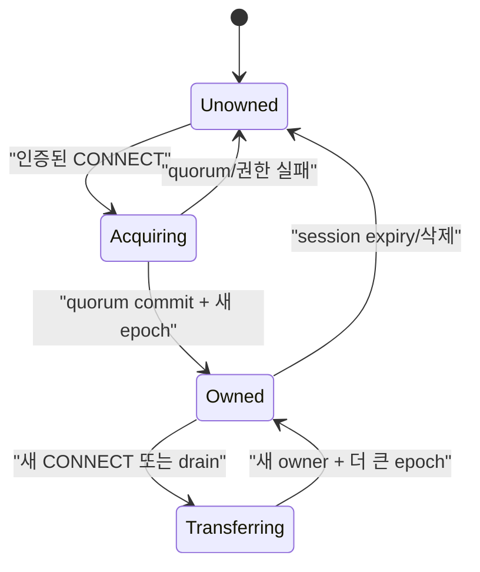
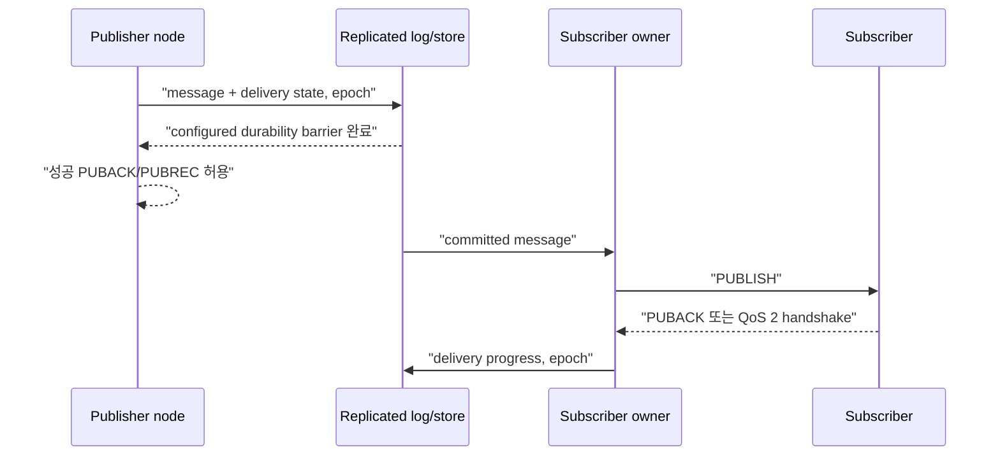

# Cluster session과 durable delivery 스펙

이 문서는 여러 NaruMQ node가 membership, session ownership, routing과 durable state를 외부에서 일관되게 제공하는 동작을 정의한다. Storage와 consensus target은 ADR에서 결정하며, target 선택만으로 runtime 수용이 완료되지는 않는다.

| 항목 | 값 |
| --- | --- |
| 상태 | Draft |
| 관련 요구사항 | CLU-01~CLU-14, NFR-07~NFR-10, NFR-15 |
| 근거 | [PRD 8장, 9.2절과 11.2절](../requirements/PRD.md) |
| 관련 Architecture | [Cluster architecture](../architectures/cluster-architecture.md), [EKS on EC2 deployment](../architectures/eks-ec2-deployment.md) |
| 관련 결정 | [ADR-0001](../decisions/ADR-0001-core-implementation-language.md), [ADR-0002](../decisions/ADR-0002-cluster-consensus-library.md), [ADR-0003](../decisions/ADR-0003-durable-ack-barrier.md), [ADR-0004](../decisions/ADR-0004-session-ownership-and-fencing.md), [ADR-0007](../decisions/ADR-0007-aws-production-deployment-platform.md), [ADR-0008](../decisions/ADR-0008-raft-peer-transport.md), [ADR-0009](../decisions/ADR-0009-raft-production-state-profile.md), [ADR-0011](../decisions/ADR-0011-cluster-backup-restore-v1.md) (historical v1 boundary), [ADR-0012](../decisions/ADR-0012-retained-replication-and-cluster-backup-v2.md) (retained scope), [ADR-0013](../decisions/ADR-0013-offline-queue-replication-and-cluster-backup-v3.md), [ADR-0014](../decisions/ADR-0014-cross-node-live-qos0-forwarding.md), [ADR-0015](../decisions/ADR-0015-cluster-durable-qos-delivery.md) (cluster QoS 1/2 durable delivery scope), [ADR-0017](../decisions/ADR-0017-tenant-storage-quota.md) (TEN-08 storage quota scope), [ADR-0018](../decisions/ADR-0018-release-compatibility-window.md) (N/N-1 release profile and feature activation), [ADR-0019](../decisions/ADR-0019-untargeted-durable-publish-quorum-barrier.md) (target 0 command 생략 범위) |
| 관련 Contract | [Cluster release compatibility v1](../contracts/cluster-release-compatibility-v1.md), [Raft peer transport v1](../contracts/raft-peer-transport-v1.md), Draft [Cluster backup v3](../contracts/cluster-backup-v3.md), Superseded [Cluster backup v2](../contracts/cluster-backup-v2.md), Superseded [Cluster backup v1](../contracts/cluster-backup-v1.md) |
| 해설 | [세션 소유권과 fencing](../explainers/session-ownership-and-fencing.md), [EKS 고가용성과 장애 도메인](../explainers/eks-ha-failure-domains.md) |

## 1. Cluster membership

1. 기준 배포는 quorum에 참여하는 node 3개로 구성해야 한다.
2. node는 `JOINING` 중 discovery, member 인증, log/snapshot 동기화와 committed persistent subscription에서 route projection을 rebuild하는 작업을 마쳐야 한다.
3. 초기 동기화와 route projection rebuild가 끝나고 quorum을 확인하기 전에는 MQTT traffic readiness를 성공으로 반환해서는 안 된다.
4. join, 정상 leave와 재시작은 수동 데이터 수정 없이 재시도할 수 있어야 한다.
5. 비인가 member와 지원하지 않는 cluster protocol version은 membership에 추가해서는 안 된다.
6. data directory가 없거나 빈 bootstrap voter는 다른 bootstrap voter 모두에게 진행 여부를 확인한 뒤에만 Raft를 bootstrap한다. 어느 voter라도 term 1·commit 3을 넘었고 이 voter를 함께 시작한 peer로 허용하지 않으면 시작하지 않고 `cluster bootstrap refused` 오류로 종료한다. 확인 중에는 management·MQTT listener를 열지 않는다.
7. 승격된 joiner voter가 영속 기록을 잃으면 같은 ID를 seed admission으로 다시 참여시키지 않는다. Seed runtime은 committed VOTER 후보를 거절하며 fresh STAGED client는 이전 seed의 VOTER 응답도 설치하지 않는다. 정상 same-volume 재시작은 persisted committed local identity로 재개한다([ADR-0024](../decisions/ADR-0024-joiner-voter-volume-loss-admission.md)).

외부 cluster 조회는 최소한 node별 `nodeId`, lifecycle state, release version, member role, readiness, replication health와 마지막 오류를 제공해야 한다. `replicationHealth`는 조회 node 자신에 대해서는 local Raft storage 상태를, 원격 peer 행에 대해서는 조회 node에서 관찰한 peer 연결 상태를 나타내며 원격 peer의 storage 상태를 뜻하지 않는다. `lastErrorCode`는 내부 오류 원문 대신 안정된 오류 code를 제공한다. `replicationQueue`는 조회 node에서 해당 원격 peer로 보내는 outbound 대기열을 나타낸다. 정확한 field 형식은 [Management API v1 Contract](../contracts/management-api-v1.md)과 OpenAPI 문서를 따른다.

## 2. Session identity와 ownership

session key는 `(tenantId, clientId)`다. 각 key에는 한 시점에 쓰기 권한을 가진 owner가 최대 하나만 존재해야 한다.



ownership record는 최소 `sessionKey`, `ownerNodeId`, 단조 증가 `epoch`, 상태와 `commit identifier`를 가져야 한다. 이 Phase 2 evidence에서 `commit identifier`는 ownership aggregate가 opaque committed-command stream을 소비할 때 부여하는 application committed-command sequence position이다. 이는 consensus adapter의 Raft `StatusDTO.CommitIndex`나 snapshot index와 다르다. [ADR-0009](../decisions/ADR-0009-raft-production-state-profile.md)는 protobuf encoding family만 선택했으며 exact persisted schema는 별도 contract에서 정한다.

Phase 2의 첫 단계인 replicated ownership core는 다음 관찰 계약을 만족해야 한다.
1. 최초 acquire의 `expectedEpoch`는 `0`이어야 하며 성공 시 `epoch`는 `1`이 된다.
2. 이후 모든 ownership 획득 및 reconnect는 현재 `epoch`와 일치하는 `expectedEpoch`를 요구하며 성공 시 `epoch`가 정확히 `1` 단조 증가한다.
3. `epoch`가 `uint64` 최대값에 도달하면 wrap-around하지 않고 mutation을 영구 중단한다.
4. quorum commit 없는 proposal은 어떤 node의 state machine에도 반영되지 않는다.
5. majority takeover 후 이전 `(ownerNodeId, epoch)`의 인가 요청은 거절되어야 한다.
6. restart 및 snapshot replay 후에도 마지막 application committed-command sequence position과 epoch가 정확히 보존된다.
7. 이미 quorum에 commit된 동일 ownership acquire command를 commit 응답 유실 후 재시도하면, retry도 다음 application committed-command sequence position으로 commit되어 `stale_epoch`로 결정적으로 거절되어야 한다. 이때 `ownerNodeId`, `epoch`와 성공한 ownership record의 `commit identifier`는 바뀌지 않아야 한다.

### 2.1 Fencing 규칙

- session aggregate를 바꾸는 acquire 이외의 command의 의미상 envelope 필드는 `sessionKey`, `ownerNodeId`, `epoch`와 operation-specific subscription 또는 inflight mutation으로 한정한다. 이 이름은 필요한 의미 정보이며 serialized field나 byte format을 정하지 않는다.
- committed apply는 `ownerNodeId == currentOwnerNodeId`이고 `epoch == currentEpoch`인 경우에만 acquire 이외의 session mutation을 인가한다.
- ownership record가 없거나 owner가 다르거나 epoch가 다르면 stale/not-authorized mutation으로 결정적으로 거절한다.
- 성공한 `Acquire`만 owner와 epoch를 설치하거나 증가시킬 수 있다. Subscription 또는 inflight mutation은 epoch가 현재 값보다 크더라도 새 owner나 epoch를 설치할 수 없다.
- 문법적으로 유효하지만 stale한 committed mutation은 application committed-command sequence position을 소비하지만 ownership, persistent subscription, QoS inflight와 route projection은 바꾸지 않는다.
- 새 owner는 더 큰 epoch가 quorum commit된 뒤에만 client traffic을 처리해야 한다.
- 이전 owner는 takeover를 관찰한 즉시 read·write와 delivery를 중단하고 connection을 종료해야 한다.
- node가 더 새로운 owner/epoch를 적용하면 이전 owner/epoch로 이미 bind된 연결은 종료하고, 아직 bind하지 않은 이전 epoch의 CONNECT는 session binding과 성공 CONNACK 전에 거절해야 한다.
- 연결 정리와 session bind 전에 거절된 CONNECT 정리는 해당 연결이 획득한 ownership epoch를 사용한다. 현재 local session epoch가 다르면 timer, repository, delivery, Will을 변경하기 전에 정리를 중단한다. epoch가 일치하면 기존 local session 정리 절차를 실행하고, replicated mutation은 committed owner/epoch 검증을 다시 거친다.
- 원격 takeover apply는 이전 node의 application `ownershipEpochs`를 새 epoch로 덮어쓰지 않는다. 이전 연결은 `DisconnectNormal`로 local lifecycle을 정리하고 Will을 억제하며, 이전 epoch로 제안된 DETACH·DISCARD 등 replicated session mutation은 committed owner/epoch 검증에서 거절된다.
- 인증으로 tenant-scoped session identity가 만들어지기 전 ingress는 raw MQTT Client ID로 pending CONNECT를 묶을 수 있다. committed ownership fence는 group 안에서 tenant별로 분리하므로 같은 raw Client ID를 쓰는 다른 tenant의 CONNECT를 거절하지 않는다.
- timeout만으로 ownership을 추정하거나 임대 만료 전 stale owner write를 허용해서는 안 된다.

CONNECT를 받은 ingress node와 Raft leader가 다를 수 있다. Ingress node는 ownership proposal을 현재 leader까지 전달해야 하며, follower는 인증된 peer transport를 통한 Raft proposal forwarding을 사용할 수 있다. Quorum commit을 확인한 뒤에만 성공 CONNACK을 반환한다. Leader 또는 quorum가 없으면 CONNECT를 거절하고 node-local ownership을 설치해서는 안 된다.

Production error/DTO와 serialized bytes는 [ADR-0009](../decisions/ADR-0009-raft-production-state-profile.md)가 선택한 encoding family에 맞춰 별도 replicated-state contract에서 정한다. ADR-0009는 exact message schema나 wire bytes를 정의하지 않는다.

### 2.2 Session aggregate와 route projection

`sessionKey`마다 ownership record, persistent subscription, inbound QoS inflight와 outbound QoS inflight를 하나의 논리적 replicated session aggregate로 취급한다. 한 `sessionKey`에 대한 command는 같은 committed ordering을 공유하고 하나의 aggregate 경계에서 원자적으로 적용해야 한다. Subscription 또는 inflight 변경 결과를 ownership 권한 판정 결과와 분리해 외부에 노출해서는 안 된다.

Route metadata는 committed persistent subscription에서만 계산하는 node-local disposable projection이다. 이 projection은 authoritative committed subscription state에서 다시 만들 수 있어야 하며, node는 routing readiness를 광고하기 전에 rebuild를 완료해야 한다. Route projection은 ownership 또는 fencing authority로 사용할 수 없다.

WAL·snapshot target, protobuf encoding family와 단일 group profile은 scoped [ADR-0009](../decisions/ADR-0009-raft-production-state-profile.md)에 기록한다. Exact replicated-state message schema는 [replicated-state-v1.proto](../contracts/replicated-state-v1.proto)에 정의한다. N-1 compatibility와 production storage 보장은 검증되지 않았다. Detached persistent session의 QoS 0 offline queue 경계는 §4.1과 [ADR-0013](../decisions/ADR-0013-offline-queue-replication-and-cluster-backup-v3.md)이 정하고, QoS 1/2 durable message·inflight state와 전달 경계는 §4.2와 [ADR-0015](../decisions/ADR-0015-cluster-durable-qos-delivery.md)가 정한다.
### 2.3 Takeover ordering

- Outbound `SEND`, `ADVANCE`, `COMPLETE`는 각각 PUBLISH, PUBREL 또는 packet identifier 해제의 wire effect보다 먼저 commit해야 한다. Successor의 더 큰 epoch `Acquire`가 commit되면 이전 owner의 후속 command는 exact owner/epoch check에서 거절되며, successor는 ATTACH로 committed delivery state를 재개한다. 이 ordering 규칙만으로 drain lifecycle이 충족되지는 않으며, broker drain contract는 [Drain spec](drain-and-rolling-update.md)을 따른다.

동시 CONNECT 또는 partition 시험에서 성공 owner가 둘로 관찰되면 spec 위반이다.

## 3. Routing

1. 어느 READY node에 publisher와 subscriber가 연결돼도 cluster 전체의 matching subscription으로 전달해야 한다.
2. route key는 tenant 격리가 끝난 canonical topic/filter를 사용해야 한다.
3. Route-affecting subscription mutation은 authoritative fenced command로 `sessionKey`, `ownerNodeId`, `epoch`와 subscription option을 전달한다. Committed apply 뒤 route projection은 committed persistent subscription state에서 파생하며, 별도의 authorized route mutation으로 처리하지 않는다.
4. 이전 owner 또는 stale owner/epoch의 route-affecting subscription add·remove mutation은 거절해야 한다.
5. route propagation 지연은 측정 가능해야 한다. 지연 중에도 권한 또는 tenant 경계를 우회해서는 안 된다.
6. shared subscription member 선택은 tenant와 group 경계를 지켜야 하며, unavailable owner를 계속 선택해서는 안 된다.

### 3.1 Live cross-node QoS 0 전달

`-cluster-config` mode에서 ingress node는 local committed route projection으로 publish 대상과 각 candidate의 effective QoS, Retain 및 shared-subscription 선택을 계산한다. Candidate마다 다음 순서를 적용한다.

1. Detached persistent session은 §4.1의 Raft offline `ENQUEUE` 경로를 먼저 사용한다.
2. Connected candidate의 committed owner가 local node와 다르면 QoS 0 delivery를 owner node로 forwarding한다.
3. Owner가 local node이거나 ownership row가 없으면 node-local delivery queue에 넣는다.

Detached 확인을 먼저 해야 한다. 연결이 끊긴 session은 이전 owner의 ownership row를 계속 가질 수 있으므로, 원격 전달보다 offline `ENQUEUE`가 우선한다. Ingress는 local committed ownership을 읽으며 publish message마다 Raft read barrier를 수행하지 않는다. QoS 0 PUBLISH ingress admission은 local storage가 정상이고 runtime과 projection이 초기화되어 있으며 projection index가 applied index 이상일 때만 허용한다. Driver가 Ready batch를 처리 중이면 cached readiness snapshot을 사용해 local projection refresh를 기다리되, `clusterReadTimeout`(2초) 뒤에도 처리가 끝나지 않거나 storage health가 `DEGRADED`/`FAILED`이면 기다림을 끝내고 delivery 전에 연결을 닫는다. 그 밖의 uninitialized·failed·stale projection은 즉시 거절한다. Quorum만 사용할 수 없는 경우에는 local projection이 정상인 QoS 0 경로를 막지 않는다.

Forwarding은 인증된 peer listener의 별도 `NMQFWRD2` stream을 사용한다. Stream queue는 방향·peer마다 최대 1,024 frame 및 8 MiB이며, Raft queue와 독립적이다. Queue admission 이후 receiver ACK나 retry는 없다. 따라서 전달은 at-most-once이고 FIFO는 같은 `(ingress node, owner node)` 쌍 안에서만 보장된다. Peer queue가 가득 차면 해당 candidate는 `Saturated`, 전달 lane/peer를 사용할 수 없으면 `Unavailable`로 처리하고 shared-subscription 선택은 다음 candidate를 시도한다.

Receiver는 자기 local committed ownership이 해당 session의 owner라고 나타내고 session이 local delivery queue에 등록된 경우에만 enqueue한다. Ownership이 다르거나 session이 등록되지 않으면 조용히 버린다. Receiver queue가 가득 차면 local queue saturation과 같이 해당 subscriber connection을 닫는다. Will publish도 동일한 routing·forwarding 경로를 사용한다. QoS 1/2는 §4.2의 Raft 경로를 사용한다.

이 경로의 live message는 Raft log, snapshot, backup 또는 detached offline queue에 기록하지 않는다.

## 4. Replicated state

다음 상태는 configured replication factor와 write quorum을 적용해야 한다.

| 상태 | 복구 계약 |
| --- | --- |
| persistent subscription | owner 장애 뒤 같은 filter와 options를 복구한다. |
| 수신·송신 QoS inflight | packet identifier, 단계와 재전송 의미를 복구한다. |
| durable offline message | expiry·quota 안에서 전달을 재개한다. |
| retained message | tenant와 canonical topic별 최신 값을 복구한다. |
| session metadata | expiry, Will, owner epoch와 client protocol 정보를 복구한다. |
| ownership·route metadata | stale owner를 fence하고 routing을 다시 구성한다. |

replica 수가 configured write quorum보다 적으면 durable write를 성공 처리해서는 안 된다. replication lag 또는 disk pressure가 한도를 넘으면 publish admission을 늦추거나 거절해야 하며, 이미 성공 ACK한 durable state를 임의로 drop해서는 안 된다.

### 4.1 Offline message capture와 전달

Cluster mode에서 persistent session(MQTT 3.1.1 CleanSession=0 또는 MQTT 5 CleanStart=0 및 Session Expiry Interval > 0)이 연결을 종료한 뒤부터 다음 재접속 전까지의 구간을 **detached** 상태로 취급한다. Detached session에 도착한 QoS 0 message만 Raft committed state machine에 저장한다. Connected session은 local owner의 node-local queue를 사용하거나, 다른 node가 owner이면 §3.1에 따라 live QoS 0 delivery를 forward한다. QoS 1/2 offline entry와 durable ACK의 동작은 §4.2에서 정한다.

1. **Key와 복제 상태:** 각 `(tenantId, clientId)` session key마다 `OfflineSessionState`를 둔다. 필드는 `tenantId`, `clientId`, 단조 증가 `epoch`, `sessionExpiresAtUnixMillis`, 단조 증가 `nextSequence`와 `messages[]`다. 각 `OfflineMessage`는 `sequence`, `topic`, `payload`, `qos(=0)`, `retain`, `expiresAtUnixMillis`를 가진다. Message identity는 session 안에서 1부터 단조 증가하는 `sequence`이며 FIFO 순서다.
2. **명령:** `OfflineChange`는 세 action을 가진다.
   - `DETACH`: owner node가 persistent session disconnect 시 제안한다. `(ownerNodeId, epoch)`가 현재 ownership과 정확히 일치해야 한다(아니면 `stale_epoch`). Record가 없으면 `nextSequence=1`로 생성한다. 동일 epoch record가 이미 있으면 no-op `Applied`다. 더 작은 epoch record가 있으면 기존 message를 보존하고 epoch를 올린 뒤 이어 붙인다. Local queue 잔여 FIFO message는 최대 64개, `topic+payload` 합계 최대 768 KiB까지 함께 싣는다.
   - `ENQUEUE`: 어느 node든 publish 대상이 detached session이면 제안한다. `ownerNodeId=0`, message 정확히 1개다. Record가 존재하고 `record.epoch == command.epoch`여야 한다(아니면 `offline_session_missing`).
   - `CLAIM`: CONNECT가 새 ownership epoch를 commit한 직후 새 owner가 제안한다. `(ownerNodeId, epoch)`가 현재 ownership과 같아야 한다(아니면 `stale_epoch`). Record를 삭제하고 그 message들을 apply 결과로 반환한다. Record가 없으면 `Found=false`다.
3. **전달 의미:** at-most-once다. CLAIM commit이 record를 먼저 지우고 그 다음 local queue로 전달한다. CLAIM 성공 뒤 전송 전 crash하면 해당 QoS 0 message는 유실될 수 있다. 자동 재시도는 하지 않는다. Commit timeout 뒤 늦게 commit된 ENQUEUE는 queue에 남는다.
4. **결정적 한도:** Apply는 session당 64 message, 전체 tenant 합산 4,096 message·16 MiB, payload당 1,000,000 bytes를 제한한다. DETACH 한 command의 `topic+payload` 합계는 768 KiB 이하여야 한다. 크기는 `len(tenantId)+len(clientId)+len(topic)+len(payload)`의 합이다. 한도를 넘으면 command 전체를 `offline_capacity_exceeded`로 거절하고 기존 state를 보존한다(같은 apply의 만료 purge는 유지). Detached session record 수는 ownership row 수를 넘지 않으므로 별도 상한을 두지 않는다. Tenant quota profile이 있으면 QoS 0 offline message와 durable delivery outbound message를 합산한 tenant usage에 `offline_queue_messages`와 `offline_queue_bytes`를 추가 적용한다. Global limits가 먼저이며 구체적인 quota 차원 순서와 profile 적용은 [ADR-0017](../decisions/ADR-0017-tenant-storage-quota.md)을 따른다.
5. **만료:** 모든 offline command apply는 먼저 proposer 시각(`proposedAtUnixMillis`) 기준으로 `0 < expiresAt <= proposedAt`인 message와 `0 < sessionExpiresAt <= proposedAt`인 session record를 지운다. Local replica clock은 읽지 않는다. `sessionExpiresAt`은 disconnect 시각 + MQTT 5 Session Expiry Interval이며, 만료가 없으면 0이다.
6. **Ownership 연동:** Ownership `Release`가 apply되면 같은 key의 offline record도 지운다. Transfer/acquire는 record를 보존하며 새 owner의 CLAIM이 가져간다. 모든 offline record는 `record.epoch` 이상의 ownership row를 가져야 한다.
7. **SessionPresent:** `CleanStart=0` CONNECT의 CLAIM이 `Found=true`이면 다른 node로 reconnect해도 CONNACK `SessionPresent=1`이고 message를 sequence FIFO로 전달한다. `CleanStart=1`이면 CLAIM으로 record를 지우고 message는 버린다.
8. **Fallback:** DETACH가 quorum/compatibility/stale-epoch 이유로 실패하면 local queue를 그대로 둔다. CLAIM이 실패하면 CONNECT를 ownership-unavailable reason으로 거절하고 local session 변경을 rollback한다. 기존 local session이 없었던 시도는 새 delivery queue 등록과 tenant route binding도 제거한다. 기존 local session이 있으면 CLAIM 성공 전까지 기존 expiry/WILL timer를 유지하고, 실패 시 기존 timer와 session 상태를 보존한다. ENQUEUE 실패는 해당 대상만 `Saturated`(capacity) 또는 `Unavailable`(그 외)로 보고한다.
9. **알려진 한계:** Owner node가 연결 중에 crash하면 DETACH가 없어 이후 message는 capture되지 않는다. Detach 전환 중 local queue 조회와 제거 사이에 해당 node로 도착한 QoS 0 message는 유실될 수 있다. ENQUEUE는 대상 session마다 commit 1회다.
10. **Schema와 profile gate:** Replicated-state schema는 `1.0`을 유지하고 unknown field를 거절한다. Offline command는 fresh read barrier 뒤 모든 non-retired member의 cluster protocol/state schema가 exact match이고 release가 같은 major의 인접 minor window 안에 있는지 확인한 뒤 제안한다.

### 4.2 QoS 1/2 durable delivery

Cluster mode에서 publisher가 보낸 QoS 1/2 PUBLISH 및 QoS 1/2 Will의 처리는 Raft quorum 경계를 따른다. QoS 1 client PUBLISH는 retained mutation이 있으면 이를 먼저 commit한다. Prepare 시점 ingress route projection에 durable target 후보가 하나 이상 있으면 `publish_qos=1` delivery command를 commit한 뒤 effective QoS 0 대상 lane을 처리하고 PUBACK을 보낸다. 후보가 없으면 delivery PUBLISH command 없이 fresh, proposal 없는 quorum ReadIndex barrier를 기다리고, 그 index까지 local apply와 route projection이 끝난 뒤 QoS 0 lane을 처리하고 PUBACK을 보낸다. QoS 2 client PUBLISH 수신은 target 수와 무관하게 publisher session inbound 상태를 RECEIVE로 commit한 뒤 PUBREC을 보낸다. QoS 1/2 Will은 publisher inbound RECEIVE 없이 전달하며, retained mutation이 있으면 기존 순서로 먼저 commit한다. Target 후보가 있으면 `publish_qos=1/2` durable PUBLISH command를 commit하고 없으면 같은 fresh ReadIndex barrier를 통과한 뒤 QoS 0 lane을 처리한다. Will에는 publisher ACK가 없다. PUBREL 수신은 target 수와 무관하게 retained state와 `publish_qos=2`인 RELEASE를 commit하고 QoS 0 대상 lane을 처리한 뒤 PUBCOMP을 보낸다. RELEASE가 이미 완료된 tombstone을 찾거나 packet을 찾지 못하면 QoS 0 lane 없이 성공 PUBCOMP을 보낸다.

Client QoS 1/2 PUBLISH ingress admission은 local projection readiness만 먼저 확인하며 별도 quorum readiness barrier를 수행하지 않는다. Admission은 Ready drain이 진행 중일 때 atomic cached readiness snapshot을 확인하고 route projection refresh를 기다리며, storage health는 그 대기와 독립적으로 확인한다. `DEGRADED`/`FAILED` storage 또는 `clusterReadTimeout`(2초) 내에 끝나지 않은 Ready drain은 전달 전에 연결을 닫는다. Ready 처리 중이 아닐 때 projection이 초기화되지 않았거나 rebuild에 실패했거나 applied index보다 뒤처지면 즉시 닫는다. Runtime은 staged proposal 결과를 Ready drain이 끝나고 refreshed projection이 최신 applied index를 반영한 뒤 해제한다. Fatal Ready 처리 오류는 admission-failed 상태를 기록한 뒤 sequence를 닫아 이후 PUBLISH admission이 실패하도록 하며, driver exit은 request queue에 남은 proposal과 driver-local waiter의 미적용·stage된 결과를 포함한 pending proposal 전체를 non-success error로 해제한다. Fresh quorum proof는 durable command의 bounded commit 경계에서 확인한다. 성공 응답 전에 quorum이 없거나 commit이 실패·timeout되면 PUBACK/PUBREC/PUBCOMP 성공 응답을 보내지 않고 연결을 닫는다. RECEIVE capacity 초과 또는 command 크기 초과 시 MQTT 5는 reason `0x97`을 보내고 MQTT 3.1.1은 연결을 닫는다. PUBLISH/RELEASE 대상별 durable queue가 포화되면 그 대상은 `Saturated`로 건너뛰지만 publish 전체는 성공할 수 있다. 이는 PRD CLU-12의 한도 도달 시 publish 제한 요구와 다른, 승인된 결정이다. 로컬 연결 중인 포화 대상은 기존 정책에 따라 연결을 닫으며, 재접속 시 queue 적재가 다시 시도된다.

각 `(tenantId, clientId)` session에는 Raft 복제 durable queue와 QoS inflight state가 있다. Apply 단계의 target 판정은 committed ownership과 subscription으로 다시 검증하며, 현재 owner/epoch에 묶인 matching subscription 가운데 QoS 1 이상이 있어야 한다. `DeliveryChange.publish_qos`는 PUBLISH/RELEASE에서 각각 1 또는 2이며 RELEASE는 2여야 한다. Apply는 이 값을 사용해 `min(publish_qos, matching subscription QoS 최대값)`을 대상의 effective QoS로 계산한다. 각 session message는 1부터 증가하는 sequence를 가져 FIFO로 복구된다. Session당 message 64개 및 inbound 64개, tenant 전체 합계 4,096 entries와 16 MiB, payload 1,000,000 bytes, command당 1,024 targets 제한을 둔다. Committed tenant quota profile은 offline queue와 durable delivery outbound message를 함께 집계하고 `offline_queue_messages`·`offline_queue_bytes`를 적용한다. `storage_bytes`에는 retained, offline, durable delivery outbound·inbound state를 포함한다. 전체 quota 규칙은 [ADR-0017](../decisions/ADR-0017-tenant-storage-quota.md)을 따른다.

Delivery command를 만들지 여부를 결정하는 target 후보는 prepare 시점 ingress projection의 primary 후보 가운데 effective QoS가 1 이상인 matching subscription이다. Session의 persistent 여부는 후보 포함 여부를 바꾸지 않으며, Apply는 기존대로 committed ownership과 subscription을 다시 검증한다. Ingress node에 아직 적용되지 않은 SUBSCRIBE는 publish보다 뒤에 정렬된다. Target 없는 경로에서 barrier가 실패하거나 timeout되면 성공 ACK와 QoS 0 lane 처리를 막는다. QoS 1 client PUBLISH는 기존 commit 실패와 같이 연결을 닫으며, Will에는 원래 publisher ACK가 없다. Barrier timeout은 5초다. 이 경로는 별도 release profile compatibility gate나 feature activation을 추가하지 않는다.

`NextSequence`는 wrap-around하지 않는다. `uint64` 최대값에 도달한 target은 새 message를 받지 않고 `Saturated`로 보고한다.

Owner는 outbound PUBLISH 쓰기 전에 SEND를 commit하고, subscriber의 PUBREC 뒤 PUBREL 쓰기 전에 ADVANCE를 commit한다. PUBACK/PUBCOMP 또는 실패 PUBREC 처리 뒤에는 COMPLETE를 commit한 뒤 packet identifier를 해제한다. 이전 owner의 명령은 새 ownership epoch에서 fencing된다. Reconnect/takeover 시 새 owner는 할당된 inflight를 packet identifier 순서로 재전송한다(PUBLISH는 `DUP=1`, PUBREL 대기 단계는 PUBREL). 이어 QUEUED message를 sequence 순서로 보내고, claimed offline QoS 0 message는 그 뒤에 보낸다. CleanStart는 durable state를 reset하며, CONNACK SessionPresent는 offline CLAIM 또는 durable ATTACH 중 하나가 기존 state를 찾았고 CleanStart가 아닌 경우에만 설정한다.

`SEND` commit에서 quorum을 일시적으로 사용할 수 없으면 replicated message와 local queue head를 소비하거나 승격해서는 안 된다. 이 사유만으로 subscriber TCP connection을 닫거나 PUBLISH를 보내지 않는다. `ErrRetryableUnavailable`은 SEND commit 결과를 확인할 수 없는 상태를 나타내며, local queue head와 pending Packet Identifier를 보존하고 같은 ID로 재시도한다. Writer는 최대 초당 한 번 자동 재시도하고, 다음 durable-delivery notification은 retry timer보다 먼저 처리를 깨울 수 있다. 일반 `ErrUnavailable`은 missing session/state를 뜻하므로 일시적 quorum 오류로 취급하지 않는다.

`ATTACH`는 command 전부터 `DeliverySessionState` record가 있으면 message/inbound가 비어 있어도 `Found=true`를 반환한다. `Reset=true`인 CleanStart는 delivery/inbound state와 committed persistent subscriptions를 지우고 `Found=false`를 반환하며, record가 있으면 `next_sequence`는 단조 증가를 유지한다.

QoS 2 publisher inbound record는 PUBREL 전 상태 또는 완료 tombstone을 복구한다. Tombstone은 RELEASE 뒤 PUBCOMP가 유실되어 client가 PUBREL을 재시도할 때 성공 PUBCOMP을 보장하며, 같은 packet identifier의 새 RECEIVE, capacity eviction, ATTACH reset 또는 record 삭제까지만 유지된다. QoS 1 중복은 같은 connection에서 기존 inbound 상태로 억제하지만, reconnect 뒤 DUP 재전송은 새 PUBLISH로 처리될 수 있어 중복 전달이 가능하다. QoS 2는 publisher inbound state로 connection/node를 넘어 중복을 억제한다.

QoS 1/2 PUBLISH에서 effective QoS가 0인 subscriber는 durable queue가 아니라 기존 QoS 0 경로를 따른다. 이 at-most-once lane은 delivery commit 뒤 detached session이면 offline ENQUEUE, remote owner이면 `NMQFWRD2` forwarding, 그 밖에는 local queue를 사용한다. PUBACK/PUBCOMP 뒤 lane 실패 또는 ingress node crash로 전달이 유실될 수 있다. 이는 MQTT QoS 0 및 ADR-0013의 보장 범위와 같다.

SUBSCRIBE 중 retained message 재생과 DETACH 실패 뒤 남은 local QoS 0 message는 node-local 예외이며 owner crash/takeover 시 복구되지 않는다. Local QoS 0 message는 durable queue 뒤 순서로 유지되고 capacity 초과분은 잘릴 수 있다. Connected session의 owner node가 crash하고 client가 돌아오지 않아 DETACH가 없으면 session expiry 갱신이 없을 수 있다. Record는 session당 64개까지 찬 뒤 이후 matching target은 `Saturated`로 건너뛰며 global quota도 고갈될 수 있다.

이 범위는 ADR-0015가 정한 cluster QoS 1/2 durable delivery 동작이다. §11.11은 detached session queue 전달, QoS inflight takeover, QoS 2 Will reconnect/takeover 전달, backup restore, ACK 뒤 process kill 및 quorum-loss 거절을 확인한 unit/process evidence를 기록한다. Drain/`SAFE_TO_STOP`은 ADR-0015 범위에 포함되지 않으며 broker drain 동작과 process evidence는 [Drain spec §10](drain-and-rolling-update.md#10-broker-drain-수용-시험-매핑)에 별도로 기록한다. Production storage/EBS power-loss, BP-03, N-1 compatibility와 TEN-08 quota도 별도 gate다.
Target 없는 QoS 1 client PUBLISH와 QoS 1/2 Will의 delivery command 생략 및 quorum barrier는 [ADR-0019](../decisions/ADR-0019-untargeted-durable-publish-quorum-barrier.md)가 ADR-0015 §1–8을 제한된 범위에서 대체한다.

## 5. Publish commit과 delivery



- 성공 PUBACK/PUBREC은 PRD의 내구성 ACK 경계 뒤에만 반환해야 한다.
- matching durable subscriber(durable target)가 없으면 publisher ACK는 quorum 확인만 뜻하며 payload를 저장하지 않는다. 미래 subscriber 전달을 뜻하지 않는다.
- owner 장애 뒤 새 owner는 committed inflight 단계에서 handshake를 재개해야 한다.
- QoS 1 중복은 허용되지만 durable ACK 뒤 message gap은 허용되지 않는다.
- QoS 2는 MQTT receiver와의 protocol handshake에서 중복 전달을 막아야 한다. subscriber 애플리케이션의 정확히 한 번 처리는 보장하지 않는다.

## 6. Partition과 quorum loss

| 상태 | Majority/quorum side | Minority 또는 quorum 없는 side |
| --- | --- | --- |
| 기존 non-durable traffic | 설정 정책과 자원 한도 안에서만 처리할 수 있다. | 데이터 일관성을 해치지 않는 범위로 제한한다. |
| 새 session ownership | 획득할 수 있다. | 획득해서는 안 된다. |
| durable publish ACK | barrier 충족 시 반환한다. | 성공 ACK을 반환해서는 안 된다. |
| ownership transfer | 새 epoch를 commit할 수 있다. | 수행해서는 안 된다. |
| 관리 mutation | quorum이 필요한 변경만 commit한다. | `quorum_unavailable`로 실패해야 한다. |

partition이 복구되면 committed log가 기준이 된다. minority의 speculative state가 있었다면 폐기하고 route·session state를 다시 구성해야 한다. 자동 수렴 전 node를 READY로 표시해서는 안 된다.

## 7. Failure recovery

1. process crash 또는 host loss가 감지되면 다른 node가 quorum을 통해 새 epoch를 획득해야 한다.
2. 새 owner는 persistent session, subscription, inflight와 offline queue를 복구한 뒤 connection을 수용해야 한다.
3. 단일 node 장애에서 durable ACK가 끝난 message의 RPO는 0이어야 한다.
4. crash 중 snapshot 또는 log append가 중단돼도 마지막 유효 commit 이전 상태로 원자적으로 복구해야 한다.
   - Joiner voter의 기록 손실은 3-voter·승격 직후 4-voter 상태 모두 seed 단계에서 재참여를 막고 새 ID로 교체한다. Joiner 초기 metadata/WAL·listener 생성은 허용되나 성공 MQTT admission과 Raft 참여는 허용하지 않는다. 정상 NOT_READY 거절과 Raft panic을 구분한다.
5. 실제 disk full과 느린 I/O는 해당 node의 복제 상태, readiness와 commit 결과에 반영해야 한다. 저장 오류를 성공 commit으로 보고해서는 안 된다.
   - Local `replicationHealth`는 terminal Raft 실패 시 `FAILED`, WAL Ready 기록과 `fsync` 또는 snapshot 영속화 한 건이 1초 이상 걸리거나 진행 중인 시간이 1초에 도달하면 `DEGRADED`, 나머지는 `HEALTHY`다. 느린 작업이 끝난 뒤 10초 동안 다시 느린 영속화 작업이 없으면 `HEALTHY`로 돌아간다.
   - `DEGRADED`는 `/health/ready`를 503으로 만들고 liveness는 200으로 유지한다. `FAILED`는 `/health/ready`와 `/health/live`를 모두 503으로 만들며 readiness 원인은 `raft storage failed: no space left; restart required`, `raft storage failed: I/O error; restart required`, `raft node failed; restart required` 중 원인에 맞는 문자열이어야 한다. 느린 I/O readiness 원인은 `raft storage I/O is slow`다. `FAILED` node는 관리 HTTP 응답을 유지하고 MQTT 신규 연결을 거절하며, 저장 공간을 확보해도 process를 재시작하기 전에는 복구하지 않는다.
   - Storage health는 membership lifecycle `state`를 바꾸지 않는다. local `DEGRADED` 또는 `FAILED` node의 summary는 `ready=false`, 해당 readiness 원인과 `storagePressure`를 보고해야 한다.
   - `FAILED` node는 새로운 commit을 성공으로 반환해서는 안 된다. Quorum이 남아 있는 healthy node는 진행할 수 있고, quorum이 없으면 commit을 거절해야 한다. `DEGRADED`는 commit을 계속 시도할 수 있다.
   - `lastErrorCode`는 내부 오류 문자열 대신 `storage_no_space`, `storage_io_error`, `storage_slow`, `raft_node_failed`, `peer_disconnected`, `peer_queue_full`, `peer_invalid_message`, `peer_transport_error` 중 안정된 code만 제공한다. local slow-I/O code는 상태가 회복된 뒤에도 최근 원인으로 남는다.
   - 원격 node 행의 `replicationHealth`는 조회 node에서 관찰한 peer 연결 상태다. 연결되어 있으면 `HEALTHY`, 끊겼으면 `UNREACHABLE`이며, `lastErrorCode`는 연결 상태와 별개로 마지막 알려진 transport 오류를 안정된 code로 나타낸다. 이 값은 원격 node의 Raft 또는 storage health를 의미하지 않는다. `replicationQueue`는 조회 node에서 해당 peer로 보내는 outbound message 수, byte 수와 거절 수를 나타내며 실제 transport 제한을 넘지 않아야 한다. 원시 transport 오류 문자열은 API 응답에 포함하지 않는다.
6. volume을 잃은 voter는 같은 ID로 다시 bootstrap하지 않는다. 새 ID를 stage·join해 voter로 승격한 뒤 잃은 member를 planned removal로 제거한다. Removal은 잃은 member의 session ownership을 남은 voter로 이전한다.

## 8. Mixed-version compatibility

- Dynamic cluster release compatibility follows the [release compatibility contract](../contracts/cluster-release-compatibility-v1.md): same major and minor distance at most one; patch does not affect the compatibility decision. N-1 and N must safely interoperate for cluster wire, persisted state, snapshot and management behavior.
- Rollback window가 끝나기 전에는 N-1이 해석하지 못하는 persisted state를 기록하는 irreversible migration을 해서는 안 된다. Window 종료 판단과 migration 승인 절차는 [release compatibility contract §8](../contracts/cluster-release-compatibility-v1.md#8-blocker와-제외-범위)의 미결정 정책을 따른다.
- N에서 N-1로 rollback할 때 이미 기록된 상태를 손상하거나 silent downgrade해서는 안 된다.
- 호환할 수 없는 변경은 rolling update를 시작하기 전에 preflight에서 거절해야 한다.
- 호환 matrix는 release artifact에 포함해야 한다.

Retained, offline, durable delivery, node drain and tenant quota replication require a fresh read barrier and a profile gate across all non-retired members. Cluster ID, cluster protocol and state schema remain exact; releases must share a major and fit the one-minor compatibility window. Member release and features are mutable committed profiles. After restart, a node is not READY until its committed profile matches its build identity. Feature advertisement is carried by committed member profile, not peer hello. `FeatureActivation` commits only when every non-retired member advertises the feature. A build that does not support an active feature is not READY and reports `incompatible_state_schema: ...`; its profile update is rejected. Periodic profile reconciliation keeps the last synchronized state while the sequential `Members` and `ActiveFeatures` reads are pending, then applies the decision only after both complete. A read error, wait, mismatch/proposal, local committed profile change or snapshot restore closes the gate. A local committed profile change or snapshot restore increments the revision, so completion from a pre-change read cannot reopen readiness. Unsupported feature activation or restored unsupported feature state latches incompatibility before readiness can reopen.

## 9. Rebalance

P1 rebalance는 아직 구현되지 않았다. 활성화될 때 rebalance는 ownership fencing과 이미 복제된 delivery state를 보존해 successor가 새 epoch의 ATTACH로 재개하도록 해야 한다. QoS 전송·진행 상태는 wire effect보다 먼저 replicated command로 commit되며, rebalance를 위해 별도의 checkpoint authority를 두지 않는다.

## 10. Snapshot, backup과 restore

1. Snapshot은 포함한 commit index와 typed-state checksum을 가져야 한다. Finalize는 snapshot file sync, close, atomic rename, directory sync 순서이며, 그 경계에서 process crash가 발생해도 재시작 시 완전한 snapshot/WAL만 replay한다.
2. Backup은 commit 경계와 일치하는 typed snapshot, 그 뒤의 committed application/configuration 기록, schema/release metadata 및 checksum을 포함해야 한다. Backup capture는 fresh quorum/read barrier를 거쳐야 한다.
3. 전체 CLU-14 target에는 tenant, session ownership, persistent subscription, retained, QoS delivery/inflight, offline state와 committed tenant quota profile이 포함된다. Current [Cluster backup v3](../contracts/cluster-backup-v3.md)는 archive format `3.0`을 유지하고 required `inflight` kind summary에 delivery session의 outbound message와 inbound QoS 2 상태를 포함한다. Count는 모든 `DeliverySessionState`의 `len(messages)+len(inbound)` 합이며 digest는 `delivery_sessions`만 가진 typed snapshot을 사용한다. Tenant digest에도 delivery record tenant를 포함한다. Tenant quota profile은 replicated typed snapshot과 whole-state SHA-256에 포함하고 별도 kind summary를 만들지 않는다. Historical v2는 retained만, historical v1은 retained/offline 모두 제외했다. 이전 §11.9 acceptance는 QoS 0 offline/retained만 검증했으며 durable QoS 1/2 backup/restore 증거는 §11.11에 기록한다. Linux/EBS power-loss와 retention/RPO/RTO는 여전히 미완료다.
4. Restore는 snapshot과 committed tail을 replay한 뒤 manifest의 commit-boundary count/checksum과 비교해야 한다. Format, identity, version, member identity 또는 summary가 일치하지 않으면 target storage를 바꾸기 전에 거절한다.
5. Current v3 restore는 동일 cluster·protocol/schema를 요구하고 producer와 모든 voter release는 restore build와 같은 major·minor 차이 1 이하인 N/N-1 window 안이어야 한다 ([ADR-0021](../decisions/ADR-0021-backup-archive-release-window.md)). Commit 경계 state의 active feature를 restore build가 지원하지 않으면 target storage 변경 전에 거절한다. 기존 strict decode·replay·summary 검증은 유지하며 모르는 state를 무시하지 않는다. 정확히 세 bootstrap voter ID와 동일 address/DNS SAN/certificate fingerprint를 요구하며 learner ID가 있으면 거절한다. V1/v2 archive, cross-cluster migration과 voter-set 변경은 지원하지 않는다. Restore는 member profile을 바꾸지 않으며 startup 뒤 build profile commit·재확인 전에는 READY가 되지 않는다.
6. Restore는 offline CLI로 voter별 빈 target directory를 seed한 뒤 종료한다. Durable restore marker가 남은 node는 일반 startup에서 READY가 되면 안 된다.
7. Retention 기간과 disaster-recovery RPO/RTO는 `SPEC-TBD-09`이며, Linux EBS/power-loss 보장은 별도 acceptance로 남는다.

## 11. 수용 시험

- 3-node에서 publisher와 subscriber를 서로 다른 node에 연결해 모든 QoS와 subscription 유형을 시험한다.
- 동시 CONNECT, owner kill, packet partition과 stale epoch write 거절을 검증한다.
- quorum 상실 중 새 ownership과 durable ACK가 성공하지 않는지 검증한다.
- 성공 durable ACK 직후 각 node를 kill해 message gap이 없는지 확인한다.
- disk full, snapshot finalize crash, archive/restore·restart/resync 중 consistency와 readiness를 확인한다. Production EBS/power-loss는 별도 미완료 기준이다.
- N-1↔N rolling upgrade와 rollback을 양방향으로 시험한다.

### 11.1 Phase 0 gate 4 deterministic spike mapping

아래 첫 표의 네 시나리오는 `internal/adapters/raft`의 in-process deterministic harness가 검증하는 제한된 증거다. 각 시나리오는 독립 temporary directory와 FIFO `MessageDTO` delivery를 사용한다. 이어지는 두 failure-bound 시험은 각각 WAL adapter unit test와 in-process cluster harness를 쓰는 부분 증거이며, 실제 디스크 장애나 production transport를 검증하지 않는다.

| Spike scenario | 관찰할 결과 | Test mapping |
| --- | --- | --- |
| `leader failure preserves committed state` | node 1 장애 뒤 node 2가 증가한 term으로 선출되고 `[alpha,beta]`가 surviving node에 유지된다. | `TestRaftConsensusSpike/leader_failure_preserves_committed_state` |
| `quorum loss cannot commit` | quorum 없는 old leader가 `gamma`를 apply하지 않으며 반복 proposal은 `ErrBackpressure`로 수렴한다. | `TestRaftConsensusSpike/quorum_loss_cannot_commit` |
| `WAL replay restores commit` | bootstrap snapshot 뒤 reopen한 node가 `[alpha]`를 복구하고 재가입 뒤 `[alpha,beta]`로 수렴한다. | `TestRaftConsensusSpike/WAL_replay_restores_commit` |
| `snapshot plus WAL tail restores state` | snapshot index 이후 WAL tail을 replay해 `[alpha,beta,gamma]`와 동일한 applied/commit 경계를 복구한다. | `TestRaftConsensusSpike/snapshot_plus_WAL_tail_restores_state` |

첫 표 mapping은 CLU-01/02/06/07/09/10과 ADR-0001 gate 4, ADR-0002 §7의 skeleton·local recovery 항목을 연결한다. Fixed-voter peer transport v1의 별도 evidence는 §11.3에 있다. Session ownership, durable MQTT ACK barrier, 실제 disk-full/readiness, 느린 I/O와 membership-change 수용 시험은 여전히 미완료이며 §11.3을 cluster 전체 수용 완료로 간주하지 않는다.

#### WAL write failure와 slow-follower 제한의 부분 증거

아래 시험은 특정 어댑터 동작과 Raft의 in-process flow-control window에 관한 부분 증거다. `Open`의 `MaxInflightMsgs=16`은 entry가 포함된 고유 `MsgApp` 범위에 적용된다. entry가 없는 `MsgApp`은 commit index를 전달할 수 있어 이 계수에 포함하지 않는다. 측정값은 총 outbound 메시지 수, transport queue 크기 또는 retained Raft log 크기의 한계를 뜻하지 않는다.

| Evidence case | 관찰한 결과 | Test mapping |
| --- | --- | --- |
| `WAL write failure stops outbound` | bootstrap 이후 해당 node의 `wal.bin` write에만 주입한 `ENOSPC`를 WAL worker 완료에서 인수하면 `ErrFailed`를 반환하고 node는 terminal failed state로 전이한다. 실패 batch는 비고 applied command는 바뀌지 않는다. 주입 제거 후 `Campaign`, `Propose`, `ProcessReady`도 계속 `ErrFailed`이며 `Close`는 worker를 join하고 정상 작동한다. | `TestNodeWALWriteFailureStopsOutbound` (`internal/adapters/raft/stable_store_test.go`) |
| `slow follower keeps outbound append window bounded` | 1↔3 및 2↔3 route를 막은 동안 node 1·2가 순서가 고유한 1 KiB command 64개를 모두 같은 순서로 적용하고 node 3은 적용하지 않는다. node 1→3의 미응답 entry-bearing `MsgApp` 고유 범위는 `Open`의 `MaxInflightMsgs=16`에 따라 16개 이하로 제한된다. route 복구 뒤 최대 20 logical tick 안에 세 node가 같은 command 순서로 수렴한다. | `TestRaftConsensusSpike/slow_follower_keeps_outbound_append_window_bounded` (`tests/integration/raft_consensus_test.go`) |

WAL 쓰기 시험의 `ENOSPC`는 `filePersistenceOps.write`에서 주입한 오류로 실제 파일시스템 용량 고갈을 재현하지 않는다. 느린 follower 시험은 in-process route 차단이며 실제 peer transport, 느린 I/O, production queue의 메시지·byte 사용량 또는 전체 retained log를 측정하지 않는다. 두 시험 모두 node readiness, MQTT durable ACK, production durability나 전체 수용 시험 완료를 증명하지 않는다.

### 11.2 Phase 2 replicated session ownership core mapping

아래 다섯 시나리오는 `internal/application/takeover`가 application committed-command 순서로 세션 상태를 적용하고 `internal/adapters/raft`가 opaque bytes를 운반하는 in-process deterministic 3-node harness의 제한된 증거다. Acquire bytes는 `takeover`의 experimental codec으로 해석하며, subscription·inflight bytes는 해당 시험 안에서만 typed DTO를 찾는 token으로 해석한다. NMQSTATE1 snapshot/WAL의 재시작 복구 증거는 acquire command에만 해당하고 새 mutation type의 persisted encoding·재시작 replay를 증명하지 않는다.

| Scenario | 관찰할 결과 | Test mapping |
| --- | --- | --- |
| `concurrent acquire elects single owner` | 동일 `(tenantId, clientId)`에 동시 acquire 시 leader에서 먼저 commit된 owner만 epoch 1을 얻고 후속 제안은 `stale_epoch`로 거절되며 모든 node가 동일 상태로 수렴한다. | `TestReplicatedSessionOwnership/concurrent_acquire_elects_single_owner` |
| `minority cannot acquire or advance epoch` | partition된 minority node의 ownership proposal은 commit되지 않으며 majority에서 새 leader가 epoch 2를 commit한 뒤 takeover한다. partition 복구 시 minority는 majority의 epoch 2로 수렴하고 이전 epoch 1 owner의 authorize는 거절된다. | `TestReplicatedSessionOwnership/minority_cannot_acquire_or_advance_epoch` |
| `restart recovers ownership epoch and command sequence` | snapshot과 WAL tail을 가진 node가 재시작 후 opaque command stream을 replay했을 때 restart 전과 동일한 session owner, epoch, application committed-command sequence position으로 복구된다. | `TestReplicatedSessionOwnership/restart_recovers_ownership_epoch_and_command_sequence` |
| `lost commit response retry preserves owner and epoch` | 동일한 opaque command payload 두 개가 모든 node에 commit되고 두 번째 retry가 `stale_epoch`로 거절되며, ownership은 node 1 / epoch 1 / sequence position 1에 남고 state machine은 application sequence position 2까지 진행한다. | `TestReplicatedSessionOwnership/lost_commit_response_retry_preserves_owner_and_epoch` |
| `stale owner session mutations are fenced after takeover` | 5개 명령이 적용된 뒤 node 2/epoch 2 takeover의 ownership position은 5다. 미리 준비한 이전 owner의 persistent subscription 및 inbound/outbound QoS inflight 명령 세 개가 뒤이어 commit되어 3개 node 모두 application sequence 8까지 진행하지만 각각 `stale_epoch`로 거절된다. 구독 `orders/#` QoS 1, inbound `[10]`, outbound `[20]`과 각 node의 파생 route projection은 takeover 직후와 동일하게 유지된다. | `TestReplicatedSessionOwnership/stale_owner_session_mutations_are_fenced_after_takeover` |

이 mapping은 CLU-04, CLU-05, CLU-10과 ADR-0004 §8 항목 1~5의 in-process session ownership/fencing core를 연결한다. 실제 MQTT CONNECT 경로와의 결합 및 multi-node TCP connection teardown은 §11.12에서 process 수준으로 별도 검증했다. Production peer transport와 durable message ACK barrier는 이 core slice 범위에 포함되지 않는다. Persistent subscription·inflight의 production encoding/replay와 route projection rebuild 수용 증거는 §11.14에 기록한다. 어느 한 mapping도 수용 시험 전체 완료를 뜻하지 않는다.

### 11.3 Phase 0 gate 4 production peer transport mapping

이 mapping은 Accepted [ADR-0008](../decisions/ADR-0008-raft-peer-transport.md)과 Active [Raft peer transport v1 contract](../contracts/raft-peer-transport-v1.md)의 고정 voter `{1,2,3}` 전송 경로만 닫는다. 실행 가능한 composition root는 `cmd/narumq -raft-peer-config`이며 일반 MQTT listener와 통합되지 않는다.

| Scenario | 관찰할 결과 | Test mapping | 실행 증거 |
| --- | --- | --- | --- |
| Contract wire vectors와 framing limits | Canonical hello/frame bytes, protocol version validation, zero/oversized/truncated frame 경계가 contract와 일치한다. | `TestPeerTransportHelloGoldenVector`, `TestPeerTransportHelloRejectsInvalidFields`, `TestPeerTransportFrameGoldenVectorAndLengthBounds` | `go test ./internal/adapters/tcp -run '^TestPeerTransport' -count=1` |
| mTLS identity 및 invalid peer 입력 | Foreign CA, allowlisted 다른 identity 주장, cluster/version mismatch, protobuf envelope mismatch, malformed protobuf, oversized/truncated frame은 state/command에 적용되지 않는다. Production driver는 malformed protobuf를 보낸 peer 연결을 종료한다. | `TestPeerTransportRejectsInboundCertificateForWrongVoter`, `TestRaftPeerTransportRejectsUnauthenticatedAndMalformedPeers`, `TestRaftPeerDriverTicksQueuesAndStops` | `go test ./internal/adapters/tcp -run '^TestPeerTransport' -count=1`; `go test ./tests/integration -run '^TestRaftPeerTransport' -count=1`; `go test ./cmd/narumq -run '^TestRaftPeerDriverTicksQueuesAndStops$' -count=1` |
| Bounded queue, backpressure와 quorum progress | Queue count/byte cap을 지킨다. Peer 3 outbound queue가 가득 차도 node 1·2는 election과 command apply를 진행하고, queue가 drain된 뒤 Raft가 peer traffic을 재생성한다. 같은 Ready batch의 거절된 peer 후속 frame은 건너뛰며 healthy peer 전송은 계속한다. Inbound staging overflow는 해당 connection을 닫고 cancellation은 queued-byte accounting을 비운다. 초과 inbound socket도 accept되지 않는다. | `TestPeerTransportSendQueueBoundsCountAndTracksWriter`, `TestPeerTransportSendQueueBoundsFramedBytes`, `TestPeerTransportInboundQueueBoundsFramedBytes`, `TestPeerTransportInboundCancellationDrainsStagedFrames`, `TestPeerTransportConnectionBoundsAndCancellation`, `TestPeerTransportLimitsConcurrentInboundConnections`, `TestProcessRaftMessagesContinuesOtherPeersAndSkipsRejectedFIFO`, `TestRaftPeerDriverTicksQueuesAndStops` | `go test ./internal/adapters/tcp -run '^TestPeerTransport' -count=1`; `go test ./cmd/narumq -run '^(TestProcessRaftMessagesContinuesOtherPeersAndSkipsRejectedFIFO|TestRaftPeerDriverTicksQueuesAndStops)$' -count=1` |
| TLS 3-node replication과 reconnect | Node 3을 끊은 동안 majority가 progress하고, 재연결 후 Node 3이 commit된 command까지 catch up한다. | `TestRaftPeerTransportThreeNodeReplicationAndCatchup` | `go test ./tests/integration -run '^TestRaftPeerTransport' -count=1` |
| Peer-only CLI lifecycle | 3개 별도 peer-only process가 TLS election을 수행하고 WAL을 남긴다. Cancellation 뒤 listener/socket이 닫히며 MQTT `READY`는 출력되지 않는다. | `TestRaftPeerOnlyStartsThreePeersAndStops` | `go test ./cmd/narumq -run '^(TestRaftPeerOnlyRejectsOtherFlags|TestRaftPeerOnlyStartsThreePeersAndStops)$' -count=1` |

이 evidence는 dynamic membership, join/leave, N/N-1 release compatibility, production snapshot transfer, 실제 disk-full·slow-I/O, replicated MQTT message/session state, durable ACK 또는 readiness를 닫지 않는다. ADR-0002는 `Proposed`로 남으며 peer-only executable을 전체 production broker cluster로 해석하지 않는다.

### 11.4 ADR-0009 design target과 module checksum 증거

[ADR-0009](../decisions/ADR-0009-raft-production-state-profile.md)은 네 가지 design target만 채택하며 runtime acceptance는 아니다. 2026-09-24 실행에서 `go mod verify`는 `all modules verified`를 출력했고, `go mod download -json go.etcd.io/raft/v3@v3.7.0`은 아래 값을 반환했다.

| 항목 | 검증 결과 |
| --- | --- |
| Version | `v3.7.0` |
| `Sum` | `h1:BGzlwx07bLv8PW6OU5HObuz1y4hlPZUXA07pM1mPUh4=` |
| `GoModSum` | `h1:6gX6T2X907DjnjsFLODnTxba77stjs84W9gTTI0GUNA=` |

두 checksum은 `go.sum`과 ADR-0009의 선택값에 일치한다. 이는 Go module checksum 검증 결과이며 production code, file/directory sync의 power-loss 보장, snapshot recovery, backup·restore, quorum ACK 또는 N/N-1 호환성 증거가 아니다. 이 decision-only 결과로 기존 acceptance row나 미실행 기준을 통과 처리하지 않는다.

### 11.5 Dynamic membership·restart convergence·MQTT readiness mapping

아래 표의 동적 membership 시나리오는 각 시험 위치의 실행 결과로 확인한다. 이 section은 production storage·disk-full·backup/restore를 판정하지 않는다. Backup v1의 별도 process evidence는 §11.7이며, durable QoS ACK·release N/N-1은 미완료 수용 범위다.

| Scenario | 관찰할 결과 | 시험 위치 | 실행 증거 |
| --- | --- | --- | --- |
| Three-voter replacement and retired ID | `{1,2,3}`에서 새 ID `4` learner를 catch up·promote하고 planned removal로 `{1,2,4}`가 된다. ID `3` 재사용은 거절되고 나머지 두 voter는 한 node loss 뒤 quorum을 유지한다. | `tests/integration.TestDynamicClusterMembershipProcessAcceptance` | PASS: member 4가 catch-up/promotion 후 voter가 됐고, member 3 removal 뒤 voter 집합 `{1,2,4}`와 retired 상태를 확인했다. ID 3 재사용은 409 `member_id_reserved`로 거절됐으며, survivor 1대 crash 뒤 2 voter가 quorum readiness와 MQTT CONNECT를 유지했다. `go test ./tests/integration -run '^TestDynamicClusterMembershipProcessAcceptance$' -count=1 -v` |
| Idempotent join/leave | Stage, promotion, leave/remove 각 응답을 유실한 뒤 같은 key로 재요청하면 같은 operation ID와 최종 voter set으로 수렴한다. 중복 promotion/config change는 없다. | `tests/integration.TestDynamicClusterMembershipProcessAcceptance` | PASS: stage 직후, promotion 완료 후, planned removal 완료 후 같은 idempotency key 재요청이 동일 operation ID와 committed phase로 수렴했고 중복 config change/promotion이 없었다. 위 process acceptance 실행 |
| Compatibility and identity rejection | Foreign CA, SAN/fingerprint/cluster/ID mismatch, unsupported release/protocol/schema, malformed hello/state record는 membership log에 commit되지 않고 `Step`에 도달하지 않는다. | `TestDynamicPeerRejectsTLSCertificateIdentityMismatchBeforeRaftDelivery`, `TestDynamicPeerRejectsForeignCAAndSANAndClusterMismatchBeforeRaftDelivery` (`internal/adapters/tcp/peer_transport_v2_test.go`); `tests/integration.TestDynamicClusterMembershipProcessAcceptance` | PASS: foreign CA, SAN, cluster ID, peer fingerprint 및 malformed hello가 transport/Raft delivery 전에 거절됐다. Unsupported release/protocol/schema는 422 `compatibility_unsupported`, retired ID는 409 `member_id_reserved`로 거절됐다. TCP transport 및 process acceptance test가 통과했다. |
| Learner TCP dial and peer-phase delivery boundary | Unchanged peer identity updates retain queued/in-progress outbound frames. `InboundReady` coalesces staged-frame notifications; `TakeInbound` leases one frame, and the cluster driver completes it after `Step`. Reconciliation blocks new leases and waits for active leases before advancing identity revision and discarding prior staging. Forwarded Raft requests preserve their original requester only when both it and the authenticated relay are committed members. | `TestDynamicPeerTransportPreservesQueuedFramesAcrossPhaseChange`, `TestDynamicPeerPhaseRefreshPreservesInProgressOutboundFrame`, `TestDynamicPeerPhaseRefreshDiscardsInboundAndRejectsStaleFrames`, `TestDynamicPeerPhaseRefreshWaitsForInboundDeliveryCompletion` (`internal/adapters/tcp/peer_transport_v2_test.go`); `TestDynamicStepAllowsOnlyAuthenticatedForwardedRequests` (`internal/adapters/raft/node_dynamic_test.go`); process acceptance | PASS: adapter tests verify queued/in-progress outbound retention, inbound lease/reconciliation, and authorized Raft forwarding while rejecting spoofed replication and unknown members. Process acceptance confirmed learner peer delivery and catch-up after the queued peer connection became available. `go run ./tools/verify local` |
| Transition-boundary crash/restart | ConfChangeV2 Ready persistence 전후, snapshot transfer 중, local finalize 후, promotion/remove 전후에서 같은 volume으로 재시작하면 committed ConfState·phase·operation·tombstone·typed state가 수동 수정 없이 수렴한다. 빈 Raft entry가 typed event 뒤에 오더라도 snapshot index는 Raft applied index와 일치한다. | `tests/integration.TestDynamicClusterMembershipTransitionCrashRecovery`; `TestAdvanceAppliedIndexPreservesCommittedStateAcrossEmptyRaftEntries` (`internal/application/membership/machine_test.go`) | PASS: failpoint로 membership persistence/apply 및 snapshot install 경계에서 process를 중단하고 같은 data directory로 재시작해 committed voter set, operation phase, retired identity와 readiness 수렴을 확인했다. 빈 entry 뒤 typed snapshot index 및 복원된 state 일치는 unit test로 확인했다. `go test -race ./tests/integration -run '^TestDynamicClusterMembershipTransitionCrashRecovery$' -count=2`; `go run ./tools/verify local` |
| Readiness and MQTT admission | Fresh join/restart, applied-index gap, route projection rebuild failure or quorum barrier failure 시 `/health/ready`는 503이고 신규 CONNECT는 긍정 CONNACK을 받지 않는다. Committed subscription projection과 fresh quorum proof 후에만 readiness가 200이 되고 cross-node routing이 일치한다. | `TestClusterReadinessGate` (`cmd/narumq/cluster_runtime_test.go`); `tests/integration.TestDynamicClusterMembershipTransitionCrashRecovery`; `tests/integration.TestDynamicClusterMembershipRemovalHandoffWaitsForQuorum` | PASS: readiness snapshot의 projection 실패와 applied-index gap을 unit test로 확인했다. Process failpoint에서 projection rebuild 실패 중 readiness 503 및 MQTT 거절, route projection 재구성, quorum 복귀 후 readiness/MQTT 수락을 확인했다. `go test ./cmd/narumq -run '^TestClusterReadinessGate$' -count=1`; `go test ./tests/integration -run '^(TestDynamicClusterMembershipTransitionCrashRecovery|TestDynamicClusterMembershipRemovalHandoffWaitsForQuorum)$' -count=1 -v` |
| Quorum loss and planned leave | quorum loss 또는 successor ownership transfer 실패 중 readiness와 admission이 내려가고 기존 voter removal은 commit되지 않는다. Transfer가 commit되면 replicated subscription과 durable delivery state를 새 owner가 다음 CONNECT의 ATTACH로 재개하고, 그 뒤에만 planned removal이 완료된다. | `tests/integration.TestDynamicClusterMembershipRemovalHandoffWaitsForQuorum` | PASS: active MQTT session의 ownership Transfer가 quorum 복귀 전 commit되지 않고 연결도 유지됨을 확인했다. 복귀 뒤 old owner가 committed Transfer 적용 시 기존 socket을 takeover로 닫고, survivor에서 removal 완료와 최종 voter set/MQTT admission 수렴을 확인했다. `go test ./tests/integration -run '^TestDynamicClusterMembershipRemovalHandoffWaitsForQuorum$' -count=1 -v` |

Membership acceptance 실행 증거:

```text
go test ./tests/integration -run '^TestDynamicClusterMembershipProcessAcceptance$' -count=1 -v
go test ./tests/integration -run '^TestDynamicClusterMembershipTransitionCrashRecovery$' -count=1 -v
go test ./tests/integration -run '^TestDynamicClusterMembershipRemovalHandoffWaitsForQuorum$' -count=1 -v
go test ./tests/integration -run '^(TestDynamicClusterMembershipProcessAcceptance|TestDynamicClusterMembershipTransitionCrashRecovery|TestDynamicClusterMembershipRemovalHandoffWaitsForQuorum)$' -count=1
```

각 실행은 `PASS`였다. 첫 process acceptance는 기존 voter 교체, idempotency, compatibility, readiness와 quorum-loss 동작을 확인한다. Failpoint recovery 시험은 transition 경계의 process crash/restart, readiness failure와 projection recovery를 확인한다. Planned-leave 시험은 active session handoff를 quorum loss 동안 보류하고 quorum 복구 후 완료한다. 이 증거는 해당 membership scenario만 검증하며 production storage, 실제 disk-full, §11.7 backup/restore acceptance, durable QoS ACK 및 release N/N-1 완료를 뜻하지 않는다.

실행 증거와 시험 매핑은 위 표와 [ADR-0010 §7](../decisions/ADR-0010-dynamic-cluster-membership.md#7-검증)에 기록한다.

**검증 결과 및 잔여 범위:**

- `go run ./tools/verify local` PASS: gofmt, vet, `go test ./...`, fuzz 4종, `go test -race ./...`, traceability, architecture, coverage와 mutation gate가 모두 통과했다. 전체 production line coverage 91.59% (15,988/17,457; 기준 90%), function coverage 99.24% (914/921; 기준 90%)이며 두 mutation 대상군에서 각각 25/25와 46/46 killed, lived·uncovered 0이었다. Branch coverage는 승인된 계측 도구가 없어 `not_evaluated`로 기록됐다. 이전에는 learner 추가 뒤 빈 Raft entry 때문에 typed state index와 Raft applied index가 달라 snapshot 저장이 건너뛰어질 수 있었다. 이제 빈 entry까지 index를 전진시킨 후 동일 index로 snapshot을 저장한다. 추가로 forwarding 중 원래 요청자가 남은 Raft `From`과 인증된 직접 송신자를 구분해 검증한다. 이는 §11.5의 membership 시나리오 검증 결과이며 실제 disk-full, backup/restore, durable QoS ACK, rolling upgrade 등 다른 cluster 수용 기준의 완료를 뜻하지 않는다.

### 11.6 Storage fault chaos mapping

이 시험은 용량 제한 tmpfs를 ENOSPC까지 채우고 FUSE에서 file/directory sync 지연·오류, 보류된 WAL fsync와 제어된 power cut을 주입한다. MQTT CONNECT/SUBSCRIBE 결과는 readiness와 admission 관찰이며 durable ACK가 아니다. 각 scenario는 applied index와 peer queue도 별도로 기록한다. Raft follower의 authenticated proposal forwarding은 `internal/adapters/raft.TestDynamicFollowerForwardsApplicationProposal`로 검증한다. §11.6의 durable ACK extension은 별도 MQTT PUBLISH·ACK·delivery sentinel을 확인한다. Held fsync의 cut-generation 회귀 시험은 release→remount→late-resume 순서에서 stale callback을 거부한다. FUSE journal의 rollback은 실제 전원 손실이나 production EBS 검증이 아니다.

| Scenario | 관찰할 결과 | 시험 위치 | 실행 증거 |
| --- | --- | --- | --- |
| `follower-disk-full` | Follower의 filesystem이 실제 ENOSPC에 도달하고 `FAILED`, `/health/ready`·`/health/live` 503, `storage_no_space`, `storagePressure=true`를 보인다. 관리 HTTP는 유지되고 Follower의 MQTT probe는 거절된다. Leader의 progress probe는 성공하고 outbound queue count/bytes가 제한 안에 있으며 queue cap 도달을 관찰한다. Leader와 healthy follower의 applied index가 증가한다. 공간 확보·restart 뒤 follower가 READY로 돌아와 leader를 따라잡고 fresh client와 원래 baseline client의 MQTT CONNECT/SUBSCRIBE가 수락된다. | `go run ./tests/chaos/cluster-storage-v1`; Docker process runner | PASS (`storage-power-loss-20260930g`): node 2에서 67,096,576 bytes 기록 뒤 `ENOSPC`, free 0; 9ms 내 `FAILED`; leader progress 59/59, queue 30 samples·최대 32 messages/1,706 bytes, recovery 3.010s, applied index 397로 수렴했다. Leader와 healthy follower의 QoS 1/2 여섯 topic이 fault 중 ACK됐고 recovery 뒤 각 payload가 한 번 전달됨; missing/duplicates 없음. |
| `quorum-disk-full` | 두 follower가 실제 ENOSPC로 `FAILED`가 된 뒤 leader의 readiness는 503, `quorumAvailable=false`다. 20초 동안 leader MQTT progress probe는 성공하지 않고 applied index는 변하지 않으며 peer queue는 제한 안에 있다. 두 follower의 공간 확보·restart 뒤 세 node가 READY가 되고 applied index가 수렴하며 각 node의 MQTT probe와 원래 baseline client reconnect가 수락된다. | `go run ./tests/chaos/cluster-storage-v1`; Docker process runner | PASS (`storage-power-loss-20260930g`): nodes 2·3에서 각각 67,092,480 bytes 기록 뒤 `ENOSPC`, free 0; quorum loss 21.069s 동안 applied index 40으로 유지, recovery 4.813s. Fault 중 QoS 1/2 ACK 없음; recovery 뒤 persistent QoS 2가 같은 packet identifier로 재개되고 `SessionPresent=true`로 한 번 전달됨. QoS 1은 at-most-once로 미재전송; missing/duplicates 없음. |
| `follower-slow-io` | 별도 I/O probe가 FUSE write/`fsync` 지연을 확인한다. Follower는 `DEGRADED`, readiness 503, liveness 200, `storage_slow`, `storagePressure=true`를 보이고 MQTT admission을 거절한다. Leader progress probe는 성공하고 peer queue가 제한 안에 있다. Delay 제거와 10초 recovery window 뒤 follower는 `HEALTHY`가 되며 process 재시작은 없다. Recovery 후 fresh client와 원래 baseline client의 MQTT CONNECT/SUBSCRIBE가 수락된다. | `go run ./tests/chaos/cluster-storage-v1`; Docker process runner | PASS (`storage-power-loss-20260930g`): I/O probe 4.001s, `DEGRADED` 감지 1.950s, liveness 200; leader progress 58/58, queue 29 samples·최대 32 messages/28,807 bytes; recovery 12.207s, uptime 11.967→54.145s. Leader와 healthy follower의 QoS 1/2 여섯 topic이 fault 중 ACK됐고 recovery 뒤 각 payload가 한 번 전달됨; missing/duplicates 없음. |
| `follower-sync-error` | Follower file `fsync` 실패 뒤 `FAILED`, `storage_io_error`, readiness/liveness 503 및 MQTT rejection을 보인다. Leader는 READY 상태로 progress를 계속하고 bounded peer queue를 유지한다. 오류가 남은 상태의 broker reopen은 fail-closed로 종료되거나 readiness 503을 유지해야 한다. 오류 제거·restart 뒤 follower가 applied index를 따라잡고 fault 중 ACK된 QoS 1/2를 sentinel 이전에 전달한다. | `tests/chaos/cluster-storage-v1/power.go::runFollowerSyncError`; `durable.go::verifyDurableDelivery` | PASS (`storage-power-loss-20260930g`): readiness/liveness 503, `storage_io_error`; leader progress 57/57, queue cap 32, reopen exit code 1과 `reopenFailClosed=true`; recovery 3.019s, ACK된 7개 QoS 1/2 topic 모두 전달, missing/duplicates 없음. |
| `follower-torn-power-loss` | Follower의 WAL fsync를 보류한 동안 healthy quorum이 durable QoS 1을 ACK한다. Follower 전원 차단에서 unsynced WAL tail을 torn 상태로 남기고, power-on·recovery 뒤 commit과 applied index를 수렴시키며 ACK된 payload를 한 번 전달한다. | `tests/chaos/cluster-storage-v1/power.go::runFollowerTornPowerLoss`, `validateTornWALCut` | PASS (`storage-power-loss-20260930g`): mounted path `node/wal.bin`, held WAL fsync 1회, torn cut에서 `unsyncedBytes=16`, `keptBytes=8`, broker exit 137; power-on 뒤 cluster readiness와 applied index convergence, ACKed QoS 1 delivery 확인, missing/duplicates 없음. |
| `cluster-power-loss` | In-flight QoS 1 publisher가 네 건의 ACK를 받은 뒤 `client.publish`로 PUBLISH packet을 성공적으로 쓴다. Write 완료 뒤 barrier를 signal하고 `awaitAck` 전에 대기한다. Barrier 뒤 세 노드의 power cut을 동시에 시작하며 모든 cut 완료 전에는 전원을 켜지 않는다. 한 follower에는 WAL fsync 보류와 torn tail을, 나머지 노드에는 clean cut을 적용한다. 복구 뒤 readiness, leader 합의, applied-index 수렴과 persistent `SessionPresent`를 확인한다. 원래 leader와 복구 후 leader를 별도로 기록한다. Cut이 connection을 끊어 PUBACK 관찰을 중단한 해당 PUBLISH만 `unknown`으로 기록한다. 알려진 `timeout`/`closed` 결과는 unacked로 남기되 unknown evidence에 포함하지 않는다. 해당 payload는 0회 또는 1회 전달을 허용하고 중복은 거부한다. | `tests/chaos/cluster-storage-v1/power.go::runClusterPowerLoss`; `durable.go::startInflightPublisher`, `verifyDurableDelivery` | PASS (`storage-power-loss-20260930g`): leader 1→recovery leader 1, index 39→42, 세 broker 모두 exit 137. Node 2의 `node/wal.bin` torn tail은 held fsync 1회, unsynced 16 bytes 중 8 bytes 보존. 네 during-cut QoS 1 ACK와 `qos1-05`의 `unknown` outcome을 기록했고 `AckOutcomeUnknownDuringFault`에는 해당 topic만 포함됐다. Persistent `SessionPresent=true`; cut 전·중 ACKed 여섯 topic에 누락·중복 없음. |

최종 실행 검증: `GOMAXPROCS=2 go run ./tests/chaos/cluster-storage-v1 --run-id storage-power-loss-20260930g --output .artifacts/chaos/cluster-storage-v1/storage-power-loss-20260930g`는 exit code 0으로 여섯 scenario 모두 PASS했다. 기존 세 scenario의 disk-full·quorum·slow-I/O 관측값과 새 sync-error·torn-cut·cluster power-loss ACK/recovery 결과는 `summary.json`과 scenario별 `events.jsonl`에 보존했다.
추가 실행 검증: `GOMAXPROCS=2 go run ./tests/chaos/cluster-storage-v1 --run-id storage-power-20260930-walskip3 --output .artifacts/chaos/cluster-storage-v1/storage-power-20260930-walskip3`는 exit code 0, `summary.json` status `passed`, 여섯 scenario 모두 PASS였다. `follower-slow-io`는 probe 4.002s, DEGRADED 감지 6.030s, 회복 11.204s, leader progress 58/58; fault 중 QoS 1/2 6개 모두 ACK되고 missing/duplicates는 비어 있었다. `follower-torn-power-loss`와 `cluster-power-loss`는 각각 held WAL fsync 1회를 확인했으며 torn cut은 `unsyncedBytes=102`, `keptBytes=51`이었다. Cluster cut 전 ACK된 message는 한 번 전달됐고 persistent `SessionPresent=true`로 수렴했다. 첫 두 실행의 slow-I/O subscriber EOF는 durable `SEND` quorum 실패가 delivery writer에서 연결 종료로 이어진 문제였으며, transient quorum-unavailable 시 local queue head와 TCP connection을 보존하는 수정 뒤 이 실행이 통과했다. 상세 결과는 run `summary.json`과 scenario별 `events.jsonl`에 있다.
최신 코드의 전체 재검증: `GOMAXPROCS=2 go run ./tests/chaos/cluster-storage-v1 --run-id storage-power-20260930-walskip4 --output .artifacts/chaos/cluster-storage-v1/storage-power-20260930-walskip4`는 `quorum-disk-full`의 persistent client `chaos-durable-halt-2` 재연결에서 CONNACK body `0003`을 받아 실패했고, 나머지 다섯 scenario는 통과했다. 이어서 실행한 `GOMAXPROCS=2 go run ./tests/chaos/cluster-storage-v1 --run-id storage-power-20260930-walskip5 --output .artifacts/chaos/cluster-storage-v1/storage-power-20260930-walskip5`는 exit code 0, 여섯 scenario 모두 PASS였다. Quorum 복구는 4.699s, applied index 59로 수렴했고 persistent QoS 2 재개에서 `SessionPresent=true`, missing·duplicates 없음이었다. 두 실행의 `summary.json`, scenario별 `events.jsonl`, node log를 artifact에 보존했다. 첫 run의 CONNACK 실패 원인은 확인되지 않았다. 이는 반복 실행의 재현되지 않은 실패이지 원인을 확정한 flake 판정은 아니다.

후속 batch·transport 안전성 수정 뒤 실행한 `GOMAXPROCS=2 go run ./tests/chaos/cluster-storage-v1 --run-id storage-batch-20261001 --output .artifacts/chaos/cluster-storage-v1/storage-batch-20261001`는 exit 0, 여섯 scenario 모두 PASS였다(263.29s). 모든 scenario의 `missingAcked`·`duplicates`는 비어 있었다. Quorum disk-full 중 성공 ACK는 없고 applied index는 57로 유지됐으며, 복구 뒤 persistent QoS 2의 `SessionPresent=true`와 index 59 수렴을 확인했다. Slow-I/O에서는 fault 중 QoS 1/2 여섯 ACK가 유지되고 leader progress 54/54, 회복 12.244s였다. Sync-error reopen은 exit 1로 fail-closed였다. Follower torn-cut은 보류된 WAL fsync 1개에서 unsynced 102 bytes 중 51 bytes를 보존했다. 동시 three-node cut 뒤 index 39→42, `SessionPresent=true`와 ACKed delivery 복구를 확인했다. In-flight `qos1-05` ACK outcome은 `unknown`이며 성공/실패로 추정하지 않는다. 이 결과는 local Docker/FUSE simulation이며 production storage gate를 닫지 않는다.

2026-10-02 proposal batching 뒤 `GOMAXPROCS=2 go run ./tests/chaos/cluster-storage-v1 --run-id storage-proposals-20261002 --output .artifacts/chaos/cluster-storage-v1/storage-proposals-20261002`는 exit 0, 여섯 scenario 모두 PASS(259.07s wall)했다. `summary.json`의 모든 `missingAcked`·`duplicates`는 비어 있었다. Quorum disk-full 중 성공 ACK는 없었고 복구 뒤 `SessionPresent=true`, applied index 59 수렴을 확인했다. Follower disk-full·slow-I/O·sync-error 중 ACKed QoS 1/2는 복구 후 누락·중복 없이 전달됐다. Follower torn cut 뒤 index 21, simultaneous cluster cut 뒤 index 42로 수렴했으며 cluster cut의 in-flight `qos1-05`는 `unknown`으로 보존됐다. 이 Docker/FUSE 결과는 BP-03 성능 또는 production physical power-loss 수용을 대신하지 않는다.

최종 bounded Raft inbound 코드의 `GOMAXPROCS=2 go run ./tests/chaos/cluster-storage-v1 --run-id storage-flow-20261002 --output .artifacts/chaos/cluster-storage-v1/storage-flow-20261002`는 exit 1(255.22s wall), **5/6 PASS**였다. `follower-slow-io`는 follower의 HEALTHY·READY 복구, leader/follower applied index 373 수렴과 recovery·baseline MQTT 접속 수락을 확인했다. 그러나 leader에서 durable sentinel CONNECT가 CONNACK `0003`(Server unavailable)으로 거절되어 최종 delivery 검증을 완료하지 못했다. 다른 다섯 scenario는 PASS였다. 실패 scenario의 비어 있는 missing/duplicate 배열은 sentinel 이전 중단 때문에 delivery 수용 증거가 아니다. 원인은 미확정이며 이 실행을 여섯 scenario 통과로 표시하지 않는다.

Readiness 판정을 유지한 거절 계측 뒤 `GOMAXPROCS=2 go run ./tests/chaos/cluster-storage-v1 --run-id storage-readiness-20261002 --output .artifacts/chaos/cluster-storage-v1/storage-readiness-20261002`는 exit 0, **6/6 PASS**(249.71s wall)였다. Slow-I/O는 leader progress 55/55, recovery 12.213s, index 373 수렴 뒤 sentinel·ACKed delivery 검증을 완료했다. 모든 scenario의 missing/duplicate가 없었으며, quorum loss 중 no-ACK·복구 후 persistent QoS 2 `SessionPresent=true`, sync-error reopen exit 1, torn cut index 21, cluster cut index 42 복구를 확인했다. Cluster cut의 in-flight `qos1-05`는 `unknown`으로 보존했다. Fault 중 MQTT 거절은 실제 storage `FAILED`·`DEGRADED` 또는 fresh quorum proof deadline으로 구분됐다([성능 검증의 진단 기록](performance-and-verification.md#2026-10-02-readiness-거절-진단--기존-계약-유지)). 이전 복구 후 sentinel 실패는 재현되지 않았으며 projection checkpoint 대기나 다른 readiness 정책 변경으로 해결했다고 주장하지 않는다. BP-03·production durability 수용은 계속 미완료다.

마지막 typed 로그 attr 구성 뒤 `storage-readinessattrs-20261002`도 여섯 scenario 모두 PASS했다(scenario 247.896s; 이어진 local gate와 합계 558.26s wall). Slow-I/O는 progress 55/55, recovery 12.195s, index 373과 최종 sentinel·ACKed delivery를 확인했다. 모든 scenario의 missing/duplicate가 없고, 기존 disk-full·quorum loss·sync-error·torn-cut·cluster cut 검증도 통과했다. Readiness 판정·ACK·fsync 정책은 바꾸지 않았다. Repository 완료 gate는 integration 279.091s, traceability·fuzz·architecture·package/integration·race·coverage PASS였다.

Fresh ReadIndex 발행 제어와 origin별 예산 분할 뒤 `GOMAXPROCS=2 go run ./tests/chaos/cluster-storage-v1 --run-id storage-readcredit-20261002 --output .artifacts/chaos/cluster-storage-v1/storage-readcredit-20261002`는 exit 0, **6/6 PASS**(248.43s wall)였다. Slow-I/O는 healthy quorum progress 55/55, recovery 12.198s, index 373 수렴과 최종 ACKed delivery를 완료했다. 모든 scenario의 `missingAcked`·`duplicates`는 비어 있었다. Quorum disk-full 중 성공 ACK는 없고 복구 뒤 persistent QoS 2 `SessionPresent=true`를 확인했다. Sync-error의 reopen은 exit 1로 fail-closed됐으며 follower torn cut·동시 cluster cut도 복구 검증을 통과했다. Queue cap·readiness·fresh proof·ACK·fsync 계약은 그대로다. Artifact는 `.artifacts/chaos/cluster-storage-v1/storage-readcredit-20261002/summary.json`에 보존했다.

Harness는 certificate, JWT와 token을 임시 fixture directory에만 두고 `.artifacts/chaos/cluster-storage-v1/<run-id>/`에는 manifest, probe/control event, summary, image metadata와 node log만 보존한다. Historical `storage-fault-20260925d`는 disk-full·slow-I/O replication health, readiness, commit progress/halt, bounded transport queue와 MQTT admission만 확인했다. `storage-fault-durable-20260927d`는 durable ACK extension의 최초 세 scenario 증거다. `storage-power-loss-20260930g`는 disk/quorum/slow-I/O와 file `fsync` failure, fail-closed reopen, held WAL fsync, torn-tail rollback, simultaneous three-node cut 및 delivery recovery를 Docker/FUSE에서 확인했다. 이 evidence는 실제 power loss, production filesystem/EBS, N/N-1 compatibility를 증명하지 않는다. 별도 backup acceptance는 §11.7~§11.11에 기록한다.

**ADR-0003 durable ACK 확장:** Runner는 durable subscriber의 persistent subscription을 세 node에 복제했는지 확인하고, follower disk-full·slow-I/O·sync-error에서 leader와 healthy follower가 fault 중 QoS 1/2를 성공 ACK한 뒤 sentinel 이전에 한 번 전달하는지 확인한다. Slow-I/O scenario의 durable subscriber는 fault target follower에 둔다. Quorum disk-full에서는 fault 전 QoS 1/2 publish를 ACK하고, quorum loss 뒤 QoS 1/2 no-ACK, persistent QoS 2 same-packet 재개 및 QoS 1 at-most-once를 확인한다. Torn-power-loss에서는 held WAL fsync 중 ACK된 QoS 1을 torn cut 뒤 복구한다. Cluster-power-loss에서는 세 node 동시 power-cut과 in-flight publisher를 거친 뒤 ACK된 QoS 1/2를 복구하고 persistent SessionPresent를 확인한다. 실행 매핑과 실제 결과는 [§11.13](#1113-adr-0003-durable-ack-fault-수용-매핑)에 기록한다.


### 11.7 Cluster backup/restore와 snapshot finalize 수용 매핑

이 수용 시험은 historical v2 archive의 commit 경계, identity와 local process restore/restart 범위를 확인한다. Retained-specific assertions는 §11.8에 연결하며, current archive와 offline queue는 §11.9를 따른다. Restore는 정확히 세 bootstrap voter를 요구하고 learner archive와 v1 bytes를 거절한다. Production EBS power-loss, retention/RPO/RTO와 archive N/N-1 compatibility는 미완료다.

| Scenario | 관찰할 결과 | 시험 위치 | 실행 증거 |
| --- | --- | --- | --- |
| Online boundary archive | ClusterAdmin API가 fresh quorum barrier 뒤 v2 binary archive를 반환한다. Commit header가 manifest commit과 같고 committed tail이 snapshot 뒤 archive에 포함된다. | `cmd/narumq.TestRunClusterModeInProcess`; `tests/integration.TestClusterBackupRestoreProcessCrashAndResync` | PASS: in-process API 시험이 archive를 decode하고 committed tail을 재구성했다. Process 시험은 v2 format, retained summary, commit header와 SHA-256 trailer digest를 확인했다. |
| Archive validation and identity | Corrupt/noncanonical/checksum·summary 오류, cluster/member ID·address/SAN/certificate·release/schema mismatch, learner 및 v1 archive는 target을 바꾸기 전에 거절한다. | `internal/adapters/raft/records` archive tests; `cmd/narumq` restore tests | PASS: focused package suite에서 archive codec와 restore package가 통과했다. `NMQBKUP1`은 명시적 unsupported-format 오류로 거절한다. |
| Offline restore, crash/restart and resync | 같은 v2 archive를 세 bootstrap voter directory에 seed한다. Staged operation과 retained state가 유지되고, restored node crash/restart 뒤 quorum READY, 신규 joiner catch-up과 replay가 수렴한다. | `tests/integration.TestClusterBackupRestoreProcessCrashAndResync` | PASS: process test가 세 offline restore, cross-node·restored·restarted·joiner retained replay, staged state와 summary convergence를 관찰했다. |
| Snapshot finalize process crash | Temp file Sync 뒤 rename 전 crash와 rename/directory sync 후 crash에서 process restart 뒤 committed membership과 readiness가 수렴한다. | `tests/integration.TestSnapshotFinalizationCrashRecoveryAcrossProcessRestart` | PASS: build-tagged failpoint supervisor가 두 process exit를 확인하고 disarmed restart 뒤 bootstrap 및 membership operation convergence를 확인했다. |
| Production volume boundary | EBS/전원 손실 경계에서 durable commit을 보존한다. | Production-like filesystem/EBS acceptance | 미실행. Retained/offline process pass로 scope를 줄여 통과 처리하지 않는다. |
Process·membership·retained regression 검증:

```text
go build ./...
go test ./tests/integration -parallel=2 -run '^(TestClusterBackupRestoreProcessCrashAndResync|TestDynamicClusterMembershipProcessAcceptance|TestDynamicClusterMembershipTransitionCrashRecovery|TestDynamicClusterMembershipRemovalHandoffWaitsForQuorum|TestSnapshotFinalizationCrashRecoveryAcrossProcessRestart)$' -count=1 -v
```

`-parallel=2 -count=3` focused stability run passed all five process tests three times (`narumq/tests/integration`, 190.857s). This focused run excludes the full repository suite, race/fuzz/mutation gates and production power-loss tests.

`go run ./tools/verify local` PASS: 현재 tree에서 일반·race package suite, 제한 fuzz, traceability, architecture와 coverage gate가 통과했다. Mutation gate는 delivery target 25/25 kill, session/ownership target 45/46 kill·1 timeout, lived/uncovered mutant 0으로 끝났으며 verifier는 `local: PASS`를 반환했다. Timeout은 완료된 kill로 계산하지 않았다. 이 local gate는 production storage나 전체 CLU-14 acceptance를 대체하지 않는다.

### 11.8 Retained replication과 backup v2 수용 매핑

Retained key는 `(tenantId, exact Topic Name)`이다. Cluster MQTT ingress의 현재 범위는 QoS 0 PUBLISH다. Retained mutation은 Raft commit 뒤 다른 node의 replay projection에 반영되고, v2 snapshot/archive는 같은 committed retained state와 kind summary를 보존한다. Offline queue와 durable QoS 1/2 ACK는 이 acceptance 범위가 아니다.

| Scenario | 관찰할 결과 | 시험 위치 | 실행 증거 |
| --- | --- | --- | --- |
| Tenant-scoped retained state와 deterministic limits | 같은 topic의 다른 tenant 값은 분리된다. Replace/delete, proposal-time expiry, 전체 tenant 합산 1,024 object/16 MiB/1,000,000-byte payload limit, per-tenant quota 미제공과 canonical snapshot을 검증한다. | `internal/application/membership/retained_test.go`; `internal/adapters/raft/records/retained_codec_test.go` | PASS: focused package suite에서 tenant boundary, expiry, capacity conflict, snapshot과 codec tests가 통과했다. |
| Commit-before-route와 projection recovery | Retained commit은 route matching보다 먼저 일어난다. Commit error에서 fan-out하지 않고, snapshot/startup projection은 committed state에서 rebuild한다. | `internal/application/publish/retained_commit_test.go`; `cmd/narumq/cluster_retained_test.go`; `cmd/narumq/cluster_runtime_test.go` | PASS: focused package suite에서 publish commit behavior, exact profile/read-barrier gate, projection rebuild/incremental sync와 failure/readiness tests가 통과했다. |
| Live cross-node retained replay | Node 1에서 retained `a=alpha`, `b=beta`를 publish하고 `b`를 삭제한 뒤 `c=gamma`를 publish한다. 다른 node가 정확히 `{a:alpha,c:gamma}`를 replay하며 삭제한 값은 나타나지 않는다. | `tests/integration.TestClusterBackupRestoreProcessCrashAndResync` | PASS: process acceptance가 실제 MQTT QoS 0 PUBLISH/SUBSCRIBE로 cross-node replay를 확인했다. |
| v2 backup, restore, restart와 catch-up | Archive format major 2, retained summary count 2와 `not_replicated_kinds=["offline"]`를 확인한다. 세 voter restore, restored-node crash/restart와 learner catch-up 뒤 모두 `{a:alpha,c:gamma}`를 replay한다. | `tests/integration.TestClusterBackupRestoreProcessCrashAndResync` | PASS: process acceptance가 archive metadata, API commit/checksum header, restore, restart와 joiner replay/convergence를 확인했다. |
| Focused package regression | Membership, records, retained repository, publish/subscribe/management, runtime와 contract consumers가 일관되게 동작한다. | `go test ./internal/application/membership/... ./internal/adapters/raft/records/... ./internal/adapters/memory/retained/... ./internal/application/publish/... ./internal/application/subscribe/... ./internal/application/management/... ./internal/adapters/http/management/... ./cmd/narumq/... ./tests/contracts/... -count=1` | PASS: 전체 지정 package suite 통과. |
| Process/membership regression | Backup/restore retained replay, dynamic join, transition recovery, removal handoff와 snapshot finalize crash recovery가 통과한다. | §11.7의 다섯-test command | PASS: `ok narumq/tests/integration 90.062s`. |
| Full local repository gate | 현재 package/integration suite, race suite, 제한 fuzz, traceability, architecture, coverage와 mutation 검증이 통과한다. | `go run ./tools/verify local` | PASS: `local: PASS`; mutation은 25/25 및 45/46 kill, 두 번째 target에서 1 timeout, lived/uncovered 0이다. |
| Offline queue, durable QoS ACK, mixed-release rolling upgrade와 production power-loss | 해당 state와 보장이 요구된 수용 시나리오에서 통과한다. | Offline/durable-delivery 및 production-like storage acceptance | 미실행. 전체 CLU-14나 production readiness를 승인하지 않는다. |

이 local gate PASS는 offline queue replication, archive N/N-1 compatibility, retention/RPO/RTO, durable QoS 1/2 ACK 또는 production EBS/power-loss 수용을 의미하지 않는다. Retained acceptance는 위의 제한된 process proof이며 전체 CLU-14가 아니다.

### 11.9 Offline queue replication과 backup v3 수용 매핑

Offline key는 `(tenantId, clientId)`다. Cluster mode에서 persistent session이 detached 상태일 때 도착한 QoS 0 message를 Raft committed state machine에 복제하고, reconnect 때 새 owner가 CLAIM으로 가져간다. Backup v3(`NMQBKUP3`)는 retained와 offline kind summary를 필수로 포함하고 v1/v2 archive를 거절한다.

| Scenario | 관찰할 결과 | 시험 위치 | 실행 증거 |
| --- | --- | --- | --- |
| Offline FIFO, fencing and capacity limits | Detach, enqueue, claim이 sequence 1..N 순서와 payload를 복구한다. Stale epoch/non-owner claim과 epoch 불일치 enqueue는 거절된다. Session당 64개, 전체 4,096개·16 MiB, payload 1,000,000 bytes 초과는 `offline_capacity_exceeded`로 거절되며 기존 state를 보존한다. Expiry purge는 proposer 시각 기준이다. | `internal/application/membership/offline_test.go`; `internal/adapters/raft/records/offline_codec_test.go` | PASS: `go test ./internal/application/membership/... ./internal/adapters/raft/records/... -count=1` |
| Connect and publish offline integration | Disconnect 시 persistent session pending queue를 DETACH하고 local queue를 제거한다. DETACH 실패 시 local queue를 보존한다. CleanStart=0 CONNECT의 CLAIM 성공 시 SessionPresent=true와 복구 queue를 설치한다. CLAIM 실패 시 CONNECT와 local session 변경을 rollback하며, 새 session이면 queue 등록 및 tenant route binding을 제거하고, 기존 session이면 queue·route·expiry timer를 보존한다. Detached 대상 publish는 Raft ENQUEUE를 호출한다. | `internal/application/connect/offline_test.go`; `internal/application/publish/offline_commit_test.go`; `cmd/narumq/cluster_offline_test.go` | PASS: connect/publish/runtime focused suites 통과. 마지막 route/timer rollback 수정 뒤 `go test ./internal/application/connect/... -count=1` 통과. |
| Backup v3 and historical v1/v2 archive rejection | V3 archive format major 3, required `offline` kind count/digest와 offline tenant digest를 검증한다. Format 1과 format 2 archive는 `unsupported archive format N`으로 명시 거절하며 target directory를 변경하지 않는다. | `internal/adapters/raft/records/backup_test.go`; `cmd/narumq/cluster_backup_restore_test.go` | PASS: `go test ./internal/adapters/raft/records/... ./cmd/narumq/... -run 'TestBackupArchive|TestClusterRestore' -count=1` |
| Real-cluster cross-node offline enqueue and owner crash delivery | Node 1 detached subscriber로 Node 2가 publish한 QoS 0 message 세 개를 복제한다. Owner node 1 crash 뒤 Node 3으로 reconnect 시 CONNACK `SessionPresent=true`와 세 message가 FIFO 순서로 1회씩 도착한다. | `tests/integration/cluster_backup_restore_process_test.go` | PASS: `TestClusterBackupRestoreProcessCrashAndResync` (17.62s); Node 1 crash 뒤 Node 3 reconnect에서 `SessionPresent=true`와 `[offline/1, offline/2, offline/3]`이 FIFO 순서로 정확히 1회 수신됨. |
| Backup v3 restore, restart and joiner convergence | Node 1 재시작 후 네 번째 message가 offline queue에 든 상태에서 backup v3를 뜬다(format 3, retained count 2, offline count 3). 세 voter restore 후 restored node 2 reconnect에서 네 번째 message가 도착한다. 이후 발행된 다섯 번째 message는 joiner reconnect에서 도착한다. Restored node와 joiner의 backup summary가 동일 commit index에서 일치한다. | `tests/integration/cluster_backup_restore_process_test.go` | PASS: `TestClusterBackupRestoreProcessCrashAndResync`; format major 3, retained 2, offline 3, restored node 2에서 `offline/4`, joiner에서 `offline/5` 수신, 동일 commit index에서 summary 완전 일치. |
| Full local repository verification | Current package suite, race suite, fuzz, traceability, architecture, coverage and mutation checks pass. | `GOMAXPROCS=4 go run ./tools/verify local` | PASS after route/timer rollback fixes: `local: PASS`; unit/integration suites, four fuzz targets, all-package race, traceability, architecture and coverage pass. Mutation reports: 17 killed/8 timed out and 42 killed/4 timed out; 0 lived/uncovered. Timeout은 kill로 계산하지 않았다. Windows의 unconstrained race run은 system commit limit 1455로 실패해 제한 실행했다. |
| Production storage boundary | Linux/EBS power-loss, WAL torn-tail, volume loss/reseed와 retention/RPO/RTO를 검증한다. | Linux/EBS production acceptance | 미실행. 이 결과는 TEN-08 storage quota acceptance와 별도다. |

이 local gate와 process acceptance는 QoS 0 offline queue 복제와 backup v3 검증 결과다. Durable QoS 1/2 ACK, archive N/N-1 compatibility, retention/RPO/RTO 또는 production EBS/power-loss 수용을 뜻하지 않는다. PRD TEN-08 tenant storage quota acceptance와 실행 증거는 §11.16에 연결한다.

### 11.10 Live cross-node QoS 0 forwarding 수용 매핑

Ingress는 cluster-wide committed route projection으로 remote candidate를 선택하고, bounded `NMQFWRD2` lane에 admitted 된 QoS 0 delivery를 subscriber owner로 보낸다. Receiver는 committed local ownership과 등록된 session queue를 확인한다. 전달은 at-most-once이며 Raft state에는 포함되지 않는다. QoS 1/2, stale-epoch end-to-end fencing과 quorum-loss durable ACK는 이 mapping의 범위 밖이다.

| Scenario | 관찰할 결과 | 시험 위치 | 실행 증거 |
| --- | --- | --- | --- |
| Forwarded-delivery codec and framing | Canonical v1 bytes가 opaque non-UTF-8 routing ID를 포함해 round-trip한다. Unknown version/flags, 잘못된 topic UTF-8, 길이 오류, trailing bytes와 oversized payload는 거절하며 idle stream은 length prefix를 기다리는 동안 만료되지 않는다. | `internal/adapters/tcp/peer_forward_test.go` | PASS: focused package run에서 golden bytes, malformed frame과 idle-reader 시험 통과. |
| Independent forward lane and bounds | `NMQFWRD2` delivery는 `TakeForward`에서만 수신하고 Raft는 기존 `TakeInbound` 경로를 유지한다. Raft 32-frame/4-MiB와 forwarding 1,024-frame/8-MiB queue는 독립적이다. | `internal/adapters/tcp/peer_forward_test.go`; `internal/adapters/tcp/peer_transport_v2_test.go` | PASS: `go test ./internal/adapters/tcp/... -count=1` 통과. |
| Publish candidate precedence and receiver validation | Detached candidate는 forwarder를 호출하지 않는다. Remote-handled는 local enqueue를 생략하고 unhandled는 local fallback을 사용한다. Full은 shared fallback의 `Saturated`가 된다. 만료, 잘못된 session/topic 및 QoS 0이 아닌 input은 enqueue하지 않는다. | `internal/application/publish/remote_forward_test.go` | PASS: `go test ./internal/application/publish/...` 포함 focused run 통과. |
| Local subscriber queue outcome | Registered session에 enqueue한 뒤 connection을 깨운다. Full queue는 connection을 닫고 `ErrFull`, 등록되지 않은 session은 `ErrUnavailable`을 반환한다. | `internal/adapters/tcp/server_coverage_test.go::TestCSVDeliverForwardedRoutingOutcomes` | PASS: TCP focused package suite 통과. |
| Local projection admission without quorum barrier | 이미 연결된 session의 QoS 0 PUBLISH는 local projection으로 처리하며 별도 quorum read를 하지 않는다. Projection이 초기화되지 않았거나 실패했거나 applied index보다 뒤처지면 기다리지 않고 전달 전에 거절한다. | `internal/adapters/tcp/server_test.go::TestTCPClusterQoS0UsesLocalProjectionWithoutQuorumBarrier`, `TestTCPClusterQoS0RejectsWhenLocalProjectionIsNotReady`; `cmd/narumq/cluster_runtime_test.go::TestClusterProjectionReadyRequiresInitializedCurrentProjection`; `tests/integration.TestDynamicClusterLiveQoS0CrossNodeForwardingProcessAcceptance` | PASS: TCP package 10.629s, runtime index-gap test 0.02s (focused package 0.293s), full `cmd/narumq` package 14.549s, and three-node QoS 0 process acceptance 9.10s. Adapter callback tests prove PUBLISH does not call `ClusterReady`; runtime-level coverage proves initialization, projection failure, index gating, and prompt fail-closed return. Process acceptance separately covers network forwarding and owner movement. |
| Runtime owner validation and error mapping | Ingress는 다른 committed owner에게만 보낸다. Receiver는 local owner만 sink로 전달하며 malformed frame을 warning과 함께 버린다. Peer backpressure는 `Saturated`로 이어진다. | `cmd/narumq/cluster_forward_test.go` | PASS: `go test ./cmd/narumq/... -count=1` 통과. |
| Three-node live delivery, order and ownership move | Node 1 publisher가 Node 2·3 subscriber에 각각 한 번 전달된다. Node 2 ingress는 local·remote fan-out을 수행한다. Subscriber가 Node 1로 reconnect하면 Node 3 publish가 새 owner에 도달한다. | `tests/integration.TestDynamicClusterLiveQoS0CrossNodeForwardingProcessAcceptance` | PASS: `go test ./tests/integration -run '^TestDynamicClusterLiveQoS0CrossNodeForwardingProcessAcceptance$' -count=1 -v`; test 9.10s, package 9.311s. |
| Offline/membership regression | Publish forwarding 변경 뒤 offline backup/restore/resync와 planned removal handoff가 유지된다. | `tests/integration.TestClusterBackupRestoreProcessCrashAndResync`; `tests/integration.TestDynamicClusterMembershipRemovalHandoffWaitsForQuorum` | PASS: targeted 두 process test 통과; `ok narumq/tests/integration 27.528s`. |
| Focused packages and full local gate | Build, TCP/publish/runtime unit tests, integration, race, fuzz, architecture, traceability and coverage 검증이 모두 통과한다. | `go build ./...`; `go test ./internal/adapters/tcp/... ./internal/application/publish/... ./cmd/narumq/... ./tests/contracts/... -count=1`; `GOMAXPROCS=4 go run ./tools/verify local` | Current change: build, full TCP (11.169s), full `cmd/narumq` (13.204s), and the immediate consecutive-publish backup/restore test (three runs, 30.153s) passed. Final standard local gate passed all checks after the evidence update in 209.92s (integration coverage 164.207s). Earlier reduced-resource attempts had intermittent failures; see §11.14. |

§11.10의 focused·process acceptance와 local gate는 이전 verification run에서 통과했다. Process acceptance는 subscriber socket의 실제 전달과 owner 이전을 확인했다. Queue admission만으로 QoS 1/2 durability를 증명하지는 않으며 durable ACK 경계는 §§11.11, 11.13에 기록한다. Cross-node QoS/subscription matrix, concurrent CONNECT와 stale-epoch end-to-end는 §11.15에서 확인한다.

### 11.11 QoS 1/2 durable delivery 수용 매핑

ADR-0015의 cluster QoS 1/2 delivery scope는 아래 focused unit suite와 네 process acceptance test로 검증했다. Process test는 persistent session이 detached된 동안의 QoS 1/2 queue, owner takeover 뒤 inflight 재개, backup v3 restore와 tombstone, 성공 ACK 뒤 process kill 및 quorum loss 중 성공 ACK 부재, 그리고 QoS 2 Will reconnect/takeover 전달을 확인한다. 이 evidence는 production storage·EBS power-loss, BP-03, N-1 compatibility, TEN-08 tenant quota 또는 drain/SAFE_TO_STOP를 승인하지 않는다.


PUBLISH admission이 진행 중인 Ready drain을 만났을 때는 driver queue에 local projection checkpoint(새 quorum 조회가 아닌 현재 commit 경계의 projection 상태 확인)를 요청한다. Driver는 현재 commit index까지 local apply/projection이 끝난 경계에서 health와 applied index를 검사해 응답한다. 따라서 ingress가 10ms마다 짧은 drain 종료 구간을 우연히 찾아야 하는 대기는 제거한다. 최대 대기 2초와 대기 중 10ms 간격의 storage health 확인은 유지하며, driver 종료·projection 실패·applied-index gap은 거절한다. Durable 변경은 driver의 FIFO pending 목록에서 각 변경의 고유 ReadIndex proof를 확인한 뒤 입력 순서대로 proposal을 제출한다. 해당 Ready의 WAL sync·apply·projection·outbound 완료 뒤 proposal result를 반환하며, TCP 완료 worker는 그 결과 뒤에만 성공 ACK를 만든다. 후속 batch 회귀 결과는 아래 수용 표에, 변경 후 process crash·Docker/FUSE 재검증은 §§11.6, 11.13의 2026-10-01 실행에 연결한다. 다른 행의 과거 실행 증거와 구분하며, BP-03 수용은 별도다.

변경 후 전체 local gate: 최종 BP-03 compare 이후 `GOMAXPROCS=4 go run ./tools/verify local` PASS (306.35s, integration package 267.290s). Package/race suite, 네 fuzz target, traceability, architecture와 coverage가 통과했다. Test fixture의 publications 설정은 listener 시작 전 완료하여 앞선 local run의 data race를 수정했다. 이 결과는 BP-03 invalid 상태를 변경하지 않는다([성능 검증 §3.4](performance-and-verification.md#34-bp-03-durable-delivery-smoke-관찰-경계)).

| Scenario | 관찰할 결과 | 시험 위치 | 실행 증거 |
| --- | --- | --- | --- |
| Batch SEND 오류와 모든 suffix PacketID 보존 | 앞선 SEND의 commit 뒤 quorum 오류와 뒤 SEND의 성공이 겹쳐도 동일 ID 재시도로 수렴한다. TCP는 일부 prefix 전송 뒤 모든 suffix 예약을 지키고, durable sequence가 없는 local 메시지에도 ID를 중복 사용하지 않는다. | `cmd/narumq/cluster_durable_test.go::TestClusterDurableBatchRetriesCommittedSuffixWithSameIdentifiers`; `internal/adapters/tcp/server_phases_test.go::TestTCPPartialPromotionPreservesEverySuffixIdentifier` | PASS: cmd runtime package `-race` 12.766s, TCP package `-race` 13.691s. TCP 시험은 실제 `net.Pipe`에서 세 PUBLISH의 topic·PacketID를 decode하고, runtime 시험은 실제 membership state machine에서 retry·ADVANCE·COMPLETE 뒤 replicated message 제거를 확인한다. |
| Durable state transitions, capacity, fencing and targets | Action별 전이, proposal-time expiry, stale epoch fencing, target 재검증, session/global saturation 시 나머지 target 처리, tombstone·snapshot 유효성을 확인한다. | `internal/application/membership/delivery_test.go`, `machine_test.go`, `coverage_test.go` | PASS: focused membership package suite에서 transition, capacity, ownership release와 snapshot 복구 시험 통과. |
| Delivery command and snapshot codec | Action validation 경계, `publish_qos` 범위 및 RELEASE QoS 2 강제, nested canonical order와 1 MiB 초과 command 처리를 확인한다. | `internal/adapters/raft/records/codec_coverage_test.go` | PASS: focused records package suite에서 command size, nested ordering과 snapshot codec 시험 통과. |
| Backup v3 delivery state | Backup `inflight` count/digest에 delivery session message와 inbound tombstone이 포함되고, restore 뒤 같은 commit-boundary state가 takeover에 사용된다. 손상된 membership ID와 tail entry는 거부한다. | `cmd/narumq/cluster_backup_restore_test.go::TestClusterBackupArchivePreservesDurableQoSState`, `internal/adapters/raft/records/backup_test.go::TestBackupArchiveRejectsInconsistentMembershipAndEntries`, `tests/integration.TestDynamicClusterDurableQoSBackupRestoreProcessAcceptance` | PASS: unit test가 QoS 2 queue와 inflight summary를 확인하고, archive validator가 잘못된 voter/learner와 entry를 거부했다. Process test는 QoS 1/2 inflight와 publisher tombstone을 backup v3로 restore해 재전송 중 중복 전달이 없는지 확인했다. |
| Backup v3 membership configuration tail | Snapshot 뒤의 learner 추가·promotion·제거 entry를 정렬해 replay하고, restore seed가 원래 3-voter 상태와 retired member를 보존한다. | `cmd/narumq/cluster_backup_restore_test.go::TestClusterRestoreSeedReplaysConfigurationTail`, `TestClusterBackupConfigurationActionsRoundTrip` | PASS: focused `cmd/narumq` suite에서 세 configuration action의 archive mapping 왕복과 commit-boundary 복원 통과. |
| Durable queue replacement | Durable outbound 교체, packet identifier 충돌, durable queued 우선순위, local queued 유지 및 capacity 절단을 확인한다. | `internal/adapters/memory/deliveryqueue/queue_test.go::TestQueueResetDurableReplacesStateAndBoundsLocalQueue`, `TestQueueResetDurablePacketIDConflictIsAtomic` | PASS: focused queue package suite에서 state replacement, FIFO precedence, expiry filtering, local-state preservation/truncation과 실패 atomicity 통과. |
| Publish commit boundary and QoS 0 lane | QoS 1/2 durable target과 effective-QoS-0 lane 분리, QoS 2 Will의 publish QoS 보존, commit 실패 시 QoS 0 fan-out 금지, target 없는 QoS 1 PUBLISH/Will의 proposal-free ReadIndex barrier, RELEASE not-found 시 QoS 0 lane 생략, unauthorized QoS 2 RECEIVE의 commit 금지를 확인한다. | `internal/application/publish/durable_delivery_test.go::TestPublishDurableWithoutTargetsUsesQuorumBarrier` | PASS: sync/begin 두 경로에서 barrier 시작·대기 오류가 QoS 0 전달을 막고, BeginPublish만 호출한 시점에는 전달이 없음을 확인했다. Retained·RELEASE 및 기존 QoS 2 경계도 focused package suite에서 PASS (전체 명령·시간은 Acceptance commands 행). |
| Resume, detach and rollback | Resume 뒤 durable delivery가 claimed offline QoS 0보다 먼저 오고, SessionPresent/CleanStart, reset-before-activation, durable ATTACH conflict rollback, detach expiry/discard를 확인한다. | `internal/application/connect/durable_delivery_test.go` | PASS: focused connect package suite에서 durable attach/reset, offline claim ordering, ATTACH conflict 시 negative CONNACK 및 lifecycle rollback 통과. |
| MQTT ACK ordering and inbound recovery | QoS 1 PUBACK은 commit 뒤에만 오고 실패 시 성공 ACK 없이 종료한다. Target 없는 QoS 1은 barrier 대기 중 PUBACK을 보내지 않으며, 성공 완료 뒤에만 PUBACK을 보내고 실패하면 ACK 없이 연결을 종료한다. QoS 2 RECEIVE/PUBREC·RELEASE/PUBCOMP 순서, capacity reason, inbound recovery와 unknown/tombstone PUBREL 처리를 확인한다. | `internal/adapters/tcp/server_durable_test.go::TestTCPDurableQoS1WithoutTargetAcknowledgesAfterQuorumBarrier`, `TestTCPDurablePhasesWithoutTargetWaitForQuorumBarrier`, `server_qos_delivery_test.go` | PASS: channel로 barrier 완료를 보류한 실제 TCP phase worker에서 pending ACK 차단·완료 후 PacketID 42 PUBACK·실패 시 연결 종료와 ACK 부재를 확인했다. Focused TCP package PASS (10.080s). |
| Durable promotion retry and Packet ID reuse | `ErrRetryableUnavailable` 경로에서 reserved Packet ID를 보존하고, 후속 notification 또는 timer retry 뒤 동일 Packet ID로 재시도하여 eventual PUBLISH를 보내며 다음 메시지에는 다른 Packet ID를 할당한다. | `internal/adapters/tcp/server_qos_delivery_test.go::TestDeliveryWriterRetainsStateOnQueueAndWireErrors` | PASS: focused TCP package suite에서 retryable quorum unavailability 발생 시 동일 Packet ID 보존, timer retry 및 후속 메시지 분리 할당 검증 통과. |
| Publish readiness and durable commit boundary | QoS 1/2 PUBLISH ingress는 별도 full quorum-readiness preflight 없이 stable atomic view 또는 driver 소유 projection checkpoint를 사용한다. Ready 진행 중에도 최대 2초와 10ms 간격 storage-health 검사로 fail closed다. 변경마다 고유 ReadIndex proof를 요청하고 proof index까지 apply/projection한 뒤 FIFO 순서로 proposal을 제출한다. Proposal 결과는 해당 Ready의 WAL sync·apply/projection·outbound 완료 뒤 반환하며 이후 unrelated Ready 전체가 끝날 때까지 기다리지 않는다. 실패·cancel·driver exit은 queued checkpoint, pending fresh-proof 변경, staged·unapplied proposal 모두 non-success로 해제한다. TCP의 두 lane과 완료 worker는 같은 방향·ID 순서, 입력 제한, PacketID 예약과 commit 뒤 성공 ACK를 지킨다. | `internal/adapters/tcp/server_durable_test.go::TestTCPClusterDurablePublishUsesCommitWithoutReadinessPreflight`, `TestTCPDurableQoS1AcknowledgesOnlyAfterCommit`; `server_phases_test.go::TestTCPDurablePublishSubmitsBeforePriorCommitCompletes`, `TestTCPDurablePublishFailureDrainsPendingWithoutSuccessAck`, `TestTCPDurablePhasesCompleteIndependentExchangeDuringReceiveCommit`, `TestTCPDurablePhasesPreserveDuplicateReleaseBeforeIdentifierReuse`, `TestWriteDeliveriesReservesPacketIDWhilePromotionWaits`; `cmd/narumq/cluster_runtime_test.go::TestResolveProposalAndCompleteReadStates`, `TestClusterProjectionReadyRequiresInitializedCurrentProjection`, `TestClusterCommitReadProofPreservesSubmissionOrderAndCancellation`, `TestFailPendingProposalsOnDriverExit`, `TestDriverRequestsRejectAfterExit`; `tests/integration.TestDynamicClusterCrossNodeDeliveryMatrixProcessAcceptance`, `TestDynamicClusterDurableQoSBackupRestoreProcessAcceptance`, `TestDynamicClusterDurableQoSTakeoverProcessAcceptance`, `TestDynamicClusterDurableQoSAckThenKillProcessAcceptance` | 현재 변경: focused TCP ordering·PacketID 및 runtime checkpoint 회귀 PASS; fresh-proof 순서·projection gap·취소가 실제 3-node Raft에 잘못된 command를 제출하지 않는 회귀 PASS (0.205s). 전체 process·local gate 증거는 실행 후 갱신한다. |
| Runtime notification, recovery and fencing | Durable notifier의 `loadedThrough`, local sink 실패 뒤 reconnect 재투영, non-owner skip, missing message 처리, epoch detach, error mapping, committed command/configuration의 정렬 replay와 duplicate/malformed tail 거부, ownership epoch 전환과 subscription commit/fencing, proposal 없는 quorum ReadIndex barrier를 확인한다. | `cmd/narumq/cluster_durable_test.go::TestClusterQuorumBarrierUsesReadIndexWithoutProposal`, `cmd/narumq/cluster_runtime_test.go::TestReplayClusterAppliedRestoresDurableDeliveryWithoutDuplicateTail`, `TestClusterRuntimeCommitsOwnershipAndEpochFencedSubscriptions` | PASS: focused `cmd/narumq` tests에서 ReadIndex-only barrier, projection retry, SEND/ADVANCE/COMPLETE ordering, missing head, stale epoch fencing, durable delivery replay, learner configuration 복원, ownership 재획득 및 stale subscription 거부 통과. |
| Detached queue, cross-node takeover and publisher recovery | Detached subscriber에 쌓인 QoS 1/2를 reconnect 뒤 FIFO로 재개하고, subscriber owner crash 뒤 QoS 1 PUBLISH 및 QoS 2 PUBREL을 이어 보내며 중복을 만들지 않는다. | `tests/integration.TestDynamicClusterDurableQoSTakeoverProcessAcceptance` | PASS: 3-process MQTT acceptance에서 detached QoS 1/2 전달, owner takeover, publisher QoS 2 inbound recovery와 sentinel 순서를 확인했다. |
| ACK-then-crash and quorum loss | QoS 1 PUBACK 뒤 publisher process를 중단하고 persistent subscriber를 reconnect해 message가 복구되는지 확인한다. Target 없는 QoS 1 PUBLISH는 quorum이 있을 때 barrier 뒤 성공 PUBACK을 받고, quorum 상실 중에는 성공 PUBACK을 보내지 않는지 확인한다. | `tests/integration.TestDynamicClusterDurableQoSAckThenKillProcessAcceptance` | PASS: subscriber가 reconnect 뒤 `SessionPresent=true`와 committed message를 받았고, quorum-loss QoS 1/2에서 성공 ACK가 없었다. No-quorum targetless QoS 1 PUBLISH도 성공 ACK가 없었다. |
| QoS 2 Will reconnect and takeover | 비정상 종료한 publisher의 QoS 2 Will이 detached QoS 2 subscriber reconnect 뒤 한 번 전달된다. Subscriber owner가 `AWAIT_PUBCOMP`에서 crash한 뒤 takeover는 같은 packet ID의 PUBREL만 재전송하고, sentinel 전에 중복이 없다. Clean-session DISCARD 뒤에도 인증된 tenant key로 Will을 route해 tenant 격리와 기존 PUBLISH session 검증을 유지한다. | `tests/integration.TestDynamicClusterDurableQoS2WillProcessAcceptance` | PASS: QoS 0 observer가 Will을 확인했고, subscriber reconnect 뒤 QoS 2 Will을 처리했다. Owner restart/takeover 뒤 PUBREL과 sentinel만 순서대로 수신했다. |
| Acceptance commands | Focused package suite and the four process acceptance tests above. | Focused package command below; `GOMAXPROCS=4 go test ./tests/integration -run '^(TestDynamicClusterDurableQoSTakeoverProcessAcceptance|TestDynamicClusterDurableQoSAckThenKillProcessAcceptance|TestDynamicClusterDurableQoSBackupRestoreProcessAcceptance|TestDynamicClusterDurableQoS2WillProcessAcceptance)$' -count=1 -v` | 검증 보강 후 PASS: all seven focused packages (14.91s wall; TCP 10.080s, `cmd/narumq` 12.373s), four process tests (43.353s; takeover 11.19s, ACK-then-kill 14.90s, backup/restore 8.88s, QoS 2 Will 8.24s). |
| Matched-target ACK fault 재검증 | ACK 직후 replica kill, WAL/commit crash 및 leader/follower partition에서 기존 matched-target 저장·전달 경계를 유지한다. | `GOMAXPROCS=4 NARUMQ_DURABLE_ACK_FAULTS=1 go test ./tests/integration -run '^TestDynamicClusterDurableAck(ReplicaKill|CrashPoint|Partition)ProcessAcceptance$' -count=1 -v -timeout 30m` | 회귀 보강 후 PASS (156.803s); replica kill 31.28s, partition 25.80s와 WAL/commit crash 조합 통과. |
| Full local repository gate | 회귀 보강 후 package·integration·race, 네 fuzz target, traceability, architecture와 coverage를 확인한다. | `GOMAXPROCS=4 go run ./tools/verify local` | 최신 PASS (286.65s wall; integration package 257.138s). 앞선 두 실패와 ownership 수정 후의 검증 이력은 §11.15에 보존한다. Retained readiness timeout의 원인은 여전히 미확정이며 이번 PASS를 원인 해소 증거로 해석하지 않는다. |

Focused verification:

```text
GOMAXPROCS=4 go test ./internal/application/membership ./internal/adapters/raft/records ./internal/adapters/memory/deliveryqueue ./internal/application/publish ./internal/application/connect ./internal/adapters/tcp ./cmd/narumq -count=1
```

이전 verification run에서 네 process acceptance test PASS (38.493s)와 `GOMAXPROCS=4 go run ./tools/verify local` PASS (188.23s)를 관찰했다. 이는 waiter-release 변경 전 evidence이며 현재 full gate 결과는 §11.14에 기록한다. Drain/`SAFE_TO_STOP`은 별도 broker-side scope이며 [Drain spec §10](drain-and-rolling-update.md#10-broker-drain-수용-시험-매핑)에 process evidence를 연결한다. Production storage/EBS power-loss, BP-03, N-1 compatibility와 TEN-08은 계속 별도 상태다.

### 11.12 MQTT CONNECT ownership acquisition과 takeover 수용 매핑

이 절은 §2·§2.1의 quorum commit 뒤에만 성공 CONNACK을 보내고 takeover 뒤 이전 owner의 client connection을 종료해야 하는 규칙을 실제 3-process MQTT 경로에서 확인한다. `ownership-acquire-after-commit` failpoint는 ownership `Acquire`가 apply된 뒤 CONNECT local activation 전에 node 2를 종료해 CONNACK이 commit보다 먼저 반환되지 않는 경계를 확인한다.

Persistent subscription·inflight의 production encoding/replay와 route projection rebuild 수용은 §11.14에서 별도로 확인한다. 동시 CONNECT 및 stale-epoch end-to-end는 §11.15에 연결한다. Broker drain acceptance는 [Drain spec §10](drain-and-rolling-update.md#10-broker-drain-수용-시험-매핑)에 별도 기록한다.

| Scenario | 관찰할 결과 | 시험 위치 | 실행 증거 |
| --- | --- | --- | --- |
| Live takeover | SessionPresent=1, 이전 owner socket 종료, 새 owner 전달 | `tests/integration.TestDynamicClusterMQTTConnectOwnershipTakeoverProcessAcceptance` | PASS: node 1에서 node 3으로 takeover 후 SessionPresent=1, node 1 socket 종료, node 3이 `after-takeover`를 수신했다. |
| Commit-before-CONNACK failpoint | Node 2 exit 86과 failpoint marker, CONNACK 없음, node 3 socket 종료, node 1 복구 reconnect와 전달 | `tests/integration.TestDynamicClusterMQTTConnectOwnershipTakeoverProcessAcceptance` | PASS: armed node 2가 TCP 연결에서 MQTT CONNECT packet을 받은 뒤 CONNACK header read 중 socket close를 관찰했다. `ownership-acquire-after-commit` marker와 exit 86도 확인했고, node 3 socket 종료 뒤 node 1이 SessionPresent=1로 복구해 `after-recovery`를 받았다. |
| Failpoint parse/boundary unit | failpoint 문자열을 parse하고 ownership acquire 경계에만 일치한다. | `cmd/narumq/cluster_failpoint_test.go` | PASS: `go test ./cmd/narumq -run '^TestClusterFailpoint' -count=1`. |
| Acceptance commands and duration | Both builds, failpoint unit, process acceptance, ownership/takeover regression, and local gate | Commands below | PASS: failpoint unit 0.318s; final process test 8.15s; regression tests 49.425s; final local gate 165.53s. Both builds passed. In the strict pre-commit negative control, the established CONNECT attempt closed while reading the CONNACK header, but node 3's owner socket remained open and the 30s close assertion timed out as expected (test 36.83s). Restoring the post-commit boundary made the process test pass. |

실행한 명령:

```text
go build ./...
go build -tags narumq_failpoint ./...
go test ./cmd/narumq -run '^TestClusterFailpoint' -count=1
go test ./tests/integration -run '^TestDynamicClusterMQTTConnectOwnershipTakeoverProcessAcceptance$' -count=1 -v
go test ./tests/integration -run '^(TestDynamicClusterLiveQoS0CrossNodeForwardingProcessAcceptance|TestDynamicClusterDurableQoSTakeoverProcessAcceptance|TestDynamicClusterMembershipRemovalHandoffWaitsForQuorum)$' -count=1
GOMAXPROCS=4 go run ./tools/verify local
```

### 11.13 ADR-0003 durable ACK fault 수용 매핑

이 매핑은 ADR-0003 §9의 process-crash, partition 및 storage-fault evidence를 연결한다. Process crash는 실제 프로세스를 종료하지만 OS·filesystem cache를 비우는 전원 손실 시험은 아니다. `WALAfterSync`는 `File.Sync`가 성공을 반환한 뒤 process를 종료하며 physical power-loss durability를 증명하지 않는다. 새 Docker/FUSE power-cut 시나리오는 held fsync와 journal rollback을 시험하지만 production filesystem/EBS 또는 실제 전원 손실의 증거가 아니다. QoS 1 reconnect retry는 ADR-0015 §1.13의 at-least-once 의미를 따라 새 command일 수 있어 중복을 허용한다. QoS 2는 동일 packet identifier 재개 후 중복 전달이 없어야 한다.

| Scenario | 관찰할 결과 | 시험 위치 | 실행 증거 |
| --- | --- | --- | --- |
| ACK 뒤 replica kill | QoS 1/2 성공 ACK 직후 각 세 replica를 차례로 종료한다. 재접속 subscriber가 ACKed message를 정확히 한 번 받는다. Leader와 follower 역할 모두 두 QoS에서 시험한다. | `tests/integration.TestDynamicClusterDurableAckReplicaKillProcessAcceptance` | PASS: 세 node를 victim으로 순회하고 QoS 1/2를 각각 실행했다. Leader/follower 역할을 두 QoS 모두에서 확인하고, 각 ACK 직후 종료·재시작 뒤 topic count가 1임을 assertion으로 검증했다. 개별 여섯 실행 모두 top-level acceptance 23.31s 안에 통과했다. |
| WAL·commit crash matrix | `delivery-wal-before-write`, `delivery-wal-before-sync`, `delivery-wal-after-sync`, `delivery-commit-before-apply`, `delivery-commit-after-apply` 각각에 leader/follower와 QoS 1/2 조합을 주입한다. | `tests/integration.TestDynamicClusterDurableAckCrashPointProcessAcceptance`; `internal/adapters/raft.TestWALBoundaryHookReportsNormalEntryStages` | PASS: 20 subtest가 모두 통과했다. Follower WAL crash 6건과 commit crash 4건은 QoS 1/2 모두 ACK=true, count=1이었다. Leader WAL crash 3개 지점은 QoS 1 ACK=false/count=0, QoS 2 ACK=false/count=1이었다. Leader commit-before/after-apply 4건은 QoS 1/2 ACK=true/count=1이었다. QoS 1 no-ACK 경로는 at-most-once 허용으로 검증했다. |
| Follower·leader partition | Isolated node는 quorum을 잃고 QoS 1 PUBACK/QoS 2 PUBREC를 성공 반환하지 않는다. Majority는 QoS 1/2를 계속 ACK한다. Heal 뒤 동일 QoS 2 packet을 재개해 한 번 전달하고 QoS 1은 at-most-once로 취급한다. | `tests/integration.TestDynamicClusterDurableAckPartitionProcessAcceptance` | PASS: follower-isolated 및 leader-isolated 두 subtest가 통과했다. 양쪽에서 majority QoS 1/2 각 1건, isolated QoS 2 1건, isolated QoS 1 0건을 관찰했다. |
| Storage-fault/power-loss durable ACK chaos | §11.6의 disk-full, quorum-loss, slow-I/O, sync-error, follower torn-power-loss와 cluster power-loss scenario에서 ACK·recovery 경계를 확인한다. Cluster publisher는 PUBLISH packet write 성공 뒤 in-flight barrier를 signal하고 `awaitAck` 전에 멈춘다. Cut으로 PUBACK 관찰이 끊긴 이 QoS 1 결과만 `unknown`이며, known timeout/closed 결과는 unacked로 남고 unknown evidence에서는 제외한다. Unknown payload delivery는 0회 또는 1회로 허용하되 중복은 거부한다. | `tests/chaos/cluster-storage-v1`; §7.4의 Docker command | PASS (`storage-power-loss-20260930g`): 여섯 scenario 모두 통과했다. Sync-error reopen은 fail-closed(exit 1)됐고 복구 뒤 ACKed QoS 1/2 7개가 전달됐다. Torn WAL cut은 held fsync 1회, unsynced 16 bytes 중 8 bytes 보존과 recovery delivery를 확인했다. Cluster cut 뒤 index 39→42 수렴, `SessionPresent=true`, ACKed QoS 1/2 6개를 누락·중복 없이 전달했다. `qos1-05`만 `AckOutcomeUnknownDuringFault`에 기록됐다. FUSE 결과는 production EBS·전원 손실 검증이 아니다. |

실행한 process acceptance와 regression 명령:

```text
GOMAXPROCS=4 NARUMQ_DURABLE_ACK_FAULTS=1 go test ./tests/integration -run '^TestDynamicClusterDurableAck(ReplicaKill|CrashPoint|Partition)ProcessAcceptance$' -count=1 -v -timeout 30m
go test ./tests/integration -run '^(TestDynamicClusterDurableQoSTakeoverProcessAcceptance|TestDynamicClusterDurableQoSAckThenKillProcessAcceptance|TestDynamicClusterDurableQoSBackupRestoreProcessAcceptance|TestDynamicClusterDurableQoS2WillProcessAcceptance|TestDynamicClusterMembershipTransitionCrashRecovery)$' -count=1
go test ./tests/chaos/cluster-storage-v1 -count=1
```

실행 결과: process acceptance `ok narumq/tests/integration 111.707s`, 기존 durable regression `ok narumq/tests/integration 86.549s`, runner unit suite `go test ./tests/chaos/cluster-storage-v1 -count=1` PASS했다. Mounted FUSE node suite도 pinned container에서 PASS했다. Docker run `storage-fault-durable-20260927d`의 기존 세 scenario와 최종 `storage-power-loss-20260930g`의 여섯 scenario가 모두 통과했다. Artifact `.artifacts/chaos/cluster-storage-v1/storage-power-loss-20260930g/summary.json`에 ACK, in-flight `unknown`, cut 및 recovery 결과가 남아 있다. `GOMAXPROCS=4 go run ./tools/verify local` PASS (282.51s; traceability, four fuzz targets, architecture, package/race tests, coverage). Final evidence edit 뒤 `go run ./tools/verify traceability`도 PASS했다. 일반 local verification은 Docker/FUSE chaos나 production storage 검증을 대체하지 않는다. BP-03 및 Linux/EBS·physical power-loss gate는 미실행이다.

2026-10-01 재검증: `GOMAXPROCS=4 NARUMQ_DURABLE_ACK_FAULTS=1 go test ./tests/integration -run '^TestDynamicClusterDurableAck(ReplicaKill|CrashPoint|Partition)ProcessAcceptance$' -count=1 -v -timeout 30m` PASS (package 161.165s). 세 replica × QoS 1/2 ACK 뒤 kill, WAL/commit crash 20개 조합과 leader/follower partition 두 시나리오 모두 통과했다. 후속 Docker/FUSE 여섯 scenario는 run `storage-batch-20261001`로 §11.6에 연결한다. 이 결과는 유효한 BP-03 ACK/WAL 비교 또는 production power-loss 증거가 아니다.
2026-10-02 fault regression: the first run failed the QoS 1 replica-kill role-coverage assertion because the test killed nodes in fixed ID order while leadership changed. `cluster_durable_ack_fault_process_test.go` now selects the current untested leader, then a remaining follower, before the final replica. The full rerun passed: replica kill 31.21s, WAL/commit crash matrix 98.37s, partition 25.89s; package `narumq/tests/integration` 155.608s. These matched-target scenarios revalidate existing ACK/WAL behavior; they do not exercise targetless barriers or production power-loss.

2026-10-02 proposal batching 재검증: `GOMAXPROCS=4 NARUMQ_DURABLE_ACK_FAULTS=1 go test ./tests/integration -run 'TestDynamicClusterDurableAck.*ProcessAcceptance' -count=1 -v -timeout 30m` PASS (`narumq/tests/integration` 159.235s). Replica kill 32.39s, WAL/commit crash 20개 조합 100.14s, leader/follower partition 26.54s에서 기존 ACK·복구 불변식을 확인했다. Batch는 command별 fresh proof와 독립 log entry를 유지한다. 이 결과는 [BP-03 invalid 실행](performance-and-verification.md#34-bp-03-durable-delivery-smoke-관찰-경계)의 성능 수용을 대신하지 않는다.

Fresh ReadIndex 발행 제어의 최종 matched-target fault suite: `GOMAXPROCS=4 NARUMQ_DURABLE_ACK_FAULTS=1 go test ./tests/integration -run '^TestDynamicClusterDurableAck(ReplicaKill|CrashPoint|Partition)ProcessAcceptance$' -count=1 -v -timeout 30m` PASS(package 158.343s; 159.65s wall). Replica kill 여섯 조합 31.34s, WAL/commit crash 20개 조합 100.74s, follower/leader partition 26.11s에서 기존 quorum-before-ACK·재전송 복구 불변식을 유지했다. Docker/FUSE의 여섯 scenario는 §11.6의 `storage-readcredit-20261002`에 연결한다. 고정 BP-03는 전체 메시지 invariant를 만족해 완주했지만 Step 3 generator overload로 invalid였으며, 해당 성능 수용을 이 fault suite로 대체하지 않는다([성능 검증 §3.4](performance-and-verification.md#34-bp-03-durable-delivery-smoke-관찰-경계)).

같은 최종 코드의 `GOMAXPROCS=4 go run ./tools/verify local` PASS(299.58s wall; integration 262.907s): traceability, 네 fuzz target 각각 10,000회, architecture, package/integration 시험, package race와 coverage를 확인했다. 실제 fresh-proof burst·3-process summary와 runner의 persistent QoS 2 재개 회귀를 포함한다. 유효한 BP-03와 production Linux/EBS gate는 별도 미완료다.

### 11.14 Persistent subscription·inflight replay와 route projection rebuild 수용 매핑

이 매핑은 production `replicated-state-v1` command codec과 typed snapshot을 거친 persistent subscription·QoS inflight 복구, 전체 process 재시작 뒤 route projection 재구성, dynamic joiner의 첫 READY 경계를 확인한다. Unit test는 index 9 snapshot 뒤 command tail을 재생하고, process test는 MQTT client의 관찰 결과와 node-local management projection을 확인한다.

| Scenario | 관찰 결과 | 시험 위치 | 실행 증거 |
| --- | --- | --- | --- |
| Production codec snapshot + WAL-tail replay | Snapshot index 9의 subscription option과 outbound QoS 1 `AWAIT_PUBACK` 상태를 복원하고 index 10~13 tail을 적용한다. Takeover 후 owner/epoch는 2/2이며 `opts/#`, `plain/+/x`, `late/+`만 남고 stale subscription·SEND는 상태를 바꾸지 않는다. Route rebuild 결과도 authoritative subscription과 일치한다. | `cmd/narumq/cluster_runtime_test.go::TestClusterSnapshotAndWALTailReplayRestoresSessionAggregateAndRouteProjection` | PASS: focused test 0.01s. `opts/#`의 QoS 2, No Local, RAP, Retain Handling 2와 committed packet ID 7이 보존되고 `gone/#`, `stale/#`는 route lookup에 없다. |
| Full cluster crash, WAL replay and ingress routing | 세 bootstrap process 전체 종료·재시작 뒤 두 persistent filter를 모두 복구한다. Node 1 ingress의 exact·wildcard publish가 각각 `exact-1`, `plus-1`로 재생되고, 제거한 `gone/#` 대상은 sentinel 앞에서 전달되지 않는다. | `tests/integration.TestDynamicClusterPersistentSubscriptionReplayProcessAcceptance` | PASS: 세 process run 연속 통과(각 14.63s, 16.31s, 16.10s; paired package run 47.460s). Final local gate에서도 Ready-batch admission synchronization을 포함한 현재 runtime으로 재검증했다. |
| Joiner first READY has complete projection | Joiner의 첫 `/health/ready` 200을 관찰한 같은 probe에서 exact·wildcard subscription 두 개를 확인한다. Node 4 ingress가 rebuilt projection으로 subscriber를 찾아 `via-joiner`를 전달하고 세 bootstrap node의 snapshot index가 모두 증가한다. | `tests/integration.TestDynamicClusterPersistentSubscriptionReplayProcessAcceptance` | PASS: 같은 세 process run에서 첫 readiness 당시 filter 목록이 일치했고 joiner ingress publish가 subscriber에 도달했다. |
| Inflight and subscription WAL tail after join snapshot | Configuration snapshot 뒤 `SEND`와 `late/+` ADD가 snapshot index를 바꾸지 않는다. 네 process 재시작 뒤 subscription 세 개가 복원되고, 같은 packet ID의 DUP `inflight-1`과 새 `late-1`을 전달한다. | `tests/integration.TestDynamicClusterPersistentSubscriptionReplayProcessAcceptance` | PASS: 같은 세 process run에서 id 12 PUBLISH 전 node 1 `/health/ready`를 확인했고, 세 번 모두 Phase D를 EOF 없이 완료했다. |
| Unsubscribe and stale mutation absence | `replay/gone/#` UNSUBSCRIBE 뒤 projection에서 filter를 제거한다. Takeover 전 owner/epoch의 stale subscription과 SEND는 committed aggregate 및 route를 바꾸지 않는다. | `tests/integration.TestDynamicClusterPersistentSubscriptionReplayProcessAcceptance`; `cmd/narumq/cluster_runtime_test.go::TestClusterSnapshotAndWALTailReplayRestoresSessionAggregateAndRouteProjection` | PASS: process test 세 번 모두 stale filter 없이 sentinel을 받았고, current `cmd/narumq` package suite 11.860s 통과. |

실행 명령:

```text
go build ./...
go test ./cmd/narumq -run '^TestClusterSnapshotAndWALTailReplayRestoresSessionAggregateAndRouteProjection$' -count=1 -v
go test ./tests/integration -run '^(TestClusterSubscriptionReplaySnapshotIndexRejectsNonDecimalDigits|TestDynamicClusterPersistentSubscriptionReplayProcessAcceptance)$' -count=3 -v -timeout 20m
go test ./tests/integration -run '^(TestDynamicClusterDurableQoSTakeoverProcessAcceptance|TestDynamicClusterDurableQoSBackupRestoreProcessAcceptance|TestDynamicClusterMembershipProcessAcceptance)$' -count=1 -timeout 30m
go test ./tests/integration -run '^TestDynamicClusterDurableQoSBackupRestoreProcessAcceptance$' -count=3 -v -timeout 20m
GOMAXPROCS=4 go run ./tools/verify local
```

After PUBLISH proposal-release and Ready-admission synchronization, `go build ./...`, the TCP and `cmd/narumq` suites, and the immediate cross-node QoS matrix passed. The matrix sends the QoS 0/1/2 combinations before draining subscriber deliveries and passed in the combined process acceptance recorded in §11.15.

The final standard `GOMAXPROCS=4 go run ./tools/verify local` passed traceability, architecture, fuzz, coverage, race and local checks in 224.94s; integration coverage took 197.686s. This gate ran after final acceptance evidence update.

Earlier reduced-resource attempts had intermittent failures: a `GOMAXPROCS=2` gate saw a JWKS request-count mismatch and ThreadSanitizer allocation failure; a `GOGC=75` run observed EOF for QoS 2 packet 42 while the old test still read subscriber delivery before sending that packet. The test now exercises the immediate sequence and passed in the final process acceptance and full local gate. Earlier EOFs for packet IDs 11 and 21 lack readiness/index evidence, so their causes remain unconfirmed. PUBLISH ingress admission serializes the local projection check with Ready-batch application and does not add a quorum ReadIndex. CONNECT/SUBSCRIBE retain their separate read-barrier readiness path. Process readiness waits remain test-only.

이 process acceptance는 MQTT 3.1.1 경로를 사용한다. MQTT 5 subscription option의 cross-node matrix, 동시 CONNECT와 stale-epoch end-to-end는 §11.15에서 확인한다. Broker drain/`SAFE_TO_STOP`은 이 mapping의 범위 밖이며 별도 수용 결과를 [Drain spec §10](drain-and-rolling-update.md#10-broker-drain-수용-시험-매핑)에 기록한다.

### 11.15 Cross-node delivery matrix·동시 CONNECT·stale-epoch 수용 매핑

이 절은 Cluster §3·§3.1·§4.2의 remote-owner delivery 조합과 §2·§2.1의 session ownership·fencing 결과를 연결한다. 세 process acceptance는 production MQTT 경로를 사용한다. 별도 drain/`SAFE_TO_STOP`, N-1 compatibility, production storage/EBS와 power-loss gate를 닫지 않는다.

| Scenario | 관찰 결과 | 시험 위치 | 실행 증거 |
| --- | --- | --- | --- |
| Cross-node QoS × filter matrix | Node 1 publisher가 Node 2·3의 exact, single-level `+`, multi-level `#` subscriber에 QoS 0/1/2 각각 발행한다. 각 subscriber는 `p0`, `p1`, `p2`를 한 번씩 받고 delivery QoS가 `min(publish QoS, subscription QoS)`이며 QoS>0 packet ID가 0이 아니다. DUP/RETAIN은 모두 0이다. | `tests/integration.TestDynamicClusterCrossNodeDeliveryMatrixProcessAcceptance/qos-filter-matrix` | PASS: 아홉 subscriber가 각각 세 메시지를 받고 payload 집합, topic, effective QoS, packet ID, DUP/RETAIN을 확인했다. |
| Shared subscription with mixed QoS | MQTT 5 `$share` group의 Node 2·3 member에 QoS 1 세 건과 QoS 0 세 건을 모두 보낸 뒤에만 subscriber read/ACK를 시작한다. 여섯 topic은 각각 정확히 한 번 전달되고 두 member 모두 선택되며 추가 전달은 없다. | `tests/integration.TestDynamicClusterCrossNodeDeliveryMatrixProcessAcceptance/shared-group` | PASS: 6개 unique topic과 두 member의 수신을 확인했다. 모든 publish가 subscriber drain/ACK보다 먼저 완료됐다. |
| MQTT 5 retained subscription options | Retained publish is delivered to an MQTT 3.1.1 subscriber. RH 0/1 delivers one retained message, RH 2 delivers none, and repeating RH 1 does not replay. RAP 1/0 sets RETAIN 1/0. No Local suppresses self-publish but delivers remote publish. The No Local client setup retries MQTT 5 Server Unavailable (`0x88`) CONNACK for up to 15 seconds; all other reason codes fail immediately and persistent unavailability emits broker diagnostics. | `tests/integration.TestDynamicClusterCrossNodeDeliveryMatrixProcessAcceptance/retained-and-options` | PASS: final focused suite PASS (`GOMAXPROCS=4 go test ./tests/integration -run '^(TestClusterFencingAliveDeadlineFailureStopsProbe|TestDynamicClusterConcurrentConnectProcessAcceptance|TestDynamicClusterCrossNodeDeliveryMatrixProcessAcceptance)$' -count=1 -v -timeout 15m`; package 29.822s; matrix 22.51s, concurrent CONNECT 7.14s, deadline-failure regression 0.01s). |
| Concurrent CONNECT ownership | Forced hold에서 두 node가 동일한 expected epoch를 읽은 뒤 하나만 CONNACK success를 받고, 다른 하나는 stale-epoch conflict를 받는다. 자연 경합 10회마다 정확히 한 accepted owner가 살아 있고 유효한 SUBSCRIBE를 처리한다. TCP regression은 epoch 1 commit 뒤 local bind 전 epoch 2 takeover를 적용해 stale 연결 bind를 거절하고 epoch 2 owner만 등록한다. | `internal/adapters/tcp.TestCommittedTakeoverFencesConnectBeforeSessionBinding`; `tests/integration.TestDynamicClusterConcurrentConnectProcessAcceptance` | PASS: TCP/runtime package suites와 deterministic bind regression PASS. Concurrent CONNECT process acceptance PASS (6.645s), including all 10 natural-race rounds. Combined matrix/CONNECT/stale-epoch process acceptance PASS (36.611s; concurrent CONNECT 6.35s). |
| 연결 정리 epoch fence와 tenant 분리 | 현재 local epoch와 다르면 이전 연결의 cleanup은 timer·repository·delivery·Will 변경을 시작하지 않는다. 원격 takeover apply는 이전 node의 local epoch map을 덮어쓰지 않으므로 해당 연결은 `DisconnectNormal`로 local lifecycle을 정리하고 Will을 억제하며, 오래된 epoch의 DETACH·DISCARD 등 replicated session mutation은 committed owner/epoch 검증에서 거절된다. 같은 raw Client ID를 쓰는 서로 다른 tenant의 pending fence는 독립적이다. | `internal/application/connect.TestDisconnectIfOwnershipEpochLeavesReplacementSessionUntouched`; `internal/adapters/tcp.TestOldConnectionCleanupCannotDisconnectReplacementEpoch`, `TestCommittedTakeoverFencesConnectBeforeSessionBinding`, `TestPendingOwnershipFenceIsTenantScoped` | PASS: `GOMAXPROCS=4 go test ./internal/application/connect ./internal/adapters/tcp -run 'TestDisconnectIfOwnershipEpoch|TestPendingOwnershipFenceIsTenantScoped|TestOldConnectionCleanupCannotDisconnectReplacementEpoch|TestCommittedTakeoverFencesConnectBeforeSessionBinding' -count=1`; 이후 전체 관련 package·race, process acceptance와 local gate도 PASS. |
| Stale subscription fencing | Takeover 뒤 이전 epoch에서 시작한 SUBSCRIBE는 success SUBACK을 내지 않고 새 projection에 stale filter를 추가하지 않는다. 현재 owner의 sentinel subscription은 계속 전달된다. | `tests/integration.TestDynamicClusterStaleEpochFencingProcessAcceptance/stale-subscription` | PASS: held stale mutation은 `conflict=stale_epoch`로 끝났고 `stale/b` 전달 없이 `stale/a` sentinel만 도착했다. |
| Stale inflight completion fencing | 이전 owner의 held `DeliveryActionComplete`는 takeover 뒤 거절된다. 새 owner와 이후 owner takeover는 같은 packet ID의 inflight PUBLISH를 DUP로 다시 전달하며 ACK 뒤 sentinel 전에 중복이 없다. | `tests/integration.TestDynamicClusterStaleEpochFencingProcessAcceptance/stale-inflight-complete` | PASS: stale COMPLETE는 `conflict=stale_epoch`; 새 owner와 node 2 takeover에서 같은 packet ID의 `DUP=1`을 확인하고 ACK 뒤 sentinel을 받았다. |
| Ready-drain PUBLISH admission and projection regressions | PUBLISH는 stable atomic admission view 또는 driver checkpoint로 local projection을 확인한다. CONNECT/SUBSCRIBE의 별도 read-barrier readiness는 유지한다. Checkpoint는 현재 commit index까지 적용한 경계에서만 성공하고 2초 제한·storage health·fatal Ready 오류·driver exit에는 fail closed다. Durable write마다 새 ReadIndex context와 적용된 proof를 요구하며, 앞선 proof가 지연되어도 뒤 command가 추월하지 않는다. Proposal 결과는 해당 Ready의 sync·apply·projection·outbound 완료 뒤 반환한다. Tenant-scoped shared cursor와 RH 1 first-subscription 확인은 기존 회귀가 담당한다. | `cmd/narumq/cluster_runtime_test.go::TestClusterProjectionReadyRequiresInitializedCurrentProjection`, `TestResolveProposalAndCompleteReadStates`, `TestClusterCommitReadProofPreservesSubmissionOrderAndCancellation`, `TestFailPendingProposalsOnDriverExit`, `TestDriverRequestsRejectAfterExit`; `internal/domain/routing/routing_test.go::TestReplaceProjectionPreservesTenantSharedRoundRobinCursor`; `internal/application/subscribe/subscribe_test.go::TestSubscribeRetainHandlingIfNewChecksBeforeCommittedProjection`; `tests/integration.TestDynamicClusterCrossNodeDeliveryMatrixProcessAcceptance` | 현재 변경: focused runtime checkpoint·driver-exit regressions PASS (0.184s), fresh proof와 cancellation의 실제 Raft 순서 회귀 PASS (0.205s). Standard local-gate 결과는 아래에 기록하며, 후속 전체 gate rerun에서 발생한 실패도 함께 남긴다. |
| Combined process acceptance | Matrix, concurrent CONNECT, stale subscription/inflight fencing을 한 번의 failpoint·non-failpoint process suite에서 실행한다. | `GOMAXPROCS=4 go test ./tests/integration -run '^(TestDynamicClusterCrossNodeDeliveryMatrixProcessAcceptance|TestDynamicClusterConcurrentConnectProcessAcceptance|TestDynamicClusterStaleEpochFencingProcessAcceptance)$' -count=1 -v -timeout 20m` | PASS: `tests/integration` 35.480s; matrix 21.56s, concurrent CONNECT 5.82s, stale-epoch fencing 7.95s. |

TCP cleanup 시험의 범위: `TestOldConnectionCleanupCannotDisconnectReplacementEpoch`는 `CloseSessionForTakeover`가 시작한 cleanup을 `deliveryMu`로 보류하고 시험에서 local `Disconnect`를 실행하여 epoch 2 replacement를 만든다. 이는 주입한 lifecycle 전이에서 정리 fence를 확인하는 계약 시험이지 자연 발생하는 production race의 재현이 아니다. Application 단위 시험은 stale epoch가 replacement의 repository·queue·Will에 영향을 주지 않는 계약을 따로 검증한다. `old.cleanup()`은 `sync.Once`의 기존 실행 완료를 기다릴 수 있으며 cleanup을 두 번 실행하지 않는다.

2026-10-02 verification history: a pre-fence local gate passed (287.75s; integration 255.837s). Two later pre-fence reruns failed: retained-and-options (`retain-rh1` received MQTT 5 Server Unavailable after read-barrier deadline logs) and concurrent CONNECT natural-race (round 9 reported two live connections). The latter matches a confirmed apply-before-bind race: takeover apply searched only `bySession`, while `activate` binds after `ConnectContext` returns; the deterministic regression now rejects stale epoch 1 after epoch 2 applies. Post-fence combined process acceptance PASS (36.611s), and `GOMAXPROCS=4 go run ./tools/verify local` PASS (291.84s; integration package 260.099s). The earlier retained readiness timeout cause remains unconfirmed; that scenario passed in the combined and post-fence full local runs.

Epoch-conditional cleanup follow-up: focused regressions, affected package suites and race suites PASS; combined process acceptance PASS (35.480s). `GOMAXPROCS=4 go run ./tools/verify local` PASS (289.66s; integration 261.161s; traceability, fuzz, architecture, package suites, race and coverage).


실행 명령:

```text
GOMAXPROCS=4 go test ./tests/integration -run '^(TestDynamicClusterCrossNodeDeliveryMatrixProcessAcceptance|TestDynamicClusterConcurrentConnectProcessAcceptance|TestDynamicClusterStaleEpochFencingProcessAcceptance)$' -count=1 -v -timeout 20m
```

Focused regression 명령은 `go test ./cmd/narumq -run '^(TestResolveProposalAndCompleteReadStates|TestClusterProjectionReadyRequiresInitializedCurrentProjection)$' -count=1` 및 `go test ./internal/domain/routing ./internal/application/subscribe -count=1`이다. Combined process acceptance와 함께 runtime의 Ready-batch admission, tenant-scoped shared cursor 보존, retained RH 1 first-subscription 판정을 확인했다.

### 11.16 Tenant storage quota 수용 매핑

이 mapping은 Dynamic cluster의 committed tenant quota profile, retained·offline·durable delivery state usage, over-limit 결과와 경보를 검증한다. Quota를 낮춰도 기존 state를 보존하고 usage를 줄이는 mutation을 허용한다. Linux/EBS power-loss, WAL torn-tail, retention/RPO/RTO와 N/N-1 compatibility는 이 acceptance에 포함되지 않는다.

| Scenario | 관찰할 결과 | 시험 위치 | 실행 증거 |
| --- | --- | --- | --- |
| Profile validation, versioning, storage accounting and snapshot replay | Profile validation/version, tenant isolation, retained/offline/delivery quota enforcement, retained shrink, offline CLAIM, delivery COMPLETE and restored usage/rejection are checked. | `internal/application/membership/tenant_quota_test.go` | PASS: `go test ./internal/application/membership -count=1` |
| Replicated command/snapshot codec and conversion | Tenant quota command와 typed snapshot round-trip, nil/default-invalid profile, 정렬 오류 및 quota-aware object count mismatch를 거절한다. | `internal/adapters/raft/records/tenant_quota_codec_test.go`; `cmd/narumq/cluster_records_test.go` | PASS: `go test ./internal/adapters/raft/records ./cmd/narumq -count=1`; `go vet ./...`; `go build ./...` |
| Strict config, controller, committed-profile readiness and rejection report | Default profile, config version/limit validation, profile proposal rules, mismatch warning, rejection counter/rate-limited log and uncommitted-profile readiness are checked. | `cmd/narumq/cluster_config_test.go`; `cmd/narumq/cluster_tenant_quota_test.go` | PASS: `go test ./cmd/narumq -count=1`; `go build ./...` |
| Bounded quota metrics | Tenant label escaping, 1,024-label limit and `_overflow`, allowed dimensions, rejection counter and three profile gauges are checked. | `internal/adapters/metrics/registry_test.go` | PASS: `go test ./internal/adapters/metrics -count=1` |
| Three-node MQTT storage quota and rolling profile update | Retained quota excess preserves the old value and closes the MQTT 3.1.1 connection. Detached QoS 1 targets receive only up to the quota while publisher ACK succeeds. A node with lower local configuration still enforces the committed profile; rolling version update resolves mismatch. Restart preserves usage and retained state. | `tests/integration.TestDynamicClusterTenantStorageQuotaProcessAcceptance` | PASS: `GOMAXPROCS=4 go test ./tests/integration -run '^TestDynamicClusterTenantStorageQuotaProcessAcceptance$' -count=1 -v -timeout 20m` (11.10s) |
| Readiness regressions and full local verification | Tenant profile readiness 추가 뒤 membership, durable delivery, backup/restore, drain process acceptance와 repository local verification을 통과한다. | `tests/integration` readiness regression command; `GOMAXPROCS=4 go run ./tools/verify local` | PASS: `GOMAXPROCS=4 go test ./tests/integration -run '^(TestDynamicClusterMembershipProcessAcceptance|TestDynamicClusterDurableQoSTakeoverProcessAcceptance|TestClusterBackupRestoreProcessCrashAndResync|TestDynamicClusterNodeDrainProcessAcceptance)$' -count=1 -v -timeout 30m` (37.475s); `GOMAXPROCS=4 go run ./tools/verify local` (traceability, vet, architecture, four fuzz targets, all-package tests, race, coverage: PASS) |

실행 명령:

```text
go test ./internal/application/membership -count=1
go test ./internal/adapters/raft/records ./cmd/narumq -run 'TenantQuota|Records' -count=1
go test ./cmd/narumq ./internal/adapters/metrics -count=1
go test ./tests/integration -run '^TestDynamicClusterTenantStorageQuotaProcessAcceptance$' -count=1 -v -timeout 20m
GOMAXPROCS=4 go test ./tests/integration -run '^(TestDynamicClusterMembershipProcessAcceptance|TestDynamicClusterDurableQoSTakeoverProcessAcceptance|TestClusterBackupRestoreProcessCrashAndResync|TestDynamicClusterNodeDrainProcessAcceptance)$' -count=1 -v -timeout 30m
GOMAXPROCS=4 go run ./tools/verify local
```

각 행의 실행 증거는 해당 명령이 실제 통과한 뒤 갱신한다. 미실행 시험을 통과로 표시하지 않는다.

### 11.17 N-1↔N rolling upgrade·rollback 수용 매핑

이 process acceptance는 같은 source를 `-ldflags`만 달리해 N-2=`1.0.0`, N-1=`1.1.0`, N=`1.2.0` binary로 build한다. 이는 release gate, profile activation, rollback, peer rejection과 양방향 snapshot 동작을 증명하지만 서로 다른 historical source revision 사이의 wire 차이를 증명하지 않는다. Rollout-controller preflight는 범위 밖이며 backup archive cross-release restore는 §11.19에서 검증한다.

| Scenario | 관찰할 결과 | 시험 위치 | 실행 증거 |
| --- | --- | --- | --- |
| N-1 bootstrap and durable session baseline | 세 node가 N-1 profile로 READY가 되고 node 간 QoS 1 persistent session이 재개된다. | `tests/integration.TestDynamicClusterReleaseCompatibilityProcessAcceptance` | PASS (same process acceptance run) |
| N-1 leader → N follower snapshot | N-1 cluster에 N follower를 넣어 snapshot catch-up, retained 최신 값, committed `1.2.0` profile과 feature advertisement를 확인한다. N-1 member가 남아 있으면 activation은 409다. | 같은 process acceptance, scenario 2 | PASS (strict installed-snapshot assertion) |
| Drain and second node upgrade | Non-leader N-1 node가 drain에서 `SAFE_TO_STOP`에 도달한 뒤 N build로 READY가 된다. | 같은 process acceptance, scenario 3 | PASS |
| N leader → N-1 follower snapshot after failure | N leader의 compacted state를 N-1 follower가 snapshot으로 복구하고 retained 값과 durable session delivery를 유지한다. | 같은 process acceptance, scenario 4 | PASS (strict installed-snapshot assertion) |
| Rolling rollback and re-upgrade | N node를 하나씩 N-1로 되돌리고 durable session takeover를 확인한 뒤 다시 N으로 올린다. | 같은 process acceptance, scenario 5–6 | PASS |
| N/N same-release snapshot transfer in both peer roles | All-N cluster에서 서로 다른 두 member를 차례로 중단·재시작한다. 각 member는 중단 전 applied index를 넘는 실제 설치 snapshot과 retained payload를 복구한다. | 같은 process acceptance, scenario 6 | PASS (two strict installed-snapshot transfers) |
| N-2 rejection | `1.0.0` node는 10초 동안 readiness 503이며 다른 node의 committed version은 `1.2.0`으로 유지된다. | 같은 process acceptance, scenario 6 | PASS |
| Feature activation and rollback block | 모든 member가 `compatibility-probe`를 광고한 뒤 activation/replay가 200이다. N-1 rollback node는 `incompatible_state_schema: ...` reason으로 503이고 N build로 돌아오면 READY가 된다. | 같은 process acceptance, scenario 7 | PASS |
| Release-profile readiness transitions | The controller retains synchronized state while both sequential reads are pending, then applies the combined result. Read errors, missing-member wait and profile proposal close the gate. A committed local profile change invalidates stale reads. A compatible snapshot restore closes the profile gate without latching incompatibility; unsupported activation or unsupported restored feature state latches incompatibility. | `cmd/narumq` `TestClusterReleaseProfileReconcilePreservesSyncedStateDuringRead`, `TestClusterReleaseProfileReconcileClearsSyncedOnReadErrors`, `TestClusterReleaseProfileReconcileWaitClearsSyncedState`, `TestClusterReleaseProfileReconcileProposalClearsSyncedState`, `TestClusterReleaseProfileAppliedLocalMemberChangeInvalidatesStaleRead`, `TestClusterReleaseProfileAppliedUnsupportedFeatureBlocksReadiness`, `TestClusterReleaseProfileCompatibleSnapshotRestoreInvalidatesReadiness`, `TestClusterReleaseProfileSnapshotRestoreLatchesUnsupportedFeature` | PASS: `go test ./cmd/narumq -run '^TestClusterReleaseProfile' -count=1 -v`; all listed controller transitions passed. |
| Snapshot invalidation wake and stale confirmation | Snapshot restore는 즉시 gate를 닫는다. 이전 revision의 pending 조회가 성공해도 다시 열리지 않는다. Controller는 주기 대기 없이 새 `Members`·`ActiveFeatures` fresh proof를 요청하며 둘 다 끝난 뒤에만 일치하는 profile을 승인한다. | `cmd/narumq.TestClusterReleaseProfileSnapshotWakeReconfirmsAfterStaleRead` | 기존 코드에서 periodic reconcile 대기로 FAIL을 재현한 뒤 controller race suite PASS. Gate 무효화와 unsupported-feature 시험은 변경하지 않았다. |

실행 명령:

```text
NARUMQ_RELEASE_COMPAT=1 GOMAXPROCS=4 go test ./tests/integration -run '^TestDynamicClusterReleaseCompatibilityProcessAcceptance$' -count=1 -v -timeout 20m
```
실행 결과: PASS (`TestDynamicClusterReleaseCompatibilityProcessAcceptance` 105.55s; integration package 105.695s). 시나리오 2·4의 strict installed-snapshot assertion과 시나리오 6의 두 N/N snapshot transfer가 모두 통과했다.

위 acceptance 실행의 모든 시나리오가 PASS했다. Test skip은 acceptance 증거가 아니다.

### 11.18 비동기 WAL·application 완료 경계 수용 매핑

[ADR-0020](../decisions/ADR-0020-asynchronous-raft-wal-group-commit.md)은 저장 실행 구조만 채택한다. Pending 저장 중 RawNode 진행과 저장 뒤 ACK 경계를 분리하며, 단일 `ProcessReady` 반환은 저장 완료가 아니다.

| 경계 | 시험 위치 | 실행 증거 |
| --- | --- | --- |
| Held fsync 중 tick; 저장 전 follower 응답·apply 없음 | `TestNodeHeldWALSyncDoesNotBlockTick`, `TestNodeHeldAppendWithholdsReplicationAndApply` | 기존 구현 tick 차단 FAIL을 재현한 뒤 Raft package PASS |
| Leader entry replication은 local WAL 완료 뒤 | `TestNodeLeaderReplicationWaitsForLocalWAL`; durable ACK crash process acceptance | 초기 async 구현 leader before-write QoS 1 조기 ACK FAIL. 저장 의존 `MsgApp` 보류 뒤 isolated case `acked=false,count=0` PASS; 전체 20 crash 조합 PASS |
| Commit-only sync·old-term overwrite·queue count/byte 상한 | `node_storage_boundaries_test.go` | Raft package PASS |
| 여러 CRC frame의 공동 sync·write/sync 실패 시 성공 완료 없음 | `wal_worker_test.go` | Raft package PASS; 4 frame/2 sync와 reopen FIFO payload 확인 |
| Snapshot·backup/restore·takeover·drain·실제 peer | `TestDynamicClusterDurableQoSTakeoverProcessAcceptance`, `TestDynamicClusterDurableQoSBackupRestoreProcessAcceptance`, `TestDynamicClusterNodeDrainProcessAcceptance`, `TestRaftConsensusSpike`, `TestRaftPeerTransportThreeNodeReplicationAndCatchup` | 실제 broker process smoke PASS; integration 38.458s |
| ACK 직후 replica kill·WAL/commit crash·partition | 기존 §11.13의 세 process acceptance | release-profile wake 보완 뒤 opt-in suite PASS (160.53s wall), replica/QoS 6개·crash 20개·partition 2개 |
| Disk-full·slow I/O·sync 오류·torn rollback·cluster cut | `tests/chaos/cluster-storage-v1` | release-profile wake 보완 뒤 Docker/FUSE `storage-releasewake-20261003` 6/6 PASS (241.47s wall); artifact `.artifacts/chaos/cluster-storage-v1/storage-releasewake-20261003/` |

첫 chaos run `storage-asyncwal-20261003`은 5/6 PASS였다. Quorum-disk-full은 장애 주입 전 CONNECT에서 `projection_behind_applied` (`applied=21,projection=20`)로 실패했다. Fresh ReadIndex를 유지하며 driver가 게시한 application 완료 상태로 readiness를 판정하고 read 결과도 그 게시 뒤 반환하도록 바꿨다. Retry·proof cache·정책 완화는 추가하지 않았다. 수정 뒤 여섯 scenario 모두 통과했다.

로컬 Docker/FUSE는 production Linux/EBS·실제 전원 손실 수용이 아니다. 고정 BP-03 단일 compare와 5회 suite 결과 및 최종 local gate는 [성능 §3.4](performance-and-verification.md#34-bp-03-durable-delivery-smoke-관찰-경계)에 연결한다. 단일 compare PASS가 5회 suite 또는 ADR-0003 전체 수용을 뜻하지 않는다.

후속 lifecycle·계측 보완: `TestNodeCloseFlushesHeldAppendOrReportsFailure`는 byte bound 때문에 보관된 append를 worker가 마지막에 저장해 WAL FIFO tail을 유지하는 경우, 마지막 sync 실패, 이미 인수한 선행 오류 뒤 미처리 queue가 남는 경우를 확인한다. 모두 Raft race suite PASS다. 보류 복제 메시지는 marshal된 소유 bytes로 보관하며 `TestNodeLeaderReplicationWaitsForLocalWAL`은 held sync 중 두 peer의 실제 heartbeat 출력과 entry-bearing `MsgApp` 차단을 함께 확인한다. 포화 forwarded `MsgProp`에는 자동 재전송 보장이 없고 원래 caller가 성공 ACK 없이 timeout할 수 있음을 ADR·코드에 명시했다.

Lifecycle·계측 보완 당시 opt-in ACK fault suite PASS (160.56s wall), Docker/FUSE `storage-asyncclose-20261003` 6/6 PASS (242.19s wall), full local gate PASS (292.24s wall)였다. 마지막 consumed-error 종료 보고 보강 뒤 Raft race suite와 full local gate도 PASS (289.24s wall)했다. 그 단계에서는 BP-03 artifact가 보완 전 실행이어서 4/5 invalid 상태를 유지했다. 이후 release-profile wake의 재측정은 아래에 구분한다.

Release-profile wake 보완 뒤 synthetic release process acceptance도 PASS (85.55s wall)했다. 실제 설치 snapshot을 N/N-1 양방향과 서로 다른 N node 두 개에서 확인하고 MQTT·durable session을 검증했다. 고정 BP-03 최종 suite는 5/5 valid이며 이전 4/5 실패를 지우지 않는다. 최신 범위·수치와 마지막 local gate는 [성능 §3.4](performance-and-verification.md#34-bp-03-durable-delivery-smoke-관찰-경계)에 기록한다.

### 11.19 Backup archive N/N-1 restore 수용 매핑

같은 source를 `-ldflags`로 N-2=`1.0.0`, N-1=`1.1.0`, N=`1.2.0`으로 build한다. Gate와 restore mechanics만 검증하며 실제 historical-source wire/state 호환성이나 production storage를 증명하지 않는다. Archive format `3.0`, protocol `2.0`, schema `1.0`과 strict codec·boundary summary 검증은 유지한다.

| Scenario | 관찰할 결과 | 시험 위치 | 실행 증거 |
| --- | --- | --- | --- |
| Upgrade restore N-1→N | 모든 committed profile이 N으로 수렴한 뒤 READY; retained `v1`, SessionPresent와 offline `one` 복구 | `tests/integration.TestClusterBackupRestoreReleaseWindowProcessAcceptance` | PASS (same-source synthetic process 20.71s; package 20.856s) |
| Downgrade restore N→N-1 | Feature 비활성 archive에서 profile이 N-1로 수렴; retained `v1`, SessionPresent와 offline `two` 복구 | 같은 process acceptance | PASS (같은 실행) |
| Unsupported active feature 거절 | `compatibility-probe`를 모르는 N-1 restore는 non-zero exit, 지정 오류, target directory 미생성 | 같은 process acceptance | PASS (같은 실행; stderr JSON error·`os.Stat` 확인) |
| N-2 거절 | N archive를 N-2에서 복원하면 window 오류, target directory 미생성 | 같은 process acceptance | PASS (같은 실행) |
| Unit window·feature·voter 경계 | 양방향·patch 허용, N-2·major·미지원 feature·window 밖 voter 거절; seed profile 보존 | `cmd/narumq.TestClusterRestoreSeedAppliesAdjacentReleaseWindow`, `TestClusterRestoreSeedRejectsUnsupportedActiveFeature`, `TestClusterRestoreMemberReleaseWindow` | PASS (package 0.150s; wall 2.44s). 변경 전 `1.1.0→1.2.0` exact-release 오류 FAIL 재현 |
| Protocol·state schema exact 경계 | Manifest의 protocol major/minor와 schema major/minor를 각각 바꾸면 지정 protocol/schema 오류로 거절 | `cmd/narumq.TestClusterRestoreSeedRejectsProtocolAndSchemaMismatch` | PASS (네 subtest; focused package 0.150s, wall 2.71s) |

실행 명령:

```text
GOMAXPROCS=4 go test ./cmd/narumq -run '^(TestClusterRestoreSeed|TestClusterRestoreMemberReleaseWindow)' -count=1 -v
NARUMQ_RELEASE_COMPAT=1 GOMAXPROCS=4 go test ./tests/integration -run '^TestClusterBackupRestoreReleaseWindowProcessAcceptance$' -count=1 -v -timeout 20m
NARUMQ_RELEASE_COMPAT=1 GOMAXPROCS=4 go test ./tests/integration -run '^(TestDynamicClusterReleaseCompatibilityProcessAcceptance|TestClusterBackupRestoreProcessCrashAndResync)$' -count=1 -v -timeout 30m
GOMAXPROCS=4 go run ./tools/verify local
```

2026-10-03 실행 결과: 새 acceptance PASS (22.88s wall). 최초 실행은 fixture의 허용 Client ID·topic 목록에 새 archive 시험 값이 없어 CONNACK `0005`로 실패했다. 시험 전용 ACL에 해당 값만 추가한 뒤 위 모든 시나리오가 통과했다. Production 인증·readiness 정책은 바꾸지 않았다. 기존 release acceptance PASS (82.49s), backup crash/resync PASS (20.27s), combined package 102.908s (104.13s wall). 전체 `GOMAXPROCS=4 go run ./tools/verify local` PASS (297.18s wall; integration 266.067s), traceability·architecture·네 fuzz target 각 10,000회·package/integration·package race·coverage를 확인했다. 마지막 증거 문서 갱신은 gate 뒤에 했으며 상대 파일 링크·anchor를 별도 확인한다.

Exact protocol/schema 경계 시험 추가 뒤 focused restore suite PASS (2.71s wall), full local gate PASS (273.91s wall; integration 244.056s). Production 코드는 추가 변경하지 않았다. Local traceability gate는 MQTT/TEST requirement와 MQTT statement matrix를 검사하며 `CLU-*` token은 검증하지 않는다. CLU-11/CLU-14와 시험·실행 증거의 연결은 이 §11.19 표가 기준이다.

Skip은 acceptance가 아니다. 지정 historical baseline의 별도 증거는 §11.21에 있다. 이후 게시 release별 matrix, Linux/EBS와 `SPEC-TBD-09` retention/RPO/RTO는 열린 gate로 남는다.


### 11.20 Voter volume 손실 보호와 재시드 수용 매핑

[ADR-0022](../decisions/ADR-0022-bootstrap-volume-loss-guard.md)의 빈 directory bootstrap 보호와 [ADR-0024](../decisions/ADR-0024-joiner-voter-volume-loss-admission.md)의 joiner voter seed 보호·새 ID 교체를 검증한다. 로컬 process 종료·volume 삭제는 production Linux/EBS 손실 시험을 대신하지 않는다. Bootstrap은 exit 1·listener 미개방·directory 미변경이고 joiner는 기존 NOT_READY·generic seed 거절 경로를 유지하므로 서로 다른 수용 기준이다.

| Scenario | 관찰할 결과 | 시험 위치 | 실행 증거 |
| --- | --- | --- | --- |
| Probe wire·TLS·listener 재사용 | 고정 bytes, configured peer만 EMPTY, cancel 뒤 listener 재사용 | `internal/adapters/tcp.TestBootstrapProbeGoldenBytes`, `TestServeBootstrapProbeAnswersConfiguredPeerOnly`, `TestBootstrapProbeRejectsInvalidWire` | PASS: 아래 transport 명령 package 0.755s, wall 2.99s; 실제 TLS socket과 raw listener 재사용 확인 |
| Co-bootstrap 허용 해제 | 진행한 peer에 READY, Raft frame 수신 뒤 PROGRESSED, 초기 term/index READY, nil handler 거절 | `internal/adapters/tcp.TestDynamicTransportBootstrapProbeAllowanceClearsOnRaftFrame` | PASS: 같은 transport 실행, 실제 Raft payload 수신 전후 probe 확인 |
| Directory·all-peer barrier·취소 | 없는/빈 directory만 검사, 모든 peer 응답 대기, PROGRESSED 거절, context 취소 | `cmd/narumq.TestClusterDirectoryEmpty`, `TestClusterBootstrapProbeWaitsForEveryPeer`, `TestClusterBootstrapProbeRejectsProgressedPeer`, `TestClusterBootstrapProbeStopsOnContextCancel` | PASS: package 0.190s, wall 2.90s; 같은 round의 가장 작은 PROGRESSED ID 선택도 확인 |
| 손실 voter 거절 | 같은 ID 재시작 exit 1·오류 로그, directory 미변경, 두 survivor READY | `tests/integration.TestDynamicClusterVoterVolumeLossProcessAcceptance` | PASS: 10.12s; 변경 전 동일 시험은 30초 내 거절되지 않아 예상 지점 FAIL (package 36.184s, wall 38.27s) |
| 새 ID 재시드 | `{1,2,4}` voter와 retired 3, joiner에서 retained `v1`, SessionPresent와 offline `kept` 복구 | 같은 process acceptance | PASS: 같은 10.12s 실행에서 down voter planned removal과 상태 복구 확인 |
| 늦은 초기 peer 허용 | Node 3 probe 지연 중 management 미개방, 진행한 peer READY 응답, 세 node READY | `tests/integration.TestDynamicClusterBootstrapProbeAllowsLateCoBootstrapPeer` | PASS: 25.84s; delay 20초 유지. 두 새 process 시험 package 36.133s, wall 38.22s |
| Membership·crash·snapshot 회귀 | 새 listener 계약과 기존 membership/recovery 결과 유지 | `TestDynamicClusterMembershipProcessAcceptance`, `TestDynamicClusterMembershipTransitionCrashRecovery`, `TestDynamicClusterMembershipRemovalHandoffWaitsForQuorum`, `TestSnapshotFinalizationCrashRecoveryAcrossProcessRestart` | PASS: 네 시험, package 58.398s, wall 60.45s |
| Release·backup 회귀 | 인접 release와 archive restore process acceptance 유지 | `TestDynamicClusterReleaseCompatibilityProcessAcceptance`, `TestClusterBackupRestoreReleaseWindowProcessAcceptance` | PASS: 각각 83.43s·23.39s, package 106.979s, wall 108.18s; 같은 source synthetic release 경계 |
| Durable ACK fault 회귀 | Replica kill·crash point·partition에서 기존 ACK 경계 유지 | `TestDynamicClusterDurableAckReplicaKillProcessAcceptance`, `TestDynamicClusterDurableAckCrashPointProcessAcceptance`, `TestDynamicClusterDurableAckPartitionProcessAcceptance` | PASS: 세 replica × QoS 1/2 kill, 20 crash 조합, 두 partition 시나리오; package 159.740s, wall 160.95s |
| Docker storage chaos | 기존 여섯 storage 시나리오 모두 PASS | `tests/chaos/cluster-storage-v1` | PASS 6/6: `storage-bootprobe-20261003`, wall 243.96s; artifact `.artifacts/chaos/cluster-storage-v1/storage-bootprobe-20261003/` |
| Repository local gate | `local: PASS` | `go run ./tools/verify local` | PASS: wall 336.41s, integration 300.618s; traceability·architecture·네 fuzz target 각 10,000회·package/integration·package race·coverage |
| Fresh joiner VOTER 응답 거절 | 실제 TLS에서 정합적인 VOTER 응답도 local STAGED identity·peer registry에 설치하지 않고 Raft 송신 차단 | `internal/adapters/tcp.TestDynamicSeedAdmissionRejectsFreshVoterIdentity` | Before FAIL: identity·세 peer 설치와 Raft send 허용, package 0.707s·wall 3.00s. After PASS: 기존 learner/catching-up/voter 진행과 함께 package 0.852s·wall 3.64s |
| Joiner voter 4-voter 빈 volume | `{1,2,3,4}`에서 같은 ID 빈-volume 재시작은 seed 거절·NOT_READY·긍정 CONNACK 없음·panic 없음, survivor membership 불변 | `tests/integration.TestDynamicClusterJoinerVoterVolumeLossProcessAcceptance/four_voters_before_replacement` | Before FAIL: raw TLS seed 승인과 `tocommit(28) ... lastIndex(0)` heartbeat panic·exit 2 (11.46s). After PASS 24.06s: client guard를 거치지 않은 seed wire 거절과 3초 이상 startup/ready 503·정상 MQTT 거절·snapshot 부재 확인 |
| Joiner voter 3-voter 빈 volume | `{1,2,4}`에서도 같은 보호, 정상 same-volume recovery 유지 | 같은 process 시험 `three_voters_after_replacement` | 기존 3-voter 기준 PASS 23.43s·package 23.585s·wall 25.80s. After PASS 23.32s. 최초 시험의 MQTT close-only 조건은 정상 negative CONNACK `0003`을 잘못 거절해 수정했으며 production 동작은 완화하지 않음 |
| Joiner 새 ID 재시드 | 최종 `{1,2,5}`·retired 4, 새 node에서 retained·SessionPresent·offline 복구와 same-volume restart, retired ID stage 거절 | 같은 process 시험 두 subtest | PASS: 두 경우 retained `v1`, offline `kept`와 재시작 후 다른 메시지 `after-reseed`, `member_id_reserved` 확인. 전체 시험 47.39s·package 47.567s·wall 50.515s |
| ADR-0024 membership 회귀 | 정상 joiner volume 복구·bootstrap 보호·learner/promotion/removal crash recovery 유지 | `TestDynamicClusterMembershipProcessAcceptance`, `TestDynamicClusterMembershipTransitionCrashRecovery`, `TestDynamicClusterMembershipRemovalHandoffWaitsForQuorum`, `TestDynamicClusterVoterVolumeLossProcessAcceptance`, `TestDynamicClusterBootstrapProbeAllowsLateCoBootstrapPeer` | PASS: 다섯 시험 package 80.351s·wall 81.816s |
| ADR-0024 boundary race | 전체 TCP·composition runtime package에서 concurrency 위반 없음 | `go test -race ./internal/adapters/tcp ./cmd/narumq -count=1` | PASS: 각각 12.854s·16.482s, wall 24.575s |
| ADR-0024 release 회귀 | Synthetic와 지정 historical baseline의 mixed release·snapshot·rollback 계약 유지 | `TestDynamicClusterReleaseCompatibilityProcessAcceptance`, `TestDynamicClusterHistoricalReleaseCompatibilityProcessAcceptance` | PASS: synthetic 85.25s, historical `58a95f801e1467379db2eb6f3454ae44e954418a` 90.99s, package 176.410s·wall 177.735s |
| ADR-0024 repository local gate | `local: PASS` | `go run ./tools/verify local` | PASS: wall 377.424s·integration 342.977s; gofmt·vet·traceability·architecture·네 fuzz target 각 10,000회·전체 package/integration·production package race·coverage |
| Production Linux/EBS volume loss | 실제 영속 volume 손실과 새 ID 복구 | Production acceptance | 미실행; CLU-14·ADR-0009 열린 gate 유지 |

2026-10-03 Windows 로컬 실행 명령 (작업 위치 `D:/Workspace/narumq`):

```text
GOMAXPROCS=4 go test ./internal/adapters/tcp -run 'BootstrapProbe' -count=1 -v
GOMAXPROCS=4 go test ./cmd/narumq -run '^(TestClusterDirectoryEmpty|TestClusterBootstrapProbe)' -count=1 -v
GOMAXPROCS=4 go test ./tests/integration -run '^TestDynamicClusterVoterVolumeLossProcessAcceptance$' -count=1 -v -timeout 20m
GOMAXPROCS=4 go test ./tests/integration -run '^(TestDynamicClusterVoterVolumeLossProcessAcceptance|TestDynamicClusterBootstrapProbeAllowsLateCoBootstrapPeer)$' -count=1 -v -timeout 20m
GOMAXPROCS=4 go test ./tests/integration -run '^(TestDynamicClusterMembershipProcessAcceptance|TestDynamicClusterMembershipTransitionCrashRecovery|TestDynamicClusterMembershipRemovalHandoffWaitsForQuorum|TestSnapshotFinalizationCrashRecoveryAcrossProcessRestart)$' -count=1 -v -timeout 30m
NARUMQ_RELEASE_COMPAT=1 GOMAXPROCS=4 go test ./tests/integration -run '^(TestDynamicClusterReleaseCompatibilityProcessAcceptance|TestClusterBackupRestoreReleaseWindowProcessAcceptance)$' -count=1 -v -timeout 30m
NARUMQ_DURABLE_ACK_FAULTS=1 GOMAXPROCS=4 go test ./tests/integration -run '^TestDynamicClusterDurableAck(ReplicaKill|CrashPoint|Partition)ProcessAcceptance$' -count=1 -v -timeout 30m
GOMAXPROCS=2 go run ./tests/chaos/cluster-storage-v1 --run-id storage-bootprobe-20261003 --output .artifacts/chaos/cluster-storage-v1/storage-bootprobe-20261003
GOMAXPROCS=4 go run ./tools/verify local
```

위 env 표기는 실행 조건이며 Windows에서는 Python `subprocess.run`의 argv와 env dict로 전달했다. 단독 volume-loss 명령은 구현 전 실패 재현에 사용했고, 구현 후에는 두 process 시험을 묶은 명령으로 확인했다. 최초 transport 시험의 추가 certificate mismatch case는 client의 local SAN 검증에서 먼저 실패했다. 요청 ID만 configured peer로 가장하도록 fixture를 고쳐 실제 responder의 certificate 거절을 확인했으며 production 검증 정책은 완화하지 않았다.

Docker 결과의 여섯 ID는 `follower-disk-full`, `quorum-disk-full`, `follower-slow-io`, `follower-sync-error`, `follower-torn-power-loss`, `cluster-power-loss`이고 모두 `passed`였다. Chaos runner 시작 순서는 변경하지 않았다. Local gate 뒤 변경은 이 증거 기록과 관련 문서 링크뿐이다. CLU-to-test 연결은 이 표에서 관리하며 MQTT/TEST traceability gate가 CLU token까지 검증한다는 뜻은 아니다.

2026-10-03 ADR-0024 실행 명령 (`D:/Workspace/narumq`; regression·race·release·local은 `GOMAXPROCS=4`, release는 `NARUMQ_RELEASE_COMPAT=1`을 Python subprocess의 env로 전달):

```text
go test ./internal/adapters/tcp -run '^(TestDynamicSeedAdmissionRejectsFreshVoterIdentity|TestDynamicSeedAdmissionRequiresTLSBoundCommittedStage)$' -count=1 -v
go test ./tests/integration -run '^TestDynamicClusterJoinerVoterVolumeLossProcessAcceptance$' -count=1 -v -timeout 20m
go test ./tests/integration -run '^TestDynamicClusterJoinerVoterVolumeLossProcessAcceptance$/^three_voters_after_replacement$' -count=1 -v -timeout 20m
go test ./tests/integration -run '^(TestDynamicClusterMembershipProcessAcceptance|TestDynamicClusterMembershipTransitionCrashRecovery|TestDynamicClusterMembershipRemovalHandoffWaitsForQuorum|TestDynamicClusterVoterVolumeLossProcessAcceptance|TestDynamicClusterBootstrapProbeAllowsLateCoBootstrapPeer)$' -count=1 -v -timeout 30m
go test -race ./internal/adapters/tcp ./cmd/narumq -count=1
go test ./tests/integration -run '^(TestDynamicClusterReleaseCompatibilityProcessAcceptance|TestDynamicClusterHistoricalReleaseCompatibilityProcessAcceptance)$' -count=1 -v -timeout 30m
go run ./tools/verify local
```

최초 permanent process 실행은 package 27.502s·wall 29.766s·exit 1이었다. 4-voter에서 의도한 결함을 확인했다. 3-voter의 negative CONNACK도 정상 거절로 취급하도록 시험만 수정한 뒤, 3-voter baseline은 production 구현 변경 전에도 통과했다.

Before/after와 회귀 원시 출력은 `.artifacts/planning/joiner-voter-admission-before.txt`, `joiner-volume-loss-process-before.txt`, `joiner-volume-loss-three-before.txt`, `joiner-tls-after.txt`, `joiner-process-after.txt`, `joiner-membership-regression.txt`, `joiner-race-release.txt`, `joiner-release-regression.txt`, `joiner-local-gate.txt`에 보존했다. 모든 lost-volume 삭제는 test fixture 안에서만 수행했다. Gate 뒤 변경은 이 증거와 문서 링크뿐이며 production Linux/EBS·새 게시 release별 matrix·Docker/FUSE storage chaos·opt-in durable ACK fault 재실행은 이번 admission-only 작업 범위에 포함하지 않았다.


### 11.21 Historical-source N-1↔N 호환성 수용 매핑

N-1·N-2 source는 commit `58a95f801e1467379db2eb6f3454ae44e954418a`다. 게시된 release가 아니라 사용자가 지정한 historical baseline(과거 source 기준점)이다. 이 source를 `git archive`로 추출하고 release identity `1.1.0`·`1.0.0`으로 build한다. N은 HEAD를 `1.2.0`과 feature `compatibility-probe`로 build한다. Production storage는 이 검증 범위에 포함하지 않는다.

| Scenario | 관찰할 결과 | 시험 위치 | 실행 증거 |
| --- | --- | --- | --- |
| Provenance·build | 지정 commit을 정확히 해석·추출하고 과거 source와 HEAD에서 각각 binary를 build | `tests/integration.TestDynamicClusterHistoricalReleaseCompatibilityProcessAcceptance`, `TestClusterBackupRestoreHistoricalReleaseProcessAcceptance` | PASS: 두 시험 모두 `historical N-1 source 58a95f801e1467379db2eb6f3454ae44e954418a` 로그; historical package 108.681s, wall 110.81s |
| §11.17 시나리오 1–7 historical 재실행 | N-1 bootstrap profile, rolling upgrade·rollback, 양방향 installed snapshot, drain, N-2 거절 9회 이상, feature activation 차단과 미지원 rollback readiness 거절 | `tests/integration.TestDynamicClusterHistoricalReleaseCompatibilityProcessAcceptance` | PASS: 91.38s; bootstrap `{"1":"1.1.0","2":"1.1.0","3":"1.1.0"}`, N-2 거절 10회, rollback reason `incompatible_state_schema: committed cluster features are not supported by this release` |
| Historical N-1 archive를 HEAD로 restore | Retained `v1`, `SessionPresent=true`, offline `archive/offline/1`=`one` 복구 | `tests/integration.TestClusterBackupRestoreHistoricalReleaseProcessAcceptance` | PASS: 17.14s; committed profile의 N 수렴과 세 MQTT 상태 assertion 통과 |
| HEAD archive를 historical N-1이 fail-closed로 거절 | `backup release or schema does not match cluster config`, non-zero exit와 target directory 미생성 | 같은 historical archive 시험 | PASS: 같은 17.14s 실행; 지정 오류 출력과 `os.Stat`의 not-exist 확인 |
| Synthetic 회귀 | 기존 same-source rolling·archive 시나리오 유지 | `TestDynamicClusterReleaseCompatibilityProcessAcceptance`, `TestClusterBackupRestoreReleaseWindowProcessAcceptance` | PASS: rolling 83.61s, archive 23.68s; package 107.447s, wall 109.59s |
| Repository local gate | `local: PASS` | `GOMAXPROCS=4 go run ./tools/verify local` | PASS: wall 322.76s, integration 286.705s; traceability·architecture·네 fuzz target 각 10,000회·vet·package/integration·production package race·coverage |

Full git history와 PATH의 `git`이 필요하다. Revision을 찾지 못하면 skip하지 않고 실패한다. ADR-0021 이전 historical N-1 consumer는 producer release exact 일치만 허용하므로 HEAD archive의 N→N-1 restore 성공은 이 baseline의 지원 범위가 아니다. Target 생성 전 거절을 수용 기준으로 확인한다. 이후 실제 게시 release 사이의 matrix는 release마다 추가한다.

2026-10-03 실행에서 N source의 HEAD는 `fbe5edebfe944921bdd95e56b6d74e7dc4d1a3ae`였다. 변경한 시험 harness는 현재 working tree에서 실행했다. Broker runtime은 변경하지 않았고 historical source나 기존 수용 assertion도 완화하지 않았다. Historical 추출·build helper smoke는 PASS(wall 7.15s); 임시 smoke 파일은 제거했다. 별도 opt-in 시험은 아래 순서대로 실행했으며 Windows에서 환경 변수와 argv는 Python `subprocess.run`으로 전달했다.

```text
NARUMQ_RELEASE_COMPAT=1 GOMAXPROCS=4 go test ./tests/integration -run '^(TestDynamicClusterReleaseCompatibilityProcessAcceptance|TestClusterBackupRestoreReleaseWindowProcessAcceptance)$' -count=1 -v -timeout 30m
NARUMQ_RELEASE_COMPAT=1 GOMAXPROCS=4 go test ./tests/integration -run '^(TestDynamicClusterHistoricalReleaseCompatibilityProcessAcceptance|TestClusterBackupRestoreHistoricalReleaseProcessAcceptance)$' -count=1 -v -timeout 30m
GOMAXPROCS=4 go run ./tools/verify local
```

최종 local gate는 exit 0과 `local: PASS`였다. Opt-in historical·synthetic 시험의 증거는 위 별도 실행이며 일반 local suite의 skip을 acceptance로 계산하지 않는다. Gate 뒤 변경은 이 실행 증거 문서 기록뿐이다. CLU-14는 production Linux/EBS·retention/RPO/RTO가 남아 있어 열린 상태를 유지한다.

### 11.22 WAL compaction·snapshot retention·torn-tail 수용 매핑

[ADR-0023](../decisions/ADR-0023-raft-wal-compaction-and-snapshot-retention.md)은 local snapshot이 확정될 때 이전 기록의 저장 공간을 회수하는 규칙을 정한다. WAL은 재시작 시 재생하는 영속 기록이며, tail은 snapshot index 뒤의 기록이다. Snapshot 파일 확정 → 영속 tail과 최신 HardState로 WAL 교체 → 이전 snapshot 삭제 순서를 지킨다. 이미 저장된 미commit entry도 tail에 보존한다. 최신 finalized snapshot 하나만 남기며 오래된 snapshot temp도 삭제한다. 더 큰 index의 temp는 유지한다.

Torn write는 끝나지 않은 마지막 쓰기다. Header보다 짧은 tail·부족한 payload는 절단한다. Zero-length header는 남은 영역 전체가 0일 때만 절단한다. 마지막 CRC 불일치 frame은 frame 자체의 파일 offset 기준 512-byte 구간(양 끝 부분 포함)에 전부 0인 구간이 있을 때만 절단한다. Frame 뒤의 zero padding만으로 손상 frame을 버리지 않는다. 근거 없는 마지막 CRC 오류, 중간 오류, decode 실패와 크기 한도 초과는 fail-closed다.

2026-10-03 Windows 로컬 실행, 작업 위치 `D:/Workspace/narumq`. 아래 wall time은 Python `subprocess.run` 시작부터 종료까지다. Opt-in process 시험은 각각 별도로 실행했으며 skip을 PASS로 계산하지 않았다.

| Scenario | 관찰할 결과 | 시험 위치·명령 | 실제 결과 |
| --- | --- | --- | --- |
| Snapshot 이후 WAL tail·append 재개 | Index 5 뒤에는 6–10, index 8 뒤에는 9–10과 commit 10만 보존; snapshot record 없음; snapshot 하나·temp 없음; entry 11 append 뒤 commands 1–11·applied 11 복구 | `internal/adapters/raft/wal_compaction_test.go` `TestStableStoreSnapshotCompactsWALToSnapshotTail`; 명령 A | 구현 전 FAIL (index 1 잔존); 구현 후 PASS. A 전체 wall 2.130s |
| Frame 크기 경계 | 60 KiB entry 40개에서 snapshot 1 뒤 entry 2–40을 여러 bounded frame으로 저장; 재시작 뒤 commands 40개 정확히 복구 | 같은 파일 `TestStableStoreCompactionSplitsLargeTailIntoFrames`; A | 구현 전 FAIL (index 1 잔존); 구현 후 PASS |
| Crash 상태 복구 | Stale WAL temp 제거, snapshot 확정 후 이전 WAL·교체 후 prune 전 상태에서 commands·applied·commit 10 보존; 다음 snapshot에서 하나만 남김 | 같은 파일 `TestStableStoreRecoversEveryCompactionCrashState`; A | 구현 전 stale temp·snapshot 3개 FAIL; 구현 후 세 subtest PASS |
| Compaction 오류 복구 | Temp sync·rename·교체 후 directory sync 실패가 error 반환; close 안전; 다시 열면 commands 1–10·applied 10·temp 없음 | 같은 파일 `TestStableStoreCompactionFailureKeepsRecoverableState`; A | 구현 전 오류 미발생 FAIL; 구현 후 세 subtest PASS |
| Torn-tail 근거와 corruption 거절 | Zero-filled tail·zero-sector frame은 valid prefix까지 절단, record 1개와 정확한 파일 크기; 근거 없는 CRC·zero padding만 있는 CRC·zero header 뒤 nonzero·middle corruption은 거절 | `stable_store_corruption_test.go` `TestWALReaderHandlesTornAndCorruptFrames`; A | 구현 전 tail checksum 허용·zero-filled tail decode FAIL; 구현 후 모든 case PASS. 기존 짧은 header tail 회귀 유지 |
| Consensus snapshot·handle 교체 | Snapshot index=AppliedIndex 하나, WAL identity 교체; gamma append 후 alpha/beta/gamma와 CommitIndex=AppliedIndex 복구 | `tests/integration/raft_consensus_test.go` `TestRaftConsensusSpike` 새 subtest; B | 구현 전 FAIL (snapshot 3개·WAL 미교체), wall 2.929s; 구현 후 전체 PASS, wall 3.217s |
| Worker와 handle 교체 race 회귀 | 기존 Raft package의 저장·snapshot·복구 경계 유지, race 오류 없음 | C | PASS, wall 9.425s |
| 실제 3-node MQTT snapshot·restart | 두 snapshot 주기 뒤 node별 finalized 하나·old temp 없음·WAL 교체; 전체 재시작 뒤 retained payload 일치 | `tests/integration/cluster_wal_lifecycle_process_test.go` `TestDynamicClusterWALCompactionProcessAcceptance`; D | 구현 전 node 1 snapshot 3개 FAIL, wall 18.885s; 구현 후 PASS, wall 23.821s. 세 node 모두 snapshot index=2003, `wal.bin`=1745 bytes, replaced=true |
| N/N-1와 historical rollback | 기존 release 시나리오 유지; HEAD가 교체한 WAL을 `58a95f8` N-1 binary가 읽는 scenario 5 통과 | `TestDynamicClusterReleaseCompatibilityProcessAcceptance`, `TestDynamicClusterHistoricalReleaseCompatibilityProcessAcceptance`; E | PASS, wall 178.297s; historical 91.77s, synthetic 85.10s. 지정 historical source 로그 확인 |
| Durable ACK 장애 회귀 | 세 replica × QoS 1/2 kill·20 WAL/commit crash·follower/leader partition에서 기존 ACK·복구 assertions 유지 | `TestDynamicClusterDurableAckReplicaKillProcessAcceptance`, `TestDynamicClusterDurableAckCrashPointProcessAcceptance`, `TestDynamicClusterDurableAckPartitionProcessAcceptance`; F | 세 시험 PASS, wall 162.364s |
| Docker/FUSE storage 회귀 | Disk-full·quorum-disk-full·slow-I/O·sync-error·follower torn power cut·cluster power cut 모두 복구·ACK 기준 유지 | `tests/chaos/cluster-storage-v1`; G | PASS 6/6, wall 243.765s; run `storage-walcompaction-20261003`, summary status=`passed` |
| 전체 local gate | Traceability·architecture·fuzz·vet·package/integration·production package race·coverage, `local: PASS` | H | PASS, wall 319.100s; integration 284.860s. 이후 변경은 증거 문서뿐 |
| Production storage와 backup retention | 실제 Linux/EBS 전원·volume 손실 및 승인된 retention·RPO/RTO | Production acceptance | 미실행: 실제 production 환경·정책은 이번 승인 범위 밖. CLU-14·ADR-0009와 `SPEC-TBD-09` gate 유지 |

실행 명령:

```text
# A: 구현 전 FAIL, 구현 후 PASS
go test ./internal/adapters/raft -run '^(TestStableStoreSnapshotCompactsWALToSnapshotTail|TestStableStoreCompactionSplitsLargeTailIntoFrames|TestStableStoreRecoversEveryCompactionCrashState|TestStableStoreCompactionFailureKeepsRecoverableState|TestWALReaderHandlesTornAndCorruptFrames)$' -count=1 -v
# B: 구현 전 FAIL, 구현 후 PASS
go test ./tests/integration -run '^TestRaftConsensusSpike$' -count=1 -v
# C
GOMAXPROCS=4 go test -race ./internal/adapters/raft -count=1
# D: 구현 전 FAIL, 구현 후 PASS
NARUMQ_WAL_LIFECYCLE=1 GOMAXPROCS=4 go test ./tests/integration -run '^TestDynamicClusterWALCompactionProcessAcceptance$' -count=1 -v -timeout 20m
# E
NARUMQ_RELEASE_COMPAT=1 GOMAXPROCS=4 go test ./tests/integration -run '^(TestDynamicClusterReleaseCompatibilityProcessAcceptance|TestDynamicClusterHistoricalReleaseCompatibilityProcessAcceptance)$' -count=1 -v -timeout 30m
# F
NARUMQ_DURABLE_ACK_FAULTS=1 GOMAXPROCS=4 go test ./tests/integration -run '^TestDynamicClusterDurableAck(ReplicaKill|CrashPoint|Partition)ProcessAcceptance$' -count=1 -v -timeout 30m
# G
GOMAXPROCS=2 go run ./tests/chaos/cluster-storage-v1 --run-id storage-walcompaction-20261003 --output .artifacts/chaos/cluster-storage-v1/storage-walcompaction-20261003
# H
GOMAXPROCS=4 go run ./tools/verify local
```

A의 구현 전 wall은 2.161s였다. Lifecycle만 구현한 중간 focused 네 시험은 PASS (2.124s)였으나 consensus identity assertion은 Windows `os.Stat`의 지연 file-ID 조회 때문에 FAIL (3.279s)했다. `File.Stat`으로 교체 전 handle의 identity를 즉시 확보하고 handle을 닫은 뒤 같은 `os.SameFile` 기준을 적용했다. 이 보완 뒤 consensus PASS (2.961s), torn-tail 구현 뒤 최종 B도 PASS했다. 초기 process 시험 작성 때 snapshot index parser의 `(uint64, error)` 계약을 boolean으로 취급한 compile 실패를 고쳤으며 이를 동작 실패 재현으로 계산하지 않는다.

Docker artifact는 `.artifacts/chaos/cluster-storage-v1/storage-walcompaction-20261003/summary.json`이며 여섯 ID `follower-disk-full`, `quorum-disk-full`, `follower-slow-io`, `follower-sync-error`, `follower-torn-power-loss`, `cluster-power-loss` 모두 `passed`다. 이 simulation과 process restart는 실제 production Linux/EBS 내구성 증거가 아니다. WAL byte format·ACK 정책·worker idle 조건·수신 snapshot 경로는 변경하지 않았다.

