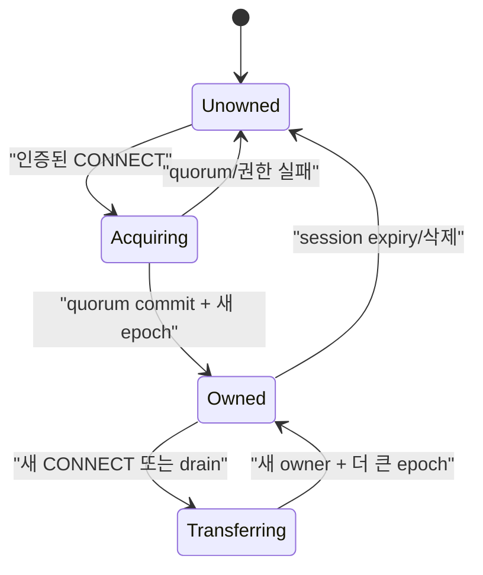
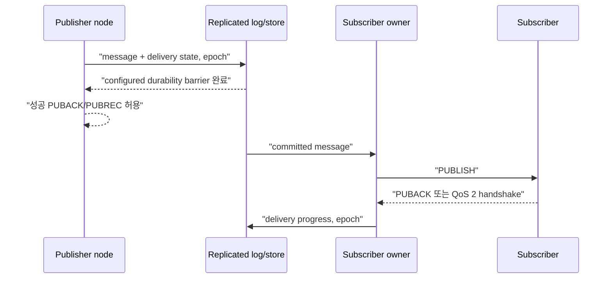

# Cluster session과 durable delivery 스펙

이 문서는 여러 NaruMQ node가 membership, session ownership, routing과 durable state를 외부에서 일관되게 제공하는 동작을 정의한다. Storage와 consensus target은 ADR에서 결정하며, target 선택만으로 runtime 수용이 완료되지는 않는다.

| 항목 | 값 |
| --- | --- |
| 상태 | Draft |
| 관련 요구사항 | CLU-01~CLU-14, NFR-07~NFR-10, NFR-15 |
| 근거 | [PRD 8장, 9.2절과 11.2절](../requirements/PRD.md) |
| 관련 Architecture | [Cluster architecture](../architectures/cluster-architecture.md), [EKS on EC2 deployment](../architectures/eks-ec2-deployment.md) |
| 관련 결정 | [ADR-0001](../decisions/ADR-0001-core-implementation-language.md), [ADR-0002](../decisions/ADR-0002-cluster-consensus-library.md), [ADR-0003](../decisions/ADR-0003-durable-ack-barrier.md), [ADR-0004](../decisions/ADR-0004-session-ownership-and-fencing.md), [ADR-0007](../decisions/ADR-0007-aws-production-deployment-platform.md), [ADR-0008](../decisions/ADR-0008-raft-peer-transport.md), [ADR-0009](../decisions/ADR-0009-raft-production-state-profile.md), [ADR-0011](../decisions/ADR-0011-cluster-backup-restore-v1.md) (historical v1 boundary), [ADR-0012](../decisions/ADR-0012-retained-replication-and-cluster-backup-v2.md) (retained scope), [ADR-0013](../decisions/ADR-0013-offline-queue-replication-and-cluster-backup-v3.md) |
| 관련 Contract | [Cluster release compatibility v1](../contracts/cluster-release-compatibility-v1.md), [Raft peer transport v1](../contracts/raft-peer-transport-v1.md), Draft [Cluster backup v3](../contracts/cluster-backup-v3.md), Superseded [Cluster backup v2](../contracts/cluster-backup-v2.md), Superseded [Cluster backup v1](../contracts/cluster-backup-v1.md) |
| 해설 | [세션 소유권과 fencing](../explainers/session-ownership-and-fencing.md), [EKS 고가용성과 장애 도메인](../explainers/eks-ha-failure-domains.md) |

## 1. Cluster membership

1. 기준 배포는 quorum에 참여하는 node 3개로 구성해야 한다.
2. node는 `JOINING` 중 discovery, member 인증, log/snapshot 동기화와 committed persistent subscription에서 route projection을 rebuild하는 작업을 마쳐야 한다.
3. 초기 동기화와 route projection rebuild가 끝나고 quorum을 확인하기 전에는 MQTT traffic readiness를 성공으로 반환해서는 안 된다.
4. join, 정상 leave와 재시작은 수동 데이터 수정 없이 재시도할 수 있어야 한다.
5. 비인가 member와 지원하지 않는 cluster protocol version은 membership에 추가해서는 안 된다.

외부 cluster 조회는 최소한 node별 `nodeId`, lifecycle state, release version, member role, readiness, replication health와 마지막 오류를 제공해야 한다. `replicationHealth`는 조회 node 자신에 대해서는 local Raft storage 상태를, 원격 peer 행에 대해서는 조회 node에서 관찰한 peer 연결 상태를 나타내며 원격 peer의 storage 상태를 뜻하지 않는다. `lastErrorCode`는 내부 오류 원문 대신 안정된 오류 code를 제공한다. `replicationQueue`는 조회 node에서 해당 원격 peer로 보내는 outbound 대기열을 나타낸다. 정확한 field 형식은 [Management API v1 Contract](../contracts/management-api-v1.md)과 OpenAPI 문서를 따른다.

## 2. Session identity와 ownership

session key는 `(tenantId, clientId)`다. 각 key에는 한 시점에 쓰기 권한을 가진 owner가 최대 하나만 존재해야 한다.



ownership record는 최소 `sessionKey`, `ownerNodeId`, 단조 증가 `epoch`, 상태와 `commit identifier`를 가져야 한다. 이 Phase 2 evidence에서 `commit identifier`는 ownership aggregate가 opaque committed-command stream을 소비할 때 부여하는 application committed-command sequence position이다. 이는 consensus adapter의 Raft `StatusDTO.CommitIndex`나 snapshot index와 다르다. [ADR-0009](../decisions/ADR-0009-raft-production-state-profile.md)는 protobuf encoding family만 선택했으며 exact persisted schema는 별도 contract에서 정한다.

Phase 2의 첫 단계인 replicated ownership core는 다음 관찰 계약을 만족해야 한다.
1. 최초 acquire의 `expectedEpoch`는 `0`이어야 하며 성공 시 `epoch`는 `1`이 된다.
2. 이후 모든 ownership 획득 및 reconnect는 현재 `epoch`와 일치하는 `expectedEpoch`를 요구하며 성공 시 `epoch`가 정확히 `1` 단조 증가한다.
3. `epoch`가 `uint64` 최대값에 도달하면 wrap-around하지 않고 mutation을 영구 중단한다.
4. quorum commit 없는 proposal은 어떤 node의 state machine에도 반영되지 않는다.
5. majority takeover 후 이전 `(ownerNodeId, epoch)`의 인가 요청은 거절되어야 한다.
6. restart 및 snapshot replay 후에도 마지막 application committed-command sequence position과 epoch가 정확히 보존된다.
7. 이미 quorum에 commit된 동일 ownership acquire command를 commit 응답 유실 후 재시도하면, retry도 다음 application committed-command sequence position으로 commit되어 `stale_epoch`로 결정적으로 거절되어야 한다. 이때 `ownerNodeId`, `epoch`와 성공한 ownership record의 `commit identifier`는 바뀌지 않아야 한다.

### 2.1 Fencing 규칙

- session aggregate를 바꾸는 acquire 이외의 command의 의미상 envelope 필드는 `sessionKey`, `ownerNodeId`, `epoch`와 operation-specific subscription 또는 inflight mutation으로 한정한다. 이 이름은 필요한 의미 정보이며 serialized field나 byte format을 정하지 않는다.
- committed apply는 `ownerNodeId == currentOwnerNodeId`이고 `epoch == currentEpoch`인 경우에만 acquire 이외의 session mutation을 인가한다.
- ownership record가 없거나 owner가 다르거나 epoch가 다르면 stale/not-authorized mutation으로 결정적으로 거절한다.
- 성공한 `Acquire`만 owner와 epoch를 설치하거나 증가시킬 수 있다. Subscription 또는 inflight mutation은 epoch가 현재 값보다 크더라도 새 owner나 epoch를 설치할 수 없다.
- 문법적으로 유효하지만 stale한 committed mutation은 application committed-command sequence position을 소비하지만 ownership, persistent subscription, QoS inflight와 route projection은 바꾸지 않는다.
- 새 owner는 더 큰 epoch가 quorum commit된 뒤에만 client traffic을 처리해야 한다.
- 이전 owner는 takeover를 관찰한 즉시 read·write와 delivery를 중단하고 connection을 종료해야 한다.
- timeout만으로 ownership을 추정하거나 임대 만료 전 stale owner write를 허용해서는 안 된다.

CONNECT를 받은 ingress node와 Raft leader가 다를 수 있다. Ingress node는 ownership proposal을 현재 leader까지 전달해야 하며, follower는 인증된 peer transport를 통한 Raft proposal forwarding을 사용할 수 있다. Quorum commit을 확인한 뒤에만 성공 CONNACK을 반환한다. Leader 또는 quorum가 없으면 CONNECT를 거절하고 node-local ownership을 설치해서는 안 된다.

Production error/DTO와 serialized bytes는 [ADR-0009](../decisions/ADR-0009-raft-production-state-profile.md)가 선택한 encoding family에 맞춰 별도 replicated-state contract에서 정한다. ADR-0009는 exact message schema나 wire bytes를 정의하지 않는다.

### 2.2 Session aggregate와 route projection

`sessionKey`마다 ownership record, persistent subscription, inbound QoS inflight와 outbound QoS inflight를 하나의 논리적 replicated session aggregate로 취급한다. 한 `sessionKey`에 대한 command는 같은 committed ordering을 공유하고 하나의 aggregate 경계에서 원자적으로 적용해야 한다. Subscription 또는 inflight 변경 결과를 ownership 권한 판정 결과와 분리해 외부에 노출해서는 안 된다.

Route metadata는 committed persistent subscription에서만 계산하는 node-local disposable projection이다. 이 projection은 authoritative aggregate에서 다시 만들 수 있어야 하며, node는 routing readiness를 광고하기 전에 rebuild를 완료해야 한다. Route projection은 ownership, checkpoint 또는 drain barrier의 근거로 사용할 수 없다.

WAL·snapshot target, protobuf encoding family와 단일 group profile은 scoped [ADR-0009](../decisions/ADR-0009-raft-production-state-profile.md)에 기록한다. Exact persisted bytes/schema, Active Raft peer transport v1 범위 밖의 peer compatibility, production application port와 `cmd/narumq` 조립 방식은 여전히 미정이다. Detached persistent session의 QoS 0 offline queue 경계는 §4.1과 [ADR-0013](../decisions/ADR-0013-offline-queue-replication-and-cluster-backup-v3.md)이 정하며, QoS 1/2 durable offline message의 저장·전달 경계는 이 slice에서 확정하지 않는다.
### 2.3 Takeover ordering

- Drain 중인 owner는 successor의 더 큰 epoch `Acquire`가 commit되기 전에 현재 epoch로 최종 persistent subscription·QoS inflight checkpoint mutation을 quorum에 commit해야 한다.
- Successor `Acquire`가 commit된 뒤 그보다 뒤에 committed ordering된 old owner의 route-affecting subscription 또는 inflight command는 exact owner/epoch check에서 거절되어야 한다. Command 도착 시각이나 locally cached route는 이 결과를 우회할 수 없으며 authoritative aggregate와 route projection은 바뀌지 않는다.

동시 CONNECT 또는 partition 시험에서 성공 owner가 둘로 관찰되면 spec 위반이다.

## 3. Routing

1. 어느 READY node에 publisher와 subscriber가 연결돼도 cluster 전체의 matching subscription으로 전달해야 한다.
2. route key는 tenant 격리가 끝난 canonical topic/filter를 사용해야 한다.
3. Route-affecting subscription mutation은 authoritative fenced command로 `sessionKey`, `ownerNodeId`, `epoch`와 subscription option을 전달한다. Committed apply 뒤 route projection은 committed persistent subscription state에서 파생하며, 별도의 authorized route mutation으로 처리하지 않는다.
4. 이전 owner 또는 stale owner/epoch의 route-affecting subscription add·remove mutation은 거절해야 한다.
5. route propagation 지연은 측정 가능해야 한다. 지연 중에도 권한 또는 tenant 경계를 우회해서는 안 된다.
6. shared subscription member 선택은 tenant와 group 경계를 지켜야 하며, unavailable owner를 계속 선택해서는 안 된다.

## 4. Replicated state

다음 상태는 configured replication factor와 write quorum을 적용해야 한다.

| 상태 | 복구 계약 |
| --- | --- |
| persistent subscription | owner 장애 뒤 같은 filter와 options를 복구한다. |
| 수신·송신 QoS inflight | packet identifier, 단계와 재전송 의미를 복구한다. |
| durable offline message | expiry·quota 안에서 전달을 재개한다. |
| retained message | tenant와 canonical topic별 최신 값을 복구한다. |
| session metadata | expiry, Will, owner epoch와 client protocol 정보를 복구한다. |
| ownership·route metadata | stale owner를 fence하고 routing을 다시 구성한다. |

replica 수가 configured write quorum보다 적으면 durable write를 성공 처리해서는 안 된다. replication lag 또는 disk pressure가 한도를 넘으면 publish admission을 늦추거나 거절해야 하며, 이미 성공 ACK한 durable state를 임의로 drop해서는 안 된다.

### 4.1 Offline message capture와 전달

Cluster mode에서 persistent session(MQTT 3.1.1 CleanSession=0 또는 MQTT 5 CleanStart=0 및 Session Expiry Interval > 0)이 연결을 종료한 뒤부터 다음 재접속 전까지의 구간을 **detached** 상태로 취급한다. Detached session에 도착한 QoS 0 message만 Raft committed state machine에 저장한다. Connected session의 live delivery는 기존 node-local queue를 유지하며, QoS 1/2 offline entry, durable ACK 및 cross-node live fan-out은 이 경계에 포함되지 않는다.

1. **Key와 복제 상태:** 각 `(tenantId, clientId)` session key마다 `OfflineSessionState`를 둔다. 필드는 `tenantId`, `clientId`, 단조 증가 `epoch`, `sessionExpiresAtUnixMillis`, 단조 증가 `nextSequence`와 `messages[]`다. 각 `OfflineMessage`는 `sequence`, `topic`, `payload`, `qos(=0)`, `retain`, `expiresAtUnixMillis`를 가진다. Message identity는 session 안에서 1부터 단조 증가하는 `sequence`이며 FIFO 순서다.
2. **명령:** `OfflineChange`는 세 action을 가진다.
   - `DETACH`: owner node가 persistent session disconnect 시 제안한다. `(ownerNodeId, epoch)`가 현재 ownership과 정확히 일치해야 한다(아니면 `stale_epoch`). Record가 없으면 `nextSequence=1`로 생성한다. 동일 epoch record가 이미 있으면 no-op `Applied`다. 더 작은 epoch record가 있으면 기존 message를 보존하고 epoch를 올린 뒤 이어 붙인다. Local queue 잔여 FIFO message는 최대 64개, `topic+payload` 합계 최대 768 KiB까지 함께 싣는다.
   - `ENQUEUE`: 어느 node든 publish 대상이 detached session이면 제안한다. `ownerNodeId=0`, message 정확히 1개다. Record가 존재하고 `record.epoch == command.epoch`여야 한다(아니면 `offline_session_missing`).
   - `CLAIM`: CONNECT가 새 ownership epoch를 commit한 직후 새 owner가 제안한다. `(ownerNodeId, epoch)`가 현재 ownership과 같아야 한다(아니면 `stale_epoch`). Record를 삭제하고 그 message들을 apply 결과로 반환한다. Record가 없으면 `Found=false`다.
3. **전달 의미:** at-most-once다. CLAIM commit이 record를 먼저 지우고 그 다음 local queue로 전달한다. CLAIM 성공 뒤 전송 전 crash하면 해당 QoS 0 message는 유실될 수 있다. 자동 재시도는 하지 않는다. Commit timeout 뒤 늦게 commit된 ENQUEUE는 queue에 남는다.
4. **결정적 한도:** Apply는 session당 64 message, 전체 tenant 합산 4,096 message·16 MiB, payload당 1,000,000 bytes를 제한한다. DETACH 한 command의 `topic+payload` 합계는 768 KiB 이하여야 한다. 크기는 `len(tenantId)+len(clientId)+len(topic)+len(payload)`의 합이다. 한도를 넘으면 command 전체를 `offline_capacity_exceeded`로 거절하고 기존 state를 보존한다(같은 apply의 만료 purge는 유지). Detached session record 수는 ownership row 수를 넘지 않으므로 별도 상한을 두지 않는다. PRD TEN-08의 tenant별 offline queue quota는 제공하지 않는다.
5. **만료:** 모든 offline command apply는 먼저 proposer 시각(`proposedAtUnixMillis`) 기준으로 `0 < expiresAt <= proposedAt`인 message와 `0 < sessionExpiresAt <= proposedAt`인 session record를 지운다. Local replica clock은 읽지 않는다. `sessionExpiresAt`은 disconnect 시각 + MQTT 5 Session Expiry Interval이며, 만료가 없으면 0이다.
6. **Ownership 연동:** Ownership `Release`가 apply되면 같은 key의 offline record도 지운다. Transfer/acquire는 record를 보존하며 새 owner의 CLAIM이 가져간다. 모든 offline record는 `record.epoch` 이상의 ownership row를 가져야 한다.
7. **SessionPresent:** `CleanStart=0` CONNECT의 CLAIM이 `Found=true`이면 다른 node로 reconnect해도 CONNACK `SessionPresent=1`이고 message를 sequence FIFO로 전달한다. `CleanStart=1`이면 CLAIM으로 record를 지우고 message는 버린다.
8. **Fallback:** DETACH가 quorum/compatibility/stale-epoch 이유로 실패하면 local queue를 그대로 둔다. CLAIM이 실패하면 CONNECT를 ownership-unavailable reason으로 거절하고 local session 변경을 rollback한다. 기존 local session이 없었던 시도는 새 delivery queue 등록과 tenant route binding도 제거한다. 기존 local session이 있으면 CLAIM 성공 전까지 기존 expiry/WILL timer를 유지하고, 실패 시 기존 timer와 session 상태를 보존한다. ENQUEUE 실패는 해당 대상만 `Saturated`(capacity) 또는 `Unavailable`(그 외)로 보고한다.
9. **알려진 한계:** Owner node가 연결 중에 crash하면 DETACH가 없어 이후 message는 capture되지 않는다. Detach 전환 중 local queue 조회와 제거 사이에 해당 node로 도착한 QoS 0 message는 유실될 수 있다. ENQUEUE는 대상 session마다 commit 1회다.
10. **Schema와 profile gate:** Replicated-state schema는 `1.0`을 유지하고 unknown field를 거절한다. Offline command는 fresh read barrier 뒤 모든 non-retired member의 release/protocol/schema가 일치하는 exact member-profile gate 뒤에서만 제안한다.

## 5. Publish commit과 delivery



- 성공 PUBACK/PUBREC은 PRD의 내구성 ACK 경계 뒤에만 반환해야 한다.
- matching durable subscriber가 없으면 publisher ACK가 미래 subscriber 전달을 뜻하지 않는다.
- owner 장애 뒤 새 owner는 committed inflight 단계에서 handshake를 재개해야 한다.
- QoS 1 중복은 허용되지만 durable ACK 뒤 message gap은 허용되지 않는다.
- QoS 2는 MQTT receiver와의 protocol handshake에서 중복 전달을 막아야 한다. subscriber 애플리케이션의 정확히 한 번 처리는 보장하지 않는다.

## 6. Partition과 quorum loss

| 상태 | Majority/quorum side | Minority 또는 quorum 없는 side |
| --- | --- | --- |
| 기존 non-durable traffic | 설정 정책과 자원 한도 안에서만 처리할 수 있다. | 데이터 일관성을 해치지 않는 범위로 제한한다. |
| 새 session ownership | 획득할 수 있다. | 획득해서는 안 된다. |
| durable publish ACK | barrier 충족 시 반환한다. | 성공 ACK을 반환해서는 안 된다. |
| ownership transfer | 새 epoch를 commit할 수 있다. | 수행해서는 안 된다. |
| 관리 mutation | quorum이 필요한 변경만 commit한다. | `quorum_unavailable`로 실패해야 한다. |

partition이 복구되면 committed log가 기준이 된다. minority의 speculative state가 있었다면 폐기하고 route·session state를 다시 구성해야 한다. 자동 수렴 전 node를 READY로 표시해서는 안 된다.

## 7. Failure recovery

1. process crash 또는 host loss가 감지되면 다른 node가 quorum을 통해 새 epoch를 획득해야 한다.
2. 새 owner는 persistent session, subscription, inflight와 offline queue를 복구한 뒤 connection을 수용해야 한다.
3. 단일 node 장애에서 durable ACK가 끝난 message의 RPO는 0이어야 한다.
4. crash 중 snapshot 또는 log append가 중단돼도 마지막 유효 commit 이전 상태로 원자적으로 복구해야 한다.
5. 실제 disk full과 느린 I/O는 해당 node의 복제 상태, readiness와 commit 결과에 반영해야 한다. 저장 오류를 성공 commit으로 보고해서는 안 된다.
   - Local `replicationHealth`는 terminal Raft 실패 시 `FAILED`, WAL Ready 기록과 `fsync` 또는 snapshot 영속화 한 건이 1초 이상 걸리거나 진행 중인 시간이 1초에 도달하면 `DEGRADED`, 나머지는 `HEALTHY`다. 느린 작업이 끝난 뒤 10초 동안 다시 느린 영속화 작업이 없으면 `HEALTHY`로 돌아간다.
   - `DEGRADED`는 `/health/ready`를 503으로 만들고 liveness는 200으로 유지한다. `FAILED`는 `/health/ready`와 `/health/live`를 모두 503으로 만들며 readiness 원인은 `raft storage failed: no space left; restart required`, `raft storage failed: I/O error; restart required`, `raft node failed; restart required` 중 원인에 맞는 문자열이어야 한다. 느린 I/O readiness 원인은 `raft storage I/O is slow`다. `FAILED` node는 관리 HTTP 응답을 유지하고 MQTT 신규 연결을 거절하며, 저장 공간을 확보해도 process를 재시작하기 전에는 복구하지 않는다.
   - Storage health는 membership lifecycle `state`를 바꾸지 않는다. local `DEGRADED` 또는 `FAILED` node의 summary는 `ready=false`, 해당 readiness 원인과 `storagePressure`를 보고해야 한다.
   - `FAILED` node는 새로운 commit을 성공으로 반환해서는 안 된다. Quorum이 남아 있는 healthy node는 진행할 수 있고, quorum이 없으면 commit을 거절해야 한다. `DEGRADED`는 commit을 계속 시도할 수 있다.
   - `lastErrorCode`는 내부 오류 문자열 대신 `storage_no_space`, `storage_io_error`, `storage_slow`, `raft_node_failed`, `peer_disconnected`, `peer_queue_full`, `peer_invalid_message`, `peer_transport_error` 중 안정된 code만 제공한다. local slow-I/O code는 상태가 회복된 뒤에도 최근 원인으로 남는다.
   - 원격 node 행의 `replicationHealth`는 조회 node에서 관찰한 peer 연결 상태다. 연결되어 있으면 `HEALTHY`, 끊겼으면 `UNREACHABLE`이며, `lastErrorCode`는 연결 상태와 별개로 마지막 알려진 transport 오류를 안정된 code로 나타낸다. 이 값은 원격 node의 Raft 또는 storage health를 의미하지 않는다. `replicationQueue`는 조회 node에서 해당 peer로 보내는 outbound message 수, byte 수와 거절 수를 나타내며 실제 transport 제한을 넘지 않아야 한다. 원시 transport 오류 문자열은 API 응답에 포함하지 않는다.

## 8. Mixed-version compatibility

- release N은 N-1의 cluster wire, persisted state, snapshot과 관리 동작을 읽고 안전하게 상호 운용해야 한다.
- N-1이 해석할 수 없는 상태를 N이 기록해야 한다면 feature activation을 모든 필수 node의 upgrade 이후로 미뤄야 한다.
- N에서 N-1로 rollback할 때 이미 기록된 상태를 손상하거나 silent downgrade해서는 안 된다.
- 호환할 수 없는 변경은 rolling update를 시작하기 전에 preflight에서 거절해야 한다.
- 호환 matrix는 release artifact에 포함해야 한다.

현재 retained profile은 rolling compatibility가 아니다. Fresh read barrier 뒤 모든 non-retired member의 release, protocol와 schema가 정확히 일치하는지 확인하고, 하나라도 다르면 retained mutation을 시작하지 않는다. 이 gate는 혼합 버전 기록을 차단하지만 N/N-1 상호 운용이나 rollback 안전성을 입증하지 않는다.

## 9. Rebalance

P1 rebalance가 활성화되면 target 편차, 최대 동시 이동 수와 이동 rate를 설정해야 한다. Rebalance는 ownership transfer와 같은 fencing·checkpoint 규칙을 따라야 한다. QoS state를 복제하기 전에 기존 owner를 종료해서는 안 된다.

## 10. Snapshot, backup과 restore

1. Snapshot은 포함한 commit index와 typed-state checksum을 가져야 한다. Finalize는 snapshot file sync, close, atomic rename, directory sync 순서이며, 그 경계에서 process crash가 발생해도 재시작 시 완전한 snapshot/WAL만 replay한다.
2. Backup은 commit 경계와 일치하는 typed snapshot, 그 뒤의 committed application/configuration 기록, schema/release metadata 및 checksum을 포함해야 한다. Backup capture는 fresh quorum/read barrier를 거쳐야 한다.
3. 전체 CLU-14 target에는 tenant, session ownership, subscription, retained, inflight와 offline state가 포함된다. Current [Cluster backup v3](../contracts/cluster-backup-v3.md)는 retained state와 offline queue를 replication snapshot/archive count·checksum에 포함한다. Historical v2는 retained만, historical v1은 retained/offline 모두 제외했다. Retained 및 offline process acceptance는 각각 §11.8과 §11.9에 있다. Linux/EBS power-loss와 retention/RPO/RTO는 여전히 미완료다.
4. Restore는 snapshot과 committed tail을 replay한 뒤 manifest의 commit-boundary count/checksum과 비교해야 한다. Format, identity, version, member identity 또는 summary가 일치하지 않으면 target storage를 바꾸기 전에 거절한다.
5. Current v3 restore는 동일 cluster/release/protocol/schema, 정확히 세 bootstrap voter ID와 동일 address/DNS SAN/certificate fingerprint를 요구한다. Archive에 learner ID가 있으면 거절한다. v1/v2 archive는 current restore에서 거절하며 cross-cluster migration과 voter-set 변경도 지원하지 않는다.
6. Restore는 offline CLI로 voter별 빈 target directory를 seed한 뒤 종료한다. Durable restore marker가 남은 node는 일반 startup에서 READY가 되면 안 된다.
7. Retention 기간과 disaster-recovery RPO/RTO는 `SPEC-TBD-09`이며, Linux EBS/power-loss 보장은 별도 acceptance로 남는다.

## 11. 수용 시험

- 3-node에서 publisher와 subscriber를 서로 다른 node에 연결해 모든 QoS와 subscription 유형을 시험한다.
- 동시 CONNECT, owner kill, packet partition과 stale epoch write 거절을 검증한다.
- quorum 상실 중 새 ownership과 durable ACK가 성공하지 않는지 검증한다.
- 성공 durable ACK 직후 각 node를 kill해 message gap이 없는지 확인한다.
- disk full, snapshot finalize crash, archive/restore·restart/resync 중 consistency와 readiness를 확인한다. Production EBS/power-loss는 별도 미완료 기준이다.
- N-1↔N rolling upgrade와 rollback을 양방향으로 시험한다.

### 11.1 Phase 0 gate 4 deterministic spike mapping

아래 첫 표의 네 시나리오는 `internal/adapters/raft`의 in-process deterministic harness가 검증하는 제한된 증거다. 각 시나리오는 독립 temporary directory와 FIFO `MessageDTO` delivery를 사용한다. 이어지는 두 failure-bound 시험은 각각 WAL adapter unit test와 in-process cluster harness를 쓰는 부분 증거이며, 실제 디스크 장애나 production transport를 검증하지 않는다.

| Spike scenario | 관찰할 결과 | Test mapping |
| --- | --- | --- |
| `leader failure preserves committed state` | node 1 장애 뒤 node 2가 증가한 term으로 선출되고 `[alpha,beta]`가 surviving node에 유지된다. | `TestRaftConsensusSpike/leader_failure_preserves_committed_state` |
| `quorum loss cannot commit` | quorum 없는 old leader가 `gamma`를 apply하지 않으며 반복 proposal은 `ErrBackpressure`로 수렴한다. | `TestRaftConsensusSpike/quorum_loss_cannot_commit` |
| `WAL replay restores commit` | bootstrap snapshot 뒤 reopen한 node가 `[alpha]`를 복구하고 재가입 뒤 `[alpha,beta]`로 수렴한다. | `TestRaftConsensusSpike/WAL_replay_restores_commit` |
| `snapshot plus WAL tail restores state` | snapshot index 이후 WAL tail을 replay해 `[alpha,beta,gamma]`와 동일한 applied/commit 경계를 복구한다. | `TestRaftConsensusSpike/snapshot_plus_WAL_tail_restores_state` |

첫 표 mapping은 CLU-01/02/06/07/09/10과 ADR-0001 gate 4, ADR-0002 §7의 skeleton·local recovery 항목을 연결한다. Fixed-voter peer transport v1의 별도 evidence는 §11.3에 있다. Session ownership, durable MQTT ACK barrier, 실제 disk-full/readiness, 느린 I/O와 membership-change 수용 시험은 여전히 미완료이며 §11.3을 cluster 전체 수용 완료로 간주하지 않는다.

#### WAL write failure와 slow-follower 제한의 부분 증거

아래 시험은 특정 어댑터 동작과 Raft의 in-process flow-control window에 관한 부분 증거다. `Open`의 `MaxInflightMsgs=16`은 entry가 포함된 고유 `MsgApp` 범위에 적용된다. entry가 없는 `MsgApp`은 commit index를 전달할 수 있어 이 계수에 포함하지 않는다. 측정값은 총 outbound 메시지 수, transport queue 크기 또는 retained Raft log 크기의 한계를 뜻하지 않는다.

| Evidence case | 관찰한 결과 | Test mapping |
| --- | --- | --- |
| `WAL write failure stops outbound` | bootstrap 이후 해당 node의 `wal.bin` write에만 주입한 `ENOSPC`가 `ErrFailed`를 반환하고 node는 terminal failed state로 전이한다. Ready batch는 비고 `persisted`/`outbound` event와 applied command는 바뀌지 않는다. 주입 제거 후 `Campaign`, `Propose`, `ProcessReady`도 계속 `ErrFailed`이며 `Close`는 정상 작동한다. | `TestNodeWALWriteFailureStopsOutbound` (`internal/adapters/raft/stable_store_test.go`) |
| `slow follower keeps outbound append window bounded` | 1↔3 및 2↔3 route를 막은 동안 node 1·2가 순서가 고유한 1 KiB command 64개를 모두 같은 순서로 적용하고 node 3은 적용하지 않는다. node 1→3의 미응답 entry-bearing `MsgApp` 고유 범위는 `Open`의 `MaxInflightMsgs=16`에 따라 16개 이하로 제한된다. route 복구 뒤 최대 20 logical tick 안에 세 node가 같은 command 순서로 수렴한다. | `TestRaftConsensusSpike/slow_follower_keeps_outbound_append_window_bounded` (`tests/integration/raft_consensus_test.go`) |

WAL 쓰기 시험의 `ENOSPC`는 `filePersistenceOps.write`에서 주입한 오류로 실제 파일시스템 용량 고갈을 재현하지 않는다. 느린 follower 시험은 in-process route 차단이며 실제 peer transport, 느린 I/O, production queue의 메시지·byte 사용량 또는 전체 retained log를 측정하지 않는다. 두 시험 모두 node readiness, MQTT durable ACK, production durability나 전체 수용 시험 완료를 증명하지 않는다.

### 11.2 Phase 2 replicated session ownership core mapping

아래 다섯 시나리오는 `internal/application/takeover`가 application committed-command 순서로 세션 상태를 적용하고 `internal/adapters/raft`가 opaque bytes를 운반하는 in-process deterministic 3-node harness의 제한된 증거다. Acquire bytes는 `takeover`의 experimental codec으로 해석하며, subscription·inflight bytes는 해당 시험 안에서만 typed DTO를 찾는 token으로 해석한다. NMQSTATE1 snapshot/WAL의 재시작 복구 증거는 acquire command에만 해당하고 새 mutation type의 persisted encoding·재시작 replay를 증명하지 않는다.

| Scenario | 관찰할 결과 | Test mapping |
| --- | --- | --- |
| `concurrent acquire elects single owner` | 동일 `(tenantId, clientId)`에 동시 acquire 시 leader에서 먼저 commit된 owner만 epoch 1을 얻고 후속 제안은 `stale_epoch`로 거절되며 모든 node가 동일 상태로 수렴한다. | `TestReplicatedSessionOwnership/concurrent_acquire_elects_single_owner` |
| `minority cannot acquire or advance epoch` | partition된 minority node의 ownership proposal은 commit되지 않으며 majority에서 새 leader가 epoch 2를 commit한 뒤 takeover한다. partition 복구 시 minority는 majority의 epoch 2로 수렴하고 이전 epoch 1 owner의 authorize는 거절된다. | `TestReplicatedSessionOwnership/minority_cannot_acquire_or_advance_epoch` |
| `restart recovers ownership epoch and command sequence` | snapshot과 WAL tail을 가진 node가 재시작 후 opaque command stream을 replay했을 때 restart 전과 동일한 session owner, epoch, application committed-command sequence position으로 복구된다. | `TestReplicatedSessionOwnership/restart_recovers_ownership_epoch_and_command_sequence` |
| `lost commit response retry preserves owner and epoch` | 동일한 opaque command payload 두 개가 모든 node에 commit되고 두 번째 retry가 `stale_epoch`로 거절되며, ownership은 node 1 / epoch 1 / sequence position 1에 남고 state machine은 application sequence position 2까지 진행한다. | `TestReplicatedSessionOwnership/lost_commit_response_retry_preserves_owner_and_epoch` |
| `stale owner session mutations are fenced after takeover` | 5개 명령이 적용된 뒤 node 2/epoch 2 takeover의 ownership position은 5다. 미리 준비한 이전 owner의 persistent subscription 및 inbound/outbound QoS inflight 명령 세 개가 뒤이어 commit되어 3개 node 모두 application sequence 8까지 진행하지만 각각 `stale_epoch`로 거절된다. 구독 `orders/#` QoS 1, inbound `[10]`, outbound `[20]`과 각 node의 파생 route projection은 takeover 직후와 동일하게 유지된다. | `TestReplicatedSessionOwnership/stale_owner_session_mutations_are_fenced_after_takeover` |

이 mapping은 CLU-04, CLU-05, CLU-10과 ADR-0004 §8 항목 1~5의 in-process session ownership/fencing core를 연결한다. 실제 MQTT CONNECT 경로와의 결합, multi-node TCP connection teardown, production peer transport, subscription·inflight persisted encoding/replay, durable message ACK barrier는 이 core slice에 포함되지 않으며 수용 시험 전체 완료로 간주하지 않는다.

### 11.3 Phase 0 gate 4 production peer transport mapping

이 mapping은 Accepted [ADR-0008](../decisions/ADR-0008-raft-peer-transport.md)과 Active [Raft peer transport v1 contract](../contracts/raft-peer-transport-v1.md)의 고정 voter `{1,2,3}` 전송 경로만 닫는다. 실행 가능한 composition root는 `cmd/narumq -raft-peer-config`이며 일반 MQTT listener와 통합되지 않는다.

| Scenario | 관찰할 결과 | Test mapping | 실행 증거 |
| --- | --- | --- | --- |
| Contract wire vectors와 framing limits | Canonical hello/frame bytes, protocol version validation, zero/oversized/truncated frame 경계가 contract와 일치한다. | `TestPeerTransportHelloGoldenVector`, `TestPeerTransportHelloRejectsInvalidFields`, `TestPeerTransportFrameGoldenVectorAndLengthBounds` | `go test ./internal/adapters/tcp -run '^TestPeerTransport' -count=1` |
| mTLS identity 및 invalid peer 입력 | Foreign CA, allowlisted 다른 identity 주장, cluster/version mismatch, protobuf envelope mismatch, malformed protobuf, oversized/truncated frame은 state/command에 적용되지 않는다. Production driver는 malformed protobuf를 보낸 peer 연결을 종료한다. | `TestPeerTransportRejectsInboundCertificateForWrongVoter`, `TestRaftPeerTransportRejectsUnauthenticatedAndMalformedPeers`, `TestRaftPeerDriverTicksQueuesAndStops` | `go test ./internal/adapters/tcp -run '^TestPeerTransport' -count=1`; `go test ./tests/integration -run '^TestRaftPeerTransport' -count=1`; `go test ./cmd/narumq -run '^TestRaftPeerDriverTicksQueuesAndStops$' -count=1` |
| Bounded queue, backpressure와 quorum progress | Queue count/byte cap을 지킨다. Peer 3 outbound queue가 가득 차도 node 1·2는 election과 command apply를 진행하고, queue가 drain된 뒤 Raft가 peer traffic을 재생성한다. 같은 Ready batch의 거절된 peer 후속 frame은 건너뛰며 healthy peer 전송은 계속한다. Inbound staging overflow는 해당 connection을 닫고 cancellation은 queued-byte accounting을 비운다. 초과 inbound socket도 accept되지 않는다. | `TestPeerTransportSendQueueBoundsCountAndTracksWriter`, `TestPeerTransportSendQueueBoundsFramedBytes`, `TestPeerTransportInboundQueueBoundsFramedBytes`, `TestPeerTransportInboundCancellationDrainsStagedFrames`, `TestPeerTransportConnectionBoundsAndCancellation`, `TestPeerTransportLimitsConcurrentInboundConnections`, `TestProcessRaftMessagesContinuesOtherPeersAndSkipsRejectedFIFO`, `TestRaftPeerDriverTicksQueuesAndStops` | `go test ./internal/adapters/tcp -run '^TestPeerTransport' -count=1`; `go test ./cmd/narumq -run '^(TestProcessRaftMessagesContinuesOtherPeersAndSkipsRejectedFIFO|TestRaftPeerDriverTicksQueuesAndStops)$' -count=1` |
| TLS 3-node replication과 reconnect | Node 3을 끊은 동안 majority가 progress하고, 재연결 후 Node 3이 commit된 command까지 catch up한다. | `TestRaftPeerTransportThreeNodeReplicationAndCatchup` | `go test ./tests/integration -run '^TestRaftPeerTransport' -count=1` |
| Peer-only CLI lifecycle | 3개 별도 peer-only process가 TLS election을 수행하고 WAL을 남긴다. Cancellation 뒤 listener/socket이 닫히며 MQTT `READY`는 출력되지 않는다. | `TestRaftPeerOnlyStartsThreePeersAndStops` | `go test ./cmd/narumq -run '^(TestRaftPeerOnlyRejectsOtherFlags|TestRaftPeerOnlyStartsThreePeersAndStops)$' -count=1` |

이 evidence는 dynamic membership, join/leave, N/N-1 release compatibility, production snapshot transfer, 실제 disk-full·slow-I/O, replicated MQTT message/session state, durable ACK 또는 readiness를 닫지 않는다. ADR-0002는 `Proposed`로 남으며 peer-only executable을 전체 production broker cluster로 해석하지 않는다.

### 11.4 ADR-0009 design target과 module checksum 증거

[ADR-0009](../decisions/ADR-0009-raft-production-state-profile.md)은 네 가지 design target만 채택하며 runtime acceptance는 아니다. 2026-09-24 실행에서 `go mod verify`는 `all modules verified`를 출력했고, `go mod download -json go.etcd.io/raft/v3@v3.7.0`은 아래 값을 반환했다.

| 항목 | 검증 결과 |
| --- | --- |
| Version | `v3.7.0` |
| `Sum` | `h1:BGzlwx07bLv8PW6OU5HObuz1y4hlPZUXA07pM1mPUh4=` |
| `GoModSum` | `h1:6gX6T2X907DjnjsFLODnTxba77stjs84W9gTTI0GUNA=` |

두 checksum은 `go.sum`과 ADR-0009의 선택값에 일치한다. 이는 Go module checksum 검증 결과이며 production code, file/directory sync의 power-loss 보장, snapshot recovery, backup·restore, quorum ACK 또는 N/N-1 호환성 증거가 아니다. 이 decision-only 결과로 기존 acceptance row나 미실행 기준을 통과 처리하지 않는다.

### 11.5 Dynamic membership·restart convergence·MQTT readiness mapping

아래 표의 동적 membership 시나리오는 각 시험 위치의 실행 결과로 확인한다. 이 section은 production storage·disk-full·backup/restore를 판정하지 않는다. Backup v1의 별도 process evidence는 §11.7이며, durable QoS ACK·release N/N-1은 미완료 수용 범위다.

| Scenario | 관찰할 결과 | 시험 위치 | 실행 증거 |
| --- | --- | --- | --- |
| Three-voter replacement and retired ID | `{1,2,3}`에서 새 ID `4` learner를 catch up·promote하고 planned removal로 `{1,2,4}`가 된다. ID `3` 재사용은 거절되고 나머지 두 voter는 한 node loss 뒤 quorum을 유지한다. | `tests/integration.TestDynamicClusterMembershipProcessAcceptance` | PASS: member 4가 catch-up/promotion 후 voter가 됐고, member 3 removal 뒤 voter 집합 `{1,2,4}`와 retired 상태를 확인했다. ID 3 재사용은 409 `member_id_reserved`로 거절됐으며, survivor 1대 crash 뒤 2 voter가 quorum readiness와 MQTT CONNECT를 유지했다. `go test ./tests/integration -run '^TestDynamicClusterMembershipProcessAcceptance$' -count=1 -v` |
| Idempotent join/leave | Stage, promotion, leave/remove 각 응답을 유실한 뒤 같은 key로 재요청하면 같은 operation ID와 최종 voter set으로 수렴한다. 중복 promotion/config change는 없다. | `tests/integration.TestDynamicClusterMembershipProcessAcceptance` | PASS: stage 직후, promotion 완료 후, planned removal 완료 후 같은 idempotency key 재요청이 동일 operation ID와 committed phase로 수렴했고 중복 config change/promotion이 없었다. 위 process acceptance 실행 |
| Compatibility and identity rejection | Foreign CA, SAN/fingerprint/cluster/ID mismatch, unsupported release/protocol/schema, malformed hello/state record는 membership log에 commit되지 않고 `Step`에 도달하지 않는다. | `TestDynamicPeerRejectsTLSCertificateIdentityMismatchBeforeRaftDelivery`, `TestDynamicPeerRejectsForeignCAAndSANAndClusterMismatchBeforeRaftDelivery` (`internal/adapters/tcp/peer_transport_v2_test.go`); `tests/integration.TestDynamicClusterMembershipProcessAcceptance` | PASS: foreign CA, SAN, cluster ID, peer fingerprint 및 malformed hello가 transport/Raft delivery 전에 거절됐다. Unsupported release/protocol/schema는 422 `compatibility_unsupported`, retired ID는 409 `member_id_reserved`로 거절됐다. TCP transport 및 process acceptance test가 통과했다. |
| Learner TCP dial and peer-phase delivery boundary | Unchanged peer identity updates retain queued/in-progress outbound frames. `InboundReady` coalesces staged-frame notifications; `TakeInbound` leases one frame, and the cluster driver completes it after `Step`. Reconciliation blocks new leases and waits for active leases before advancing identity revision and discarding prior staging. Forwarded Raft requests preserve their original requester only when both it and the authenticated relay are committed members. | `TestDynamicPeerTransportPreservesQueuedFramesAcrossPhaseChange`, `TestDynamicPeerPhaseRefreshPreservesInProgressOutboundFrame`, `TestDynamicPeerPhaseRefreshDiscardsInboundAndRejectsStaleFrames`, `TestDynamicPeerPhaseRefreshWaitsForInboundDeliveryCompletion` (`internal/adapters/tcp/peer_transport_v2_test.go`); `TestDynamicStepAllowsOnlyAuthenticatedForwardedRequests` (`internal/adapters/raft/node_dynamic_test.go`); process acceptance | PASS: adapter tests verify queued/in-progress outbound retention, inbound lease/reconciliation, and authorized Raft forwarding while rejecting spoofed replication and unknown members. Process acceptance confirmed learner peer delivery and catch-up after the queued peer connection became available. `go run ./tools/verify local` |
| Transition-boundary crash/restart | ConfChangeV2 Ready persistence 전후, snapshot transfer 중, local finalize 후, promotion/remove 전후에서 같은 volume으로 재시작하면 committed ConfState·phase·operation·tombstone·typed state가 수동 수정 없이 수렴한다. 빈 Raft entry가 typed event 뒤에 오더라도 snapshot index는 Raft applied index와 일치한다. | `tests/integration.TestDynamicClusterMembershipTransitionCrashRecovery`; `TestAdvanceAppliedIndexPreservesCommittedStateAcrossEmptyRaftEntries` (`internal/application/membership/machine_test.go`) | PASS: failpoint로 membership persistence/apply 및 snapshot install 경계에서 process를 중단하고 같은 data directory로 재시작해 committed voter set, operation phase, retired identity와 readiness 수렴을 확인했다. 빈 entry 뒤 typed snapshot index 및 복원된 state 일치는 unit test로 확인했다. `go test -race ./tests/integration -run '^TestDynamicClusterMembershipTransitionCrashRecovery$' -count=2`; `go run ./tools/verify local` |
| Readiness and MQTT admission | Fresh join/restart, applied-index gap, route projection rebuild failure or quorum barrier failure 시 `/health/ready`는 503이고 신규 CONNECT는 긍정 CONNACK을 받지 않는다. Committed subscription projection과 fresh quorum proof 후에만 readiness가 200이 되고 cross-node routing이 일치한다. | `TestClusterReadinessGate` (`cmd/narumq/cluster_runtime_test.go`); `tests/integration.TestDynamicClusterMembershipTransitionCrashRecovery`; `tests/integration.TestDynamicClusterMembershipRemovalHandoffWaitsForQuorum` | PASS: readiness snapshot의 projection 실패와 applied-index gap을 unit test로 확인했다. Process failpoint에서 projection rebuild 실패 중 readiness 503 및 MQTT 거절, route projection 재구성, quorum 복귀 후 readiness/MQTT 수락을 확인했다. `go test ./cmd/narumq -run '^TestClusterReadinessGate$' -count=1`; `go test ./tests/integration -run '^(TestDynamicClusterMembershipTransitionCrashRecovery|TestDynamicClusterMembershipRemovalHandoffWaitsForQuorum)$' -count=1 -v` |
| Quorum loss and planned leave | quorum loss 또는 successor ownership/checkpoint transfer 실패 중 readiness와 admission이 내려가고 기존 voter removal은 commit되지 않는다. Active session/inflight 이전 후에만 planned removal이 완료된다. | `tests/integration.TestDynamicClusterMembershipRemovalHandoffWaitsForQuorum` | PASS: active MQTT session의 ownership Transfer가 quorum 복귀 전 commit되지 않고 연결도 유지됨을 확인했다. quorum 복귀 뒤 Transfer 및 removal이 commit되고, 기존 연결이 takeover로 닫히며 최종 voter set과 MQTT admission이 수렴했다. `go test ./tests/integration -run '^TestDynamicClusterMembershipRemovalHandoffWaitsForQuorum$' -count=1 -v` |

Membership acceptance 실행 증거:

```text
go test ./tests/integration -run '^TestDynamicClusterMembershipProcessAcceptance$' -count=1 -v
go test ./tests/integration -run '^TestDynamicClusterMembershipTransitionCrashRecovery$' -count=1 -v
go test ./tests/integration -run '^TestDynamicClusterMembershipRemovalHandoffWaitsForQuorum$' -count=1 -v
go test ./tests/integration -run '^(TestDynamicClusterMembershipProcessAcceptance|TestDynamicClusterMembershipTransitionCrashRecovery|TestDynamicClusterMembershipRemovalHandoffWaitsForQuorum)$' -count=1
```

각 실행은 `PASS`였다. 첫 process acceptance는 기존 voter 교체, idempotency, compatibility, readiness와 quorum-loss 동작을 확인한다. Failpoint recovery 시험은 transition 경계의 process crash/restart, readiness failure와 projection recovery를 확인한다. Planned-leave 시험은 active session handoff를 quorum loss 동안 보류하고 quorum 복구 후 완료한다. 이 증거는 해당 membership scenario만 검증하며 production storage, 실제 disk-full, §11.7 backup/restore acceptance, durable QoS ACK 및 release N/N-1 완료를 뜻하지 않는다.

실행 증거와 시험 매핑은 위 표와 [ADR-0010 §7](../decisions/ADR-0010-dynamic-cluster-membership.md#7-검증)에 기록한다.

**검증 결과 및 잔여 범위:**

- `go run ./tools/verify local` PASS: gofmt, vet, `go test ./...`, fuzz 4종, `go test -race ./...`, traceability, architecture, coverage와 mutation gate가 모두 통과했다. 전체 production line coverage 91.59% (15,988/17,457; 기준 90%), function coverage 99.24% (914/921; 기준 90%)이며 두 mutation 대상군에서 각각 25/25와 46/46 killed, lived·uncovered 0이었다. Branch coverage는 승인된 계측 도구가 없어 `not_evaluated`로 기록됐다. 이전에는 learner 추가 뒤 빈 Raft entry 때문에 typed state index와 Raft applied index가 달라 snapshot 저장이 건너뛰어질 수 있었다. 이제 빈 entry까지 index를 전진시킨 후 동일 index로 snapshot을 저장한다. 추가로 forwarding 중 원래 요청자가 남은 Raft `From`과 인증된 직접 송신자를 구분해 검증한다. 이는 §11.5의 membership 시나리오 검증 결과이며 실제 disk-full, backup/restore, durable QoS ACK, rolling upgrade 등 다른 cluster 수용 기준의 완료를 뜻하지 않는다.

### 11.6 Storage fault chaos mapping

이 시험은 용량 제한 tmpfs를 ENOSPC까지 채우고 write/`fsync`를 지연하는 FUSE filesystem을 사용한다. MQTT CONNECT/SUBSCRIBE 결과는 readiness와 admission 관찰로만 취급하며 durable ACK를 뜻하지 않는다. 각 scenario는 applied index와 peer queue도 별도로 기록한다. Raft follower의 authenticated proposal forwarding은 `internal/adapters/raft.TestDynamicFollowerForwardsApplicationProposal`로 검증하고, 아래 Docker runner는 실제 broker CONNECT/SUBSCRIBE를 확인한다.

| Scenario | 관찰할 결과 | 시험 위치 | 실행 증거 |
| --- | --- | --- | --- |
| `follower-disk-full` | Follower의 filesystem이 실제 ENOSPC에 도달하고 `FAILED`, `/health/ready`·`/health/live` 503, `storage_no_space`, `storagePressure=true`를 보인다. 관리 HTTP는 유지되고 Follower의 MQTT probe는 거절된다. Leader의 progress probe는 성공하고 outbound queue count/bytes가 제한 안에 있으며 queue cap 도달을 관찰한다. Leader와 healthy follower의 applied index가 증가한다. 공간 확보·restart 뒤 follower가 READY로 돌아와 leader를 따라잡고 fresh client와 원래 baseline client의 MQTT CONNECT/SUBSCRIBE가 수락된다. | `go run ./tests/chaos/cluster-storage-v1`; Docker process runner | PASS (`storage-fault-20260925d`): ENOSPC, free 0, 3.054s 내 FAILED; leader 59/59 probes 성공(최대 7ms); queue 30회, 최대 32 messages/1,051 bytes, 574 reject; indexes 20→138, recovery 1.005s, 두 MQTT reconnect 수락. Artifacts: `.artifacts/chaos/cluster-storage-v1/storage-fault-20260925d/` |
| `quorum-disk-full` | 두 follower가 실제 ENOSPC로 `FAILED`가 된 뒤 leader의 readiness는 503, `quorumAvailable=false`다. 20초 동안 leader MQTT progress probe는 성공하지 않고 applied index는 변하지 않으며 peer queue는 제한 안에 있다. 두 follower의 공간 확보·restart 뒤 세 node가 READY가 되고 applied index가 수렴하며 각 node의 MQTT probe와 원래 baseline client reconnect가 수락된다. | `go run ./tests/chaos/cluster-storage-v1`; Docker process runner | PASS (`storage-fault-20260925d`): 두 follower free 0; quorum halt 20.045s 동안 8 probes/0 accepted, index 20→20; queue 최대 32 messages/656 bytes, 7 reject; recovery 3.590s, index 21, 모든 node admission과 baseline reconnect 수락. Artifacts: `.artifacts/chaos/cluster-storage-v1/storage-fault-20260925d/` |
| `follower-slow-io` | 별도 I/O probe가 FUSE write/`fsync` 지연을 확인한다. Follower는 `DEGRADED`, readiness 503, liveness 200, `storage_slow`, `storagePressure=true`를 보이고 MQTT admission을 거절한다. Leader progress probe는 성공하고 peer queue가 제한 안에 있다. Delay 제거와 10초 recovery window 뒤 follower는 `HEALTHY`가 되며 process 재시작은 없다. Recovery 후 fresh client와 원래 baseline client의 MQTT CONNECT/SUBSCRIBE가 수락된다. | `go run ./tests/chaos/cluster-storage-v1`; Docker process runner | PASS (`storage-fault-20260925d`): I/O probe 4.001s, DEGRADED 감지 1.910s; leader 58/58 probes 성공(최대 18ms); queue 29회, 최대 25 messages/820 bytes; indexes 8→124; recovery 12.189s, uptime 7.224→49.475s, MQTT reconnect 수락. Artifacts: `.artifacts/chaos/cluster-storage-v1/storage-fault-20260925d/` |

검증 실행: `go run ./tests/chaos/cluster-storage-v1 --run-id storage-fault-20260925d --output .artifacts/chaos/cluster-storage-v1/storage-fault-20260925d`는 종료 코드 0으로 세 scenario 모두 PASS했다. `go run ./tools/verify local`도 PASS했다.

Harness는 certificate, JWT와 token을 임시 fixture directory에만 두고 `.artifacts/chaos/cluster-storage-v1/<run-id>/`에는 manifest, probe/control event, summary, image metadata와 node log만 보존한다. 이 mapping은 disk-full·slow-I/O replication health, readiness, commit progress/halt 관찰과 bounded transport queue의 제한된 chaos evidence다. 이 mapping은 QoS 1/2 durable ACK, 실제 MQTT session/subscription 복제, snapshot crash 또는 backup/restore를 검증하지 않는다. 해당 v1 process evidence는 별도 §11.7에 기록하며 N/N-1 호환성 acceptance도 닫지 않는다.

### 11.7 Cluster backup/restore와 snapshot finalize 수용 매핑

이 수용 시험은 historical v2 archive의 commit 경계, identity와 local process restore/restart 범위를 확인한다. Retained-specific assertions는 §11.8에 연결하며, current archive와 offline queue는 §11.9를 따른다. Restore는 정확히 세 bootstrap voter를 요구하고 learner archive와 v1 bytes를 거절한다. Production EBS power-loss, retention/RPO/RTO와 archive N/N-1 compatibility는 미완료다.

| Scenario | 관찰할 결과 | 시험 위치 | 실행 증거 |
| --- | --- | --- | --- |
| Online boundary archive | ClusterAdmin API가 fresh quorum barrier 뒤 v2 binary archive를 반환한다. Commit header가 manifest commit과 같고 committed tail이 snapshot 뒤 archive에 포함된다. | `cmd/narumq.TestRunClusterModeInProcess`; `tests/integration.TestClusterBackupRestoreProcessCrashAndResync` | PASS: in-process API 시험이 archive를 decode하고 committed tail을 재구성했다. Process 시험은 v2 format, retained summary, commit header와 SHA-256 trailer digest를 확인했다. |
| Archive validation and identity | Corrupt/noncanonical/checksum·summary 오류, cluster/member ID·address/SAN/certificate·release/schema mismatch, learner 및 v1 archive는 target을 바꾸기 전에 거절한다. | `internal/adapters/raft/records` archive tests; `cmd/narumq` restore tests | PASS: focused package suite에서 archive codec와 restore package가 통과했다. `NMQBKUP1`은 명시적 unsupported-format 오류로 거절한다. |
| Offline restore, crash/restart and resync | 같은 v2 archive를 세 bootstrap voter directory에 seed한다. Staged operation과 retained state가 유지되고, restored node crash/restart 뒤 quorum READY, 신규 joiner catch-up과 replay가 수렴한다. | `tests/integration.TestClusterBackupRestoreProcessCrashAndResync` | PASS: process test가 세 offline restore, cross-node·restored·restarted·joiner retained replay, staged state와 summary convergence를 관찰했다. |
| Snapshot finalize process crash | Temp file Sync 뒤 rename 전 crash와 rename/directory sync 후 crash에서 process restart 뒤 committed membership과 readiness가 수렴한다. | `tests/integration.TestSnapshotFinalizationCrashRecoveryAcrossProcessRestart` | PASS: build-tagged failpoint supervisor가 두 process exit를 확인하고 disarmed restart 뒤 bootstrap 및 membership operation convergence를 확인했다. |
| Production volume boundary | EBS/전원 손실 경계에서 durable commit을 보존한다. | Production-like filesystem/EBS acceptance | 미실행. Retained/offline process pass로 scope를 줄여 통과 처리하지 않는다. |
Process·membership·retained regression 검증:

```text
go build ./...
go test ./tests/integration -run '^(TestClusterBackupRestoreProcessCrashAndResync|TestDynamicClusterMembershipProcessAcceptance|TestDynamicClusterMembershipTransitionCrashRecovery|TestDynamicClusterMembershipRemovalHandoffWaitsForQuorum|TestSnapshotFinalizationCrashRecoveryAcrossProcessRestart)$' -count=1 -v
```

실행 결과: `go build ./...` 통과; process/regression package는 `ok narumq/tests/integration 90.062s`였다. 위 명령은 지정한 다섯 process test만 포함하며 전체 repository `go test ./...`, race/fuzz/mutation gate 또는 production power-loss 시험 결과가 아니다.

`go run ./tools/verify local` PASS: 현재 tree에서 일반·race package suite, 제한 fuzz, traceability, architecture와 coverage gate가 통과했다. Mutation gate는 delivery target 25/25 kill, session/ownership target 45/46 kill·1 timeout, lived/uncovered mutant 0으로 끝났으며 verifier는 `local: PASS`를 반환했다. Timeout은 완료된 kill로 계산하지 않았다. 이 local gate는 production storage나 전체 CLU-14 acceptance를 대체하지 않는다.

### 11.8 Retained replication과 backup v2 수용 매핑

Retained key는 `(tenantId, exact Topic Name)`이다. Cluster MQTT ingress의 현재 범위는 QoS 0 PUBLISH다. Retained mutation은 Raft commit 뒤 다른 node의 replay projection에 반영되고, v2 snapshot/archive는 같은 committed retained state와 kind summary를 보존한다. Offline queue와 durable QoS 1/2 ACK는 이 acceptance 범위가 아니다.

| Scenario | 관찰할 결과 | 시험 위치 | 실행 증거 |
| --- | --- | --- | --- |
| Tenant-scoped retained state와 deterministic limits | 같은 topic의 다른 tenant 값은 분리된다. Replace/delete, proposal-time expiry, 전체 tenant 합산 1,024 object/16 MiB/1,000,000-byte payload limit, per-tenant quota 미제공과 canonical snapshot을 검증한다. | `internal/application/membership/retained_test.go`; `internal/adapters/raft/records/retained_codec_test.go` | PASS: focused package suite에서 tenant boundary, expiry, capacity conflict, snapshot과 codec tests가 통과했다. |
| Commit-before-route와 projection recovery | Retained commit은 route matching보다 먼저 일어난다. Commit error에서 fan-out하지 않고, snapshot/startup projection은 committed state에서 rebuild한다. | `internal/application/publish/retained_commit_test.go`; `cmd/narumq/cluster_retained_test.go`; `cmd/narumq/cluster_runtime_test.go` | PASS: focused package suite에서 publish commit behavior, exact profile/read-barrier gate, projection rebuild/incremental sync와 failure/readiness tests가 통과했다. |
| Live cross-node retained replay | Node 1에서 retained `a=alpha`, `b=beta`를 publish하고 `b`를 삭제한 뒤 `c=gamma`를 publish한다. 다른 node가 정확히 `{a:alpha,c:gamma}`를 replay하며 삭제한 값은 나타나지 않는다. | `tests/integration.TestClusterBackupRestoreProcessCrashAndResync` | PASS: process acceptance가 실제 MQTT QoS 0 PUBLISH/SUBSCRIBE로 cross-node replay를 확인했다. |
| v2 backup, restore, restart와 catch-up | Archive format major 2, retained summary count 2와 `not_replicated_kinds=["offline"]`를 확인한다. 세 voter restore, restored-node crash/restart와 learner catch-up 뒤 모두 `{a:alpha,c:gamma}`를 replay한다. | `tests/integration.TestClusterBackupRestoreProcessCrashAndResync` | PASS: process acceptance가 archive metadata, API commit/checksum header, restore, restart와 joiner replay/convergence를 확인했다. |
| Focused package regression | Membership, records, retained repository, publish/subscribe/management, runtime와 contract consumers가 일관되게 동작한다. | `go test ./internal/application/membership/... ./internal/adapters/raft/records/... ./internal/adapters/memory/retained/... ./internal/application/publish/... ./internal/application/subscribe/... ./internal/application/management/... ./internal/adapters/http/management/... ./cmd/narumq/... ./tests/contracts/... -count=1` | PASS: 전체 지정 package suite 통과. |
| Process/membership regression | Backup/restore retained replay, dynamic join, transition recovery, removal handoff와 snapshot finalize crash recovery가 통과한다. | §11.7의 다섯-test command | PASS: `ok narumq/tests/integration 90.062s`. |
| Full local repository gate | 현재 package/integration suite, race suite, 제한 fuzz, traceability, architecture, coverage와 mutation 검증이 통과한다. | `go run ./tools/verify local` | PASS: `local: PASS`; mutation은 25/25 및 45/46 kill, 두 번째 target에서 1 timeout, lived/uncovered 0이다. |
| Offline queue, durable QoS ACK, mixed-release rolling upgrade와 production power-loss | 해당 state와 보장이 요구된 수용 시나리오에서 통과한다. | Offline/durable-delivery 및 production-like storage acceptance | 미실행. 전체 CLU-14나 production readiness를 승인하지 않는다. |

이 local gate PASS는 offline queue replication, archive N/N-1 compatibility, retention/RPO/RTO, durable QoS 1/2 ACK 또는 production EBS/power-loss 수용을 의미하지 않는다. Retained acceptance는 위의 제한된 process proof이며 전체 CLU-14가 아니다.

### 11.9 Offline queue replication과 backup v3 수용 매핑

Offline key는 `(tenantId, clientId)`다. Cluster mode에서 persistent session이 detached 상태일 때 도착한 QoS 0 message를 Raft committed state machine에 복제하고, reconnect 때 새 owner가 CLAIM으로 가져간다. Backup v3(`NMQBKUP3`)는 retained와 offline kind summary를 필수로 포함하고 v1/v2 archive를 거절한다.

| Scenario | 관찰할 결과 | 시험 위치 | 실행 증거 |
| --- | --- | --- | --- |
| Offline FIFO, fencing and capacity limits | Detach, enqueue, claim이 sequence 1..N 순서와 payload를 복구한다. Stale epoch/non-owner claim과 epoch 불일치 enqueue는 거절된다. Session당 64개, 전체 4,096개·16 MiB, payload 1,000,000 bytes 초과는 `offline_capacity_exceeded`로 거절되며 기존 state를 보존한다. Expiry purge는 proposer 시각 기준이다. | `internal/application/membership/offline_test.go`; `internal/adapters/raft/records/offline_codec_test.go` | PASS: `go test ./internal/application/membership/... ./internal/adapters/raft/records/... -count=1` |
| Connect and publish offline integration | Disconnect 시 persistent session pending queue를 DETACH하고 local queue를 제거한다. DETACH 실패 시 local queue를 보존한다. CleanStart=0 CONNECT의 CLAIM 성공 시 SessionPresent=true와 복구 queue를 설치한다. CLAIM 실패 시 CONNECT와 local session 변경을 rollback하며, 새 session이면 queue 등록 및 tenant route binding을 제거하고, 기존 session이면 queue·route·expiry timer를 보존한다. Detached 대상 publish는 Raft ENQUEUE를 호출한다. | `internal/application/connect/offline_test.go`; `internal/application/publish/offline_commit_test.go`; `cmd/narumq/cluster_offline_test.go` | PASS: connect/publish/runtime focused suites 통과. 마지막 route/timer rollback 수정 뒤 `go test ./internal/application/connect/... -count=1` 통과. |
| Backup v3 and historical v1/v2 archive rejection | V3 archive format major 3, required `offline` kind count/digest와 offline tenant digest를 검증한다. Format 1과 format 2 archive는 `unsupported archive format N`으로 명시 거절하며 target directory를 변경하지 않는다. | `internal/adapters/raft/records/backup_test.go`; `cmd/narumq/cluster_backup_restore_test.go` | PASS: `go test ./internal/adapters/raft/records/... ./cmd/narumq/... -run 'TestBackupArchive|TestClusterRestore' -count=1` |
| Real-cluster cross-node offline enqueue and owner crash delivery | Node 1 detached subscriber로 Node 2가 publish한 QoS 0 message 세 개를 복제한다. Owner node 1 crash 뒤 Node 3으로 reconnect 시 CONNACK `SessionPresent=true`와 세 message가 FIFO 순서로 1회씩 도착한다. | `tests/integration/cluster_backup_restore_process_test.go` | PASS: `TestClusterBackupRestoreProcessCrashAndResync` (17.62s); Node 1 crash 뒤 Node 3 reconnect에서 `SessionPresent=true`와 `[offline/1, offline/2, offline/3]`이 FIFO 순서로 정확히 1회 수신됨. |
| Backup v3 restore, restart and joiner convergence | Node 1 재시작 후 네 번째 message가 offline queue에 든 상태에서 backup v3를 뜬다(format 3, retained count 2, offline count 3). 세 voter restore 후 restored node 2 reconnect에서 네 번째 message가 도착한다. 이후 발행된 다섯 번째 message는 joiner reconnect에서 도착한다. Restored node와 joiner의 backup summary가 동일 commit index에서 일치한다. | `tests/integration/cluster_backup_restore_process_test.go` | PASS: `TestClusterBackupRestoreProcessCrashAndResync`; format major 3, retained 2, offline 3, restored node 2에서 `offline/4`, joiner에서 `offline/5` 수신, 동일 commit index에서 summary 완전 일치. |
| Full local repository verification | Current package suite, race suite, fuzz, traceability, architecture, coverage and mutation checks pass. | `GOMAXPROCS=4 go run ./tools/verify local` | PASS after route/timer rollback fixes: `local: PASS`; unit/integration suites, four fuzz targets, all-package race, traceability, architecture and coverage pass. Mutation reports: 17 killed/8 timed out and 42 killed/4 timed out; 0 lived/uncovered. Timeout은 kill로 계산하지 않았다. Windows의 unconstrained race run은 system commit limit 1455로 실패해 제한 실행했다. |
| Production storage and tenant quota boundary | Linux/EBS power-loss, WAL torn-tail, volume loss/reseed, retention/RPO/RTO와 PRD TEN-08 tenant별 quota를 검증한다. | Linux/EBS production acceptance 및 tenant quota acceptance | 미실행. 범위 밖이며 CLU-14 전체 완료나 production readiness를 선언하지 않는다. |

이 local gate와 process acceptance는 QoS 0 offline queue 복제와 backup v3 검증 결과이며, durable QoS 1/2 ACK, archive N/N-1 compatibility, retention/RPO/RTO, PRD TEN-08 tenant별 quota 또는 production EBS/power-loss 수용을 의미하지 않는다.
