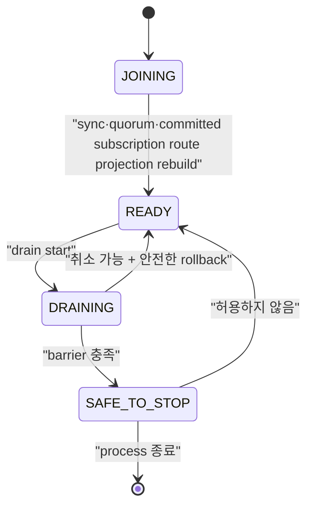

# Drain과 rolling update 스펙

이 문서는 node를 계획적으로 교체할 때 신규 연결을 차단하고 session을 인계한 뒤, 외부 controller가 Pod 삭제를 승인할 수 있는 조건을 정의한다. Kubernetes `preStop`은 최후 방어선이며 승인 gate가 아니다.

| 항목 | 값 |
| --- | --- |
| 상태 | Active (broker-side drain/`SAFE_TO_STOP` 범위만; external rollout과 전체 호환성 gate는 Draft) |
| 관련 요구사항 | DEP-01~DEP-24, CLIENT-01~CLIENT-09, CLU-11 |
| 근거 | [PRD 9.7절과 10장](../requirements/PRD.md), [Kubernetes Container Lifecycle Hooks](https://kubernetes.io/docs/concepts/containers/container-lifecycle-hooks/), [OASIS MQTT 5.0 Server redirection](https://docs.oasis-open.org/mqtt/mqtt/v5.0/mqtt-v5.0.html#_Toc3901255) |
| 관련 Architecture | [Cluster architecture](../architectures/cluster-architecture.md), [EKS on EC2 deployment](../architectures/eks-ec2-deployment.md) |
| 관련 결정 | [ADR-0004](../decisions/ADR-0004-session-ownership-and-fencing.md), [ADR-0006](../decisions/ADR-0006-external-rollout-controller.md), [ADR-0007](../decisions/ADR-0007-aws-production-deployment-platform.md), [ADR-0016](../decisions/ADR-0016-node-drain-and-safe-to-stop.md) (broker-side 범위만), [ADR-0051](../decisions/ADR-0051-cluster-update-strategy.md), [ADR-0055](../decisions/ADR-0055-drain-and-reconnect-operating-defaults.md) |
| 관련 Contract | [Management API v1](../contracts/management-api-v1.md), [MQTT client compatibility v1](../contracts/mqtt-client-compatibility-v1.md), [Cluster release compatibility v1](../contracts/cluster-release-compatibility-v1.md) |
| 해설 | [안전한 노드 drain과 Will](../explainers/safe-node-drain-and-will.md), [EKS 고가용성과 장애 도메인](../explainers/eks-ha-failure-domains.md), [AWS NLB와 MQTT 연결 lifecycle](../explainers/aws-nlb-mqtt-connection-lifecycle.md) |

## 1. Node lifecycle



| State | 신규 MQTT 연결 | 기존 연결 | Readiness | 종료 허용 |
| --- | --- | --- | --- | --- |
| `JOINING` | 거절 | 없음 | 실패 | 아니오 |
| `READY` | 허용 | 처리 | 성공 | 아니오 |
| `DRAINING` | 거절 | rate 제한 아래 인계 | 실패 | 아니오 |
| `SAFE_TO_STOP` | 거절 | 0 | 실패 | 외부 gate가 승인할 수 있음 |

정의하지 않은 상태 전이는 `409 invalid_node_transition`으로 거절하고 현재 state를 반환해야 한다. 모든 전이는 Metric과 구조화 로그에 남겨야 한다.

`-cluster-config` runtime은 committed voter를 대상으로 drain operation을 복제하고, 신규 MQTT CONNECT를 차단하며, 설정된 LB 전파 대기 뒤 rate 제한 ownership 인계를 수행한다. 모든 barrier를 통과하면 `SAFE_TO_STOP`을 replicated state에 commit하고 readiness는 실패로 유지한다. 이 broker 동작은 standalone mode에 제공되지 않는다. QoS 1/2 progress는 protocol wire effect보다 먼저 개별 replicated transition으로 commit되며 별도 replace-all checkpoint는 없다. External rollout controller, Kubernetes/EKS `preStop`, BP-07 및 N-1↔N은 별도 scope다.

Recovering 또는 joining node는 committed persistent subscription에서 node-local route projection을 rebuild하고 local sync·quorum 조건을 충족한 뒤에만 `READY`를 광고할 수 있다.

## 2. Drain operation resource

### 2.1 시작

`POST /api/v1/nodes/{nodeId}/drain`

```json
{
  "serverReference": "mqtt.example.internal:8883",
  "connectionRatePerSecond": 100,
  "loadBalancerPropagationDelayMillis": 15000,
  "timeoutMillis": 600000
}
```

`connectionRatePerSecond`, `loadBalancerPropagationDelayMillis`, `timeoutMillis`는 선택 field다. 생략하면 [ADR-0055](../decisions/ADR-0055-drain-and-reconnect-operating-defaults.md)의 기본값 `100`, `30000`, `600000`을 적용한다. 허용 범위는 각각 `1..10000`, `0..3600000`, `1000..86400000`이며 기본값 적용 뒤 timeout은 LB 전파 대기보다 커야 한다. Idempotency 비교는 기본값을 채운 뒤의 값으로 한다. `serverReference`는 선택이고 최대 256 UTF-8 bytes이며 제어 문자를 허용하지 않는다. 누락·범위 위반·잘못된 reference는 `400 invalid_request`다.

POST와 DELETE는 `Operator`, GET은 `ReadOnly` role을 요구하며 POST와 DELETE는 `Idempotency-Key`를 요구한다. 요청 대상은 cluster에 committed voter여야 한다. Active drain은 같은 node에서 새 operation을 만들지 않고 현재 committed operation을 반환한다. 최초 POST는 `202 Accepted`, 현재 operation replay는 `200 OK`다. 같은 key에 다른 parameter를 쓰면 `409 idempotency_conflict`; 다른 node drain이 이미 active이면 `409 node_drain_in_progress`다. 없는 node는 `404`, quorum을 확보할 수 없으면 `503`이다.

Rebalance operation이 `RUNNING`이면 drain 시작은 `409 connection_rebalance_in_progress`로 거절해야 한다. 이 오류는 retryable이다.

### 2.2 조회

`GET /api/v1/nodes/{nodeId}/drain`
요청은 fresh quorum read barrier를 통과한 committed 상태를 반환한다. Barrier를 확보하지 못하면 `503`이다.

```json
{
  "data": {
    "operationId": "550e8400-e29b-41d4-a716-446655440000",
    "nodeId": "3",
    "state": "DRAINING",
    "phase": "TRANSFERRING_SESSIONS",
    "startedAt": "2026-08-16T00:00:00Z",
    "deadlineAt": "2026-08-16T00:10:00Z",
    "connections": { "initial": 12000, "remaining": 420 },
    "sessions": { "stateReadyForTakeover": 11580, "takenOver": 11560, "failed": 0 },
    "replication": { "pendingWal": 0, "underReplicated": 0 },
    "safeToStop": false,
    "failure": null
  }
}
```

`phase`는 최소 `EXCLUDING_TRAFFIC`, `WAITING_FOR_LB`, `VERIFYING_SESSION_STATE`, `TRANSFERRING_SESSIONS`, `VERIFYING_BARRIER`, `COMPLETED`, `FAILED`, `CANCELLED`를 구분해야 한다. `failure`는 정상 진행 중 `null`이며 실패 시 `{ "code": string, "blockingReason": string | null }`이다. `safeToStop`은 `COMPLETED`에서만 true다.

### 2.3 취소

`DELETE /api/v1/nodes/{nodeId}/drain`은 `Operator`와 `Idempotency-Key`를 요구하며 operation을 안전하게 취소할 수 있을 때 `CANCELLED`로 commit해야 한다. 성공은 `200 OK`다. `SAFE_TO_STOP` 이후에는 `409 drain_not_cancellable`과 `details.state=SAFE_TO_STOP`을 반환해야 한다. 취소가 시작된 session takeover를 되돌리거나 epoch를 낮춰서는 안 된다. 새 readiness는 route와 replica 준비를 다시 확인한 뒤에만 성공해야 한다.

`FAILED` drain을 취소할 때는 phase를 `CANCELLED`로 바꾸고 `failure`의 code와 blocking reason을 함께 지운다. 이 취소 명령을 WAL에서 재생한 뒤에도 같은 상태여야 한다. Failure 정보는 `FAILED` phase에만 유효하다. 취소한 기록에 failure 정보가 남으면 typed snapshot 검증이 실패해 node가 재시작하지 못한다.

## 3. Drain 실행 순서

1. node state를 quorum에 `DRAINING`으로 commit한다.
2. 신규 connection admission을 닫고 readiness를 실패로 바꾼다.
3. configured load balancer propagation delay 동안 기존 connection은 유지한다.
4. connection rate limit 안에서 client reconnect와 session state takeover를 유도한다.
5. Successor의 더 큰 epoch `Acquire`가 commit되기 전에 committed persistent subscription과 QoS delivery state가 successor에서 복구 가능한지 확인한다. QoS state는 각 protocol transition에서 이미 commit됐으므로 별도의 최종 checkpoint mutation을 제안하지 않는다.
6. Successor의 더 큰 epoch session takeover commit을 확인한다.
7. safe-to-stop barrier를 평가한다.
8. barrier가 성공하면 `SAFE_TO_STOP`을 commit하고 external rollout gate에 노출한다.

Successor `Acquire` 뒤 그보다 늦게 committed ordering된 old owner의 route-affecting subscription 또는 inflight command는 exact owner/epoch check에서 거절되고 authoritative aggregate와 route projection을 바꾸지 않는다. Command 도착 시각이나 locally cached route는 이 결과를 우회할 수 없다.

Timeout은 operation을 `FAILED`로 만들 뿐 Pod 삭제를 승인하지 않는다. 실패한 node는 readiness가 내려간 DRAINING에 남아야 하며 operator가 원인을 해결하거나 명시적으로 취소해야 한다.

## 4. Client connection 인계

| Client | Server 동작 | Client 의무 | Will 기대 |
| --- | --- | --- | --- |
| MQTT 5, Server Reference 지원 | session state가 successor에서 복구 가능한 뒤 `DISCONNECT 0x9C`와 Server Reference 전송 | 같은 tenant·clientId로 임시 endpoint 또는 공통 LB에 재접속 | 충분한 Will Delay 안에 재접속하면 억제 |
| MQTT 5, Server Reference 미지원 | `0x9C`와 configured 공통 endpoint를 제공하거나 연결 종료 | 공통 LB 재접속, backoff+jitter | Will Delay 계약에 따름 |
| MQTT 3.1.1 | committed session state를 보존한 뒤 connection 종료 | 공통 LB에 같은 session key로 재접속 | Will이 설정돼 있으면 서버 종료로 발행한다(`expected_mqtt311_server_disconnect`) |
| 협력형 client | 서버 신호 뒤 client가 정상 DISCONNECT하도록 별도 application 협력 | 정상 DISCONNECT 후 재접속 | 정상 DISCONNECT면 억제 |

`0x9C`는 임시 이동이다. 영구 endpoint 변경을 뜻하는 `0x9D`로 바꿔 보내서는 안 된다. Server Reference 형식은 지원 SDK compatibility matrix에서 고정해야 한다.

공식 지원 client는 persistent session, 충분한 Session Expiry, exponential backoff+jitter와 동일 session key를 사용해야 한다. PUBACK/PUBCOMP 전 outbound publish는 local outbox에 보관하고 QoS 1 consumer는 중복을 견뎌야 한다.

## 5. Will 판정과 관측

`narumq_will_outcomes_total{reason}`은 Will의 최종 결과를 아래 6개 사유로 집계한다. [ADR-0028](../decisions/ADR-0028-planned-handoff-will-and-reason-metric.md)을 따른다.

| 상황 | 집계 node | reason |
| --- | --- | --- |
| 정상 `DISCONNECT 0x00`, pending Will 있음, metadata commit 성공 또는 local-only | owner | `suppressed_normal_disconnect` |
| 같은 node 재접속이 예약 Will 취소, superseded 정보 없음 | 재접속 node | `suppressed_reconnected_within_delay` |
| Acquire가 예약 Will 또는 계획 인계 MQTT 5 delay>0 persistent Will을 대체 | 재접속 node | `suppressed_reconnected_within_delay` |
| 계획 인계 MQTT 3.1.1 즉시 발행 | 후계 또는 재접속 node | `expected_mqtt311_server_disconnect` |
| 계획 인계 MQTT 5 delay 0 또는 retention `IMMEDIATE` 즉시 발행 | 후계 또는 재접속 node | `expected_zero_or_expired_will_delay` |
| 계획 인계 예약 Will을 timer·expiry로 발행 | 예약 node | `expected_zero_or_expired_will_delay` |
| 계획 인계 MQTT 5 delay>0·retention≠`IMMEDIATE`인데 즉시 발행 | 후계 node | `unexpected_supported_client` |
| 비정상 close·keepalive·owner crash recovery 또는 복원한 예약 Will 발행 | 발행 node | `unplanned_failure` |

계획 인계는 서버가 시작한 비정상 종료다. MQTT 3.1.1, Will Delay 0 또는 retention `IMMEDIATE`이면 즉시 claim·발행한다. 나머지는 후계 recovery 시각부터 Will Delay로 예약하며 session expiry로 제한한다. 이전 owner는 `DisconnectTakeover`로 local Will을 버리고 집계하지 않는다. Recovery 전 재접속도 committed ownership apply의 대체 결과로 같은 규칙을 적용한다.

Will 하나는 결과를 확정한 node에서 정확히 한 번 집계한다. Client `DISCONNECT 0x04`, takeover close, ACL 거절·metadata commit 실패로 발행하지 않은 Will은 집계하지 않는다. Feature 비활성 drain은 기존처럼 Will을 버리고 집계하지 않는다. 계획/비계획 출처는 복제하지 않으므로 재시작·detached 이전 뒤 복원한 예약 Will은 `unplanned_failure`다. Mixed N-1/N의 N-1 후계는 기존 억제를 유지한다.

Release gate는 `unexpected_supported_client`가 0이어야 한다. 이 사유는 위 표의 broker 규칙 위반만 탐지한다. Client 쪽 증거는 SDK drain suite로 확인한다. 예상 Will을 성공률에 섞어 숨기거나 제품 결함으로 오분류해서는 안 된다.

## 6. Safe-to-stop barrier

다음 조건을 모두 충족해야 `SAFE_TO_STOP`이 된다.

- 신규 connection admission이 닫혀 있고 readiness가 실패한다.
- 활성 MQTT connection이 0이다.
- 이 node가 현재 epoch owner인 session이 0이다.
- Persistent subscription과 QoS delivery transition은 commit된 상태이며, successor takeover 뒤 old owner의 추가 mutation이 epoch fencing으로 거절된다.
- committed but unapplied WAL과 필수 replication backlog가 허용 기준 안이다.
- 필요한 replica 수와 cluster quorum이 node 종료 뒤에도 유지된다.
- 진행 중인 local mutation이 없고 새 owner takeover 확인이 끝났다.
- state와 barrier evidence가 node-local memory가 아니라 복구 가능한 위치에 기록됐다.

Barrier 항목 하나라도 `unknown`이면 실패로 판정해야 한다. `unknown`을 0이나 성공으로 취급해서는 안 된다.
구현은 barrier 조건을 다음 안정된 blocker code로 노출한다.

| 확인 조건 | 실패 blocker |
| --- | --- |
| 신규 admission이 닫히지 않음 | `admission_open` |
| readiness가 이미 실패 상태가 아님 | `readiness_up` |
| 활성 connection 수가 0이 아님 또는 알 수 없음 | `connections_remaining` |
| local ownership session 수가 0이 아님 | `sessions_owned` |
| local persistent subscription 수가 0이 아님 | `orphan_subscription` |
| committed index와 applied index 사이에 WAL이 남음 | `pending_wal` |
| voting replica 또는 connected successor 수가 quorum에 부족 | `insufficient_replicas` |
| local node가 Raft leader임 | `local_leader` |
| local proposal이 진행 중임 | `pending_local_commit` |
| pending Will timer가 남음 | `pending_will` |
| successor voter가 아직 없거나 route projection이 준비되지 않음 | `no_successor_voter`, `route_projection_not_ready` |
| read barrier 또는 quorum을 확보하지 못함 | `quorum_unavailable` |

다음 barrier 재평가 전까지 blocker가 남으면 operation은 계속 대기한다. Deadline에 도달하면 `FAILED`와 `drain_timeout`을 commit하고 마지막 blocker를 기록한다.

## 7. External rollout gate와 Kubernetes/EKS

Rollout controller는 Pod 삭제 전에 drain을 시작하고 `SAFE_TO_STOP`을 확인해야 한다. 실패·timeout이면 현재 Pod와 다음 Pod의 교체를 중단해야 한다. 기준 3-AZ profile에서는 계획 중단을 한 번에 한 node로 제한해야 한다.

`preStop` hook은 다음만 수행한다.

1. 같은 node의 drain을 idempotent하게 시작하거나 현재 상태를 조회한다.
2. 남은 grace period 안에서 가능한 범위까지 기다린다.
3. 결과와 failure reason을 기록한다.

Kubernetes의 termination grace period는 `preStop` 실행 전에 계산이 시작된다. hook 실패나 장기 실행이 Pod 삭제를 영구 차단한다고 가정해서는 안 된다. `terminationGracePeriodSeconds`는 LB 대기, drain 최악 시간, hook overhead와 SIGTERM 뒤 정상 종료 시간을 합친 값 이상이어야 하며, 검증되지 않은 짧은 값은 배포 admission에서 거절해야 한다.

Kubernetes는 Pod 삭제뿐 아니라 startup·liveness probe 실패로 container를 종료할 때도 `preStop`을 실행한다. 따라서 startup 예산(`failureThreshold` × `periodSeconds`)을 다 쓴 container는 종료 직전에 drain을 시작한다. 이 drain은 계획된 교체가 아니다. 결과와 복구 규칙은 [§8.1](#81-startup-probe-종료와-drain-기록-재시작-순환)을 따른다.

`terminationGracePeriodSeconds ≥ ceil(timeoutMillis/1000) + 30 + 30`이어야 한다. 기본 drain 값으로는 660초다. 두 30초 값은 측정 전 예산이며 실측은 [TODO §1.4](../TODO.md#14-drain-정책관측과-production-배포)에서 추적한다.

배포 template은 PodDisruptionBudget, required anti-affinity, topology spread와 max unavailable 1을 제공해야 한다. 기준 3-AZ profile은 quorum node를 AZ마다 하나씩 배치해야 한다.

### 7.1 AWS deployment profile

초기 production 기준인 `EKS_EC2_HA`는 다음 조건을 충족해야 한다.

- 지원 EKS와 Kubernetes minor version을 release artifact에 고정한다.
- EC2 기반 node group의 서로 다른 세 가용 영역에 quorum Pod를 하나씩 배치한다.
- 각 quorum Pod는 다른 Pod와 공유하지 않는 Amazon EBS CSI persistent volume을 사용한다.
- EBS encryption, AZ binding, snapshot·restore와 disk pressure 실패 결과를 검증한다.
- Amazon NLB TCP/TLS target은 readiness 실패 뒤 신규 connection을 제외해야 한다.
- NLB deregistration delay, connection termination, TCP idle timeout, client IP preservation 또는 Proxy Protocol 정책을 명시한다.
- NLB 설정 전파 중 유입될 수 있는 신규 connection을 drain의 load balancer propagation 단계가 흡수해야 한다.
- Worker architecture와 AMI를 release artifact에 고정한다. Production broker image를 선택한 architecture로 빌드·게시하고 immutable digest를 고정한다. Broker, controller와 필수 add-on image는 선택한 architecture를 지원해야 한다.

`EKS_FARGATE`, `ECS_EC2`, `COMPOSE_LOCAL`과 단일 host의 다중 container 결과는 `EKS_EC2_HA` 수용 시험을 대신해서는 안 된다.

배포 profile의 선택 근거는 [ADR-0007](../decisions/ADR-0007-aws-production-deployment-platform.md)을 따른다. Pod·EC2·가용 영역·EBS의 장애 범위는 [EKS 고가용성과 장애 도메인](../explainers/eks-ha-failure-domains.md), NLB target과 established connection의 서로 다른 lifecycle은 [AWS NLB와 MQTT 연결 lifecycle](../explainers/aws-nlb-mqtt-connection-lifecycle.md)을 참고한다.

Amazon ECS on EC2를 지원하려면 Kubernetes rollout controller와 별개인 lifecycle adapter가 필요하다. Adapter는 ECS Task Scale-in Protection을 설정한 상태에서 NLB target 제외와 NaruMQ drain을 시작하고, `SAFE_TO_STOP` 뒤에만 protection을 해제해야 한다. Task ARN, IP와 container name을 영구 `nodeId`로 사용해서는 안 된다. 이 흐름과 storage·discovery·강제 종료 시험을 모두 통과하기 전 ECS profile은 `Experimental`이어야 한다.

### 7.2 업데이트 방식과 환경별 선택

계획 업데이트는 [ADR-0051](../decisions/ADR-0051-cluster-update-strategy.md)에 따라 한 번에 한 node씩 진행해야 한다. 새 클러스터로 전환하는 Blue/Green은 지원하지 않는다.

#### In-place 교체

1. 대상 node의 drain을 시작한다.
2. `SAFE_TO_STOP`을 확인한다.
3. 프로세스를 종료한다.
4. 같은 `nodeId`, cluster config, 데이터 디렉터리로 새 release를 시작한다.
5. `/health/ready` 성공을 확인한 뒤 다음 node로 진행한다.

재시작 node는 READY 전에 WAL·snapshot replay → log catch-up → `MemberProfileChange` commit → route projection 재구축 → drain `CLEAR` 순서로 진행한다([ADR-0018](../decisions/ADR-0018-release-compatibility-window.md)).

#### 교체형 교체

1. Committed voter가 정확히 3개인지 확인한다.
2. 새 release node를 새 `nodeId`와 빈 데이터 디렉터리로 stage·join·promotion한다. [동적 멤버십 절차](../how-to/dynamic-cluster-membership.md)를 따른다.
3. 기존 node의 drain을 시작하고 `SAFE_TO_STOP`을 확인한다.
4. 기존 node를 planned removal로 제거한다.
5. Voter가 3개로 돌아오고 모든 node가 READY인지 확인한 뒤 다음 node로 진행한다.

교체형 조합의 수용 시나리오는 [§10](#10-broker-drain-수용-시험-매핑)의 `DRN-SCN-017`이다. 이 시나리오는 production storage, Kubernetes·ECS 배포 profile과 N-1↔N 혼합 교체를 대신하지 않는다.

| 환경 | 데이터 디렉터리 재연결 | 사용할 방식 |
| --- | --- | --- |
| VM(같은 디스크 유지) | 가능 | In-place. Host 교체 시 교체형 |
| Docker Compose named volume(개발·시험 전용, production 미지원) | 가능 | In-place |
| EKS StatefulSet PVC(`EKS_EC2_HA`) | 가능 | In-place. Node·AZ·volume 교체 시 교체형 |
| ECS 서비스 관리 EBS | 불가(task마다 새 volume, task 종료 시 삭제) | 교체형만 |
| ECS on EC2 호스트 디스크 | 인스턴스를 유지하면 가능 | In-place. 인스턴스 교체 시 교체형 |

두 방식 모두 N/N-1 release window 안에서만 혼합 운영한다. 새 feature activation은 모든 node를 교체한 뒤에만 한다. Activation 전 rollback은 같은 방식으로 N-1 release를 다시 배포한다.

## 8. 비정상 종료

Process crash 또는 host loss에서는 planned drain과 barrier가 실행되지 않을 수 있다. 남은 node는 cluster spec에 따라 새 epoch를 획득하고 persistent session을 복구해야 한다. 이를 계획 drain 성공으로 기록해서는 안 되며 `unplanned_failure`로 관측해야 한다. `COMPLETED` record를 재생한 node는 admission을 닫은 채 유지하고 bounded readiness preflight를 통과한 뒤 replicated `CLEAR`를 commit해야 한다. Preflight 또는 commit에 실패하면 재시도하며, `CLEAR` apply 뒤에만 admission을 다시 연다.

### 8.1 Startup probe 종료와 drain 기록 재시작 순환

Kubelet은 startup probe가 성공하기 전에는 readiness·liveness probe를 실행하지 않는다. 그래서 cluster runtime의 `/health/startup`은 `JOINING`일 때 readiness 조건을 스스로 평가해야 한다. 외부의 `/health/ready` 요청을 기다려서는 안 된다. `DRAINING`·`SAFE_TO_STOP`은 startup을 통과한다. 이때 readiness는 계속 실패한다.

Container가 startup 예산을 다 써서 종료되면 `preStop`이 drain을 시작하고 drain은 보통 `COMPLETED`가 된다. 재시작한 container는 이 기록을 §8 규칙대로 `CLEAR`한 뒤 readiness를 다시 평가한다. 기록이 사라지면 사유는 `node drain cancelled; readiness recheck pending`으로 보일 수 있다. 이 문구는 취소 요청이 없었어도 `CLEAR` 뒤에 나온다. 취소 기록과 구분하려면 `GET /api/v1/nodes/{nodeId}/drain`의 phase와 `cleared completed node drain record` 로그를 본다.

복구 규칙은 다음과 같다.

| 재시작 때 기록 | 동작 | 사람이 할 일 |
| --- | --- | --- |
| 없음(전원 손실·`SIGKILL`) | `preStop`이 없으므로 drain 기록도 없다. Startup이 readiness를 평가해 `READY`가 된다. | 없음 |
| `COMPLETED` | 자동 `CLEAR` 뒤 `READY`가 된다. | 없음. Startup이 멈추면 원인을 찾는다. |
| `FAILED` | `DRAINING`과 readiness 실패를 유지한다. | 원인을 해결한 뒤 `DELETE /api/v1/nodes/{nodeId}/drain`으로 취소한다. |
| `CANCELLED` | 기록은 무해하다. Startup이 readiness를 평가한다. | 없음 |

전원 손실 시험 도구는 장애 뒤 대상 node가 `DRAINING`이면 먼저 Pod의 `restartCount`와 직전 container 종료 사유를 확인한다. 재시작이 있으면 drain 기록의 phase를 읽는다. `/health/ready`를 호출해 startup을 대신 통과시켜서는 안 된다. 그 호출은 결함을 가린다. 이 경로의 과거 사례는 [Cluster 검증 기록](../verification/cluster-session-and-delivery.md#2026-10-15-격리-eks-전원-손실-후속-관찰-failedunresolved)에 있다.

## 9. 수용 시험

- 최대 예상 traffic에서 연속 100회 rolling update를 수행한다.
- MQTT 3.1.1/5.0, QoS 0/1/2, retained, Will과 persistent session을 섞어 시험한다.
- 매 payload의 단조 증가 ID로 gap, duplicate와 reorder를 분리 측정한다.
- drain timeout·failure 때 controller가 Pod 삭제와 다음 node 진행을 요청하지 않는지 검증한다.
- preStop 중복 호출, hook 실패와 grace period 부족을 시험한다.
- 새 owner takeover 뒤 이전 owner의 stale write가 거절되는지 확인한다.
- 지원 client의 `unexpected_supported_client` Will이 0인지 검증한다.
- N-1↔N upgrade와 rollback에서 같은 barrier를 통과하는지 확인한다.
- `EKS_EC2_HA`에서 Pod·EC2 node·단일 AZ failure, EBS detach·reattach와 NLB deregistration을 시험한다.
- 배포 artifact가 profile 상태를 표시하고 미지원 profile의 결과를 production 출시 근거에서 제외하는지 검증한다.
- ECS adapter가 도입되면 protected task 때문에 막힌 deployment, protection 만료, direct task stop과 host loss를 별도 실패로 시험한다.

## 10. Broker drain 수용 시험 매핑

이 절은 dynamic cluster의 broker-side drain과 `SAFE_TO_STOP`, 시험 전용 SDK drain 호환성, local Kind controller lifecycle, 격리 EKS 장애 시나리오를 정의한다. Release-wide rollout이나 production storage 승인으로 확대 해석하지 않는다.

테스트 연결과 결과는 [테스트 컨벤션](../conventions/test-conventions.md)의 시나리오 보고서로 확인한다. 과거 실행 기록은 [검증 기록](../verification/drain-and-rolling-update.md)에 있다.

| 시나리오 ID | 요구사항 ID | 조건과 입력 | 기대 결과 |
| --- | --- | --- | --- |
| DRN-SCN-001 | DEP-03, DEP-04, DEP-05, DEP-06, DEP-07, DEP-10, DEP-12 | MQTT 5 persistent QoS 1 session과 MQTT 3.1.1 live·detached session이 있는 3-node cluster에서 한 node의 drain을 시작한다. 같은 `Idempotency-Key`로 시작 요청을 한 번 더 보낸다. 마지막에 그 node를 재시작한다. | readiness와 신규 admission이 막히고 기존 connection은 LB 전파 대기 동안 유지된다. 같은 key의 재시작 요청은 현재 operation을 `200 OK`로 반환한다. MQTT 5 client는 `DISCONNECT 0x9C`와 Server Reference를 받는다. 인계는 설정한 rate 안에서 일어난다. node는 `SAFE_TO_STOP`이 되고 session은 successor에서 이어진다. 재시작 뒤 완료 기록은 `CLEAR`된다. |
| DRN-SCN-002 | DEP-02, DEP-10 | 3-node cluster에서 drain을 취소한다. Drain 중 process를 재시작한다. Successor voter가 없는 상태에서 drain을 시작한다. 실패한 drain을 취소한 뒤 readiness를 확인한다. | 취소 뒤 node가 `READY`가 된다. 재시작 뒤 같은 operation이 이어진다. Successor가 없으면 deadline에 `FAILED`와 `drain_timeout`이 되고 마지막 blocker는 `insufficient_replicas`다. 취소한 뒤 readiness가 돌아온다. |
| DRN-SCN-003 | DEP-10, CLU-14 | `FAILED` drain을 `DELETE`로 취소한다. 그 취소 명령을 WAL에서 재생하고 node를 재시작한다. | phase는 `CANCELLED`이고 `failure`의 code와 blocking reason이 지워진다. WAL 재생 뒤에도 같은 상태다. typed snapshot 검증이 통과하고 node가 재시작한다([§2.3](#23-취소)). |
| DRN-SCN-004 | DEP-10, API-04 | 3-node process에서 `preStop`과 같은 순서(GET 404 뒤 POST)로 한 node의 drain을 `COMPLETED`까지 실행하고 `SIGKILL`한다. 재시작한 node에는 `/health/startup`만 호출한다. 이어 drain 없이 한 번 더 `SIGKILL`하고 같은 방식으로 확인한다. | 두 경우 모두 `/health/ready`를 호출하지 않아도 startup이 통과하고 node가 `READY`가 된다. `COMPLETED` 기록은 자동으로 `CLEAR`된다([§8.1](#81-startup-probe-종료와-drain-기록-재시작-순환)). |
| DRN-SCN-005 | DEP-01, DEP-02 | Drain 시작·조회·취소 API에 권한, `Idempotency-Key`, 같은 key의 재요청, 다른 parameter, 다른 node의 active drain, committed voter가 아닌 대상, 잘못된 요청과 허용하지 않은 phase 전이를 보낸다. | §2가 정한 상태 코드와 오류 code를 반환한다. 충돌 응답은 현재 node state를 담는다. 허용하지 않은 phase 전이는 거절된다. `SAFE_TO_STOP` 뒤와 완료된 drain은 취소되지 않는다. |
| DRN-SCN-006 | DEP-02, DEP-04, DEP-05 | 선택 field를 생략하거나 허용 범위 밖의 값으로 drain 시작을 요청한다. | 생략한 field에는 기본값 `100`, `30000`, `600000`이 적용된다. 범위 밖의 값은 `400 invalid_request`다. 도메인·HTTP·OpenAPI의 기본값이 같다([ADR-0055](../decisions/ADR-0055-drain-and-reconnect-operating-defaults.md)). |
| DRN-SCN-007 | DEP-08, DEP-10 | Barrier 조건을 하나씩 어긴 상태와 `unknown` 값으로 safe-to-stop barrier를 평가한다. 다른 voter가 연결되지 않은 cluster와 취소된 context에서 drain runtime을 실행한다. | 처음 실패한 조건의 blocker code를 반환하고 `unknown`은 실패다. 이 node가 소유한 session만 센다. 다른 voter가 연결되지 않으면 barrier가 막힌다. 취소한 run은 정리된다([§6](#6-safe-to-stop-barrier)). |
| DRN-SCN-008 | DEP-03, DEP-06, DEP-07 | Drain으로 session을 닫는다. MQTT 5 client, MQTT 3.1.1 client, 모르는 session과 admission이 닫힌 node의 CONNECT를 각각 시험한다. 유효하지 않은 Server Reference를 인코딩한다. | MQTT 5 client는 `DISCONNECT 0x9C`와 Server Reference를 받고 Will은 억제된다. MQTT 3.1.1 client는 packet 없이 닫힌다. 모르는 session은 닫지 않는다. Admission이 닫히면 readiness 전에 CONNECT를 거절한다. 유효하지 않은 Server Reference는 거절된다. |
| DRN-SCN-009 | DEP-01, DEP-02 | Drain command와 snapshot을 인코딩·복원한다. 순서 위반, 중복, 잘못된 state를 넣는다. Drain 기록이 있는 node를 제거한다. Drain 전이 metric을 기록한다. | 유효한 값은 그대로 복원되고 잘못된 입력은 거절된다. Node 제거는 drain 기록을 지운다. 전이 metric은 고정된 phase label만 쓴다. |
| DRN-SCN-010 | CLU-04, CLU-05, DEP-09, DEP-16 | MQTT CONNECT ownership takeover, persistent subscription replay와 member 제거 handoff를 실제 process cluster에서 실행한다. | Takeover 뒤 이전 owner는 session을 바꾸지 못한다. 재시작한 node와 joiner는 route projection을 다시 만든 뒤 `READY`가 된다. 제거 handoff는 quorum을 기다린다. |
| DRN-SCN-011 | MQTT-05, DEP-07, DEP-12 | 계획 인계에서 MQTT 3.1.1, MQTT 5 delay 0, delay>0 persistent session의 Will과 예약 Will을 대체하는 재접속을 평가한다. | [§5](#5-will-판정과-관측)의 표대로 reason 하나로 한 번만 집계한다. 이전 owner는 local Will을 버리고 집계하지 않는다. Metric 출력에 6개 reason이 나온다. |
| DRN-SCN-012 | MQTT-05, DEP-07, DEP-12 | Session metadata가 켜진 3-node cluster에서 node 3→1→2 순서로 drain한다. 매번 reference 재접속, session resume, observer 수신과 node 재시작을 확인한다. | Observer는 MQTT 3.1.1·Will Delay 0·만료 Will만 받고 안전한 delay 뒤에도 정상 Will은 받지 않는다. Round별 reason 증가분이 §5와 맞고 `unexpected_supported_client`와 `unplanned_failure`는 0이다. |
| DRN-SCN-013 | MQTT-05, DEP-07, DEP-12, SEC-06 | Recovery 전 재접속이 이전 Will을 대체한다. 새 CONNECT에는 Will을 넣지 않는다. 이전 principal·Will topic이 허용되는 경우, 거절되는 경우, principal이 없는 경우를 시험한다. | 이전 topic이 허용되면 이전 Will을 한 번 발행하고 집계한다. 이전 topic이 거절되거나 principal이 없으면 새 CONNECT는 성공하고 이전 Will의 발행과 집계는 모두 없다. |
| DRN-SCN-014 | DEP-06, DEP-07, DEP-12, CLIENT-01~CLIENT-09 | Paho Go MQTT 5와 Paho Python MQTT 5가 test-only readiness LB로 node 3에 연결한 뒤 node 3의 drain을 시작한다. | 두 SDK가 한 번의 임시 redirect로 node 2에 재접속하고 같은 session을 이어 간다. 후속 QoS 1이 전달된다. Will Delay 뒤에도 Will은 없다. Node 3은 `SAFE_TO_STOP`이 된다. |
| DRN-SCN-015 | CLIENT-01~CLIENT-09 | Fake server가 SDK마다 잘린 packet, 허용되지 않는 field, 중복 값, 유효하지 않은 Server Reference가 든 `DISCONNECT`를 보낸다(선택 진단). | Main CONNECT는 두 번이고 vector는 한 번이며 trap endpoint 접속은 없다. 이 진단의 실패는 제품 필수 합격 조건이 아니다([Client contract §6.3](../contracts/mqtt-client-compatibility-v1.md#63-선택적-sdk-진단)). |
| DRN-SCN-016 | DEP-12, CLIENT-01~CLIENT-09 | 필수 drain suite의 Will 실패·누락 결과와 선택적 SDK 진단 suite의 실패 결과를 각각 판정한다. | 필수 Will 실패·누락은 필수 판정을 계속 막는다. SDK 진단 실패는 진단 suite에만 남고 정상 drain 승인과 분리된다. |
| DRN-SCN-017 | CLU-02, CLU-07, DEP-06, DEP-07, DEP-08, DEP-10 | 3-voter cluster에서 node 4·5·6을 추가한 뒤 node 1·2·3을 차례로 drain하고 `SAFE_TO_STOP` 확인 뒤 planned removal한다. MQTT 5·3.1.1 live session과 3.1.1 offline session을 두고 batch마다 QoS 1·2 topic별 3개 메시지를 보낸다([§7.2](#72-업데이트-방식과-환경별-선택)). | 최종 voter는 `{4,5,6}`이다. 모든 session이 복구된다. QoS 1·2 gap은 0이고 QoS 2 duplicate는 0이다. |
| DRN-SCN-018 | DEP-06, DEP-07, DEP-10, DEP-12 | 실제 3-node cluster에서 node 3→1→2 순서의 drain, `SAFE_TO_STOP`, 재시작을 100회 수행한다. Round마다 QoS 1·2 PUBLISH 24건, retained 1건, MQTT 5 Will과 MQTT 3.1.1 Will을 쓴다. 환경 변수 `NARUMQ_ROLLING_100=1`이 있을 때만 실행한다. `NARUMQ_ROLLING_ROUNDS`로 round 수를 바꾼 dry run도 모든 검사를 수행한다. | QoS 1·2 gap은 0이고 QoS 2 duplicate와 reorder는 0이다. Retained 집합이 매 round 기대값과 같다. `unexpected_supported_client`와 `unplanned_failure`는 0이다. 100이 아닌 round 수의 dry run은 검사를 통과해도 통과가 아니라 건너뜀으로 보고한다. 그래서 `go run ./tools/verify acceptance`는 dry run을 실패로 판정한다. 이 시나리오는 local workload이며 최대 예상 traffic 시험이 아니다. |
| DRN-SCN-019 | DEP-06, DEP-07, DEP-10, DEP-12 | 운영 배포 profile에서 최대 예상 traffic으로 연속 100회 rolling update를 수행한다. MQTT 3.1.1/5.0, QoS 0/1/2, retained, Will과 persistent session을 섞는다([§9](#9-수용-시험)). | Gap, duplicate, reorder를 분리 측정한 값이 기준 안이다. `unexpected_supported_client`가 0이다. 절대 기준은 실제 `B_conn/B_pub/B_sub`를 확정한 뒤 정한다. |
| DRN-SCN-020 | CLU-11, NFR-15, DEP-18 | 게시한 N-1과 N release 사이에서 upgrade와 rollback을 수행한다. | 두 방향 모두 같은 safe-to-stop barrier를 통과한다. |
| DRN-SCN-021 | DEP-11, DEP-18, SEC-11 | Local Kind에서 실제 Go broker 3-process `OnDelete` StatefulSet을 rollout controller로 교체한다. Controller는 Management API의 committed-voter 상태로 preflight하고 OCI manifest·config label, version·feature, UID·resourceVersion, 완전한 drain barrier와 durable audit를 검증한다. 별도로 맞지 않는 version을 요청한다. | `SAFE_TO_STOP` 뒤 해당 UID의 Pod만 교체된다. 승인 audit가 durable하게 남는다. Version이 맞지 않으면 Pod를 바꾸지 않는다. |
| DRN-SCN-022 | DEP-11, DEP-18, SEC-11 | 격리 EKS에서 broker image를 합성 `0.0.0`에서 `0.0.1`로 `NaruMQRollout`으로 교체한다. Drain이 진행 중일 때 controller를 재시작한다. | 세 broker Pod가 UID 교체 뒤 Ready가 된다. 재시작한 controller가 같은 operation과 idempotency key로 이어 간다. 각 Pod의 승인에 완전한 `SAFE_TO_STOP` barrier audit가 남는다. Startup은 수동 readiness 호출 없이 통과한다. |
| DRN-SCN-023 | DEP-11, DEP-18 | Controller와 broker Management Service 사이의 fault proxy가 drain 조회에 incomplete·malformed 응답, HTTP 503과 응답 지연을 차례로 반환한다. | 각 구간에서 broker drain은 `DRAINING`, rollout은 `Draining`이다. Pod 삭제와 다른 node의 drain 요청은 0건이다. 저장된 deadline에서 `drain_timeout`으로 실패한다. |
| DRN-SCN-024 | DEP-11, DEP-18 | Leader가 아닌 controller process를 하나 더 실행하고 drain POST 결과 불명 중 leader controller를 재시작한다. | Leader가 아닌 process는 Management API를 호출하지 않고 Lease를 가져가지 않는다. 새 leader는 저장된 idempotency key로 POST를 replay하고 broker가 만든 operation을 채택한다. |
| DRN-SCN-025 | DEP-18 | 실제 Argo CD가 Git에서 시험용 `NaruMQRollout`을 동기화한 뒤 status를 주입하고 리소스와 Application의 health를 함께 본다. | 완료만 `Healthy`다. 진행·차단은 `Progressing`이고 실패·abort는 `Degraded`다. 알 수 없는 phase와 status 삭제는 `Healthy`가 아니다. Git sync는 `Synced`다. |
| DRN-SCN-026 | DEP-11, DEP-18 | 격리 EKS에서 [Rollout controller v1 §3](../contracts/rollout-controller-v1.md#3-acceptance-matrix)의 결함 matrix를 실행한다. 실제 broker drain `FAILED`, audit PVC append 장애, Pod DELETE 결과 불명, status CAS 충돌, approval·denial·failure audit event를 만든다. Argo CD가 Git에서 적용한 StatefulSet template과 `NaruMQRollout`으로 broker를 교체한다. | `FAILED`와 audit 장애에서는 승인과 Pod 삭제가 0건이다. DELETE 결과 불명 뒤에는 같은 UID·resourceVersion 조건으로만 다시 시도하고 Pod가 바뀌면 새 증거로 다시 승인한다. CAS 충돌 중에는 delete intent 저장과 Pod 삭제가 0건이다. 세 audit action이 hash chain과 함께 남는다. Argo CD 교체는 controller가 Pod마다 한 번만 삭제하고 Argo CD는 삭제하지 않는다. 완료 뒤 Application과 CR이 60초 동안 `Synced`·`Healthy`다. |
| DRN-SCN-027 | DEP-11, DEP-18 | 실제 `SAFE_TO_STOP` 뒤 승인을 audit 장애로 막아 rollout을 `Failed`로 만든다. 새 `retryToken`을 세 번 바꾸며 audit 장애를 유지한 뒤 해제하고 controller를 재시작한다([Rollout controller v1 §2.9](../contracts/rollout-controller-v1.md#2-reconciliation-contract)). | 새 token은 같은 drain을 같은 idempotency key와 operation으로 다시 승인하고 새 `approvalDeadlineAt`을 저장한다. 장애 동안 audit 파일과 broker Pod UID는 바뀌지 않고 drain POST·취소와 Pod 삭제는 0건이다. 장애를 해제한 뒤에는 세 broker가 교체되어 `Completed`가 된다. |
| DRN-SCN-028 | DEP-13, DEP-14, DEP-15, DEP-19 | `EKS_EC2_HA` 배포 template을 검증한다. | PodDisruptionBudget의 maxUnavailable은 1이다. Required anti-affinity와 zone topology spread(maxSkew 1)가 있다. `terminationGracePeriodSeconds`는 660이다. `preStop`은 drain을 idempotent하게 시작·조회하고 `COMPLETED`·`safeToStop`을 기다리는 script다. |
| DRN-SCN-029 | DEP-13 | 라이브 Pod에서 `preStop` hook을 연속 두 번 실행한다. 첫 실행 때는 drain 기록이 없고 두 번째 실행 때는 `COMPLETED` 기록이 있다. | 첫 실행은 404를 확인한 뒤 POST로 drain을 시작하고 `COMPLETED`를 기다려 exit 0이다. 두 번째 실행은 중복 POST 없이 같은 operationId를 확인하고 exit 0이다. 요청은 Bearer 인증과 `Idempotency-Key`를 쓰고 대기는 600초를 넘지 않는다. |
| DRN-SCN-030 | DEP-13, DEP-14 | `preStop` hook 실패, 중복 호출과 grace period 부족을 일으킨다. `terminationGracePeriodSeconds`가 [§7](#7-external-rollout-gate와-kuberneteseks)의 식보다 짧은 배포를 제출한다. | Hook 실패가 Pod 삭제를 영구 차단한다고 가정하지 않고 결과와 failure reason이 기록된다. 짧은 `terminationGracePeriodSeconds`는 배포 admission에서 거절된다. |
| DRN-SCN-031 | DEP-03, DEP-22 | 격리 EKS에서 한 node의 drain을 시작한 뒤 readiness, EndpointSlice와 AWS NLB TargetGroup 상태를 관찰한다. | `/health/ready`는 즉시 실패한다. EndpointSlice의 `ready`는 false가 되고 TargetGroup target은 `draining`이 된다. 이 두 전파는 설정한 LB 전파 예산 안에 끝난다. 신규 connection은 거절된다. |
| DRN-SCN-032 | DEP-19, DEP-23 | Release artifact가 배포 profile의 지원 상태를 표시하는지 검증한다. | `Supported`, `Experimental`, `Unsupported` 상태가 표시된다. 지원하지 않는 profile의 결과는 `EKS_EC2_HA`의 HA·RPO·rolling update 근거에서 제외된다. |
| DRN-SCN-033 | DEP-17, DEP-21, NFR-07 | 격리 EKS에서 정상 Pod를 삭제해 재생성한다. | 같은 PVC와 EBS volume이 다시 연결된다. Quorum이 유지되고 Pod는 Ready로 돌아온다. |
| DRN-SCN-034 | DEP-17, DEP-21, NFR-07 | `SAFE_TO_STOP` 뒤 exact UID·resourceVersion 조건으로 follower Pod를 삭제한다. 같은 AZ의 다른 worker에서 기존 PVC·PV·EBS와 MQTT 상태를 확인한다. | 삭제는 `SAFE_TO_STOP` 확인 뒤에만 일어난다. 같은 PVC·PV·EBS가 새 worker에 연결된다. Broker 3개가 Ready가 된다. `sessionPresent=true`이고 오프라인 QoS 1 payload와 retained 값이 재발행 없이 확인된다. |
| DRN-SCN-035 | DEP-17, DEP-21, NFR-07 | 단일 follower의 EC2를 `terminate-instances --skip-os-shutdown`으로 종료한다. 종료 확인 전에는 operator storage 복구 변경을 하지 않는다. 생존 Pod에 고정한 observer로 관찰한다. 판정 기준은 [EKS worker observer 보완 기준](#eks-worker-observer-보완-기준)이다. | 같은 AZ의 다른 worker가 같은 PVC·PV·EBS를 연결한다. 나머지 두 broker Pod UID는 바뀌지 않는다. Broker 3개가 Ready가 되고 quorum이 회복된다. 복구한 broker에서 `sessionPresent=true`, 오프라인 QoS 1 payload와 retained 값이 재발행 없이 확인된다. 관찰 표본은 모두 성공한다. |
| DRN-SCN-036 | DEP-17, DEP-20, NFR-07 | 현재 leader의 EC2를 OS 종료 없이 종료한다. 생존 follower로 관찰한다. 판정 기준은 [DEP-20 leader EC2 손실](#dep-20-leader-ec2-손실)이다. | 생존 member 하나가 새 leader가 된다. 단일 불가용 구간은 30초 이하다. 같은 PVC·PV·EBS로 복구한다. Durable stream RPO는 0이다. |
| DRN-SCN-037 | DEP-20, NFR-07 | Follower 한 개가 있는 AZ의 모든 worker를 OS 종료 없이 정지하고 대체 용량 없이 유지한 뒤 다시 시작한다. 판정 기준은 [DEP-20 단일 AZ 전원 중단 모델](#dep-20-단일-az-전원-중단-모델)이다. | 중단 중 남은 두 AZ의 quorum·MQTT·session 인계가 성공한다. 시작 뒤 3-voter가 복구되고 Durable stream RPO는 0이다. 통제를 해제한 뒤 180초 동안 ASG activity와 Pod UID 변화가 없다. |
| DRN-SCN-038 | DEP-21, NFR-07 | 실제 broker EBS filesystem에 ballast를 써서 follower admission 압박, follower ENOSPC, 두 follower ENOSPC를 차례로 만든다. 공간 회복과 재시작 뒤 durable stream을 확인한다. 판정 기준은 [DEP-21 EBS disk pressure·ENOSPC](#dep-21-ebs-disk-pressureenospc)다. | 압박에서는 PUBACK `0x97`이 오고 공간을 회복하면 publish가 다시 성공한다. Follower ENOSPC는 대상 node 자신의 관리 API에 `storage_no_space`로 보이고 생존 경로의 quorum·MQTT는 성공한다. 두 follower가 모두 막히면 그동안 `acked`가 없다. 공간 회복 뒤 3개 broker가 Ready가 되고 durable stream RPO는 0이다. |

EKS 장애 시험(`DRN-SCN-035`~`DRN-SCN-038`)의 판정 기준은 아래 [EKS worker observer 보완 기준](#eks-worker-observer-보완-기준)과 [EKS 장애 matrix 보완 기준](#eks-장애-matrix-보완-기준-2026-10-16)을 따른다.

### EKS worker observer 보완 기준

이 절은 EKS worker 장애 시험의 observer 판정 기준이다. 제품의 복구 정책·API 예산·drain gate는 바꾸지 않는다. 적용 범위는 전용 합성 fixture의 관찰과 operator fencing 판정이다.

- 관리 API와 MQTT는 독립된 작업에서 각각 표본을 기록한다. API 조회 실패·지연 때문에 MQTT 표본을 생략하지 않는다. API client 제한 시간은 서버의 전체 5초 query 예산보다 긴 10초다.
- Fault mode는 plan에 지정한 생존 Pod의 UID·worker·provider instance를 확인한다. 대상 Pod·worker·instance와 같거나 Ready가 아니면 fault를 주입하지 않는다. 도구가 직접 그 Pod 하나에 관리 API·MQTT port-forward를 열고 두 port의 준비와 Pod identity를 재확인한다. 기존 port를 재사용하거나 service/LB로 연결하지 않는다. Tunnel이 중단되면 재연결·다른 Pod 전환 없이 실패로 남긴다. Fault 직전 identity·tunnel 생존을 다시 확인하고, 관찰과 MQTT 종료 후 tunnel도 종료한다.
- 각 표본은 시작·종료 시각과 결과를 기록한다. 오류가 있어도 표본을 남기고, 실패·관찰 공백을 성공으로 바꾸지 않는다. 인증 값과 오류의 비밀 원문은 기록하지 않는다.
- Operator Node 변경은 AWS에서 대상 instance가 `terminated`임을 확인한 뒤에만 허용한다. Patch 직전에도 종료 상태를 확인한다. 기존 Node UID·provider instance가 다르면 해당 Node를 변경하지 않는다. 기존 taint를 보존하고 `node.kubernetes.io/out-of-service:NoExecute`를 추가한다. 같은 key의 `NoSchedule`만으로는 이 조건을 충족하지 않는다.
- Node patch 명령이 실패하면 fresh GET으로 현재 Node를 읽는다. 삭제·UID 교체·resourceVersion 변경·같은 상태를 구분해 기록한다. 실패한 JSON Patch 연산이나 실제 적용 여부를 응답 없이 추정하지 않으며 patch를 자동 반복하지 않는다. 이후에는 읽기 전용으로 대체 Pod 복구를 관찰한다. 상태 변화가 없는 실패나 변경 후 taint 미확인은 전체 결과를 실패로 남긴다.
- Fencing 결과가 `out_of_service` 또는 `already_out_of_service`이면 기존 대상 Pod 하나를 Pod UID precondition과 `gracePeriodSeconds=0`으로 한 번 삭제한다. 삭제 직전에 EC2 `terminated`, 기존 Node UID·provider instance·out-of-service `NoExecute` taint, Pod UID·`spec.nodeName`을 다시 읽는다. 하나라도 다르거나 Node가 없으면 삭제하지 않고 이유를 기록한다. 삭제 명령이 실패하면 fresh GET으로 Pod를 읽고 자동 반복하지 않는다. 같은 UID가 남아 있는 결과(`failed_unexplained`·`delete_unconfirmed`)는 전체 결과를 실패로 남긴다. 이유: EC2 terminate에서는 cloud controller가 Node와 taint를 먼저 지울 수 있다. 그러면 Kubernetes가 taint를 근거로 하는 Pod 강제 삭제와 즉시 detach를 하지 못하고 기본 6분 force detach 대기에 들어간다고 본다 [INFERENCE]. 이 삭제는 PodGC가 NotReady·out-of-service Node에서 하는 강제 삭제를 Node가 사라지기 전에 앞당긴다. 기존 EC2가 `terminated`일 때만 허용하므로 이전 instance가 같은 EBS에 쓰는 경로는 없다. EBS force detach와 VolumeAttachment 삭제는 하지 않는다. 근거는 [EBS detach 대기 분석](../../.artifacts/analysis/ebs-detach-wait-analysis.md)이다.
- 복구 표본마다 대상 PV의 VolumeAttachment(`nodeName`·`attached`·삭제 시각·detach 오류 시각)와 EBS attachment(instance·state)를 함께 기록한다. 이 조회가 실패해도 오류 종류만 남기고 복구 관찰은 계속한다.
- 관찰 작업은 fault와 복구 판정 동안 계속 실행한다. 종료 시 진행 중인 probe가 끝나고 표본 파일이 닫혔는지 확인한다. 기록 실패나 작업 종료 실패가 있으면 전체 관찰을 통과로 표시하지 않는다.
- 로컬 회귀·실제 MQTT와 Kubernetes API smoke는 observer의 동작만 검증한다. 실제 EC2 장애·EBS 재연결 판정은 EKS 실행 기록만 근거로 쓴다. 연속 운영 가용성과 전체 장애 matrix는 계속 열린 gate다.
- 진단용 `nodes` 표본은 fault mode에서만 약 4초 간격으로 생존 Pod의 `GET /api/v1/nodes` 첫 페이지를 읽어 노드별 7개 필드만 `nodes-samples.jsonl`에 남긴다. 이 스트림은 관찰 전용 부하이며 PASS/FAIL 판정에 쓰지 않는다. 다만 표본 기록 실패와 작업 종료 실패는 전체 관찰을 실패로 만든다.
- Fault 요청 전에 `nodes` 첫 표본이 끝나기를 최대 20초 기다린다. 결과는 `monitor.diagnostics.nodes.baseline`에 남긴다. `available`은 첫 완료 표본이 성공했을 때만 참이다. 한도까지 표본이 없거나 실패해도 fault는 진행하고 PASS/FAIL 판정은 바뀌지 않는다. `faultRequestedAt`은 AWS 요청 직전에 기록한다.

### EKS 장애 matrix 보완 기준 (2026-10-16)

이 절은 DEP-20·DEP-21의 남은 EKS 장애 시나리오와 판정 기준을 실행 전에 정한다. 대상은 전용 합성 fixture다. 각 시나리오는 한 번 실행하며, 한 번의 결과를 반복 성능으로 해석하지 않는다. 제품 동작 기준은 [Cluster §6·§7](cluster-session-and-delivery.md#7-failure-recovery), [ADR-0003](../decisions/ADR-0003-durable-ack-barrier.md), [Cluster §11.28 publish backpressure](cluster-session-and-delivery.md#1128-publish-backpressure-수용-매핑)와 [PRD §4.2](../requirements/PRD.md#42-초기-성공-지표)의 비정상 노드 장애 RTO 30초다.

#### 공통 durable stream oracle

Durable stream oracle은 PUBACK을 받은 메시지가 장애 뒤에도 사라지지 않는지(RPO 0) 확인한다.

1. 장애 전에 subscriber `durable-stream-subscriber`가 장애 대상 Pod에서 persistent session(Session Expiry 3600초)을 만든다. 시나리오 topic을 QoS 1로 구독한 뒤 정상 종료한다.
2. Publisher `durable-stream-publisher`는 생존 Pod에 연결해 장애 직전부터 순번 payload를 MQTT 5 QoS 1로 보낸다. 기본 간격은 3초이고 시나리오당 최대 60개다. 분리된 session의 durable queue는 session당 64개까지 담는다. 그 뒤의 대상은 `Saturated`로 건너뛰지만 publish는 성공할 수 있다([Cluster §4.2](cluster-session-and-delivery.md#42-qos-12-durable-delivery)의 승인된 결정). 그래서 60개를 넘겨 보내면 RPO가 아니라 이 한도를 재게 된다. 메시지마다 결과를 기록한다.
   - `acked`: reason code가 `0x80` 미만인 PUBACK을 받았다.
   - `rejected`: reason code가 `0x80` 이상인 PUBACK을 받았다.
   - `unknown`: 15초 안에 PUBACK이 없거나 연결이 끊겼다.
3. 확인 단계에서 subscriber는 지정한 Pod에 Clean Start 0으로 다시 연결한다. `SessionPresent=1`이어야 한다. 10초 동안 새 메시지가 없을 때까지 받는다.
4. 통과 조건은 두 가지다. `acked` 메시지는 모두 한 번 이상 받아야 한다(누락 0). `rejected` 메시지는 받으면 안 된다. `unknown` 메시지의 전달 여부와 QoS 1 중복 수는 기록만 하고 판정에 쓰지 않는다.

#### DEP-20 leader EC2 손실

- 사전 조건은 기존 follower 시험과 같다. 차이는 다음과 같다. 대상은 현재 leader여야 한다. 관찰 Pod는 다른 AZ의 follower여야 한다.
- 장애 주입, fencing, 기존 Pod 해제, 같은 AZ 여분 worker의 같은 PVC·PV·EBS 복구 판정은 [EKS worker observer 보완 기준](#eks-worker-observer-보완-기준)을 따른다.
- 관리 API 표본에서 생존 member 하나가 새 leader로 보여야 한다.
- 관리 API와 MQTT 표본의 실패는 장애 요청 뒤 하나의 연속 구간에만 허용한다. 그 구간은 첫 실패 표본 시작부터 다음 성공 표본 종료까지 30초 이하여야 한다. 구간 밖의 실패가 있으면 실패다.
- Durable stream 확인은 복구 뒤 생존 Pod에서 한다.

#### DEP-20 단일 AZ 전원 중단 모델

이 시나리오는 한 AZ의 compute 전원을 잃은 상태를 모델로 삼는다. AZ의 network·EBS 서비스·EKS control plane 장애는 모델에 포함하지 않는다. 실제 AZ 장애를 완전히 재현한 것으로 표현하지 않는다.

- 대상 AZ에는 follower 한 개가 있어야 한다. Leader와 관찰 Pod는 다른 AZ에 있어야 한다. 대상 AZ에는 여분 worker가 없어야 한다.
- 장애 전에 대상 AZ를 포함한 node group ASG의 `Launch`, `Terminate`, `ReplaceUnhealthy`, `AZRebalance`, `HealthCheck` process를 멈춘다. 이 조치는 정지한 instance가 교체되지 않게 하는 시험 통제다. 시험 전부터 멈춰 있던 process는 건드리지 않는다. 시험이 끝나면 도구가 멈춘 process만 다시 켠다.
- Process를 다시 켜기 전에 시작한 instance의 ASG health를 확인한다. Instance가 `running`이고 Kubernetes Node가 Ready인데 ASG health가 `Unhealthy`이면 `set-instance-health --health-status Healthy`로 되돌리고 기록한다. 120초 안에 조건을 만족하지 못한 instance는 바꾸지 않고 기록한다.
- 대상 AZ의 모든 worker EC2를 `stop-instances --skip-os-shutdown`으로 정지한다. 480초 동안 유지한 뒤 같은 instance를 시작한다.
- 중단 동안 관찰 Pod의 관리 API 표본은 모두 `quorumAvailable=true`여야 하고 leader는 대상 AZ 밖에 있어야 한다. MQTT 표본은 모두 성공해야 한다.
- 중단 동안 subscriber가 관찰 Pod로 다시 연결해 durable stream을 1차 확인한다. 대상 Pod가 소유했던 session을 생존 node가 넘겨받는지 보는 단계다.
- 시작 뒤 900초 안에 대상 slot의 Pod가 Ready가 되어야 한다. 같은 PVC·PV·EBS를 써야 하고, 3개 broker Ready와 quorum이 회복되어야 한다. 이후 durable stream을 2차 확인한다.
- Process를 다시 켠 뒤 `postResumeSeconds`(기본 180초) 동안 10초 간격으로 관찰한다. 이 동안 ASG scaling activity가 없어야 하고, ASG instance 집합과 broker Pod UID가 회복 시점과 같아야 한다. 이 조건은 모델이 만든 상태가 시험 뒤에도 그대로 유지되는지 확인한다. 모델 통제를 푼 직후의 교체는 실제 AZ 장애가 아니라 시험 통제의 부작용이므로 별도 실패로 판정한다.

#### DEP-21 EBS disk pressure·ENOSPC

Ballast는 대상 broker Pod에 추가한 ephemeral container가 같은 PVC filesystem에 쓰는 파일이다. Broker container와 제품 설정은 바꾸지 않는다. 대상은 follower다. 기본 `minFreeBytes`는 1 GiB다([Process configuration v1](../contracts/process-configuration-v1.md)).

| 단계 | 조치 | 통과 조건 |
| --- | --- | --- |
| D1 admission 압박 | 대상 filesystem의 여유 공간을 1 GiB 미만, 0보다 크게 만든다. | 대상 Pod로 보낸 QoS 1 PUBLISH가 10초 안에 PUBACK `0x97`을 받는다. 생존 Pod 경로의 publish는 성공한다. Ballast를 줄여 여유 공간을 1 GiB+128 MiB 이상으로 만들면 10초 안에 대상 경로 publish가 다시 성공한다. |
| D2 follower ENOSPC | 대상 filesystem을 가득 채우고, 관찰 Pod로 retained QoS 1 쓰기 부하를 보낸다. | 부하 시작 60초 안에 대상 node가 Ready가 아니게 되고, **대상 node 자신의** 관리 API에 `lastErrorCode=storage_no_space` 또는 `FAILED`와 `storagePressure=true`가 보인다. 다른 node의 원격 행은 연결 상태만 담고 storage 상태를 담지 않으므로 판정에 쓰지 않는다([Cluster §7](cluster-session-and-delivery.md#7-failure-recovery), [§11.6](cluster-session-and-delivery.md#116-storage-fault-chaos-mapping)). Liveness 503으로 Kubernetes가 container를 다시 시작하면 공간이 회복될 때까지 시작이 실패할 수 있다. 이는 fail-closed 동작이다. 생존 Pod의 quorum과 MQTT 표본은 모두 성공한다. Ballast를 지우면 900초 안에 같은 PVC로 3개 broker가 Ready가 된다. Durable stream 확인이 통과한다. 관찰 tunnel이 끊기면 결과를 판정 불가(FAIL)로 기록한다. |
| D3 두 follower ENOSPC | 두 follower filesystem을 모두 가득 채우고, leader인 관찰 Pod로 retained QoS 1 쓰기 부하를 보낸다. | 두 node 모두 각자의 관리 API에서 storage 실패가 보이거나 Ready가 아니게 된 때부터 한 node의 공간이 회복될 때까지 보낸 메시지에 `acked`가 없어야 한다. 공간 회복과 재시작 뒤 900초 안에 3개 broker가 Ready가 된다. Durable stream 확인이 통과한다. |

D2·D3 부하가 남기는 retained 상태는 256 KiB 이하로 유지해야 한다. 기본값은 128 KiB payload를 2개 topic에 번갈아 쓰는 것이다(`loadPayloadBytes`·`loadTopics`). WAL은 publish마다 payload만큼 커지므로 topic 수를 줄여도 filesystem을 채우는 데는 영향이 없다. 직렬화한 snapshot이 1 MiB를 넘으면 다시 시작한 follower가 snapshot으로 따라잡을 수 없다([Cluster §7](cluster-session-and-delivery.md#7-failure-recovery) 7항). 그러면 이 시험은 disk pressure가 아니라 알려진 snapshot 전송 한계를 측정하게 된다. 256 KiB는 1 MiB 한도에 여유를 두는 시험 설계값이다. 다른 복제 상태와 직렬화 overhead까지 포함한 실제 snapshot 크기는 측정하지 않았다. 부하를 시작한 시나리오는 결과와 관계없이 부하 topic의 retained message 삭제를 시도하고 완료 여부를 기록한다. 완료되지 않았으면 다음 시험 전에 지워야 한다.
