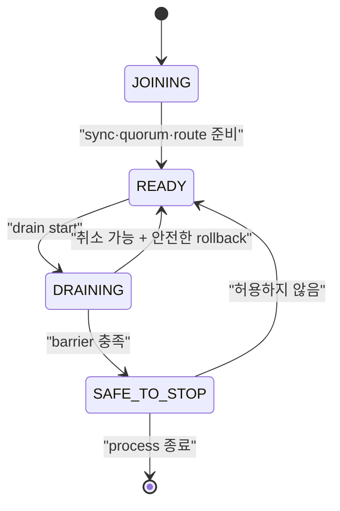

# Drain과 rolling update 스펙

이 문서는 node를 계획적으로 교체할 때 신규 연결을 차단하고 session을 인계한 뒤, 외부 controller가 Pod 삭제를 승인할 수 있는 조건을 정의한다. Kubernetes `preStop`은 최후 방어선이며 승인 gate가 아니다.

| 항목 | 값 |
| --- | --- |
| 상태 | Draft |
| 관련 요구사항 | DEP-01~DEP-24, CLIENT-01~CLIENT-09, CLU-11 |
| 근거 | [PRD 9.7절과 10장](../requirements/PRD.md), [Kubernetes Container Lifecycle Hooks](https://kubernetes.io/docs/concepts/containers/container-lifecycle-hooks/), [OASIS MQTT 5.0 Server redirection](https://docs.oasis-open.org/mqtt/mqtt/v5.0/mqtt-v5.0.html#_Toc3901255) |
| 관련 Architecture | [Cluster architecture](../architectures/cluster-architecture.md), [EKS on EC2 deployment](../architectures/eks-ec2-deployment.md) |
| 관련 결정 | [ADR-0004](../decisions/ADR-0004-session-ownership-and-fencing.md), [ADR-0006](../decisions/ADR-0006-external-rollout-controller.md), [ADR-0007](../decisions/ADR-0007-aws-production-deployment-platform.md) |
| 관련 Contract | [Management API v1](../contracts/management-api-v1.md), [MQTT client compatibility v1](../contracts/mqtt-client-compatibility-v1.md), [Cluster release compatibility v1](../contracts/cluster-release-compatibility-v1.md) |
| 해설 | [안전한 노드 drain과 Will](../explainers/safe-node-drain-and-will.md), [EKS 고가용성과 장애 도메인](../explainers/eks-ha-failure-domains.md), [AWS NLB와 MQTT 연결 lifecycle](../explainers/aws-nlb-mqtt-connection-lifecycle.md) |

## 1. Node lifecycle



| State | 신규 MQTT 연결 | 기존 연결 | Readiness | 종료 허용 |
| --- | --- | --- | --- | --- |
| `JOINING` | 거절 | 없음 | 실패 | 아니오 |
| `READY` | 허용 | 처리 | 성공 | 아니오 |
| `DRAINING` | 거절 | rate 제한 아래 인계 | 실패 | 아니오 |
| `SAFE_TO_STOP` | 거절 | 0 | 실패 | 외부 gate가 승인할 수 있음 |

정의하지 않은 상태 전이는 `409 invalid_node_transition`으로 거절하고 현재 state를 반환해야 한다. 모든 전이는 Metric과 구조화 로그에 남겨야 한다.

## 2. Drain operation resource

### 2.1 시작

`POST /api/v1/nodes/{nodeId}/drain`

```json
{
  "serverReference": "mqtt.example.internal:8883",
  "connectionRatePerSecond": 100,
  "loadBalancerPropagationDelayMs": 15000,
  "timeoutMs": 600000
}
```

위 수치는 schema 예시일 뿐 제품 기본값이 아니다. 실제 값은 `SPEC-TBD-04`에서 확정한다. 누락 필드에는 배포 profile이 명시한 값을 적용해야 한다.

READY node에 처음 요청하면 `202 Accepted`와 operation을 반환해야 한다. 이미 DRAINING 또는 SAFE_TO_STOP이면 새 operation을 만들지 않고 현재 operation을 반환해야 한다. 요청 node가 없으면 `404`, quorum 또는 precondition이 부족하면 `503` 또는 `409`를 반환해야 한다.

### 2.2 조회

`GET /api/v1/nodes/{nodeId}/drain`

```json
{
  "data": {
    "operationId": "opaque-operation-id",
    "nodeId": "opaque-node-id",
    "state": "DRAINING",
    "phase": "TRANSFERRING_SESSIONS",
    "startedAt": "2026-08-16T00:00:00Z",
    "deadlineAt": "2026-08-16T00:10:00Z",
    "connections": { "initial": 12000, "remaining": 420 },
    "sessions": { "checkpointed": 11580, "takenOver": 11560, "failed": 0 },
    "replication": { "pendingWal": 0, "underReplicated": 0 },
    "safeToStop": false,
    "failure": null
  }
}
```

`phase`는 최소 `EXCLUDING_TRAFFIC`, `WAITING_FOR_LB`, `CHECKPOINTING`, `TRANSFERRING_SESSIONS`, `VERIFYING_BARRIER`, `COMPLETED`, `FAILED`, `CANCELLED`를 구분해야 한다.

### 2.3 취소

`DELETE /api/v1/nodes/{nodeId}/drain`은 operation을 안전하게 취소할 수 있을 때 READY로 되돌려야 한다. SAFE_TO_STOP 이후에는 `409 drain_not_cancellable`을 반환해야 한다. 취소가 시작된 session takeover를 되돌리거나 epoch를 낮춰서는 안 된다. 새 readiness는 route와 replica 준비를 다시 확인한 뒤에만 성공해야 한다.

## 3. Drain 실행 순서

1. node state를 quorum에 `DRAINING`으로 commit한다.
2. 신규 connection admission을 닫고 readiness를 실패로 바꾼다.
3. configured load balancer propagation delay 동안 기존 connection은 유지한다.
4. connection rate limit 안에서 session checkpoint와 client reconnect를 유도한다.
5. 각 persistent session의 inflight, subscription, offline queue와 owner epoch를 quorum에 반영한다.
6. 새 owner의 더 큰 epoch와 session takeover를 확인한다.
7. safe-to-stop barrier를 평가한다.
8. barrier가 성공하면 `SAFE_TO_STOP`을 commit하고 external rollout gate에 노출한다.

Timeout은 operation을 `FAILED`로 만들 뿐 Pod 삭제를 승인하지 않는다. 실패한 node는 readiness가 내려간 DRAINING에 남아야 하며 operator가 원인을 해결하거나 명시적으로 취소해야 한다.

## 4. Client connection 인계

| Client | Server 동작 | Client 의무 | Will 기대 |
| --- | --- | --- | --- |
| MQTT 5, Server Reference 지원 | session checkpoint 뒤 `DISCONNECT 0x9C`와 Server Reference 전송 | 같은 tenant·clientId로 임시 endpoint 또는 공통 LB에 재접속 | 충분한 Will Delay 안에 재접속하면 억제 |
| MQTT 5, Server Reference 미지원 | `0x9C`와 configured 공통 endpoint를 제공하거나 연결 종료 | 공통 LB 재접속, backoff+jitter | Will Delay 계약에 따름 |
| MQTT 3.1.1 | checkpoint 뒤 connection 종료 | 공통 LB에 같은 session key로 재접속 | Will이 설정돼 있으면 표준에 따라 발행될 수 있음 |
| 협력형 client | 서버 신호 뒤 client가 정상 DISCONNECT하도록 별도 application 협력 | 정상 DISCONNECT 후 재접속 | 정상 DISCONNECT면 억제 |

`0x9C`는 임시 이동이다. 영구 endpoint 변경을 뜻하는 `0x9D`로 바꿔 보내서는 안 된다. Server Reference 형식은 지원 SDK compatibility matrix에서 고정해야 한다.

공식 지원 client는 persistent session, 충분한 Session Expiry, exponential backoff+jitter와 동일 session key를 사용해야 한다. PUBACK/PUBCOMP 전 outbound publish는 local outbox에 보관하고 QoS 1 consumer는 중복을 견뎌야 한다.

## 5. Will 판정과 관측

계획 drain에서 Will은 다음 reason으로 분류해야 한다.

| reason | 의미 |
| --- | --- |
| `suppressed_normal_disconnect` | client가 정상 DISCONNECT를 보냄 |
| `suppressed_reconnected_within_delay` | MQTT 5 client가 Will Delay 안에 session 재개 |
| `expected_mqtt311_server_disconnect` | MQTT 3.1.1 server 주도 종료로 표준상 발행 가능 |
| `expected_zero_or_expired_will_delay` | Will Delay가 0이거나 재접속 전에 만료 |
| `unexpected_supported_client` | CLIENT-01~CLIENT-09 계약을 충족했지만 계획 drain 때문에 예상 밖 발행 |
| `unplanned_failure` | crash, network loss 등 계획되지 않은 종료 |

release gate에서 0을 요구하는 값은 `unexpected_supported_client`다. 예상 Will을 전체 성공률에 섞어 숨기거나 예상 Will을 제품 결함으로 오분류해서는 안 된다.

## 6. Safe-to-stop barrier

다음 조건을 모두 충족해야 `SAFE_TO_STOP`이 된다.

- 신규 connection admission이 닫혀 있고 readiness가 실패한다.
- 활성 MQTT connection이 0이다.
- 이 node가 현재 epoch owner인 session이 0이다.
- checkpoint 대상 persistent session과 QoS inflight가 configured quorum에 commit됐다.
- committed but unapplied WAL과 필수 replication backlog가 허용 기준 안이다.
- 필요한 replica 수와 cluster quorum이 node 종료 뒤에도 유지된다.
- 진행 중인 local mutation이 없고 새 owner takeover 확인이 끝났다.
- state와 barrier evidence가 node-local memory가 아니라 복구 가능한 위치에 기록됐다.

Barrier 항목 하나라도 `unknown`이면 실패로 판정해야 한다. `unknown`을 0이나 성공으로 취급해서는 안 된다.

## 7. External rollout gate와 Kubernetes/EKS

Rollout controller는 Pod 삭제 전에 drain을 시작하고 `SAFE_TO_STOP`을 확인해야 한다. 실패·timeout이면 현재 Pod와 다음 Pod의 교체를 중단해야 한다. 기준 3-AZ profile에서는 계획 중단을 한 번에 한 node로 제한해야 한다.

`preStop` hook은 다음만 수행한다.

1. 같은 node의 drain을 idempotent하게 시작하거나 현재 상태를 조회한다.
2. 남은 grace period 안에서 가능한 범위까지 기다린다.
3. 결과와 failure reason을 기록한다.

Kubernetes의 termination grace period는 `preStop` 실행 전에 계산이 시작된다. hook 실패나 장기 실행이 Pod 삭제를 영구 차단한다고 가정해서는 안 된다. `terminationGracePeriodSeconds`는 LB 대기, drain 최악 시간, hook overhead와 SIGTERM 뒤 정상 종료 시간을 합친 값 이상이어야 하며, 검증되지 않은 짧은 값은 배포 admission에서 거절해야 한다.

배포 template은 PodDisruptionBudget, required anti-affinity, topology spread와 max unavailable 1을 제공해야 한다. 기준 3-AZ profile은 quorum node를 AZ마다 하나씩 배치해야 한다.

### 7.1 AWS deployment profile

초기 production 기준인 `EKS_EC2_HA`는 다음 조건을 충족해야 한다.

- 지원 EKS와 Kubernetes minor version을 release artifact에 고정한다.
- EC2 기반 node group의 서로 다른 세 가용 영역에 quorum Pod를 하나씩 배치한다.
- 각 quorum Pod는 다른 Pod와 공유하지 않는 Amazon EBS CSI persistent volume을 사용한다.
- EBS encryption, AZ binding, snapshot·restore와 disk pressure 실패 결과를 검증한다.
- Amazon NLB TCP/TLS target은 readiness 실패 뒤 신규 connection을 제외해야 한다.
- NLB deregistration delay, connection termination, TCP idle timeout, client IP preservation 또는 Proxy Protocol 정책을 명시한다.
- NLB 설정 전파 중 유입될 수 있는 신규 connection을 drain의 load balancer propagation 단계가 흡수해야 한다.

`EKS_FARGATE`, `ECS_EC2`, `COMPOSE_LOCAL`과 단일 host의 다중 container 결과는 `EKS_EC2_HA` 수용 시험을 대신해서는 안 된다.

배포 profile의 선택 근거는 [ADR-0007](../decisions/ADR-0007-aws-production-deployment-platform.md)을 따른다. Pod·EC2·가용 영역·EBS의 장애 범위는 [EKS 고가용성과 장애 도메인](../explainers/eks-ha-failure-domains.md), NLB target과 established connection의 서로 다른 lifecycle은 [AWS NLB와 MQTT 연결 lifecycle](../explainers/aws-nlb-mqtt-connection-lifecycle.md)을 참고한다.

Amazon ECS on EC2를 지원하려면 Kubernetes rollout controller와 별개인 lifecycle adapter가 필요하다. Adapter는 ECS Task Scale-in Protection을 설정한 상태에서 NLB target 제외와 NaruMQ drain을 시작하고, `SAFE_TO_STOP` 뒤에만 protection을 해제해야 한다. Task ARN, IP와 container name을 영구 `nodeId`로 사용해서는 안 된다. 이 흐름과 storage·discovery·강제 종료 시험을 모두 통과하기 전 ECS profile은 `Experimental`이어야 한다.

## 8. 비정상 종료

Crash 또는 host loss에서는 drain과 safe-to-stop barrier가 실행되지 않을 수 있다. Remaining node는 cluster spec에 따라 새 epoch를 획득하고 persistent session을 복구해야 한다. 이를 계획 drain 성공으로 기록해서는 안 되며 `unplanned_failure`로 관측해야 한다.

## 9. 수용 시험

- 최대 예상 traffic에서 연속 100회 rolling update를 수행한다.
- MQTT 3.1.1/5.0, QoS 0/1/2, retained, Will과 persistent session을 섞어 시험한다.
- 매 payload의 단조 증가 ID로 gap, duplicate와 reorder를 분리 측정한다.
- drain timeout·failure 때 controller가 Pod 삭제와 다음 node 진행을 요청하지 않는지 검증한다.
- preStop 중복 호출, hook 실패와 grace period 부족을 시험한다.
- 새 owner takeover 뒤 이전 owner의 stale write가 거절되는지 확인한다.
- 지원 client의 `unexpected_supported_client` Will이 0인지 검증한다.
- N-1↔N upgrade와 rollback에서 같은 barrier를 통과하는지 확인한다.
- `EKS_EC2_HA`에서 Pod·EC2 node·단일 AZ failure, EBS detach·reattach와 NLB deregistration을 시험한다.
- 배포 artifact가 profile 상태를 표시하고 미지원 profile의 결과를 production 출시 근거에서 제외하는지 검증한다.
- ECS adapter가 도입되면 protected task 때문에 막힌 deployment, protection 만료, direct task stop과 host loss를 별도 실패로 시험한다.
