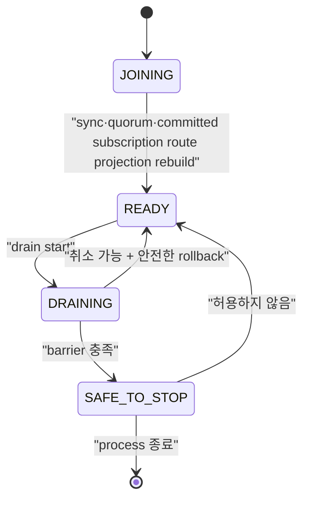

# Drain과 rolling update 스펙

이 문서는 node를 계획적으로 교체할 때 신규 연결을 차단하고 session을 인계한 뒤, 외부 controller가 Pod 삭제를 승인할 수 있는 조건을 정의한다. Kubernetes `preStop`은 최후 방어선이며 승인 gate가 아니다.

| 항목 | 값 |
| --- | --- |
| 상태 | Active (broker-side drain/`SAFE_TO_STOP` 범위만; external rollout과 전체 호환성 gate는 Draft) |
| 관련 요구사항 | DEP-01~DEP-24, CLIENT-01~CLIENT-09, CLU-11 |
| 근거 | [PRD 9.7절과 10장](../requirements/PRD.md), [Kubernetes Container Lifecycle Hooks](https://kubernetes.io/docs/concepts/containers/container-lifecycle-hooks/), [OASIS MQTT 5.0 Server redirection](https://docs.oasis-open.org/mqtt/mqtt/v5.0/mqtt-v5.0.html#_Toc3901255) |
| 관련 Architecture | [Cluster architecture](../architectures/cluster-architecture.md), [EKS on EC2 deployment](../architectures/eks-ec2-deployment.md) |
| 관련 결정 | [ADR-0004](../decisions/ADR-0004-session-ownership-and-fencing.md), [ADR-0006](../decisions/ADR-0006-external-rollout-controller.md), [ADR-0007](../decisions/ADR-0007-aws-production-deployment-platform.md), [ADR-0016](../decisions/ADR-0016-node-drain-and-safe-to-stop.md) (broker-side 범위만), [ADR-0051](../decisions/ADR-0051-cluster-update-strategy.md), [ADR-0055](../decisions/ADR-0055-drain-and-reconnect-operating-defaults.md) |
| 관련 Contract | [Management API v1](../contracts/management-api-v1.md), [MQTT client compatibility v1](../contracts/mqtt-client-compatibility-v1.md), [Cluster release compatibility v1](../contracts/cluster-release-compatibility-v1.md) |
| 해설 | [안전한 노드 drain과 Will](../explainers/safe-node-drain-and-will.md), [EKS 고가용성과 장애 도메인](../explainers/eks-ha-failure-domains.md), [AWS NLB와 MQTT 연결 lifecycle](../explainers/aws-nlb-mqtt-connection-lifecycle.md) |

## 1. Node lifecycle



| State | 신규 MQTT 연결 | 기존 연결 | Readiness | 종료 허용 |
| --- | --- | --- | --- | --- |
| `JOINING` | 거절 | 없음 | 실패 | 아니오 |
| `READY` | 허용 | 처리 | 성공 | 아니오 |
| `DRAINING` | 거절 | rate 제한 아래 인계 | 실패 | 아니오 |
| `SAFE_TO_STOP` | 거절 | 0 | 실패 | 외부 gate가 승인할 수 있음 |

정의하지 않은 상태 전이는 `409 invalid_node_transition`으로 거절하고 현재 state를 반환해야 한다. 모든 전이는 Metric과 구조화 로그에 남겨야 한다.

`-cluster-config` runtime은 committed voter를 대상으로 drain operation을 복제하고, 신규 MQTT CONNECT를 차단하며, 설정된 LB 전파 대기 뒤 rate 제한 ownership 인계를 수행한다. 모든 barrier를 통과하면 `SAFE_TO_STOP`을 replicated state에 commit하고 readiness는 실패로 유지한다. 이 broker 동작은 standalone mode에 제공되지 않는다. QoS 1/2 progress는 protocol wire effect보다 먼저 개별 replicated transition으로 commit되며 별도 replace-all checkpoint는 없다. External rollout controller, Kubernetes/EKS `preStop`, BP-07 및 N-1↔N은 별도 scope다.

Recovering 또는 joining node는 committed persistent subscription에서 node-local route projection을 rebuild하고 local sync·quorum 조건을 충족한 뒤에만 `READY`를 광고할 수 있다.

## 2. Drain operation resource

### 2.1 시작

`POST /api/v1/nodes/{nodeId}/drain`

```json
{
  "serverReference": "mqtt.example.internal:8883",
  "connectionRatePerSecond": 100,
  "loadBalancerPropagationDelayMillis": 15000,
  "timeoutMillis": 600000
}
```

`connectionRatePerSecond`, `loadBalancerPropagationDelayMillis`, `timeoutMillis`는 선택 field다. 생략하면 [ADR-0055](../decisions/ADR-0055-drain-and-reconnect-operating-defaults.md)의 기본값 `100`, `30000`, `600000`을 적용한다. 허용 범위는 각각 `1..10000`, `0..3600000`, `1000..86400000`이며 기본값 적용 뒤 timeout은 LB 전파 대기보다 커야 한다. Idempotency 비교는 기본값을 채운 뒤의 값으로 한다. `serverReference`는 선택이고 최대 256 UTF-8 bytes이며 제어 문자를 허용하지 않는다. 누락·범위 위반·잘못된 reference는 `400 invalid_request`다.

POST와 DELETE는 `Operator`, GET은 `ReadOnly` role을 요구하며 POST와 DELETE는 `Idempotency-Key`를 요구한다. 요청 대상은 cluster에 committed voter여야 한다. Active drain은 같은 node에서 새 operation을 만들지 않고 현재 committed operation을 반환한다. 최초 POST는 `202 Accepted`, 현재 operation replay는 `200 OK`다. 같은 key에 다른 parameter를 쓰면 `409 idempotency_conflict`; 다른 node drain이 이미 active이면 `409 node_drain_in_progress`다. 없는 node는 `404`, quorum을 확보할 수 없으면 `503`이다.

Rebalance operation이 `RUNNING`이면 drain 시작은 `409 connection_rebalance_in_progress`로 거절해야 한다. 이 오류는 retryable이다.

### 2.2 조회

`GET /api/v1/nodes/{nodeId}/drain`
요청은 fresh quorum read barrier를 통과한 committed 상태를 반환한다. Barrier를 확보하지 못하면 `503`이다.

```json
{
  "data": {
    "operationId": "550e8400-e29b-41d4-a716-446655440000",
    "nodeId": "3",
    "state": "DRAINING",
    "phase": "TRANSFERRING_SESSIONS",
    "startedAt": "2026-08-16T00:00:00Z",
    "deadlineAt": "2026-08-16T00:10:00Z",
    "connections": { "initial": 12000, "remaining": 420 },
    "sessions": { "stateReadyForTakeover": 11580, "takenOver": 11560, "failed": 0 },
    "replication": { "pendingWal": 0, "underReplicated": 0 },
    "safeToStop": false,
    "failure": null
  }
}
```

`phase`는 최소 `EXCLUDING_TRAFFIC`, `WAITING_FOR_LB`, `VERIFYING_SESSION_STATE`, `TRANSFERRING_SESSIONS`, `VERIFYING_BARRIER`, `COMPLETED`, `FAILED`, `CANCELLED`를 구분해야 한다. `failure`는 정상 진행 중 `null`이며 실패 시 `{ "code": string, "blockingReason": string | null }`이다. `safeToStop`은 `COMPLETED`에서만 true다.

### 2.3 취소

`DELETE /api/v1/nodes/{nodeId}/drain`은 `Operator`와 `Idempotency-Key`를 요구하며 operation을 안전하게 취소할 수 있을 때 `CANCELLED`로 commit해야 한다. 성공은 `200 OK`다. `SAFE_TO_STOP` 이후에는 `409 drain_not_cancellable`과 `details.state=SAFE_TO_STOP`을 반환해야 한다. 취소가 시작된 session takeover를 되돌리거나 epoch를 낮춰서는 안 된다. 새 readiness는 route와 replica 준비를 다시 확인한 뒤에만 성공해야 한다.

## 3. Drain 실행 순서

1. node state를 quorum에 `DRAINING`으로 commit한다.
2. 신규 connection admission을 닫고 readiness를 실패로 바꾼다.
3. configured load balancer propagation delay 동안 기존 connection은 유지한다.
4. connection rate limit 안에서 client reconnect와 session state takeover를 유도한다.
5. Successor의 더 큰 epoch `Acquire`가 commit되기 전에 committed persistent subscription과 QoS delivery state가 successor에서 복구 가능한지 확인한다. QoS state는 각 protocol transition에서 이미 commit됐으므로 별도의 최종 checkpoint mutation을 제안하지 않는다.
6. Successor의 더 큰 epoch session takeover commit을 확인한다.
7. safe-to-stop barrier를 평가한다.
8. barrier가 성공하면 `SAFE_TO_STOP`을 commit하고 external rollout gate에 노출한다.

Successor `Acquire` 뒤 그보다 늦게 committed ordering된 old owner의 route-affecting subscription 또는 inflight command는 exact owner/epoch check에서 거절되고 authoritative aggregate와 route projection을 바꾸지 않는다. Command 도착 시각이나 locally cached route는 이 결과를 우회할 수 없다.

Timeout은 operation을 `FAILED`로 만들 뿐 Pod 삭제를 승인하지 않는다. 실패한 node는 readiness가 내려간 DRAINING에 남아야 하며 operator가 원인을 해결하거나 명시적으로 취소해야 한다.

## 4. Client connection 인계

| Client | Server 동작 | Client 의무 | Will 기대 |
| --- | --- | --- | --- |
| MQTT 5, Server Reference 지원 | session state가 successor에서 복구 가능한 뒤 `DISCONNECT 0x9C`와 Server Reference 전송 | 같은 tenant·clientId로 임시 endpoint 또는 공통 LB에 재접속 | 충분한 Will Delay 안에 재접속하면 억제 |
| MQTT 5, Server Reference 미지원 | `0x9C`와 configured 공통 endpoint를 제공하거나 연결 종료 | 공통 LB 재접속, backoff+jitter | Will Delay 계약에 따름 |
| MQTT 3.1.1 | committed session state를 보존한 뒤 connection 종료 | 공통 LB에 같은 session key로 재접속 | Will이 설정돼 있으면 서버 종료로 발행한다(`expected_mqtt311_server_disconnect`) |
| 협력형 client | 서버 신호 뒤 client가 정상 DISCONNECT하도록 별도 application 협력 | 정상 DISCONNECT 후 재접속 | 정상 DISCONNECT면 억제 |

`0x9C`는 임시 이동이다. 영구 endpoint 변경을 뜻하는 `0x9D`로 바꿔 보내서는 안 된다. Server Reference 형식은 지원 SDK compatibility matrix에서 고정해야 한다.

공식 지원 client는 persistent session, 충분한 Session Expiry, exponential backoff+jitter와 동일 session key를 사용해야 한다. PUBACK/PUBCOMP 전 outbound publish는 local outbox에 보관하고 QoS 1 consumer는 중복을 견뎌야 한다.

## 5. Will 판정과 관측

`narumq_will_outcomes_total{reason}`은 Will의 최종 결과를 아래 6개 사유로 집계한다. [ADR-0028](../decisions/ADR-0028-planned-handoff-will-and-reason-metric.md)을 따른다.

| 상황 | 집계 node | reason |
| --- | --- | --- |
| 정상 `DISCONNECT 0x00`, pending Will 있음, metadata commit 성공 또는 local-only | owner | `suppressed_normal_disconnect` |
| 같은 node 재접속이 예약 Will 취소, superseded 정보 없음 | 재접속 node | `suppressed_reconnected_within_delay` |
| Acquire가 예약 Will 또는 계획 인계 MQTT 5 delay>0 persistent Will을 대체 | 재접속 node | `suppressed_reconnected_within_delay` |
| 계획 인계 MQTT 3.1.1 즉시 발행 | 후계 또는 재접속 node | `expected_mqtt311_server_disconnect` |
| 계획 인계 MQTT 5 delay 0 또는 retention `IMMEDIATE` 즉시 발행 | 후계 또는 재접속 node | `expected_zero_or_expired_will_delay` |
| 계획 인계 예약 Will을 timer·expiry로 발행 | 예약 node | `expected_zero_or_expired_will_delay` |
| 계획 인계 MQTT 5 delay>0·retention≠`IMMEDIATE`인데 즉시 발행 | 후계 node | `unexpected_supported_client` |
| 비정상 close·keepalive·owner crash recovery 또는 복원한 예약 Will 발행 | 발행 node | `unplanned_failure` |

계획 인계는 서버가 시작한 비정상 종료다. MQTT 3.1.1, Will Delay 0 또는 retention `IMMEDIATE`이면 즉시 claim·발행한다. 나머지는 후계 recovery 시각부터 Will Delay로 예약하며 session expiry로 제한한다. 이전 owner는 `DisconnectTakeover`로 local Will을 버리고 집계하지 않는다. Recovery 전 재접속도 committed ownership apply의 대체 결과로 같은 규칙을 적용한다.

Will 하나는 결과를 확정한 node에서 정확히 한 번 집계한다. Client `DISCONNECT 0x04`, takeover close, ACL 거절·metadata commit 실패로 발행하지 않은 Will은 집계하지 않는다. Feature 비활성 drain은 기존처럼 Will을 버리고 집계하지 않는다. 계획/비계획 출처는 복제하지 않으므로 재시작·detached 이전 뒤 복원한 예약 Will은 `unplanned_failure`다. Mixed N-1/N의 N-1 후계는 기존 억제를 유지한다.

Release gate는 `unexpected_supported_client`가 0이어야 한다. 이 사유는 위 표의 broker 규칙 위반만 탐지한다. Client 쪽 증거는 SDK drain suite로 확인한다. 예상 Will을 성공률에 섞어 숨기거나 제품 결함으로 오분류해서는 안 된다.

## 6. Safe-to-stop barrier

다음 조건을 모두 충족해야 `SAFE_TO_STOP`이 된다.

- 신규 connection admission이 닫혀 있고 readiness가 실패한다.
- 활성 MQTT connection이 0이다.
- 이 node가 현재 epoch owner인 session이 0이다.
- Persistent subscription과 QoS delivery transition은 commit된 상태이며, successor takeover 뒤 old owner의 추가 mutation이 epoch fencing으로 거절된다.
- committed but unapplied WAL과 필수 replication backlog가 허용 기준 안이다.
- 필요한 replica 수와 cluster quorum이 node 종료 뒤에도 유지된다.
- 진행 중인 local mutation이 없고 새 owner takeover 확인이 끝났다.
- state와 barrier evidence가 node-local memory가 아니라 복구 가능한 위치에 기록됐다.

Barrier 항목 하나라도 `unknown`이면 실패로 판정해야 한다. `unknown`을 0이나 성공으로 취급해서는 안 된다.
구현은 barrier 조건을 다음 안정된 blocker code로 노출한다.

| 확인 조건 | 실패 blocker |
| --- | --- |
| 신규 admission이 닫히지 않음 | `admission_open` |
| readiness가 이미 실패 상태가 아님 | `readiness_up` |
| 활성 connection 수가 0이 아님 또는 알 수 없음 | `connections_remaining` |
| local ownership session 수가 0이 아님 | `sessions_owned` |
| local persistent subscription 수가 0이 아님 | `orphan_subscription` |
| committed index와 applied index 사이에 WAL이 남음 | `pending_wal` |
| voting replica 또는 connected successor 수가 quorum에 부족 | `insufficient_replicas` |
| local node가 Raft leader임 | `local_leader` |
| local proposal이 진행 중임 | `pending_local_commit` |
| pending Will timer가 남음 | `pending_will` |
| successor voter가 아직 없거나 route projection이 준비되지 않음 | `no_successor_voter`, `route_projection_not_ready` |
| read barrier 또는 quorum을 확보하지 못함 | `quorum_unavailable` |

다음 barrier 재평가 전까지 blocker가 남으면 operation은 계속 대기한다. Deadline에 도달하면 `FAILED`와 `drain_timeout`을 commit하고 마지막 blocker를 기록한다.

## 7. External rollout gate와 Kubernetes/EKS

Rollout controller는 Pod 삭제 전에 drain을 시작하고 `SAFE_TO_STOP`을 확인해야 한다. 실패·timeout이면 현재 Pod와 다음 Pod의 교체를 중단해야 한다. 기준 3-AZ profile에서는 계획 중단을 한 번에 한 node로 제한해야 한다.

`preStop` hook은 다음만 수행한다.

1. 같은 node의 drain을 idempotent하게 시작하거나 현재 상태를 조회한다.
2. 남은 grace period 안에서 가능한 범위까지 기다린다.
3. 결과와 failure reason을 기록한다.

Kubernetes의 termination grace period는 `preStop` 실행 전에 계산이 시작된다. hook 실패나 장기 실행이 Pod 삭제를 영구 차단한다고 가정해서는 안 된다. `terminationGracePeriodSeconds`는 LB 대기, drain 최악 시간, hook overhead와 SIGTERM 뒤 정상 종료 시간을 합친 값 이상이어야 하며, 검증되지 않은 짧은 값은 배포 admission에서 거절해야 한다.

`terminationGracePeriodSeconds ≥ ceil(timeoutMillis/1000) + 30 + 30`이어야 한다. 기본 drain 값으로는 660초다. 두 30초 값은 측정 전 예산이며 실측은 [TODO §1.4](../TODO.md#14-drain-정책관측과-production-배포)에서 추적한다.

배포 template은 PodDisruptionBudget, required anti-affinity, topology spread와 max unavailable 1을 제공해야 한다. 기준 3-AZ profile은 quorum node를 AZ마다 하나씩 배치해야 한다.

### 7.1 AWS deployment profile

초기 production 기준인 `EKS_EC2_HA`는 다음 조건을 충족해야 한다.

- 지원 EKS와 Kubernetes minor version을 release artifact에 고정한다.
- EC2 기반 node group의 서로 다른 세 가용 영역에 quorum Pod를 하나씩 배치한다.
- 각 quorum Pod는 다른 Pod와 공유하지 않는 Amazon EBS CSI persistent volume을 사용한다.
- EBS encryption, AZ binding, snapshot·restore와 disk pressure 실패 결과를 검증한다.
- Amazon NLB TCP/TLS target은 readiness 실패 뒤 신규 connection을 제외해야 한다.
- NLB deregistration delay, connection termination, TCP idle timeout, client IP preservation 또는 Proxy Protocol 정책을 명시한다.
- NLB 설정 전파 중 유입될 수 있는 신규 connection을 drain의 load balancer propagation 단계가 흡수해야 한다.
- Worker architecture와 AMI를 release artifact에 고정한다. Production broker image를 선택한 architecture로 빌드·게시하고 immutable digest를 고정한다. Broker, controller와 필수 add-on image는 선택한 architecture를 지원해야 한다.

`EKS_FARGATE`, `ECS_EC2`, `COMPOSE_LOCAL`과 단일 host의 다중 container 결과는 `EKS_EC2_HA` 수용 시험을 대신해서는 안 된다.

배포 profile의 선택 근거는 [ADR-0007](../decisions/ADR-0007-aws-production-deployment-platform.md)을 따른다. Pod·EC2·가용 영역·EBS의 장애 범위는 [EKS 고가용성과 장애 도메인](../explainers/eks-ha-failure-domains.md), NLB target과 established connection의 서로 다른 lifecycle은 [AWS NLB와 MQTT 연결 lifecycle](../explainers/aws-nlb-mqtt-connection-lifecycle.md)을 참고한다.

Amazon ECS on EC2를 지원하려면 Kubernetes rollout controller와 별개인 lifecycle adapter가 필요하다. Adapter는 ECS Task Scale-in Protection을 설정한 상태에서 NLB target 제외와 NaruMQ drain을 시작하고, `SAFE_TO_STOP` 뒤에만 protection을 해제해야 한다. Task ARN, IP와 container name을 영구 `nodeId`로 사용해서는 안 된다. 이 흐름과 storage·discovery·강제 종료 시험을 모두 통과하기 전 ECS profile은 `Experimental`이어야 한다.

### 7.2 업데이트 방식과 환경별 선택

계획 업데이트는 [ADR-0051](../decisions/ADR-0051-cluster-update-strategy.md)에 따라 한 번에 한 node씩 진행해야 한다. 새 클러스터로 전환하는 Blue/Green은 지원하지 않는다.

#### In-place 교체

1. 대상 node의 drain을 시작한다.
2. `SAFE_TO_STOP`을 확인한다.
3. 프로세스를 종료한다.
4. 같은 `nodeId`, cluster config, 데이터 디렉터리로 새 release를 시작한다.
5. `/health/ready` 성공을 확인한 뒤 다음 node로 진행한다.

재시작 node는 READY 전에 WAL·snapshot replay → log catch-up → `MemberProfileChange` commit → route projection 재구축 → drain `CLEAR` 순서로 진행한다([ADR-0018](../decisions/ADR-0018-release-compatibility-window.md)).

#### 교체형 교체

1. Committed voter가 정확히 3개인지 확인한다.
2. 새 release node를 새 `nodeId`와 빈 데이터 디렉터리로 stage·join·promotion한다. [동적 멤버십 절차](../how-to/dynamic-cluster-membership.md)를 따른다.
3. 기존 node의 drain을 시작하고 `SAFE_TO_STOP`을 확인한다.
4. 기존 node를 planned removal로 제거한다.
5. Voter가 3개로 돌아오고 모든 node가 READY인지 확인한 뒤 다음 node로 진행한다.

교체형 조합은 세 차례 모두 node를 바꾸는 local 3-node process 수용 시험으로 확인했다. 각 batch는 QoS 1·2 topic마다 3개 메시지를 보낸다. 이 증거는 production storage, Kubernetes·ECS 배포 profile과 N-1↔N 혼합 교체를 대신하지 않는다([§10](#10-broker-drain-수용-시험-매핑)).

| 환경 | 데이터 디렉터리 재연결 | 사용할 방식 |
| --- | --- | --- |
| VM(같은 디스크 유지) | 가능 | In-place. Host 교체 시 교체형 |
| Docker Compose named volume(개발·시험 전용, production 미지원) | 가능 | In-place |
| EKS StatefulSet PVC(`EKS_EC2_HA`) | 가능 | In-place. Node·AZ·volume 교체 시 교체형 |
| ECS 서비스 관리 EBS | 불가(task마다 새 volume, task 종료 시 삭제) | 교체형만 |
| ECS on EC2 호스트 디스크 | 인스턴스를 유지하면 가능 | In-place. 인스턴스 교체 시 교체형 |

두 방식 모두 N/N-1 release window 안에서만 혼합 운영한다. 새 feature activation은 모든 node를 교체한 뒤에만 한다. Activation 전 rollback은 같은 방식으로 N-1 release를 다시 배포한다.

## 8. 비정상 종료

Process crash 또는 host loss에서는 planned drain과 barrier가 실행되지 않을 수 있다. 남은 node는 cluster spec에 따라 새 epoch를 획득하고 persistent session을 복구해야 한다. 이를 계획 drain 성공으로 기록해서는 안 되며 `unplanned_failure`로 관측해야 한다. `COMPLETED` record를 재생한 node는 admission을 닫은 채 유지하고 bounded readiness preflight를 통과한 뒤 replicated `CLEAR`를 commit해야 한다. Preflight 또는 commit에 실패하면 재시도하며, `CLEAR` apply 뒤에만 admission을 다시 연다.

## 9. 수용 시험

- 최대 예상 traffic에서 연속 100회 rolling update를 수행한다.
- MQTT 3.1.1/5.0, QoS 0/1/2, retained, Will과 persistent session을 섞어 시험한다.
- 매 payload의 단조 증가 ID로 gap, duplicate와 reorder를 분리 측정한다.
- drain timeout·failure 때 controller가 Pod 삭제와 다음 node 진행을 요청하지 않는지 검증한다.
- preStop 중복 호출, hook 실패와 grace period 부족을 시험한다.
- 새 owner takeover 뒤 이전 owner의 stale write가 거절되는지 확인한다.
- 지원 client의 `unexpected_supported_client` Will이 0인지 검증한다.
- N-1↔N upgrade와 rollback에서 같은 barrier를 통과하는지 확인한다.
- `EKS_EC2_HA`에서 Pod·EC2 node·단일 AZ failure, EBS detach·reattach와 NLB deregistration을 시험한다.
- 배포 artifact가 profile 상태를 표시하고 미지원 profile의 결과를 production 출시 근거에서 제외하는지 검증한다.
- ECS adapter가 도입되면 protected task 때문에 막힌 deployment, protection 만료, direct task stop과 host loss를 별도 실패로 시험한다.

## 10. Broker drain 수용 시험 매핑

아래 evidence는 dynamic cluster의 broker-side drain과 `SAFE_TO_STOP`, 시험 전용 SDK drain 호환성, 그리고 local Kind controller lifecycle acceptance를 검증한다. Release-wide rollout이나 production storage 승인으로 확대 해석하지 않는다.

| Scenario | Acceptance test | 실행 증거 |
| --- | --- | --- |
| Local real-controller rollout (DEP-11/DEP-18/SEC-11) | `TestRolloutControllerKindLifecycle`: controller가 실제 Go broker 3-process `OnDelete` StatefulSet을 Management API committed-voter profile로 preflight하고 OCI manifest/config labels, version/features, UID/RV, persisted complete drain barrier, durable audit를 검증한다. | **2026-10-15 PASS**: `NARUMQ_ROLLOUT_KIND_SMOKE=1 NARUMQ_ROLLOUT_REGISTRY=172.20.0.3:5000 NARUMQ_ROLLOUT_HOST_REGISTRY=http://127.0.0.1:5001 NARUMQ_ROLLOUT_OLD_DIGEST=sha256:dd44acdabea4188939ef08e84a5537ed7b7c1812f62a7ccc33935d16c26e0c2b NARUMQ_ROLLOUT_TARGET_DIGEST=sha256:cc6e480086f74a0233ffc52f88c62796accc346a03843bec6f8c78e25f4a195c NARUMQ_ROLLOUT_CONTROLLER_IMAGE=narumq-rollout-controller:local GOMAXPROCS=4 go test ./tests/integration -run '^TestRolloutControllerKindLifecycle$' -count=1 -v -timeout 15m`; test **243.53s**, package **248.487s**. Controller was restarted during active drain; the same broker `operationId` was observed afterward. Three broker Pod UIDs changed to target image IDs; the audit PVC contained a `rollout.pod.delete_approved` event with controller Pod UID producer identity; caller version `0.0.2` mismatch caused no Pod UID change. This `0.0.0`→`0.0.1` TEST-ONLY upgrade does not qualify published N/N-1, production B*, MQTT-13 90 days, independent assessor, EKS HA or NLB acceptance. |
| MQTT 5 persistent QoS 1과 MQTT 3.1.1 live/detached session이 있는 3-node drain | `TestDynamicClusterNodeDrainProcessAcceptance`: readiness·admission 차단, 기존 connection 유지, idempotent replay, `DISCONNECT 0x9C`/Server Reference, rate-limited transfer, `SAFE_TO_STOP`, session resume와 restart `CLEAR`를 확인한다. | `go test ./tests/integration -run '^TestDynamicClusterNodeDrain' -count=1 -v -timeout 20m` PASS; 이 case 9.75s. |
| Cancel, crash/restart, completed-record clear와 missing-replica timeout | `TestDynamicClusterNodeDrainCancelTimeoutAndResumeProcessAcceptance`: cancel 뒤 READY, 같은 operation 재개, missing successor에서 `drain_timeout/insufficient_replicas`, 취소 뒤 readiness를 확인한다. | 같은 process command PASS; 이 case 16.03s. Combined package 25.916s. |
| Domain·application·wire·HTTP·metrics와 OpenAPI contract | `internal/domain/nodedrain`, `internal/application/membership`, `internal/adapters/tcp`, `internal/adapters/http/management`, `internal/adapters/metrics`, `tests/contracts/management-api-v1` 등 focused unit/contract suite. | `go test ./internal/domain/nodedrain ./internal/domain/mqtt ./internal/application/membership ./internal/application/connect ./internal/adapters/raft/records ./internal/adapters/tcp ./internal/adapters/http/management ./internal/adapters/metrics ./tests/contracts/management-api-v1 ./cmd/narumq ./tools/verify -count=1` PASS. |
| Existing ownership, subscription replay와 removal regressions | `TestDynamicClusterMQTTConnectOwnershipTakeoverProcessAcceptance`, `TestDynamicClusterPersistentSubscriptionReplayProcessAcceptance`, `TestDynamicClusterMembershipRemovalHandoffWaitsForQuorum`. | Targeted integration command PASS; package 38.257s. |
| Prior full local verification record (historical; separate from the 2026-10-15 attempt below) | `GOMAXPROCS=4 go run ./tools/verify local` | PASS; 204.42s. This is the previously recorded run only, not the current attempt. |
| Full local verification attempt after rollout adapter/API changes (2026-10-15) | `GOMAXPROCS=4 go run ./tools/verify local` | **FAIL; 499.46s; not a full-local PASS.** Architecture and traceability passed (P0 71/81, 10 exceptions). Test output reported TEN-09 victim p99 ratio `1.517 > 1.5` and `internal/adapters/raft/TestNodeCloseFlushesHeldAppendOrReportsFailure/unconsumed-prior-error` failed in setup with Windows `compact WAL: replace WAL: Access is denied`. Targeted follow-ups: `GOMAXPROCS=4 go test ./internal/adapters/raft -run '^TestNodeCloseFlushesHeldAppendOrReportsFailure$/^unconsumed-prior-error$' -count=1 -v` PASS (subtest 0.03s, package 0.901s); `GOMAXPROCS=4 go test -race ./internal/adapters/raft -run '^TestNodeCloseFlushesHeldAppendOrReportsFailure$/^unconsumed-prior-error$' -count=1 -v` PASS (2.070s); `GOMAXPROCS=4 go test ./tests/integration -run '^TestDynamicClusterTenantNoisyNeighborProcessAcceptance$' -count=1 -v -timeout 10m` PASS (package 47.090s, p99 ratio 0.732). These isolated results support, but do not prove, load sensitivity/intermittency. The subtest PASS does not explain or resolve the aggregate race-child exit 1; its diagnostics remain unavailable. The full verifier remains FAIL. |
| NodeDrain core coverage ratchet | `go run ./tools/verify coverage --profile .artifacts/verification/coverage.out --policy tests/verification/coverage-policy.json --report .artifacts/verification/coverage-summary.json` | PASS; 100/102 executable lines (98.04%) and 13/13 functions (100%). |
| NodeDrain mutation gate | `go tool gremlins unleash --config=tests/verification/gremlins.yaml --output=.artifacts/verification/mutation-nodedrain.json internal/domain/nodedrain` | PASS; KILLED=64, LIVED=0, NOT_COVERED=0, efficacy=100%, mutant coverage=100%; 76s. |
| SDK callback adapter의 redirect·session resume·Will 억제 | `tests/compatibility/mqtt-clients-v1 --suite drain`: Paho Go MQTT 5 `v0.23.0`과 Python `2.1.0`이 test-only readiness LB의 node3에서 node2로 이동한다. 후속 QoS 1 전달, Will Delay 뒤 no-Will과 drain `SAFE_TO_STOP`을 확인한다. | `drain-paho-go-python-will-acl-final`의 cluster case 2/2 PASS. 재접속 Go 89ms, Python 약 99.071ms. 전체 suite 9/10이며 artifact는 `.artifacts/compatibility/mqtt-clients-v1/drain-paho-go-python-will-acl-final/`에 있다. |
| Malformed server DISCONNECT 4종과 configured endpoint fallback | 같은 drain suite의 SDK별 truncated·disallowed·duplicate·invalid-reference case. Main CONNECT 두 번, vector 한 번과 trap 접속 부재를 요구한다. Profile·결과·trace 경계는 `drain_profile_test.go`, `drain_result_test.go`, `drain_trace_test.go`로 검증한다. | Python 4/4 PASS, Go 3/4 PASS. `go-mqtt5-malformed-duplicate-server-reference`는 `serverReferenceAccepted=true`, `trap_accept=1`로 FAIL. `go test ./tests/compatibility/mqtt-clients-v1 -count=1` PASS. 판정 규칙은 [Client contract §6.2](../contracts/mqtt-client-compatibility-v1.md#62-drain-compatibility-suite)에 있다. |
| SDK drain 구현 뒤 전체 local 회귀 | `GOMAXPROCS=4 go run ./tools/verify local`, nested Go module의 `go vet ./... && go build ./...`, Phase 1 Docker suite | Local PASS(280.08s; integration 234.376s). Traceability·architecture·4개 fuzz target 각각 10,000회·전체 unit/integration·production package race·coverage PASS. Nested vet/build PASS. `phase1-drain-adapters-final` 26/26 PASS(132.67s). Local gate는 SDK Docker suite를 대신하지 않는다. |
| 계획 인계 domain·대체 Will·집계 규칙 | `TestLifecycle_TakeoverAndPlannedHandoffWillRules`, `TestApplyOwnershipReportsSupersededWill`, `TestWillOutcomeClassifiers`, `TestDisconnectRecordsWillOutcome`, `TestConnectSupersededWillOutcome`, `TestRecoverOwnedPreviousEpochAppliesPlannedHandoffWillRules`, `TestRegistryRendersWillOutcomes`, runtime recovery 및 기존 TCP 시험 | 2026-10-04 PASS: `go build ./...`를 각 구현 단계 뒤 통과했다. `go test ./internal/domain/session ./internal/application/membership ./internal/application/connect ./internal/adapters/metrics ./internal/adapters/tcp ./cmd/narumq -count=1` PASS(각 0.600/0.731/0.649/0.583/11.352/15.383s). |
| Session metadata 활성 3-node 연속 rolling의 표준 Will·사유 | `TestDynamicClusterDrainWillReasonProcessAcceptance`: node 3→1→2 drain, reference 재접속, session resume, observer 수신과 node restart를 확인한다. | 2026-10-04 PASS: `GOMAXPROCS=4 go test ./tests/integration -run '^TestDynamicClusterDrainWillReasonProcessAcceptance$' -count=1 -v -timeout 20m`; test 49.06s, package 49.253s. Observer는 v311·zero·expire payload만 받았다. Safe delay 8초 뒤와 normal Will 무수신을 확인했다. 아래 delta 표 참조. |
| ADR-0028 영향 process 회귀 | Drain·cancel/timeout/resume, session metadata owner crash, removal handoff quorum, QoS 2 Will, CONNECT ownership takeover | 2026-10-04 PASS: 아래 회귀 명령의 6개 시험 모두 통과했다. Package 39.569s; 각 drain 13.54s, cancel 24.11s, metadata 26.79s, removal 32.66s, QoS 2 Will 12.60s, takeover 9.49s. |
| ADR-0028 전체 local gate | `GOMAXPROCS=4 go run ./tools/verify local` | 2026-10-04 PASS; wall 298.08s, integration 243.252s. Gofmt·vet·traceability·architecture·전체 unit/integration·production race·4개 fuzz 각 10,000회·coverage PASS. Production line 86.07%, function 97.51% (`.artifacts/verification/coverage-summary.json`). 첫 실행은 새 domain 시험의 MQTT requirement metadata 누락으로 중단했으며 comment·compliance mapping을 고친 뒤 통과했다. |
| Recovery 전 재접속의 이전 Will ACL 재검사 | `TestConnectSupersededWillAuthorization`: 새 CONNECT에는 Will을 넣지 않는다. 이전 principal·Will topic이 허용되면 한 번 발행·집계한다. 이전 topic이 거절되거나 principal이 없으면 새 CONNECT는 성공하지만 이전 Will 발행·집계는 모두 없다. | 2026-10-04 PASS: `go test ./internal/application/connect -run '^TestConnectSupersededWillAuthorization$' -count=1 -v`의 3개 case 모두 PASS. 최초 package 0.422s; 새 CONNECT의 Will을 제거한 뒤에도 0.406s PASS. |
| ACL 경계 시험 추가 뒤 local gate | 위 focused 명령 뒤 `GOMAXPROCS=4 go run ./tools/verify local` | 2026-10-04 PASS; 두 명령 합계 wall 286.02s, integration 246.431s. Gofmt·vet·traceability·architecture·전체 unit/integration·production race·4개 fuzz 각 10,000회·coverage PASS. 이 실행의 production line 86.20%, function 97.51%. 아래 시험 입력·요구사항 연결 정리 전 실행이다. |
| ACL 시험 입력과 요구사항 연결 정리 | 새 CONNECT의 Will을 제거해 이전 Will의 ACL 검사만 확인한다. Traceability를 `SEC-06`, `MQTT-01/TEST-04`, `MQTT-3.1.2-8`에 연결하고 compliance matrix에 시험을 추가한다. | 2026-10-04 PASS: 위 focused 명령 뒤 `go run ./tools/verify traceability`; 3개 case와 traceability PASS, 두 명령 합계 wall 2.99s. 제품 코드는 바꾸지 않았으므로 전체 local gate는 다시 실행하지 않았다. |
| ADR-0051 교체형 3회 연속 교체 | `TestDynamicClusterReplacementRollingUpdateProcessAcceptance`: node 4·5·6 추가, node 1·2·3 drain·`SAFE_TO_STOP`·planned removal, MQTT 5/3.1.1 live와 3.1.1 offline session 복구, QoS 1/2 gap 0, QoS 2 duplicate 0, 최종 voter `{4,5,6}`을 확인한다. 각 batch는 topic별 3개 메시지를 보낸다. | **2026-10-10 PASS**. 처음 사용한 topic별 batch당 5개 workload는 offline session당 QoS 1·2 총 90개를 보내 `MaxDeliveryMessagesPerSession=64`를 넘었다. offline client는 각 topic에서 seq 33–45를 받지 못했다. 코드 대조 결과, `membership.StateMachine.enqueueDeliveryTargetsLocked`는 한도를 넘은 target을 `Saturated`로 반환한다. `publish.UseCase.completePublication`은 이를 publication error로 바꾸지 않는다. `tcp.connection.completeInboundPublish`는 publisher에 성공 ACK를 보낸 뒤 saturated target 연결을 닫는다. 따라서 첫 gap은 한도를 넘은 test workload와 일치하며, 교체 과정의 session 손실 증거는 아니다. 사용자는 batch당 topic별 3개로 줄이는 변경을 승인했다. 최종 workload는 offline session당 54개(각 topic 27개)이며 64개 한도 안에 있다. 단일 실행 `GOMAXPROCS=4 go test ./tests/integration -run '^TestDynamicClusterReplacementRollingUpdateProcessAcceptance$' -count=1 -v -timeout 20m` PASS; case 36.00s. 반복 `GOMAXPROCS=4 go test ./tests/integration -run '^TestDynamicClusterReplacementRollingUpdateProcessAcceptance$' -count=3 -v -timeout 45m` PASS; 세 case 36.08s, 32.12s, 31.74s. 각 실행에서 세 round가 로그에 나타났고, MQTT 5 live·MQTT 3.1.1 live·offline receiver의 QoS 1 duplicate는 모두 0이었다. 최종 offline session은 `SessionPresent=true`였고 gap은 없었다. 최종 voter는 `{4,5,6}`이었다. |
| 연속 100회 in-place rolling의 local workload 상한 | `TestDynamicClusterContinuousRollingDrainProcessAcceptance`: 실제 3-node에서 node 3→1→2 순서로 drain·`SAFE_TO_STOP`·재시작을 100회 수행한다. Round당 QoS 1/2 PUBLISH 24건(4 batch×topic당 3건), retained PUBLISH 1건, MQTT 5 safe Will과 MQTT 3.1.1 Will을 사용한다. | **2026-10-11 PASS**: `NARUMQ_ROLLING_100=1 GOMAXPROCS=4 go test ./tests/integration -run '^TestDynamicClusterContinuousRollingDrainProcessAcceptance$' -count=1 -v -timeout 3h`; test 1715.09s, package 1716.407s. QoS 1·2 topic별 1,200건, gap 0, QoS 1 duplicate 100, QoS 2 duplicate 0, reorder 0; retained 집합은 매 round 기대값과 일치했다. Will delta는 `suppressed_reconnected_within_delay=100`, `expected_mqtt311_server_disconnect=100`, `unexpected_supported_client=0`, `unplanned_failure=0`이었다. QoS 1 duplicate와 reorder는 기록 전용이다. 이 test-defined local workload는 production 최대 traffic이 아니다. QoS 0, controller 중단·실패, `preStop`, stale write, N-1↔N, `EKS_EC2_HA`는 이번 실행 범위에 없으며 TODO §1.2는 계속 `미검증`이다. |
| Fixture 확장과 repository gate | `TestDynamicClusterNodeConfigurationProcessAcceptance`, `GOMAXPROCS=4 go run ./tools/verify local`, `go run ./tools/verify markdown-links` | **2026-10-11 PASS**: `cluster_node_configuration_process_test.go`의 ACL 규칙 수 기대값 58은 새 fixture ACL 3개 뒤 61로 바꿨다. 집중 시험 PASS(6.97s). 첫 local 실행은 기존 58개 규칙 기대값 때문에 실패했다. 수정 뒤 local PASS(244.26s), traceability P0 71/81·exceptions 10. Markdown links PASS(156 files, 2,278 links). Windows/amd64, Go 1.26.5. |
| Acceptance harness와 repository gate | Fixture·PUBLISH decoder·node-drain regression, `go vet`, gofmt, traceability, Markdown link 검사, 전체 local verification | **2026-10-10 PASS**: fixture `TestDynamicClusterNodeDrainProcessAcceptance` 13.36s; `TestDynamicClusterCrossNodeDeliveryMatrixProcessAcceptance`와 `TestDynamicClusterNodeDrainProcessAcceptance` 회귀 PASS; `go vet ./tests/integration` PASS; `gofmt -l tests/integration` 출력 없음; traceability PASS(P0 69/81, exceptions 12); markdown-links PASS(152 files, 2,135 links); `GOMAXPROCS=4 go run ./tools/verify local` PASS(`local: PASS`, 190.49s). Windows/amd64, Go 1.26.5. 대상 commit `322cfe3a416a2435a17991855df4aa06d92ac24f`; 실행에 사용한 코드와 기록은 미커밋이었다. 작업 트리에는 `tests/integration/cluster_membership_process_test.go`, `cluster_delivery_matrix_process_test.go`, `cluster_replacement_update_process_test.go`, 이 문서, [ADR-0051](../decisions/ADR-0051-cluster-update-strategy.md), [TODO](../TODO.md)의 변경이 있었고 기존 사용자 변경 `docs/artifacts/mqtt-protocol-spec-code-explanation.html`도 남아 있었다. |
| ADR-0055 drain 기본값 | `TestDefaultParametersAreValid`, `TestNodeDrainHTTPAppliesProductDefaultsToOmittedFields`, `TestNodeDrainRequestDefaultsMatchDomain` | 2026-10-11 PASS: `go test ./internal/domain/nodedrain ./internal/adapters/http/management ./internal/application/membership ./tests/contracts/management-api-v1 -count=1` PASS(0.633s, 1.228s, 1.028s, 2.389s); 세 시험 전용 `-run` 실행 PASS(0.392s, 0.651s, 0.878s); `go build ./...` PASS. `GOMAXPROCS=4 go test ./tests/integration -run '^TestZZDrainDefaultsSmoke$' -count=1 -v -timeout 10m` PASS(7.72s). `GOMAXPROCS=4 go test ./tests/integration -run '^(TestDynamicClusterNodeDrainProcessAcceptance|TestDynamicClusterNodeDrainCancelTimeoutAndResumeProcessAcceptance)$' -count=1 -v -timeout 20m` PASS(13.61s, 18.91s). 첫 Bash local gate는 `TestDynamicClusterConnectionRebalanceProcessAcceptance`에서 Windows WAL replace `Access is denied`로 실패했다. 이 시험 단독 재실행 PASS(16.24s), Bash local 재실행 PASS(`local: PASS`, 263.74s). 계획에 따른 PowerShell `pwsh -NoProfile -Command '$env:GOMAXPROCS = "4"; Get-Date -Format yyyy-MM-dd; go run ./tools/verify local'` PASS(`local: PASS`, 270.95s; traceability P0 71/81, exceptions 10). PowerShell `pwsh -NoProfile -Command 'go run ./tools/verify markdown-links'` PASS(155 files, 2,263 local links). SDK Docker drain suite **미실행**: 계획상 이 suite는 test-only 값만 확인하므로 이번 변경 뒤 재실행하지 않았다. `tests/compatibility`에서 `session-metadata`를 찾지 못했고, feature 비활성 drain의 기존 Will 억제 동작은 바뀌지 않았다. |
| EKS 라이브 NLB 라이프사이클 및 전파 실측 (DEP-22, DEP-03, SPEC-TBD-04) | 라이브 클러스터(`narumq-eks`)에서 Node 3 drain 시작 후 readiness, EndpointSlice 및 AWS NLB TargetGroup 상태 전파 실측 | **2026-10-14 관측**: T0 drain 시작 `2026-10-14T02:22:30.437331Z`; `/health/ready`는 +0.079s에 HTTP 503. EndpointSlice `ready: false` T1 `02:22:41.957972Z`(+11.520641s), AWS TargetGroup `draining` T2 `02:22:43.085056Z`(+12.647725s); T2는 30초 전파 예산 이내였다. `nlbRoutingIsolated=false`: NLB 경유 20개 MQTT probe는 모두 unauthenticated였고 하나도 accepted되지 않아 healthy target에만 성공적으로 라우팅됨을 증명하지 않는다. 별도 direct drain-target probe는 `CONNACK 0x03`(Server Unavailable) 거절을 관측했다. 이 결과는 accepted-traffic 또는 active-connection 안전성을 증명하지 않으며, authenticated routing 및 established-connection drain도 시험하지 않았다. 아티팩트: `.artifacts/verification/nlb-lifecycle-verification-report.json`. |
| EKS 라이브 preStop 훅 시맨틱 계약 및 재진입 실측 (DEP-13, DEP-14) | `tests/integration/eks_deployment_test.go` 시맨틱 계약 검증 및 라이브 파드(`narumq-2`) 내 preStop 훅 2회 연속 실행 | **2026-10-14 PASS**: preStop 스크립트 시맨틱 계약(GET 사전확인, 404 시 POST, Bearer 인증, Idempotency-Key, 600s 데드라인, COMPLETED/safeToStop 루프) 검증 `TestEKSDeployment` 통과. 라이브 파드 내 실행: Run 1은 최초 404를 감지해 POST 후 COMPLETED 대기하여 36.532s에 exit 0 완료. Run 2는 기존 COMPLETED 상태(HTTP 200)를 감지하여 중복 POST 없이 1.515s만에 exit 0 완료. 동일 operationId(`cb584088-d8f6-444c-b9f3-3332239b8b03`) 재사용 확인. 아티팩트: `.artifacts/verification/prestop-hook-verification-report.json`. |
| EKS 파드 재생성 후 동일 EBS 볼륨 재연결 관측 (DEP-21, DEP-17, NFR-07) | 파드(`narumq-1`) 재생성 후 동일 PVC/EBS 재연결, 쿼럼 및 적용 index 관측 | **2026-10-14 관측**: 정상 Pod 재생성에서 동일 PVC(`data-narumq-1`)와 EBS 볼륨(`vol-09c3a0e11277903d9`, gp3 20Gi 암호화)이 재연결되었고 쿼럼을 유지했다. 65.064s에 Ready로 복구되며 applied index 93→100이었다. 이는 durable ACK payload 검증이나 WAL/snapshot 무손실 증명은 아니다. EBS 손실, 다른 worker로의 재부착, crash fault는 시험하지 않았다. AWS TargetGroup 3/3 healthy 복구 92.851s는 보고서에 기록되어 있다. 아티팩트: `.artifacts/verification/ebs-storage-az-recovery-report.json`. |
검증 환경은 Windows/amd64, Go 1.26.5다. 검증 기준 HEAD는 `ee01d3aeeb7a6637b1bca6dfa529561f3257d3f0`이며, PowerShell gate 실행 당시 아래 16개 변경 파일은 모두 미커밋이었다: `docs/TODO.md`, `docs/contracts/management-api-v1.md`, `docs/contracts/management-api-v1.openapi.json`, `docs/contracts/mqtt-client-compatibility-v1.md`, `docs/decisions/ADR-0016-node-drain-and-safe-to-stop.md`, `docs/decisions/ADR-0051-cluster-update-strategy.md`, `docs/decisions/README.md`, `docs/decisions/ADR-0055-drain-and-reconnect-operating-defaults.md`, `docs/explainers/safe-node-drain-and-will.md`, `docs/specs/README.md`, `docs/specs/drain-and-rolling-update.md`, `internal/adapters/http/management/drain_handlers.go`, `internal/adapters/http/management/drain_handlers_test.go`, `internal/domain/nodedrain/drain.go`, `internal/domain/nodedrain/drain_test.go`, `tests/contracts/management-api-v1/contract_test.go`. PowerShell gate 뒤에는 이 문서와 ADR-0055의 검증 기록만 갱신했다. Go 코드와 시험은 바꾸지 않았다. Markdown 링크 검사는 최종 기록 뒤 다시 실행했다.


Broker process test는 Server Reference packet을 확인한다. SDK drain suite는 callback adapter의 1회 임시 redirect·session resume·Will 억제를 두 MQTT 5 SDK에서 확인했다. Go의 중복 Server Reference 처리는 실패했으므로 전체 SDK gate는 열려 있다. 표준 계획 인계 Will과 DEP-12 metric은 ADR-0028 수용 범위다.

EKS 실측(2026-10-14)은 `preStop` 훅 시맨틱·실행, EndpointSlice/NLB 관측 전파 시각, 별도 direct drain-target의 `CONNACK 0x03` 거절, 그리고 정상 Pod 재생성 후 동일 PVC/EBS 재연결·쿼럼 유지·applied index 93→100을 기록했다. 20개 unauthenticated MQTT probe 중 accepted된 것은 없고 `nlbRoutingIsolated=false`이므로 healthy target로의 성공적 독점 라우팅이나 accepted traffic/active connection 안전성은 입증되지 않았다. EBS 시험은 durable ACK payload, WAL/snapshot 무손실, EBS 손실, cross-worker 재부착 또는 crash fault를 검증하지 않았다. Local rollout controller의 실제 broker/Kind lifecycle acceptance는 위 §10에 기록했지만 이 증거는 전체 DEP 수용을 뜻하지 않는다. Production EKS controller rollout, 물리 HW 전원·단일 AZ 손실 카오스, 연속 100회 rolling·BP-07, N-1↔N, 및 MQTT 3.1.0 migration은 열린 gate로 유지한다.

### ADR-0028 연속 rolling 관측

아래 값은 각 round의 전후 모든 node counter 합 차이다. Node restart로 counter가 0으로 돌아가기 전에 차이를 기록했다.

| reason | Round 1 (node 3) | Round 2 (node 1) | Round 3 (node 2) | 합계 |
| --- | --- | --- | --- | --- |
| `suppressed_normal_disconnect` | 1 | 0 | 0 | 1 |
| `suppressed_reconnected_within_delay` | 1 | 1 | 1 | 3 |
| `expected_mqtt311_server_disconnect` | 1 | 0 | 0 | 1 |
| `expected_zero_or_expired_will_delay` | 2 | 0 | 0 | 2 |
| `unexpected_supported_client` | 0 | 0 | 0 | 0 |
| `unplanned_failure` | 0 | 0 | 0 | 0 |

회귀 명령은 저장소 root에서 실행했다.

```sh
GOMAXPROCS=4 go test ./tests/integration -run '^(TestDynamicClusterNodeDrainProcessAcceptance|TestDynamicClusterNodeDrainCancelTimeoutAndResumeProcessAcceptance|TestDynamicClusterSessionMetadataProcessAcceptance|TestDynamicClusterMembershipRemovalHandoffWaitsForQuorum|TestDynamicClusterDurableQoS2WillProcessAcceptance|TestDynamicClusterMQTTConnectOwnershipTakeoverProcessAcceptance)$' -count=1 -v -timeout 30m
```

기존 SDK 9/10 결과와 production EKS rollout 증거 미완료 상태를 유지한다. §10의 local controller smoke는 synthetic TEST-ONLY image transition이며 published-release compatibility, production B*, MQTT-13 ≥90일 관측 또는 independent assessor를 대체하지 않는다.
