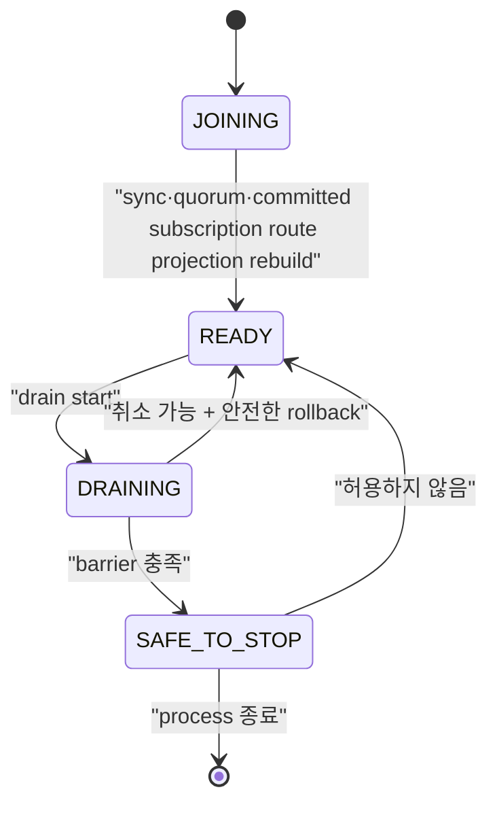

# Drain과 rolling update 스펙

이 문서는 node를 계획적으로 교체할 때 신규 연결을 차단하고 session을 인계한 뒤, 외부 controller가 Pod 삭제를 승인할 수 있는 조건을 정의한다. Kubernetes `preStop`은 최후 방어선이며 승인 gate가 아니다.

| 항목 | 값 |
| --- | --- |
| 상태 | Active (broker-side drain/`SAFE_TO_STOP` 범위만; external rollout과 전체 호환성 gate는 Draft) |
| 관련 요구사항 | DEP-01~DEP-24, CLIENT-01~CLIENT-09, CLU-11 |
| 근거 | [PRD 9.7절과 10장](../requirements/PRD.md), [Kubernetes Container Lifecycle Hooks](https://kubernetes.io/docs/concepts/containers/container-lifecycle-hooks/), [OASIS MQTT 5.0 Server redirection](https://docs.oasis-open.org/mqtt/mqtt/v5.0/mqtt-v5.0.html#_Toc3901255) |
| 관련 Architecture | [Cluster architecture](../architectures/cluster-architecture.md), [EKS on EC2 deployment](../architectures/eks-ec2-deployment.md) |
| 관련 결정 | [ADR-0004](../decisions/ADR-0004-session-ownership-and-fencing.md), [ADR-0006](../decisions/ADR-0006-external-rollout-controller.md), [ADR-0007](../decisions/ADR-0007-aws-production-deployment-platform.md), [ADR-0016](../decisions/ADR-0016-node-drain-and-safe-to-stop.md) (broker-side 범위만) |
| 관련 Contract | [Management API v1](../contracts/management-api-v1.md), [MQTT client compatibility v1](../contracts/mqtt-client-compatibility-v1.md), [Cluster release compatibility v1](../contracts/cluster-release-compatibility-v1.md) |
| 해설 | [안전한 노드 drain과 Will](../explainers/safe-node-drain-and-will.md), [EKS 고가용성과 장애 도메인](../explainers/eks-ha-failure-domains.md), [AWS NLB와 MQTT 연결 lifecycle](../explainers/aws-nlb-mqtt-connection-lifecycle.md) |

## 1. Node lifecycle



| State | 신규 MQTT 연결 | 기존 연결 | Readiness | 종료 허용 |
| --- | --- | --- | --- | --- |
| `JOINING` | 거절 | 없음 | 실패 | 아니오 |
| `READY` | 허용 | 처리 | 성공 | 아니오 |
| `DRAINING` | 거절 | rate 제한 아래 인계 | 실패 | 아니오 |
| `SAFE_TO_STOP` | 거절 | 0 | 실패 | 외부 gate가 승인할 수 있음 |

정의하지 않은 상태 전이는 `409 invalid_node_transition`으로 거절하고 현재 state를 반환해야 한다. 모든 전이는 Metric과 구조화 로그에 남겨야 한다.

`-cluster-config` runtime은 committed voter를 대상으로 drain operation을 복제하고, 신규 MQTT CONNECT를 차단하며, 설정된 LB 전파 대기 뒤 rate 제한 ownership 인계를 수행한다. 모든 barrier를 통과하면 `SAFE_TO_STOP`을 replicated state에 commit하고 readiness는 실패로 유지한다. 이 broker 동작은 standalone mode에 제공되지 않는다. QoS 1/2 progress는 protocol wire effect보다 먼저 개별 replicated transition으로 commit되며 별도 replace-all checkpoint는 없다. External rollout controller, Kubernetes/EKS `preStop`, BP-07, N-1↔N 및 Will reason 분류 metric은 별도 scope다.

Recovering 또는 joining node는 committed persistent subscription에서 node-local route projection을 rebuild하고 local sync·quorum 조건을 충족한 뒤에만 `READY`를 광고할 수 있다.

## 2. Drain operation resource

### 2.1 시작

`POST /api/v1/nodes/{nodeId}/drain`

```json
{
  "serverReference": "mqtt.example.internal:8883",
  "connectionRatePerSecond": 100,
  "loadBalancerPropagationDelayMs": 15000,
  "timeoutMs": 600000
}
```

`connectionRatePerSecond`, `loadBalancerPropagationDelayMs`, `timeoutMs`는 필수다. 허용 범위는 각각 `1..10000`, `0..3600000`, `1000..86400000`이며 timeout은 LB 전파 대기보다 커야 한다. `serverReference`는 선택이고 최대 256 UTF-8 bytes이며 제어 문자를 허용하지 않는다. 누락·범위 위반·잘못된 reference는 `400 invalid_request`다. 제품 기본값은 없다.

POST와 DELETE는 `Operator`, GET은 `ReadOnly` role을 요구하며 POST와 DELETE는 `Idempotency-Key`를 요구한다. 요청 대상은 cluster에 committed voter여야 한다. Active drain은 같은 node에서 새 operation을 만들지 않고 현재 committed operation을 반환한다. 최초 POST는 `202 Accepted`, 현재 operation replay는 `200 OK`다. 같은 key에 다른 parameter를 쓰면 `409 idempotency_conflict`; 다른 node drain이 이미 active이면 `409 node_drain_in_progress`다. 없는 node는 `404`, quorum을 확보할 수 없으면 `503`이다.

### 2.2 조회

`GET /api/v1/nodes/{nodeId}/drain`
요청은 fresh quorum read barrier를 통과한 committed 상태를 반환한다. Barrier를 확보하지 못하면 `503`이다.

```json
{
  "data": {
    "operationId": "550e8400-e29b-41d4-a716-446655440000",
    "nodeId": "3",
    "state": "DRAINING",
    "phase": "TRANSFERRING_SESSIONS",
    "startedAt": "2026-08-16T00:00:00Z",
    "deadlineAt": "2026-08-16T00:10:00Z",
    "connections": { "initial": 12000, "remaining": 420 },
    "sessions": { "stateReadyForTakeover": 11580, "takenOver": 11560, "failed": 0 },
    "replication": { "pendingWal": 0, "underReplicated": 0 },
    "safeToStop": false,
    "failure": null
  }
}
```

`phase`는 최소 `EXCLUDING_TRAFFIC`, `WAITING_FOR_LB`, `VERIFYING_SESSION_STATE`, `TRANSFERRING_SESSIONS`, `VERIFYING_BARRIER`, `COMPLETED`, `FAILED`, `CANCELLED`를 구분해야 한다. `failure`는 정상 진행 중 `null`이며 실패 시 `{ "code": string, "blockingReason": string | null }`이다. `safeToStop`은 `COMPLETED`에서만 true다.

### 2.3 취소

`DELETE /api/v1/nodes/{nodeId}/drain`은 `Operator`와 `Idempotency-Key`를 요구하며 operation을 안전하게 취소할 수 있을 때 `CANCELLED`로 commit해야 한다. 성공은 `200 OK`다. `SAFE_TO_STOP` 이후에는 `409 drain_not_cancellable`과 `details.state=SAFE_TO_STOP`을 반환해야 한다. 취소가 시작된 session takeover를 되돌리거나 epoch를 낮춰서는 안 된다. 새 readiness는 route와 replica 준비를 다시 확인한 뒤에만 성공해야 한다.

## 3. Drain 실행 순서

1. node state를 quorum에 `DRAINING`으로 commit한다.
2. 신규 connection admission을 닫고 readiness를 실패로 바꾼다.
3. configured load balancer propagation delay 동안 기존 connection은 유지한다.
4. connection rate limit 안에서 client reconnect와 session state takeover를 유도한다.
5. Successor의 더 큰 epoch `Acquire`가 commit되기 전에 committed persistent subscription과 QoS delivery state가 successor에서 복구 가능한지 확인한다. QoS state는 각 protocol transition에서 이미 commit됐으므로 별도의 최종 checkpoint mutation을 제안하지 않는다.
6. Successor의 더 큰 epoch session takeover commit을 확인한다.
7. safe-to-stop barrier를 평가한다.
8. barrier가 성공하면 `SAFE_TO_STOP`을 commit하고 external rollout gate에 노출한다.

Successor `Acquire` 뒤 그보다 늦게 committed ordering된 old owner의 route-affecting subscription 또는 inflight command는 exact owner/epoch check에서 거절되고 authoritative aggregate와 route projection을 바꾸지 않는다. Command 도착 시각이나 locally cached route는 이 결과를 우회할 수 없다.

Timeout은 operation을 `FAILED`로 만들 뿐 Pod 삭제를 승인하지 않는다. 실패한 node는 readiness가 내려간 DRAINING에 남아야 하며 operator가 원인을 해결하거나 명시적으로 취소해야 한다.

## 4. Client connection 인계

| Client | Server 동작 | Client 의무 | Will 기대 |
| --- | --- | --- | --- |
| MQTT 5, Server Reference 지원 | session state가 successor에서 복구 가능한 뒤 `DISCONNECT 0x9C`와 Server Reference 전송 | 같은 tenant·clientId로 임시 endpoint 또는 공통 LB에 재접속 | 충분한 Will Delay 안에 재접속하면 억제 |
| MQTT 5, Server Reference 미지원 | `0x9C`와 configured 공통 endpoint를 제공하거나 연결 종료 | 공통 LB 재접속, backoff+jitter | Will Delay 계약에 따름 |
| MQTT 3.1.1 | committed session state를 보존한 뒤 connection 종료 | 공통 LB에 같은 session key로 재접속 | Will이 설정돼 있으면 표준에 따라 발행될 수 있음 |
| 협력형 client | 서버 신호 뒤 client가 정상 DISCONNECT하도록 별도 application 협력 | 정상 DISCONNECT 후 재접속 | 정상 DISCONNECT면 억제 |

`0x9C`는 임시 이동이다. 영구 endpoint 변경을 뜻하는 `0x9D`로 바꿔 보내서는 안 된다. Server Reference 형식은 지원 SDK compatibility matrix에서 고정해야 한다.

공식 지원 client는 persistent session, 충분한 Session Expiry, exponential backoff+jitter와 동일 session key를 사용해야 한다. PUBACK/PUBCOMP 전 outbound publish는 local outbox에 보관하고 QoS 1 consumer는 중복을 견뎌야 한다.

## 5. Will 판정과 관측

계획 drain에서 Will은 다음 reason으로 분류해야 한다.

| reason | 의미 |
| --- | --- |
| `suppressed_normal_disconnect` | client가 정상 DISCONNECT를 보냄 |
| `suppressed_reconnected_within_delay` | MQTT 5 client가 Will Delay 안에 session 재개 |
| `expected_mqtt311_server_disconnect` | MQTT 3.1.1 server 주도 종료로 표준상 발행 가능 |
| `expected_zero_or_expired_will_delay` | Will Delay가 0이거나 재접속 전에 만료 |
| `unexpected_supported_client` | CLIENT-01~CLIENT-09 계약을 충족했지만 계획 drain 때문에 예상 밖 발행 |
| `unplanned_failure` | crash, network loss 등 계획되지 않은 종료 |

release gate에서 0을 요구하는 값은 `unexpected_supported_client`다. 예상 Will을 전체 성공률에 섞어 숨기거나 예상 Will을 제품 결함으로 오분류해서는 안 된다.
Broker ownership 인계 시 이전 연결은 takeover close로 종료되어 Will을 억제한다. Will reason별 분류와 DEP-12 metric은 이 broker drain scope에 포함되지 않으며 rollout acceptance에서 별도로 검증해야 한다.

## 6. Safe-to-stop barrier

다음 조건을 모두 충족해야 `SAFE_TO_STOP`이 된다.

- 신규 connection admission이 닫혀 있고 readiness가 실패한다.
- 활성 MQTT connection이 0이다.
- 이 node가 현재 epoch owner인 session이 0이다.
- Persistent subscription과 QoS delivery transition은 commit된 상태이며, successor takeover 뒤 old owner의 추가 mutation이 epoch fencing으로 거절된다.
- committed but unapplied WAL과 필수 replication backlog가 허용 기준 안이다.
- 필요한 replica 수와 cluster quorum이 node 종료 뒤에도 유지된다.
- 진행 중인 local mutation이 없고 새 owner takeover 확인이 끝났다.
- state와 barrier evidence가 node-local memory가 아니라 복구 가능한 위치에 기록됐다.

Barrier 항목 하나라도 `unknown`이면 실패로 판정해야 한다. `unknown`을 0이나 성공으로 취급해서는 안 된다.
구현은 barrier 조건을 다음 안정된 blocker code로 노출한다.

| 확인 조건 | 실패 blocker |
| --- | --- |
| 신규 admission이 닫히지 않음 | `admission_open` |
| readiness가 이미 실패 상태가 아님 | `readiness_up` |
| 활성 connection 수가 0이 아님 또는 알 수 없음 | `connections_remaining` |
| local ownership session 수가 0이 아님 | `sessions_owned` |
| local persistent subscription 수가 0이 아님 | `orphan_subscription` |
| committed index와 applied index 사이에 WAL이 남음 | `pending_wal` |
| voting replica 또는 connected successor 수가 quorum에 부족 | `insufficient_replicas` |
| local node가 Raft leader임 | `local_leader` |
| local proposal이 진행 중임 | `pending_local_commit` |
| pending Will timer가 남음 | `pending_will` |
| successor voter가 아직 없거나 route projection이 준비되지 않음 | `no_successor_voter`, `route_projection_not_ready` |
| read barrier 또는 quorum을 확보하지 못함 | `quorum_unavailable` |

다음 barrier 재평가 전까지 blocker가 남으면 operation은 계속 대기한다. Deadline에 도달하면 `FAILED`와 `drain_timeout`을 commit하고 마지막 blocker를 기록한다.

## 7. External rollout gate와 Kubernetes/EKS

Rollout controller는 Pod 삭제 전에 drain을 시작하고 `SAFE_TO_STOP`을 확인해야 한다. 실패·timeout이면 현재 Pod와 다음 Pod의 교체를 중단해야 한다. 기준 3-AZ profile에서는 계획 중단을 한 번에 한 node로 제한해야 한다.

`preStop` hook은 다음만 수행한다.

1. 같은 node의 drain을 idempotent하게 시작하거나 현재 상태를 조회한다.
2. 남은 grace period 안에서 가능한 범위까지 기다린다.
3. 결과와 failure reason을 기록한다.

Kubernetes의 termination grace period는 `preStop` 실행 전에 계산이 시작된다. hook 실패나 장기 실행이 Pod 삭제를 영구 차단한다고 가정해서는 안 된다. `terminationGracePeriodSeconds`는 LB 대기, drain 최악 시간, hook overhead와 SIGTERM 뒤 정상 종료 시간을 합친 값 이상이어야 하며, 검증되지 않은 짧은 값은 배포 admission에서 거절해야 한다.

배포 template은 PodDisruptionBudget, required anti-affinity, topology spread와 max unavailable 1을 제공해야 한다. 기준 3-AZ profile은 quorum node를 AZ마다 하나씩 배치해야 한다.

### 7.1 AWS deployment profile

초기 production 기준인 `EKS_EC2_HA`는 다음 조건을 충족해야 한다.

- 지원 EKS와 Kubernetes minor version을 release artifact에 고정한다.
- EC2 기반 node group의 서로 다른 세 가용 영역에 quorum Pod를 하나씩 배치한다.
- 각 quorum Pod는 다른 Pod와 공유하지 않는 Amazon EBS CSI persistent volume을 사용한다.
- EBS encryption, AZ binding, snapshot·restore와 disk pressure 실패 결과를 검증한다.
- Amazon NLB TCP/TLS target은 readiness 실패 뒤 신규 connection을 제외해야 한다.
- NLB deregistration delay, connection termination, TCP idle timeout, client IP preservation 또는 Proxy Protocol 정책을 명시한다.
- NLB 설정 전파 중 유입될 수 있는 신규 connection을 drain의 load balancer propagation 단계가 흡수해야 한다.

`EKS_FARGATE`, `ECS_EC2`, `COMPOSE_LOCAL`과 단일 host의 다중 container 결과는 `EKS_EC2_HA` 수용 시험을 대신해서는 안 된다.

배포 profile의 선택 근거는 [ADR-0007](../decisions/ADR-0007-aws-production-deployment-platform.md)을 따른다. Pod·EC2·가용 영역·EBS의 장애 범위는 [EKS 고가용성과 장애 도메인](../explainers/eks-ha-failure-domains.md), NLB target과 established connection의 서로 다른 lifecycle은 [AWS NLB와 MQTT 연결 lifecycle](../explainers/aws-nlb-mqtt-connection-lifecycle.md)을 참고한다.

Amazon ECS on EC2를 지원하려면 Kubernetes rollout controller와 별개인 lifecycle adapter가 필요하다. Adapter는 ECS Task Scale-in Protection을 설정한 상태에서 NLB target 제외와 NaruMQ drain을 시작하고, `SAFE_TO_STOP` 뒤에만 protection을 해제해야 한다. Task ARN, IP와 container name을 영구 `nodeId`로 사용해서는 안 된다. 이 흐름과 storage·discovery·강제 종료 시험을 모두 통과하기 전 ECS profile은 `Experimental`이어야 한다.

## 8. 비정상 종료

Process crash 또는 host loss에서는 planned drain과 barrier가 실행되지 않을 수 있다. 남은 node는 cluster spec에 따라 새 epoch를 획득하고 persistent session을 복구해야 한다. 이를 계획 drain 성공으로 기록해서는 안 되며 `unplanned_failure`로 관측해야 한다. `COMPLETED` record를 재생한 node는 admission을 닫은 채 유지하고 bounded readiness preflight를 통과한 뒤 replicated `CLEAR`를 commit해야 한다. Preflight 또는 commit에 실패하면 재시도하며, `CLEAR` apply 뒤에만 admission을 다시 연다.

## 9. 수용 시험

- 최대 예상 traffic에서 연속 100회 rolling update를 수행한다.
- MQTT 3.1.1/5.0, QoS 0/1/2, retained, Will과 persistent session을 섞어 시험한다.
- 매 payload의 단조 증가 ID로 gap, duplicate와 reorder를 분리 측정한다.
- drain timeout·failure 때 controller가 Pod 삭제와 다음 node 진행을 요청하지 않는지 검증한다.
- preStop 중복 호출, hook 실패와 grace period 부족을 시험한다.
- 새 owner takeover 뒤 이전 owner의 stale write가 거절되는지 확인한다.
- 지원 client의 `unexpected_supported_client` Will이 0인지 검증한다.
- N-1↔N upgrade와 rollback에서 같은 barrier를 통과하는지 확인한다.
- `EKS_EC2_HA`에서 Pod·EC2 node·단일 AZ failure, EBS detach·reattach와 NLB deregistration을 시험한다.
- 배포 artifact가 profile 상태를 표시하고 미지원 profile의 결과를 production 출시 근거에서 제외하는지 검증한다.
- ECS adapter가 도입되면 protected task 때문에 막힌 deployment, protection 만료, direct task stop과 host loss를 별도 실패로 시험한다.

## 10. Broker drain 수용 시험 매핑

아래 evidence는 dynamic cluster의 broker-side drain과 `SAFE_TO_STOP` scope를 검증한다. Release-wide rollout, SDK compatibility 또는 production storage 승인으로 확대 해석하지 않는다.

| Scenario | Acceptance test | 실행 증거 |
| --- | --- | --- |
| MQTT 5 persistent QoS 1과 MQTT 3.1.1 live/detached session이 있는 3-node drain | `TestDynamicClusterNodeDrainProcessAcceptance`: readiness·admission 차단, 기존 connection 유지, idempotent replay, `DISCONNECT 0x9C`/Server Reference, rate-limited transfer, `SAFE_TO_STOP`, session resume와 restart `CLEAR`를 확인한다. | `go test ./tests/integration -run '^TestDynamicClusterNodeDrain' -count=1 -v -timeout 20m` PASS; 이 case 9.75s. |
| Cancel, crash/restart, completed-record clear와 missing-replica timeout | `TestDynamicClusterNodeDrainCancelTimeoutAndResumeProcessAcceptance`: cancel 뒤 READY, 같은 operation 재개, missing successor에서 `drain_timeout/insufficient_replicas`, 취소 뒤 readiness를 확인한다. | 같은 process command PASS; 이 case 16.03s. Combined package 25.916s. |
| Domain·application·wire·HTTP·metrics와 OpenAPI contract | `internal/domain/nodedrain`, `internal/application/membership`, `internal/adapters/tcp`, `internal/adapters/http/management`, `internal/adapters/metrics`, `tests/contracts/management-api-v1` 등 focused unit/contract suite. | `go test ./internal/domain/nodedrain ./internal/domain/mqtt ./internal/application/membership ./internal/application/connect ./internal/adapters/raft/records ./internal/adapters/tcp ./internal/adapters/http/management ./internal/adapters/metrics ./tests/contracts/management-api-v1 ./cmd/narumq ./tools/verify -count=1` PASS. |
| Existing ownership, subscription replay와 removal regressions | `TestDynamicClusterMQTTConnectOwnershipTakeoverProcessAcceptance`, `TestDynamicClusterPersistentSubscriptionReplayProcessAcceptance`, `TestDynamicClusterMembershipRemovalHandoffWaitsForQuorum`. | Targeted integration command PASS; package 38.257s. |
| Full local verification | `GOMAXPROCS=4 go run ./tools/verify local` | PASS; 204.42s. Unit/integration, race, bounded fuzz, architecture, traceability and coverage gates passed. |
| NodeDrain core coverage ratchet | `go run ./tools/verify coverage --profile .artifacts/verification/coverage.out --policy tests/verification/coverage-policy.json --report .artifacts/verification/coverage-summary.json` | PASS; 100/102 executable lines (98.04%) and 13/13 functions (100%). |
| NodeDrain mutation gate | `go tool gremlins unleash --config=tests/verification/gremlins.yaml --output=.artifacts/verification/mutation-nodedrain.json internal/domain/nodedrain` | PASS; KILLED=64, LIVED=0, NOT_COVERED=0, efficacy=100%, mutant coverage=100%; 76s. |


Broker process test는 Server Reference packet을 확인하지만 지원 SDK 전체의 자동 redirect를 시험하지 않는다. MQTT 3.1.1/Will policy와 DEP-12 reason metric, external rollout deletion gate, Kubernetes `preStop`, `SPEC-TBD-04` product defaults, BP-07, N-1↔N, EKS/EBS power-loss·restore 및 MQTT 3.1.0 migration은 별도 release blocker다.
